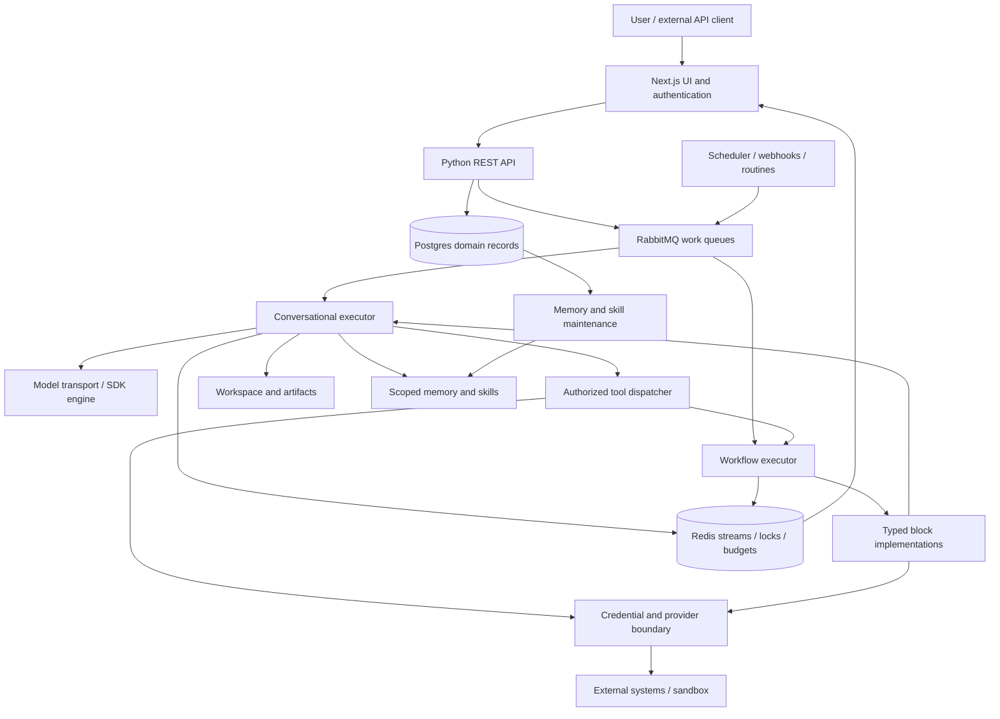
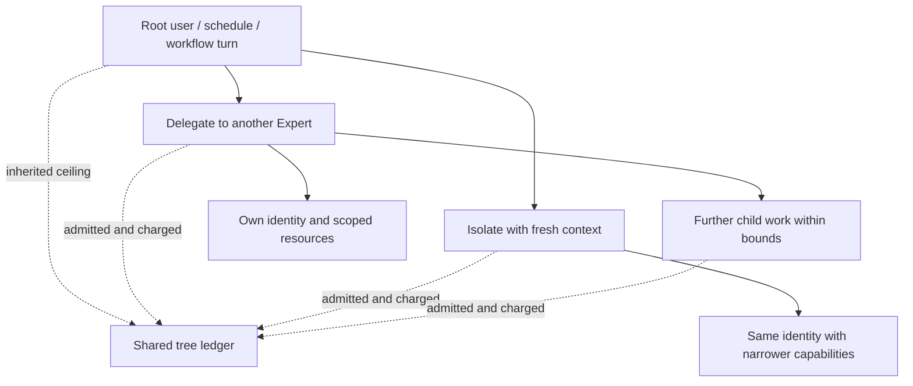
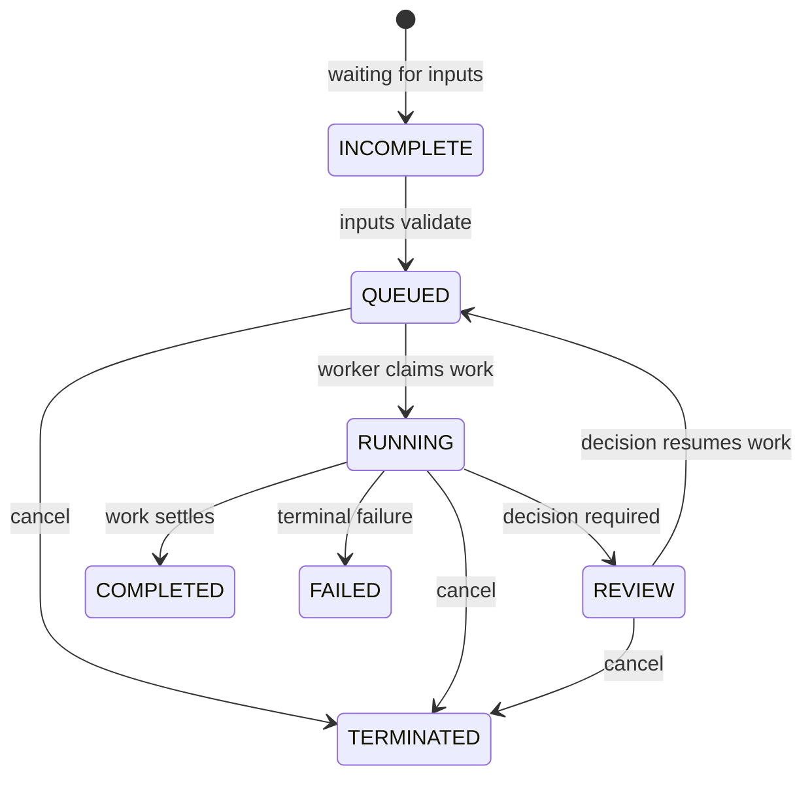

# PRD — AutoGPT: reverse-engineered product and execution architecture

**Research date:** 2026-11-04, America/Costa_Rica.  
**Status:** Finalized source reference and clone requirement baseline; application implementation and release qualification remain pending.  
**Repository snapshot:** [`Significant-Gravitas/AutoGPT`, commit `13ac38c5b6583bd01b0a6142b0060fc03e102b6e`](https://github.com/Significant-Gravitas/AutoGPT/tree/13ac38c5b6583bd01b0a6142b0060fc03e102b6e), committed 2026-11-04 04:30:08 UTC.  
**Companion designs:** [Vercel / Next.js implementation](PRD-NextJS.md), [LangChain / Deep Agents implementation](PRD-LangChain-Deep-Agents.md), [normative model-provider contract](PRD-Model-Providers.md), [local Mac deployment contract](PRD-Local-Mac-Deployment.md).

This is a senior product and engineering reconstruction from public primary documentation and a local inspection of the pinned source. It is not AutoGPT's internal PRD, a performance benchmark, or evidence that every feature flag is enabled on its hosted service. “Observed” means present in inspected code; “documented” means described by the project; “proposed” means a requirement for our clone. No AutoGPT deployment was started, no paid services were invoked, and no model quality claims were experimentally verified in this document.

“Finalized” closes the research and product requirements for this revision; it does not certify a built application or passing release gates. The clone runs its application/services/data locally on this Mac, with local Supabase Docker and OpenRouter-only inference. These user-selected deployment/provider requirements do not change the historical AutoGPT findings or establish that AutoGPT implements our setup flow.

## 1. Executive finding: what AutoGPT actually is

AutoGPT currently combines **a conversational team of AI experts, a reusable workflow platform, and a separate Classic agent implementation**. The repository's current entry point presents Otto coordinating specialists; the visual workflow builder provides repeatable, inspectable automation beneath that experience. It is inaccurate to describe today's entire product as the original “give GPT a goal and let it loop” demo. [Current repository overview](https://github.com/Significant-Gravitas/AutoGPT/blob/13ac38c5b6583bd01b0a6142b0060fc03e102b6e/README.md)

The useful unit of analysis is not “one agent.” There are several nested control systems:

| Layer | What it decides | What actually executes | Principal stop condition |
|---|---|---|---|
| User / operator | Desired outcome, access, approved effects, schedules | Product controls and permissions | Cancel, deny, deactivate, budget |
| Otto / Expert conversational turn | Next useful tool, clarification, delegation, response | Model plus tool dispatcher | Final response, pause, failure, bounds |
| Delegation tree | Which descendant work may start | Turn dispatcher and permission envelopes | Depth, count, spend, permission refusal |
| Workflow graph | Which nodes have usable inputs | Graph executor and blocks | No runnable work, review, failure, cancel |
| Agentic block | Which tools to call inside one node | Orchestrator or AutoPilot block | Local loop policy and inherited limits |
| Scheduler / routine | When work starts again | Persistent jobs, triggers, dispatch | Disabled schedule, expired one-off, policy |
| Memory / learning maintenance | Which evidence becomes retrievable knowledge or a skill | Separate bounded jobs and versioned storage | No eligible evidence, bounds, review result |

A model supplies candidate actions and text. The application supplies tools, credentials, queues, storage, permissions, boundaries, state transitions, streaming, and recovery. A persuasive answer is not proof of a completed external action. A completed execution is not proof that the user's business objective was achieved.

### 1.1 Questions the investigation set out to answer

| Investigative question | Answer supported by the inspected implementation | Detail |
|---|---|---|
| Does “agent” mean a graph or an autonomous model? | Both meanings exist, plus persistent Experts; their state and control loops differ | Sections 3, 5, 6 |
| Is every workflow step chosen by an LLM? | No. Input readiness and graph links control ordinary execution; selected blocks contain model calls or agentic loops | Sections 6.3–6.4 |
| Does every chat generate a formal plan before acting? | The generic loop does not require a separately validated plan; planning tools and prompts supply optional structure | Sections 6.1, 7 |
| What makes it continue working? | A response containing tool calls feeds another model round; data emissions can activate more graph nodes; schedules start future runs | Section 6 |
| What makes it stop? | Different layers have different terminal signals, including final text, no runnable graph work, review, errors, cancellation and budgets | Sections 6, 11 |
| Does “thinking” prove it understood the task? | No. Visible reasoning or self-criticism is generated content, while actual effects and acceptance checks provide evidence | Section 7 |
| Are Experts separate trained models? | Expert records configure identity, resources and behavior; their existence does not imply separately trained weights | Sections 5.3, 9 |
| Can a child grant itself more tools? | The shared envelope derivation narrows the parent's authority and the execution seam rejects forbidden tools | Section 6.5 |
| Can a run say completed while missing useful output? | Runtime settlement is different from semantic success; conditional/incomplete branches and handled errors require interpretation | Sections 6.3, 11.1 |
| Does learning retrain the LLM? | Inspected learning writes evidence-backed memory/skill artifacts through maintenance pipelines; it is not weight training | Section 9 |
| Does self-hosting make all inference local automatically? | No. Chat transport, graph blocks and auxiliary capabilities must be configured and checked independently | Section 14 |
| Does a “durable” queue make every tool exactly once? | No. API idempotency, stream replay, job redelivery and external-effect reconciliation are separate guarantees | Section 11 |

These answers drove the source inspection rather than accepting product terminology at face value. Sections below link each answer to the specific implementation and distinguish stricter requirements proposed for our clone.

## 2. Evidence and freshness

### 2.1 Source priority

1. Pinned executable code and schema establish the implementation present in this snapshot.
2. Tests establish intended behavior and regression coverage, not a passing result in this research session.
3. Official documentation establishes supported product contracts and user guidance.
4. Changelogs establish reported product evolution; they do not prove all deployment flags.
5. Our architecture conclusions and clone requirements are explicitly labeled as synthesis or proposals.

The live collaboration documentation is already behind parts of `tree.py`: it says root turns never touch the tree ledger, while the inspected code meters roots when Auto mode is enabled. The code also carries fields that are not fully driven by current callers. Therefore the clone must not copy documentation prose as an executable specification. [Collaboration documentation](https://agpt.co/docs/platform/contributing/agent-collaboration-architecture), [current tree implementation](https://github.com/Significant-Gravitas/AutoGPT/blob/13ac38c5b6583bd01b0a6142b0060fc03e102b6e/autogpt_platform/backend/backend/copilot/tree.py)

### 2.2 Inspected implementation map

All source links below are pinned to the same commit, so future changes to `master` do not silently change the evidence.

| Concern | Primary source | What to inspect |
|---|---|---|
| Services and storage | [Compose topology](https://github.com/Significant-Gravitas/AutoGPT/blob/13ac38c5b6583bd01b0a6142b0060fc03e102b6e/autogpt_platform/docker-compose.platform.yml) | Separate REST, workflow executor, chat executor, scheduler, database manager, WebSocket, notifications |
| Domain persistence | [Prisma schema](https://github.com/Significant-Gravitas/AutoGPT/blob/13ac38c5b6583bd01b0a6142b0060fc03e102b6e/autogpt_platform/backend/schema.prisma) | Experts, graphs, executions, chats, reviews, files, skills, organizations, credentials, billing |
| Workflow definition | [Graph model](https://github.com/Significant-Gravitas/AutoGPT/blob/13ac38c5b6583bd01b0a6142b0060fc03e102b6e/autogpt_platform/backend/backend/data/graph.py) | Versioned graph, typed input/output schema, starting nodes, validation, exports |
| Workflow execution | [Execution manager](https://github.com/Significant-Gravitas/AutoGPT/blob/13ac38c5b6583bd01b0a6142b0060fc03e102b6e/autogpt_platform/backend/backend/executor/manager.py) | Input readiness, output propagation, locks, concurrent work, cancellation, terminal status |
| Block contract | [Block base classes](https://github.com/Significant-Gravitas/AutoGPT/blob/13ac38c5b6583bd01b0a6142b0060fc03e102b6e/autogpt_platform/backend/backend/blocks/_base.py) | Schemas, categories, outputs, execution metadata |
| Conversational loop | [Baseline engine](https://github.com/Significant-Gravitas/AutoGPT/blob/13ac38c5b6583bd01b0a6142b0060fc03e102b6e/autogpt_platform/backend/backend/copilot/baseline/service.py) | Context assembly, local model transport, streaming, tool rounds, persistence |
| Generic loop | [Tool-call loop](https://github.com/Significant-Gravitas/AutoGPT/blob/13ac38c5b6583bd01b0a6142b0060fc03e102b6e/autogpt_platform/backend/backend/util/tool_call_loop.py) | Model → tools → observations → model |
| SDK engine | [SDK service](https://github.com/Significant-Gravitas/AutoGPT/blob/13ac38c5b6583bd01b0a6142b0060fc03e102b6e/autogpt_platform/backend/backend/copilot/sdk/service.py) | Vendor SDK runtime, resumption, security hooks, adapters |
| Child-agent limits | [Tree envelope / ledger](https://github.com/Significant-Gravitas/AutoGPT/blob/13ac38c5b6583bd01b0a6142b0060fc03e102b6e/autogpt_platform/backend/backend/copilot/tree.py) | Permission narrowing, tree admission, metered spend |
| Turn dispatch | [Executor utilities](https://github.com/Significant-Gravitas/AutoGPT/blob/13ac38c5b6583bd01b0a6142b0060fc03e102b6e/autogpt_platform/backend/backend/copilot/executor/utils.py) | Queue entry, admission, streaming registration, publish cleanup |
| Tool enforcement | [Tool base class](https://github.com/Significant-Gravitas/AutoGPT/blob/13ac38c5b6583bd01b0a6142b0060fc03e102b6e/autogpt_platform/backend/backend/copilot/tools/base.py) | Auth, envelope checks, gates, tracing, large-output offload |
| Approvals | [Approval gate](https://github.com/Significant-Gravitas/AutoGPT/blob/13ac38c5b6583bd01b0a6142b0060fc03e102b6e/autogpt_platform/backend/backend/copilot/gate/__init__.py) | Exact arguments, held calls, modes, feature activation |
| Streaming recovery | [Stream registry](https://github.com/Significant-Gravitas/AutoGPT/blob/13ac38c5b6583bd01b0a6142b0060fc03e102b6e/autogpt_platform/backend/backend/copilot/stream_registry.py) | Redis streams, replay, metadata, event identity |
| Local models | [Chat configuration](https://github.com/Significant-Gravitas/AutoGPT/blob/13ac38c5b6583bd01b0a6142b0060fc03e102b6e/autogpt_platform/backend/backend/copilot/config.py) | Transport behavior, model roles, bounds, local overrides |
| Learning | [Nightly skill pass](https://github.com/Significant-Gravitas/AutoGPT/blob/13ac38c5b6583bd01b0a6142b0060fc03e102b6e/autogpt_platform/backend/backend/copilot/learning/nightly.py) | Evidence selection, review, validation, publication, durable disposition |
| Classic | [Classic interaction loop](https://github.com/Significant-Gravitas/AutoGPT/blob/13ac38c5b6583bd01b0a6142b0060fc03e102b6e/classic/original_autogpt/autogpt/app/main.py) | Action proposal, permission-mediated execution, feedback, finish |

### 2.3 Version snapshot, not a recommendation to reuse these versions

The inspected frontend declares Next.js `15.5.28`, React `19.3.1`, AI SDK `ai@7.0.143`, `@ai-sdk/react@4.0.147`, React Flow `@xyflow/react@12.12.0`, TanStack Query, Zustand, Better Auth, Zod and a Node `24.x` engine. The backend package is `0.6.22`, permits Python `>=3.11,<3.14`, and declares FastAPI, Pydantic, Prisma, RabbitMQ clients, Redis, APScheduler, Graphiti, FalkorDB, OpenAI/Anthropic clients, Claude Agent SDK and observability packages. These are **manifest observations**; dependency ranges are not exact installed resolutions. [Frontend manifest](https://github.com/Significant-Gravitas/AutoGPT/blob/13ac38c5b6583bd01b0a6142b0060fc03e102b6e/autogpt_platform/frontend/package.json), [backend manifest](https://github.com/Significant-Gravitas/AutoGPT/blob/13ac38c5b6583bd01b0a6142b0060fc03e102b6e/autogpt_platform/backend/pyproject.toml)

## 3. Product definition and intended jobs

### 3.1 Product thesis

The product turns a user's brief into work that can be inspected, corrected, reused and scheduled. The current specialist metaphor makes role, context and permissions persistent instead of forcing the user to restate them in each chat. Workflows turn useful sequences into reusable procedures; routines initiate those procedures over time.

The September 2026 official release describes hiring or creating experts, role/identity configuration, bundled skills and workflows, disabled-by-default routines, home briefings and persistent expert computers. This is useful historical evidence of the move toward a team-centered interface, without asserting that all those features first originated in that release. [Experts release](https://agpt.co/docs/platform/changelog/changelog/september-19-2026)

### 3.2 Personas and jobs to be done

| Persona | Job | Product evidence | Failure that matters |
|---|---|---|---|
| Individual knowledge worker | Ask for research, drafts, analysis, files | Conversational tools, workspace, experts | Confident answer without evidence or usable artifact |
| Operational owner | Run repeatable work on a cadence | Graphs, presets, routines, schedules | Duplicate action, missed run, noisy empty result |
| Technical builder | Compose and debug reliable automations | Typed blocks, visual graph, run history | Invalid graph accepted; opaque readiness failure |
| Team administrator | Bound access and spending | Organization/team models, credential grants, budgets | One agent crossing another team's resource boundary |
| Integration developer | Run/build agents through an API or MCP | API v2 and MCP surface | Retry creates multiple runs or permissions differ from UI |
| Self-hosting operator | Control model/data/runtime infrastructure | Compose and single-container deployment | “Local” chat still silently depends on a cloud auxiliary model |

These are synthesized personas, not a claim about AutoGPT's internal market segmentation.

### 3.3 Objects that must not be conflated

- **Goal / brief:** requested outcome, scope and constraints. Natural-language intent is not inherently executable or testable.
- **Plan:** proposed work sequence. It may be model-authored text, TODO state, decomposition or a concrete workflow graph.
- **Expert:** persistent identity, role, boundaries, installed resources and granted credentials.
- **Session:** a thread of conversation; it can contain many turns.
- **Turn:** one admitted execution responding to an input; it can contain many model calls and tool calls.
- **Tree:** a root turn and all turns spawned beneath it.
- **Workflow / graph:** a versioned definition of nodes, links, input defaults and settings.
- **Run:** an execution of a graph version with particular inputs and provenance.
- **Node execution:** one execution instance of a node; a single graph node may execute repeatedly.
- **Block:** a typed executable capability used by a graph.
- **Tool:** a model-callable interface; it may execute a block, run a workflow, inspect state, or delegate.
- **Skill:** stored instructions/resources describing how to perform a class of work; it is not automatically a permission grant.
- **Routine:** standing work whose activation materializes scheduling behavior.
- **Artifact:** concrete output such as a file, result record, graph, draft or generated report.

The schema separates these lifecycles rather than representing them as one message list. [Domain schema](https://github.com/Significant-Gravitas/AutoGPT/blob/13ac38c5b6583bd01b0a6142b0060fc03e102b6e/autogpt_platform/backend/schema.prisma)

## 4. System architecture: how the app is assembled



This is a conceptual synthesis; the actual services communicate through more than one transport. Compose declares independent executors and supporting services, not a single Next.js request handler that performs all work. Redis supports ephemeral coordination and replay; Postgres stores domain state; RabbitMQ delivers work; FalkorDB supports the graph-memory subsystem. Files and provider credentials have separate ownership and storage concerns. [Deployment topology](https://github.com/Significant-Gravitas/AutoGPT/blob/13ac38c5b6583bd01b0a6142b0060fc03e102b6e/autogpt_platform/docker-compose.platform.yml), [top-level Compose](https://github.com/Significant-Gravitas/AutoGPT/blob/13ac38c5b6583bd01b0a6142b0060fc03e102b6e/autogpt_platform/docker-compose.yml)

### 4.1 Product surface versus runtime

The frontend handles the interaction contract: chats, tool cards, approval cards, builder canvas, forms, files, library, team and activity. It does not become the authority merely because it renders a disabled button. Backend policy must enforce the same restrictions for UI requests, API calls, scheduled execution, tools and child turns.

The presence of AI SDK in the frontend does not mean AutoGPT's agent reasoning runs in a Vercel agent loop. The observed baseline and SDK engines are Python backend code. This distinction matters when comparing our Next.js and Deep Agents designs: a Next.js UI is compatible with either runtime.

### 4.2 How source structure reveals the development method

Observed patterns suggest incremental construction around reusable contracts:

1. Typed block inputs/outputs enable runtime validation and generated UI forms.
2. Graph definitions and execution records are separate, enabling immutable version references and historical inspection.
3. Conversational tools wrap existing product actions rather than duplicating all integrations.
4. Shared tool execution and response models normalize different model engines.
5. Queue workers separate long work from HTTP connections.
6. Tests concentrate on operational races, permissions, billing, cancellation, credentials and stream consistency, showing these are first-class engineering concerns.
7. Flags allow new behavior such as approval modes or learning to land before universal activation.

This is an architectural inference from repository structure, not a reconstructed chronology of private design decisions.

## 5. End-to-end user flows

### 5.1 Brief → researched artifact → review

1. The user supplies a brief, relevant files and constraints in Otto or an Expert thread.
2. The server resolves identity, tenant, session, selected expert, model connection, permissions and run context.
3. The turn dispatcher performs admission, registers stream state and publishes queued work.
4. The worker assembles system instructions, expert identity, relevant memory, skills, conversation and new input.
5. The model selects a tool or produces a response; each proposed tool passes server enforcement.
6. Tools may retrieve evidence, create artifacts, execute blocks, run workflows, or delegate parts of the task.
7. Tool results become observations for subsequent model calls; progress events reach the interface during execution.
8. If a required action needs approval or input, the product records the pending decision and exposes a concrete card.
9. The turn returns an answer with artifacts and unresolved work; stored history and activity preserve what happened.

The application can support this flow, but the correctness of a research answer depends on the chosen model, tools, source quality and evaluation. [Baseline engine](https://github.com/Significant-Gravitas/AutoGPT/blob/13ac38c5b6583bd01b0a6142b0060fc03e102b6e/autogpt_platform/backend/backend/copilot/baseline/service.py), [turn dispatcher](https://github.com/Significant-Gravitas/AutoGPT/blob/13ac38c5b6583bd01b0a6142b0060fc03e102b6e/autogpt_platform/backend/backend/copilot/executor/utils.py)

### 5.2 Build → validate → run → improve workflow

1. A user creates a graph visually or asks AutoPilot to create/edit one.
2. Nodes select blocks with input/output schemas; links bind source pins to sink pins.
3. Defaults, input overrides, credentials, review requirements and external triggers are configured.
4. Validation checks graph structure, block references, links, required fields and credential compatibility.
5. Saving creates or updates the appropriate versioned definition; execution binds to a specific graph version.
6. A run accepts inputs and records trigger provenance; the graph executor admits starting nodes.
7. Per-node data and status reveal what ran, what waited, what failed and what reached outputs.
8. The user corrects the graph and runs a new version rather than rewriting old run history.

AutoPilot and the builder are complementary entry points to these reusable workflows. [AutoPilot documentation](https://agpt.co/docs/platform/using-the-platform/autopilot), [graph validation and versioning](https://github.com/Significant-Gravitas/AutoGPT/blob/13ac38c5b6583bd01b0a6142b0060fc03e102b6e/autogpt_platform/backend/backend/data/graph.py)

### 5.3 Hire Expert → configure → activate routine

1. The user chooses a template or creates an expert identity and role.
2. A hired copy belongs to its owner and retains its source-template relation; duplicate hiring is constrained in the schema.
3. Setup installs skills/workflows and tracks asynchronous setup status and failures.
4. The user grants concrete credentials; an intentionally empty credential grant must not be mistaken for an uninitialized expert.
5. Direct chats use the expert's identity, context and resource boundaries.
6. A routine remains inactive until configured and activated; activation creates scheduling behavior.
7. Work is attributed to the expert, including execution, usage and artifacts; a budget breach can pause schedules while chat remains available.

Relevant schema fields include `identity`, `boundaries`, `toolProfile`, `weeklyBudget`, `schedulesPausedAt`, `learningPausedAt`, `autopilotMode`, `credentialsSeededAt`, `setupStatus`, and relations to skills, workflows, routines and credentials. [Expert persistence contract](https://github.com/Significant-Gravitas/AutoGPT/blob/13ac38c5b6583bd01b0a6142b0060fc03e102b6e/autogpt_platform/backend/schema.prisma#L1437)

### 5.4 Schedule / webhook → background work

A scheduled run is a new trigger, not an LLM sitting in a loop waiting for the clock. The scheduler determines due work and dispatches it; credentials, permissions, ownership, availability and run limits still matter at execution time. Workflow runs store trigger source and references, including schedule/webhook/chat/API origins. Expert routines can select different session strategies, so each firing need not have identical conversation continuity. [Scheduler](https://github.com/Significant-Gravitas/AutoGPT/blob/13ac38c5b6583bd01b0a6142b0060fc03e102b6e/autogpt_platform/backend/backend/executor/scheduler.py), [routine and run schema](https://github.com/Significant-Gravitas/AutoGPT/blob/13ac38c5b6583bd01b0a6142b0060fc03e102b6e/autogpt_platform/backend/schema.prisma)

Our clone should expose timezone, next run, previous outcome, overlap policy and missed-run policy explicitly. Those are proposed product requirements; the existence of a scheduler alone does not establish those UX guarantees.

## 6. The actual loops

### 6.1 Conversational tool loop

The generic loop is ordinary application control flow around model calls:

```text
assemble authorized context and tool schemas
repeat within the turn's bounds:
    response = call_model(messages, allowed_tools)
    stream visible response parts and collect complete tool calls
    if no tool calls:
        persist response; finish this turn
    validate and dispatch proposed calls through tool enforcement
    append tool results to conversation
    compact / checkpoint / incorporate queued user input as supported
on last allowed round:
    remove tools and request a bounded final response
```

The inspected baseline uses `agent_max_turns`, default `100`, as its model/tool-round cap. The generic helper defaults to an unbounded value when used without an override; safe behavior therefore depends on the caller supplying bounds. Multiple tool calls may run concurrently, with a `runs_alone` callback used by the baseline to serialize file-mutating calls relative to surrounding batches. This is not a guarantee that every possible external side effect is globally serialized. [Generic loop](https://github.com/Significant-Gravitas/AutoGPT/blob/13ac38c5b6583bd01b0a6142b0060fc03e102b6e/autogpt_platform/backend/backend/util/tool_call_loop.py), [baseline call site](https://github.com/Significant-Gravitas/AutoGPT/blob/13ac38c5b6583bd01b0a6142b0060fc03e102b6e/autogpt_platform/backend/backend/copilot/baseline/service.py#L2652), [configuration](https://github.com/Significant-Gravitas/AutoGPT/blob/13ac38c5b6583bd01b0a6142b0060fc03e102b6e/autogpt_platform/backend/backend/copilot/config.py#L495)

### 6.2 SDK engine loop

The SDK path delegates portions of the conversational runtime to the vendor agent SDK and adapts its messages, tool calls, security hooks, files, costs and transcript into the product. Current configuration uses an SDK step check-in default of `450`; the code comments explicitly distinguish this from the baseline's fixed round cap. SDK spend governance, resumption and model availability are separate mechanisms. Do not assume SDK context or resume state can be transferred unchanged to another provider. [SDK service](https://github.com/Significant-Gravitas/AutoGPT/blob/13ac38c5b6583bd01b0a6142b0060fc03e102b6e/autogpt_platform/backend/backend/copilot/sdk/service.py), [SDK governor](https://github.com/Significant-Gravitas/AutoGPT/blob/13ac38c5b6583bd01b0a6142b0060fc03e102b6e/autogpt_platform/backend/backend/copilot/sdk/governor.py), [configuration](https://github.com/Significant-Gravitas/AutoGPT/blob/13ac38c5b6583bd01b0a6142b0060fc03e102b6e/autogpt_platform/backend/backend/copilot/config.py)

### 6.3 Workflow dataflow loop

A graph is not necessarily a simple one-pass DAG. Execution depends on arriving values and repeated emissions:

1. Start from Agent Input nodes and eligible nodes without inbound links.
2. Apply defaults, run inputs and masks; validate what the node needs.
3. Execute a ready block. A block yields named output values, potentially repeatedly.
4. Persist each output and map it through outgoing links.
5. Under a lock scoped to downstream node and run, append the value to the earliest incomplete execution instance or create one.
6. Reuse configured static-link values where applicable; apply overrides and validate the assembled input.
7. Queue each newly ready execution. Different downstream sinks can be registered concurrently while each sink keeps ordering.
8. Continue while queued/running/evaluating work remains; settle the run according to cancellation, trusted failures and pending reviews.

This explains why a single node can execute many times, why static and dynamic links differ, and why a node may remain incomplete even when some upstream work has finished. [Output propagation implementation](https://github.com/Significant-Gravitas/AutoGPT/blob/13ac38c5b6583bd01b0a6142b0060fc03e102b6e/autogpt_platform/backend/backend/executor/manager.py#L737)

The official guide states that connected inputs must arrive and required inputs must be satisfied; unhandled error outputs do not necessarily stop the graph. The implementation additionally promotes classified run-breaking failures to `FAILED`, while ordinary node errors can be handled through graph wiring. Thus “one node failed” and “the run failed” are distinct events. [Dataflow guide](https://agpt.co/docs/platform/using-the-platform/data-flow-and-execution), [run settlement](https://github.com/Significant-Gravitas/AutoGPT/blob/13ac38c5b6583bd01b0a6142b0060fc03e102b6e/autogpt_platform/backend/backend/executor/manager.py#L1663)

### 6.4 Nested loops inside graphs

- `AgentExecutorBlock` invokes another graph, with parent/child execution attribution.
- `OrchestratorBlock` can expose available operations to a model and run the generic tool loop; its execution mode and iteration configuration are explicit inputs.
- `AutoPilotBlock` enters the conversational execution system with its configured permissions.

This creates a real risk of multiplying budgets: graph fan-out × agentic-block iterations × child turns × retries. A smart clone must budget the entire root job, not only each individual model request. [Nested agent block](https://github.com/Significant-Gravitas/AutoGPT/blob/13ac38c5b6583bd01b0a6142b0060fc03e102b6e/autogpt_platform/backend/backend/blocks/agent.py), [Orchestrator block](https://github.com/Significant-Gravitas/AutoGPT/blob/13ac38c5b6583bd01b0a6142b0060fc03e102b6e/autogpt_platform/backend/backend/blocks/orchestrator.py), [AutoPilot block](https://github.com/Significant-Gravitas/AutoGPT/blob/13ac38c5b6583bd01b0a6142b0060fc03e102b6e/autogpt_platform/backend/backend/blocks/autopilot.py)

### 6.5 Delegation tree



The envelope narrows authority using the intersection of parent permissions and requested tools, then removes denied tools. All descendants lose certain account-binding, staffing and destructive operations; isolates also lose specified outward posting and memory-writing capabilities because they act under the parent's identity. `BaseTool.execute` checks authority at execution time, so hiding a tool schema is not the sole defense. Default depth is three hops and the tree head-count is eight turns including the root. These values are upstream configuration observations, not the clone's selected defaults. [Tree enforcement](https://github.com/Significant-Gravitas/AutoGPT/blob/13ac38c5b6583bd01b0a6142b0060fc03e102b6e/autogpt_platform/backend/backend/copilot/tree.py), [tool enforcement](https://github.com/Significant-Gravitas/AutoGPT/blob/13ac38c5b6583bd01b0a6142b0060fc03e102b6e/autogpt_platform/backend/backend/copilot/tools/base.py#L580)

The ledger **meters settled spend; it does not reserve all future spend**. Concurrent children can be admitted before any reports its cost and can overshoot the nominal ceiling. The code says this explicitly. It also carries taint/deadline/restriction fields whose availability does not prove all production callers drive them. Our clone must reserve root token/time/spend budgets before concurrent OpenRouter calls and define reservation release/reconciliation explicitly.

## 7. “Thinking,” planning, goals and evaluation

### 7.1 What thinking means in this product

“Thinking” can refer to three different observable things:

- A UI state while the model or tools are running.
- Model-generated explanation, plan, self-criticism or reasoning output exposed by a chosen provider.
- Application decisions such as permission checks, node readiness, retry policy and budget admission.

Only the third category is deterministic application control. Generated explanations are not a privileged audit of the model's internal cognition, and they are not proof that an action was safe or a conclusion correct. Logs for our clone should prioritize concise decision summaries, evidence, tool calls and results; private hidden reasoning is not a product dependency.

### 7.2 Planning is plural

| Planning form | Evidence in AutoGPT | Practical meaning |
|---|---|---|
| Conversational next action | Tool-call loop | Select the next tool from current context |
| Explicit decomposition | Tools such as `decompose_goal`, TODO-related capabilities | Externalize a tentative work breakdown |
| Expert coordination | Delegation / handoff / consultation tools | Assign subwork with identities and scopes |
| Visual workflow | Graph nodes and links | User-editable executable structure |
| Reusable procedure | Skills and learned skill versions | Instructions/resources recalled for later work |
| Classic strategies | `one_shot`, `plan_execute`, `rewoo`, `reflexion`, tree/search/debate strategies | Alternative approaches in the separate Classic runtime |

The existence of several strategies does not mean all run for every task. Our clone should begin with one explicit planner/executor/reviewer control policy and evaluate whether additional reflection or delegation improves task outcomes enough to justify its cost. [Tool policy catalog](https://github.com/Significant-Gravitas/AutoGPT/blob/13ac38c5b6583bd01b0a6142b0060fc03e102b6e/autogpt_platform/backend/backend/copilot/gate/policy.py), [Classic strategy configuration](https://github.com/Significant-Gravitas/AutoGPT/blob/13ac38c5b6583bd01b0a6142b0060fc03e102b6e/classic/original_autogpt/autogpt/app/config.py)

### 7.3 What a goal does and does not do

In Classic, a task and directives are part of the prompt/state used to propose actions. In Platform, a brief can become chat work, expert delegation, a workflow, or a recurring routine. A graph's input/output schema is an executable contract, but it does not automatically encode semantic success. For example, producing a string named `report` does not establish that it contains current sources or answers the question.

**Proposed clone requirement:** represent success criteria independently from conversation text. A goal should have an outcome statement, acceptance checklist, resource bounds, allowed tools, artifacts expected, deadline if relevant, and explicit terminal reasons: verified success, partial outcome, blocked, canceled, failed or budget exhausted. The verifier should check artifact properties and evidence, not merely accept the executor's declaration.

### 7.4 Reflection is useful only when grounded

A reviewer role can check schemas, missing citations, contradictory evidence and artifact tests. Running the same model under a reviewer prompt does not create an independent source of truth. Our clone initially assigns every role to the approved OpenRouter DeepSeek profile and must combine model review with deterministic checks and reference tasks. Explicit Astra selection is available under the provider contract; role separation itself is not evidence of independent verification.

## 8. Tools, integrations, blocks and capability discovery

### 8.1 Block contract

A block has a stable identity, descriptive metadata, input schema, output schema, category/type and executable implementation. Input schemas describe data and credential requirements; named outputs let the graph route normal results and errors. Validation happens both at graph construction and before execution. The execution context carries user, graph/run/node identifiers, dry-run information and attribution. [Block base](https://github.com/Significant-Gravitas/AutoGPT/blob/13ac38c5b6583bd01b0a6142b0060fc03e102b6e/autogpt_platform/backend/backend/blocks/_base.py), [node execution](https://github.com/Significant-Gravitas/AutoGPT/blob/13ac38c5b6583bd01b0a6142b0060fc03e102b6e/autogpt_platform/backend/backend/executor/manager.py#L347)

### 8.2 Conversational tool contract

Tools expose descriptions and parameter schemas to a model and return structured product responses. The shared execution seam checks authentication, inherited envelope permissions, deferred capability restrictions and approval decisions before invoking the implementation. Large outputs can be saved into workspace files with a bounded preview and retrieval information, reducing repeated context cost. Tool traces, activity and user-facing cards are separate outputs of the same operation. [Tool base](https://github.com/Significant-Gravitas/AutoGPT/blob/13ac38c5b6583bd01b0a6142b0060fc03e102b6e/autogpt_platform/backend/backend/copilot/tools/base.py)

### 8.3 Capability discovery avoids an unlimited prompt catalog

The implementation can defer capabilities and resolve a `run_capability` identifier into a concrete tool, skill or expert operation. Resolution restores the actual tool identity for permission checks, history, circuit breaking and UI events. This is important: a generic dispatcher must not become a way to bypass restrictions on the operation it wraps. [Capability dispatch](https://github.com/Significant-Gravitas/AutoGPT/blob/13ac38c5b6583bd01b0a6142b0060fc03e102b6e/autogpt_platform/backend/backend/copilot/capabilities/dispatch.py)

**Clone design:** expose a small initial tool set, retrieve relevant tool definitions on demand, validate schemas before use, and preserve explicit operation names in logs. The configured OpenRouter model should not receive hundreds of unrelated tools simply because the catalog contains them.

### 8.4 Credentials are application resources

Credentials must be resolved for the authenticated owner and allowed expert at execution time. The graph executor checks expert credential grants and acquires credential leases; its comments state that OAuth credential leasing currently prevents simultaneous blocks using that credential. This is a concrete throughput constraint and a protection against refresh/replacement races. It is not a universal rule that every integration must serialize all use. [Credential acquisition in node execution](https://github.com/Significant-Gravitas/AutoGPT/blob/13ac38c5b6583bd01b0a6142b0060fc03e102b6e/autogpt_platform/backend/backend/executor/manager.py#L490)

### 8.5 Dry run is not proof of production success

The executor distinguishes special blocks that execute in a modified dry-run mode from ordinary blocks that use simulated output. Some dry-run calls can still consume model resources and have separate spend checks. Therefore the clone must label simulated, stubbed and real external effects individually; “dry run passed” must not imply that all live integrations or credentials were exercised. [Dry-run handling](https://github.com/Significant-Gravitas/AutoGPT/blob/13ac38c5b6583bd01b0a6142b0060fc03e102b6e/autogpt_platform/backend/backend/executor/manager.py#L465), [simulator](https://github.com/Significant-Gravitas/AutoGPT/blob/13ac38c5b6583bd01b0a6142b0060fc03e102b6e/autogpt_platform/backend/backend/executor/simulator.py)

## 9. State, memory and learning

### 9.1 State domains

| State | Lifetime | Authority / purpose |
|---|---|---|
| Graph definition and version | Until edited/archived | Executable workflow contract |
| Graph and node execution | One run, retained history | Actual status, inputs, outputs, timing, provenance |
| Chat transcript | Across turns | User-visible conversation and tool history |
| Turn checkpoint / stream | Active execution and replay retention | Reconnect and partial progress |
| Workspace files | User/expert-owned durable artifacts | Large results and reusable context |
| Memory records | Across tasks under scope | Retrieved facts, preferences, rules and procedures |
| Skills and versions | Until superseded/deleted | Reusable playbooks/resources |
| Schedules / routines | Until disabled or exhausted | Future work authorization/configuration |
| Credential references | Until revoked/rotated | Access to external systems |
| Budget / usage records | Turn/tree/period/history | Admission, attribution and reconciliation |

The schema explicitly separates graph/node executions, chat messages, expert routines, workspace files, skill learning records, skill versions, pending human reviews and cost logs. Persisting only a chat transcript would lose these distinctions. [Persistence schema](https://github.com/Significant-Gravitas/AutoGPT/blob/13ac38c5b6583bd01b0a6142b0060fc03e102b6e/autogpt_platform/backend/schema.prisma)

### 9.2 Context management

The baseline reconstructs context from stored messages, current input, expert identity, skills and memory, and compacts older content when needed. Local-model context probing attempts to discover the backend's actual window. Summaries are lossy and should not replace original artifacts or execution evidence. Tool output offloading and selective retrieval reduce context pressure independently of summarization. [Baseline compaction](https://github.com/Significant-Gravitas/AutoGPT/blob/13ac38c5b6583bd01b0a6142b0060fc03e102b6e/autogpt_platform/backend/backend/copilot/baseline/service.py#L1489), [local context probe](https://github.com/Significant-Gravitas/AutoGPT/blob/13ac38c5b6583bd01b0a6142b0060fc03e102b6e/autogpt_platform/backend/backend/copilot/local_context_probe.py)

### 9.3 Memory is scoped evidence, not an omniscient database

The Graphiti memory envelope distinguishes user assertions, assistant-derived findings and tool observations. It models facts, preferences, rules, findings, plans, events and procedures, with active/tentative/superseded/contradicted/retracted lifecycle states. This is a meaningful design choice: a model-generated inference should not silently acquire the status of a user-confirmed fact. Retrieval, forgetting and provenance require their own contracts. [Memory envelope](https://github.com/Significant-Gravitas/AutoGPT/blob/13ac38c5b6583bd01b0a6142b0060fc03e102b6e/autogpt_platform/backend/backend/copilot/graphiti/memory_model.py), [memory context retrieval](https://github.com/Significant-Gravitas/AutoGPT/blob/13ac38c5b6583bd01b0a6142b0060fc03e102b6e/autogpt_platform/backend/backend/copilot/graphiti/context.py)

### 9.4 Nightly memory maintenance and skill learning are distinct

Memory maintenance includes consolidation, recombination and sanitization phases with separate execution/state machinery. Skill learning selects eligible source revisions, gathers bounded evidence, asks a reviewer model, validates a proposed procedure, and publishes or proposes a versioned skill. Neither mechanism implies gradient updates or fine-tuning of model weights. [Memory maintenance orchestrator](https://github.com/Significant-Gravitas/AutoGPT/blob/13ac38c5b6583bd01b0a6142b0060fc03e102b6e/autogpt_platform/backend/backend/copilot/dream/orchestrator.py), [skill reviewer](https://github.com/Significant-Gravitas/AutoGPT/blob/13ac38c5b6583bd01b0a6142b0060fc03e102b6e/autogpt_platform/backend/backend/copilot/learning/reviewer.py)

The inspected learning pass is feature-gated, uses a per-user lease, reconciles interrupted publication, and advances source cursors only after durable dispositions. Defaults include at most 20 sources, five changes per pass, and bounded evidence. Provider failures, stale approval, insufficient novelty and exhausted budget are represented separately. These details are more valuable to clone than an unbounded “reflect and learn” prompt. [Nightly skill pass](https://github.com/Significant-Gravitas/AutoGPT/blob/13ac38c5b6583bd01b0a6142b0060fc03e102b6e/autogpt_platform/backend/backend/copilot/learning/nightly.py)

**Proposed MVP simplification:** implement explicit user-approved memory and versioned skills before automatic nightly learning. Add automated learning only after provenance, rollback, evaluation and deletion work reliably.

## 10. Approvals, trust and side effects

### 10.1 Graph review

The Human-in-the-Loop block persists a review and pauses the execution. Approval and rejection route the actual reviewed data through different output pins; they are not string statuses that downstream nodes must compare. The payload can be editable when configured. A review record stores who it belongs to, graph/chat context, payload, status, processed marker and timestamps. [Human review block](https://github.com/Significant-Gravitas/AutoGPT/blob/13ac38c5b6583bd01b0a6142b0060fc03e102b6e/autogpt_platform/backend/backend/blocks/human_in_the_loop.py), [review schema](https://github.com/Significant-Gravitas/AutoGPT/blob/13ac38c5b6583bd01b0a6142b0060fc03e102b6e/autogpt_platform/backend/schema.prisma#L2350)

### 10.2 Conversational action gate

The inspected gate orders checks from explicit deterministic rules toward model supervision: exact approval, the subject/effect of the real action, user rules, mode policy, then supervisor where applicable. A supervisor can add a question but cannot override a deterministic requirement to ask. Exact approved arguments are bound to the execution; duplicate use and changed arguments must not inherit unrelated approval. [Approval gate](https://github.com/Significant-Gravitas/AutoGPT/blob/13ac38c5b6583bd01b0a6142b0060fc03e102b6e/autogpt_platform/backend/backend/copilot/gate/__init__.py), [effect policy](https://github.com/Significant-Gravitas/AutoGPT/blob/13ac38c5b6583bd01b0a6142b0060fc03e102b6e/autogpt_platform/backend/backend/copilot/gate/policy.py)

Do not overstate this as “every action always needs approval.” Activation depends on `COPILOT_AUTO_MODE`, origin and mode. The source includes `ask_first`, `auto` and `unsupervised` behavior and paths without interactive cards. It also explicitly permits some irreversible behavior in unsupervised mode. Our clone should define its own product authorization policy, applying consistently to chat, scheduled work, API, nested graph and child agents.

### 10.3 Required trust boundaries for the clone

These are proposed requirements derived from the inspected risks:

- Treat web pages, tool results, attachments, skills from others and remembered text as data, not authority to expand permissions.
- Resolve user/tenant/expert ownership server-side; do not trust model-supplied ownership identifiers.
- Bind approval to normalized tool name, resolved target, arguments, effect, credential reference and graph/skill version where relevant.
- Recheck permission and revocation immediately before an external effect.
- Run generated code in an isolated execution environment with bounded filesystem/network access.
- Keep secrets out of prompts, ordinary logs, browser bundles and shared artifacts.
- Enforce child permission subsets in the dispatcher even if a model fabricates a forbidden call.
- For ambiguous external outcomes, reconcile with the external provider before retrying.
- Do not let a model-written memory or learned skill authorize an otherwise forbidden action.

These are product behavior requirements, not an instruction to ask users before every reversible local operation.

## 11. Reliability, recovery and stopping

### 11.1 Execution state machine

The source enum includes `INCOMPLETE`, `QUEUED`, `RUNNING`, `COMPLETED`, `TERMINATED`, `FAILED` and `REVIEW`. The following diagram is a conceptual explanation, not an exhaustive formal transition table:



The node and graph use related status vocabulary, but a graph can contain incomplete/skipped branches and still settle successfully according to its runtime semantics. The clone should expose skipped and unsatisfied-input reasons rather than reducing everything to a green/red run badge. [Execution status schema](https://github.com/Significant-Gravitas/AutoGPT/blob/13ac38c5b6583bd01b0a6142b0060fc03e102b6e/autogpt_platform/backend/schema.prisma#L2178), [executor settlement](https://github.com/Significant-Gravitas/AutoGPT/blob/13ac38c5b6583bd01b0a6142b0060fc03e102b6e/autogpt_platform/backend/backend/executor/manager.py)

### 11.2 Reconnect is different from restart recovery

Redis streams persist emitted events for replay and live delivery across stateless subscribing pods. A reconnect can replay missed events instead of starting the same work again. Database transcripts and checkpoints preserve conversation state. RabbitMQ redelivery and worker shutdown paths address another problem: execution ownership during process failure. None of these mechanisms alone guarantees exactly-once external effects. [Stream registry](https://github.com/Significant-Gravitas/AutoGPT/blob/13ac38c5b6583bd01b0a6142b0060fc03e102b6e/autogpt_platform/backend/backend/copilot/stream_registry.py), [chat execution processor](https://github.com/Significant-Gravitas/AutoGPT/blob/13ac38c5b6583bd01b0a6142b0060fc03e102b6e/autogpt_platform/backend/backend/copilot/executor/processor.py)

### 11.3 Idempotency has a defined scope

API v2 supports an `Idempotency-Key` for starting runs. Its implementation binds a key to a request fingerprint and uses a store to coordinate/replay run-start behavior. This protects that API operation; it is not proof that an arbitrary email, payment or file mutation inside a workflow is exactly once. The clone must separately model `tool_invocation_id`, provider idempotency key, delivery state and reconciliation. [API idempotency implementation](https://github.com/Significant-Gravitas/AutoGPT/blob/13ac38c5b6583bd01b0a6142b0060fc03e102b6e/autogpt_platform/backend/backend/api/external/v2/idempotency.py)

### 11.4 Cancellation is a distributed operation

The execution system has cancellation messages, worker cancellation state, cleanup and settlement paths. Canceling should stop admission of new descendants and future tools; an already accepted external operation may still complete. The UI must report that distinction honestly. Resume must not blindly rerun completed side effects merely because the previous HTTP connection disappeared. [Graph execution manager](https://github.com/Significant-Gravitas/AutoGPT/blob/13ac38c5b6583bd01b0a6142b0060fc03e102b6e/autogpt_platform/backend/backend/executor/manager.py), [chat executor utilities](https://github.com/Significant-Gravitas/AutoGPT/blob/13ac38c5b6583bd01b0a6142b0060fc03e102b6e/autogpt_platform/backend/backend/copilot/executor/utils.py)

### 11.5 Important non-guarantees

- A model stopping with final text does not prove all acceptance criteria passed.
- A queue with redelivery does not provide global exactly-once effects.
- A spend ceiling based on completed calls is not an advance reservation.
- A review record does not establish coverage of every execution origin.
- An OpenAI-compatible endpoint does not establish tool-call correctness or context capacity.
- A graph with error pins does not automatically implement compensation.
- A passing simulated run does not verify live providers.
- A learned skill is not necessarily a correct or safe procedure.

## 12. Logs, events, traces and operator visibility

### 12.1 What the code records

The graph executor carries user, graph, graph-execution, node and node-execution identifiers in structured log metadata. Per-node inputs/outputs and timing/status records support debugging. Conversational tool execution records traces and structured stream responses; the current tool trace contract explicitly avoids recording raw input/output in certain span surfaces. Activity events are useful product history, but their write path is best-effort and must not be confused with an authoritative transaction journal. [Executor logging](https://github.com/Significant-Gravitas/AutoGPT/blob/13ac38c5b6583bd01b0a6142b0060fc03e102b6e/autogpt_platform/backend/backend/executor/manager.py), [tool tracing and activity](https://github.com/Significant-Gravitas/AutoGPT/blob/13ac38c5b6583bd01b0a6142b0060fc03e102b6e/autogpt_platform/backend/backend/copilot/tools/base.py)

### 12.2 Event types versus business state

The response model distinguishes text, reasoning, tool-input, tool-output, usage, status, checkpoints, errors, paused turns and finish events. Redis stream event identity allows the browser to reconcile replay with live delivery. UI animation or streamed reasoning is presentation; execution records and confirmed tool results establish business state. [Response models](https://github.com/Significant-Gravitas/AutoGPT/blob/13ac38c5b6583bd01b0a6142b0060fc03e102b6e/autogpt_platform/backend/backend/copilot/response_model.py), [stream registry](https://github.com/Significant-Gravitas/AutoGPT/blob/13ac38c5b6583bd01b0a6142b0060fc03e102b6e/autogpt_platform/backend/backend/copilot/stream_registry.py)

### 12.3 Proposed observability contract for the clone

Every persisted event should carry `event_id`, monotonically ordered run sequence, `run_id`, `turn_id`, `parent_turn_id`, `tool_call_id` when applicable, `workflow_version`, `model_role`, `model_id`, timestamps and outcome. Separate:

| Surface | Audience | Must answer |
|---|---|---|
| Progress timeline | User | What is running, waiting, done or blocked? |
| Decision summary | User / reviewer | What evidence justified this next action? |
| Tool journal | Operator / audit | What exact authorized effect was attempted and confirmed? |
| Model metrics | Developer | Tokens, latency, parse errors, context usage, retries |
| Execution traces | Developer | Where time and failures occurred across descendants |
| Cost / resource ledger | User / operator | Who consumed budget, tokens, compute time and paid tool usage? |
| Evaluation report | Product owner | Did the task meet the acceptance criteria? |

Raw prompts and outputs should be optional, access-controlled and redacted. Logs must not become an accidental credential or private-document archive. The clone records local application resource use separately from OpenRouter inference estimates and reported charges.

## 13. Classic AutoGPT: separate lineage and current behavior

The Classic tree remains in the repository and must be distinguished from Platform. Its current implementation is also more developed than the earliest historical demo: it has a configurable strategy layer, reusable components, command permissions and sub-agent infrastructure. Do not use an old tutorial to describe its present default behavior.

### 13.1 Classic action loop

The interaction loop asks the agent to propose an action, displays the proposal's thoughts, executes through the permission manager, records success/error/human feedback, decrements applicable cycle budget and repeats. Invalid response parsing terminates after three consecutive failures in the inspected path. The finish command raises a completion signal; interactive mode can offer continuation with a new task, while noninteractive mode returns. [Classic loop](https://github.com/Significant-Gravitas/AutoGPT/blob/13ac38c5b6583bd01b0a6142b0060fc03e102b6e/classic/original_autogpt/autogpt/app/main.py#L611)

### 13.2 Classic “thoughts” are an output schema

The one-shot strategy defines observations, reasoning, self-criticism and a list of plan items in the action proposal. It builds a prompt from role, directives, available commands, task and history. These fields are generated content exposed by that strategy; they are not an independently verified cognitive trace. The strategy's declared model classification is the fast-model role in the inspected source. [One-shot strategy](https://github.com/Significant-Gravitas/AutoGPT/blob/13ac38c5b6583bd01b0a6142b0060fc03e102b6e/classic/original_autogpt/autogpt/agents/prompt_strategies/one_shot.py)

### 13.3 Classic components and strategies

The agent composes history, system information, user interaction, file management, code execution, Git, browser/search, context, TODO, archives, data/HTTP/math/text utilities, watchdog, skills and optional Platform blocks. Strategy configuration includes one-shot, plan/execute, ReWOO, Reflexion, tree-of-thoughts, LATS and multi-agent debate; the factory can create noninteractive subagents from shared execution context. This proves architectural options exist, not that one strategy is superior or enabled for every run. [Classic Agent](https://github.com/Significant-Gravitas/AutoGPT/blob/13ac38c5b6583bd01b0a6142b0060fc03e102b6e/classic/original_autogpt/autogpt/agents/agent.py), [strategy configuration](https://github.com/Significant-Gravitas/AutoGPT/blob/13ac38c5b6583bd01b0a6142b0060fc03e102b6e/classic/original_autogpt/autogpt/app/config.py), [subagent factory](https://github.com/Significant-Gravitas/AutoGPT/blob/13ac38c5b6583bd01b0a6142b0060fc03e102b6e/classic/original_autogpt/autogpt/agent_factory/default_factory.py)

### 13.4 What to retain from Classic

Retain explicit goals/directives, a visible action/result history, bounded loops, tools as contracts, interruption feedback and completion signaling. Retain the ability to experiment with planning strategies behind a stable runtime interface. Do not equate a longer reasoning trace, more self-criticism, or more agents with improved reliability.

## 14. Provider boundaries and implications for our clone

AutoGPT already documents an OpenAI-compatible local transport for AutoPilot chat. It requires tool-calling and streaming support and routes local use through the baseline instead of the Claude Agent SDK path. Auxiliary model defaults can inherit the selected local chat model; graph-layer LLM blocks have a separate configuration path. This is an upstream capability, not the chosen inference deployment for our clone. [Official local AutoPilot guide](https://agpt.co/docs/platform/using-ai-services/copilot-local-llm)

Earlier [Bonsai protocol research](research/LOCAL-MODEL-EVIDENCE.md) and the [Qwen GGUF experiment](research/QWEN38-GGUF-TEST-RESULTS.md) remain historical evidence outside the active OpenRouter-only clone scope.

The implication is **protocol compatibility is necessary but insufficient**. Qualify each selected OpenRouter route for tool-call serialization, context behavior, structured output, cancellation, streaming and bounded concurrency. Catalog metadata is neither a completed protocol test nor evidence of autonomous task quality.

Clone role seams include planning, execution, review, evaluation, summarization, memory, routing and skill learning. All 14 roles initially resolve to `openrouter_deepseek_flash`; explicit selection may assign `openrouter_astra`. The complete persisted key set, precedence and language-specific constants are defined in the [provider contract](PRD-Model-Providers.md) and implementation PRDs. There is no local inference profile or automatic model/provider fallback. Start with two OpenRouter slots and qualified per-run budgets.

Use local lexical/full-text retrieval and explicit structured memory in Supabase Postgres. Neither approved generative model constitutes an embedding interface; no hidden local embedding model, reranker or alternative model endpoint is included.

### 14.1 Finalized clone handoff: local application, OpenRouter inference

The [model-provider PRD](PRD-Model-Providers.md) governs credentials, model selection, routing, budgets and acceptance tests. The [local Mac deployment PRD](PRD-Local-Mac-Deployment.md) governs native application processes and the local official self-hosted Supabase Compose baseline. This handoff specifies our clone, not the pinned AutoGPT implementation.

- **Local application/data:** Next.js, workers, Supabase Auth/Postgres/storage and persisted run records remain on this Mac. MVP listeners are loopback-only; Supabase Cloud and remote application deployment are outside scope.
- **Default inference:** every role uses canonical `deepseek/deepseek-v4.1-flash-20261017` through OpenRouter. Explicit Astra selection is available; the registry contains only these two profiles. No automatic fallback or hidden reviewer/summarizer model is permitted.
- **Missing credentials:** local UI, files, onboarding and settings remain usable; all model calls pause as `credentials_required`. Every model-backed run displays the selected models, external payload scope and cost budget. Selected inference context leaves the Mac through OpenRouter; local application storage does not make inference offline.
- **Credential setup:** the server first resolves its configured `OPENROUTER_API_KEY` from the server environment, including a deployment's `.env` setup. If no server key is configured, the app provides the settings flow to supply a key. The app shows configured/missing status, never the stored key. Credentials must remain out of client bundles, returned settings payloads, model context, logs and exported artifacts; the normative provider PRD defines secure input, storage and authorization.
- **Private persistence:** encrypted credentials live in local Supabase `app_private.provider_credentials`, accessed through direct server SQL and excluded from PostgREST/Realtime. The master key remains in protected host storage outside the workspace; agent tools cannot access it.
- **Run identity:** persist the selected provider, requested canonical model and resolved request ID with the run. Provider selection must remain explicit and auditable; resumption must not silently switch its model or credentials to an unrelated scope.

The public catalog snapshot distinguishes the requested canonical identifiers from the IDs sent in OpenRouter requests:

| User-selected canonical model | OpenRouter request `model` ID |
|---|---|
| `deepseek/deepseek-v4.1-flash-20261017` | `deepseek/deepseek-v4.1-flash-1017` |
| `openai/gpt-6-astra-20260903` | `openai/gpt-6-astra` |

These mappings come from the [2026-11-04 catalog evidence](research/openrouter-model-catalog.json), not paid inference. In particular, a shorter request ID is not proof of permanent snapshot pinning; validate the canonical mapping according to the provider contract. Catalog availability does not establish task quality, schema support on every route, or release qualification. Provider setup and selection are finalized requirements; implementing and testing them remains pending.

## 15. Functional requirements for the independent clone

The following are **finalized clone requirements informed by AutoGPT**, not claims that AutoGPT currently guarantees every acceptance condition or that our implementation has passed them. The IDs are shared with the implementation PRDs; the provider contract supplements AG-01, AG-03, AG-11 and AG-14.

| ID | Requirement | Priority | Acceptance condition |
|---|---|---|---|
| AG-01 | Identity, workspace and credential scope | P0 | A run cannot access another user's or expert's files/credentials; API and worker enforce the same policy |
| AG-02 | Goal brief and success criteria | P0 | User can inspect outcome, constraints, expected artifacts and completion criteria before/through execution |
| AG-03 | Bounded conversational tool loop | P0 | Tool rounds, tokens, wall time, retries and no-progress attempts stop with explicit terminal reason |
| AG-04 | Expert profiles and delegation | P1 | Each child gets a documented assignment, subset permissions and a bounded contribution to the root job |
| AG-05 | Typed versioned workflow builder | P1 | Invalid links/inputs fail validation; every run references an immutable workflow version |
| AG-06 | Dataflow execution and fan-out | P1 | Repeated emissions, branches, static values and join readiness have tested semantics |
| AG-07 | Approval, review and resume | P0 | Approval binds exact effect/arguments/version; restart cannot lose or broaden it; rejection prevents the effect |
| AG-08 | Schedules, triggers and routines | P1 | Due work survives restart; timezone, overlap, pause and missed-run behavior are explicit |
| AG-09 | Artifacts, memory and context | P0 | Outputs survive compaction; memory has provenance/scope; forget prevents later retrieval |
| AG-10 | Evidence-based skill learning | P2 | New skill versions cite source runs, pass validation and support review/rollback |
| AG-11 | Logs, events and usage | P0 | A reviewer can reconstruct actual tool effects and reconcile the timeline after reconnect |
| AG-12 | Recovery, idempotency and cancellation | P0 | Crash/retry tests do not duplicate protected effects; cancel stops new work and reports in-flight ambiguity |
| AG-13 | Library, catalog, API and MCP | P1/P2 | Reusable workflows/tools retain schemas, versions and identical authorization semantics across entry points |
| AG-14 | Model and task evaluation | P0 | Model-serving and task-quality gates pass on fixed datasets before autonomy expands |

### 15.1 Minimum product slice

The first useful product is a locally hosted goal-driven research/file assistant with OpenRouter inference, a small trusted tool catalog, inspectable plan, local persistent artifacts, review, cancellation and resumable execution. It should prove the hard runtime guarantees before a large marketplace, visual workflow builder, multi-expert roster, recurring schedules or automatic learning multiply complexity.

A clone that only reproduces chat styling misses the execution product. A clone that implements every integration before validating the selected model routes spends effort before resolving its central technical risk.

### 15.2 Representative acceptance journeys

1. **Research report:** given a bounded question and source constraints, create a cited artifact; evaluator catches missing requested sections and unsupported claims.
2. **File transformation:** read a structured input, produce an output matching schema, verify counts/checksums and retain input/output provenance.
3. **Approval-bound action:** prepare an external update, pause with exact target/payload, approve once, execute once, reject altered-payload replay.
4. **Restart:** terminate the worker after tool completion but before client delivery; recover known output without executing the protected side effect twice.
5. **Context pressure:** exceed the normal transcript budget; preserve artifact references, active constraints and unfinished tasks after compaction.
6. **Delegation:** ask a child for forbidden access; dispatcher rejects it even if the child fabricates the tool call.
7. **No progress:** repeated identical failing calls trigger bounded recovery or a blocked result rather than endless reflection.
8. **Schedule:** activate a routine, restart the scheduler and observe the declared missed-run/overlap policy without duplicate dispatch.
9. **Memory deletion:** store a fact, retract it, run maintenance and confirm it cannot reappear through normal retrieval.
10. **Local application / remote inference boundary:** exercise every role and confirm all model calls use the approved OpenRouter route while app/auth/database/files/checkpoints remain on this Mac. Missing credentials preserve app access and pause all inference; no local model or embedding fallback starts.
11. **Provider setup and selection:** resolve a configured server key; if missing, complete the in-app credential flow without exposing the saved value or automatically launching a paid run. Verify default DeepSeek and explicit Astra canonical/request-ID mappings, inherited role policy, budgets and no-substitution behavior against the [provider PRD](PRD-Model-Providers.md).

## 16. Nonfunctional requirements and measurable gates

These are clone release targets to qualify against the Mac deployment and selected OpenRouter routes, not measured AutoGPT results.

| Area | Requirement / release gate |
|---|---|
| Correctness | 100% of tool arguments pass schema validation before effects; malformed calls become observations or bounded failures |
| Authorization | No unauthorized tool/credential/file access in adversarial scope tests |
| Approval | No protected effect without an applicable server-side approval or explicit standing authorization |
| Recovery | Protected external writes pass duplicate-delivery and crash-boundary tests |
| Visibility | Every accepted job gets a durable ID and inspectable status; reconnect does not launch a second job |
| Responsiveness | UI acknowledges work independently of model latency; progress and cancellation state remain visible |
| Inference | Establish provider p50/p95 first-token latency, tokens/sec, useful context, queue time and cost; measure local application/database memory separately |
| Budget | Root job budget includes descendants, model roles, tool calls, retries and maintenance attributed to that job |
| Storage | Artifacts and critical run records survive process restart; backups and restore are exercised before unattended use |
| Privacy | No secrets in ordinary event payloads; retention and deletion apply to memory and artifacts, not only chat messages |
| Maintainability | Tool schemas, model-role registry and workflow definitions are versioned and independently testable |

Do not promise fixed end-to-end latency before measuring provider behavior and representative tasks. Context, reasoning/output length, network conditions and concurrent requests affect the result.

## 17. Test and evaluation strategy

The repository contains tests around fan-out, static input readiness, node status, credential leases, cancellation, billing, stream behavior, tree permissions, API idempotency and learning. Those names and source establish intended coverage; this research did not install all dependencies or execute the full upstream suite. [Executor tests](https://github.com/Significant-Gravitas/AutoGPT/tree/13ac38c5b6583bd01b0a6142b0060fc03e102b6e/autogpt_platform/backend/backend/executor), [chat and tree implementation/tests](https://github.com/Significant-Gravitas/AutoGPT/tree/13ac38c5b6583bd01b0a6142b0060fc03e102b6e/autogpt_platform/backend/backend/copilot), [API idempotency tests](https://github.com/Significant-Gravitas/AutoGPT/blob/13ac38c5b6583bd01b0a6142b0060fc03e102b6e/autogpt_platform/backend/backend/api/external/v2/idempotency_test.py)

Our test pyramid should separate:

- **Protocol tests:** each enabled OpenRouter route accepts the intended messages/tools, produces valid tool calls, streams correctly and handles cancellation; qualify actual enforcement separately from metadata claims.
- **Deterministic runtime tests:** state transitions, policy, queue retries, checkpoints, versioning, schema validation and budget accounting.
- **Fault injection:** worker loss, model timeout, network partition, expired credentials, duplicate webhook, conflicting approval and partial storage write.
- **Task evaluations:** research quality, tool selection, plan adherence, recovery, artifact correctness and grounded completion.
- **Adversarial evaluations:** untrusted content requesting broader permissions, secret exposure, tool confusion and approval replay.
- **Regression evaluation:** same fixed fixtures before model, prompt, parser, tool-schema or framework changes.

Measure success per task, not only per model response. Record failures separately: model selected wrong tool, malformed arguments, unsupported runtime feature, external provider failure, runtime bug, ambiguous request, or valid refusal. A stronger orchestration library cannot fix all of these categories.

## 18. Implementation risks and verification gates

The companion PRDs resolve the product choices below. Remaining uncertainties are empirical release checks or upstream deployment facts, not unanswered requirements that prevent implementation.

| Risk / verification topic | Evidence or uncertainty | Adopted requirement / remaining evidence |
|---|---|---|
| Which AutoGPT are we cloning? | Current product combines Experts, workflows and Classic | Adopt layered parity roadmap, not a vague “autonomous agent” label |
| Can the selected OpenRouter models perform tasks reliably? | Public catalog metadata does not establish task quality | Run role-specific tool/JSON/context tests before autonomous release |
| Does each provider route enforce required protocol features? | OpenAI-compatible endpoints and routes vary | Capability probe and adapter contract; no unsupported flags by assumption |
| How much concurrency fits budgets and the local app? | Remote inference and local worker/database limits are distinct | Start with two OpenRouter slots; measure local service memory and root budget accounting |
| Can autonomous work overspend? | Upstream settled-cost ledger can overshoot under fan-out | Reserve root resources and track in-flight commitments |
| Will retries duplicate external actions? | Queue recovery and API idempotency have limited scopes | Effect journal, provider keys and reconciliation |
| Can a child bypass parent authority? | Upstream narrows envelopes and enforces them | Preserve this invariant across generic dispatchers and nested workflows |
| Can external content poison memory? | Persistent memory and learning amplify mistakes | Provenance, source trust, reviewer validation, versioning and deletion |
| Do approvals cover every origin? | Upstream activation/origin/mode dependent | Explicit policy matrix and integration tests for every entry point |
| Is a completed run actually useful? | Runtime success and business success differ | Independent artifact acceptance checks |
| How should marketplace parity be staged? | Large catalog adds maintenance and credential scope | Small curated local catalog first; ecosystem later |
| Which upstream features are live? | Source and feature flags differ | Treat code presence as availability, not hosted deployment proof |

## 19. License and independent implementation boundary

The repository applies MIT to Classic and most material outside `autogpt_platform`, while Platform is under PolyForm Shield. The actual license text is the governing source, not an informal “open source” label. Our objective should be an independently implemented product informed by behavior and public interfaces, with original code, prompts, assets and branding; do not assume a competing hosted product can redistribute Platform code under MIT. Any decision to reuse protected code or ship a competing service needs a license review of the exact materials. [Root license](https://github.com/Significant-Gravitas/AutoGPT/blob/13ac38c5b6583bd01b0a6142b0060fc03e102b6e/LICENSE), [Platform license](https://github.com/Significant-Gravitas/AutoGPT/blob/13ac38c5b6583bd01b0a6142b0060fc03e102b6e/autogpt_platform/LICENSE.md)

This is a project constraint and implementation recommendation, not a legal conclusion about a particular planned distribution. Dependency licenses, model-weight license, model-runtime license and training-data claims are separate questions; a permissive application framework does not settle them.

## 20. Decisions this research establishes for the companion PRDs

1. **Use Next.js for the product interface in either approach.** The runtime choice is not a choice between having or not having a web application.
2. **Separate durable orchestration from an HTTP chat stream.** Browser disconnect must not define job lifetime.
3. **Start with one bounded conversational runtime and a small typed tool registry.** Add graph authoring and multiple experts after each enabled model/provider path passes its applicable gates.
4. **Use OpenRouter exclusively, with DeepSeek default across all 14 roles and explicit Astra selection.** The [provider contract](PRD-Model-Providers.md) governs exact identities, server/in-app credentials and budgets. No local inference or automatic model/provider fallback.
5. **Treat planning, reflection and delegation as evaluated strategies.** They must justify their latency and complexity with task outcomes.
6. **Keep permission, approval, resource and persistence controls outside model-generated text.** A role prompt is not a security boundary.
7. **Store inspectable plans, artifacts, tool effects and evidence.** They matter more than exposing a long “thinking” transcript.
8. **Improve on the source where necessary.** Explicit completion criteria, root resource reservations, effect reconciliation and a consistent approval policy are deliberate clone requirements.
9. **Make parity incremental.** Conversational worker → reliable tools/artifacts → review/recovery → experts/routines → visual workflows/catalog → governed learning.
10. **Qualify the selected orchestration stack and each enabled model/provider before autonomy expands.** Framework capability is established by documentation; runtime protocol behavior and task quality require evidence from the configured deployment.
11. **Keep application services and durable data on this Mac.** Native app processes plus official self-hosted Supabase Docker follow the [deployment contract](PRD-Local-Mac-Deployment.md); agent credentials remain in private local server storage.

## 21. Research limitations and next validation

The investigation inspected the pinned source, official product documentation, manifests, schema, key runtime paths and representative tests. It did not exercise the hosted UI, run the whole self-hosted stack, benchmark AutoGPT, audit every integration, or verify production feature-flag values. Some official docs lag the code, and many capabilities are optional or provider-dependent.

During implementation, validate the selected OpenRouter client contracts, task quality at realistic context/output budgets, exact durability/replay semantics and the combined footprint of native workers, sandbox and local Supabase Docker. These are bounded engineering gates with pass/fail artifacts, not unfinished product requirements.

Implement and qualify mandatory OpenRouter credential handling, model selection, canonical-ID resolution, spend accounting and failure behavior against the provider PRD. The finalized specification does not imply those features already exist, nor does public catalog inspection count as a paid-model evaluation.
