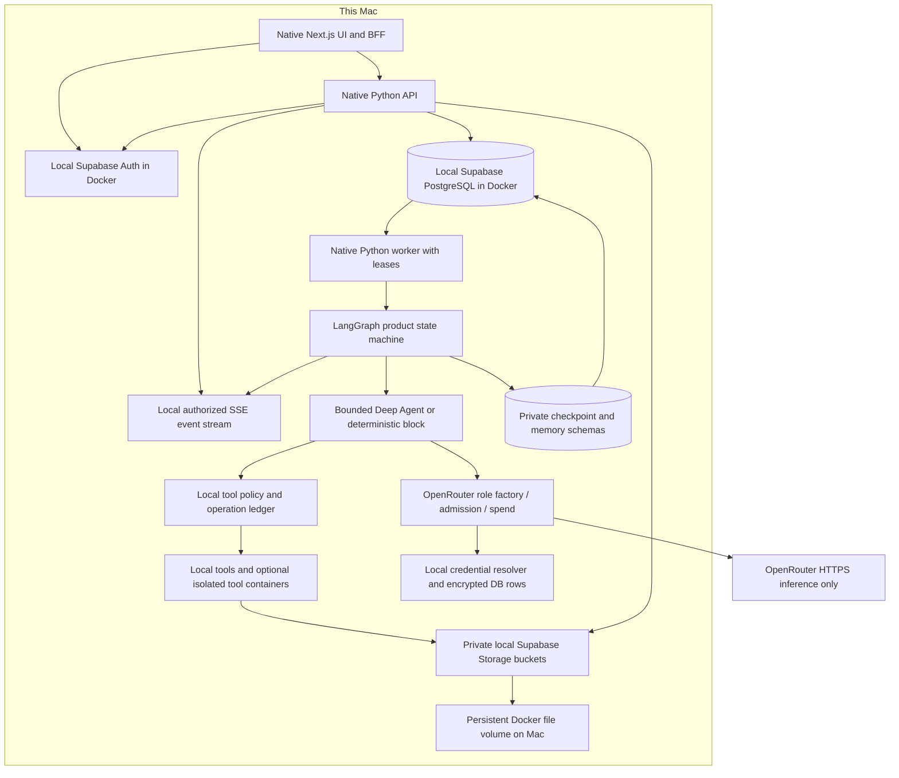
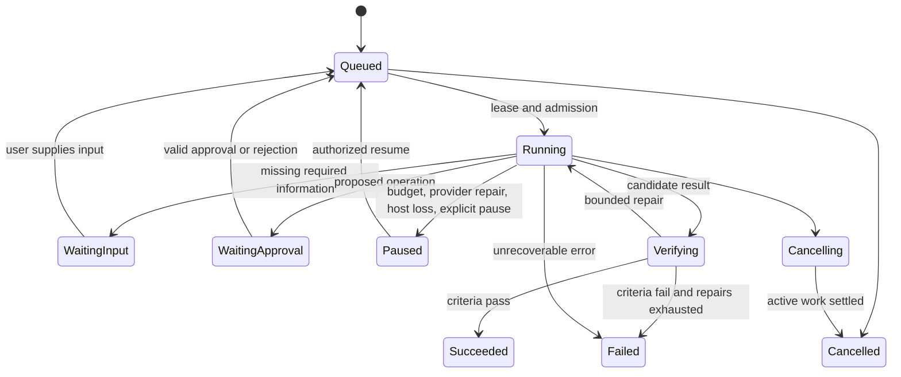

# PRD: AutoGPT-inspired application with LangChain, LangGraph, and Deep Agents

CODEBASE Context: skipped (product intent predates implementation; CODEBASE.md describes only development tooling and supplies no requirements)

**Status:** finalized product requirements and architecture decisions; implementation and release qualification are pending. No application integration or cloud-model qualification is claimed complete.  
**Research date:** November 4, 2026, America/Costa_Rica.  
**Product baseline:** [PRD-AutoGPT.md](./PRD-AutoGPT.md).  
**Alternative:** [PRD-NextJS.md](./PRD-NextJS.md).  
**Execution entry point:** [SPECS.md](./SPECS.md) organizes Option B implementation and evidence without replacing this PRD or the normative companion contracts.  
**Normative provider contract:** [PRD-Model-Providers.md](./PRD-Model-Providers.md), shared with the Next.js implementation.  
**Normative deployment contract:** [PRD-Local-Mac-Deployment.md](./PRD-Local-Mac-Deployment.md).  
**Normative development prerequisite:** [PRD-Development-Harness.md](./PRD-Development-Harness.md); H0 foundation and H1 activated baseline precede product implementation.  
**Normative interface design:** [PRD-Design-System.md](./PRD-Design-System.md) and the exact [Luma tokens](docs/design/luma.css); shadcn Luma with dark mode as the default.  
**Decision:** run the Next.js interface, Python API/workers, LangGraph orchestration, tools, and all application persistence on this Mac. Use local Docker-hosted Supabase for PostgreSQL, Auth, and private Storage. OpenRouter is the only inference provider: every initial role uses `openrouter_terra`, with `openrouter_deepseek_flash` available through explicit selection. No error, missing key, or SDK default may silently change models or providers.

## 1. Product intent and evidence boundaries

Build an application where a user can give a goal to a coordinator, work directly with a persistent specialist, inspect a plan, approve consequential operations, collect verified artifacts, and turn useful work into repeatable routines and workflows. The target includes AutoGPT's current Experts/AutoPilot experience and its graph automation substrate. A chat box around `create_deep_agent` would cover only part of that product.

The source baseline is AutoGPT commit `13ac38c5b6583bd01b0a6142b0060fc03e102b6e`. The companion AutoGPT PRD distinguishes the current product, deterministic workflow execution, nested agent loops, and Classic's historical goal loop. Its requirements and evidence are the source of functional parity decisions here. We reproduce behavior through a new implementation; we do not assume that adopting an agent SDK reproduces AutoGPT's integrations, data model, scheduler, or operational guarantees. [AutoGPT source snapshot](https://github.com/Significant-Gravitas/AutoGPT/tree/13ac38c5b6583bd01b0a6142b0060fc03e102b6e)

Evidence labels used in this document:

| Label | Meaning |
|---|---|
| Verified upstream | Read in official documentation, a package registry, or pinned source |
| Verified local | Observed configuration, installed files, or historical local verification records; distinguished from tests run now |
| Product requirement | A decided behavior, architecture choice, initial limit, or acceptance target; implementation pending |
| Qualification gate | A claim that must be demonstrated with the actual model/runtime before release |

The deepest uncertainty is model behavior. An advertised capability, a valid JSON object, and a good arithmetic smoke test are different kinds of evidence. None proves reliable planning, tool selection, recovery, or completion judgment. Deep Agents requires a chat model with tool-calling support; upstream model evaluations do not certify our selected OpenRouter routes or application configuration. [Deep Agents model requirements](https://docs.langchain.com/oss/python/deepagents/models)

## 2. Users, jobs, outcomes, and scope

### 2.1 Primary users

| User | Job | Observable success |
|---|---|---|
| Individual operator | Delegate research or workspace work from a locally operated application using a visible approved OpenRouter model | Receives an artifact with evidence, a truthful completion status, and a useful activity history |
| Automation builder | Turn a successful procedure into a reusable workflow | Can validate, version, run, inspect, and schedule a graph without changing application code |
| Specialist owner | Configure a persistent expert's instructions, knowledge, tools, and routines | Direct conversations and delegated runs use the intended configuration version and access scope |
| Reviewer | Decide whether a proposed external action should execute | Sees exact target, arguments, diff or payload, relevant evidence, and an auditable approval decision |
| Operator/developer | Diagnose stalls, model failures, and interrupted work | Can distinguish queued, thinking/generating, waiting for a tool, waiting for approval, paused, and failed |

### 2.2 Product outcomes

1. The user can move from a goal to a bounded execution with measurable acceptance criteria.
2. Expert identity persists; a particular execution remains a separately versioned, resumable run.
3. Work survives browser disconnection and worker restart at documented checkpoints.
4. Every consequential tool operation is associated with a policy decision and an operation record.
5. A model's assertion of success cannot alone mark a run successful.
6. The same tool registry serves direct expert work, delegation, and visual workflows.
7. All 14 inference roles are separately configurable and initially resolve to the approved Terra profile; every actual model call uses the run's explicit OpenRouter role snapshot.
8. A user can securely configure OpenRouter, understand what context leaves the device, and select an approved model without repeated approval for each bounded inference call.
9. Application services, authentication, files, database, logs, and credentials remain on this Mac; inference sends only the authorized request context to OpenRouter and its serving provider.

### 2.3 Explicit scope choices

**First implementation priority — Milestone 0:** establish and activate the repository development harness before feature code, product migrations, or production worker logic. Minimal scaffolding and disposable fixtures needed to prove H0–H1 are permitted. This includes project `.claude` skills, subagents, rules and deterministic hooks, `CLAUDE.md`, shared `AGENTS.md`, and a mandatory portable verification runner usable without Claude. An unavailable or incompatible Claude adapter may remain explicitly inactive without blocking a passing portable baseline. These are requirements to implement, not files or hooks claimed installed by this PRD update. The coding assistant is a developer-time integration; it does not join the product's agent graph or change its OpenRouter-only model registry/defaults.

**P0 vertical slice:** one local owner/workspace, local Supabase Auth/PostgreSQL/Storage, one goal assistant, manual goals, read/search/artifact tools, structured plans, durable runs, approvals, OpenRouter configuration/selection, evidence-backed completion, and a run inspector. **P1 product MVP:** add configurable Experts, coordinator routing, bounded delegation, a small typed workflow vocabulary, schedules, and run history.

**Later:** OAuth connector catalog, richer visual editing, imports/exports, safe sandbox execution, cross-workspace collaboration, and reviewed memory/skill improvement. Public marketplace, payment/credit systems, all AutoGPT integrations, unattended self-modification, and full graph-import compatibility are outside the first release.

Hosted application/database/auth/storage/tracing deployments and local inference engines are outside the active design. Use Vercel-maintained packages where relevant without deploying the application to Vercel. Permissioned web research or connector calls remain tools executed by the local worker; they do not relocate application services or persistence.

The product must accurately show unavailable capabilities. With the local host asleep, a scheduled run is delayed or missed according to its configured policy; it does not silently execute elsewhere. With tool calling unqualified, autonomous execution remains disabled and the application reports the specific unmet gate.

## 3. Current stack and version policy

### 3.1 Verified Python package snapshot

These are registry observations made on the research date, not a tested lockfile. The supporting [dependency snapshot](./research/dependency-snapshot.json) retains historical registry metadata and source URLs; only the active packages below are selected. Resolve them in an isolated Python 3.12 application environment, commit the resulting lock, and qualify the resolved set. Supabase Compose release and image pins come from the local deployment contract.

| Package | Latest non-prerelease observed | Publication date, UTC | Intended use / qualification |
|---|---:|---|---|
| `deepagents` | `0.7.32` | 2026-10-23 | Agent harness; requires Python >=3.11; package still carries a Beta maturity classifier |
| `langchain` | `1.4.8` | 2026-11-02 | Agent/model/tool abstractions and middleware |
| `langgraph` | `1.2.19` | 2026-10-30 | Explicit state machine, checkpoints, interrupts, retries |
| `langchain-openrouter` | `0.2.9` | 2026-09-22 | Dedicated OpenRouter adapter; tool/reasoning round trips require qualification |
| `langgraph-checkpoint-postgres` | `3.2.0` | 2026-10-14 | Persistent checkpoints and store integration |
| `langsmith` | `0.14.17` | 2026-11-02 | Transitive dependency only; hosted tracing is disabled and outside the deployment scope |
| `fastapi` | `0.162.0` | 2026-10-23 | Application API; optional relative to another ASGI application service |
| `psycopg` | `3.3.8` | 2026-11-04 | PostgreSQL connectivity; same-day update must pass integration tests |
| `langchain-mcp-adapters` | `0.3.2` | 2026-08-06 | Existing adapter option; newer LangChain native MCP API described below |

Sources: version-specific [Deep Agents](https://pypi.org/pypi/deepagents/0.7.32/json), [LangChain](https://pypi.org/pypi/langchain/1.4.8/json), [LangGraph](https://pypi.org/pypi/langgraph/1.2.19/json), [PostgreSQL checkpoint package](https://pypi.org/pypi/langgraph-checkpoint-postgres/3.2.0/json), [LangSmith](https://pypi.org/pypi/langsmith/0.14.17/json), [FastAPI](https://pypi.org/pypi/fastapi/0.162.0/json), [Psycopg](https://pypi.org/pypi/psycopg/3.3.8/json), and [MCP adapters](https://pypi.org/pypi/langchain-mcp-adapters/0.3.2/json).

The OpenRouter adapter was checked separately after the original dependency snapshot. Its `0.2.9` metadata requires `langchain-core>=1.5.5,<2.0.0` and `openrouter>=0.9.2,<1.0.0`. The latest observed standalone OpenRouter SDK is `1.3.117`, outside that range; `0.11.46` is the latest non-yanked stable release observed within the allowed range. Resolve and qualify the compatible dependency set instead of combining independent latest versions. No package was installed or resolver compatibility demonstrated in this research. [Adapter metadata](https://pypi.org/pypi/langchain-openrouter/0.2.9/json), [compatible SDK release](https://pypi.org/pypi/openrouter/0.11.46/json), [current SDK metadata](https://pypi.org/pypi/openrouter/1.3.117/json)

The direct `langchain-core` ranges intersect at `>=1.7.4,<2.0.0` for the selected LangChain, Deep Agents, and OpenRouter adapter; observed `1.7.5` falls inside them. This does not prove complete transitive compatibility. In particular, `openrouter==0.11.46` constrains Pydantic to `>=2.11.2,<2.13`. The full resolver/import/serialization gate remains mandatory. The evidence snapshot includes earlier adapter research that is not an active dependency selection. [Dependency and source evidence](./research/openrouter-langchain-sdk.json)

The latest prereleases found by publication date were older than those baselines: Deep Agents `0.7.0b2`, LangChain `1.4.0a4`, and LangGraph `1.2.0a7`. They are not selected. The absence of a prerelease suffix is not a promise that every feature is stable.

Deep Agents release tag `deepagents==0.7.32` resolves to `e85c6b98087861512d2c5240305e16cfac68a746`; detailed construction behavior below was checked against that release. Repository `main` was also inspected at `3a0c7bb935fefb5d283f0799ef4551add6c2a361`. Main already differs from the published dependency metadata, so do not use a moving branch as the installation specification. [Release source](https://github.com/langchain-ai/deepagents/tree/e85c6b98087861512d2c5240305e16cfac68a746), [published dependency metadata](https://pypi.org/pypi/deepagents/0.7.32/json)

### 3.2 JavaScript is a real alternative

| npm package | `latest` observed | Role |
|---|---:|---|
| `deepagents` | `1.16.2` | JavaScript Deep Agents SDK |
| `langchain` | `1.6.1` | JavaScript LangChain |
| `@langchain/langgraph` | `1.6.1` | JavaScript graph runtime |
| `@langchain/langgraph-sdk` | `1.12.10` | Agent Server client |
| `@langchain/react` | `1.2.10` | React frontend stream integration |

Sources: npm registry records for [deepagents](https://registry.npmjs.org/deepagents), [langchain](https://registry.npmjs.org/langchain), [LangGraph](https://registry.npmjs.org/@langchain%2Flanggraph), [server client](https://registry.npmjs.org/@langchain%2Flanggraph-sdk), and [React](https://registry.npmjs.org/@langchain%2Freact). Python and JavaScript versions are independent and do not indicate feature equivalence.

**Selected architecture:** Python for the agent service because the selected Deep Agents/LangGraph harness, backend tools, and evaluation workflow fit that ecosystem. The Python API and worker run natively on this Mac and call OpenRouter over HTTPS. TypeScript Deep Agents remains a credible alternative if maintaining one application language becomes the dominant constraint. This PRD does not claim Python is faster or that JavaScript lacks durable execution.

### 3.3 Stable core, optional moving features

Use explicit graph nodes, checkpointers, normal streaming, synchronous isolated specialists, and application-owned tool policies first. Treat dynamic subagents, forked context, profiles, rubric grading, event-stream APIs marked Beta, and the new native MCP adapter as separately gated features. They are useful options, not requirements for the product to work.

LangChain `1.4` adds `langchain.mcp.MCPAdapter` through `langchain[mcp]`, backed by FastMCP; official docs identify it as Beta and provide migration from `langchain-mcp-adapters`. Put either implementation behind our connector interface, and select one tested version rather than exposing SDK-specific adapter objects throughout the application. [Native MCP documentation](https://docs.langchain.com/oss/python/langchain/mcp)

## 4. How the three LangChain layers actually help

| Layer | Verified capability | What we must still build |
|---|---|---|
| LangChain | Chat-model interface, tools, `create_agent`, middleware, structured-response strategies | Provider/model qualification, capabilities, credentials, tool policy, product contracts |
| LangGraph | Stateful execution graph, checkpointing, routing, interrupts, streaming, recovery primitives | Durable job admission/leases, schedules, ownership, API, product status, safe external-effect semantics |
| Deep Agents | Filesystem abstraction, context offload/summarization, delegation, optional skills/memory and approval wiring | Persistent Experts, role configuration, goal criteria, workflow editor/compiler, connector UX, evaluation gates |

These layers compose, but they are not three independent autonomous minds. The model proposes text or tool calls; the harness executes validated operations and feeds back observations. The outer application controls when execution may continue, how much it may spend, and whether results satisfy the goal. [LangChain stack overview](https://www.langchain.com/oss-overview), [Deep Agents overview](https://docs.langchain.com/oss/python/deepagents/overview)

### 4.1 Changes that make old examples misleading

- Starting with Deep Agents `0.7`, task planning is opt-in: explicitly add `TodoListMiddleware` for `write_todos`. A todo list is a progress representation, not a scheduler or a guarantee of a good plan.
- Always pass a `ChatOpenRouter` model initialized by the application factory. In the checked release, omitting a model still selects a deprecated Anthropic default. Bare provider strings and implicit model/provider inference are prohibited in application agent construction.
- The construction function merges additional tools with built-ins. Passing `tools=[]` does not by itself remove filesystem/delegation tools.
- Ordinary declarative subagents inherit configured approval behavior unless overridden. Already-compiled and remote async agents do not automatically inherit it.
- The default general-purpose subagent is added unless deliberately overridden or disabled using a supported configuration. Define its model and tools explicitly in our factory.

Sources: [planning change](https://docs.langchain.com/oss/python/deepagents/overview#task-planning), [pinned construction code](https://github.com/langchain-ai/deepagents/blob/e85c6b98087861512d2c5240305e16cfac68a746/libs/deepagents/deepagents/graph.py), [subagent configuration](https://docs.langchain.com/oss/python/deepagents/subagents).

### 4.2 Product parity map

| AutoGPT behavior from baseline PRD | Proposed implementation | Priority |
|---|---|---|
| Coordinator and direct Expert chats | Persist Expert definitions; route sessions to compiled role configurations | P1 |
| Shared tools across baseline/SDK execution | One versioned application Tool Registry; LangChain adapters and graph executors reference it | P0 |
| Bounded model/tool loop | Deep Agent invocation inside run admission, global budgets, stop checks | P0 |
| Specialist delegation with narrower scope | Explicit assignment envelope intersected with parent's permissions and remaining budget | P1 |
| Durable execution and visible activity | PostgreSQL job lease + LangGraph checkpoints + append-only public event log | P0 |
| Approval-dependent operations | Typed approval records plus LangGraph interrupts; policy also enforced at executor | P0 |
| Graph nodes, links, inputs, emissions | Application Workflow IR, validator, readiness engine, and versioned block adapters | P1 |
| Recurring routines and triggers | Durable schedule service with occurrence IDs and missed-run policy | P1 |
| Apps/credentials | Server-held secrets and scoped connector grants | P1 |
| Memory/skills consolidation | Offline proposal generation, evidence checks, review, versioned promotion | P2 |
| Marketplace/credit economy | Separate future product project | Out of MVP |

Do not map AutoGPT's graph directly to a LangGraph diagram without examining semantics. A visual dataflow graph's output ports, repeated emissions, optional inputs, iteration, and join behavior differ from a control-flow state machine. The application owns those semantics even if LangGraph coordinates their execution.

The baseline's shared requirement IDs provide implementation traceability:

| AutoGPT requirement | This PRD's implementation/acceptance reference |
|---|---|
| AG-01 identity, workspace, credentials | LC-02, LC-05, LC-16, LC-18; sections 9 and 11 |
| AG-02 goal/brief and success criteria | LC-03, LC-12; sections 7–8 |
| AG-03 bounded conversational tool loop | LC-01, LC-04, LC-17; sections 6–7 |
| AG-04 Expert profiles/delegation | LC-02, LC-07; section 8.2–8.3 |
| AG-05 typed versioned workflow builder | LC-14; sections 7.3 and 11 |
| AG-06 dataflow execution/fanout | LC-14; explicit readiness/emission design in section 7.3 |
| AG-07 approvals/review/resume | LC-10; sections 9.2 and 10.3 |
| AG-08 schedules/triggers/routines | LC-15; section 10.4 |
| AG-09 artifacts/memory/context | LC-03, LC-12, LC-16; sections 6.6 and 8.4 |
| AG-10 evidence/versioned skill learning | LC-16; reviewed P2 pipeline in section 8.5 |
| AG-11 logs/events/cost | LC-13; sections 6.5, 11.3, and 12 |
| AG-12 recovery/idempotency/cancellation | LC-08, LC-09, LC-11; section 10 |
| AG-13 reusable library/catalog/API/MCP | LC-05, LC-14; tool registry/API initially, public marketplace deferred |
| AG-14 evaluation | LC-12, LC-17; sections 6.4 and 14 |

## 5. Local Mac deployment and component architecture

The [local deployment PRD](./PRD-Local-Mac-Deployment.md) is normative. The primary database is the PostgreSQL instance in the official self-hosted Supabase Docker Compose stack, with a pinned release/configuration and image versions. Supabase CLI may provide disposable development/test environments; it must not start a second primary application database. Official documentation supports Docker-based self-hosting on macOS; the deployment must qualify the selected images and services on this Mac. [Supabase Docker deployment](https://supabase.com/docs/guides/self-hosting/docker)

The inspected baseline is `self-hosted/v0.8.3`, commit `bc27d2661edd09a5d0b8d76ce33da6d4071a756e`. Preserve its coordinated service configuration and pin resolved image digests during implementation. Docker Desktop/Compose availability, ARM64 images, disk capacity, and bind-mount behavior remain checks to perform; this research did not install or start the stack. [Pinned Compose source](https://github.com/supabase/supabase/blob/bc27d2661edd09a5d0b8d76ce33da6d4071a756e/docker/docker-compose.yml)

Disable Studio's AI assistant/inference integration and explicitly clear its `OPENAI_API_KEY` setting instead of allowing host environment interpolation. Never pass the OpenRouter key to Studio. Audit the rendered service configuration for inherited provider keys or other AI integrations; the application worker's approved factory must be the only inference path. Disabling an assistant must use the pinned release's supported configuration and verified behavior, not an invented environment switch.



### 5.1 Process boundaries and local networking

1. **Native Next.js web process:** user interface, same-origin session handling/BFF, typed calls to the Python API. It does not own long-running agent work. Bind the user-facing listener to loopback.
2. **Native Python API:** validates local Auth sessions, checks workspace ownership, admits runs, serves snapshots/events/approvals, and performs small transactions. It does not keep an HTTP request open as the sole owner of a run.
3. **Native Python worker:** claims local database jobs, renews leases, drives LangGraph, executes allowed tools, and projects durable events. All orchestration and tool execution remain on this Mac.
4. **Supabase PostgreSQL in Docker:** the single primary database for product records, queues/leases, operation and spending ledgers, checkpoints, memory, and encrypted credentials. The worker uses a scoped direct SQL connection through a loopback-published database port; it does not use PostgREST for worker ownership or checkpoint writes.
5. **Supabase Auth in Docker:** local identity/session service, password-based owner bootstrap and administrator-controlled enrollment. Disable public signup and external identity providers; the MVP needs no external SMTP or OAuth service. Restrict allowed redirects to the configured local application origin. Use the self-hosted configuration, not a hosted dashboard. [Auth configuration](https://supabase.com/docs/guides/self-hosting/auth/config)
6. **Supabase Storage in Docker:** private artifact/evidence buckets backed by persistent local volumes. The backend checks workspace authorization and mediates uploads/downloads or narrowly scoped, short-lived local signed URLs. Checkpoints retain object references and hashes rather than copying large payloads.
7. **Local tool containers, when qualified:** nonprivileged, bounded, and mounted only to assigned workspaces. No credential directory, database volume, broad home-directory mount, or Docker socket is exposed to agent tools.
8. **OpenRouter factory and invocation controller:** all 14 roles, subagents, and model-backed middleware use one controlled factory, fixed HTTPS inference base, shared per-workspace admission, credential late binding, catalog checks, and spend accounting. OpenRouter performs inference; it does not own the local run queue or persistent product state.

Publish required Docker ports on `127.0.0.1`, not all interfaces; keep unneeded services/internal ports unpublished. The native API/worker connects to published loopback addresses. Docker-internal service connections use Compose DNS names; a later containerized application would use that network contract rather than treating its own `localhost` as the host database. Listener, URL, and Auth redirect configuration must be checked together.

The proposed collision-checked host endpoints are Next.js `127.0.0.1:3000`, Python `127.0.0.1:8001`, the Supabase gateway `127.0.0.1:54321`, and direct PostgreSQL `127.0.0.1:54322`. Publish the actual Compose `db:5432` service for that database connection; upstream Supavisor host ports are not a direct PostgreSQL endpoint and are removed from this baseline. Keep internal PostgreSQL port 5432 unchanged. Studio is available to the operator through the authenticated gateway root; do not publish raw Studio or a second pooler port. Validate the fully merged Compose configuration for leftover wildcard port bindings. [Pinned deployment evidence](./research/supabase-local-deployment-snapshot.json)

There is no hosted application, hosted Supabase project, remote worker, hosted trace collector, or cloud secret store in this deployment profile. Hosted Vercel infrastructure is not required by use of Next.js or Vercel-maintained libraries. Local logs and evaluations remain in local storage; only authorized inference payloads go to OpenRouter, plus separately scoped external web/connector tool requests.

### 5.2 Queue, checkpointer, and store ownership

Use a PostgreSQL-backed job table with transactional enqueue, leased claims, heartbeat, attempts, and `available_at`. Enqueue the run and initial outbox event atomically. Workers claim eligible jobs with row locking, establish a monotonically increasing execution generation/fencing value, and write product state only while their generation is current. Use database time for lease/occurrence decisions so host sleep or wall-clock changes do not create competing owners.

Use direct PostgreSQL connections for LangGraph checkpointers and stores in private `agent_runtime`; credentials, ledgers, and other application internals belong in private `app_private`. Keep those schemas outside PostgREST and Realtime exposure and revoke browser-role access. A separate migration/admin identity creates schema objects; the runtime worker receives only required grants and no blanket database-superuser authority. Verify the installed checkpoint/store adapter's connection `search_path`, setup/migrations, and schema resolution; do not invent an unsupported schema constructor argument. RLS on user-facing records complements server-side authorization; privileged internal writes still require explicit workspace checks.

LangGraph checkpointing is execution-state persistence. It is not the scheduler, durable admission queue, event authorization layer, or protection against duplicate external effects. Supabase Realtime may be left disabled; it is never the job-ownership or guaranteed-event-delivery mechanism. Product SSE uses the durable local event log and cursor replay. Do not layer another workflow engine over the same run.

### 5.3 Auth, private artifacts, and persistence boundaries

Validate local Supabase Auth tokens using the configured local issuer/key configuration and session rules. Do not trust a decoded subject without verification. Map the verified identity to workspace membership in the Python API; background jobs retain the authorized owner/workspace scope. Owner/admin controls protect model credentials, defaults, role policy, and invitations. Keep Supabase service/secret keys server-side; a publishable key alone is not authorization.

For any exposed application schema, enable and test RLS and grants; keep internal schemas unexposed regardless of RLS. Storage policies must constrain workspace membership and object paths. A server service credential can bypass Storage RLS, so every privileged artifact operation must independently verify workspace, bucket, object identity, size, and allowed action. Never rely on a guessed path prefix as the authorization check. [PostgreSQL RLS](https://supabase.com/docs/guides/database/postgres/row-level-security), [Storage access control](https://supabase.com/docs/guides/storage/security/access-control)

Persist artifacts under workspace/run namespaces with immutable content hashes, metadata, and retention rules. Local signed URLs are download capabilities, not public cloud hosting; do not give an external inference provider a `localhost` URL and expect it to fetch the object. Assemble only authorized bytes/text into the model request when needed. Artifact creation uses staged upload, recorded checksum, and a committed metadata reference; a recovery job removes or reconciles orphaned files rather than claiming a database transaction atomically committed file bytes.

The master key remains in the private host path defined in section 6.7, outside the workspace and Docker data volumes. Supabase database backups alone do not include artifact file contents or this key. Back up and restore all required local components together as described in section 10.5.

### 5.4 Configuration contract

| Configuration | Required use |
|---|---|
| `AUTOBOTS_CONFIG_ROOT` | Absolute shared configuration root for native Next.js/Python/bootstrap; never infer a different root from worker cwd |
| `DATABASE_URL` | Server-only direct PostgreSQL connection to the intended local Supabase database on host loopback port 54322, using scoped application/worker credentials |
| `SUPABASE_URL` | Local gateway base `http://127.0.0.1:54321` for server Auth/Storage operations |
| `NEXT_PUBLIC_SUPABASE_URL` / `NEXT_PUBLIC_SUPABASE_PUBLISHABLE_KEY` | Local gateway and non-secret client identification only; RLS/session checks still govern browser access |
| `SUPABASE_SECRET_KEY` or deployment-matched legacy service-role key | Server-only privileged operations; never a browser, model, checkpoint, or tool-sandbox value |
| `OPENROUTER_API_KEY` | Effective server credential using the shared precedence rules; absence blocks all inference |
| `AUTOBOTS_PROVIDER_MASTER_KEY_FILE` | Absolute private host key path, shared by native processes and excluded from tool mounts |

Reject hosted Supabase URLs, external application API/trace endpoints, and unapproved inference endpoints at startup. The loopback-only MVP may use HTTP for local UI/API/Auth/Storage with exact Host/Origin checks and CSRF protection on sensitive mutations; OpenRouter always uses HTTPS. Keep development/test instances isolated by explicit ports, database identity, credentials, and volumes, with no production-data reset from a test command. [Deployment configuration](./PRD-Local-Mac-Deployment.md)

## 6. Provider selection, model policy, and qualification

### 6.1 Active evidence and superseded research

The active inference evidence is the dated public OpenRouter catalog and official adapter/package-source inspection. No authenticated key check, paid model call, full SDK integration, or end-to-end cloud task qualification was performed for this PRD revision. Earlier [local model evidence](./research/LOCAL-MODEL-EVIDENCE.md) and [GGUF experiments](./research/QWEN38-GGUF-TEST-RESULTS.md) are superseded research; they are not deployment dependencies, selected providers, model defaults, or acceptance results for this architecture.

### 6.2 Required role constants and approved registry

All initial role constants resolve to `openrouter_terra`. Runtime bindings are resolved from explicit model choices separately; defaults never overwrite a user's selected binding. Roles separate prompts, permissions, and responsibilities, while inference for every role uses OpenRouter. The following is a configuration contract to implement, not an executed application:

```python
from types import MappingProxyType

OPENROUTER_BASE_URL = "https://openrouter.ai/api/v1"
DEFAULT_MODEL_PROFILE = "openrouter_terra"
DEFAULT_CANONICAL_MODEL = "openai/gpt-6.1-terra-20261026"
DEFAULT_WIRE_MODEL_ID = "openai/gpt-6.1-terra"

MODEL_COORDINATOR = DEFAULT_MODEL_PROFILE
MODEL_PLANNER = DEFAULT_MODEL_PROFILE
MODEL_EXECUTOR = DEFAULT_MODEL_PROFILE
MODEL_RESEARCHER = DEFAULT_MODEL_PROFILE
MODEL_CODER = DEFAULT_MODEL_PROFILE
MODEL_REVIEWER = DEFAULT_MODEL_PROFILE
MODEL_EVALUATOR = DEFAULT_MODEL_PROFILE
MODEL_SUMMARIZER = DEFAULT_MODEL_PROFILE
MODEL_ROUTER = DEFAULT_MODEL_PROFILE
MODEL_MEMORY_CURATOR = DEFAULT_MODEL_PROFILE
MODEL_SKILL_LEARNER = DEFAULT_MODEL_PROFILE
MODEL_TOOL_REPAIR = DEFAULT_MODEL_PROFILE
MODEL_WORKFLOW_GENERATOR = DEFAULT_MODEL_PROFILE
MODEL_GENERAL_PURPOSE = DEFAULT_MODEL_PROFILE

DEFAULT_MODEL_BY_ROLE = MappingProxyType({
    "coordinator": MODEL_COORDINATOR,
    "planner": MODEL_PLANNER,
    "executor": MODEL_EXECUTOR,
    "researcher": MODEL_RESEARCHER,
    "coder": MODEL_CODER,
    "reviewer": MODEL_REVIEWER,
    "evaluator": MODEL_EVALUATOR,
    "summarizer": MODEL_SUMMARIZER,
    "router": MODEL_ROUTER,
    "memory_curator": MODEL_MEMORY_CURATOR,
    "skill_learner": MODEL_SKILL_LEARNER,
    "tool_repair": MODEL_TOOL_REPAIR,
    "workflow_generator": MODEL_WORKFLOW_GENERATOR,
    "general_purpose": MODEL_GENERAL_PURPOSE,
})

assert set(DEFAULT_MODEL_BY_ROLE.values()) == {DEFAULT_MODEL_PROFILE}
```

The registry contains exactly these two OpenRouter entries. There is no third provider, local endpoint, `:batch`, Pro, auto-router, or model fallback:

| Profile / provider | Canonical selection identity | Wire `model` value | Initial status |
|---|---|---|---|
| `openrouter_deepseek_flash` / `openrouter` | `deepseek/deepseek-v4.1-flash-20261017` | `deepseek/deepseek-v4.1-flash-1017` | Explicit alternative; credentials and qualification required |
| `openrouter_terra` / `openrouter` | `openai/gpt-6.1-terra-20261026` | `openai/gpt-6.1-terra` | Default for all roles; credentials and qualification required |

The two requested model names are catalog `canonical_slug` values, not necessarily request IDs. Retain both. Before each paid attempt, verify that the selected non-batch wire ID still maps to the recorded canonical slug using catalog metadata no older than five minutes. Missing entries, conflicting mappings, alias drift, or expired metadata that cannot be refreshed block the call. Public aliases do not guarantee immutable upstream weights; disclose that limitation. [Public catalog snapshot](./research/openrouter-model-catalog.json)

Resolve each role in this exact shared order: explicit run-specific role override → explicit run-wide profile → workspace role override → workspace default → `openrouter_terra`. A run-wide selection applies to every role unless the user supplies a run-specific override; show the complete map before launch. Resolve once into a `RunProviderSnapshot` covering all 14 canonical keys, including summaries, evaluations, background memory/skill work, and dynamically created children. Map the SDK's `general-purpose` subagent name to the product's `general_purpose` role. Routine definitions snapshot the explicitly authorized model policy for future occurrences.

Selecting Run authorizes bounded calls to the displayed OpenRouter model/role map without a second approval for each inference call. A key's existence never starts inference. Failures pause or fail the affected work without switching models. MVP run bindings are immutable: changing the model for unfinished work creates a linked new run with explicit artifact/evidence references, preserving the original transcript and replay history. Policy edits affect future admissions only. [Shared provider policy](./PRD-Model-Providers.md)

No embedding or reranking inference is enabled. Use local Supabase PostgreSQL full-text search, filename/metadata filters, and lexical retrieval. Adding a separate embedding provider or an unapproved generative model requires a later explicit product-scope change.

### 6.3 OpenRouter-only model factory

Every model-backed path requests a role from the same application factory. The factory accepts a validated, frozen binding for one of the two registry entries, constructs `ChatOpenRouter`, and wraps each invocation with budget, cancellation, credential-version, catalog, and admission checks. Construct clients lazily at dispatch after credential resolution, not during application startup, so a missing key does not prevent local sign-in/viewing/Settings. Arbitrary base URLs and raw model strings are rejected. Model/client objects and keys never become checkpoint state.

The constructor shape below was checked against published source. The binding and credential resolver are contracts to implement; this is not an existing or tested application integration:

```python
from langchain_openrouter import ChatOpenRouter

def openrouter_model(binding, resolved_secret) -> ChatOpenRouter:
    # Validate the fixed provider/registry and late-resolve the credential first.
    # This client is transient and must never be serialized into graph state.
    return ChatOpenRouter(
        model=binding.wire_model_id,
        base_url=OPENROUTER_BASE_URL,
        api_key=resolved_secret,
        openrouter_provider={
            "require_parameters": True,
            "allow_fallbacks": False,
        },
        max_tokens=binding.max_output_tokens,
        max_retries=0,
        timeout=180_000,  # ChatOpenRouter 0.2.9: milliseconds.
        stream_usage=True,
        app_url=None,
        app_title="Autobots",
        app_categories=None,
        session_id=None,
        trace=None,
        route=None,
        plugins=None,
        # Catalog-supported, explicitly configured sampling/reasoning fields only.
        # The validated mapping cannot override constructor fields above.
        **binding.qualified_generation_parameters,
    )
```

`max_retries=0` centralizes retry accounting in the invocation controller; it does not mean no retries anywhere. The explicit resolved key and fixed HTTPS base prevent SDK defaults from bypassing credential precedence or redirecting secrets. No local endpoint adapter or direct model-vendor client is part of this factory. Validate complete tool JSON before dispatch; never execute streaming prefixes or use `eval` to interpret a model reply.

**OpenRouter adapter decision:** `langchain_openrouter.ChatOpenRouter` is the only model adapter in the active design. The dedicated adapter supports OpenRouter routing, tool binding, structured results, and provider reasoning metadata. Its release source retains `reasoning_details` and reconstructs fragmented streaming details when serializing assistant messages for the next tool turn. Its constructor accepts `openrouter_provider`, and its timeout is in milliseconds. Preserve these distinctions in wrapper tests. [Official integration](https://docs.langchain.com/oss/python/integrations/chat/openrouter), [release source](https://github.com/langchain-ai/langchain/blob/langchain-openrouter%3D%3D0.2.9/libs/partners/openrouter/langchain_openrouter/chat_models.py), [inspected package evidence](./research/openrouter-langchain-sdk.json)

The shared provider contract requires `provider.require_parameters=true` and `provider.allow_fallbacks=false`. Do not pass a model fallback array, an automatic router ID, or a fallback route. This limits routing; it is not a guarantee of zero data retention or a fixed upstream company. Record the actual upstream provider when returned and do not claim ZDR or a data-collection policy that has not been configured and verified. [OpenRouter provider routing](https://openrouter.ai/docs/guides/routing/provider-selection)

Tool schemas remain application-owned. Qualify automatic, required, and named tool choice; enforce complete argument validation and tool/result IDs independently of a model's strict flag. For structured cloud results, use an explicitly qualified `function_calling` strategy or `json_schema` with `strict=True`; do not let auto-detected SDK profiles silently select a method. OpenRouter's catalog indicates support, while endpoint implementations can differ in actual enforcement. Validate every final object and reject truncated/invalid output. Native-schema enablement requires the provider-specific contract suite; setting `require_parameters` alone does not prove schema correctness. [OpenRouter structured-output limits](https://openrouter.ai/docs/guides/features/structured-outputs)

Maintain separate qualified generation presets for the two approved models. The catalog snapshot for Terra does **not** advertise `temperature`, `top_p`, `top_k`, penalties, or `parallel_tool_calls`; omit them, including a convenient global `temperature=0` or `parallel_tool_calls=False`. Execute accepted tool calls under application policy even when the request cannot disable parallel proposals. Terra advertises mandatory reasoning, so the UI must not offer reasoning-off or send `effort="none"`. Use each model's supported reasoning controls; the starting 512-token output cap includes reasoning where the provider accounts it that way and can yield a length-limited response with little or no visible answer. Such a result is incomplete, not success. [Catalog evidence](./research/openrouter-model-catalog.json), [OpenRouter reasoning controls and budgets](https://openrouter.ai/docs/guides/best-practices/reasoning-tokens)

Keep required provider reasoning envelopes in restricted execution state through assistant → tool result → next assistant and checkpoint/resume. Do not reduce an assistant message to plain `content`, rewrite signatures, or lose metadata during stream assembly or context compaction. Qualify serialization round trips and signed/encrypted metadata where returned. Preserve only the protocol material required for continuation, with retention/access controls; show concise work summaries in the UI, never raw reasoning payloads as product logs or claimed explanations of model internals.

Agent construction must explicitly inject factory-created models into `create_deep_agent`, every declarative subagent, any separately compiled agent, and model-backed middleware such as summarization. Override the default general-purpose subagent and its model. If a bundled middleware cannot accept the separately resolved summarizer model, replace/configure it through supported middleware composition; do not silently use the parent model when advanced roles selected a different summarizer. Instrument every model dispatch at the factory boundary and verify that the inventory exactly matches the frozen role map. An unregistered inference path is a release failure.

### 6.4 Capability gate matrix

Run the gates separately for each enabled OpenRouter model/adapter preset. Identity uses fresh catalog mappings, authentication status, and authorized endpoint qualification. Local deployment checks cover application services and data, not model loading. One passing model binding never certifies another.

| Gate | Experiment | Required release evidence |
|---|---|---|
| M1 identity/health | Validate catalog identity, credential metadata, and separately authorized model requests | Exact canonical/wire mapping, adapter/SDK versions, actual upstream provider when returned, honest auth versus inference status |
| M2 message protocol | System/user/assistant/tool history round trips | Correct tool-call IDs, result association, no silent role loss |
| M3 tools | Zero, one, malformed, unknown, and sequential tool requests | No unauthorized dispatch; valid calls parsed; controlled error recovery |
| M4 schema | Nested arguments, enums, omitted fields, Unicode, escaped content | Schema validation and bounded repair; no permissive coercion of dangerous inputs |
| M5 streaming | Text and tool arguments interrupted at arbitrary chunks | Correct assembly; partial arguments never executed; reconnect behavior documented |
| M6 structured result | Plan and evaluation schemas under supported strategy | Valid output or explicit failure; no guessed provider capabilities |
| M7 context | Increasing prompts, tool output offload, compaction and later retrieval | Measured usable context and completion reserve; retained constraints/evidence |
| M8 cancellation | Cancel generation and tools; restart worker | No new dispatch after cancellation fence; orphan inference handled explicitly |
| M9 goals | Repeat representative research, artifact, and workflow tasks | End-to-end rubric results, failure categories, latency, token use, and cost distributions |
| M10 local application / OpenRouter-only | Inspect configured service endpoints, database volumes, logs, inference dispatch, and missing-key behavior | Application/Auth/Storage/runtime remain local; every inference uses an approved OpenRouter model; no other provider and no inference without a valid credential |
| M11 provider resolution | Exercise run/workspace/advanced role selection, catalog alias drift, and missing capabilities | Every role matches its immutable binding; no cloud activation from key presence and no model/provider fallback |
| M12 credential lifecycle | Draft validation, invalid managed environment value, rotation, deletion, restart, and redaction | Exact source precedence, encrypted persistence, old valid key preserved on invalid replacement, no secret leakage |
| M13 cloud protocol | Tool-choice variants, nested schemas, stream chunks, reasoning metadata, checkpoint/resume | Explicit adapter/SDK lock passes fixture and selected-model tests; no dropped metadata or unsupported Terra sampling parameters |
| M14 spend and errors | Concurrent reservations, 401/402/429/5xx, unknown usage, cancelled stream | Bounded retries/charges, correct repair UX, no hidden paid validation probe, no duplicate automatic invocation after replay |

Current gate status: active evidence is public catalog, documentation, and package-source inspection only. No OpenRouter key was read, no paid generation or authentication call was made, and all active SDK, deployment, adversarial, context, cancellation, recovery, and task-quality gates remain pending. Superseded local-model tests do not satisfy them. Credential validation and catalog support alone must never produce a “model qualified” badge.

Tool validity, tool semantic correctness, and goal success are separate metrics. The shared candidate release gate is at least 98% first-pass valid calls on a 100-case contract corpus, at least 85% end-to-end success on 40 held-out representative low-risk tasks repeated three times, and zero permission/replay-safety failures. These are acceptance targets, not current results. Publish failures and task definitions; do not hide them behind an aggregate score.

### 6.5 Provider admission and budgets

Begin with at most two concurrent OpenRouter calls per workspace, enforced across local workers using shared database admission state. Hold a permit only for one HTTP model call and release it before the parent waits for child work, preventing parent/child admission deadlocks. There is no GPU or local-model generation permit. The initial 8,192-token total context budget and 512-token output limit are configurable application cost/context controls, not claims about local model capacity. Larger catalog limits do not automatically authorize larger payloads or spending.

Shared initial candidate policy: at most two outstanding specialist assignments, at most four child runs in the complete tree, delegation depth at most two, 24 model calls across the entire run tree, 40 tool dispatches, one repair attempt for schema/tool-argument failure, two plan revisions after the initial plan, and a 15-minute active execution budget. Count review, repair, summary, routing, and memory calls in the same global ledger. Approval wait time is tracked separately, and queue wait time is visible. Tune these values only from benchmark evidence.

Reserve input/output allowances before every generation, then reconcile reported or conservatively estimated tokens. If usage metadata is absent, label the estimate and retain its counting method/version. Display token use, time to first token, call duration, admission wait, estimated/reported cost, and unresolved billing separately.

Cloud defaults are USD 1 per run and USD 5 per workspace UTC day, configurable through model policy. Reserve the worst-known input/output/per-request charge under a database lock before dispatch, across parents, children, summaries, reviews, retries, and concurrent runs. Price conservatively across eligible routes; unavailable or unbounded price information blocks a new paid call. Warn at 80%; pause admission at 100%, counting settled charges plus outstanding reservations. Reconcile provider-reported usage/cost when available, including reasoning and cache categories; retain unresolved reservations when a response/usage event is lost. Use catalog pricing with its timestamp and applicable tiers rather than stale constants. These application estimates and reservations are not an external provider hard spending cap; account-level limits and billing can differ. Unknown cost must not be displayed as zero. [Shared spend policy](./PRD-Model-Providers.md)

### 6.6 Harness size is an explicit feasibility gate

The stock harness can expose filesystem schemas, delegation schemas, prompts, skills metadata, and tool descriptions before the user task is included. Source inspection confirms a nontrivial filesystem tool set and additive construction behavior; this research has not instantiated the complete proposed harness and counted its serialized request. Do not assume the stock harness fits our initial 8,192-token application budget merely because a hosted model advertises a larger context. [Filesystem middleware source](https://github.com/langchain-ai/deepagents/blob/e85c6b98087861512d2c5240305e16cfac68a746/libs/deepagents/deepagents/middleware/filesystem.py)

Phase 0 must capture the rendered request for each role, count or conservatively estimate instructions, tools, history, evidence, and reserved completion, and reject calls before the configured context limit. The initial allocation allows at most 2,500 tokens for instructions/tools and reserves 512 tokens for completion, leaving the remainder for task/history/evidence and a safety margin. Context/output are configurable profile defaults: raising either requires an explicit revision for new runs within qualified limits and spending policy; truncation never raises them automatically. Count provider-specific reasoning/history envelopes too.

Start with a small role-specific tool catalog. Configure the supported filesystem middleware allowlist, explicitly override the general-purpose specialist, limit skill metadata, and avoid forked context. Qualify any profile-based tool exclusions separately because profiles are a moving API. If necessary, use LangChain `create_agent` with selected Deep Agents middleware inside the same LangGraph product architecture until a fuller harness fits. This retains the proposed product semantics while making harness complexity conditional on actual model capacity.

### 6.7 Credential setup, selection, and secure persistence

The [shared provider PRD](./PRD-Model-Providers.md) is normative for both implementations. The Python application must implement the same behavior, rather than inheriting a library's environment lookup:

The implementation's `.env.example` includes an empty server-only `OPENROUTER_API_KEY=` entry and never a real key; real environment files remain outside version control. This specification update does not create or read those files.

1. **Selection:** the run picker offers the two approved OpenRouter identities, with Terra initially selected. Explain that selected prompts, relevant history, tool results, and required protocol metadata go to OpenRouter and its serving provider while application persistence remains on the Mac. Selecting Run authorizes calls within the displayed scope/budget; ordinary tool-effect approvals still apply separately.
2. **Missing credential:** preserve the draft goal and selected model; link to **Settings → Models → OpenRouter** when the user attempts inference or opens Settings. All inference is blocked until a valid authorized credential and capability gates are available. Local UI, file/history viewing, and Settings remain usable. Do not repeatedly ask for a key in chat. After successful setup return to the composer with its draft and selection intact; Save & validate does not launch work. The user starts the bounded run using Run.
3. **Managed environment:** resolve nonblank process `OPENROUTER_API_KEY` first, then the shared absolute `AUTOBOTS_CONFIG_ROOT` `.env` loader. Its order is `.env.$NODE_ENV.local`, `.env.local` except in tests, `.env.$NODE_ENV`, then `.env`; loaded files never overwrite a nonblank injected process value, and whitespace-only candidates count as absent. Only when no nonblank environment value exists may the encrypted application credential be used. A nonblank invalid environment value remains authoritative and blocked; app credentials cannot mask it. Show managed/read-only status and the configuration source category without exposing the value. Installation credentials are available only to explicitly authorized workspaces; environment changes require coordinated process restart.
4. **Save & validate:** send the write-only draft input to the server. The server checks the draft with `GET https://openrouter.ai/api/v1/key`, then checks the selected identity/capabilities against the public catalog. It performs no paid generation. An invalid draft must not overwrite a previously valid stored key. Commit an authentication-valid draft encrypted even if catalog refresh is temporarily unavailable, but block cloud launch until the catalog check succeeds. A key-validation network failure leaves the draft uncommitted and the prior credential unchanged; it is unavailable, not proof of an invalid key. Return status metadata, never the key. [OpenRouter key metadata endpoint](https://openrouter.ai/docs/api/api-reference/api-keys/get-current-api-key)
5. **Storage:** encrypt application-managed credentials with AES-256-GCM, a fresh nonce, and authenticated additional data binding workspace/provider/credential ID/version. Store ciphertext plus version/status metadata in `ProviderCredential` inside local Supabase's private `app_private` schema. Bootstrap a cryptographically random 32-byte master key outside the repository at `~/Library/Application Support/Autobots/secrets/provider-master.key`, parent permissions `0700`, file `0600`, create-once without overwriting; configure the same absolute `AUTOBOTS_PROVIDER_MASTER_KEY_FILE` in native Next.js/Python processes. Key management stays local. A missing/unreadable master key blocks decryption; it never triggers regeneration that destroys access to existing credentials. Back up key material separately from ciphertext and qualify restoration.
6. **Secret boundaries:** the input is transient browser form state only and is cleared after submission; no localStorage/sessionStorage, URL, browser persistence, event, prompt, checkpoint, artifact, analytics, or exception may contain the value. Checkpoints hold only a credential reference and audited revision metadata. Protect secret-management endpoints with authenticated workspace-owner authorization, CSRF/origin protection, redaction, and cache disabling. Do not echo key-validation response bodies indiscriminately.
7. **Rotation/deletion:** replacement is validated before committing a new encrypted revision; deletion removes the application credential but cannot remove an environment-managed value. At each invocation or resume, resolve the current effective credential for the already selected provider and record its non-secret source/version. Credential rotation may repair a paused run without changing its model selection. Provider/model changes require a linked new run in MVP.

The Settings page uses the shared authentication states `missing`, `validating`, `configured`, `invalid`, and `unavailable`, with separate managed-source, catalog/model-availability, and qualification metadata. A successful key check proves authentication at that time, not available credits, endpoint uptime, model quality, or complete tool/schema compatibility. Public capability metadata and runtime qualification are separate records.

## 7. The three execution loops

### 7.1 Outer goal lifecycle: application-owned



The diagram shows the principal flow with display labels. The [preserved SP-010 contract](./docs/engineering/option-b-contract.md#sp-010--canonical-run-states-and-transitions) owns the normative lowercase API run-state enum and complete transition table; [SPECS.md](./SPECS.md) decomposes it into traceable work. It includes cancellation from every nonterminal state and pause during verification. `succeeded`, `failed`, and `cancelled` are terminal; ordinary resume applies only to `paused`. Input and approval commands release their respective waits rather than using the generic resume command.

The model may propose a plan, ask a question, request a tool, or offer a result. The application changes status. A completion evaluator returns findings; only deterministic transition logic sets `Succeeded`. An expired budget returns `Paused` or `Failed` with a reason, not a fabricated successful answer.

Pre-admission setup errors return typed errors such as `credentials_required`, preserve the composer draft, and do not substitute another model. For an admitted run, credential expiry, stale/unavailable catalog, unsupported required capability, or exhausted cloud budget moves execution to `Paused` with a specific repair reason. Resume revalidates the saved provider policy, local service availability, and current authorized credential before re-enqueueing.

### 7.2 Inner specialist loop: Deep Agents

1. Resolve the frozen Expert configuration, complete role/provider map, and assignment scope.
2. Load only authorized instructions, selected skills, bounded memory, and task evidence.
3. Resolve the selected provider credential, validate identity/capabilities, and admit a model call through its provider pool under shared token/call/spend budgets.
4. Receive a final reply or proposed tool calls.
5. Validate schemas, permissions, run status, budget, and any approval requirement.
6. Execute allowed tools through the operation ledger; append tool results with matching IDs.
7. Offload large outputs, summarize only when needed, and continue within limits.
8. Return a concise result with artifact/evidence IDs, unresolved issues, and verification claims.

Persist explicit plans, action summaries, tool inputs/results, revisions, and reviewer findings. These are inspectable work products. Do not present private chain-of-thought or speculative internal cognition as an observable system state. A spinner can say “Generating plan” or “Reviewing evidence”; it must not imply that a displayed rationale is a complete explanation of model internals.

### 7.3 Workflow/dataflow loop: application-owned

The Workflow IR stores node IDs, block type/version, typed ports, links, static configuration, credential references, iteration boundaries, and explicit join semantics. Validate graph structure and types before publication. For the first release support a documented subset: input, output, transform, condition, bounded foreach, join, HTTP/read connector, artifact write, approval, and bounded agent node.

An execution record binds a graph version to input values. A readiness engine determines whether each node instance has enough inputs. Results become immutable output emissions keyed by node instance and port. Repeated emissions or iterations create distinct instance keys; they do not overwrite one mutable output field. A conditional branch that is skipped must be distinguishable from one that is still waiting or failed.

LangGraph may coordinate dispatch/readiness transitions, but it does not automatically supply AutoGPT's output-pin/emission behavior. Reject arbitrary cyclic imports until a bounded-cycle design is implemented. Generated workflows are proposals: compile and validate them before saving a published version. Run records always reference the exact graph version and block versions.

## 8. Planning, specialists, memory, and review

### 8.1 Goal and plan contracts

`GoalSpec` contains objective, user constraints, acceptance criteria, input references, allowed capabilities, prohibited actions, budget, expected artifacts, and due/trigger information. Preserve the original request alongside the normalized representation.

`PlanVersion` contains numbered tasks with dependencies, expected evidence/artifacts, assigned Expert, risk/approval requirements, estimated resource use, status, and revision reason. Validate references and dependency cycles in code. A `write_todos` update is synchronized to this view but cannot erase acceptance criteria or silently widen scope.

Plan only as much as the task needs. A single deterministic tool task does not need planner, researcher, reviewer, and evaluator model calls. Use model roles when they add measurable value. For complex work, a plan preview is visible; policy determines whether execution can start immediately or needs an approval already required by the task.

### 8.2 Expert identity versus subagent execution

An **Expert** is a durable product object: name, purpose, configuration revision, model-role binding, instructions, skill versions, knowledge references, connector grants, tool allowlist, and routine definitions. A **specialist assignment** is a bounded execution of that Expert for one task. A Deep Agents subagent is one implementation mechanism for the assignment, not the Expert's entire persistence model.

For synchronous delegation, isolated context is the default. Send the goal slice, necessary evidence, acceptance rubric, output contract, and capability envelope. Require concise returned findings with durable artifact references. Keep raw intermediate data in the child run/artifact store. Same-model reviewers offer a second pass with different prompts and evidence, but their errors are correlated; deterministic checks and human review remain essential.

Upstream Deep Agents also offers background async subagents with launch/check/update/cancel tools and separate threads through an Agent Protocol-compatible server. That upstream capability is not a reason to deploy a hosted agent service. MVP uses application-owned assignments and synchronous child graphs executing on this Mac with explicit checkpoint namespaces. Any later async integration must use a qualified local server and preserve the same authorization/data boundaries. [Async subagents and required transport](https://docs.langchain.com/oss/python/deepagents/async-subagents)

### 8.3 Scope and budget narrowing

Every child receives `parent_run_id`, `assignment_id`, allowed tool IDs, allowed resources, its resolved provider/role binding, permitted external-context scope, remaining budget allocation, deadline, maximum depth, and artifact namespace. The worker intersects requested scope with parent scope. A child cannot expand connector access, increase budget, choose an unapproved provider, send additional classes of private data externally, authorize its own irreversible operation, or grant privileges to its descendants.

The assignment record is created before dispatch and is deduplicated by parent operation ID. If a parent resumes after a crash, it reattaches to the existing assignment or reads its result. It does not create a second specialist because the model repeated a `task` request during replay.

### 8.4 Memory and context design

| Information | Location | Policy |
|---|---|---|
| Conversation and current execution | LangGraph checkpoints in local Supabase `agent_runtime` | Thread-scoped; bounded retention and migrations; no browser/REST exposure |
| Working scratch files | `StateBackend` or assigned native working directory | Run/thread scope; no credential-directory mounts; durable outputs promoted to private Storage |
| Durable user/Expert memory | Local PostgreSQL store behind `StoreBackend` with explicit namespace | Workspace + owner + Expert identifiers; no global default namespace |
| Large tool results and generated files | Private local Supabase Storage bucket | Content hash, access metadata, size, provenance, local volume persistence |
| Skills and operating procedures | Versioned local database metadata and private artifact objects | Reviewed read-only release; candidate edits separate |
| Searchable evidence | Local Supabase PostgreSQL / lexical index | Source URL/path, retrieval time, hash, citation locations |

The default StateBackend persists through checkpoints for a thread; cross-thread persistence requires a store or another durable backend. CompositeBackend routes path prefixes to appropriate backends. Neither namespace labels nor a virtual filesystem replace application authorization. [Backend behavior](https://docs.langchain.com/oss/python/deepagents/backends), [checkpoint/store distinction](https://docs.langchain.com/oss/python/langgraph/persistence)

Use short invariant instructions and a small active tool set to fit the configured context budget. Offload long source text and tool output to local artifacts, retain summaries plus references, and retrieve original evidence before consequential decisions. Pin the original goal, permissions, unresolved approval state, and acceptance criteria outside lossy summaries. Local persistence does not imply that content is never transmitted: only authorized excerpts needed for inference enter the OpenRouter request.

Set compaction thresholds from the configured, qualified context limit; a catalog profile must not silently enlarge the allowance. The summarizer uses the run's explicit summarizer binding, initially `MODEL_SUMMARIZER`/Terra, and consumes the same global call/spend budget. Test compaction with pending tool messages so that tool/result pairing and required reasoning envelopes remain valid. Summarization must use the approved OpenRouter factory and authorized context scope. [Context engineering](https://docs.langchain.com/oss/python/deepagents/context-engineering), [release summarization implementation](https://github.com/langchain-ai/deepagents/blob/e85c6b98087861512d2c5240305e16cfac68a746/libs/deepagents/deepagents/middleware/summarization.py)

### 8.5 Skills and learning

Deep Agents skills expose summaries initially and load instructions/resources when selected. They package procedures and do not replace typed tools or authorization. Configured memory files can influence later conversations through persisted instructions/facts; this does not train or modify the hosted model. [Skills](https://docs.langchain.com/oss/python/deepagents/skills), [memory](https://docs.langchain.com/oss/python/deepagents/memory)

For later improvement jobs, collect failed/successful runs, propose a narrowly scoped memory or skill change, attach supporting evidence, run regression tasks, and require promotion to a new version. Preserve rollback. Treat retrieved files and generated memory as untrusted input; they cannot override operating policy or enable tools. Never silently promote a single model's invented recollection into a shared instruction.

## 9. Tools, approvals, and isolation

### 9.1 Tool contract

Every registered tool has a stable ID and version, description, input/output schemas, operation class, resource scope, timeout, retry policy, idempotency/reconciliation strategy, approval policy, output-size cap, and redaction rules. Tool code receives secrets from trusted runtime context; model-visible schemas contain credential references, never secret values.

Tool operation classes:

| Class | Example | Default behavior |
|---|---|---|
| Pure | Format data, validate a schema | Retry safely within limits |
| Read-only external | Fetch a permitted page | Bounded retry; scope and URL validation |
| Reversible internal write | Save run artifact | Transactional/versioned write with idempotency |
| Consequential external write | Send notification, publish, update remote system | Policy/approval plus operation ledger and reconciliation |
| Arbitrary execution | Shell or browser action with broad capabilities | Disabled until isolated executor and policy are qualified |

All tools, including MCP tools, pass through the same enforcement layer. Tool discovery does not imply permission to execute. Validate destination URLs after redirects, reject loopback/private-metadata access for general web-fetch tools unless specifically authorized, bound download sizes, and sanitize tool errors before returning them to the model.

### 9.2 Approval contract and replay

Create an `ApprovalRequest` with immutable operation ID, tool/version, exact arguments hash, human-readable payload/diff, risk class, resource target, requester, scope snapshot, expiration, and policy version. Store the proposal before the interrupt. The review UI supports approve/reject; editing arguments creates a new validated proposal and invalidates the previous argument hash.

Use a persistent checkpointer and stable thread ID. On resume, verify the actor, workspace, request status, operation generation, expiration, and payload hash, then provide the matching interrupt resume value. The worker rechecks policy immediately before dispatch. Duplicate approval requests/responses are idempotent. A rejection is an observation the agent can use to propose a permissible alternative; it is not permission to retry the same action under a new name.

LangGraph resumes an interrupted node by re-executing its code to the interrupt point; side effects before it can happen again. Keep proposal persistence idempotent and execute external writes after approval through the operation ledger. Do not catch the interrupt exception as an ordinary tool error. [Interrupt behavior](https://docs.langchain.com/oss/python/langgraph/interrupts), [Deep Agents approval integration](https://docs.langchain.com/oss/python/deepagents/human-in-the-loop)

Explicit cloud model selection plus Run authorizes the displayed bounded inference calls, including authorized child/review/summary calls. Do not add an approval interrupt before each model request. Model selection does not authorize external tool effects, credential exposure, unselected provider changes, or unlimited spend.

### 9.3 Filesystem and execution boundaries

Deep Agents filesystem permission rules use first-match precedence, and an unmatched operation is allowed. They cover built-in filesystem tools, not arbitrary custom tools, MCP tools, direct backend calls, or shell execution. Our policy must end with a deny rule for paths outside explicit grants, and the executor must independently enforce resource boundaries. [Filesystem permissions](https://docs.langchain.com/oss/python/deepagents/permissions)

`FilesystemBackend` exposes real files within configured behavior; it is not a security sandbox. `LocalShellBackend` executes on the host without isolation. An `execute` capability requires a supporting execution backend, and naming a backend “sandbox” does not prove OS/process/network isolation. Use a separate nonprivileged local container/VM, explicit mounts, time/memory/process limits, controlled network egress, and no inherited credentials. Keep configuration/secret paths, local Supabase volumes, and the Docker socket inaccessible to agent tools. [Backend execution distinctions](https://docs.langchain.com/oss/python/deepagents/backends)

For MVP, prefer a small explicit tool set and virtual run files. Inspect the model-visible tool catalog in tests: supplying custom tools must not accidentally expose inherited shell tools or a broad default specialist. Separately compiled local specialists require explicit independent policy configuration, and a common executor policy remains authoritative even when SDK middleware differs.

## 10. Durability, failure, cancellation, and time

### 10.1 Checkpoints and exactly-once limitations

Use the local Supabase PostgreSQL database for durable checkpoints, with private `agent_runtime` and separate product/schema ownership. In-memory checkpointers are for isolated tests only. Configure `durability="sync"` for runs that require the next execution step to begin only after checkpoint persistence, and benchmark its latency. Verify the adapter's schema setup and direct SQL connection against the pinned database configuration. Retention, encryption, backups, migrations, and restore drills remain local application operations. [Checkpointers](https://docs.langchain.com/oss/python/langgraph/checkpointers), [durability modes](https://reference.langchain.com/python/langgraph/types/Durability)

Checkpointing cannot atomically commit an arbitrary remote API side effect and a local checkpoint. An external operation may finish while the response is lost. The application must represent `unknown` outcome, reuse a provider idempotency key where available, and reconcile through a read API or operator review before retrying. Do not claim exactly-once execution where the destination does not support it. [LangGraph retry/idempotency guidance](https://docs.langchain.com/oss/python/langgraph/fault-tolerance)

### 10.2 Failure policy

| Failure | Response | Retry ownership |
|---|---|---|
| Model endpoint transient failure before accepted output | At most two retries when classified safe, within deadline/budget; preserve each attempt | Invocation controller |
| Partial model SSE or uncertain accepted/billed request | Retain attempt/partial output and reservation; no automatic redispatch until classified/reconciled | Invocation controller and usage ledger |
| Malformed tool arguments | Return validation feedback; maximum one repair | Agent loop under global call budget |
| Tool read 429/5xx | Backoff with jitter and Retry-After where available | Tool executor |
| External write timeout after dispatch | Mark unknown; reconcile; never blind retry | Operation ledger |
| OpenRouter 401 / invalid effective key | Pause; show source-specific credential repair; invalid environment value never falls through to app key | Application lifecycle |
| OpenRouter 402 | Pause for insufficient credits; retain work and selected model | Application lifecycle |
| OpenRouter 429 | At most two retries with Retry-After, root deadline, and budget checks | Invocation controller |
| OpenRouter 5xx / safe pre-output network failure | At most two bounded retries; never change model/provider | Invocation controller |
| Catalog older than five minutes and refresh unavailable; identity drift | Block paid dispatch as model unavailable; require fresh matching metadata | Provider preflight |
| Required parameter/schema unsupported | Fail capability preflight or pause with typed error; no silent parameter drop or unconstrained response | Provider factory |
| Invalid/expired tool credentials | Pause for connection repair | Application lifecycle |
| Worker crash | Lease expires, replacement resumes checkpoint with fencing | Queue/worker supervisor |
| Database unavailable | Stop dispatch, keep failure visible, retry admission later | Application service |
| Docker/Supabase database unavailable | Stop new model/tool dispatch until durable ownership and receipts can be written; preserve repair state | Local supervisor and worker |
| Local Storage unavailable or disk full | Reject new artifact writes, retain staged/partial state, do not claim successful delivery | Artifact backend |
| Local Auth unavailable/invalid session | Block affected user operations; do not bypass ownership checks | API/Auth boundary |
| Mac sleep, network loss, or process termination | Stop progression; classify in-flight external outcomes before resume | Local supervisor and invocation ledger |
| Repeated no-progress loop | Ask for information, revise within limit, or terminate | Product state machine |
| Run deadline/budget exhausted | Stop new work and produce partial artifact inventory | Product state machine |

Use one accountable retry layer per operation. Disable overlapping library retries or include them in attempt accounting. Graph recursion limits count graph execution steps, not semantic work, tokens, or wall-clock time; they supplement the explicit product budgets.

### 10.3 Pause, cancel, and resume

A pause prevents new dispatch and checkpoints at a safe boundary, including during verification. Cancellation is available from every nonterminal run state: it sets a monotonic cancellation flag, propagates to children and pending tools, and interrupts active operations where supported. Transition directly to `cancelled` only when no attempt or effect remains unsettled; otherwise use `cancelling` while reconciliation proceeds under the normative [preserved transition contract](./docs/engineering/option-b-contract.md#sp-010--canonical-run-states-and-transitions). Unknown outcomes remain explicit. Cancelling a client coroutine does not prove the inference server or remote service stopped its work.

Before each model/tool dispatch and after each result, the worker checks its lease generation and cancellation flag. Late results may be recorded for reconciliation but cannot resurrect a terminal run. Resume applies only to `paused`, preserves outstanding input/approval obligations, and cannot reopen `succeeded`, `failed`, or `cancelled`. Continuing terminal work requires an explicitly linked new run. The UI cannot merely remove a cancellation flag; input and approval commands follow their own authorized transitions.

Resume retains the original model/role bindings and application/skill/tool/workflow revisions. A deployment must retain compatible workers or perform a controlled checkpoint/product-schema migration that preserves execution semantics. It must not use migration to swap the model: MVP model changes create a linked new run. Do not replay old checkpoints through arbitrarily changed tool semantics.

The selected provider/canonical identity/wire ID/role policy remain frozen, but credential values are late-resolved for each attempt. A validated app credential rotation therefore repairs later calls without checkpointing a secret or rewriting model selection. Record the effective non-secret credential version and current catalog mapping on each attempt. Cache complete model-call receipts outside replayable graph-node code where possible; classify an interrupted call with no settled receipt before another paid attempt. A closed stream or cancelled coroutine is not proof of stopped provider generation or zero charges.

### 10.4 Routines and scheduled work

A routine binds an Expert/configuration version or workflow version to a trigger, input template, authorization scope, timezone, budget, and missed-run policy. Store UTC instants and the user's IANA timezone (`America/Costa_Rica` by default for this workspace). Use a unique `(routine_id, occurrence_time)` key to deduplicate scheduled launches.

Define overlap behavior explicitly: skip, queue, or replace only after safe cancellation. Initial default is no overlap and one catch-up occurrence after host recovery; show missed occurrences in history. Routine edits do not mutate in-flight runs. Recurring work receives no broader tool permissions or external inference/data scope than the user granted to the routine. Memory/skill consolidation jobs require their own snapshotted role policy and budgets; key presence cannot activate unattended cloud jobs.

### 10.5 Local shutdown, backup, restore, and upgrades

Startup order is local Docker/Supabase health, schema and credential-store readiness, then native API/worker and UI. On deliberate shutdown, stop new admissions, checkpoint/reconcile active work, stop workers, then stop storage/database services. Mac sleep may interrupt an external inference request without stopping provider-side computation; on wake, use persisted attempt status, reservations, and fencing to avoid blind redispatch. An asleep Mac has no cloud worker continuing its schedules.

Persist database and Storage data in explicitly named local volumes/bind mounts. Container recreation must retain them; destructive volume reset is an explicit maintenance operation, never a startup or migration step. Back up the database, Storage file data, pinned Compose/configuration versions, and required Auth signing configuration, with the provider master key protected separately. Keep backups local under the deployment policy. Restrict permissions and encrypt sensitive exports; a database dump alone is not a complete artifact or credential recovery plan.

For a consistent backup, pause admissions and drain or checkpoint writes, record a backup manifest with database/schema versions and artifact hashes, capture the database and artifact files, then resume. Test restore into an isolated local instance with different ports/volumes: verify owner login, RLS, artifact hashes/downloads, credential decryption without revealing values, checkpoint recovery, and no automatic replay of paid calls or external writes. Backups on the same physical device do not protect against losing that device; do not promise disaster recovery beyond the actual backup arrangement.

Pin the official Supabase release/configuration and image digests. Inspect migrations and run a restore/replay drill before upgrading. Use the local deployment PRD's versioned upgrade/rollback procedure; do not pull a moving image tag during normal startup. Monitor local disk, Docker health, database/storage availability, and backup age in Operations.

## 11. Data contracts and API surface

### 11.1 Product entities

| Entity | Essential fields |
|---|---|
| `Workspace` | ID, local Auth owner, timezone, retention, approved OpenRouter role policy, permitted installation credential scope |
| `ExpertDefinition` / `ExpertVersion` | Identity, instructions, skills, model role, tools, connectors, knowledge, revision hash |
| `Session` | Workspace, Expert/coordinator, user, thread reference |
| `GoalSpec` | Original request, normalized goal, criteria, constraints, scope, budget |
| `Run` | ID, parent, goal, status, configuration snapshot, lease generation, checkpoint/thread reference, budget counters |
| `PlanVersion` / `Task` | Dependencies, owner, expected output, status, revision reason |
| `Assignment` | Parent/child, narrowed capability envelope, budget reservation, result references |
| `ToolOperation` | Stable operation ID, tool/version, argument hash, approval, state, idempotency key, response/provenance |
| `ApprovalRequest` | Operation, actor/scope, exact proposal, expiry, decision, decision timestamp |
| `Artifact` / `Evidence` | Content hash, MIME type, private local Storage bucket/object reference, source, workspace access scope, provenance, retention |
| `WorkflowVersion` / `NodeExecution` | IR version, graph hash, node-instance key, readiness, attempts, emissions |
| `Routine` / `Occurrence` | Trigger, timezone, binding version, overlap/missed policy, deduplication key |
| `RunEvent` | Run, sequence, event type, causal IDs, sanitized payload, timestamp |
| `ProviderCredential` | Local `app_private.provider_credentials`: workspace/provider, ciphertext/nonce/tag, key reference, credential version, timestamps, status; never returned in public API |
| `ProviderConnectionStatus` | Safe source category, authorized credential reference/version, authentication status/time, catalog availability; no secret |
| `ModelCatalogSnapshot` | Source, retrieval time, canonical/wire mapping, supported parameters, reasoning constraints, price/capability revision |
| `ModelPolicy` / `RunProviderSnapshot` | Versioned workspace/run/advanced role map, profile, provider/canonical/wire IDs, generation limits, capability/catalog versions, external-data scope, credential references |
| `ModelInvocation` / `SpendReservation` | Root/run/role, attempt, selected and actual provider, credential version, request hash, limits, token/cost estimate and receipt, status, reconciliation state |
| `LocalDeploymentStatus` | Safe service health, schema/image/configuration revisions, volume/disk readiness, backup/restore metadata; no database/Auth/service secrets |

Product state is the domain truth; checkpoints are the execution truth. The event log is the user-visible projection. Link them with IDs and reconciliation jobs rather than pretending three separate writes are one transaction. Where possible, product state and outbox events share a database transaction; checkpoint updates may require projection reconciliation after a crash.

All entities are persisted in local Supabase PostgreSQL; large artifact bytes live in the private local Storage volume. Domain rows exposed through the Data API have workspace-aware RLS and grants. Private credentials, spending/operation internals, checkpoints, and memory execution state are not exposed through PostgREST or Realtime. Use local Auth subjects and membership joins for ownership rather than trusting a browser-supplied workspace ID.

### 11.2 API contract

All mutation endpoints accept an idempotency key; all resource reads enforce workspace ownership. Illustrative API names are application contracts rather than claims about LangChain's HTTP API.

| Endpoint | Behavior |
|---|---|
| `POST /v1/experts` | Create a versioned Expert definition |
| `POST /v1/experts/{id}/versions` | Validate and save a configuration revision |
| `POST /v1/sessions` | Start coordinator or direct Expert conversation |
| `POST /v1/runs` | Validate goal/scope, atomically enqueue, return `202` and run ID |
| `GET /v1/runs/{id}` | Return status, counters, active plan, pending approvals, checkpoint summary |
| `GET /v1/runs/{id}/events?after={sequence}` | Authorized replay followed by SSE live stream |
| `POST /v1/runs/{id}/input` | Attach user clarification to a waiting run |
| `POST /v1/runs/{id}/pause` | Request a safe-boundary pause |
| `POST /v1/runs/{id}/resume` | Validate resumability and enqueue continuation |
| `POST /v1/runs/{id}/cancel` | Record cancellation and propagate to descendants |
| `POST /v1/approvals/{id}/decision` | Validate decision against exact proposed operation |
| `GET /v1/artifacts/{id}` | Authorized metadata or file download |
| `POST /v1/workflows/validate` | Validate IR and return typed errors |
| `POST /v1/workflows/{id}/versions` | Publish an immutable validated version |
| `POST /v1/routines` | Save an explicitly scoped schedule/trigger |
| `GET /v1/model-capabilities` | Expose measured model/runtime contract and test timestamp |
| `GET /v1/operations/local-status` | Owner-only safe readiness for Docker/Supabase, queue/checkpoint/storage, migrations and backups; no secrets |

Provider configuration uses the exact shared public API, translated by the authenticated Next.js BFF into corresponding Python `/v1` routes. These are application contracts, not OpenRouter endpoints:

| Public endpoint | Python service counterpart / behavior |
|---|---|
| `GET /api/settings/model-providers` | `GET /v1/settings/model-providers`; safe source/status, credential reference/version, catalog age, qualification metadata |
| `PUT /api/settings/model-providers/openrouter/credential` | `PUT /v1/settings/model-providers/openrouter/credential`; expected settings version plus transient draft; validate, encrypt, commit |
| `DELETE /api/settings/model-providers/openrouter/credential` | `DELETE /v1/settings/model-providers/openrouter/credential`; disconnect app-managed credential with concurrency check |
| `POST /api/settings/model-providers/openrouter/validate` | `POST /v1/settings/model-providers/openrouter/validate`; revalidate effective credential and metadata, no inference |
| `GET /api/models` | `GET /v1/models`; approved profiles/canonical and wire identities, availability/capabilities, no secrets |
| `PUT /api/settings/model-policy` | `PUT /v1/settings/model-policy`; owner/admin-only versioned defaults/advanced role policy |

Mutation handlers require workspace owner/admin authority, expected settings/policy version, idempotency, and CSRF/origin protection. Return conflict for stale versions; reject cross-workspace credential IDs. Secret-bearing request bodies and authorization headers must be excluded from access logs, traces, middleware dumps, and error reports. Run creation accepts the selected profile and permitted role-policy version, resolves the full map, returns typed setup/capability errors before admission, and never falls back implicitly. [Normative API and security contract](./PRD-Model-Providers.md)

Use JSON Schema/OpenAPI generated from Pydantic contracts and generate a TypeScript client. Do not serialize arbitrary Python objects into public responses. The browser never receives database credentials, Supabase service/secret keys, OpenRouter keys returned from storage, or connector secrets. Browser-supplied provider credentials are transient write-only setup input. All public application routes terminate on the local BFF; Auth and artifact authorization use the local Supabase instance.

### 11.3 Public event envelope

```json
{
  "schemaVersion": 1,
  "runId": "run_01...",
  "sequence": 42,
  "type": "tool.operation.completed",
  "timestamp": "2026-11-04T16:00:00Z",
  "causationId": "operation_01...",
  "parentRunId": null,
  "payload": {
    "toolId": "web.fetch",
    "status": "succeeded",
    "artifactIds": ["artifact_01..."],
    "summary": "Fetched the permitted document."
  }
}
```

Persist monotonically increasing sequence numbers per run. Clients deduplicate by `(runId, sequence)`, reconnect with their last cursor, and can recover from a snapshot plus later events. Token deltas may be ephemeral/coalesced; operation completion, approval, plan revision, artifact, and terminal status events are durable. SSE delivery does not replace durable event storage.

## 12. Interface and observability

### 12.1 Required screens

**Revised for this release by [Decision 0009](docs/engineering/decisions/0009-release-scope-from-blocking-findings.md):** chat, routines, memory, improvements, skill and knowledge versions, and an Expert test run are later scope, and their API routes stay where they exist. The rest of this list is required.

1. **Home/Experts:** local owner sign-in, coordinator entry point, direct Expert conversations, application/provider readiness. Missing OpenRouter setup leaves local files/history/Settings usable while clearly blocking inference.
2. **Expert editor:** instructions, model-role mapping, tool/app grants, skill/knowledge versions, routines, test run.
3. **Run workspace:** chat, goal/criteria, model/profile picker and complete effective role map, plan, delegated assignments, artifact list, status and token/spend budgets. Draft restoration never automatically starts a cloud run.
4. **Approval inbox:** exact proposed action/diff, reason, target, expiry, approve/reject controls.
5. **Run inspector:** timeline, tool operation attempts, checkpoints, provider/canonical/wire identity per role, actual upstream provider when known, token usage and reported/estimated costs, errors, evidence links.
6. **Workflow editor/monitor:** typed ports, validation, run bindings, node-instance status, output emissions.
7. **Operations:** local Docker/Supabase/Auth/Storage health, OpenRouter availability, queue/lease state, delayed schedules, disk/retention, backup age and restore history, qualification evidence. No local model/GPU control panel is required.
8. **Settings → Models → OpenRouter:** source/authentication status, write-only key setup when app-managed, Save & validate/Validate/Replace/Disconnect, catalog availability, approved model identities, separate capability qualification, workspace default and advanced role policy. An invalid managed environment key explains the source-specific repair; it never reveals the value or suggests an ineffective app-key override.

The latest LangChain frontend documentation uses `@langchain/react` and `useStream`, with projections for messages, subagents, custom state, and interrupts. Those hooks expect their supported server/transport contract. A custom FastAPI SSE endpoint is not automatically an Agent Server endpoint. Choose our typed event client for the custom service, or deliberately implement/adopt the compatible server protocol before using the SDK hook. [Frontend integration](https://docs.langchain.com/oss/python/deepagents/frontend/overview)

### 12.1.1 Luma design and theme behavior

All required screens use shadcn components and the exact user-supplied semantic tokens in [docs/design/luma.css](docs/design/luma.css), governed by [DS-01–DS-05](PRD-Design-System.md). Render dark on a fresh visit regardless of OS preference. Persist an explicit light/dark selection locally, apply it before paint, and fall back to dark for a missing or invalid preference. Do not derive an initial light mode from the light `:root` token block.

Use the shared tokens for the shell/sidebar, dialogs/popovers, forms, buttons, tables, workflow canvas/inspectors and data visualizations. Primary actions use Luma blue; green chart colors are data-series tokens, not a forest-green brand. Present run state, pending approvals, diffs and validation with text/icons as well as color. Both modes require accessible contrast, keyboard use and visible focus. Changing appearance is local UI behavior; it must not mutate execution policy or initiate inference.

The earlier warm-neutral/forest-green mockups are superseded visual exploration. Regenerated [concept images](docs/imagine/index.html) show the current direction; exact CSS and this design contract remain authoritative over raster approximations. Theme coverage applies as each screen is delivered, including keyless setup, loading, empty, error and reconnecting states.

### 12.2 Logs and metrics

Emit structured records keyed by workspace, run, parent run, Expert version, checkpoint/thread, node instance, assignment, tool operation, model call, and trace/span IDs. Record queue wait, inference wait, time to first token, generation duration, reported/estimated tokens, retries, schema failures, context compactions, tool duration, approval wait, cancellation delay, and terminal reason. Model records also include the frozen role/provider/canonical/wire identity, catalog revision, actual upstream provider or `unknown`, credential source/version reference, admission reservation, reported charge or labeled estimate, and reconciliation status.

Use explicit event categories: `run.*`, `plan.*`, `assignment.*`, `model.*`, `provider.status.*`, `tool.operation.*`, `approval.*`, `artifact.*`, `workflow.node.*`, and `memory.proposal.*`. Store concise public activity separately from restricted raw diagnostic traces. Redact credentials, authorization headers, and sensitive tool payloads before persistence; set retention limits and support deletion. Provider reasoning envelopes belong only in protected execution protocol state when needed, not ordinary logs, analytics, exported transcripts, or activity events.

Hosted LangSmith tracing and other remote observability services are outside this deployment. Enforce tracing-disabled configuration before agent construction, even if a transitive SDK is installed: inherited host tracing settings must be explicitly disabled or rejected by application bootstrap, and no remote trace callbacks/exporters are attached. No LangSmith key is required. Model selection must not enable trace broadcasts. Store traces/evaluation evidence in local database/files, with optional OpenTelemetry-compatible instrumentation directed only to a local collector. The architecture intentionally sends authorized inference context to OpenRouter and permits scoped external tool requests; it does not claim zero network egress.

“Thinking time” is measured time spent waiting for or generating a model response, not a measured cognitive process. Show failures faithfully: “Tool arguments still invalid after the permitted repair” is more useful than “The agent is still thinking.”

## 13. Functional requirements and acceptance criteria

| ID | Requirement | Acceptance evidence |
|---|---|---|
| LC-01 | Every initial role uses `openrouter_terra`; every call uses an approved explicit binding | All 14 role defaults and precedence fixtures pass; coordinator, summaries, specialists, judges, and memory jobs use only the two OpenRouter registry entries. In this release a run dispatches through one route, its `executor` binding, and a summarizer that differs pauses it with `route_not_bound` ([Decision 0009](docs/engineering/decisions/0009-release-scope-from-blocking-findings.md)) |
| LC-02 | Persistent configurable Experts | New session uses chosen revision; in-flight run keeps old revision |
| LC-03 | Goal/criteria captured | User can inspect original request and normalized criteria before and after compaction |
| LC-04 | Bounded planner/executor loop | Budget exhaustion stops dispatch across descendants and returns partial results |
| LC-05 | Tools are scoped | Out-of-scope calls fail before side effects, including MCP and child tools |
| LC-06 | Plans are versioned | Revision explains changed tasks; completed evidence remains accessible |
| LC-07 | Delegation is visible and bounded | Child result links to parent; depth/headcount/budget limits are enforced |
| LC-08 | Runs survive process failure | Crash/restart resumes the checkpoint without duplicate internal artifacts |
| LC-09 | External effects are reconciled | Lost-response test yields known success or explicit unknown outcome, never blind duplicate write |
| LC-10 | Approvals bind to payload | Modified/expired/replayed approval cannot authorize a different operation |
| LC-11 | Cancellation is monotonic | No new tool/model call starts after cancellation fence; late result cannot mark success |
| LC-12 | Evidence-based completion | Missing required artifact or failed deterministic check prevents success |
| LC-13 | Event reconnect works | Disconnect/reconnect reconstructs plan, approvals, artifacts, and status without gaps/duplicates |
| LC-14 | Workflow subset behaves predictably | Branch/foreach/join fixtures preserve emissions and node-instance identity |
| LC-15 | Routines deduplicate | Duplicate trigger yields one occurrence; host downtime follows documented missed policy |
| LC-16 | Memory is scoped/versioned | One workspace cannot read another's memory; promotion has provenance and rollback. Separation between users in a workspace is later scope ([Decision 0009](docs/engineering/decisions/0009-release-scope-from-blocking-findings.md)) |
| LC-17 | Provider/model capability status is honest | Authentication, catalog support, and runtime/task qualification remain distinct; application code doesn't request an unqualified feature, enforced by a test, with test date/config visible ([Decision 0009](docs/engineering/decisions/0009-release-scope-from-blocking-findings.md)) |
| LC-18 | Secrets remain server-side | Prompt/event/artifact scans and connector tests reveal no secret values |
| LC-19 | Provider identity and routing stay explicit | Exact canonical/wire mappings, five-minute catalog preflight, no batch/Pro/router substitution, no implicit fallback; matches MP-A05/08 |
| LC-20 | Missing-key setup preserves user intent | All inference returns `credentials_required`; local UI/files/history/Settings stay usable; setup preserves draft/selection, validates without paid generation, and never auto-launches; matches MP-A02/04 |
| LC-21 | Credential precedence and encryption match the shared contract | Process/dotenv/store and whitespace/test-mode fixtures, invalid-env blocking, AES-GCM authentication and key-loss/restore cases pass; matches MP-A01/03/11 |
| LC-22 | Credentials never enter durable agent state | Rotation/restart/replay use current authorized credential version; checkpoint/client/trace/export scans reveal no secret; matches MP-A10/11 |
| LC-23 | OpenRouter tool and reasoning continuation is lossless | Two-tool named-choice counterexample, required/auto selection, fragmented SSE, schema validation, preserved reasoning metadata, and resume tests pass; matches MP-A06/07 |
| LC-24 | Cloud costs and failures are bounded | Concurrent child/retry reservations, UTC rollover, 401/402/429/5xx, truncation, cancellation, and uncertain-charge tests pass; matches MP-A09 |
| LC-25 | Every model-backed middleware and child uses the provider factory | Instrumented dispatch inventory matches every role that dispatches in this release, the `executor` and a matching `summarizer` ([Decision 0009](docs/engineering/decisions/0009-release-scope-from-blocking-findings.md)), including compaction and background learning; no SDK implicit model appears |
| LC-26 | Provider-specific generation options are validated | Terra receives no unadvertised sampler/parallel-tool flags or reasoning-off; unsupported required schema/tool capability blocks before dispatch |
| LC-27 | Application services/data remain on this Mac | Runtime configuration and socket checks show native UI/API/workers plus local Supabase Compose; no hosted application/database/Auth/Storage/tracing endpoint or secondary primary database; Studio AI and inherited remote tracing are disabled |
| LC-28 | Local Auth and RLS enforce ownership | Owner bootstrap/sign-in works; public signup is disabled; forged/expired tokens, cross-workspace queries and private-schema REST/Realtime access fail |
| LC-29 | LangGraph uses scoped direct local SQL | Worker/checkpointer integration passes in `agent_runtime`, with a LangGraph store later scope ([Decision 0009](docs/engineering/decisions/0009-release-scope-from-blocking-findings.md)); grants/search_path/migrations are verified; queue fencing works without PostgREST or Realtime |
| LC-30 | Private local artifacts persist and stay scoped | Container restart retains objects, cross-workspace reads fail, privileged service operations check ownership, and metadata/file mismatch is reconciled |
| LC-31 | Local restore and sleep recovery are demonstrated | Isolated restore verifies Auth, DB, file hashes, encrypted credential access and checkpoints; wake/restart causes no blind paid replay or duplicate effect |
| LC-32 | Development harness is the prerequisite for product work | H0 foundation and H1 activated baseline pass the normative harness acceptance suite in a disposable local project; portable runner works independently of Claude, deliberate violations fail, and no persistent database reset occurs |
| LC-33 | Every work item has a proportionate delivery record | Plan, implementation, final verification and exercised runbook/evidence records follow SPECS.md and the harness contract, with one independent review and disposition of the final code before a release ([Decision 0009](docs/engineering/decisions/0009-release-scope-from-blocking-findings.md)); required failures or unavailable checks prevent completion |
| LC-34 | Shared shadcn Luma interface defaults to dark | DS-01–DS-05: exact tokens, fresh-visit dark behavior under both OS preferences, persisted explicit light/dark before paint, accessible key flows in both modes and revision-bound visual evidence |

The shared [development harness acceptance suite](./PRD-Development-Harness.md), [provider acceptance suite](./PRD-Model-Providers.md), [local deployment acceptance suite](./PRD-Local-Mac-Deployment.md), and [design-system requirements](./PRD-Design-System.md) are mandatory in addition to LC-01–LC-34. These tables define work to implement and verify, not passing test results.

### 13.1 Nonfunctional targets

These are initial acceptance targets, not claims about current performance. Changing them requires a documented policy revision based on measured behavior:

- Non-inference API requests: p95 below 300 ms on the local benchmark workload.
- Durable event visible in the UI: p95 below one second after committed server event.
- Cancellation acknowledged by API within one second; dispatch stopped at next enforceable boundary.
- Crash recovery: eligible run reclaimed within 60 seconds after lease expiry/worker availability.
- Stable local UI/API/worker/Docker operation during the qualified two-call inference and bounded tool workload; measure CPU, memory, disk and connection usage without assuming remote model memory is allocated locally.
- Run outcomes and evidence remain reconstructible after backup/restore exercises.
- Zero unauthorized effect in the security and replay acceptance suite.

Model latency, tokens per second, configured context behavior, and admitted workload capacity are measured outputs per qualified OpenRouter model/route/preset. Local service responsiveness and Docker resource use are separate measurements. Do not transfer vendor benchmark claims to another adapter, route, or task.

## 14. Evaluation and release qualification

### 14.1 Test pyramid

| Level | What is tested | Why it matters |
|---|---|---|
| Development harness — Gate 0 | Rules/skills/subagent configuration, deterministic hook behavior, portable verification commands, deliberate failing fixtures, isolated database targeting | Proves repository standards run outside the assistant and cannot report skipped or missing checks as successful |
| Deterministic unit tests | Validators, reducers, permission intersection, status transitions, idempotency keys | Product correctness independent of model variability |
| Model contract tests | Native calls, arguments, output schemas, history, reasoning metadata, streaming, cancellation | Establishes whether each enabled provider/model can drive the harness |
| Provider policy tests | Credential precedence/encryption, catalog freshness/identity, parameter filtering, factory coverage, spend/error handling | Prevents accidental cloud use, secret exposure, unsupported requests, and unbounded retries |
| Local infrastructure tests | Pinned Compose merge, loopback ports, direct SQL roles, Auth, RLS, private Storage, persistence and restore | Confirms the Mac-only application and data boundary works as specified |
| Tool integration tests | Connector grant, retry, partial write, unknown outcome, redaction | Confirms real effects match declared semantics |
| Recovery tests | Kill worker before/after dispatch/checkpoint/approval; DB disconnect | Exposes duplicate effects and lost state |
| Agent task evaluations | Research, evidence synthesis, artifact generation, error recovery | Measures useful goal completion |
| Adversarial tasks | Retrieved prompt injection, malicious tool text, path escape, privilege escalation | Ensures model text cannot enlarge authorization |
| UI end-to-end | Stream reconnect, approval review, cancellation, workflow inspection | Confirms the operator can understand/control work |

Reuse ideas and fixtures from upstream tests where licensing permits, but run our own model/task corpus. Deep Agents includes dedicated tests for tool flows, subagents, filesystem behavior, and human review; upstream passing tests do not certify the local Supabase backend or our OpenRouter integration. [Upstream test organization](https://github.com/langchain-ai/deepagents/tree/e85c6b98087861512d2c5240305e16cfac68a746/libs/deepagents/tests)

### 14.2 Three benchmark tasks

1. **Research report:** fetch permitted primary sources, answer a defined question, create a Markdown artifact, and attach source references. Seed one broken URL and one misleading document instruction. Check factual support and authorization behavior.
2. **Workspace repair:** inspect a disposable project, propose a bounded change, run permitted validation, produce a diff and test result. An approval gate protects any operation outside the disposable workspace. Measure useful completion and false claims.
3. **Recurring data workflow:** read fixture data, transform/filter it, request approval for a mock external write, simulate lost response, restart, and reconcile. Check graph output semantics and no duplicated write.

Compare a simple single-agent baseline, a planner/executor variant, and a coordinator with one specialist. Keep the same model, tools, task data, budget, and hardware. Report success rate, human interventions, total model calls, elapsed time, evidence coverage, and error categories. More agents are justified only if they improve outcomes enough to offset overhead.

First use mocked providers and stored protocol fixtures for secret lifecycle, error categorization, streaming assembly, catalog drift, billing reservations, and replay tests. Actual OpenRouter qualification is a separately authorized bounded paid exercise for each selected route; Save & validate never performs it. Hold tasks, tools, context, and run budgets constant for cross-model comparisons, and report latency/cost and capability differences separately from task success. Use named-tool counterexamples with two competing tools and deterministically graded arithmetic tasks so a superficially valid protocol response cannot hide an incorrect answer.

### 14.3 Evaluator independence

The evaluator initially uses `MODEL_EVALUATOR`/Terra and thereafter the run's explicitly selected evaluator binding. Its judgment is advisory; same-model review has correlated weaknesses, and selecting another model does not establish evaluator independence or truth. Prefer deterministic tests, schema checks, source matching, artifact existence, and human-scored samples for ground truth. Do not allow a self-generated score to erase an observed tool failure or missing deliverable.

Structured evaluation outputs use an explicit supported strategy. `ToolStrategy` uses tool calling; `ProviderStrategy` assumes provider-native schema support. Selecting a schema type can trigger automatic capability selection, so explicitly choose and qualify the mode for each approved OpenRouter model and validate completed output independently. [Structured output strategies](https://docs.langchain.com/oss/python/langchain/structured-output)

## 15. Implementation sequence and exit gates

Begin with [SPECS.md](./SPECS.md), the Option B execution entry point. Every H0/H1 and product work item follows **plan → implement → independent review → verify → runbook + evidence**. Scale the record to the change: identify requirements, scope and checks; implement the bounded change; obtain independent review and record finding dispositions; verify the final changed state; update and exercise the relevant runbook in the qualified disposable environment and attach actual evidence, versions and remaining limitations. If operational behavior is unchanged, record that fact rather than inventing a procedure. Fixes return through the affected review/check steps. No stage is silently skipped for a small change, and an optional assistant reviewer is not the only way to obtain independent review. Exact artifacts and completion rules follow SPECS.md and the normative harness contract.

**Milestone 0 / Gate 0 is mandatory before product implementation.** The [development harness PRD](./PRD-Development-Harness.md) defines H0 and H1, their exact files, commands, hook semantics, standards and acceptance evidence. Establish enforceable standards for Next.js/TypeScript, Python, Docker, Supabase migrations and deterministic seeds, shared contracts/generated types, state transitions, workers and the model gateway. Shared `AGENTS.md` holds portable repository guidance; `CLAUDE.md` and `.claude` adapt it to the coding assistant without duplicating conflicting policy. Deterministic hooks invoke the same repository runner available from a normal terminal; assistant instructions alone do not satisfy the gate.

Validate the mandatory portable harness in a disposable local project with explicit test database identity and isolated ports/volumes. Exercise both passing and deliberately failing cases; missing required tools/checks block Gate 0. Distinguish adapter configuration, deterministic hook-script tests and actual assistant event delivery. An incompatible or unavailable optional Claude adapter stays explicitly inactive; it neither blocks a passing portable baseline nor receives a passing activation claim. Prove actual event delivery for any adapter that is enabled. Never reset or reseed the persistent application database to demonstrate this gate. Only minimal non-feature scaffolding and disposable fixtures needed to prove H0–H1 precede product work; exact activation order follows the normative harness document. The specification-ingestion subset now exists with local script evidence; complete H0/H1 and actual assistant event delivery remain pending. See CODEBASE.md and the adaptation evidence for current scope.

| Phase | Deliverable | Exit gate |
|---|---|---|
| H0 — Development foundation | Repository instructions, `.claude` skills/subagents/rules, deterministic hook definitions and portable verification runner; versioned standards and safe test targeting | Normative H0 checks pass; responsibilities, commands, failure states and isolated verification procedure are explicit |
| H1 — Activated baseline | Verify the mandatory portable runner and deterministic hook fixtures in a disposable local project; qualify actual event delivery for any enabled assistant adapter | Normative H1 acceptance passes, deliberate violations are caught, optional inactive adapters are recorded honestly, and persistent data/services remain untouched; product work may now begin |
| 0 — Local foundation and provider contract | Pinned Supabase Compose, native UI/API/worker bootstrap, Auth owner setup, private schemas/Storage, OpenRouter-only factory/compatible lock, all 14 roles, budgets | Loopback/private-schema/RLS checks and mocked credential/catalog/factory tests pass; no second database or alternate inference provider; actual model capabilities await qualification |
| 1 — Durable vertical slice and Settings | Goal → queued run → read tool → private artifact → verified completion; two-model picker, encrypted Save & validate, policy API | Local SQL/checkpoint integration and browser/worker recovery pass; missing key blocks all inference but not local viewing; authorized protocol/usage tests precede enabling each route |
| 2 — Experts and plans | Versioned Expert configuration, direct chat, coordinator routing, plan view | Scope/revision tests and bounded plan repair pass |
| 3 — Delegation and approvals | Specialist assignments, approval inbox, operation ledger | Nested permission, duplicate approval, lost-response, and cancellation tests pass |
| 4 — Workflow subset | Typed IR, editor/monitor, agent nodes, branch/foreach/join | Golden workflow fixtures and restart tests pass |
| 5 — Routines and connectors | Durable schedules, selected apps, credential repair UX | Missed/duplicate/overlap cases and secret handling pass |
| 6 — Memory improvement | Scoped memory, skills, reviewed consolidation | Provenance, isolation, regression gate, and rollback pass |
| 7 — Local operations hardening | Retention, DB/Storage/key backups, Supabase/application upgrade migration, sleep/restart and disk dashboards | Isolated local restore, container recreation, sleep/replay, upgrade resume and full acceptance corpus pass |

After H0–H1, do not spend the first product phase building a complete canvas. The earliest valuable product execution evidence is a bounded goal using the local application and qualified Terra binding, with validated tools, private artifacts, truthful logs, and restart behavior. If a binding fails qualification, keep it unavailable; another model is used only after explicit selection and its own qualification. No failed request is quietly replaced by another provider/model.

## 16. Implementation risks and remaining qualification gates

| Risk / empirical gate | Implication | Required response |
|---|---|---|
| Development instructions exist but checks are inactive or assistant-dependent | Product changes can bypass standards or receive false passing reports | Complete H0–H1 first; use a portable runner, deliberate failure fixtures and disposable database guards |
| Selected OpenRouter routes are not application-qualified | Framework integration may work while tasks still fail | Qualify protocol and end-to-end tasks before enabling broad autonomy |
| One default model serves all roles | Multi-agent designs can increase latency, cost and correlated errors | Narrow roles, bounded two-call workspace admission, comparison with a single-agent baseline |
| Context defaults may exceed tested capacity | Summaries arrive too late or generation fails | Explicit measured context/output budget and early offload |
| Deep Agents package/API evolves rapidly | Main docs may diverge from installed behavior | Pin release/lock, wrap factories, run migration and contract suite |
| SDK permissions are partial | MCP/shell/custom tools could bypass file rules | Central executor policy and OS-level isolation |
| Checkpoint versus product-state mismatch | UI can display stale status after a crash | Transactional outbox and reconciliation keyed by checkpoint/run IDs |
| External effect acknowledgment is lost | Duplicate irreversible actions | Idempotency keys, operation states, reconciliation, explicit unknown outcome |
| Resume under new code/schema | Old checkpoints may become invalid | Versioned workers/configuration and migration policy |
| Persistent memory poisoning | Bad content influences future work | Scoped candidate memory, provenance, review, regression tests |
| Host sleep/offline | Local orchestration stops; an already dispatched remote call may still complete or bill | Visible availability, durable queue, defined catch-up policy and uncertain-attempt reconciliation |
| Python plus TypeScript | Extra deployment/schema/observability work | Generated contracts, clear service boundary, small process topology |
| Hosted trace defaults or unapproved service endpoints | Local application/data boundary is violated | Fixed local service configuration, OpenRouter-only model registry, outbound tests and hosted tracing disabled |
| OpenRouter adapter constrains SDK to `<1` | Latest standalone SDK cannot simply be combined with current adapter | Resolve compatible lock; protocol fixtures and actual route qualification before release |
| Catalog alias or route capabilities change | A previously valid request can target changed behavior or fail | Five-minute metadata preflight, exact canonical mapping, actual-route audit, independent validation |
| Credential/key store or master key unavailable | All inference cannot authenticate/decrypt | Honest repair state, no fallback source/plaintext storage; local viewing/settings remain available |
| Billing response lost or mandatory reasoning consumes output cap | Spend may remain uncertain and response incomplete | Retain reservations, classify/reconcile, mark truncation honestly, no uncontrolled retry or automatic limit increase |
| Supabase image/schema upgrade or adapter search_path mismatch | Checkpoint/store access or Auth/Storage behavior can break | Pin release/images, use scoped direct SQL, inspect adapter migration behavior and run isolated upgrade/restore tests |
| Database backup omits local Storage bytes or host master key | History may restore while artifacts/credentials remain unusable | Versioned backup manifest and complete local restore drill |
| Docker unavailable, disk full, or unsafe port merge | Local services stop or become externally reachable | Startup health/resource checks, loopback-only merged Compose verification and operator repair |

Product decisions are closed: the prerequisite development harness, native local UI/API/workers, Docker Supabase persistence/Auth/Storage, OpenRouter-only inference, Terra defaults and optional DeepSeek Flash, credential precedence/local encryption, API/UX, role inheritance, budgets, and error policy are specified here and in the normative companion PRDs. Remaining gates require implementation and experiments: H0–H1 activation, Compose/image compatibility, scoped SQL/checkpoint migrations, Auth/RLS/Storage isolation, full local restore, per-model tools/schemas/reasoning/replay, task quality, cancellation, and usable cost receipts. Research facts do not replace those results.

## 17. Comparison with the local Next.js / Vercel SDK implementation

The fair alternative is the current AI SDK plus Workflow stack described in [PRD-NextJS.md](./PRD-NextJS.md), including native `WorkflowAgent` and a PostgreSQL-backed self-hosted Workflow runtime. It would be inaccurate to compare LangGraph with only an in-memory `streamText` loop. Vercel's current agent workflow integration provides durable execution capabilities that substantially reduce that historical gap. [WorkflowAgent](https://ai-sdk.dev/docs/agents/workflow-agent), [PostgreSQL Workflow world](https://workflow-sdk.dev/worlds/postgres)

Both alternatives run their application and data services on this Mac, use the same local Supabase baseline, and call only the two approved OpenRouter models. “Vercel SDK” identifies the maintained libraries; it does not mean a Vercel-hosted application deployment.

Current AI SDK documentation also provides subagent and memory patterns; those are not exclusive LangChain capabilities. Deep Agents' value is the particular bundled harness and its fit to the product, not the mere existence of delegation. The Vercel PostgreSQL world is a maintained, tested reference implementation, but its documentation warns that it is not optimized for scale/security and ships workflow HTTP routes without authentication; a production deployment must adapt and protect those routes. [AI SDK subagents](https://ai-sdk.dev/docs/agents/subagents), [Postgres World deployment caveats](https://workflow-sdk.dev/worlds/postgres)

| Decision factor | This LangChain design | Current Vercel design |
|---|---|---|
| Bounded autonomous work | Deep Agents supplies useful filesystem/context/delegation conventions | AI SDK/Workflow supplies agent execution; product-specific harness choices remain |
| Durable orchestration | LangGraph checkpoints, explicit state, interrupts | Workflow durable steps and agent integration; evaluate exact replay semantics |
| Product UI | Next.js frontend plus Python contract | One TypeScript application ecosystem is simpler |
| Inference integration | Dedicated ChatOpenRouter with explicit role binding and per-route qualification | AI SDK OpenRouter integration with the same role policy and qualification gates |
| Local data/runtime | Native Python API/workers plus Next.js; direct SQL/checkpoints in local Supabase | Native TypeScript runtime plus local Supabase; direct SQL durable Workflow world |
| Custom visual workflows | Application IR/readiness semantics still necessary | Application IR/readiness semantics still necessary |
| Context and skill behavior | More ready-made harness mechanisms, with configuration caveats | More explicit product implementation choices and potentially tighter control |
| Operational complexity | Two languages, graph/checkpoint migrations, local Supabase operations, substantial dependency surface | TypeScript coherence; durable runtime/world and local Supabase operations remain |
| Model quality | Does not improve a selected model by itself | Does not improve a selected model by itself |

**Architecture recommendation:** this design is the stronger starting point when the defining requirement is inspectable, long-running specialist work with context management, plans, files, memory, and human interruption. Keep Next.js for the user experience. Prefer the TypeScript implementation if team fluency, one application language, and product/workflow delivery speed outweigh the prebuilt Deep Agents harness. Both choices must pass the same local deployment, provider qualification, credential/security, spending, and external-effect gates. OpenRouter-only inference does not itself favor one orchestration stack.

## 18. Licensing and source hygiene

Deep Agents' repository is MIT licensed. Preserve applicable notices when reusing permitted code and inspect SDK, Supabase component/image, and Docker tooling licenses in the resolved deployment. AutoGPT has directory-specific licensing documented in the baseline PRD; do not assume every platform file can be copied under the Classic license. [Deep Agents license](https://github.com/langchain-ai/deepagents/blob/e85c6b98087861512d2c5240305e16cfac68a746/LICENSE), [AutoGPT license](https://github.com/Significant-Gravitas/AutoGPT/blob/13ac38c5b6583bd01b0a6142b0060fc03e102b6e/LICENSE)

OpenRouter access is a separately governed hosted service: SDK licensing does not grant rights to redistribute hosted model weights or establish provider retention guarantees. No cloud account validation, paid inference, or hosted-provider task result was performed for this PRD update.

This document finalizes requirements for an original implementation informed by observed behavior and public APIs. Implementation, compatible package/image resolution, local Supabase deployment, actual adapter qualification, external connector certification, and applicable license review remain release work. No installation, service change, credential access, or inference was performed for this revision. Superseded research does not certify the active architecture.
