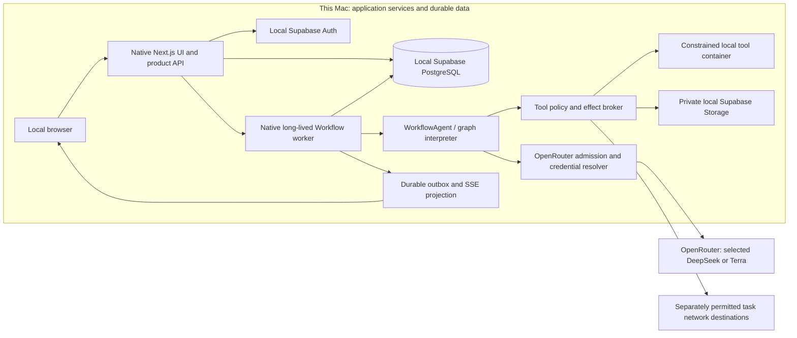
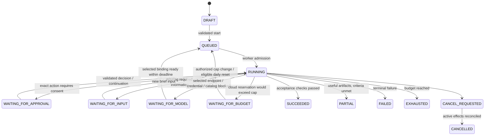

# PRD — local Mac AutoGPT clone with Next.js, Vercel AI SDK, Supabase and OpenRouter

**Research date:** 2026-11-04, America/Costa_Rica.  
**Status:** finalized requirements; application implementation and release qualification pending. All application services and durable application data run on this Mac. OpenRouter is the only inference provider. Public catalog/SDK research does not establish paid inference, integration correctness or clone quality.  
**Product baseline:** [PRD-AutoGPT.md](PRD-AutoGPT.md), including AG-01–AG-14.  
**Normative contracts:** [PRD-Model-Providers.md](PRD-Model-Providers.md) governs model identities, credentials, selection, budgets and APIs; [PRD-Local-Mac-Deployment.md](PRD-Local-Mac-Deployment.md) governs this Mac's services, ports, storage and lifecycle.  
**Normative interface design:** [PRD-Design-System.md](PRD-Design-System.md) and the exact [Luma tokens](docs/design/luma.css): shadcn Luma with dark mode as the default.  
**Package evidence:** [dependency metadata](research/dependency-snapshot.json), [OpenRouter adapter](research/openrouter-nextjs-sdk.json), [Supabase JS/SSR](research/supabase-nextjs-sdk.json).  
**Architecture:** native local Next.js 16 and a long-lived Workflow worker, AI SDK 7/Workflow SDK 5, Docker-hosted self-managed Supabase PostgreSQL/Auth/Storage, and server-only OpenRouter inference. Every role initially selects `openrouter_deepseek_flash`; `openrouter_terra` is the alternative explicit choice.

Earlier [local-model experiments](research/LOCAL-MODEL-EVIDENCE.md) are superseded research history, not dependencies, deployment options or acceptance evidence for this specification.

## 1. Product decision

Build a locally hosted workbench in which a user gives a coordinator a goal, sees its plan, delegates bounded tasks to specialists, reviews consequential actions, and receives evidence-backed artifacts. Preserve the second important AutoGPT mode: reusable, typed workflows with explicit dataflow, schedules, and execution history. A chat interface around a language model is insufficient for either mode.

The proposed TypeScript stack is considerably more capable than an AI SDK 5/6-era comparison would suggest. Current AI SDK documentation is version 7. It includes a durable `WorkflowAgent` in `@ai-sdk/workflow`, alongside the in-memory `ToolLoopAgent`. The current Workflow ecosystem also includes a Vercel-maintained PostgreSQL World for self-hosting. These provide useful execution primitives; the product still needs its own goal model, authorization, graph interpreter, evidence store, evaluation suite, and operational policies. [WorkflowAgent guide](https://ai-sdk.dev/docs/agents/workflow-agent), [Worlds directory](https://workflow-sdk.dev/worlds)

**Recommended architecture for this option:** run Next.js and its Workflow PostgreSQL worker natively on this Mac, with Supabase's self-hosted Docker Compose stack for local PostgreSQL, Auth and private Storage. Run generated code only in a separate constrained local container. Vercel's SDKs execute locally; no hosted application, orchestration, database, authentication, storage or telemetry service is in scope. Only selected inference payloads leave for OpenRouter; separately authorized task tools may access their approved network destinations.

This proposal is a behavioral reimplementation. It does not propose copying AutoGPT's protected platform source, branding, marketplace, or commercial service. The source and licensing distinctions are recorded in the baseline PRD.

### 1.1 What success looks like

A user can ask, “Research these three products, compare them using this rubric, produce a cited report, and prepare a recurring refresh.” The system:

1. Turns the request into a versioned brief and explicit acceptance criteria.
2. Reuses an appropriate specialist or creates a bounded specialist assignment.
3. Obtains sources through real tools, preserving URLs, retrieval dates, and excerpts.
4. Produces and validates an artifact; tells the user which criteria remain unresolved.
5. Offers a reusable workflow/routine, showing its inputs and external effects.
6. Resumes after an app restart and after a later approval without silently repeating a committed external action.
7. Starts every inference role on the dated DeepSeek Flash profile through OpenRouter; preserves an explicit per-run/workspace/role choice of that profile or Terra, recorded before dispatch.

The user should understand what happened, what evidence supports the result, and what needs intervention without reading a raw model transcript.

## 2. Scope and traceability to AutoGPT

The upstream research is pinned to AutoGPT commit `13ac38c5b6583bd01b0a6142b0060fc03e102b6e`. Its current product combines Otto/Experts, conversational execution, and the underlying workflow platform. Classic's historical autonomous goal loop explains part of the lineage, but it is not a complete description of the current product. [Pinned AutoGPT repository](https://github.com/Significant-Gravitas/AutoGPT/tree/13ac38c5b6583bd01b0a6142b0060fc03e102b6e)

The following are **clone requirements**, not claims that upstream implements every stronger guarantee proposed here.

| Baseline | Clone requirement | Priority | Implementation ownership |
|---|---|---|---|
| AG-01 | Workspace identity, scoped credentials, least-privilege tool access | P0 | Product API and tool broker |
| AG-02 | Persisted goal, constraints, success criteria, plan revisions | P0 | Product domain |
| AG-03 | Bounded model → tool → observation loop | P0 | WorkflowAgent plus policy wrapper |
| AG-04 | Coordinator, specialist profiles, explicit delegation lineage | P1 | Product domain plus child workflows; limited delegation qualified during P0 testing |
| AG-05 | Typed graph editing, validation, immutable published versions | P1 | React Flow UI and graph service |
| AG-06 | Readiness, fanout, joins, bounded loops, failure propagation | P1 | Custom interpreter over Workflow steps |
| AG-07 | Review queue, exact-action approval, durable continuation | P0 | Approval service plus SDK approval messages/hooks |
| AG-08 | Manual/API/webhook/scheduled runs and reusable routines | P1 | Trigger admission service |
| AG-09 | Artifacts, compact context, durable scoped memory | P0 | PostgreSQL and artifact store |
| AG-10 | Evidence-backed skill proposals and versioned promotion | P2 | Reviewable learning pipeline |
| AG-11 | Run timeline, tool logs, usage, lineage, event replay | P0 | Product event log plus telemetry |
| AG-12 | Recovery, deduplication, retry classification, cancellation | P0 | Workflow runtime plus application invariants |
| AG-13 | Reusable catalog, documented API, selected MCP integrations | P1 | Registry and integration adapters |
| AG-14 | Reproducible evaluations with deterministic checks | P0 | Evaluation harness |

### 2.1 MVP boundary

MVP contains one local owner workspace, coordinator chat, three configurable specialist profiles, at most two concurrent OpenRouter inference requests, local file/search/calculation tools, separately permitted network tools, plan/task views, private artifact storage, an approval queue, durable recovery, a small authored workflow format, and Settings → Models → OpenRouter. The UI, local file management and settings remain usable without a model key; every inference action is blocked until credential authentication, fresh catalog metadata and policy admission succeed. A visual graph editor and scheduling follow after the executor passes failure tests.

Exclude initially: a public marketplace, payments, organization billing, autonomous self-deployment, unrestricted desktop control, arbitrary connector discovery, multimodal inference, remote application deployment, and a claim of parity with every upstream integration. The internal types must support multiple workspaces even if the first UI is single-user.

## 3. Verified package and API snapshot

“Latest” means the npm `latest` dist-tag inspected on the research date, not an unpinned installation policy. Exact versions below were read from the registry. They are a proposed starting lockfile, not proof that the full dependency set has passed integration tests.

| Package | Observed latest | Role / compatibility note |
|---|---:|---|
| `next` | `16.4.5` | App Router, Route Handlers, server-rendered product UI; Node minimum 20.9, overridden by stricter SDK requirement |
| `react`, `react-dom` | `19.3.1` | Client UI; React DOM declares React `^19.3.1` |
| `ai` | `7.0.162` | AI SDK Core; requires Node `>=22` |
| `@ai-sdk/react` | `4.0.166` | `useChat` and typed UI streaming; Node `>=22` |
| `@openrouter/ai-sdk-provider` | `3.1.0` | OpenRouter-maintained AI SDK 7 adapter; ESM, Node `>=22`, peers `ai: ^7.0.0` and `zod: ^3.25.76 \|\| ^4.1.8`; durable app-credential replay remains a product integration gate |
| `@ai-sdk/workflow` | `2.0.94` | Durable agent; directly depends on `ai: 7.0.162`, peers on `workflow: ^5.1.0` |
| `workflow` | `5.3.0` | Durable steps, hooks, streams, replay and workflow API |
| `@workflow/world-postgres` | `5.1.0` | Self-hosted persistence and job processing; use compatible Workflow major/spec |
| `@supabase/supabase-js` | `2.119.0` | Local Supabase Auth/Storage client; Node `>=22.0.0`, OTel API peer `>=1.0.0` |
| `@supabase/ssr` | `0.12.7` | Cookie-based Next.js Auth clients; peers on `@supabase/supabase-js: ^2.114.0` |
| `zod` | `4.6.7` | Tool, plan, graph, API and event schemas |
| `@ai-sdk/mcp` | `2.0.90` | Selected external/local MCP capabilities, server-side only |
| `@xyflow/react` | `12.12.1` | Graph editor, P1; renderer does not provide execution semantics |
| `drizzle-orm` | `0.45.4` | Application tables and migrations, separate from World-owned tables |
| `pg` | `8.23.1` | PostgreSQL application driver |
| `@vercel/otel` | `2.2.1` | Optional Next.js OpenTelemetry setup with local collector/export only |
| `@opentelemetry/api` | `1.10.0` | Telemetry interface |
| `@workflow/ai` | `5.0.3` | **Do not use in this baseline:** this legacy package peers on `ai: ^6` |
| `eve` | `1.0.0-rc.3` | Evaluate separately as a higher-level accelerator; latest tag is a release candidate |

Registry evidence and dependency metadata are retained in the [shared snapshot](research/dependency-snapshot.json). Core compatibility records: [AI SDK](https://registry.npmjs.org/ai/7.0.162), [WorkflowAgent](https://registry.npmjs.org/@ai-sdk/workflow/2.0.94), [Workflow](https://registry.npmjs.org/workflow/5.3.0), [legacy Workflow AI](https://registry.npmjs.org/@workflow/ai/5.0.3), [React DOM](https://registry.npmjs.org/react-dom/19.3.1). The snapshot is evidence, not an installed lockfile. The added OpenRouter adapter was independently verified against its [exact npm 3.1.0 metadata](https://registry.npmjs.org/@openrouter/ai-sdk-provider/3.1.0) and [published archive](https://registry.npmjs.org/@openrouter/ai-sdk-provider/-/ai-sdk-provider-3.1.0.tgz); it is compatible with the stated AI SDK/Zod majors, without assuming compatibility from a legacy v5/v6 example.

Supabase's [JS 2.119.0 metadata](https://registry.npmjs.org/@supabase/supabase-js/2.119.0) and [SSR 0.12.7 metadata](https://registry.npmjs.org/@supabase/ssr/0.12.7) are recorded in the [dedicated snapshot](research/supabase-nextjs-sdk.json). Their peer ranges fit the selected Node 22+/OTel/JS line; this is not a completed package-resolution or integration test. Docker service releases/images are pinned separately by the local deployment contract; npm versions do not identify the PostgreSQL/Auth/Storage server images.

### 3.1 Avoid obsolete examples

- AI SDK 7 documentation uses `isStepCount`, rather than carrying forward `stepCountIs` examples without checking the installed version.
- Use `@ai-sdk/workflow` for this design, not an old `workflow/ai` `DurableAgent` tutorial.
- `ToolLoopAgent` uses `toolApproval`; current `WorkflowAgent` still uses tool-level `needsApproval`. These are not interchangeable configuration fields.
- Use `Output.object()` with the matching core/workflow package only when the serving stack supports the required output protocol. TypeScript schemas cannot create server-side constrained decoding.
- Current WorkflowAgent streaming requires an explicit limit. The exact `2.0.94` source resolves the fallback as `mode === 'generate' ? isStepCount(20) : undefined`; this confirms a 20-step non-streaming default despite the generic loop page's broader wording. Set the product limit explicitly for both APIs. [Published source archive](https://registry.npmjs.org/@ai-sdk/workflow/-/workflow-2.0.94.tgz)

These API differences were checked against current docs and the published `@ai-sdk/workflow@2.0.94` source tarball, not just search-result excerpts. [Loop control](https://ai-sdk.dev/docs/agents/loop-control), [tool approvals](https://ai-sdk.dev/docs/agents/tool-approvals), [WorkflowAgent API](https://ai-sdk.dev/docs/reference/ai-sdk-workflow/workflow-agent)

### 3.2 Evaluate eve without making it a hidden dependency

Vercel's new eve framework supplies a broader agent application layer, including skills, channels, scheduling, subagents and evaluation hooks. Its official configuration supports explicit AI SDK provider objects and a self-hosted Node server with PostgreSQL Workflow persistence. [eve overview](https://eve.dev/), [model configuration](https://eve.dev/docs/agent-config), [self-hosting](https://eve.dev/docs/guides/deployment/self-hosting)

**Decision:** keep eve out of the initial critical path because the observed latest release is an RC and the clone needs precise custom graph and permission semantics. A time-boxed prototype may replace some custom plumbing if it passes the same acceptance suite. Explicitly configure every model and compaction role; its default model behavior must not bypass the persisted provider policy, including the OpenRouter-only allowlist and local application-data boundary. Do not compare a hypothetical future eve integration as if it were already validated.

## 4. Local Mac deployment and component architecture



### 4.1 Component responsibilities

| Component | Owns | Must not own |
|---|---|---|
| Native Next.js UI/API | Local sign-in, intent, previews, permissions, validated requests and admission | Raw provider/admin keys in browser bundles; goal lifetime tied to an HTTP request |
| Native Workflow worker | Durable step history, resumption, hooks, schedules and streams | Hosted orchestration or product success criteria inferred from text |
| Agent controller | Prompt assembly, planning, bounded delegation and review | Permission escalation or unconditional completion claims |
| Graph interpreter | Port readiness, activations, joins and iteration rules | Arbitrary graph-to-JavaScript evaluation |
| Inference admission | Two OpenRouter slots, frozen role bindings, catalog checks and token/USD reservations | Other inference providers, silent model fallback or key-presence authorization |
| Credential resolver | Environment precedence, encrypted app references, validation and rotation | Secrets in checkpoints, prompts, browser responses or events |
| Local Supabase Auth | Owner identity, sign-in/session lifecycle, explicit invitations | Public signup or a hosted identity dependency |
| Local Supabase PostgreSQL | Product entities, audit/outbox records and private Workflow persistence | Browser access to credential/runtime schemas or an implicit durable-job role for Realtime |
| Local Supabase Storage | Private artifact/evidence objects on a local persistent volume | Public buckets, remote object storage or executing uploaded content |
| Local tool sandbox | Restricted code/file jobs in dedicated container workdirs | User-home, database/secret-volume or Docker-socket mounts |

### 4.2 One supported deployment topology

Follow [PRD-Local-Mac-Deployment.md](PRD-Local-Mac-Deployment.md). The MVP runs native Node processes for the application and worker; Docker runs the self-hosted Supabase services and isolated tool jobs. Every host-published service port binds **127.0.0.1**. Container-internal ports stay on a private Docker network. No LAN/public listener, remote control tunnel, hosted frontend, hosted World, hosted Supabase or hosted telemetry backend is part of this design.

Use Supabase's official **self-hosted/v0.8.3** distribution, inspected at commit **bc27d2661edd09a5d0b8d76ce33da6d4071a756e**, and record resolved image digests during implementation. Preserve its coordinated service versions. Apply reviewed loopback bindings, generated credentials, local URLs, persistent volume paths and service-health dependencies in a versioned local override. Do not run a moving `main` checkout or `latest` image as an untracked deployment. The official manual path supports macOS with Docker Desktop; its automated Linux setup script is not the Mac bootstrap. [Pinned Compose](https://github.com/supabase/supabase/blob/bc27d2661edd09a5d0b8d76ce33da6d4071a756e/docker/docker-compose.yml), [deployment evidence](research/supabase-local-deployment-snapshot.json), [Mac setup guide](https://supabase.com/docs/guides/self-hosting/docker)

| Native consumer | Proposed local address | Required connection |
|---|---|---|
| Browser UI and application API | `http://127.0.0.1:3000` | Same-origin authenticated BFF |
| Auth, REST and Storage clients | `http://127.0.0.1:54321` | Supabase gateway |
| Native application/Workflow database clients | `127.0.0.1:54322` | Explicit host publication to the `db` container's internal port 5432 |
| Supabase Studio operator | Gateway's authenticated operator route on port 54321 | Preserve gateway authentication; no raw Studio port |

These are proposed ports, not claims about running services. Check conflicts before startup without stopping unrelated processes. The upstream default database publications belong to Supavisor; replace them with the explicit direct `db` mapping for this design and remove unused host pooler ports. Keep the internal PostgreSQL port at 5432. Do not publish raw Studio or use the CLI's separate Studio port. Inspect rendered Compose and live listeners so an override cannot retain a wildcard binding alongside the new loopback mapping.

The pinned Compose also forwards `OPENAI_API_KEY` into Studio. Explicitly disable/empty that optional assistant credential in this stack so an unrelated host variable cannot introduce direct provider inference. Studio is an operator console, not another agent entry point. [Pinned Studio configuration](https://github.com/supabase/supabase/blob/bc27d2661edd09a5d0b8d76ce33da6d4071a756e/docker/docker-compose.yml#L49)

The optional Supabase CLI local stack is for disposable development/test fixtures. It has separate ports, project identity and volumes and is not a second concurrent stack sharing the owner's live data. Upgrade and restore rehearsal must use isolated test data. The deployment contract owns exact local origins and transport settings so cookie redirects, API URLs and internal service URLs agree.

The PostgreSQL World needs a long-lived worker and its own migrations. Connect it directly to local PostgreSQL with a dedicated database role and a runtime-owned, non-API-exposed schema; do not send Workflow SQL/checkpoints through PostgREST or use the browser's Supabase client. Qualify the backend's configured schema/search path, transactions, advisory locks and prepared statements against the pinned release. Supabase's pooler is not a substitute for the required direct-session semantics. Native processes use host loopback publications; Docker services use Compose service DNS/internal ports, not another container's localhost.

Vercel describes Postgres World as a tested reference implementation requiring hardening. Its internal routes and observability UI have no built-in authentication, and this backend lacks Workflow end-to-end encryption. Bind internal listeners to loopback, authenticate product-to-worker access, protect routes from the browser/public API surface, and test backup, restart and upgrade behavior. Locality alone is not authorization. [Postgres World requirements](https://workflow-sdk.dev/worlds/postgres)

### 4.3 Supabase client and storage boundaries

Use `@supabase/ssr` for cookie-based user sessions, with separate `createBrowserClient` and request-scoped `createServerClient` setup. Point both at the configured local gateway. Only the local URL and publishable client key may enter `NEXT_PUBLIC_*`; validate user identity server-side rather than trust a client-provided session object. Refresh cookies using the current Next.js integration, and disable shared caching for authenticated responses. [Supabase Next.js SSR guide](https://supabase.com/docs/guides/auth/server-side/nextjs)

The Next.js BFF receives SSR cookies, verifies the current user through its server Auth client, and enforces workspace membership before admitting requests. Durable job payloads retain verified actor IDs and authorization references, not session cookies/access tokens. Workers recheck current permissions for consequential effects. The publishable Supabase client key is the explicit browser-safe key exception; OpenRouter and Supabase administrative credentials remain server-only.

Keep three client classes separate: user-session Auth/Storage clients governed by RLS; explicitly privileged server administration for owner bootstrap/invitations; and direct PostgreSQL worker/application connections with narrowly scoped roles. Secret/service-role keys never enter browser code and can bypass RLS, so their server handlers must perform explicit workspace authorization. Public signup is disabled; create the initial owner locally and use explicit local invitations thereafter. No external email/OAuth provider is required for the first owner's password sign-in.

Private buckets store artifacts, source captures and optional restricted diagnostics. Enforce workspace ownership in Storage policies and product APIs; resolve authorized downloads through the local server or short-lived local signed URLs. A private bucket still needs tested policies. [Private bucket behavior](https://supabase.com/docs/guides/storage/buckets/fundamentals), [RLS requirements](https://supabase.com/docs/guides/database/postgres/row-level-security)

| Application configuration | Exposure and purpose |
|---|---|
| `SUPABASE_URL` | Server local gateway URL, initially `http://127.0.0.1:54321` |
| `NEXT_PUBLIC_SUPABASE_URL`, `NEXT_PUBLIC_SUPABASE_PUBLISHABLE_KEY` | Local gateway URL and intentionally public client key; requires correct Auth/RLS policies |
| `SUPABASE_SECRET_KEY` | Privileged server-only key matching the pinned deployment; a legacy service-role setup must use its corresponding server configuration |
| `DATABASE_URL` | Server-only direct loopback PostgreSQL connection using the appropriate limited role; migration privileges use a separate credential |
| `OPENROUTER_API_KEY` | Server-only inference credential, resolved under §5.4 or replaced by an authorized encrypted app reference when absent |
| `NEXT_TELEMETRY_DISABLED=1` | Disable Next.js usage telemetry for local development/build/runtime processes |

Generate installation credentials; never reuse example secrets. The UI configuration must not contain database passwords, Supabase secret/service-role keys or OpenRouter keys.

Application data, credentials, runtime tables and their backups remain on this Mac. Only bounded model-request content is sent to OpenRouter for inference; task-tool network access is separately scoped. Local Supabase persistence does not imply that inference prompts remain local.

## 5. Model registry, provider factory and credentials

The [shared provider PRD](PRD-Model-Providers.md) is normative. This section specifies its Next.js/AI SDK integration. All inference, including planning, summaries, repairs and evaluation, uses OpenRouter. The application services and durable data stay local. Merely discovering, saving or validating a key does not submit task content or start a model call.

### 5.1 The only supported inference profiles

| Registry entry | Provider | Requested canonical identity | Chat Completions wire `model` |
|---|---|---|---|
| `openrouter_deepseek_flash` — initial default | `openrouter` | `deepseek/deepseek-v4.1-flash-20261017` | `deepseek/deepseek-v4.1-flash-1017` |
| `openrouter_terra` — explicit alternative | `openrouter` | `openai/gpt-6.1-terra-20261026` | `openai/gpt-6.1-terra` |

The requested dated strings are exact catalog **`canonical_slug` values**, not the current Chat API `id` strings. Persist both. Before each paid attempt, require catalog metadata no older than five minutes, match the same non-batch Chat ID to the exact canonical identity, and block as `model_unavailable` on missing, ambiguous or changed mapping. An expired catalog that cannot be refreshed blocks new paid requests. The public alias mapping is observed metadata, not a guarantee that OpenRouter hard-pins an immutable snapshot. Do not select an older family alias, Terra Pro, `:batch`, an automatic router, or a newer dated model. Catalog capability claims are not completed inference tests. [Captured catalog](research/openrouter-model-catalog.json), [OpenRouter models API](https://openrouter.ai/api/v1/models)

### 5.2 Defaults, policy selection and immutable bindings

Retain a separate initial binding for each of the 14 canonical role keys, **all referencing `openrouter_deepseek_flash`**. This preserves future role-specific configuration without hidden framework defaults or unbudgeted reviewers. The following is a proposed constants contract, not implemented application code:

```ts
export const DEFAULT_MODEL_ROLES = {
  coordinator: 'openrouter_deepseek_flash',
  router: 'openrouter_deepseek_flash',
  planner: 'openrouter_deepseek_flash',
  executor: 'openrouter_deepseek_flash',
  researcher: 'openrouter_deepseek_flash',
  coder: 'openrouter_deepseek_flash',
  reviewer: 'openrouter_deepseek_flash',
  evaluator: 'openrouter_deepseek_flash',
  summarizer: 'openrouter_deepseek_flash',
  memory_curator: 'openrouter_deepseek_flash',
  skill_learner: 'openrouter_deepseek_flash',
  tool_repair: 'openrouter_deepseek_flash',
  workflow_generator: 'openrouter_deepseek_flash',
  general_purpose: 'openrouter_deepseek_flash',
} as const;
```

A user may explicitly select an allowlisted model for a run, save a workspace default, or set advanced role overrides. Resolve each role in this order: **run role override → explicit run-wide profile → workspace role override → workspace default → DeepSeek Flash**. A simple run selection therefore replaces inherited workspace role choices; advanced mode shows the complete effective map. Run creation freezes provider, canonical identity, wire ID, role map and `role_policy_version`, capability/catalog revision and time, generation preset, data-scope policy, credential reference, and initial budgets. Display that selection before starting and retain it in run history. Settings edits affect future admissions. MVP provider/model bindings remain immutable: choosing another model for unfinished work creates a linked new run using selected artifact references, rather than rewriting the active run or replaying provider-specific protocol state under another model. Credential rotation still resolves the current authorized key version within the original binding.

Before Run, show the selected models/roles, spend limits and external payload categories: instructions, relevant conversation/context, retrieved material, tool results and required protocol metadata. Apply workspace data-scope restrictions when assembling them. Starting a model-backed run authorizes its bounded inference calls without another approval for every call. Consequential **tools** retain their independent approval policy.

The provider allowlist contains only OpenRouter. No automatic cross-model or cross-provider fallback is permitted, and OpenRouter upstream fallback is disabled. A missing key, model outage or failed validation blocks all inference on the selected binding while local files/settings/history remain available. Do not route through the AI SDK default AI Gateway using a plain model string.

### 5.3 Explicit AI SDK providers and durable key resolution

Use **`@openrouter/ai-sdk-provider@3.1.0`** for every model call. Its verified AI SDK 7 peers fit the selected stack. The API base is exactly `https://openrouter.ai/api/v1`. Use explicit provider/model objects and the chat method. [Official integration](https://openrouter.ai/docs/guides/community/vercel-ai-sdk), [adapter metadata](https://registry.npmjs.org/@openrouter/ai-sdk-provider/3.1.0)

Illustrative factory inside the server-side model-request boundary; product contracts/helpers below are proposed, not implemented:

```ts
import 'server-only';
import { createOpenRouter } from '@openrouter/ai-sdk-provider';

async function createModelForRequest(binding: RunModelBinding) {
  assertAdmittedImmutableBinding(binding);
  if (binding.provider !== 'openrouter') throw new Error('unsupported_provider');
  const key = await credentialResolver.resolve(binding.credentialRef);
  return createOpenRouter({
    apiKey: key.value,
    baseURL: 'https://openrouter.ai/api/v1',
    compatibility: 'strict',
  }).chat(binding.apiModelId, {
    provider: { require_parameters: true, allow_fallbacks: false },
  });
}
```

`compatibility: 'strict'` is the adapter's API compatibility mode; it is not proof of JSON-schema or named-tool enforcement. Model-specific request parameters are built separately from the qualified capability record. The factory must execute only after policy/budget admission, and neither its key nor returned client is checkpoint data.

**Durability requirement:** persist only the nonsecret binding and credential reference. Construct the actual provider inside each model-request step, resolving the currently active credential version and recording that version's metadata. For `WorkflowAgent`, implement a product-owned `LanguageModelV4` wrapper whose Workflow serialization contains only this descriptor; its request methods reconstruct the official provider inside the SDK's model step. Qualify both generate and streaming/restart paths. Alternatively use explicit individually checkpointed Workflow model-call steps. Never put a whole side-effecting agent loop into one retryable step to bypass this requirement.

The repository's current adapter documentation describes serialization behavior that rereads environment credentials, but **the published 3.1.0 archive did not establish those model hooks**: its built JavaScript contains only the two Workflow symbol declarations. Do not assume the repository's moving main branch proves that the selected release supports durable app-store keys. Even an environment-only restore mechanism would not implement the encrypted workspace credential store. This is an explicit integration gate, not an implemented feature. [Published adapter archive](https://registry.npmjs.org/@openrouter/ai-sdk-provider/-/ai-sdk-provider-3.1.0.tgz), [pinned source and package evidence](research/openrouter-nextjs-sdk.json)

### 5.4 Settings, environment precedence and credential storage

At **Settings → Models → OpenRouter**, show key source, redacted authentication status, last validation time, catalog availability and inference qualification separately. Never display a saved secret. Missing OpenRouter credentials permit local owner onboarding, files, history and settings, but block every inference action as `credentials_required`. Open setup from Settings or when the user requests a model-backed action; preserve the draft while configuration is completed. Resolve `OPENROUTER_API_KEY` using **inherited process environment first**, then Next.js's native `.env*` loading order, then the encrypted app credential store. Next's files resolve `.env.$NODE_ENV.local`, `.env.local` except test mode, `.env.$NODE_ENV`, then `.env`; do not load `.env` afterward with an override that defeats that order. All processes use the same absolute `AUTOBOTS_CONFIG_ROOT`, deployment mode and normalization. Worker processes must reproduce the same effective resolver rather than infer a root from their current directory. [Next environment loading](https://nextjs.org/docs/app/guides/environment-variables)

Treat each absent or whitespace-only candidate as missing and continue precedence resolution. A nonblank but invalid environment-managed key **blocks OpenRouter** and shows instructions to fix that environment source; it must not silently fall back to a saved app key. An environment-managed value is read-only in the UI and usable only by explicitly authorized workspaces. Environment changes require a coordinated server/worker restart; app-key rotations affect the next attempt. Disconnect deletes the app-stored credential only and cannot clear a process environment variable. Saving a key does not change model defaults.

When no environment key is supplied, **Save & validate** sends the draft key once to the authenticated server handler. The server calls `GET https://openrouter.ai/api/v1/key` with Bearer authentication and checks the public model catalog. Commit an authentication-valid draft encrypted even when the catalog is temporarily unavailable; report that separate availability error and block inference until fresh metadata exists. An invalid draft or key-validation network failure leaves the prior valid app credential unchanged; distinguish rejection from temporary unavailability. Return metadata only. This flow never launches a paid completion as a “key test.” [Current-key API](https://openrouter.ai/docs/api/api-reference/api-keys/get-current-api-key)

After saving, return to the composer with its draft and pending selection preserved. **Save & validate does not launch a run**; the user selects Run to authorize bounded cloud execution. Reopening the app or restoring a draft cannot trigger paid work. Implement the shared `missing`, `validating`, `configured`, `invalid` and `unavailable` states without conflating authentication, model availability and inference qualification.

Store app credentials in local Supabase Postgres at `app_private.provider_credentials`, using **AES-256-GCM**, a fresh nonce and AAD binding workspace, provider, credential ID and version. Access them only through direct authorized server SQL, excluded from PostgREST and Realtime and denied to browser roles. The shared local bootstrap provisions one cryptographically random 32-byte master key outside the workspace at `~/Library/Application Support/Autobots/secrets/provider-master.key`, with directory mode 0700 and file mode 0600, using exclusive creation and never overwriting it. All local application/worker processes share the absolute `AUTOBOTS_PROVIDER_MASTER_KEY_FILE`; keep it outside Supabase volumes and every tool workdir. If encrypted rows already exist and the key is missing, report unavailable storage and do not create a replacement. Keep key backup separate from ciphertext backup. Credential values never enter `NEXT_PUBLIC_*`, browser storage, logs, model prompts, workflow arguments or durable state. Keep the transient form value only long enough to submit it, then clear it. Only opaque references and metadata leave the vault.

### 5.5 Capabilities, request shaping and output validation

Refresh and store the selected model's advertised parameters and relevant endpoint capabilities. Send `provider.require_parameters: true` so a route must support requested fields, and `allow_fallbacks: false`; fail visibly instead of silently dropping a requirement. Do not infer zero data retention or a `data_collection: deny` guarantee: neither is a baseline promise, and any stronger routing policy requires explicit configuration and qualification. Disable automatic model fallback lists, server tools and response-healing plugins unless separately specified. [Provider routing](https://openrouter.ai/docs/guides/routing/provider-selection), [structured output](https://openrouter.ai/docs/guides/features/structured-outputs)

Preserve provider reasoning metadata needed for tool continuation in access-controlled protocol state with its original content/order; it must survive adapter conversion and replay. This is not user-visible private-thought logging. Display concise decision summaries and evidence instead. Record the actual upstream provider for each attempt when reported, otherwise `unknown`; disabled fallback does not pin one upstream host across separate requests. [Reasoning continuation](https://openrouter.ai/docs/guides/best-practices/reasoning-tokens)

- **DeepSeek:** use only its current supported parameter set and reasoning-effort choices, captured in its own versioned request preset.
- **Terra:** the recorded catalog does not advertise `temperature`, `top_p`, `top_k` or `parallel_tool_calls`; omit them. Reasoning is mandatory and the recorded effort choices exclude `none`; do not offer a reasoning-off control. A small output budget may exhaust reasoning before producing a usable result; report that failure without automatically expanding the budget.
- **Tools:** require catalog support, validate schemas and arguments, verify result IDs, and run adversarial named-choice tests with multiple tools and a conflicting prompt. A correct one-tool response does not establish selector enforcement.
- **Structured results:** distinguish `tools`/`tool_choice` from `response_format`/`structured_outputs`. Use the appropriate qualified route; always validate complete JSON and semantics locally. An advertisement is not an SDK integration pass.
- **Planning/verdict tools:** narrow `submit_plan`/`submit_verdict` contracts may be used where appropriate, with independent validation and one bounded repair. This is an explicit output strategy, not permission to execute unconstrained fallback text.

### 5.6 Context, concurrency and provider budgets

Initial defaults are **8,192 total context tokens and 512 output tokens per request**, including allowance for provider reasoning where applicable. Count instructions, tool schemas, evidence, summaries and reserved output before dispatch. Reject or compact with an audit event before overflow; never silently truncate acceptance criteria. The catalog's larger theoretical context is not the product's default allocation.

An explicit user profile or audited run-policy revision may configure those limits within qualified model/runtime capacity and existing resource/spend controls. In particular, an Terra response that exhausts 512 tokens is a visible truncation, not permission to expand its budget automatically.

Keep **two OpenRouter inference slots**, with the same 24 actual model-request limit across roles, children and retries. Release an inference lease before waiting for a child. These conservative application limits govern spend, responsiveness and bounded execution; they are not a local GPU or model-memory capacity estimate.

For all model-backed runs, default to **USD 1 per run and USD 5 per workspace UTC day**, configurable through the authorized model policy. Under a shared transaction/lock reserve worst-known input/output cost, billable reasoning and supported per-request charges before dispatch, conservatively across eligible routing prices. Missing or unbounded price information blocks paid admission. Warn at 80% and pause at 100% of settled spend plus outstanding reservations; settle from reported usage/cost. Include retries, continuations and all helper roles. Unknown billing does not mean zero: retain ambiguous reservations for reconciliation. These application reservations are **not a provider-side hard billing cap**. Resume requires an authorized cap increase or, for the workspace daily cap only, an eligible UTC-day reset; a reset does not replenish an exhausted per-run budget.

Use local PostgreSQL lexical/full-text retrieval initially; selecting a chat model does not authorize an embedding provider, remote memory store or hidden evaluator. Keep application compaction auditable and qualify generation presets separately per provider. All run snapshots preserve the exact parameter/capability versions used.

## 6. User journeys and product behavior

### 6.1 Create and execute a goal

1. User supplies an objective, optional files, scope, deadline and constraints; the selector shows DeepSeek Flash or the explicit saved choice, with OpenRouter destination and cost limits visible.
2. The local API creates a draft `Goal` and immutable `BriefRevision` without inference. Local files, settings and previous artifacts remain accessible even when the model service is unavailable.
3. The user chooses Run or an explicitly model-backed planning action. If credentials are missing, open setup while preserving the draft. Save & validate returns to that draft without dispatching a paid call.
4. Admission freezes the complete role map and checks authenticated credentials, fresh catalog/capabilities, permissions and reservations before any planner request. It creates the product run and durable dispatch record. Key presence alone never authorizes work.
5. The planner proposes measurable criteria, a small task graph, assumptions and required capabilities within that run's budget. Deterministic validation must pass before the plan can control tools.
6. User edits or missing essential information produce a versioned plan/brief update. Continuation stays inside the already authorized run envelope; broader effects or limits require the relevant explicit change.
7. The coordinator executes/delegates and records artifact/evidence references after each meaningful task.
8. The reviewer checks criteria using actual artifacts and tool observations.
9. Completion is committed only when required checks pass; otherwise the run requests information/approval, revises a bounded part of the plan, or reports partial completion.

### 6.2 Specialist delegation

The coordinator sends a task packet containing objective, input artifact IDs, output schema, success checks, budget slice, tool allowlist, parent run ID, and a nonsecret role-binding reference from the root run snapshot. Delegation cannot choose a new provider or pass credential values. The specialist gets a separate context containing only necessary evidence. It returns a structured result and artifact references, not an entire transcript.

Child permissions are the intersection of workspace policy, parent grant, specialist profile and task grant. An agent-generated instruction cannot add a credential, network destination, filesystem root or tool. Initially permit depth 2 and at most 4 descendant assignments across the entire product run as deliberately conservative clone defaults; these are not upstream defaults.

Specialist names do not create independent epistemic authority. A reviewer using the same model can repeat the executor's mistake. Use deterministic checks, changed prompts, source checks and human evaluation to establish correctness. The AI SDK's subagent pattern supplies context-separated delegation; task admission, lineage and resource policy remain application responsibilities. [Subagent pattern](https://ai-sdk.dev/docs/agents/subagents)

### 6.3 Consequential tool approval

1. Tool broker classifies the proposed action using server-owned policy.
2. UI displays exact target, arguments, before/after diff or message body, risk class, credential scope and expiration.
3. Server persists a pending approval bound to the action hash, run, workspace and requester.
4. User approves, denies or edits. Editing creates a new action/hash and invalidates the prior approval.
5. Execution rechecks current authorization, plan version, credential validity and cancellation immediately before the effect.
6. A single-use approval becomes consumed atomically with effect admission. The resulting effect ID is attached to the run.

Approval cannot be inferred from model text or a browser-submitted message history. A valid HMAC proves an unchanged signed request; the application must still check actor authorization, action freshness, single use and workspace ownership.

### 6.4 Build or convert a reusable workflow

The user can author a graph or convert a successful run into a proposed graph. The model may suggest nodes, ports and configuration but cannot publish executable JavaScript. The server validates the graph against installed block schemas, checks credentials, then stores an immutable published version. The UI previews sample inputs and expected external effects.

A new execution always references a published version. Editing a workflow creates a new draft; it never mutates the graph currently executing. Reusable routines bind a workflow or specialist to an input template and trigger policy.

### 6.5 Recover an interrupted run

On browser reconnection, the UI reads the product run and resumes its event stream from a cursor. On worker restart, the runtime replays completed steps and resumes pending work. If OpenRouter or the selected model is unavailable, the product enters `WAITING_FOR_MODEL` with an explicit reason, retry time and remaining budget. Missing/invalid credentials or catalog mapping drift also block the selected binding until corrected. No replay or recovery path switches providers or reads a new workspace model default. Mac sleep or local service shutdown pauses local execution; restart reconciles persisted claims before new inference or tools are admitted.

For an external operation whose outcome is unknown, show a reconciliation state. Query the destination using the operation's idempotency key or external ID before allowing a retry. A generic “Retry run” button must not repeat all side effects.

## 7. The execution loops

### 7.1 Four distinct loops

| Loop | Decision maker | Persisted state | Stop conditions |
|---|---|---|---|
| Goal loop | Product coordinator and explicit policy | Goal/brief, plan revisions, criteria, budgets | Criteria satisfied, blocked, cancelled, budget exhausted |
| Agent tool loop | Model plus WorkflowAgent | Messages, durable model/tool outcomes | Final response, approval, explicit model-call cap, failure |
| Workflow dataflow loop | Deterministic graph interpreter | Activations, input tokens, outputs, joins | No runnable work, terminal outputs, error, iteration limit |
| Improvement loop | Evaluator plus human promotion policy | Evaluation cases, skill candidates, versions | Candidate promoted/rejected, fixed evaluation budget |

A finished model response is not automatically a finished goal. An empty ready queue is not automatically graph success. A positive self-review is not automatically an accepted artifact. These distinctions must be visible in state and tests.

### 7.2 Proposed agent turn contract

Each turn:

1. Load the immutable brief, active plan revision and allowed capabilities.
2. Read cancellation, deadlines and remaining reserved budget.
3. Assemble context with source labels and compact observations.
4. Obtain an inference lease and reserve maximum output tokens.
5. Resolve the selected credential reference inside the model step and call the frozen OpenRouter binding through its explicit provider instance; enforce the model-specific request allowlist.
6. Validate proposed tool names and arguments; reject unavailable capabilities.
7. Route effects through approval and idempotency policy.
8. Persist observations, usage, artifacts and task-state changes.
9. Evaluate progress against the criterion being worked on.
10. Continue, delegate, revise, wait, fail or complete according to the product state machine.

Use `WorkflowAgent` for durable tool turns and explicit Workflow functions for broader goal/graph orchestration. A single `ToolLoopAgent` inside one large retried step would replay the whole agent on failure and is unsuitable for a side-effecting long-running goal. Workflow directives separate deterministic orchestration from Node-side effects; I/O belongs in steps. [Workflow execution semantics](https://workflow-sdk.dev/docs/how-it-works/understanding-directives)

### 7.3 Boundedness and no-progress detection

Proposed initial limits, tuned after evaluation:

| Limit | Initial policy |
|---|---|
| Model calls per product run | 24 total across coordinator and children |
| Model calls per specialist assignment | 8, drawn from the parent total |
| Tool executions | 40 total across the root and children, including retried executions |
| Active execution time | 15 minutes per root run; human/model-unavailable waits are recorded separately and still obey an optional absolute deadline |
| Descendant assignments | 4 across the entire root run |
| Plan revisions | 2 automatic revisions; then request intervention |
| Schema repair | 1 repair per malformed result |
| Identical failed tool attempt | No automatic repetition without changed arguments or an identified transient cause |
| Tool recursion/delegation depth | 2 |
| Active inference | Two OpenRouter slots, subject to shared request and USD limits |
| Cloud spend | USD 1/run and USD 5/workspace UTC day by default; reserve atomically, warn at 80%, pause at 100% |
| External effect retries | Only by tool-specific idempotency/reconciliation policy |
| Artifact bytes / fetch bytes | Configured limits enforced before loading content into context |

A repeated `(tool, normalized_arguments, relevant_state_hash)` without new evidence increments a no-progress counter. Three repetitions stop the assignment. A final model response must still be evaluated; the stop reason `MAX_STEPS` maps to a partial/exhausted result, never silently to success.

Maintain tokens, OpenRouter request time, tool-call count, wall-clock and USD budgets for every role and descendant. Local application compute, disk growth and connector costs are tracked separately. Reserve before dispatch; settle after observed usage. Mark unavailable usage as unknown rather than zero.

The 24-call ceiling counts actual inference attempts, including transport retries and every role. SDK loop-step counters alone do not enforce it. Enforce admission at the model request boundary and cap nested retries; a qualified provider transport wrapper must account for requests that a higher-level callback would otherwise miss.

### 7.4 “Thinking” and planning UI

Display goals, assumptions, plan steps, chosen actions, brief decision summaries, evidence and validation results. Do not promise access to a model's complete internal reasoning or render private reasoning streams as the audit trail. A concise rationale is a model-generated explanation; it is not evidence that the action is correct.

Plans are structured application objects with dependency IDs and acceptance checks. Keep them small enough for the actual context allocation. The planner proposes; deterministic validation rejects cycles, missing dependencies, impossible tool references, unauthorized actions and excessive fanout.

## 8. Durable execution and approval semantics

### 8.1 Product run versus engine invocation

Use distinct IDs:

- `goal_id`: user objective over its lifetime.
- `product_run_id`: one attempt to fulfill a brief revision.
- `engine_invocation_id`: one Workflow SDK run/invocation.
- `agent_assignment_id`: delegated bounded work.
- `action_id`: proposed logical operation.
- `effect_id`: deduplicated external effect.

**Research finding:** the current WorkflowAgent guide uses broad suspension language, but the published `2.0.94` implementation's approval branch stops the agent loop, emits approval requests and returns an outcome. Its approval tests demonstrate continuation in a later invocation with persisted model messages and an approval response. Therefore `needsApproval: true` alone is not the product contract for a forever-suspended same-ID workflow. Persist `WAITING_FOR_APPROVAL` at the product layer and resume a validated continuation, or explicitly wrap the wait in a Workflow Hook. [Exact published WorkflowAgent source archive](https://registry.npmjs.org/@ai-sdk/workflow/-/workflow-2.0.94.tgz), [non-streaming approval guide](https://ai-sdk.dev/docs/agents/workflow-agent#approval-round-trips-without-streaming)

Source files inspected in that archive: `src/workflow-agent.ts`, particularly the paused-tool branch, and `src/test/approval-workflows.ts`. This distinction prevents UI completion events from incorrectly marking an approval-blocked goal successful.

### 8.2 Run state machine



Waiting, queued and draft states can also be cancelled; the diagram abbreviates those transitions. Terminal states require a reason code and result summary. A cancelled external request may already have committed, so cancellation records observed effects rather than claiming rollback.

A daily reset only clears a workspace-day admission block; per-run caps and all root request/time limits still apply.

### 8.3 Side-effect ledger

Every mutating tool implements this sequence:

1. Derive a stable logical `action_id`; retries keep the same ID.
2. Persist validated arguments, canonical hash, actor scope, approval and intended effect.
3. Acquire a unique effect reservation before calling the destination.
4. Send a destination-supported idempotency key when available.
5. Persist external receipt/output and transition the effect to committed.
6. On ambiguity, transition to `OUTCOME_UNKNOWN` and reconcile; do not blindly repeat.

Workflow replay reuses completed steps, but a crash after an external write and before step persistence can leave an ambiguous attempt. Stable step IDs can support downstream idempotency; they do not make every integration exactly-once. [Workflow idempotency](https://workflow-sdk.dev/docs/foundations/idempotency)

Product run admission also needs deduplication. Use an application unique key `(workspace_id, client_request_id)` and a transactional dispatch outbox. A dispatcher crash can create duplicate engine invocations; the first workflow step must atomically claim the product run and reject redundant invocation IDs before tools execute. Preserve a recovery/epoch protocol for abandoned claims. Do not claim that an outbox alone gives exactly-once execution.

Workflow's atomic start-Hook option is an alternative after qualification; the current PostgreSQL backend requires an experimental flag and a specific migration for it. It is not a default stable invariant of this MVP. Keep application admission deduplication even if that optimization is adopted.

### 8.4 Retry, timeout and cancellation matrix

| Failure | Behavior |
|---|---|
| Missing effective credential | Block every model call as `credentials_required`; preserve draft/local files/settings and show setup |
| Model transport reset before accepted output | At most two classified-safe retries within root deadline/reservations; retain attempt telemetry |
| Partial model SSE / uncertain acceptance | Persist accumulated output and uncertain attempt; no automatic redispatch until classified/reconciled |
| Unsupported request field / schema HTTP 400 | Do not retry unchanged; surface capability mismatch |
| Invalid plan/tool arguments | One repair; then stop assignment |
| Model HTTP 429/5xx | At most two bounded retries when safe, honoring `Retry-After`, root deadline and reservations |
| Cloud HTTP 402 | Preserve work and pause for insufficient credits; no provider/model substitution |
| Authentication/permission failure | Stop affected tool/model admission; expose redacted reconnection or environment-managed correction state; never substitute another credential/provider |
| Cloud catalog alias drift / missing required parameter | Block selected binding; require explicit policy/model update after revalidation |
| Cloud USD reservation exhausted | Pause further inference; preserve run; resume only under authorized budget change or eligible UTC-day reset |
| Effect response lost | Reconcile using destination idempotency/receipt |
| Approval expires | Invalidate; require a fresh action preview |
| Worker dies | Runtime recovery plus stale-claim reconciliation |
| Selected endpoint unavailable | Wait/queue within deadline; no automatic cross-model or cross-provider fallback |
| User cancels | Persist intent, stop new admissions, propagate abort, cancel child runs, reconcile active effects |

Explicitly configure retry ownership so SDK retries, workflow retries and HTTP-adapter retries do not multiply unexpectedly. Workflow supports fatal/retryable error classification and cooperative cancellation, but the tool must honor aborts and external effects cannot be undone by stopping a run. [Errors and retries](https://workflow-sdk.dev/docs/foundations/errors-and-retries), [cancellation semantics](https://workflow-sdk.dev/docs/how-it-works/cancellation)

## 9. Workflow graph semantics

### 9.1 Minimum graph model

Each graph version contains typed nodes, edges, input/output schemas, policy requirements and an execution-schema version. Each node references a versioned block definition; a node does not contain arbitrary executable user code.

Initial block families:

| Family | Examples | Runtime rule |
|---|---|---|
| Inputs/outputs | Form input, file input, artifact output | Validate at boundary |
| Deterministic transforms | Map fields, filter, format, arithmetic | No model call |
| Control flow | Branch, bounded for-each, explicit join | Interpreter-owned semantics |
| Model tasks | Classify, extract, specialist task | Frozen provider/role binding and token/time/USD budget |
| Retrieval | File search, approved web fetch | Scoped provenance and byte limits |
| Integration | Approved HTTP/MCP operation | Credentials and effect policy |
| Human | Approval, requested input | Durable waiting state |

### 9.2 Readiness and activation identity

A node becomes runnable only when its required input ports have compatible values for the same correlation/iteration key. Readiness is not “some predecessor finished.” Give every activation a unique ID derived from graph version, node, logical run, iteration and input sequence. A loop can therefore execute the same node many times without overwriting its earlier state.

Fanout carries explicit branch/correlation IDs. Joins specify `all`, `any`, or a defined aggregate with a timeout and missing-input policy. Never accidentally zip unrelated items or form an unbounded Cartesian product. The graph validator must reject implicit cycles; only explicit bounded loop blocks may create repetition in the initial release.

This is an intentional initial subset of AutoGPT's more flexible repeated-emission/static-link dataflow. Preserve explicit static values separately from per-activation dynamic tokens, and add compatibility fixtures before claiming equivalent graph behavior. The MVP's DAG-plus-bounded-loop restriction must appear in import/validation errors and the builder UI.

Store outputs as typed references and persist propagation. A failed branch results in a visible failed/skipped/degraded downstream status according to the graph's policy. A graph completes when all required terminal conditions are met and no required activation is pending—not just when the scheduler is temporarily idle.

### 9.3 What Vercel libraries do and do not provide

Workflow SDK gives a durable substrate for individual block activations and waits. It does not automatically reproduce AutoGPT's port, emission, collection, join or graph-version behavior. React Flow provides an editor surface. The clone must own and test those semantics explicitly.

Compile a validated graph into an interpreted execution plan, not into untrusted source code. Start with sequential execution; introduce parallel deterministic/read-only activations under quotas. Model blocks share the OpenRouter inference semaphore and the root run’s common request/cost reservations.

## 10. Tool registry, permissions and integrations

Proposed registry metadata:

```ts
type ToolDefinition = {
  name: string;
  version: string;
  inputSchemaId: string;
  outputSchemaId: string;
  effect: 'read' | 'workspace-write' | 'external-write' | 'code-execution';
  credentialScopes: string[];
  allowedHostPolicyId?: string;
  timeoutMs: number;
  maxOutputBytes: number;
  retryClass: 'read-safe' | 'idempotent-write' | 'reconcile-first' | 'never';
};
```

Every execution validates arguments again in the tool broker. Model-visible descriptions are capability explanations, not authorization. Credentials are looked up at execution time from a server-side reference. An LLM never sees the raw token unless a specific tool's legitimate task requires content containing it, which should be exceptional and separately designed.

MCP is an integration transport, not a security boundary or permission policy. Pin the tool manifest/version admitted to a run, review changes, scope resources and wrap effects through the same broker. Use `@ai-sdk/mcp` clients inside appropriate server/step lifetimes; do not serialize live clients or stdio process handles into checkpoints. Current SDK documentation supports HTTP and local stdio transports with protocol-version negotiation. [MCP integration](https://ai-sdk.dev/docs/ai-sdk-core/mcp-tools)

For generated-code execution, use a constrained local Docker job with a dedicated working directory, CPU/memory/time limits, read-only root filesystem where practical, and network denied unless an exact task capability allows it. Do not mount the Docker socket, user home, Supabase volumes or credential directory. The trusted local tool runner creates containers; agent code never receives host process or container-management authority. No remote sandbox service is in scope.

## 11. Storage and domain schema

| Entity | Required data / invariant |
|---|---|
| `Workspace`, `Membership` | Local Supabase Auth user ID, owner/admin/member role and policy version; enforced on every API and stream |
| `ExpertProfile`, `ExpertVersion` | Instructions, skill refs, allowed tools, model role, default budget |
| `Goal`, `BriefRevision` | Objective, constraints, criteria, input refs, author, immutable revision |
| `PlanRevision`, `Task` | Dependencies, assignee, checks, status, evidence refs |
| `ProductRun` | Brief/plan versions, runtime version, immutable model-policy snapshot, status, token/time/USD budget, terminal reason |
| `ModelPolicy`, `RunModelBinding` | OpenRouter-only provider policy, workspace/run/role selections, `role_policy_version`, provider, canonical identity, wire ID, catalog/capability/preset revision/time, credential reference and initial limits; model bindings frozen for admitted runs; linked replacement runs preserve lineage |
| `ProviderCredential` | Workspace/provider, encrypted ciphertext/nonce/tag, AAD version, encryption-key version, opaque reference, credential version, validation metadata; stored values decrypted only inside resolver/request boundary |
| `EngineInvocation` | Product run, Workflow run ID, continuation index, claim epoch |
| `AgentAssignment` | Parent, child profile version, context hash, permissions, budget slice |
| `WorkflowDefinition`, `WorkflowVersion` | Draft/published status, graph, schema/block versions |
| `NodeActivation`, `PortValue` | Activation/correlation IDs, inputs, outputs, attempt state |
| `ToolCall`, `EffectLedger` | Validated inputs, action hash, effect state, external receipt |
| `Approval` | Actor, action hash, expiry, verdict, consumed state, signature reference |
| `Artifact`, `Evidence` | Workspace-scoped private local Storage object key, content hash, media type, source URI and provenance |
| `MemoryItem` | Workspace/expert scope, source evidence, confidence, expiry, version |
| `SkillVersion`, `SkillProposal` | Content, source runs, evaluation result, approval and rollback |
| `Schedule`, `TriggerReceipt` | Timezone, next occurrence, misfire rule, deduplication key |
| `RunEvent` | Monotonic per-run sequence, type, timestamp, payload version, correlation IDs |
| `InferenceLease`, `UsageLedger` | Provider slot, atomic token/USD reservation, UTC-day workspace total, actual usage/cost, credential-version metadata, runtime timing, unknown settlements, lease recovery |
| `DispatchOutbox` | Transactional admission event, delivery/reconciliation state |

Keep user-facing application domain tables in `public`, with narrow grants, RLS and workspace policies on every API-exposed table. Use `app_private` for encrypted credentials, effect/reservation ledgers and other internal records; exclude it from PostgREST and Realtime exposure. The worker's `workflow_runtime` schema is also private, owned by its migration role and accessed directly by a limited database role. Do not write inside Supabase's `auth` or `storage` schemas except through supported APIs/migrations. Application tables reference Workflow IDs rather than reaching into runtime internals.

Native services use a scoped `DATABASE_URL` against the local loopback PostgreSQL port. A direct database role does not automatically inherit the browser JWT's RLS context: handlers must validate identity/workspace, use bounded database grants and explicitly tested transaction/query scoping. Keep runtime migrations separate from application and Supabase upgrades; verify the chosen World supports its private schema/search path before release.

Store final artifacts and evidence in the private `artifacts` bucket on Supabase Storage's local filesystem volume. Use workspace/object IDs and immutable content hashes; native working files live in private local workdirs and are imported through the artifact service. Backup PostgreSQL, Storage bytes, application configuration and encryption-key material consistently, with the key backup separate. Test complete restore into an isolated local stack; a database-only or transcript-only backup cannot recover file bytes and running jobs.

An object upload and a database transaction are not atomic together. Persist staging status and a stable artifact operation ID, upload/verify the object's content hash, then publish committed metadata and events. Reconcile interrupted uploads and orphan objects. Success requires the actual object to be present and authorized, not merely an artifact metadata row.

PostgreSQL full-text search is sufficient for the first memory/retrieval release. Memory writes need provenance, scope, expiry and user correction. Facts retrieved from untrusted pages must not silently become high-priority instructions. AI SDK documents provider-defined memory, external memory integrations and custom tools; it is not missing memory integration capabilities. This design keeps scoped memory and full-text search in local PostgreSQL, without a hosted memory or embedding dependency. Long-term memory still requires an explicit application contract. [AI SDK memory options](https://ai-sdk.dev/docs/agents/memory)

## 12. API and streaming contracts

All routes below are **proposed product APIs**, not AutoGPT or SDK endpoints.

| Route | Contract |
|---|---|
| `POST /api/goals` | Create brief; return goal/revision IDs |
| `POST /api/goals/:id/plans` | Propose plan from a brief version |
| `POST /api/runs` | Validate explicit model/policy selection, freeze per-role bindings and reservations; require client request ID; return `202` with product run ID or redacted blocked-admission reason |
| `GET /api/runs/:id` | Authoritative product state and available actions |
| `GET /api/runs/:id/events?after=...` | Authorized event replay followed by live SSE |
| `POST /api/runs/:id/messages` | Append user input/steering with message ID and expected version |
| `POST /api/runs/:id/cancel` | Durable cancellation intent; idempotent |
| `POST /api/approvals/:id/decision` | Actor-bound verdict with expected action hash |
| `POST /api/workflows/:id/versions` | Validate and publish immutable graph version |
| `POST /api/schedules` | Create routine trigger with timezone and misfire policy |
| `GET /api/artifacts/:id` | Scoped metadata or authorized download |
| `GET /api/model-health` | Redacted OpenRouter capability, availability, catalog age and queue state; no key values |
| `GET /api/settings/model-providers` | Metadata-only credential source/status, validation timestamps and supported provider choices |
| `PUT /api/settings/model-providers/openrouter/credential` | Owner/admin Save & validate with expected settings version; authenticate draft and check catalog server-side, atomically encrypt/store an auth-valid key, report catalog availability separately; return metadata only |
| `DELETE /api/settings/model-providers/openrouter/credential` | Owner/admin disconnect with expected version; remove app credential, never environment key; active requests and future admissions tracked separately |
| `POST /api/settings/model-providers/openrouter/validate` | Validate effective key with OpenRouter `GET /api/v1/key`, plus catalog capabilities; no paid completion |
| `GET /api/models` | Exactly the two allowlisted OpenRouter profiles with canonical/wire mapping, capabilities and qualification status |
| `PUT /api/settings/model-policy` | Owner/admin versioned workspace default/advanced role policy and budgets; changes apply to future runs, not existing admitted bindings |

Provider-related events include `model.binding.resolved`, `provider.validation.changed`, `credential.rotated`, `model.admission.blocked`, `inference.dispatched`, `usage.settled`, `budget.warning` and `budget.paused`. Their typed payloads contain provider, canonical/wire IDs, policy/capability revision, credential reference/version and bounded usage metadata, never the key or task content merely because settings were opened.

Credential/policy mutations require authenticated workspace owner/admin authority, CSRF protection and optimistic concurrency checks; stale writes return conflict. Run selection requires permission to use that provider in the workspace. The MVP uses the strictly loopback local origin specified by the deployment contract, with Host/Origin validation, CSRF protection, body-size limits and body/header redaction. OpenRouter traffic always uses HTTPS; no LAN/public HTTP endpoint is permitted. All errors are categorized and sanitized. The shared MP-05 contract is authoritative; a Python-backed deployment maps these public `/api` routes to matching `/v1` service paths.

An SSE event contains `event_id`, `product_run_id`, `sequence`, `type`, `schema_version`, `timestamp`, correlation IDs and a typed payload. Persist state transition and event in one application transaction. Subscribers may receive duplicates; the client deduplicates by sequence. Cursor gaps trigger a snapshot plus replay. The durable database outbox and worker own dispatch; product SSE owns reconnectable UI projection. Supabase Realtime is not the job queue, Workflow checkpointer or authoritative completion log.

Use AI SDK UI message chunks for conversational rendering and the product event stream for operational state. Do not derive authoritative run state by parsing assistant text. `WorkflowChatTransport` provides reconnection support, but raw model-stream indexes differ from UI chunk indexes; follow its documented transform/cursor contract and authorize every reconnect endpoint. [WorkflowChatTransport reference](https://ai-sdk.dev/docs/reference/ai-sdk-workflow/workflow-chat-transport)

Persist user-facing `UIMessage` records for replay and display, plus the necessary model-message/tool ledger for continuation. Treat client-submitted history as untrusted and reconstruct authoritative server history. [Message persistence guidance](https://ai-sdk.dev/docs/ai-sdk-ui/chatbot-message-persistence)

### 12.1 Shared Luma interface

Use shadcn components with the exact user-supplied Luma semantic tokens in [docs/design/luma.css](docs/design/luma.css), governed by [DS-01–DS-05](PRD-Design-System.md). The first visit renders dark regardless of the operating-system preference. An explicit light/dark choice persists locally and is applied before paint; missing or invalid preference falls back to dark. The light token block is supported, but it is not the initial appearance.

Apply the same tokens to sign-in, the shell/sidebar, goal composer, model setup, plans, activity, approvals, artifacts, Experts, workflow canvas/inspectors and Operations. Primary actions use Luma blue; chart colors do not become a replacement brand palette. Use semantic classes and shared components instead of hardcoded colors or per-screen theme variants. Preserve accessible labels, keyboard/focus behavior and textual status/diff meaning in both modes. Theme changes must not dispatch model calls or alter durable run state.

The earlier warm-neutral/forest-green mockups are superseded visual exploration. The regenerated [concept gallery](docs/imagine/index.html) illustrates the selected direction; the design PRD and exact CSS, not raster samples, govern implementation. All relevant UI stories inherit DS-01–DS-05 and their evidence requirements.

## 13. Logs, evaluation and evidence

### 13.1 Three observability layers

1. **User timeline:** selected model/provider, plan proposed, task delegated, tool started, artifact created, approval needed, validation failed, budget warning/pause and run finished.
2. **Audit events:** actor, action hash, credential reference, authorization result, effect receipt, policy/model/prompt/tool versions.
3. **Engineering telemetry:** queue wait, model time-to-first-token, generation time, input/output tokens, tool duration, retries, memory pressure, workflow replay and failures.

Correlate workspace, goal, product run, engine invocation, assignment, tool call, effect and trace IDs. Redact credentials and sensitive tool arguments by schema. Raw prompts/responses are opt-in restricted diagnostic artifacts with retention controls, not default console logs.

Use a local OpenTelemetry collector/exporter or local files for operational traces and the local durable product event log for the audit trail. Do not enable hosted telemetry, session replay or remote tracing endpoints. Set `NEXT_TELEMETRY_DISABLED=1`; serve application assets locally instead of introducing CDN or remote analytics dependencies. Telemetry sampling or exporter failure must not erase user-visible history. AI SDK telemetry is an instrumentation interface; configure its input/output recording deliberately. [AI SDK telemetry](https://ai-sdk.dev/docs/ai-sdk-core/telemetry), [Next.js opt-out](https://nextjs.org/telemetry)

### 13.2 Evaluation harness

Use the shared comparison corpus: 100 protocol cases and 40 held-out task fixtures repeated three times, plus a dedicated permission/recovery suite. Cover structured calls, multi-step tasks, interruption/approval, prompt injection, graph semantics and schedules. These counts are proposed scope, not completed tests; use the same fixtures and resource envelope for both architecture options.

Every case records provider, canonical identity, wire ID, catalog revision, credential-source metadata, runtime/adapter version, sampling configuration, tool versions, fixture data, prompt/skill versions, expected artifacts, deterministic assertions and resource budgets. Separate pass/fail correctness from a model-generated critique.

Use deterministic checks where possible: arithmetic, schema conformity, file existence/content, citation resolution, allowed-domain enforcement, effect counts, task dependency validity and bounded execution. Human grading checks whether the output actually satisfies the objective. An evaluator role using either selected model can flag candidates for review, but its score alone cannot release the system.

### 13.3 Launch gates

| Gate | Acceptance criterion |
|---|---|
| Protocol | At least 98% first-pass valid tool selection/arguments across 100 cases; 100% correct call-ID/result association for executed calls |
| Structured plans | Every persisted/executed plan passes schema validation; at most one repair, then explicit failure |
| Functional quality | At least 85% complete success across 40 held-out tasks repeated three times, with no fabricated tool completion |
| Safety invariants | Zero unauthorized effects in the permission/adversarial suite |
| Recovery | All fixture runs recover after process kill at model/tool/approval boundaries without duplicate committed effects |
| Cancellation | No new effects admitted after cancellation becomes authoritative; active-effect outcomes accurately reported |
| Provenance | Every externally sourced final claim required by a task has a resolvable evidence reference |
| Inference allowlist | Network instrumentation confirms every role, retry, repair, summary and evaluation uses only the admitted OpenRouter route; no hidden default provider or model fallback |
| Model selection | All 14 roles initialize to DeepSeek Flash; explicit Terra/role choices are frozen at admission; key setup never launches inference or silently reassigns a model |
| Credential boundary | MP-A01–MP-A04 and MP-A10–MP-A11 pass: full precedence/whitespace/test rules, invalid environment blocking, invalid-draft preservation, encrypted storage, auth/catalog separation, rotation/restart and tenant isolation; no raw key in bundles, logs or checkpoints |
| Missing-key flow | MP-A12 passes: local UI, files, history and settings remain available, but all model calls are `credentials_required`; auth-valid save preserves composer draft/selection without dispatch; user Run initiates bounded work |
| Luma interface | DS-01–DS-05 pass: exact semantic tokens, dark on a fresh visit under either OS preference, explicit light/dark persistence before paint, accessible key flows in both modes, and screenshots bound to the tested revision |
| Cloud contracts | MP-A05–MP-A07 pass: five-minute mapping freshness and drift rejection, qualified model-specific parameters, strict tools/schema/SSE and genuine named enforcement through the adapter; reasoning/tool continuation survives replay |
| Cloud budgets | Parallel requests reserve atomically; helper roles/retries counted; 80% warning/100% pause, unknown-cost handling and UTC-day rollover tested |
| Local deployment/data | LM-A01–LM-A09 pass: loopback/direct-DB/Studio boundaries, owner Auth, private Storage/RLS, nonexposed runtime/credential schemas, ARM64/runtime compatibility, restart and full local restore |
| Performance | Publish measured p50/p95 task and provider latency plus local application resource use; no invented tokens-per-second target |

Do not waive safety invariants to hit an aggregate task-success percentage. If the selected model misses the functional gate, narrow task scope, reduce tool complexity and improve validation; changing to the other profile requires explicit selection. Catalog presence or credential validation does not waive functional and SDK qualification gates. Mocked tests may establish application behavior without paid calls; actual model qualification is a separately authorized, bounded test run.

## 14. Scheduling and skill improvement

Schedules store IANA timezone, original rule, next occurrence, missed-run policy and maximum concurrent occurrences. Default this user's UI to `America/Costa_Rica`; persist UTC timestamps as well. An occurrence key deduplicates repeated scheduler delivery. Choose explicitly whether a missed occurrence is skipped, run once on recovery, or replayed with a bounded catch-up count.

A routine reuses a published workflow/expert version and a fixed policy envelope, including explicitly selected provider roles and cloud budget rules. Scheduled replay never infers cloud consent from a newly configured key. Updating a routine's instructions or scopes creates a new version. A schedule does not grant authority that an interactive run lacks. Approval expiration must not make recurring effects permanently pre-approved unless the user configured a precise standing policy.

Skill learning is P2: extract a candidate from successful runs, attach supporting evidence and intended applicability, run regression tests, and present a diff for promotion. Keep skills as versioned instructions/examples. Do not let the agent rewrite its permission policy, evaluator rubric, model allowlist or own runtime. Rollback must restore the previous skill version and preserve the audit history.

## 15. Security and reliability requirements

- Enforce workspace ownership on runs, stream cursors, artifacts, approvals, graph versions and credentials.
- Treat web pages, files, tool outputs, MCP descriptions and imported skills as untrusted data. Preserve origin labels and prevent them from overriding system policy.
- Validate fetch destinations before and after redirects; block private/metadata addresses except explicitly configured internal tools.
- Resolve and constrain filesystem paths; prevent traversal, symlink escape and cross-workspace access.
- Never give generated code direct host shell access, Docker socket access, Supabase volume mounts or credential-directory access.
- Protect internal Workflow callback endpoints. Excluding them from Next.js proxy matching is an integration requirement, not permission to expose them unauthenticated. [Next.js Workflow setup](https://workflow-sdk.dev/docs/getting-started/next)
- Keep credential values out of checkpoint inputs, prompts, persistent browser state, tool schema descriptions and telemetry. The transient credential form is cleared after submission; all GET/status APIs are metadata-only. Protect credential/policy mutations against cross-site requests and require workspace owner/admin authority. Agent tools cannot read the key directory, environment files, credential tables or process environments.
- Resolve credentials server-side at each admitted request; lock the OpenRouter origin, do not forward keys on redirects, and preserve environment-managed precedence. No `NEXT_PUBLIC_OPENROUTER_API_KEY`, plaintext app credential storage or silent provider substitution.
- Bound tool output sizes, attachment sizes, graph activations, pending approvals and retained stream data.
- Use database constraints for unique action/effect IDs and atomic version comparisons.
- Pin package/runtime/graph/prompt versions for every run; retain compatible execution code for in-flight runs or drain/migrate deliberately. [Workflow versioning](https://workflow-sdk.dev/docs/foundations/versioning)
- Record a degradation mode when local PostgreSQL/Auth/Storage, the worker or OpenRouter is unavailable. Never report success before required writes are durable. Without OpenRouter, permit local inspection/settings/files while blocking inference.
- Verify every host-published port is loopback-only. Supabase publishable client keys require RLS; secret/service-role keys and direct DB credentials remain server-only. Deny default grants to private runtime/credential schemas.
- Keep backups, logs, source captures and native workdirs on this Mac. Review outbound application connections to ensure only OpenRouter control/inference calls and explicitly permitted task destinations leave the local stack.

These are product implementation requirements, not claims that selecting an SDK automatically enforces them.

## 16. Proposed repository layout

```text
apps/web/                    Next.js UI, API, instrumentation and Workflow integration
packages/contracts/          API/events/plan/graph/tool schemas
packages/domain/             goals, plans, approvals, profiles and run state machine
packages/agents/             prompts, role assembly and delegation rules
packages/model-config/       initial DeepSeek role constants, immutable bindings and capability policy
packages/model-providers/    OpenRouter request factory, credential-bound V4 wrapper and request shaping
packages/credentials/        environment resolution, AES-GCM vault, validation and metadata-only settings
packages/workflows/          goal orchestration and graph interpreter
packages/tools/              typed tool adapters and authorization broker
packages/storage/            local Supabase clients, RLS, app tables, private artifacts and outbox
packages/observability/      product events, redaction and OTel helpers
packages/evals/              fixtures, deterministic checks and reports
services/tool-sandbox/       local isolation adapter and worker protocol
ops/supabase/                pinned official Compose, local overrides, volumes and migrations
ops/                         native process lifecycle, local manifest, backup and restore scripts
```

Runtime secrets belong in local environment configuration or encrypted app storage, not committed `.env` files. Read the existing `OPENROUTER_API_KEY` through native Next loading; when missing, the implemented settings flow must support entry without asking the user to paste the key into a chat. Local master-key bootstrap is shared with the normative provider contract.

## 17. Delivery phases and exit criteria

| Phase | Deliverable | Exit criterion |
|---|---|---|
| 0 — local foundation and provider setup | Pinned local Supabase Compose, native Next.js/worker, owner Auth, private Storage, scoped schemas, registry, settings/vault and policy | Loopback ports and local persistence verified; RLS/private-schema isolation passes; missing-key flow and no-paid-save behavior pass; no local inference or hosted application dependency |
| 1 — durable vertical slice | Goal → plan → two tools → private artifact → verification with frozen OpenRouter bindings | Bounded authorized adapter qualification; worker restart/browser reopen preserve outcomes; credential-safe replay works; stale mapping/missing key blocks rather than reroutes |
| 2 — policy and specialists | Profiles, scoped delegation, approval/effect ledger | Narrowed child permissions; tampered/expired approval rejected; effect deduplication proven |
| 3 — workflow product | Graph schema, authored workflows, editor and local schedule admission | Fanout/join/iteration fixtures pass; Mac sleep/restart and missed-run behavior demonstrated |
| 4 — release hardening | Task evaluations, cost reservations, local backup/recovery, resource controls and upgrade runbook | Both enabled model routes pass documented gates; Supabase and worker restart/restore tests preserve private data and pending work; no unexpected outbound service dependency |
| 5 — optional local product expansion | Skill proposals, selected MCP connectors and eve spike | Same local hosting/data, OpenRouter-only inference and permission invariants pass |

Do not begin with a marketplace or a large graph canvas. Establish one end-to-end durable outcome and its failure behavior before widening the tool catalog.

## 18. Closed decisions and remaining implementation risks

| Question / risk | Current decision | Remaining evidence |
|---|---|---|
| Where do application services/data run? | Only this Mac: native application/worker and Docker-hosted self-managed Supabase | Port, outbound-connection, restart and local backup/restore checks |
| Which inference route is allowed? | OpenRouter only; DeepSeek Flash defaults and explicit Terra choice | Actual protocol/task evaluations, canonical-drift and budget tests |
| Are models qualified by catalog/key validation? | No; metadata/authentication and inference qualification are separate | Tools/schema/SSE, genuine named enforcement, continuation and semantic fixtures |
| Can the published provider serialize app credentials safely by itself? | Not established for 3.1.0; use descriptor-only wrapper or explicit model-call steps | Environment/app-key restart, rotation and secret-leak tests |
| Is local Supabase secure by default for this product? | No; configure private buckets, RLS, scoped DB roles and nonexposed runtime/credential schemas | Ownership, cross-scope, backup and key-loss tests |
| Can requests execute concurrently? | Two OpenRouter slots under shared request/time/USD limits | Atomic reservation and descendant admission tests |
| Should eve replace custom agent plumbing? | Optional local RC spike outside the critical path | Provider-policy, secret-boundary and feature-parity tests |
| Is `WorkflowAgent` a complete AutoGPT clone? | No; product domain, graph semantics, tool catalog and evals remain necessary | Vertical-slice and prioritized parity results |
| Is Postgres World turnkey production infrastructure? | No; harden its reference implementation inside the local boundary | Private schema/migration compatibility, route authorization and replay/upgrade tests |
| Can same-model review establish correctness? | No independent guarantee | Deterministic checks and independent task scoring |
| Can every connector be retried safely? | No | Per-connector idempotency or reconciliation contracts |

The requirements are finalized; these are measurable implementation risks rather than an invitation to reintroduce removed hosting or inference alternatives.

The strongest reason to choose this option is one TypeScript application stack with durable-agent primitives and strong UI integration. Its principal engineering cost is implementing goal, planning, memory, graph and evaluation behavior around those primitives, while hardening local Supabase and Workflow persistence. Finalized requirements do not claim that the application, Docker stack, credential vault or paid inference tests have been implemented or run.
