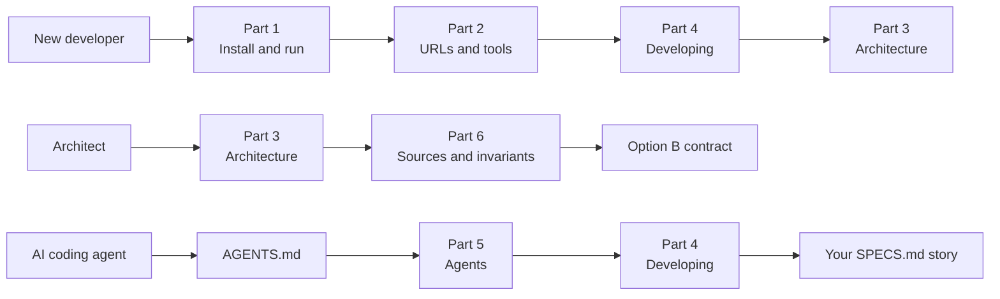
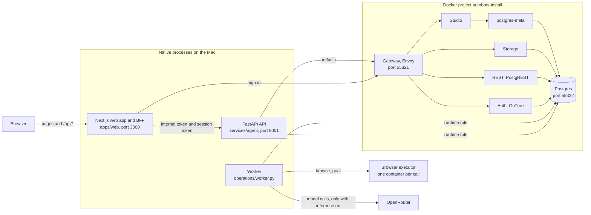
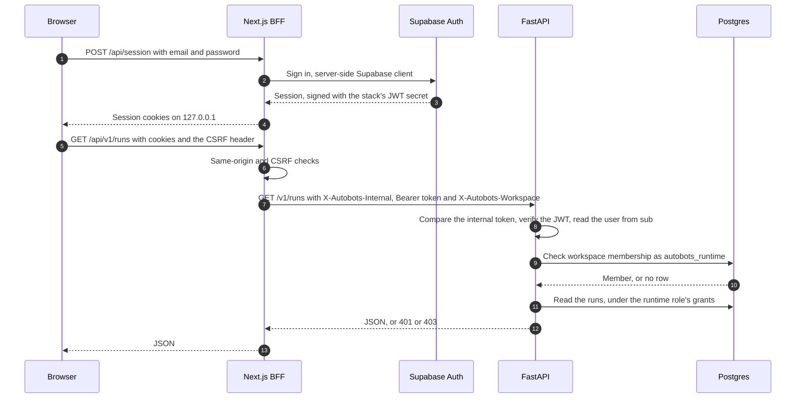
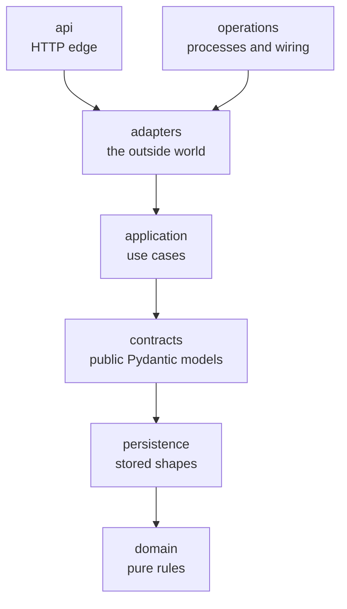
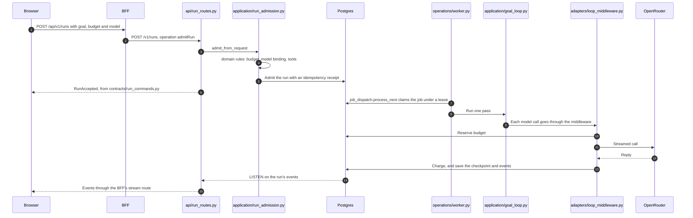
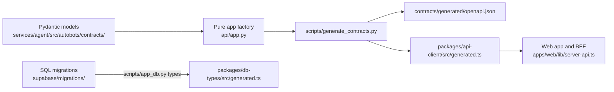
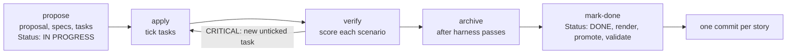

<p align="center">
  
</p>

<p align="center">
  <a href="README.md">Product overview</a> ·
  <b>Developer guide</b> ·
  <a href="README.md#quick-start">Quick start</a> ·
  <a href="SPECS.md">Backlog</a> ·
  <a href="CODEBASE.md">Codebase</a>
</p>

# Autobots developer guide

The onboarding guide for new developers, architects and AI coding agents. It covers how to install, set up and run the Autobots backend and frontend on a Mac, how the system is built, and how work gets done in this repository.

For what Autobots is and why, start with [the product overview](README.md). This guide summarizes and links. The documents it links to are the authority. If this guide and one of them disagree, follow the linked document, and fix this guide.

## Start here

Pick your role, read its first stop, then follow the rest of its path.

| You are | Read first | Then |
|---|---|---|
| **A new developer** | [Part 1: Install, set up and run](#part-1-install-set-up-and-run) | [Part 2](#part-2-local-urls-and-tools), [Part 4](#part-4-developing), then [Part 3](#part-3-how-autobots-is-built) as you need it |
| **An architect** | [Part 3: How Autobots is built](#part-3-how-autobots-is-built) | [Part 6](#part-6-for-architects), then the [Option B engineering contract](docs/engineering/option-b-contract.md) |
| **An AI coding agent** | [AGENTS.md](AGENTS.md), which your instructions load, then [Part 5: For AI coding agents](#part-5-for-ai-coding-agents) | [Part 4](#part-4-developing) and [Part 3](#part-3-how-autobots-is-built), then the [SPECS.md](SPECS.md) story you were given |
| **Running the app day to day** | [Part 1: Install, set up and run](#part-1-install-set-up-and-run) | [Part 2](#part-2-local-urls-and-tools) and the [operations runbook](docs/engineering/runbooks/operations.md) |



## Contents

- [Part 1: Install, set up and run](#part-1-install-set-up-and-run)
  - [What you need](#what-you-need)
  - [First-time setup](#first-time-setup)
  - [Every day](#every-day)
  - [Paid inference](#paid-inference)
  - [Seeing your code changes](#seeing-your-code-changes)
  - [After pulling new code](#after-pulling-new-code)
- [Part 2: Local URLs and tools](#part-2-local-urls-and-tools)
  - [Local URLs at a glance](#local-urls-at-a-glance)
  - [Web app](#web-app)
  - [API](#api)
  - [Supabase gateway and Studio](#supabase-gateway-and-studio)
  - [Database](#database)
  - [Logs and observability](#logs-and-observability)
  - [Browsing and the browser executor](#browsing-and-the-browser-executor)
- [Part 3: How Autobots is built](#part-3-how-autobots-is-built)
  - [How the pieces fit](#how-the-pieces-fit)
  - [Auth, layer by layer](#auth-layer-by-layer)
  - [The frontend](#the-frontend)
  - [The Python service](#the-python-service)
  - [Following one run through the layers](#following-one-run-through-the-layers)
  - [Contracts: from Pydantic to TypeScript](#contracts-from-pydantic-to-typescript)
- [Part 4: Developing](#part-4-developing)
  - [Repository map](#repository-map)
  - [Checks and tests](#checks-and-tests)
  - [Changing the API contract](#changing-the-api-contract)
  - [Changing the database](#changing-the-database)
  - [Adding a tool](#adding-a-tool)
  - [Code conventions](#code-conventions)
  - [Safety rules for everyone](#safety-rules-for-everyone)
- [Part 5: For AI coding agents](#part-5-for-ai-coding-agents)
  - [Instruction files](#instruction-files)
  - [Specialist agents](#specialist-agents)
  - [Skills](#skills)
  - [Hooks](#hooks)
  - [How work is delivered](#how-work-is-delivered)
  - [When to stop and ask](#when-to-stop-and-ask)
  - [Reporting honestly](#reporting-honestly)
- [Part 6: For architects](#part-6-for-architects)
  - [Sources of truth](#sources-of-truth)
  - [Architectural invariants](#architectural-invariants)
  - [Decisions](#decisions)
  - [Reviews and the refactor plan](#reviews-and-the-refactor-plan)
  - [Changing the architecture](#changing-the-architecture)
- [Part 7: Reference](#part-7-reference)
  - [Everyday commands](#everyday-commands)
  - [Where things live](#where-things-live)
  - [Glossary](#glossary)

---

## Part 1: Install, set up and run

The web app, API and worker run natively on the Mac. Supabase runs in Docker. The `make` targets wrap `scripts/persistent_install.py`, which [the persistent install runbook](docs/engineering/runbooks/local-supabase.md#the-persistent-install) describes.

### What you need

Nothing in the repository installs these. The versions must match exactly, except Docker's. Only Apple Silicon Macs are qualified.

| Tool | Version | Notes |
|---|---|---|
| Docker, such as Docker Desktop | A current version with Compose | Must be running |
| `python3.12` | 3.12.16 | On your `PATH`, for example from Homebrew |
| `uv` | 0.13.6 | On your `PATH` |
| `node` | 22.23.2 | Through nvm, in `~/.nvm/versions/node/v22.23.2` |

You don't need to install pnpm. The scripts run it through Corepack inside the repository. Check what you have:

```bash
python3.12 scripts/toolchain.py versions
```

### First-time setup

```bash
make first-time
```

It downloads packages and the pinned Supabase images, so it needs the network. It makes no model calls and costs nothing. In order, it:

1. Installs the Python and Node packages from the lockfiles, inside the repository.
2. Pulls the pinned Supabase images.
3. Records the install and generates its secrets in `~/.local/share/autobots-install`.
4. Starts the containers, creates the database roles, and applies the migrations and the reference seed.
5. Builds the web app.
6. Creates your owner account and a workspace named `Personal`.

If it stops partway, `make first-time` won't run again once an install is recorded. Run the steps after the one that failed, in the order the Makefile's `first-time` target lists them: `make images`, `make install`, `make build` and `make owner`, after `make toolchain`. [The persistent install runbook](docs/engineering/runbooks/local-supabase.md#the-persistent-install) says what each install stage refuses.

Then:

1. Start everything with `make start`.
2. Open http://127.0.0.1:3000 and sign in as the generated owner. The email and password are `OWNER_EMAIL` and `OWNER_PASSWORD` in the install's owner file, which [the persistent install runbook](docs/engineering/runbooks/local-supabase.md#the-persistent-install) locates.
3. Add your OpenRouter key at **Settings → Models → OpenRouter → Save & validate**. Saving it doesn't start a run or spend money.
4. Set up backups with [the backup runbook](docs/engineering/runbooks/backup-restore.md). Saving a key creates the master key that encrypts stored credentials, and losing it loses them.

### Every day

```bash
make start
```

```bash
make status
```

```bash
make stop
```

- `make start` starts the containers, API, web app and worker, with paid inference off. Running it again is safe.
- `make status` shows what's listening and each process.
- `make stop` stops the web app, API and worker, then the containers. Data stays in Docker's named volumes.
- `make stop-app` stops only the web app, API and worker.

### Paid inference

Inference is off by default, so runs you start stay queued and nothing is billed. To process them:

```bash
make stop-worker && make start-worker INFERENCE=enabled
```

**This spends real money.** Every queued run, in every workspace with a key, sends billed requests to OpenRouter. To turn it off, run `make stop-worker && make start-worker`.

### Seeing your code changes

The install runs production builds: `next start` for the web app, and `uvicorn` without reload for the API. There's no hot-reload target, so restart what you changed:

| You changed | Run |
|---|---|
| Python in `services/agent` | `make stop-api && make start-api`, and for worker code `make stop-worker && make start-worker`. Add `INFERENCE=enabled` to `start-worker` if paid inference was on, since a restart turns it off. |
| The web app in `apps/web` | `make build`, then `make stop-web && make start-web` |
| A migration in `supabase/migrations` | Follow [Changing the database](#changing-the-database) first, then `make migrate` |

You don't need the running install for most checks: the `harness`, `fast` and `full` profiles start nothing persistent. See [Checks and tests](#checks-and-tests).

### After pulling new code

First see whether the new code changes the database, the Supabase stack or the Python packages:

```bash
git diff --stat ORIG_HEAD HEAD -- supabase infra/supabase services/agent/uv.lock
```

- **If that lists nothing:** run `make stop-app`, `make toolchain` and `make build`, then `make start`.
- **If it lists anything:** follow [the upgrade runbook](docs/engineering/runbooks/upgrade.md). That means a backup, the new migrations' header checks, then `make migrate`, `make build` and a restart.

`make start` never applies migrations. With migrations missing, the API reports `schema_behind` and refuses new work.

---

## Part 2: Local URLs and tools

### Local URLs at a glance

Use `127.0.0.1`, not `localhost`. Sign-in cookies and the API's allowed origin are tied to `127.0.0.1`.

| Service | URL | Without credentials |
|---|---|---|
| Web app | http://127.0.0.1:3000 | 200, with a sign-in page |
| API | http://127.0.0.1:8001 | 401 |
| Supabase gateway and Studio | http://127.0.0.1:55321 | 401, apart from `/storage/v1/status` |
| Postgres | `127.0.0.1:55322`, database `postgres` | Needs a role password |

These are the default ports. The install records its own in `install.json`, and `make` reads them from there.

### Web app

http://127.0.0.1:3000

| Page | URL |
|---|---|
| Home | http://127.0.0.1:3000/ |
| Runs | http://127.0.0.1:3000/runs |
| One run | `http://127.0.0.1:3000/runs/<id>` |
| One run's inspector | `http://127.0.0.1:3000/runs/<id>/inspector` |
| Approvals | http://127.0.0.1:3000/approvals |
| Experts | http://127.0.0.1:3000/experts |
| Workflows | http://127.0.0.1:3000/workflows |
| Tools | http://127.0.0.1:3000/tools |
| Operations | http://127.0.0.1:3000/operations |
| Settings | http://127.0.0.1:3000/settings |
| Models | http://127.0.0.1:3000/settings/models |
| Keys & vars | http://127.0.0.1:3000/settings/keys-and-vars |
| Sign in | http://127.0.0.1:3000/sign-in |

### API

http://127.0.0.1:8001

- It answers 401 to any request without the internal token, which is in the install's `app.env`.
- To explore it, sign in to the web app and go through the BFF. For example, http://127.0.0.1:3000/api/v1/runs lists runs and http://127.0.0.1:3000/api/models lists models.
- The interactive docs are off: `/docs` and `/openapi.json` return 404. The full schema is [contracts/generated/openapi.json](contracts/generated/openapi.json).

The BFF's routes:

| BFF route | What it does |
|---|---|
| `/api/v1/*` | Forwards to the API's `/v1/*` |
| `/api/v1/runs/<id>/events/stream` | Streams a run's events |
| `/api/settings/*` | Settings reads and writes |
| `/api/models` | The models offered for new runs |
| `/api/session` | Signs in and out |
| `/api/csrf` | Issues the CSRF token |
| `/api/workspace` | Chooses the workspace |

### Supabase gateway and Studio

http://127.0.0.1:55321

- **Studio, at http://127.0.0.1:55321/:** asks for a basic-auth login. The username is `DASHBOARD_USERNAME` (`supabase` by default) and the password is `DASHBOARD_PASSWORD`, both in the install's `stack.env`.
  - The table editor, SQL editor, Auth users and Storage browser work.
  - Its Logs pages stay empty, because Supabase's logging service, `analytics`, isn't part of the install.
  - Its AI assistant is off, with an empty `OPENAI_API_KEY`.
- **REST, Auth and Storage:** `/rest/v1/`, `/auth/v1/` and `/storage/v1/` need the anon or service key from `stack.env`. Only `/storage/v1/status` answers without one.
- **Sign-up is off.** `make owner` creates the owner account once.

### Database

`127.0.0.1:55322`, database `postgres`. This port goes straight to the `db` container's port 5432, not through a pooler.

- The role passwords are in `stack.env` and `app.env`. The API and worker connect as `autobots_runtime`, which has only the grants it needs, and migrations run as `autobots_migrator`.
- For a quick look without a password, open `psql` inside the container:

```bash
docker exec -it autobots-install-db-1 psql -U supabase_admin -d postgres
```

That's the superuser on real data. Stick to `select`, or start with `begin transaction read only;`.

### Logs and observability

There is no Grafana, Loki or hosted tracing. Remote tracing is excluded by design: the API and worker turn off any inherited LangSmith or OpenTelemetry settings at startup, and Operations reports it.

| What | Where |
|---|---|
| Health: database, schema, checkpoints, Storage, disk, queue, worker, OpenRouter and the last backup | http://127.0.0.1:3000/operations |
| One run's events, steps, tool calls, approvals and spend | `http://127.0.0.1:3000/runs/<id>/inspector` |
| API, web and worker logs | `make logs` |
| One container's logs | `docker logs -f autobots-install-<service>-1`, where the service is `db`, `auth`, `rest`, `storage`, `api-gw` or `studio` |
| Containers, with logs, CPU and memory | Docker Desktop's Containers view, project `autobots-install` |

```bash
make logs
```

```bash
docker logs -f autobots-install-db-1
```

`make logs` follows `api.log`, `web.log` and `worker.log` in the install's `logs` folder; Ctrl+C stops it. The logs are JSON lines:

- Secret shapes are replaced with `[redacted]`.
- Identifiers are cut to eight characters.
- An exception logs its type, never its message.
- HTTP access lines aren't logged.

Adding Grafana, Loki or another service would change the install's topology, which [PRD-Local-Mac-Deployment.md](docs/PRD/PRD-Local-Mac-Deployment.md) owns, so it needs the owner's decision first.

### Browsing and the browser executor

`browse_goal` drives a hardened Chromium container, one per call, behind an egress proxy that allows only the hosts the call names. It's available only when both of these hold:

1. **The switch is on.** `AUTOBOTS_BROWSER_EXECUTOR` is `enabled`. A value saved for a workspace in Settings → Keys & vars wins. Otherwise the process environment counts, then the repository's `.env`, which `make start` passes to the API and worker only when it reads exactly `enabled`.
2. **The executor is qualified at the current code.** The live check passed at the images' current source fingerprint, and both images still carry that fingerprint.

To build the images and qualify them:

```bash
make browser-images && python3.12 scripts/qualify_browser_executor.py
```

- **The check:** it runs 25 cases on a disposable database. Among them: only named hosts are reached; private addresses, files, downloads and request bodies are refused; the memory, process and time caps end a session; and a crashed worker's containers are swept.
- **The report:** it goes to `.checks/browser-executor/qualification.json`.
- **No restart:** the running API and worker read the report each time they decide whether browsing is available, and re-check the image labels at least every 30 seconds.
- **Each call:** waits for approval, then runs on the run's researcher model. With paid inference on, that costs money.

[The operations runbook](docs/engineering/runbooks/operations.md#turning-on-browse_goal) covers browsing in full.

---

## Part 3: How Autobots is built

### How the pieces fit

Every port is published on loopback only.



- **Browser:** talks only to the web app. It never calls the API directly.
- **Web app:** renders pages and serves `/api/*` as a backend-for-frontend (BFF). It signs people in through Supabase Auth and forwards API calls with the internal token and the person's session token.
- **API:** answers the BFF, checks every request, and reads and writes Postgres as the restricted runtime role.
- **Worker:** claims queued work, runs the goal loop, and makes model calls only when it was started with inference on.
- **Supabase:** Auth, REST, Storage and Studio sit behind one gateway. Realtime, Edge Functions and the pooler are not part of the install.
- **OpenRouter:** the only inference provider. There is no fallback provider and no local model server.

### Auth, layer by layer

A request passes four checks on its way from the browser to Postgres.



| Layer | What it does | Files |
|---|---|---|
| **Supabase Auth** | Stores users and issues session tokens, signed with HS256. It runs as the `autobots-install-auth-1` container, with sign-up off. | [infra/supabase/compose.overlay.yaml](infra/supabase/compose.overlay.yaml), on top of [infra/supabase/upstream/](infra/supabase/upstream) |
| **Web sign-in and session** | The sign-in page and form. A server-side Supabase client keeps the session in cookies, and one route signs in and out. | [app/sign-in/page.tsx](apps/web/app/sign-in/page.tsx), [components/sign-in-form.tsx](apps/web/components/sign-in-form.tsx), [lib/session.ts](apps/web/lib/session.ts), [app/api/session/route.ts](apps/web/app/api/session/route.ts), [lib/sign-in-failure.ts](apps/web/lib/sign-in-failure.ts) |
| **BFF** | Checks same-origin and the CSRF token, the `autobots.csrf` cookie matched by the `x-autobots-csrf` header. It then calls the API with three headers: `X-Autobots-Internal`, `Authorization: Bearer <session token>` and `X-Autobots-Workspace`. | [lib/request-guard.ts](apps/web/lib/request-guard.ts), [app/api/csrf/route.ts](apps/web/app/api/csrf/route.ts), [lib/csrf-fetch.ts](apps/web/lib/csrf-fetch.ts), [lib/bff.ts](apps/web/lib/bff.ts), [lib/bff-policy.ts](apps/web/lib/bff-policy.ts), [lib/server-api.ts](apps/web/lib/server-api.ts), the routes under [app/api/](apps/web/app/api) |
| **FastAPI** | `require_internal` compares the internal token in constant time; a request from loopback gets nothing for that. `verified_claims` decodes the session token once per request, requiring HS256, audience `authenticated`, and the `exp`, `sub` and `aud` claims. `current_user` takes the user from `sub`, never from anything the browser names. Then workspace membership is checked, and the default is to deny. | [api/security.py](services/agent/src/autobots/api/security.py), [api/membership.py](services/agent/src/autobots/api/membership.py), [api/dependencies.py](services/agent/src/autobots/api/dependencies.py) |
| **Database** | Roles, grants, row-level security and Storage policies. Members may only read Storage objects; writes go through the API. | [supabase/bootstrap/roles.sql](supabase/bootstrap/roles.sql), [supabase/bootstrap/storage.sql](supabase/bootstrap/storage.sql), [supabase/bootstrap/20261115000001_storage_members_read_only.sql](supabase/bootstrap/20261115000001_storage_members_read_only.sql), [supabase/migrations/](supabase/migrations) |

Two more places:

- [operations/bootstrap_owner.py](services/agent/src/autobots/operations/bootstrap_owner.py) creates the owner account and the first workspace (`make owner`).
- [scripts/qualify_identity.py](scripts/qualify_identity.py) is the end-to-end identity and browser check that the `db` profile runs.

### The frontend

[apps/web/](apps/web) is a Next.js App Router app, served by `next start` on the install.

| Folder | What it holds |
|---|---|
| [app/](apps/web/app) | The pages, one folder per route: `runs`, `approvals`, `experts`, `workflows`, `tools`, `operations`, `settings`, `sessions`, `sign-in`. [app/api/](apps/web/app/api) holds the BFF's routes. |
| [components/](apps/web/components) | Components by area, such as `runs/`, `approvals/`, `composer/`, `workflow-editor/`, `experts/`, `tools/`, `operations/` and `search/`, plus the shared primitives in `ui/` |
| [lib/](apps/web/lib) | Shared code. Files that start with `import "server-only"`, such as `bff.ts`, `session.ts` and `server-api.ts`, never reach the browser. |
| [tests/unit/](apps/web/tests/unit) | Unit tests, run with `node --test` |
| [tests/browser/](apps/web/tests/browser) | Playwright suites, grouped into projects in `projects.json` |

- **API calls:** both sides use the generated client in [packages/api-client/](packages/api-client).
  - Server components read through [lib/server-api.ts](apps/web/lib/server-api.ts).
  - Browser code goes through [lib/api/browser.ts](apps/web/lib/api/browser.ts), which calls the same generated operations against the BFF's same-origin `/api` routes and sends writes with the CSRF token through `csrfFetch`.
  - The BFF checks the host, origin, token, session and workspace of every call.
- **Design system:** the interface uses shadcn Luma, dark by default, with the exact tokens in [docs/design/luma.css](docs/design/luma.css) and [docs/design/studio-extensions.css](docs/design/studio-extensions.css). [PRD-Design-System.md](docs/PRD/PRD-Design-System.md) owns it.
- **Contrast:** WCAG 2.1 AA is the pass line, by [Decision 0010](docs/engineering/decisions/0010-contrast-pass-line.md). The `db` profile's visual walk measures contrast on every named surface in both themes.

### The Python service

The API and the worker share one Python package, [services/agent/src/autobots/](services/agent/src/autobots). It's split into layers by responsibility, and a test keeps imports pointing inward.

#### The api package

[api/](services/agent/src/autobots/api) is the HTTP edge.

- **[main.py](services/agent/src/autobots/api/main.py):** the process entry, `uvicorn --factory autobots.api.main:create_configured_app`. It reads configuration from the environment through `operations/composition.py`, which the worker shares, and exits on a missing or malformed setting.
- **[app.py](services/agent/src/autobots/api/app.py):** the pure factory. Building the app or its OpenAPI schema opens nothing and needs no key, which is why contract generation can run offline.
- **Routes:** one module per area, such as [run_routes.py](services/agent/src/autobots/api/run_routes.py), [run_command_routes.py](services/agent/src/autobots/api/run_command_routes.py), [approval_routes.py](services/agent/src/autobots/api/approval_routes.py), [expert_routes.py](services/agent/src/autobots/api/expert_routes.py), [workflow_routes.py](services/agent/src/autobots/api/workflow_routes.py), [tool_routes.py](services/agent/src/autobots/api/tool_routes.py), [operation_routes.py](services/agent/src/autobots/api/operation_routes.py) and [keys_and_vars_routes.py](services/agent/src/autobots/api/keys_and_vars_routes.py), plus the shared [routes.py](services/agent/src/autobots/api/routes.py).
  - Routes stay thin. They hold no SQL, apart from the event stream's `LISTEN`.
  - Each route checks the request, calls one use case in `application/`, and maps the result to a model in `contracts/`.
- **[dependencies.py](services/agent/src/autobots/api/dependencies.py):** the shared FastAPI dependencies, such as workspace and owner rules, readiness and the key check.
- **[errors.py](services/agent/src/autobots/api/errors.py):** turns a refusal from the domain or application into one HTTP error shape.
- **Other plumbing:** [settings.py](services/agent/src/autobots/api/settings.py) holds the API's configuration, [pool.py](services/agent/src/autobots/api/pool.py) the database connection pool, and [resources.py](services/agent/src/autobots/api/resources.py) the process resources as one typed `AppResources`.

#### The layers and their import rule

Each layer may import only the layers below it. [services/agent/tests/test_layers.py](services/agent/tests/test_layers.py) enforces this, function-level imports included, and counts the few known exceptions exactly, so a new one fails until someone decides to allow it.



An arrow means "may import". Each layer may also import every layer further down, so `application` may import `contracts`, `persistence` and `domain`.

| Layer | May import |
|---|---|
| `domain` | nothing else |
| `persistence` | `domain` |
| `contracts` | `domain`, `persistence` |
| `application` | `domain`, `persistence`, `contracts` |
| `adapters` | `domain`, `persistence`, `contracts`, `application` |
| `api` | `domain`, `persistence`, `contracts`, `application`, `adapters` |
| `operations` | `domain`, `persistence`, `contracts`, `application`, `adapters` |

The counted exceptions are:
- twelve imports from `application` into `adapters`;
- one from `application` into `operations`;
- one from `api` into `operations`, where `api/main.py` composes from `operations/composition.py`.

[logs.py](services/agent/src/autobots/logs.py), the JSON logger, sits beside the layers as a leaf every layer may use.

The point of the order: rules sit at the bottom with no I/O, so they're tested without a database or network. Use cases depend on small interfaces, not on psycopg or HTTP clients, so tests pass fakes. Only `adapters`, `api` and `operations` touch real infrastructure.

#### domain: the rules

[domain/](services/agent/src/autobots/domain) holds pure rules: no I/O, no framework, and no imports from other layers.

| Module | What it decides |
|---|---|
| [models.py](services/agent/src/autobots/domain/models.py) | The three approved OpenRouter profiles, the model roles, where a run's model binding comes from, and `ModelRoute` |
| [budgets.py](services/agent/src/autobots/domain/budgets.py) | Allowed run budgets, US$0.25 to US$5.00 in US$0.25 steps |
| [runs.py](services/agent/src/autobots/domain/runs.py) | Run statuses, the commands, which status each command leads to, and which actors may send each one |
| [effects.py](services/agent/src/autobots/domain/effects.py) | The receipt and approval state machines |
| [stops.py](services/agent/src/autobots/domain/stops.py) | Why a run stops, and what each stop code means |
| [errors.py](services/agent/src/autobots/domain/errors.py) | The base for refusals, which `api/errors.py` maps to HTTP |
| [execution.py](services/agent/src/autobots/domain/execution.py) | Graph-state and tool versions, so a saved run that this release can't honor pauses as `incompatible_version` |
| [tools.py](services/agent/src/autobots/domain/tools.py), [tool_catalog.py](services/agent/src/autobots/domain/tool_catalog.py) | Tool groups, operation classes and grants |
| [tool_guides.py](services/agent/src/autobots/domain/tool_guides.py) | Each tool's guide: what it does, when to use it and why. A guide describes a tool and never grants it |
| [workflows.py](services/agent/src/autobots/domain/workflows.py), [workflow_execution.py](services/agent/src/autobots/domain/workflow_execution.py) | Workflow graphs, their blocks and execution order |
| [routines.py](services/agent/src/autobots/domain/routines.py) | Scheduled routines and their occurrences |
| [improvements.py](services/agent/src/autobots/domain/improvements.py) | The verdict of a held-out replay, judged from its runs alone |
| [secret_patterns.py](services/agent/src/autobots/domain/secret_patterns.py) | The secret shapes that log redaction and displayed text both mask |

#### persistence: the shapes of stored data

[persistence/](services/agent/src/autobots/persistence) holds the typed shapes of what the database stores and returns. It doesn't hold the SQL itself.

- **[rows.py](services/agent/src/autobots/persistence/rows.py):** one frozen dataclass per query's select list, built by column name. A missing, extra or duplicate column raises. A row is never a public response: the read that selects it maps it to a contract explicitly.
- **[records.py](services/agent/src/autobots/persistence/records.py):** versioned storage formats for JSON documents kept in `jsonb` columns. A record ignores fields it doesn't know and holds no request limits, so a contract can change without breaking older saved documents.

The SQL statements live in the `application/` modules that need them. They're typed through [application/sql.py](services/agent/src/autobots/application/sql.py), which describes a connection, cursor and pool as Protocols without importing psycopg, so a real connection and a test's fake both fit. The schema itself belongs to the SQL migrations.

#### contracts: the public models

[contracts/](services/agent/src/autobots/contracts) holds the Pydantic models for everything that crosses a boundary: API requests and responses, tool inputs and outputs, and durable documents.

- **Source of OpenAPI:** these models are the source of [contracts/generated/openapi.json](contracts/generated/openapi.json) and of the web app's TypeScript client.
- **[primitives.py](services/agent/src/autobots/contracts/primitives.py):** strict building blocks such as `MicroUsd`, `Count`, `Version`, `Flag` and `UtcInput`.
- **Per area:** [runs.py](services/agent/src/autobots/contracts/runs.py), [run_commands.py](services/agent/src/autobots/contracts/run_commands.py), [approvals.py](services/agent/src/autobots/contracts/approvals.py), [experts.py](services/agent/src/autobots/contracts/experts.py), [workflows.py](services/agent/src/autobots/contracts/workflows.py), [settings.py](services/agent/src/autobots/contracts/settings.py) and others.
- **Tool contracts:** [tool_catalog.py](services/agent/src/autobots/contracts/tool_catalog.py), [github_tools.py](services/agent/src/autobots/contracts/github_tools.py), [file_tools.py](services/agent/src/autobots/contracts/file_tools.py), [web_tools.py](services/agent/src/autobots/contracts/web_tools.py), [browsing.py](services/agent/src/autobots/contracts/browsing.py) and others. Every tool version's schema digest is pinned, so a schema can't change silently under saved runs.
- **[persisted.py](services/agent/src/autobots/contracts/persisted.py):** types the durable documents, such as a run's frozen policy snapshot, stored event payloads and receipts.
- **Parity tests:** response vocabularies use the domain's enums or Literals, and tests hold them equal to the SQL `CHECK` constraints.

#### application: the use cases

[application/](services/agent/src/autobots/application) holds what the product does, in plain async Python. Both the API and the worker call into it.

| Area | Modules | What they do |
|---|---|---|
| Admission | [run_admission.py](services/agent/src/autobots/application/run_admission.py), [runs.py](services/agent/src/autobots/application/runs.py), [readiness.py](services/agent/src/autobots/application/readiness.py) | Accept or refuse a new run: readiness, budget, a usable model key, tools available. `runs.py` is the one place run commands are applied. |
| Goal loop | [goal_loop.py](services/agent/src/autobots/application/goal_loop.py), [loop_prompts.py](services/agent/src/autobots/application/loop_prompts.py), [settlement.py](services/agent/src/autobots/application/settlement.py), [run_lifecycle.py](services/agent/src/autobots/application/run_lifecycle.py), [plans.py](services/agent/src/autobots/application/plans.py), [verification.py](services/agent/src/autobots/application/verification.py), [recovery.py](services/agent/src/autobots/application/recovery.py), [compaction.py](services/agent/src/autobots/application/compaction.py) | One pass of a run: `goal_loop.py` builds the LangChain Deep Agents graph, then candidates are verified and settled, and the pass ends or pauses |
| Model spend | [model_admission.py](services/agent/src/autobots/application/model_admission.py), [model_attempts.py](services/agent/src/autobots/application/model_attempts.py), [loop_admission.py](services/agent/src/autobots/application/loop_admission.py), [loop_policy.py](services/agent/src/autobots/application/loop_policy.py), [worker_inference.py](services/agent/src/autobots/application/worker_inference.py), [profiles.py](services/agent/src/autobots/application/profiles.py) | Reserve budget before each model call, charge it afterwards, and reconcile uncertain calls |
| Tools | [tool_definitions.py](services/agent/src/autobots/application/tool_definitions.py), [tool_gateway.py](services/agent/src/autobots/application/tool_gateway.py), [tool_catalog.py](services/agent/src/autobots/application/tool_catalog.py), [tool_grants.py](services/agent/src/autobots/application/tool_grants.py), [tool_keys.py](services/agent/src/autobots/application/tool_keys.py), [approvals.py](services/agent/src/autobots/application/approvals.py), [receipts.py](services/agent/src/autobots/application/receipts.py), [reconciliation.py](services/agent/src/autobots/application/reconciliation.py), [browsing_tool.py](services/agent/src/autobots/application/browsing_tool.py) | Which tools a run may use, the approval wait, idempotency receipts for external writes, and key precedence |
| Product surfaces | [experts.py](services/agent/src/autobots/application/experts.py), [workflows.py](services/agent/src/autobots/application/workflows.py), [workflow_runner.py](services/agent/src/autobots/application/workflow_runner.py), [routines.py](services/agent/src/autobots/application/routines.py), [memory.py](services/agent/src/autobots/application/memory.py), [knowledge.py](services/agent/src/autobots/application/knowledge.py), [artifacts.py](services/agent/src/autobots/application/artifacts.py), [run_projection/](services/agent/src/autobots/application/run_projection), [search.py](services/agent/src/autobots/application/search.py) | Experts, workflows, routines, memory, artifacts, the run views and search |
| Local operations | [operations.py](services/agent/src/autobots/application/operations.py), [retention.py](services/agent/src/autobots/application/retention.py), [worker_leases.py](services/agent/src/autobots/application/worker_leases.py), [schema_release.py](services/agent/src/autobots/application/schema_release.py), [provider_settings.py](services/agent/src/autobots/application/provider_settings.py), [credentials/](services/agent/src/autobots/application/credentials) | The Operations page's checks, retention, worker leases, the schema version this code expects, and stored provider keys, sealed with AES-256-GCM under the master key |

#### adapters: the outside world

[adapters/](services/agent/src/autobots/adapters) wraps everything outside the process. Each adapter implements what `application/` asks for, so the use cases never import an HTTP client or SDK directly.

| Area | Modules | What they wrap |
|---|---|---|
| Models | [models/](services/agent/src/autobots/adapters/models), [loop_middleware.py](services/agent/src/autobots/adapters/loop_middleware.py), [model_replies.py](services/agent/src/autobots/adapters/model_replies.py) | OpenRouter, the only inference provider. `AdmittedModel` refuses any call outside an admitted dispatch, and every call streams. |
| Tool dispatch | [tool_registry.py](services/agent/src/autobots/adapters/tool_registry.py), [tool_middleware.py](services/agent/src/autobots/adapters/tool_middleware.py) | Builds the tool registry once, where the API and worker are composed |
| Checkpoints and files | [checkpoints.py](services/agent/src/autobots/adapters/checkpoints.py), [object_storage.py](services/agent/src/autobots/adapters/object_storage.py), [result_stream.py](services/agent/src/autobots/adapters/result_stream.py) | LangGraph's Postgres checkpointer, private Supabase Storage for artifacts, and live result text |
| Outbound HTTP | [provider_http.py](services/agent/src/autobots/adapters/provider_http.py), [url_guard.py](services/agent/src/autobots/adapters/url_guard.py), [tavily.py](services/agent/src/autobots/adapters/tavily.py), [jina.py](services/agent/src/autobots/adapters/jina.py), [market_data.py](services/agent/src/autobots/adapters/market_data.py), `github_*.py` | One HTTP client factory with no redirects, no proxy variables and a required timeout. The URL guard admits only `https` to public addresses. |
| Browser | [browser_executor.py](services/agent/src/autobots/adapters/browser_executor.py), [browser_cdp.py](services/agent/src/autobots/adapters/browser_cdp.py), [browser_page.py](services/agent/src/autobots/adapters/browser_page.py), [browser_qualification.py](services/agent/src/autobots/adapters/browser_qualification.py), [egress_proxy.py](services/agent/src/autobots/adapters/egress_proxy.py) | One hardened Chromium container per call, the egress proxy, and the qualification check |

#### operations: processes and wiring

[operations/](services/agent/src/autobots/operations) holds the long-running processes and the code that assembles them.

- **[worker.py](services/agent/src/autobots/operations/worker.py):** the worker process.
  - It writes a heartbeat and runs maintenance: it expires approvals, starts due routines and applies retention. A restore hold stops all three.
  - With `AUTOBOTS_WORKER_INFERENCE=enabled`, which `make start-worker INFERENCE=enabled` sets, it also processes run jobs.
  - It drains on `TERM`, so a step in the middle of a paid call can finish.
- **[job_dispatch.py](services/agent/src/autobots/operations/job_dispatch.py):** `process_next` claims the next job under a lease, and `drive_lease` keeps the lease while the pass runs.
- **[composition.py](services/agent/src/autobots/operations/composition.py):** the configuration that the API and worker both build from the environment, such as provider keys, the object store and settings checks.
- **[cli.py](services/agent/src/autobots/operations/cli.py):** shared exit codes: 0 for success, 1 for `REFUSED:`, 2 for `ERROR:` on a missing or malformed setting.
- **[bootstrap_owner.py](services/agent/src/autobots/operations/bootstrap_owner.py):** creates the owner and the first workspace.
- **Paid trials:** [route_qualification.py](services/agent/src/autobots/operations/route_qualification.py), [reasoning_trial.py](services/agent/src/autobots/operations/reasoning_trial.py) and [browse_trial.py](services/agent/src/autobots/operations/browse_trial.py) make paid model calls. They run only when someone starts them explicitly.

### Following one run through the layers



1. The browser posts the goal to the BFF, which adds the auth headers.
2. `api/run_routes.py` checks the request and calls `application/run_admission.py`.
3. Admission applies the domain rules, such as the budget, the model binding, the tools and readiness. It then admits the run atomically, with an idempotency receipt, so a retried request can't create a second run.
4. The worker claims the job under a lease and runs one pass of `application/goal_loop.py`.
5. Each model call goes through `adapters/loop_middleware.py`, which reserves budget before the call and charges it after. Checkpoints and events are saved in Postgres as the pass goes.
6. The run page follows the run's event stream, which the API reads with Postgres `LISTEN`.

### Contracts: from Pydantic to TypeScript



- **One owner per contract:** Pydantic owns the public API. FastAPI turns the models into an OpenAPI schema, and [scripts/generate_contracts.py](scripts/generate_contracts.py) writes [contracts/generated/openapi.json](contracts/generated/openapi.json) and the TypeScript client [packages/api-client/src/generated.ts](packages/api-client/src/generated.ts).
- **Validated at runtime:** a TypeScript type doesn't validate JSON, so every generated `parse` function checks the response at runtime.
- **Headers the client leaves out:** the BFF sets the auth and workspace headers from the verified session, so the generated functions don't take them.
- **Database types:** SQL owns the database schema. [packages/db-types/src/generated.ts](packages/db-types/src/generated.ts) lists the columns the `authenticated` role can select, regenerated by `scripts/app_db.py types`. See [packages/db-types/README.md](packages/db-types/README.md).

---

## Part 4: Developing

### Repository map

| Path | What it holds |
|---|---|
| [apps/web/](apps/web) | The Next.js web app and BFF |
| [services/agent/](services/agent) | The Python API and worker: `src/autobots/` and `tests/` |
| [packages/api-client/](packages/api-client) | The generated TypeScript API client and its runtime |
| [packages/db-types/](packages/db-types) | The generated database row types |
| [contracts/](contracts) | The generated OpenAPI schema and shared fixtures |
| [supabase/](supabase) | Migrations, superuser bootstrap files and seeds |
| [infra/](infra) | The Supabase Compose overlay over the pinned upstream, the disposable stack, and the browser executor's images |
| [scripts/](scripts) | Checks, qualifiers, the toolchain, contract generation and install tooling |
| [tests/](tests) | Repository-level suites: `harness`, `db`, `web`, `toolchain`, `faults` and `qualification` |
| [openspec/](openspec) | OpenSpec specs, and the changes that delivered each story |
| [docs/engineering/](docs/engineering) | The Option B contract, decisions, runbooks, evidence and templates |
| [docs/reviews/](docs/reviews) | Committed code-quality reviews, their standards and the refactor plan |
| [.claude/](.claude) | Agent rules, skills, specialist agents and hooks |
| `.checks/` | Ignored reports from checks and qualifiers |

### Checks and tests

`scripts/verify.py` runs the checks in profiles. Each profile exits 0 when its checks pass, 1 when one fails, and 2 when a prerequisite is missing or a check couldn't run. Only one profile runs at a time.

| Profile | What it adds | Starts |
|---|---|---|
| `harness` | Repository checks: specs, configuration, harness tests | Nothing |
| `fast` | Lint, format, types and unit tests for what changed | Nothing |
| `full` | Every lint, type and unit check, the production build, and the web browser suite | Temporary local servers |
| `db` | Synthetic migrations, seeds, authorization and most browser suites, including the visual walk | Disposable Docker stacks, removed afterwards |
| `operations` | The operations, backup and upgrade runbooks, with a scripted model | Disposable Compose projects, removed afterwards |

```bash
python3.12 scripts/verify.py --profile fast
```

Reports go to `.checks/<profile>/latest.json`. No profile makes a paid model call or touches the persistent install. A pass is evidence for that profile only. It doesn't establish H1 or product acceptance; [AGENTS.md](AGENTS.md#commands) explains what each one proves.

For a quick loop while you work, run focused tests directly. To run one Python test file:

```bash
cd services/agent && .venv/bin/pytest tests/test_layers.py -q
```

To run one web unit test:

```bash
PATH="$HOME/.nvm/versions/node/v22.23.2/bin:$PATH" node --test apps/web/tests/unit/approval-text.test.ts
```

- **Browser suites:** they need the pinned Chromium, installed once as [the local app runbook](docs/engineering/runbooks/local-app.md) shows. They run through `scripts/qualify_web.py` and `scripts/qualify_identity.py`, which `full` and `db` call.
- **Which step runs which test:** [scripts/suites.py](scripts/suites.py) decides. A test file no step runs fails the harness unless it's listed there as manual, with a reason.
- **More detail:** [the toolchain runbook](docs/engineering/runbooks/toolchains.md) covers pinned versions and the toolchain check.

### Changing the API contract

1. Change the Pydantic models in [contracts/](services/agent/src/autobots/contracts) and the route that uses them.
2. Regenerate the OpenAPI schema and the TypeScript client:

```bash
python3.12 scripts/generate_contracts.py write
```

3. Update the web code that calls the changed functions.
4. Run `fast`. It runs `generate_contracts.py check`, which fails on any drift between the models and the generated files.

Never edit the generated files by hand. [.claude/rules/contracts.md](.claude/rules/contracts.md) has the rules, and the `autobots-contracts` skill walks through them.

### Changing the database

- **New files only.** A change is a new migration in [supabase/migrations/](supabase/migrations), named for what it does. An applied migration keeps its name and bytes. A change to a superuser file goes in a new numbered file in [supabase/bootstrap/](supabase/bootstrap).
- **The header.** Every new migration opens with its traceability comment, then three lines:
  - `-- Locks:` says what it locks, and for how long on the largest table.
  - `-- Data:` says which rows it rewrites, or none.
  - `-- Recovery:` gives the forward fix if it fails midway.

  `tests/harness/test_migration_headers.py` checks this.
- **Seeds stay separate.** Migrations and repeatable seeds are separate files. Never seed real secrets or pending inference jobs.
- **Test on a disposable stack.** The `db` profile applies everything to a disposable Docker stack and runs the authorization checks. If the change affects what members can read, regenerate [packages/db-types/](packages/db-types).
- **On the persistent install:** apply it only through [the upgrade runbook](docs/engineering/runbooks/upgrade.md): a backup, the header's checks, then `make migrate`. Never reset a persistent database or remove its volumes.

[.claude/rules/database.md](.claude/rules/database.md) and the `autobots-supabase` skill have the details.

### Adding a tool

A tool is more than a Python function. It needs:
- versioned Pydantic input and output contracts, with a pinned schema digest;
- a definition with its group, effect class, timeout and output limits;
- a handler that checks permissions in code, since a prompt is not access control;
- for a write: reconciliation, deduplication and the argument-bound approval path;
- registration, exposed deliberately through grants;
- a guide, which a unit test requires for every tool;
- an updated execution version, so existing checkpoints aren't reinterpreted.

[PRD-Tool-Catalog.md](docs/PRD/PRD-Tool-Catalog.md) owns the catalog.

### Code conventions

- **Comments** state what holds now, then cite the source: `(Decision 0026 G2)`, `PRD-Studio SR-01`, `US-14.19`. No delivery narrative, such as "a later story", and no IDs from a review round that isn't committed under `docs/reviews/`.
- **Suppressions** name a code and a reason, for example `# noqa: RUF009 - frozen, so sharing the default is safe.`
- **Names:** files, tests and migrations are named for the behavior they cover, never for the story that added them. Python files are snake_case and TypeScript files kebab-case. Exception names state the outcome, such as `ProfileNotOffered`.
- **Ownership:** Pydantic and OpenAPI own the public API, and SQL owns the schema. LangGraph state, reducers and UI view models stay distinct.
- **Layers:** imports point inward, as in [the layer rule](#the-layers-and-their-import-rule).
- **The rules files:** [.claude/rules/comments-and-names.md](.claude/rules/comments-and-names.md) has these in full, and [the code-quality standards](docs/reviews/review-2026-11-12-09-52-30/standards.md) give the reasons.

### Safety rules for everyone

These apply to people and agents alike:

- **Secrets stay out:** keep `.env`, `stack.env`, `app.env`, `owner.env` and the master key out of the repository, logs, reports and tool workspaces. No environment dumps.
- **Checks spend nothing:** no paid model call in a check. Paid qualification runs only when someone starts it on purpose.
- **Persistent data is protected:** no persistent database change, reset, volume removal or cloud project link in ordinary work. Use disposable, target-guarded environments.
- **Installs stay deliberate:** install dependencies only from the locks, repo-local, when a change requires it.
- **Inference has one route:** all application model calls go through OpenRouter's approved profiles and the shared gateway.

---

## Part 5: For AI coding agents

### Instruction files

| File | What it is |
|---|---|
| [AGENTS.md](AGENTS.md) | The engineering contract: work protocol, commands, boundaries, completion evidence |
| [CLAUDE.md](CLAUDE.md) | Imports AGENTS.md, and adds the OhMyOrch workflow and where skills and agents live |
| [.claude/rules/](.claude/rules) | Scoped rules: `comments-and-names`, `contracts`, `database`, `delivery`, `infrastructure`, `model-gateway`, `nextjs`, `ohmyorch-delivery`, `python-worker` |
| [.claude/autobots.json](.claude/autobots.json) | The document map: which file is the backlog, the contract, the product PRD, and so on. Resolve documents through it. |
| [SPECS.md](SPECS.md) | The backlog: epics `EPIC-*` and stories `US-*`, each traced to its source requirements |
| [CODEBASE.md](CODEBASE.md) | What the code does now. It describes; it never sets product intent. |

### Specialist agents

[.claude/agents/](.claude/agents) defines the specialists. Writers own separate files, and reviewers inspect without repairing.

| Agent | Role |
|---|---|
| `autobots-architect` | Read-only. Cross-layer plans, state ownership, compatibility and requirement conflicts |
| `autobots-python-worker` | Writes the Python API, domain and application logic and durable LangGraph workers |
| `autobots-nextjs` | Writes the Next.js interface and BFF |
| `autobots-database` | Writes Supabase migrations, RLS, grants, private storage and deterministic fixtures |
| `autobots-infrastructure` | Writes Docker and Supabase configuration, operational tooling and runbooks |
| `autobots-reviewer` | Read-only independent review of a change, its requirement coverage and evidence |
| `autobots-spec-ingestor` | Read-only. Turns approved sources into backlog updates for the caller to save |

### Skills

[.claude/skills/](.claude/skills) holds the project's workflows. Load the one that matches the work.

| Skill | Use it to |
|---|---|
| `autobots-plan-change` | Plan one authorized work item against its SPECS and PRD acceptance |
| `autobots-implement-item` | Implement a planned story and record what changed |
| `autobots-review-change` | Review a change independently, without modifying it |
| `autobots-verify-change` | Run the right check profiles and read their evidence honestly |
| `autobots-runbook-evidence` | Maintain and exercise a runbook and its redacted evidence |
| `autobots-contracts` | Evolve API, event, database and state contracts |
| `autobots-python` | Work on typed Python in `services/agent` |
| `autobots-durable-worker` | Work on leases, checkpoints, receipts, outbox, cancellation, approvals and replay |
| `autobots-model-gateway` | Work on OpenRouter routing, budgets and tool or structured output |
| `autobots-nextjs` | Work on the web app and BFF |
| `autobots-supabase` | Work on migrations, RLS, grants, seeds and database tests |
| `autobots-docker-local` | Work on the local Docker and Supabase configuration |
| `autobots-spec-ingest` | Create or refresh the source-traceable backlog |

### Hooks

[.claude/settings.json](.claude/settings.json) runs [.claude/hooks/dispatch.py](.claude/hooks/dispatch.py) on these events. They're guardrails, not a sandbox: they stop the common mistakes, not arbitrary shell code.

| Event | What it does |
|---|---|
| `SessionStart` | Points the session to AGENTS.md, SPECS and the harness check |
| `PreToolUse` | Refuses reads and edits of secret files and of the install's private folder. Refuses commands that print `.env` files, touch key files or name the install's folder. Refuses commands that prune or remove Docker volumes, or reset a database. Refuses edits outside the checkout. |
| `PostToolUse` | After an edit, names the check domains it affects and runs ruff on a changed Python file |
| `Stop` | Blocks finishing while changed files have no current passing report from a profile that covers them |
| `SubagentStop` | Reminds a specialist to return scoped findings, changed paths and actual evidence |

So when you edit, run the profile the change needs, usually `harness` or `fast`, before you finish. A refused command means it needs the owner, not a workaround. Hand it to the person with the exact command.

### How work is delivered

**Delivering a story.** Use OhMyOrch's `/ohmyorch:deliver` with a SPECS target such as `EPIC-3` or `US-3.2`. Each story becomes one OpenSpec change, which [.claude/rules/ohmyorch-delivery.md](.claude/rules/ohmyorch-delivery.md) drives through a fixed lifecycle:



- **The record:** the archived OpenSpec change, in [openspec/changes/archive/](openspec/changes/archive), is the story's record. `tasks.md` is its only progress tracker.
- **Verify:** this step scores every scenario from what was actually run, and writes no file. A scenario never counts as passing without being observed; one that isn't observed becomes a task, which sends the change back to `apply`.
- **Order:** a story waiting only on another story's delivery is a matter of order. Deliver the prerequisite first. Never hand-edit a story to `READY`.
- **The runbook:** [docs/engineering/runbooks/ohmyorch-delivery.md](docs/engineering/runbooks/ohmyorch-delivery.md) covers install, stop, resume and recovery.

**Other work.** Anything outside that loop follows the [work-item contract, DH-W01 to DH-W06](docs/PRD/PRD-Development-Harness.md#dh-091-work-item-evidence-contract):
1. A proportional plan.
2. The implementation.
3. An independent read-only review.
4. Current verification.
5. An exercised runbook.

Evidence goes in `docs/engineering/evidence/<work-item-id>/`, from [the templates](docs/engineering/templates), checked by `scripts/evidence.py`.

**Backlog edits.** After an authorized edit to SPECS.md, run the render and validate steps:

```bash
python3.12 scripts/specs.py render && python3.12 scripts/specs.py validate
```

### When to stop and ask

Stop and report rather than proceed when the work would need any of these:

- a paid model call, or a live credential;
- a persistent database change or reset, or a cloud project link;
- a change outside this repository, or a tool that's missing;
- a decision the sources don't make: an open question, a conflict between sources, or `NEEDS CLARIFICATION`;
- anything an owner-only hook refused.

Keep unsupported behavior as a question and conflicts as blocked work. Don't infer new requirements from the code.

### Reporting honestly

- **Kinds of evidence:** mocked, static, disposable and live evidence are different things. Name which one you have.
- **What doesn't count:** a skipped test, a template or a missing tool is never a pass.
- **What a profile proves:** a passing profile is evidence for that profile only. It doesn't establish H1 or product acceptance.
- **Scenarios:** report a scenario as passing only when you observed it. One that couldn't be exercised stays `UNVERIFIED`.
- **Who owns status:** the coordinator owns status changes, and a successful syntax check never marks a story done.

---

## Part 6: For architects

### Sources of truth

| Source | Owns |
|---|---|
| [PRD-LangChain-Deep-Agents.md](docs/PRD/PRD-LangChain-Deep-Agents.md) | The selected product design: native Next.js plus Python LangGraph and Deep Agents, local Supabase, OpenRouter only |
| [docs/engineering/option-b-contract.md](docs/engineering/option-b-contract.md) | The binding engineering decisions SP-001 to SP-021: architecture, run states and transitions, durable jobs, tools and approvals, migrations, definition of done |
| [PRD-Model-Providers.md](docs/PRD/PRD-Model-Providers.md) | The approved OpenRouter models, credentials, routing and budgets |
| [PRD-Local-Mac-Deployment.md](docs/PRD/PRD-Local-Mac-Deployment.md) | Local topology: Supabase in Docker, Auth, Storage, ports, backups and recovery |
| [PRD-Tool-Catalog.md](docs/PRD/PRD-Tool-Catalog.md) | The tools, their providers and keys |
| [PRD-Studio.md](docs/PRD/PRD-Studio.md) | The product surfaces: Experts, workflows and the Studio screens |
| [PRD-Design-System.md](docs/PRD/PRD-Design-System.md) | Tokens, components, themes, and visual and accessibility evidence |
| [PRD-Development-Harness.md](docs/PRD/PRD-Development-Harness.md) | The harness: skills, agents, rules, hooks, checks and the work-item contract |
| [PRD-AutoGPT.md](docs/PRD/PRD-AutoGPT.md), [PRD-Comparison-Recommendation.md](docs/PRD/PRD-Comparison-Recommendation.md), [PRD-NextJS.md](docs/PRD/PRD-NextJS.md) | The research and the comparison behind the selected design, and the alternative not taken |
| [SPECS.md](SPECS.md) | The execution backlog, traced to these sources |
| [CODEBASE.md](CODEBASE.md) | What exists now. It describes the code and never sets intent. |

### Architectural invariants

These hold across the system. A change that breaks one needs a decision first.

- **Inference:** all application model calls go through the approved OpenRouter profiles and one shared gateway. There's no fallback, no local model server, no hosted tracing and no other provider.
- **Contracts:** Pydantic and OpenAPI own the public API, and generated TypeScript consumes it. SQL owns the persistent schema. LangGraph state and reducers and UI view models stay separate.
- **Run states:** runs use the canonical states and transitions of SP-010, and a terminal run never resumes. `domain/runs.py` lists which actors may send each command.
- **Durable work:** workers need leases with fencing, receipts, budgets and cancellation before live inference. Checkpoint ownership is enforced, not only checked before dispatch.
- **Consequential effects:** an external write waits for an approval bound to its exact arguments, and records a receipt, so a retry never repeats it.
- **Topology:** native app processes, Supabase in Docker, every port on loopback, and Studio only behind the gateway.
- **Data:** migrations and seeds are separate, applied migrations never change, and ordinary checks never touch persistent data.
- **Secrets:** they stay outside model and tool workspaces, logs and evidence. Provider keys are sealed under a master key kept apart from database backups.

### Decisions

[docs/engineering/decisions/](docs/engineering/decisions) records what the sources left open. Each decision says who decided, when, and what it amends.

| Topic | Decisions |
|---|---|
| How work is delivered | [0001](docs/engineering/decisions/0001-ohmyorch-adaptation.md), [0002](docs/engineering/decisions/0002-ohmyorch-delivery-loop.md), [0003](docs/engineering/decisions/0003-openspec-only-delivery.md), [0012](docs/engineering/decisions/0012-unqualified-hooks-in-h1.md), [0030](docs/engineering/decisions/0030-ohmyorch-0-1-0-delivery.md) |
| Models | [0004](docs/engineering/decisions/0004-terra-replaces-astra.md), [0005](docs/engineering/decisions/0005-deepseek-strict-nested-unsupported.md), [0006](docs/engineering/decisions/0006-terra-is-the-default.md), [0019](docs/engineering/decisions/0019-sol-profile-and-browser-use.md) |
| Release scope and limits | [0008](docs/engineering/decisions/0008-us-10-1-limits-accepted.md), [0009](docs/engineering/decisions/0009-release-scope-from-blocking-findings.md), [0011](docs/engineering/decisions/0011-review-dispositions.md), [0013](docs/engineering/decisions/0013-release-closure.md), [0014](docs/engineering/decisions/0014-release-limits-accepted.md) |
| Approvals, learning and accessibility | [0010](docs/engineering/decisions/0010-contrast-pass-line.md), [0015](docs/engineering/decisions/0015-approval-request-fields.md), [0016](docs/engineering/decisions/0016-held-out-replay.md) |
| Tools, connectors and browsing | [0007](docs/engineering/decisions/0007-first-connector-github-issues.md), [0017](docs/engineering/decisions/0017-tool-catalog.md), [0018](docs/engineering/decisions/0018-browser-executor.md), [0020](docs/engineering/decisions/0020-own-browsing-loop.md), [0024](docs/engineering/decisions/0024-tool-keys-from-env-and-settings.md), [0025](docs/engineering/decisions/0025-keys-and-vars.md), [0026](docs/engineering/decisions/0026-cronjob-tool-and-tool-guide.md) |
| Studio interface | [0021](docs/engineering/decisions/0021-studio-interface-redesign.md), [0022](docs/engineering/decisions/0022-studio-product-surfaces.md), [0023](docs/engineering/decisions/0023-install-current-and-real-examples.md) |
| Refactor choices | [0027](docs/engineering/decisions/0027-refactor-decisions-delegated.md), [0028](docs/engineering/decisions/0028-refactor-decisions-delegated-r21-r40.md), [0029](docs/engineering/decisions/0029-refactor-decisions-delegated-r41-r68.md) |

### Reviews and the refactor plan

[docs/reviews/review-2026-11-12-09-52-30/](docs/reviews/review-2026-11-12-09-52-30) is the latest committed code-quality review. It contains:
- the [standards](docs/reviews/review-2026-11-12-09-52-30/standards.md) the code is held to;
- the findings by area;
- the [refactor plan](docs/reviews/review-2026-11-12-09-52-30/refactor-plan.md), items R-01 to R-68, with their waves, risks and dependencies.

The evidence for each refactor batch is in `docs/engineering/evidence/REFACTOR-*/`.

### Changing the architecture

1. **Record it.** Write the decision in `docs/engineering/decisions/`, with its authority and what it amends.
2. **Update the owner.** Amend the PRD or contract section that owns the rule, keeping its `SP-*`, `EPIC-*` and `US-*` identifiers stable. When a decision amends a requirement row, update every comment that cites that row in the same change.
3. **Plan it.** Add or change stories in SPECS.md through `autobots-spec-ingest`, then render and validate.
4. **Describe it.** Update CODEBASE.md once the code changes, and keep its `Analyzed revision` honest.

---

## Part 7: Reference

### Everyday commands

From the repository root:

| Command | What it does |
|---|---|
| `make first-time` | Sets up a new install, once |
| `make start` | Containers, API, web and worker, with paid inference off |
| `make stop` | Web, API and worker, then the containers. Data is kept. |
| `make stop-app` | Web, API and worker only |
| `make stop-worker && make start-worker INFERENCE=enabled` | Restart the worker with paid inference on |
| `make status` | What is listening, and each process |
| `make logs` | Follow the API, web and worker logs |
| `make build` | Rebuild the web app |
| `make toolchain` | Reinstall packages from the locks |
| `make migrate` | Apply pending migrations, after [the upgrade runbook](docs/engineering/runbooks/upgrade.md) |
| `make browser-images` | Build the browser executor's two images |
| `python3.12 scripts/verify.py --profile <profile>` | Run a check profile: `harness`, `fast`, `full`, `db` or `operations` |
| `python3.12 scripts/generate_contracts.py write` | Regenerate the OpenAPI schema and TypeScript client |
| `python3.12 scripts/specs.py render && python3.12 scripts/specs.py validate` | Regenerate the backlog's navigation and validate it |

### Where things live

| What | Where |
|---|---|
| Install record and secrets: `install.json`, `stack.env`, `app.env`, `owner.env` | `~/.local/share/autobots-install` |
| Master key for stored credentials | `~/.local/share/autobots-install/config/secrets/` |
| App logs: `api.log`, `web.log`, `worker.log` | `~/.local/share/autobots-install/logs` |
| Backups | `~/.local/share/autobots-install/backups` |
| Database and files | Docker named volumes, `autobots-install_*` |
| Check and qualification reports | `.checks/`, ignored by Git |
| Runbooks | [docs/engineering/runbooks/](docs/engineering/runbooks) |

**To keep your data, don't run** `docker compose down -v`, `docker volume rm` or `docker system prune`. Only a backup can bring back what they delete.

### Glossary

| Term | Meaning |
|---|---|
| **Run** | One attempt to reach a goal, with a budget and a model. Its state follows the canonical SP-010 transitions. |
| **Pass** | One stretch of a run's goal loop on a worker, which ends, pauses or continues |
| **Expert** | A saved, versioned specialist: instructions, tools and model settings a run can use |
| **Workflow** | A typed, reusable graph of blocks |
| **Routine** | A schedule that starts runs, with versions and occurrences |
| **Approval** | A person's decision on one consequential tool call, bound to its exact arguments |
| **Receipt** | The durable record of an external write or a model call, so a retry never repeats it |
| **Lease** | A worker's time-limited claim on a job, with fencing so a lost lease can't keep writing |
| **Checkpoint** | LangGraph's saved graph state, stored in Postgres |
| **Profile** | An approved OpenRouter model: Terra, Sol or DeepSeek Flash |
| **Role** | One of the 14 inference roles, each bound to a profile, such as `researcher` |
| **BFF** | The backend-for-frontend: the web app's server routes under `/api/*` |
| **H0, H1** | The development-harness milestones that come before feature work |
| **`SP-*`, `EPIC-*`, `US-*`** | Contract decisions, backlog epics and user stories. These identifiers stay stable. |
| **Disposable target** | A Docker project named `autobots-disposable-*`, which checks create and remove |
| **Persistent install** | Your real local install, the Compose project `autobots-install` |
