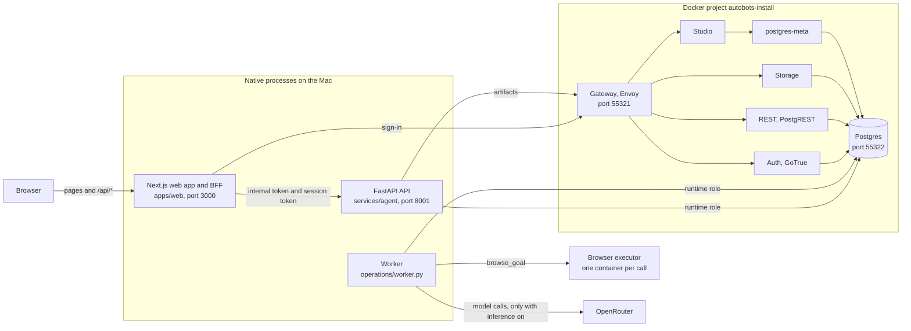
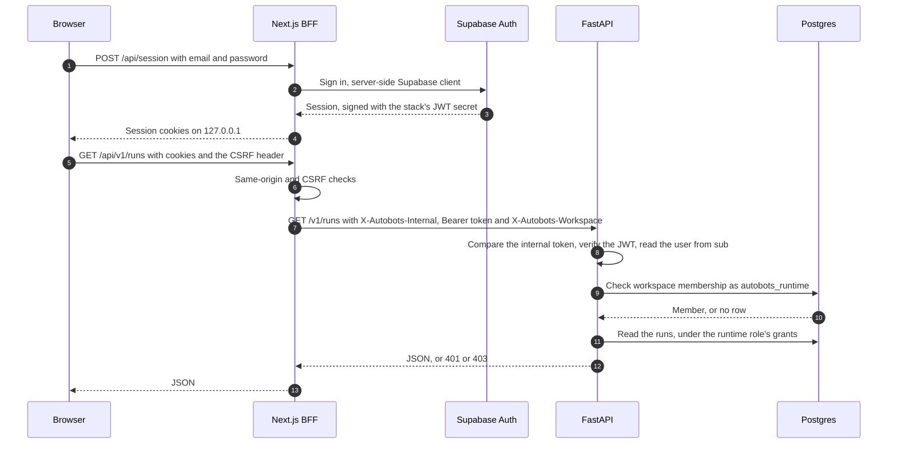
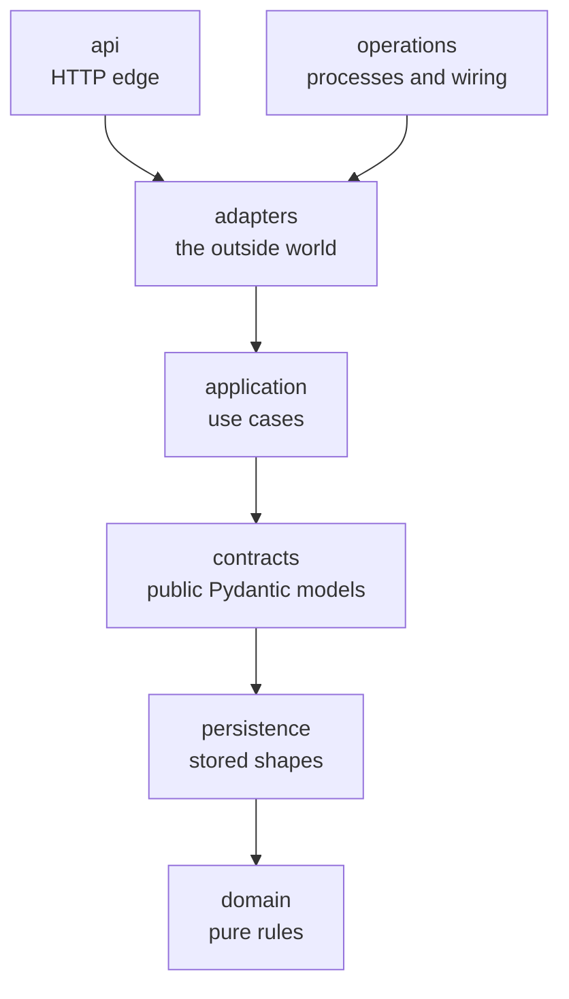
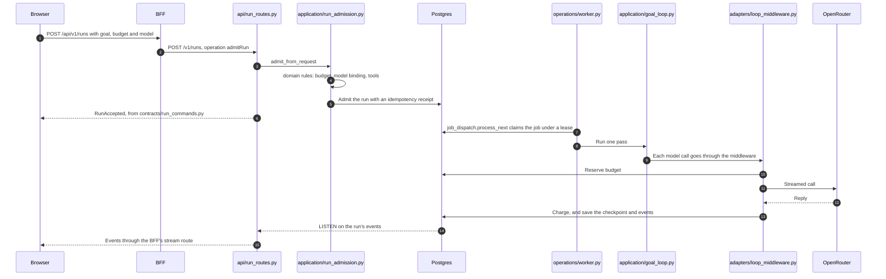
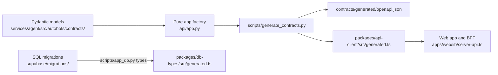

# Autobots developer guide

Where everything runs on the local install, how a request travels through it, and how the code is laid out. It complements [README-SETUP-RUN.md](README-SETUP-RUN.md), which installs and runs the app, and [CODEBASE.md](CODEBASE.md), which describes the current implementation module by module.

## Contents

- [Local URLs at a glance](#local-urls-at-a-glance)
- [How the pieces fit](#how-the-pieces-fit)
- [Web app](#web-app)
- [API](#api)
- [Supabase gateway and Studio](#supabase-gateway-and-studio)
- [Database](#database)
- [Logs and observability](#logs-and-observability)
- [Browsing and the browser executor](#browsing-and-the-browser-executor)
- [Auth, layer by layer](#auth-layer-by-layer)
- [The Python service](#the-python-service)
  - [The api package](#the-api-package)
  - [The layers and their import rule](#the-layers-and-their-import-rule)
  - [domain: the rules](#domain-the-rules)
  - [persistence: the shapes of stored data](#persistence-the-shapes-of-stored-data)
  - [contracts: the public models](#contracts-the-public-models)
  - [application: the use cases](#application-the-use-cases)
  - [adapters: the outside world](#adapters-the-outside-world)
  - [operations: processes and wiring](#operations-processes-and-wiring)
  - [Following one run through the layers](#following-one-run-through-the-layers)
- [Contracts: from Pydantic to TypeScript](#contracts-from-pydantic-to-typescript)
- [Everyday commands](#everyday-commands)

## Local URLs at a glance

Use `127.0.0.1`, not `localhost`. Sign-in cookies and the API's allowed origin are tied to `127.0.0.1`.

| Service | URL | Without credentials |
|---|---|---|
| Web app | http://127.0.0.1:3000 | 200, with a sign-in page |
| API | http://127.0.0.1:8001 | 401 |
| Supabase gateway and Studio | http://127.0.0.1:55321 | 401, apart from `/storage/v1/status` |
| Postgres | `127.0.0.1:55322`, database `postgres` | Needs a role password |

These are the default ports. The install records its own in `install.json`, in `~/.local/share/autobots-install`, and `make` reads them from there.

## How the pieces fit

The web app, API and worker run natively on the Mac. Supabase runs in Docker as the `autobots-install` Compose project. Every port is published on loopback only.



- **Browser:** talks only to the web app. It never calls the API directly.
- **Web app:** renders pages and serves `/api/*` as a backend-for-frontend (BFF). It signs people in through Supabase Auth and forwards API calls with the internal token and the person's session token.
- **API:** answers the BFF, checks every request, and reads and writes Postgres as the restricted runtime role.
- **Worker:** claims queued work, runs the goal loop, and makes model calls only when it was started with inference on.
- **Supabase:** Auth, REST, Storage and Studio sit behind one gateway. Realtime, Edge Functions and the pooler are not part of the install.

## Web app

http://127.0.0.1:3000

| Page | URL |
|---|---|
| Home | http://127.0.0.1:3000/ |
| Runs | http://127.0.0.1:3000/runs |
| One run | `http://127.0.0.1:3000/runs/<id>` |
| One run's inspector | `http://127.0.0.1:3000/runs/<id>/inspector` |
| Approvals | http://127.0.0.1:3000/approvals |
| Experts | http://127.0.0.1:3000/experts |
| Workflows | http://127.0.0.1:3000/workflows |
| Tools | http://127.0.0.1:3000/tools |
| Operations | http://127.0.0.1:3000/operations |
| Settings | http://127.0.0.1:3000/settings |
| Models | http://127.0.0.1:3000/settings/models |
| Keys & vars | http://127.0.0.1:3000/settings/keys-and-vars |
| Sign in | http://127.0.0.1:3000/sign-in |

The pages live in [apps/web/app/](apps/web/app), the components in [apps/web/components/](apps/web/components) and the shared code in [apps/web/lib/](apps/web/lib).

## API

http://127.0.0.1:8001

- It answers 401 to any request without the internal token, which is in the install's `app.env`.
- To explore it, sign in to the web app and go through the BFF. For example, http://127.0.0.1:3000/api/v1/runs lists runs and http://127.0.0.1:3000/api/models lists models.
- The interactive docs are off: `/docs` and `/openapi.json` return 404. The full schema is [contracts/generated/openapi.json](contracts/generated/openapi.json).

The BFF's routes:

| BFF route | What it does |
|---|---|
| `/api/v1/*` | Forwards to the API's `/v1/*` |
| `/api/v1/runs/<id>/events/stream` | Streams a run's events |
| `/api/settings/*` | Settings reads and writes |
| `/api/models` | The models offered for new runs |
| `/api/session` | Signs in and out |
| `/api/csrf` | Issues the CSRF token |
| `/api/workspace` | Chooses the workspace |

## Supabase gateway and Studio

http://127.0.0.1:55321

- **Studio, at http://127.0.0.1:55321/:** asks for a basic-auth login. The username is `DASHBOARD_USERNAME` (`supabase` by default) and the password is `DASHBOARD_PASSWORD`, both in the install's `stack.env`.
  - The table editor, SQL editor, Auth users and Storage browser work.
  - Its Logs pages stay empty, because Supabase's logging service, `analytics`, isn't part of the install.
  - Its AI assistant is off, with an empty `OPENAI_API_KEY`.
- **REST, Auth and Storage:** `/rest/v1/`, `/auth/v1/` and `/storage/v1/` need the anon or service key from `stack.env`. Only `/storage/v1/status` answers without one.
- **Sign-up is off.** `make owner` creates the owner account once.

## Database

`127.0.0.1:55322`, database `postgres`. This port goes straight to the `db` container's port 5432, not through a pooler.

- The role passwords are in `stack.env` and `app.env`. The API and worker connect as `autobots_runtime`, which has only the grants it needs, and migrations run as `autobots_migrator`.
- For a quick look without a password, open `psql` inside the container:

```bash
docker exec -it autobots-install-db-1 psql -U supabase_admin -d postgres
```

That's the superuser on real data. Stick to `select`, or start with `begin transaction read only;`.

- SQL migrations own the schema. They're in [supabase/migrations/](supabase/migrations), and the files that run as the superuser are in [supabase/bootstrap/](supabase/bootstrap). `make migrate` applies them through the guarded apply. Never edit an applied migration, and follow [the upgrade runbook](docs/engineering/runbooks/upgrade.md) on the install.

## Logs and observability

There is no Grafana, Loki or hosted tracing. Remote tracing is excluded by design: the API and worker turn off any inherited LangSmith or OpenTelemetry settings at startup, and Operations reports it.

| What | Where |
|---|---|
| Health: database, schema, checkpoints, Storage, disk, queue, worker, OpenRouter and the last backup | http://127.0.0.1:3000/operations |
| One run's events, steps, tool calls, approvals and spend | `http://127.0.0.1:3000/runs/<id>/inspector` |
| API, web and worker logs | `make logs` |
| One container's logs | `docker logs -f autobots-install-<service>-1`, where the service is `db`, `auth`, `rest`, `storage`, `api-gw` or `studio` |
| Containers, with logs, CPU and memory | Docker Desktop's Containers view, project `autobots-install` |

```bash
make status
```

```bash
make logs
```

```bash
docker logs -f autobots-install-db-1
```

`make status` shows what is listening and each process. `make logs` follows `api.log`, `web.log` and `worker.log` in the install's `logs` folder; Ctrl+C stops it. The logs are JSON lines:

- Secret shapes are replaced with `[redacted]`.
- Identifiers are cut to eight characters.
- An exception logs its type, never its message.
- HTTP access lines aren't logged.

Adding Grafana, Loki or another service would change the install's topology, which [PRD-Local-Mac-Deployment.md](PRD-Local-Mac-Deployment.md) owns, so it needs the owner's decision first.

## Browsing and the browser executor

`browse_goal` drives a hardened Chromium container, one per call, behind an egress proxy that allows only the hosts the call names. It's available only when both of these hold:

1. **The switch is on.** `AUTOBOTS_BROWSER_EXECUTOR` is `enabled`. A value saved for a workspace in Settings → Keys & vars wins. Otherwise the process environment counts, then the repository's `.env`, which `make start` passes to the API and worker only when it reads exactly `enabled`.
2. **The executor is qualified at the current code.** The live check passed at the images' current source fingerprint, and both images still carry that fingerprint.

To build the images and qualify them:

```bash
make browser-images && python3.12 scripts/qualify_browser_executor.py
```

- **The check:** it runs 25 cases on a disposable database. Among them: only named hosts are reached; private addresses, files, downloads and request bodies are refused; the memory, process and time caps end a session; and a crashed worker's containers are swept.
- **The report:** it goes to `.checks/browser-executor/qualification.json`.
- **No restart:** the running API and worker read the report each time they decide whether browsing is available, and re-check the image labels at least every 30 seconds.
- **Each call:** waits for approval, then runs on the run's researcher model. With paid inference on, that costs money.

[docs/engineering/runbooks/operations.md](docs/engineering/runbooks/operations.md) covers browsing and the worker in full.

## Auth, layer by layer

A request passes four checks on its way from the browser to Postgres.



| Layer | What it does | Files |
|---|---|---|
| **Supabase Auth** | Stores users and issues session tokens, signed with HS256. It runs as the `autobots-install-auth-1` container, with sign-up off. | [infra/supabase/compose.overlay.yaml](infra/supabase/compose.overlay.yaml), on top of [infra/supabase/upstream/](infra/supabase/upstream) |
| **Web sign-in and session** | The sign-in page and form. A server-side Supabase client keeps the session in cookies, and one route signs in and out. | [app/sign-in/page.tsx](apps/web/app/sign-in/page.tsx), [components/sign-in-form.tsx](apps/web/components/sign-in-form.tsx), [lib/session.ts](apps/web/lib/session.ts), [app/api/session/route.ts](apps/web/app/api/session/route.ts), [lib/sign-in-failure.ts](apps/web/lib/sign-in-failure.ts) |
| **BFF** | Checks same-origin and the CSRF token, the `autobots.csrf` cookie matched by the `x-autobots-csrf` header. It then calls the API with three headers: `X-Autobots-Internal`, `Authorization: Bearer <session token>` and `X-Autobots-Workspace`. | [lib/request-guard.ts](apps/web/lib/request-guard.ts), [app/api/csrf/route.ts](apps/web/app/api/csrf/route.ts), [lib/csrf-fetch.ts](apps/web/lib/csrf-fetch.ts), [lib/bff.ts](apps/web/lib/bff.ts), [lib/bff-policy.ts](apps/web/lib/bff-policy.ts), [lib/server-api.ts](apps/web/lib/server-api.ts), the routes under [app/api/](apps/web/app/api) |
| **FastAPI** | `require_internal` compares the internal token in constant time; a request from loopback gets nothing for that. `verified_claims` decodes the session token once per request, requiring HS256, audience `authenticated`, and the `exp`, `sub` and `aud` claims. `current_user` takes the user from `sub`, never from anything the browser names. Then workspace membership is checked, and the default is to deny. | [api/security.py](services/agent/src/autobots/api/security.py), [api/membership.py](services/agent/src/autobots/api/membership.py), [api/dependencies.py](services/agent/src/autobots/api/dependencies.py) |
| **Database** | Roles, grants, row-level security and Storage policies. Members may only read Storage objects; writes go through the API. | [supabase/bootstrap/roles.sql](supabase/bootstrap/roles.sql), [supabase/bootstrap/storage.sql](supabase/bootstrap/storage.sql), [supabase/bootstrap/20261115000001_storage_members_read_only.sql](supabase/bootstrap/20261115000001_storage_members_read_only.sql), [supabase/migrations/](supabase/migrations) |

Two more places:

- [operations/bootstrap_owner.py](services/agent/src/autobots/operations/bootstrap_owner.py) creates the owner account and the first workspace (`make owner`).
- [scripts/qualify_identity.py](scripts/qualify_identity.py) is the end-to-end identity and browser check that the `db` profile runs.

## The Python service

The API and the worker share one Python package, [services/agent/src/autobots/](services/agent/src/autobots). It is split into layers by responsibility, and a test keeps imports pointing inward.

### The api package

[api/](services/agent/src/autobots/api) is the HTTP edge.

- **[main.py](services/agent/src/autobots/api/main.py):** the process entry, `uvicorn --factory autobots.api.main:create_configured_app`. It reads configuration from the environment through `operations/composition.py`, which the worker shares, and exits on a missing or malformed setting.
- **[app.py](services/agent/src/autobots/api/app.py):** the pure factory. Building the app or its OpenAPI schema opens nothing and needs no key, which is why contract generation can run offline.
- **Routes:** one module per area, such as [run_routes.py](services/agent/src/autobots/api/run_routes.py), [run_command_routes.py](services/agent/src/autobots/api/run_command_routes.py), [approval_routes.py](services/agent/src/autobots/api/approval_routes.py), [expert_routes.py](services/agent/src/autobots/api/expert_routes.py), [workflow_routes.py](services/agent/src/autobots/api/workflow_routes.py), [tool_routes.py](services/agent/src/autobots/api/tool_routes.py), [operation_routes.py](services/agent/src/autobots/api/operation_routes.py) and [keys_and_vars_routes.py](services/agent/src/autobots/api/keys_and_vars_routes.py), plus the shared [routes.py](services/agent/src/autobots/api/routes.py).
  - Routes stay thin. They hold no SQL, apart from the event stream's `LISTEN`.
  - Each route checks the request, calls one use case in `application/`, and maps the result to a model in `contracts/`.
- **[dependencies.py](services/agent/src/autobots/api/dependencies.py):** the shared FastAPI dependencies, such as workspace and owner rules, readiness and the key check.
- **[errors.py](services/agent/src/autobots/api/errors.py):** turns a refusal from the domain or application into one HTTP error shape.
- **Other plumbing:** [settings.py](services/agent/src/autobots/api/settings.py) holds the API's configuration, [pool.py](services/agent/src/autobots/api/pool.py) the database connection pool, and [resources.py](services/agent/src/autobots/api/resources.py) the process resources as one typed `AppResources`.

### The layers and their import rule

Each layer may import only the layers below it. [services/agent/tests/test_layers.py](services/agent/tests/test_layers.py) enforces this, function-level imports included, and counts the few known exceptions exactly, so a new one fails until someone decides to allow it.



An arrow means "may import". Each layer may also import every layer further down, so `application` may import `contracts`, `persistence` and `domain`.

| Layer | May import |
|---|---|
| `domain` | nothing else |
| `persistence` | `domain` |
| `contracts` | `domain`, `persistence` |
| `application` | `domain`, `persistence`, `contracts` |
| `adapters` | `domain`, `persistence`, `contracts`, `application` |
| `api` | `domain`, `persistence`, `contracts`, `application`, `adapters` |
| `operations` | `domain`, `persistence`, `contracts`, `application`, `adapters` |

The counted exceptions are:
- twelve imports from `application` into `adapters`;
- one from `application` into `operations`;
- one from `api` into `operations`, where `api/main.py` composes from `operations/composition.py`.

[logs.py](services/agent/src/autobots/logs.py), the JSON logger, sits beside the layers as a leaf every layer may use.

The point of the order: rules sit at the bottom with no I/O, so they're tested without a database or network. Use cases depend on small interfaces, not on psycopg or HTTP clients, so tests pass fakes. Only `adapters`, `api` and `operations` touch real infrastructure.

### domain: the rules

[domain/](services/agent/src/autobots/domain) holds pure rules: no I/O, no framework, and no imports from other layers.

| Module | What it decides |
|---|---|
| [models.py](services/agent/src/autobots/domain/models.py) | The three approved OpenRouter profiles, the model roles, where a run's model binding comes from, and `ModelRoute` |
| [budgets.py](services/agent/src/autobots/domain/budgets.py) | Allowed run budgets, US$0.25 to US$5.00 in US$0.25 steps |
| [runs.py](services/agent/src/autobots/domain/runs.py) | Run statuses, the commands, which status each command leads to, and which actors may send each one |
| [effects.py](services/agent/src/autobots/domain/effects.py) | The receipt and approval state machines |
| [stops.py](services/agent/src/autobots/domain/stops.py) | Why a run stops, and what each stop code means |
| [errors.py](services/agent/src/autobots/domain/errors.py) | The base for refusals, which `api/errors.py` maps to HTTP |
| [execution.py](services/agent/src/autobots/domain/execution.py) | Graph-state and tool versions, so a saved run that this release can't honor pauses as `incompatible_version` |
| [tools.py](services/agent/src/autobots/domain/tools.py), [tool_catalog.py](services/agent/src/autobots/domain/tool_catalog.py) | Tool groups, operation classes and grants |
| [tool_guides.py](services/agent/src/autobots/domain/tool_guides.py) | Each tool's guide: what it does, when to use it and why. A guide describes a tool and never grants it |
| [workflows.py](services/agent/src/autobots/domain/workflows.py), [workflow_execution.py](services/agent/src/autobots/domain/workflow_execution.py) | Workflow graphs, their blocks and execution order |
| [routines.py](services/agent/src/autobots/domain/routines.py) | Scheduled routines and their occurrences |
| [improvements.py](services/agent/src/autobots/domain/improvements.py) | The verdict of a held-out replay, judged from its runs alone |
| [secret_patterns.py](services/agent/src/autobots/domain/secret_patterns.py) | The secret shapes that log redaction and displayed text both mask |

### persistence: the shapes of stored data

[persistence/](services/agent/src/autobots/persistence) holds the typed shapes of what the database stores and returns. It doesn't hold the SQL itself.

- **[rows.py](services/agent/src/autobots/persistence/rows.py):** one frozen dataclass per query's select list, built by column name. A missing, extra or duplicate column raises. A row is never a public response: the read that selects it maps it to a contract explicitly.
- **[records.py](services/agent/src/autobots/persistence/records.py):** versioned storage formats for JSON documents kept in `jsonb` columns. A record ignores fields it doesn't know and holds no request limits, so a contract can change without breaking older saved documents.

The SQL statements live in the `application/` modules that need them. They're typed through [application/sql.py](services/agent/src/autobots/application/sql.py), which describes a connection, cursor and pool as Protocols without importing psycopg, so a real connection and a test's fake both fit. The schema itself belongs to the SQL migrations.

### contracts: the public models

[contracts/](services/agent/src/autobots/contracts) holds the Pydantic models for everything that crosses a boundary: API requests and responses, tool inputs and outputs, and durable documents.

- **Source of OpenAPI:** these models are the source of [contracts/generated/openapi.json](contracts/generated/openapi.json) and of the web app's TypeScript client.
- **[primitives.py](services/agent/src/autobots/contracts/primitives.py):** strict building blocks such as `MicroUsd`, `Count`, `Version`, `Flag` and `UtcInput`.
- **Per area:** [runs.py](services/agent/src/autobots/contracts/runs.py), [run_commands.py](services/agent/src/autobots/contracts/run_commands.py), [approvals.py](services/agent/src/autobots/contracts/approvals.py), [experts.py](services/agent/src/autobots/contracts/experts.py), [workflows.py](services/agent/src/autobots/contracts/workflows.py), [settings.py](services/agent/src/autobots/contracts/settings.py) and others.
- **Tool contracts:** [tool_catalog.py](services/agent/src/autobots/contracts/tool_catalog.py), [github_tools.py](services/agent/src/autobots/contracts/github_tools.py), [file_tools.py](services/agent/src/autobots/contracts/file_tools.py), [web_tools.py](services/agent/src/autobots/contracts/web_tools.py), [browsing.py](services/agent/src/autobots/contracts/browsing.py) and others. Every tool version's schema digest is pinned, so a schema can't change silently under saved runs.
- **[persisted.py](services/agent/src/autobots/contracts/persisted.py):** types the durable documents, such as a run's frozen policy snapshot, stored event payloads and receipts.
- **Parity tests:** response vocabularies use the domain's enums or Literals, and tests hold them equal to the SQL `CHECK` constraints.

### application: the use cases

[application/](services/agent/src/autobots/application) holds what the product does, in plain async Python. Both the API and the worker call into it.

| Area | Modules | What they do |
|---|---|---|
| Admission | [run_admission.py](services/agent/src/autobots/application/run_admission.py), [runs.py](services/agent/src/autobots/application/runs.py), [readiness.py](services/agent/src/autobots/application/readiness.py) | Accept or refuse a new run: readiness, budget, a usable model key, tools available. `runs.py` is the one place run commands are applied. |
| Goal loop | [goal_loop.py](services/agent/src/autobots/application/goal_loop.py), [loop_prompts.py](services/agent/src/autobots/application/loop_prompts.py), [settlement.py](services/agent/src/autobots/application/settlement.py), [run_lifecycle.py](services/agent/src/autobots/application/run_lifecycle.py), [plans.py](services/agent/src/autobots/application/plans.py), [verification.py](services/agent/src/autobots/application/verification.py), [recovery.py](services/agent/src/autobots/application/recovery.py), [compaction.py](services/agent/src/autobots/application/compaction.py) | One pass of a run: `goal_loop.py` builds the LangChain Deep Agents graph, then candidates are verified and settled, and the pass ends or pauses |
| Model spend | [model_admission.py](services/agent/src/autobots/application/model_admission.py), [model_attempts.py](services/agent/src/autobots/application/model_attempts.py), [loop_admission.py](services/agent/src/autobots/application/loop_admission.py), [loop_policy.py](services/agent/src/autobots/application/loop_policy.py), [worker_inference.py](services/agent/src/autobots/application/worker_inference.py), [profiles.py](services/agent/src/autobots/application/profiles.py) | Reserve budget before each model call, charge it afterwards, and reconcile uncertain calls |
| Tools | [tool_definitions.py](services/agent/src/autobots/application/tool_definitions.py), [tool_gateway.py](services/agent/src/autobots/application/tool_gateway.py), [tool_catalog.py](services/agent/src/autobots/application/tool_catalog.py), [tool_grants.py](services/agent/src/autobots/application/tool_grants.py), [tool_keys.py](services/agent/src/autobots/application/tool_keys.py), [approvals.py](services/agent/src/autobots/application/approvals.py), [receipts.py](services/agent/src/autobots/application/receipts.py), [reconciliation.py](services/agent/src/autobots/application/reconciliation.py), [browsing_tool.py](services/agent/src/autobots/application/browsing_tool.py) | Which tools a run may use, the approval wait, idempotency receipts for external writes, and key precedence |
| Product surfaces | [experts.py](services/agent/src/autobots/application/experts.py), [workflows.py](services/agent/src/autobots/application/workflows.py), [workflow_runner.py](services/agent/src/autobots/application/workflow_runner.py), [routines.py](services/agent/src/autobots/application/routines.py), [memory.py](services/agent/src/autobots/application/memory.py), [knowledge.py](services/agent/src/autobots/application/knowledge.py), [artifacts.py](services/agent/src/autobots/application/artifacts.py), [run_projection/](services/agent/src/autobots/application/run_projection), [search.py](services/agent/src/autobots/application/search.py) | Experts, workflows, routines, memory, artifacts, the run views and search |
| Local operations | [operations.py](services/agent/src/autobots/application/operations.py), [retention.py](services/agent/src/autobots/application/retention.py), [worker_leases.py](services/agent/src/autobots/application/worker_leases.py), [schema_release.py](services/agent/src/autobots/application/schema_release.py), [provider_settings.py](services/agent/src/autobots/application/provider_settings.py), [credentials/](services/agent/src/autobots/application/credentials) | The Operations page's checks, retention, worker leases, the schema version this code expects, and stored provider keys, sealed with AES-256-GCM under the master key |

### adapters: the outside world

[adapters/](services/agent/src/autobots/adapters) wraps everything outside the process. Each adapter implements what `application/` asks for, so the use cases never import an HTTP client or SDK directly.

| Area | Modules | What they wrap |
|---|---|---|
| Models | [models/](services/agent/src/autobots/adapters/models), [loop_middleware.py](services/agent/src/autobots/adapters/loop_middleware.py), [model_replies.py](services/agent/src/autobots/adapters/model_replies.py) | OpenRouter, the only inference provider. `AdmittedModel` refuses any call outside an admitted dispatch, and every call streams. |
| Tool dispatch | [tool_registry.py](services/agent/src/autobots/adapters/tool_registry.py), [tool_middleware.py](services/agent/src/autobots/adapters/tool_middleware.py) | Builds the tool registry once, where the API and worker are composed |
| Checkpoints and files | [checkpoints.py](services/agent/src/autobots/adapters/checkpoints.py), [object_storage.py](services/agent/src/autobots/adapters/object_storage.py), [result_stream.py](services/agent/src/autobots/adapters/result_stream.py) | LangGraph's Postgres checkpointer, private Supabase Storage for artifacts, and live result text |
| Outbound HTTP | [provider_http.py](services/agent/src/autobots/adapters/provider_http.py), [url_guard.py](services/agent/src/autobots/adapters/url_guard.py), [tavily.py](services/agent/src/autobots/adapters/tavily.py), [jina.py](services/agent/src/autobots/adapters/jina.py), [market_data.py](services/agent/src/autobots/adapters/market_data.py), `github_*.py` | One HTTP client factory with no redirects, no proxy variables and a required timeout. The URL guard admits only `https` to public addresses. |
| Browser | [browser_executor.py](services/agent/src/autobots/adapters/browser_executor.py), [browser_cdp.py](services/agent/src/autobots/adapters/browser_cdp.py), [browser_page.py](services/agent/src/autobots/adapters/browser_page.py), [browser_qualification.py](services/agent/src/autobots/adapters/browser_qualification.py), [egress_proxy.py](services/agent/src/autobots/adapters/egress_proxy.py) | One hardened Chromium container per call, the egress proxy, and the qualification check |

### operations: processes and wiring

[operations/](services/agent/src/autobots/operations) holds the long-running processes and the code that assembles them.

- **[worker.py](services/agent/src/autobots/operations/worker.py):** the worker process.
  - It writes a heartbeat and runs maintenance: it expires approvals, starts due routines and applies retention. A restore hold stops all three.
  - With `AUTOBOTS_WORKER_INFERENCE=enabled`, which `make start-worker INFERENCE=enabled` sets, it also processes run jobs.
  - It drains on `TERM`, so a step in the middle of a paid call can finish.
- **[job_dispatch.py](services/agent/src/autobots/operations/job_dispatch.py):** `process_next` claims the next job under a lease, and `drive_lease` keeps the lease while the pass runs.
- **[composition.py](services/agent/src/autobots/operations/composition.py):** the configuration that the API and worker both build from the environment, such as provider keys, the object store and settings checks.
- **[cli.py](services/agent/src/autobots/operations/cli.py):** shared exit codes: 0 for success, 1 for `REFUSED:`, 2 for `ERROR:` on a missing or malformed setting.
- **[bootstrap_owner.py](services/agent/src/autobots/operations/bootstrap_owner.py):** creates the owner and the first workspace.
- **Paid trials:** [route_qualification.py](services/agent/src/autobots/operations/route_qualification.py), [reasoning_trial.py](services/agent/src/autobots/operations/reasoning_trial.py) and [browse_trial.py](services/agent/src/autobots/operations/browse_trial.py) make paid model calls. They run only when someone starts them explicitly.

### Following one run through the layers



1. The browser posts the goal to the BFF, which adds the auth headers.
2. `api/run_routes.py` checks the request and calls `application/run_admission.py`.
3. Admission applies the domain rules, such as the budget, the model binding, the tools and readiness. It then admits the run atomically, with an idempotency receipt, so a retried request can't create a second run.
4. The worker claims the job under a lease and runs one pass of `application/goal_loop.py`.
5. Each model call goes through `adapters/loop_middleware.py`, which reserves budget before the call and charges it after. Checkpoints and events are saved in Postgres as the pass goes.
6. The run page follows the run's event stream, which the API reads with Postgres `LISTEN`.

## Contracts: from Pydantic to TypeScript



- **One owner per contract:** Pydantic owns the public API. FastAPI turns the models into an OpenAPI schema, and [scripts/generate_contracts.py](scripts/generate_contracts.py) writes [contracts/generated/openapi.json](contracts/generated/openapi.json) and the TypeScript client [packages/api-client/src/generated.ts](packages/api-client/src/generated.ts).
- **Validated at runtime:** a TypeScript type doesn't validate JSON, so every generated `parse` function checks the response at runtime.
- **Headers the client leaves out:** the BFF sets the auth and workspace headers from the verified session, so the generated functions don't take them.
- **Drift fails the checks:** `check` regenerates in memory and compares. Never edit the generated files by hand.
- **Database types:** SQL owns the database schema. [packages/db-types/src/generated.ts](packages/db-types/src/generated.ts) is the columns the `authenticated` role can select, regenerated by `scripts/app_db.py types`. See [packages/db-types/README.md](packages/db-types/README.md).

After changing a model in `contracts/`:

```bash
python3.12 scripts/generate_contracts.py write
```

```bash
python3.12 scripts/generate_contracts.py check
```

## Everyday commands

From the repository root:

| Command | What it does |
|---|---|
| `make start` | Containers, API, web and worker, with paid inference off |
| `make stop` | Web, API and worker, then the containers. Data is kept. |
| `make stop-app` | Web, API and worker only |
| `make stop-worker && make start-worker INFERENCE=enabled` | Restart the worker with paid inference on |
| `make status` | What is listening, and each process |
| `make logs` | Follow the API, web and worker logs |
| `make build` | Rebuild the web app |
| `make migrate` | Apply pending migrations, after [the upgrade runbook](docs/engineering/runbooks/upgrade.md) |
| `make browser-images` | Build the browser executor's two images |
| `python3.12 scripts/verify.py --profile harness` | Repository checks, with no services |
| `python3.12 scripts/verify.py --profile fast` | Plus lint, types and unit tests for what changed |
| `python3.12 scripts/verify.py --profile full` | Plus every check, the production build and the browser checks |
| `python3.12 scripts/verify.py --profile db` | Synthetic migrations, seeds, authorization and browser suites on disposable Docker targets |
| `python3.12 scripts/verify.py --profile operations` | The operations, backup and upgrade runbooks on disposable Compose projects |

`verify.py` exits 0 when the checks pass, 1 when one fails, and 2 when a prerequisite is missing. [AGENTS.md](AGENTS.md) explains what each profile does and doesn't prove.

Where secrets live: `stack.env`, `app.env`, `owner.env` and the master key are under `~/.local/share/autobots-install`, outside the repository. Never copy them into the repository, a log or a report.
