<p align="center">
  
</p>

<h3 align="center">Autonomous agents that do real work, on your own Mac.</h3>

<p align="center">
  Give Autobots a goal. It plans, searches, reads, writes code and drafts documents with the tools you grant.<br>
  It asks before it changes anything outside your Mac, stays inside the budget you set,<br>
  and hands you a result it has checked.
</p>

<p align="center">
  <b>Product overview</b> ·
  <a href="README-DEV.md">Developer guide</a> ·
  <a href="#quick-start">Quick start</a> ·
  <a href="README-Deep-Research-Content-Writer.md">Deep research, live</a> ·
  <a href="README-YouTube-Transcript.md">YouTube transcript, live</a> ·
  <a href="README-Market-Watcher-Costa-Rica.md">Market watcher Costa Rica, live</a> ·
  <a href="SPECS.md">Backlog</a> ·
  <a href="CODEBASE.md">Codebase</a>
</p>

<p align="center">
  ▶ Watch on YouTube: <a href="https://www.youtube.com/watch?v=i6JhWdaDm98">Autonomous agents that do real work, on your own Mac</a>
</p>

<p align="center">
  
</p>

## The problem

Agent demos are easy. Agents you can trust with real work are not. Most run in someone else's cloud. They spend money you see only on the invoice, act without asking, and lose their place when something crashes. And you can't tell what they actually checked before they said "done".

## What Autobots does

Autobots is a studio for autonomous agents that runs on your Mac. You describe a goal and pick an Expert, a model and a budget. A durable worker carries the goal out: it plans, calls tools, and records every step in Postgres. Anything with consequences outside your Mac, such as opening a pull request or filing an issue, stops and waits for you. Browsing waits too, unless its YOLO setting is on, and then it goes only to the domains its Expert lists. The run ends when its plan is complete and its checks are recorded, not when the model says it's finished.

- **For builders** who want an agent that can read a repository, patch code and propose a pull request they review.
- **For researchers** who want sourced briefs from the open web, Google, GitHub and market data.
- **For teams of one** who want recurring work, such as a weekly competitor brief or nightly test triage, on a schedule.

## Superpowers

<p align="center">
  
</p>

- **Runs that survive.** A worker claims each run under a lease. Every checkpoint is fenced to that lease, so a crash, a restart or a sleeping Mac resumes the run instead of forking it. Each request carries a receipt, so a retry never starts a second run.
- **Spending you control.** Pick US$0.25 to US$5.00 per run, never above what's left of the daily cap. Every model call reserves its worst-case cost before it's sent, and a call that can't be priced doesn't go out.
- **Asks before it acts.** Opening a pull request or filing an issue needs an approval every time. The approval binds the exact arguments and diffs you saw, and a changed request needs a new one. Browsing asks too, unless you turn on its YOLO setting in Settings → Browsing (on by default). Then a browse starts without asking and runs browser-use in the isolated box, which may press, type and submit, but only on the domains its Expert lists. A bot check stops it, and each step keeps a screenshot you can open from the run's tool row. An Expert can drive the **stealth browser** instead, real headed Google Chrome in the same box, which opens some sites that refuse a headless browser and makes none of them allow automation: read a site's terms before listing it.
- **37 tools in 14 groups.** Web search through Jina, Tavily and Google (through SerpApi), page extraction and site crawling, GitHub, run files, code, CSV and market data, and a browser that runs in its own container. The owner can switch tools, or whole groups, off for the workspace.
- **Experts and workflows.** Seven Experts: Research analyst, Market watcher, Brief writer, Issue triager, Code maintainer, Google bot and Deep research writer. Seven workflows: Weekly competitor brief, Monthly FX note, Nightly test triage, Interview synthesis, Release notes from merged PRs, Vendor due diligence and Deep research content writer. An agent can hand work to a specialist, a workflow's agent steps read each other's published work, and a routine can run a goal on a schedule.
- **Local by design.** The web app, API and worker run natively on your Mac, and Supabase runs in Docker, every port on loopback. Stored keys are encrypted. What leaves your Mac is what OpenRouter needs, to validate your key and run the model calls, and the calls of the tools you granted.

## How it works

<p align="center">
  
</p>

1. **Set a goal** in the Studio's composer, with an Expert, a model and a budget. The composer shows what the run would use before you start it.
2. **Admission** checks it once: the budget is reserved, all 14 model roles are bound and frozen, the tools are granted, and the request is receipted so a retry is safe.
3. **A worker claims it** under a lease. Inference is off until you turn it on, so nothing is billed by accident.
4. **The agent loop** plans, calls the model, calls tools and observes, on Deep Agents and LangGraph. Each model call is admitted, metered and bounded, and each tool call goes through one gateway that checks its grant, its switch and its approval.
5. **The result is checked.** A run succeeds only with its plan complete and its verification recorded. Its result text streams into the Studio as it's written.

Models come from **OpenRouter only**: Terra by default, and Sol for the `researcher` role. There's no fallback model and no local model server, so what you chose is what ran.

## Everything runs on your Mac

<p align="center">
  
</p>

The browser talks only to the Next.js web app, which signs people in through Supabase Auth and forwards every API call with its session. The FastAPI API checks each request and reads and writes Postgres as a restricted role, with row-level security on every public table. Only two processes reach outside your Mac: the API, to validate your OpenRouter key against the public model catalog, and the worker, for model calls and the tools you granted.

## The Studio

<p align="center">
  
</p>

One app for the whole loop, dark by default in the shadcn Luma theme:

- **Work:** Home with what needs you, Runs with live results, and Approvals with keyboard decisions.
- **Build:** Experts, Workflows with drafts and executions, and Tools with the catalog and its switches.
- **System:** Operations health, Models for the OpenRouter key and the model each role uses, and Settings for Keys & vars, appearance, notifications and your account.

## See it work: deep research

Give the Deep research writer a topic and it works like [Deep-Research-Content-Writer](https://github.com/josoroma/Deep-Research-Content-Writer): up to 30 Google results, the best pages read and numbered as sources, and one cited guide with a report on how well it went. As a workflow, a second agent then reads that work back, checks every citation against the saved excerpts and corrects what they don't support, and the result waits for your approval.

On this Mac, for "langchain for deep agents", the Expert wrote a 12-source guide for US$0.52, and the workflow a 17-source guide, checked and corrected, for US$0.45. It took five attempts, and each failure led to a fix. [Deep research, live](README-Deep-Research-Content-Writer.md) tells the whole story, with every count and cost as observed. The video [Autonomous agents that do real work, on your own Mac](https://www.youtube.com/watch?v=i6JhWdaDm98) shows these runs in the Studio, from the Expert to the approval.

## By the numbers

<p align="center">
  
</p>

Counted from the repository on 2026-11-19. Every story in [SPECS.md](SPECS.md) traces to its source requirements and was delivered as one [OpenSpec](openspec/) change, with its scenarios checked.

## Quick start

You need an Apple Silicon Mac with Docker running, `python3.12`, `uv` and Node 22. [Part 1 of the developer guide](README-DEV.md#part-1-install-set-up-and-run) has the exact versions.

```bash
make first-time
```

```bash
make start
```

Then open http://127.0.0.1:3000, sign in as the generated owner, and add your OpenRouter key under **Settings → Models → OpenRouter → Save & validate**. Saving a key doesn't start a run or spend money.

Runs stay queued until you turn inference on, because this step spends real money:

```bash
make stop-worker && make start-worker INFERENCE=enabled
```

## How it's built

| Layer | Stack |
|---|---|
| Studio | Next.js 16, React 19, TypeScript, Tailwind and shadcn Luma |
| API and agents | Python 3.12, FastAPI, LangGraph and Deep Agents |
| Data | Supabase in Docker: Postgres, Auth and Storage |
| Inference | OpenRouter, with three approved model profiles |
| Contracts | Pydantic owns the API, OpenAPI is generated from it, and TypeScript clients from that |

The engineering is held to the same standard as the agents:

- **Traceable.** Every story in [SPECS.md](SPECS.md) cites its requirements in [the PRDs](docs/PRD/), and the [decision records](docs/engineering/decisions/) settle the rest.
- **Checked locally.** `scripts/verify.py` runs the `harness`, `fast`, `full`, `db` and `operations` profiles. The `db` and `operations` profiles use disposable Docker stacks, never your data.
- **Fake by default.** Tests use fake model transports. A paid call is always an explicit, bounded step.

## Documentation

| Read | For |
|---|---|
| [README-DEV.md](README-DEV.md) | The developer guide: install, local URLs, architecture, conventions and how work is delivered |
| [Deep research, live](README-Deep-Research-Content-Writer.md) | How Autobots researches and writes like Deep-Research-Content-Writer, as an Expert and as a workflow, and what its live runs did |
| [YouTube transcript, live](README-YouTube-Transcript.md) | The Transcript reader Expert and workflow on browser-use, and its live runs: a YouTube bot check stopped the first, and the second read the page and saved nothing, which is why `browse_goal` now saves the file itself |
| [Market watcher Costa Rica, live](README-Market-Watcher-Costa-Rica.md) | An Expert and a workflow that turn the colón, oil and coffee into a short note in Costa Rican Spanish, and their two live runs |
| [SPECS.md](SPECS.md) | The backlog: epics, stories, acceptance scenarios and status |
| [CODEBASE.md](CODEBASE.md) | What the repository contains today |
| [Option B engineering contract](docs/engineering/option-b-contract.md) | Run states, transitions and recovery guarantees |
| [docs/PRD/](docs/PRD/) | The product requirements, from the [main PRD](docs/PRD/PRD-LangChain-Deep-Agents.md) to the [tool catalog](docs/PRD/PRD-Tool-Catalog.md) and the [Studio](docs/PRD/PRD-Studio.md) |
| [AGENTS.md](AGENTS.md) | The rules every coding agent and person follows here |
| [Runbooks](docs/engineering/runbooks/) | Operations, backup and restore, upgrades and the local stack |

## Status

All 122 stories in [SPECS.md](SPECS.md) are delivered and checked on this Mac. The [US-10.2 release record](docs/engineering/evidence/US-10.2/summary.md) reads the H1 baseline as met, with its stated limits, and release stays the owner's decision. Passing a check profile is not product acceptance, and the docs say which is which. [research/](research/) keeps the evaluations behind earlier designs, including local models that the current design doesn't use.
