# SPECS — Option B source-traceable execution backlog

CODEBASE Context: consumed [CODEBASE.md](CODEBASE.md) (2026-11-04; development-harness work only, product unimplemented). Current-state evidence does not create product requirements or passing test claims.

CODEBASE Context: consumed (095a97614b4fe65427072c74c166218a70213723, staleness accepted) for US-14.21 to US-14.24 and US-16.6 to US-16.9 on 2026-11-18. The sections their Codebase Context cites were checked against the adapters, Keys & vars and the concept seed at `bd6008a` and `528e6b3`; refreshing the whole analysis is separate work.

CODEBASE Context: consumed (095a97614b4fe65427072c74c166218a70213723, staleness accepted) for US-17.1 to US-17.5 on 2026-11-19. Facts marked "checked at HEAD" were read at `0d407fa`; refreshing the whole analysis is separate work.

CODEBASE Context: consumed (095a97614b4fe65427072c74c166218a70213723, staleness accepted) for US-18.1 on 2026-11-20. Facts marked "checked at HEAD" were read at `5c00b04`; refreshing the whole analysis is separate work.

## Table of Contents

- [EPIC-1: Development foundation and Gate 0](#epic-1-development-foundation-and-gate-0)
  - [US-1.1: H0 repository and prerequisite inventory](#us-11-h0-repository-and-prerequisite-inventory)
  - [US-1.2: H0 shared instructions and development assistant assets](#us-12-h0-shared-instructions-and-development-assistant-assets)
  - [US-1.3: H0 locked toolchains and minimal scaffolding](#us-13-h0-locked-toolchains-and-minimal-scaffolding)
  - [US-1.4: H0 portable verification and deterministic hook adapter](#us-14-h0-portable-verification-and-deterministic-hook-adapter)
  - [US-1.5: H0 work records, independent review and evidence templates](#us-15-h0-work-records-independent-review-and-evidence-templates)
  - [US-1.6: H1 deliberate fault and freshness qualification](#us-16-h1-deliberate-fault-and-freshness-qualification)
  - [US-1.7: H1 disposable database and Compose guards](#us-17-h1-disposable-database-and-compose-guards)
  - [US-1.8: H1 independent baseline review and exercised runbook](#us-18-h1-independent-baseline-review-and-exercised-runbook)
- [EPIC-2: Local application foundation](#epic-2-local-application-foundation)
  - [US-2.1: Pinned local Supabase service boundary](#us-21-pinned-local-supabase-service-boundary)
  - [US-2.2: Public contracts and generated cross-language types](#us-22-public-contracts-and-generated-cross-language-types)
  - [US-2.3: Local identity, workspace grants and private schema isolation](#us-23-local-identity-workspace-grants-and-private-schema-isolation)
  - [US-2.4: Application migrations and deterministic seeds](#us-24-application-migrations-and-deterministic-seeds)
  - [US-2.5: Native FastAPI, Next.js BFF and Luma shell](#us-25-native-fastapi-nextjs-bff-and-luma-shell)
  - [US-2.6: Two-profile OpenRouter factory and immutable role policy](#us-26-two-profile-openrouter-factory-and-immutable-role-policy)
- [EPIC-3: Credentials, model admission and route qualification](#epic-3-credentials-model-admission-and-route-qualification)
  - [US-3.1: Server credential precedence and encrypted app storage](#us-31-server-credential-precedence-and-encrypted-app-storage)
  - [US-3.2: Settings, missing-key use and explicit run intent](#us-32-settings-missing-key-use-and-explicit-run-intent)
  - [US-3.3: Model admission, spending and uncertain invocation receipts](#us-33-model-admission-spending-and-uncertain-invocation-receipts)
  - [US-3.4: Qualify each enabled live OpenRouter route](#us-34-qualify-each-enabled-live-openrouter-route)
- [EPIC-4: Durable goal-to-artifact execution](#epic-4-durable-goal-to-artifact-execution)
  - [US-4.1: Atomic run admission and canonical transition commands](#us-41-atomic-run-admission-and-canonical-transition-commands)
  - [US-4.2: Fenced worker ownership and durable checkpoints](#us-42-fenced-worker-ownership-and-durable-checkpoints)
  - [US-4.3: Bounded goal planning and model/tool loop](#us-43-bounded-goal-planning-and-modeltool-loop)
  - [US-4.4: Versioned tool registry and operation receipts](#us-44-versioned-tool-registry-and-operation-receipts)
  - [US-4.5: Private artifacts with staged publication and reconciliation](#us-45-private-artifacts-with-staged-publication-and-reconciliation)
  - [US-4.6: Sanitized event replay and run workspace](#us-46-sanitized-event-replay-and-run-workspace)
  - [US-4.7: Pause, cancellation and interrupted-run recovery](#us-47-pause-cancellation-and-interrupted-run-recovery)
  - [US-4.8: Verify the first durable goal-to-artifact slice](#us-48-verify-the-first-durable-goal-to-artifact-slice)
- [EPIC-5: Experts, specialists and consequential effects](#epic-5-experts-specialists-and-consequential-effects)
  - [US-5.1: Versioned Experts, direct sessions and coordinator routing](#us-51-versioned-experts-direct-sessions-and-coordinator-routing)
  - [US-5.2: Scoped synchronous specialist assignments](#us-52-scoped-synchronous-specialist-assignments)
  - [US-5.3: Argument-bound approvals and durable decision wait](#us-53-argument-bound-approvals-and-durable-decision-wait)
  - [US-5.4: Consequential-effect reconciliation using a mock destination](#us-54-consequential-effect-reconciliation-using-a-mock-destination)
- [EPIC-6: Typed reusable workflows](#epic-6-typed-reusable-workflows)
  - [US-6.1: Typed immutable workflow definition and validation](#us-61-typed-immutable-workflow-definition-and-validation)
  - [US-6.2: Workflow readiness, emissions and restart semantics](#us-62-workflow-readiness-emissions-and-restart-semantics)
  - [US-6.3: Workflow editor and execution monitor](#us-63-workflow-editor-and-execution-monitor)
- [EPIC-7: Routines and selected connectors](#epic-7-routines-and-selected-connectors)
  - [US-7.1: Explicit routines and deduplicated scheduled occurrences](#us-71-explicit-routines-and-deduplicated-scheduled-occurrences)
  - [US-7.2: Select and qualify the first consequential connector](#us-72-select-and-qualify-the-first-consequential-connector)
- [EPIC-8: Scoped memory and reviewed learning](#epic-8-scoped-memory-and-reviewed-learning)
  - [US-8.1: Scoped memory, lexical retrieval and safe compaction](#us-81-scoped-memory-lexical-retrieval-and-safe-compaction)
  - [US-8.2: Reviewed memory and skill promotion with rollback](#us-82-reviewed-memory-and-skill-promotion-with-rollback)
- [EPIC-9: Local operations and recovery](#epic-9-local-operations-and-recovery)
  - [US-9.1: Local startup, shutdown, health and operational logs](#us-91-local-startup-shutdown-health-and-operational-logs)
  - [US-9.2: Complete isolated backup and restore proof](#us-92-complete-isolated-backup-and-restore-proof)
  - [US-9.3: Qualified upgrades and checkpoint-compatible continuation](#us-93-qualified-upgrades-and-checkpoint-compatible-continuation)
- [EPIC-10: Product qualification and completion](#epic-10-product-qualification-and-completion)
  - [US-10.1: Held-out task, policy and performance qualification](#us-101-held-out-task-policy-and-performance-qualification)
  - [US-10.2: Release traceability and evidence-based completion](#us-102-release-traceability-and-evidence-based-completion)
- [EPIC-11: Installable release readiness](#epic-11-installable-release-readiness)
  - [US-11.1: Truthful qualification status](#us-111-truthful-qualification-status)
  - [US-11.2: Reasoning continuation check](#us-112-reasoning-continuation-check)
  - [US-11.3: Guarded persistent install, exercised](#us-113-guarded-persistent-install-exercised)
  - [US-11.4: Run controls on the run page](#us-114-run-controls-on-the-run-page)
  - [US-11.5: Run list and inspector](#us-115-run-list-and-inspector)
  - [US-11.6: Model and role choice in Settings](#us-116-model-and-role-choice-in-settings)
  - [US-11.7: Approval reason and target](#us-117-approval-reason-and-target)
  - [US-11.8: Operations completeness](#us-118-operations-completeness)
  - [US-11.9: Run creation disclosure, role map and run details](#us-119-run-creation-disclosure-role-map-and-run-details)
  - [US-11.10: Real Mac sleep proof](#us-1110-real-mac-sleep-proof)
  - [US-11.11: Design system migration and final visual evidence](#us-1111-design-system-migration-and-final-visual-evidence)
  - [US-11.12: Final independent review and Gate 0](#us-1112-final-independent-review-and-gate-0)
- [EPIC-12: Release closure](#epic-12-release-closure)
  - [US-12.1: Stop offering DeepSeek for new runs](#us-121-stop-offering-deepseek-for-new-runs)
  - [US-12.2: Close what a test can settle](#us-122-close-what-a-test-can-settle)
  - [US-12.3: Final review and Gate 0 at the final code](#us-123-final-review-and-gate-0-at-the-final-code)
  - [US-12.4: Measure the two-call workload](#us-124-measure-the-two-call-workload)
  - [US-12.5: Third real Mac sleep](#us-125-third-real-mac-sleep)
  - [US-12.6: The real install at the final code](#us-126-the-real-install-at-the-final-code)
  - [US-12.7: Record why a call's outcome is unknown](#us-127-record-why-a-calls-outcome-is-unknown)
  - [US-12.8: Review and Gate 0 after the last decisions](#us-128-review-and-gate-0-after-the-last-decisions)
- [EPIC-13: After release](#epic-13-after-release)
  - [US-13.1: Requester, scope snapshot and policy version on an approval request](#us-131-requester-scope-snapshot-and-policy-version-on-an-approval-request)
  - [US-13.2: Held-out replay before promotion](#us-132-held-out-replay-before-promotion)
- [EPIC-14: Tool catalog and tool-use record](#epic-14-tool-catalog-and-tool-use-record)
  - [US-14.1: Tool catalog API derived from the registry](#us-141-tool-catalog-api-derived-from-the-registry)
  - [US-14.2: Tools page and grants by group](#us-142-tools-page-and-grants-by-group)
  - [US-14.3: Durable tool-use record and events](#us-143-durable-tool-use-record-and-events)
  - [US-14.4: Tool use on run and flow screens](#us-144-tool-use-on-run-and-flow-screens)
  - [US-14.5: Tool-provider key readiness](#us-145-tool-provider-key-readiness)
  - [US-14.6: Tavily search, extract, map and crawl](#us-146-tavily-search-extract-map-and-crawl)
  - [US-14.7: Jina Search The Web and Extract Website Content](#us-147-jina-search-the-web-and-extract-website-content)
  - [US-14.8: URL guard for tools that fetch](#us-148-url-guard-for-tools-that-fetch)
  - [US-14.9: Agent File Input, read_run_file v2, read_csv and store_remote_file](#us-149-agent-file-input-read_run_file-v2-read_csv-and-store_remote_file)
  - [US-14.10: Market history and inflation rates](#us-1410-market-history-and-inflation-rates)
  - [US-14.11: Code tools over run files](#us-1411-code-tools-over-run-files)
  - [US-14.12: Goal-driven browsing](#us-1412-goal-driven-browsing)
  - [US-14.13: Isolated browser executor](#us-1413-isolated-browser-executor)
  - [US-14.14: Admitted model for the browsing loop](#us-1414-admitted-model-for-the-browsing-loop)
  - [US-14.15: Sol profile and route qualification](#us-1415-sol-profile-and-route-qualification)
  - [US-14.16: Live browse trial with Sol](#us-1416-live-browse-trial-with-sol)
  - [US-14.17: Tool-provider keys from .env, overridden in Settings](#us-1417-tool-provider-keys-from-env-overridden-in-settings)
  - [US-14.18: Settings → Keys & vars, with the GitHub token, repository and browsing switch per workspace](#us-1418-settings--keys--vars-with-the-github-token-repository-and-browsing-switch-per-workspace)
  - [US-14.19: The cronjob tool manages the workspace's routines](#us-1419-the-cronjob-tool-manages-the-workspaces-routines)
  - [US-14.20: Tool guide, shown in a modal on the Tools page](#us-1420-tool-guide-shown-in-a-modal-on-the-tools-page)
  - [US-14.21: Search tools page in batches of 10, at most 3 pages a call](#us-1421-search-tools-page-in-batches-of-10-at-most-3-pages-a-call)
  - [US-14.22: Google search through SerpApi, and a Google bot Expert](#us-1422-google-search-through-serpapi-and-a-google-bot-expert)
  - [US-14.23: A Google toolkit that finds with Google and reads pages directly](#us-1423-a-google-toolkit-that-finds-with-google-and-reads-pages-directly)
  - [US-14.24: Tool switches on the Tools page](#us-1424-tool-switches-on-the-tools-page)
- [EPIC-15: Studio product surfaces](#epic-15-studio-product-surfaces)
  - [US-15.1: Sidebar groups with Tools under Build](#us-151-sidebar-groups-with-tools-under-build)
  - [US-15.2: Display name, workspace role and account](#us-152-display-name-workspace-role-and-account)
  - [US-15.3: Member-readable readiness, health line and service chips](#us-153-member-readable-readiness-health-line-and-service-chips)
  - [US-15.4: Run list projection, filters and spend](#us-154-run-list-projection-filters-and-spend)
  - [US-15.5: Approvals inbox, count badge and decision shortcuts](#us-155-approvals-inbox-count-badge-and-decision-shortcuts)
  - [US-15.6: Expert card facts and filters](#us-156-expert-card-facts-and-filters)
  - [US-15.7: Tools side panel, Granted to and Copy schema](#us-157-tools-side-panel-granted-to-and-copy-schema)
  - [US-15.8: Model catalog facts, binding source and form actions](#us-158-model-catalog-facts-binding-source-and-form-actions)
  - [US-15.9: Composer chips, run preview and budget](#us-159-composer-chips-run-preview-and-budget)
  - [US-15.10: Home greeting, Needs you and recent runs](#us-1510-home-greeting-needs-you-and-recent-runs)
  - [US-15.11: Workflow description and node labels](#us-1511-workflow-description-and-node-labels)
  - [US-15.12: Workflow drafts](#us-1512-workflow-drafts)
  - [US-15.13: Workflow list, preview, executions and budget](#us-1513-workflow-list-preview-executions-and-budget)
  - [US-15.14: GitHub read tools and issue labels on one repository](#us-1514-github-read-tools-and-issue-labels-on-one-repository)
  - [US-15.15: Approval-gated pull-request connector](#us-1515-approval-gated-pull-request-connector)
  - [US-15.16: Live GitHub qualification on the configured repository](#us-1516-live-github-qualification-on-the-configured-repository)
  - [US-15.17: Run side panel and plan task timing](#us-1517-run-side-panel-and-plan-task-timing)
  - [US-15.18: Operations verdict and check detail](#us-1518-operations-verdict-and-check-detail)
  - [US-15.19: Operations jobs chart](#us-1519-operations-jobs-chart)
  - [US-15.20: Appearance preferences with a System theme](#us-1520-appearance-preferences-with-a-system-theme)
  - [US-15.21: Settings sub-pages for notifications, data and keyboard](#us-1521-settings-sub-pages-for-notifications-data-and-keyboard)
  - [US-15.22: Search palette](#us-1522-search-palette)
  - [US-15.23: New run shortcut](#us-1523-new-run-shortcut)
  - [US-15.24: Streaming result text](#us-1524-streaming-result-text)
  - [US-15.25: Concept Experts and workflows seed](#us-1525-concept-experts-and-workflows-seed)
- [EPIC-16: A current install with real examples](#epic-16-a-current-install-with-real-examples)
  - [US-16.1: Sober control borders](#us-161-sober-control-borders)
  - [US-16.2: Schema readiness against every shipped migration](#us-162-schema-readiness-against-every-shipped-migration)
  - [US-16.3: Workspace choice for members of several workspaces](#us-163-workspace-choice-for-members-of-several-workspaces)
  - [US-16.4: A current install with Sol's live qualification](#us-164-a-current-install-with-sols-live-qualification)
  - [US-16.5: Real examples on the install](#us-165-real-examples-on-the-install)
  - [US-16.6: Deep research runs like Deep-Research-Content-Writer](#us-166-deep-research-runs-like-deep-research-content-writer)
  - [US-16.7: Live deep research on the install, documented](#us-167-live-deep-research-on-the-install-documented)
  - [US-16.8: A 64K working context for deep research](#us-168-a-64k-working-context-for-deep-research)
  - [US-16.9: The plan survives compaction](#us-169-the-plan-survives-compaction)
- [EPIC-17: Browsing that types and submits under YOLO, and a Transcript reader](#epic-17-browsing-that-types-and-submits-under-yolo-and-a-transcript-reader)
  - [US-17.1: The YOLO setting and the Expert's browse domains](#us-171-the-yolo-setting-and-the-experts-browse-domains)
  - [US-17.2: An admitted model endpoint for the browser box](#us-172-an-admitted-model-endpoint-for-the-browser-box)
  - [US-17.3: browse_goal on browser-use in the isolated executor](#us-173-browse_goal-on-browser-use-in-the-isolated-executor)
  - [US-17.4: Pressing, typing and submitting under YOLO, with bot_check, typed results and step screenshots](#us-174-pressing-typing-and-submitting-under-yolo-with-bot_check-typed-results-and-step-screenshots)
  - [US-17.5: The Transcript reader Expert and workflow](#us-175-the-transcript-reader-expert-and-workflow)
- [EPIC-18: inflation_rates and the World Bank provider removed](#epic-18-inflation_rates-and-the-world-bank-provider-removed)
  - [US-18.1: Retire inflation_rates and the World Bank provider](#us-181-retire-inflation_rates-and-the-world-bank-provider)

## Work Item Status

| ID | Title | Status | Parent |
|---|---|---|---|
| EPIC-1 | Development foundation and Gate 0 | — | — |
| US-1.1 | H0 repository and prerequisite inventory | DONE | EPIC-1 |
| US-1.1#1 | Inspect repository state and local tool versions. | DONE | US-1.1 |
| US-1.1#2 | Prepare only missing version-control and ignore configuration. | DONE | US-1.1 |
| US-1.2 | H0 shared instructions and development assistant assets | DONE | EPIC-1 |
| US-1.2#1 | Complete shared instructions and project skills/rules/agents, including the read-only ingestor and paired writing workflow. | DONE | US-1.2 |
| US-1.2#2 | Validate the local adaptation and record pinned provenance, syntax and optional adapter limitations. | DONE | US-1.2 |
| US-1.3 | H0 locked toolchains and minimal scaffolding | DONE | EPIC-1 |
| US-1.3#1 | Resolve and lock the selected compatible toolchains. | DONE | US-1.3 |
| US-1.3#2 | Create only the web/API/contract scaffolding needed for harness qualification. | DONE | US-1.3 |
| US-1.4 | H0 portable verification and deterministic hook adapter | DONE | EPIC-1 |
| US-1.4#1 | Implement the portable profiles and evidence freshness rules. | DONE | US-1.4 |
| US-1.4#2 | Implement and fixture-test the bounded event-to-check adapter. | DONE | US-1.4 |
| US-1.5 | H0 work records, independent review and evidence templates | DONE | EPIC-1 |
| US-1.5#1 | Define work-record, review, manifest and runbook templates. | DONE | US-1.5 |
| US-1.5#2 | Define durable redacted evidence and ignored raw-artifact retention contracts. | DONE | US-1.5 |
| US-1.6 | H1 deliberate fault and freshness qualification | DONE | EPIC-1 |
| US-1.6#1 | Implement deliberate failure and correction fixtures. | DONE | US-1.6 |
| US-1.6#2 | Qualify manifest validation and input-fingerprint invalidation. | DONE | US-1.6 |
| US-1.7 | H1 disposable database and Compose guards | DONE | EPIC-1 |
| US-1.7#1 | Implement target-checked wrappers and isolated Compose fixtures. | DONE | US-1.7 |
| US-1.7#2 | Run synthetic migration, seed, grant and Storage negative cases. | DONE | US-1.7 |
| US-1.8 | H1 independent baseline review and exercised runbook | DONE | EPIC-1 |
| US-1.8#1 | Review and resolve baseline findings independently. | DONE | US-1.8 |
| US-1.8#2 | Exercise the harness runbook and publish its versioned evidence. | DONE | US-1.8 |
| EPIC-2 | Local application foundation | — | — |
| US-2.1 | Pinned local Supabase service boundary | DONE | EPIC-2 |
| US-2.1#1 | Prepare the pinned release/overlay and resolve image digests. | DONE | US-2.1 |
| US-2.1#2 | Qualify ARM64, addresses, health and disabled extra AI/telemetry integrations. | DONE | US-2.1 |
| US-2.2 | Public contracts and generated cross-language types | DONE | EPIC-2 |
| US-2.2#1 | Define public DTOs and adapters for the initial slice. | DONE | US-2.2 |
| US-2.2#2 | Generate clients and shared validation/compatibility fixtures. | DONE | US-2.2 |
| US-2.3 | Local identity, workspace grants and private schema isolation | DONE | EPIC-2 |
| US-2.3#1 | Implement local owner/session and workspace authorization. | DONE | US-2.3 |
| US-2.3#2 | Qualify grants, RLS and private Storage with nonprivileged identities. | DONE | US-2.3 |
| US-2.4 | Application migrations and deterministic seeds | DONE | EPIC-2 |
| US-2.4#1 | Create ordered application migration and seed wrappers. | DONE | US-2.4 |
| US-2.4#2 | Verify fresh/upgrade replay, repeatability and generated public row types. | DONE | US-2.4 |
| US-2.5 | Native FastAPI, Next.js BFF and Luma shell | DONE | EPIC-2 |
| US-2.5#1 | Implement native app factories and lifespan/configuration boundaries. | DONE | US-2.5 |
| US-2.5#2 | Provide typed authenticated BFF-to-Python transport and safe errors. | DONE | US-2.5 |
| US-2.5#3 | Wire shared shadcn Luma components/tokens and dark-default preference resolution before paint. | DONE | US-2.5 |
| US-2.5#4 | Verify both appearance modes, accessible states and first-paint behavior with revision-bound browser/screenshots evidence. | DONE | US-2.5 |
| US-2.6 | Two-profile OpenRouter factory and immutable role policy | DONE | EPIC-2 |
| US-2.6#1 | Implement the two canonical/wire mappings and versioned role resolution. | DONE | US-2.6 |
| US-2.6#2 | Add mocked catalog, parameter and hidden-default negative tests. | DONE | US-2.6 |
| EPIC-3 | Credentials, model admission and route qualification | — | — |
| US-3.1 | Server credential precedence and encrypted app storage | DONE | EPIC-3 |
| US-3.1#1 | Implement shared precedence, credential references and host-key handling. | DONE | US-3.1 |
| US-3.1#2 | Qualify encrypted storage, rotation, loss and secret-redaction fixtures. | DONE | US-3.1 |
| US-3.2 | Settings, missing-key use and explicit run intent | DONE | EPIC-3 |
| US-3.2#1 | Implement the exact safe provider API routes and write-only form. | DONE | US-3.2 |
| US-3.2#2 | Test source/status separation, rotation/disconnect and draft restoration. | DONE | US-3.2 |
| US-3.3 | Model admission, spending and uncertain invocation receipts | DONE | EPIC-3 |
| US-3.3#1 | Implement slot/cost admission and per-attempt receipts. | DONE | US-3.3 |
| US-3.3#2 | Test concurrent reservations, UTC rollover, failure classes and cancellation ambiguity. | DONE | US-3.3 |
| US-3.4 | Qualify each enabled live OpenRouter route | DONE | EPIC-3 |
| US-3.4#1 | Run the per-route adapter corpus under the shared limits. | DONE | US-3.4 |
| US-3.4#2 | Publish actual qualification and failure evidence without substituting another model. | DONE | US-3.4 |
| EPIC-4 | Durable goal-to-artifact execution | — | — |
| US-4.1 | Atomic run admission and canonical transition commands | DONE | EPIC-4 |
| US-4.1#1 | Implement typed admission and atomic transition/outbox commands. | DONE | US-4.1 |
| US-4.1#2 | Test idempotency scope and valid/invalid/concurrent state changes. | DONE | US-4.1 |
| US-4.2 | Fenced worker ownership and durable checkpoints | DONE | EPIC-4 |
| US-4.2#1 | Implement lease/heartbeat/fencing and scoped direct checkpointer access. | DONE | US-4.2 |
| US-4.2#2 | Inject stale-owner and process-death cases at domain/checkpoint boundaries. | DONE | US-4.2 |
| US-4.3 | Bounded goal planning and model/tool loop | DONE | EPIC-4 |
| US-4.3#1 | Compose the minimal explicitly configured Deep Agents stage and plan adapter. | DONE | US-4.3 |
| US-4.3#2 | Exercise loop bounds and complete argument/result validation with fake models. | DONE | US-4.3 |
| US-4.4 | Versioned tool registry and operation receipts | DONE | EPIC-4 |
| US-4.4#1 | Implement the narrow read/calculation/artifact tool contracts and central policy gateway. | DONE | US-4.4 |
| US-4.4#2 | Test denied resources, hidden tools and receipt reuse. | DONE | US-4.4 |
| US-4.5 | Private artifacts with staged publication and reconciliation | DONE | EPIC-4 |
| US-4.5#1 | Implement staged private uploads and authorized metadata/downloads. | DONE | US-4.5 |
| US-4.5#2 | Test cross-workspace denial, interruption and hash reconciliation. | DONE | US-4.5 |
| US-4.6 | Sanitized event replay and run workspace | DONE | EPIC-4 |
| US-4.6#1 | Implement durable event projection, cursor transport and typed client. | DONE | US-4.6 |
| US-4.6#2 | Build the run/plan/artifact inspector with accessible status states. | DONE | US-4.6 |
| US-4.7 | Pause, cancellation and interrupted-run recovery | DONE | EPIC-4 |
| US-4.7#1 | Implement cancellation propagation and preserved pause/wait context. | DONE | US-4.7 |
| US-4.7#2 | Run late-result, sleep, retry and competing completion/cancellation fixtures. | DONE | US-4.7 |
| US-4.8 | Verify the first durable goal-to-artifact slice | DONE | EPIC-4 |
| US-4.8#1 | Exercise the bounded mock/local database/browser slice. | DONE | US-4.8 |
| US-4.8#2 | Record independent review, recovery assertions and exercised user-flow runbook. | DONE | US-4.8 |
| EPIC-5 | Experts, specialists and consequential effects | — | — |
| US-5.1 | Versioned Experts, direct sessions and coordinator routing | DONE | EPIC-5 |
| US-5.1#1 | Implement Expert/session persistence and revision APIs. | DONE | US-5.1 |
| US-5.1#2 | Add bounded coordinator routing and the Expert editor. | DONE | US-5.1 |
| US-5.2 | Scoped synchronous specialist assignments | DONE | EPIC-5 |
| US-5.2#1 | Implement assignment records, namespaces and inherited budgets. | DONE | US-5.2 |
| US-5.2#2 | Test duplicate delegation, denied expansion and parent cancellation. | DONE | US-5.2 |
| US-5.3 | Argument-bound approvals and durable decision wait | DONE | EPIC-5 |
| US-5.3#1 | Implement approval persistence, validated decision commands and inbox. | DONE | US-5.3 |
| US-5.3#2 | Exercise tampering, expiry, rejection and interrupted-node replay fixtures. | DONE | US-5.3 |
| US-5.4 | Consequential-effect reconciliation using a mock destination | DONE | EPIC-5 |
| US-5.4#1 | Implement connector-independent reconciliation states and receipt handling. | DONE | US-5.4 |
| US-5.4#2 | Test lost-response and duplicate-delivery behavior with a controlled sink. | DONE | US-5.4 |
| EPIC-6 | Typed reusable workflows | — | — |
| US-6.1 | Typed immutable workflow definition and validation | DONE | EPIC-6 |
| US-6.1#1 | Define typed workflow IR and version persistence. | DONE | US-6.1 |
| US-6.1#2 | Add type, link, bounded-cycle and publication fixtures. | DONE | US-6.1 |
| US-6.2 | Workflow readiness, emissions and restart semantics | DONE | EPIC-6 |
| US-6.2#1 | Implement the declared readiness and bounded iteration/join semantics. | DONE | US-6.2 |
| US-6.2#2 | Run golden and restart fixtures for the supported subset. | DONE | US-6.2 |
| US-6.3 | Workflow editor and execution monitor | DONE | EPIC-6 |
| US-6.3#1 | Build subset editing, validation and version selection UI. | DONE | US-6.3 |
| US-6.3#2 | Expose authorized instance/emission monitoring and reconnect behavior. | DONE | US-6.3 |
| EPIC-7 | Routines and selected connectors | — | — |
| US-7.1 | Explicit routines and deduplicated scheduled occurrences | DONE | EPIC-7 |
| US-7.1#1 | Implement versioned routines and occurrence admission. | DONE | US-7.1 |
| US-7.1#2 | Test duplicate, missed, overlap and timezone cases. | DONE | US-7.1 |
| US-7.2 | Select and qualify the first consequential connector | DONE | EPIC-7 |
| US-7.2#1 | Resolve the connector/service and operation scope decision. | DONE | US-7.2 |
| US-7.2#2 | Implement and qualify only that selected connector under the existing effect contract. | DONE | US-7.2 |
| EPIC-8 | Scoped memory and reviewed learning | — | — |
| US-8.1 | Scoped memory, lexical retrieval and safe compaction | DONE | EPIC-8 |
| US-8.1#1 | Implement scoped store/artifact retrieval and explicit compaction policy. | DONE | US-8.1 |
| US-8.1#2 | Test provenance, tool/result pairing and evidence retention across summaries. | DONE | US-8.1 |
| US-8.2 | Reviewed memory and skill promotion with rollback | DONE | EPIC-8 |
| US-8.2#1 | Implement candidate, review, regression and versioned promotion states. | DONE | US-8.2 |
| US-8.2#2 | Demonstrate isolation and rollback on controlled fixtures. | DONE | US-8.2 |
| EPIC-9 | Local operations and recovery | — | — |
| US-9.1 | Local startup, shutdown, health and operational logs | DONE | EPIC-9 |
| US-9.1#1 | Implement safe readiness/lifecycle/status interfaces and local telemetry. | DONE | US-9.1 |
| US-9.1#2 | Exercise failure, retention and recovery paths in the operations runbook. | DONE | US-9.1 |
| US-9.2 | Complete isolated backup and restore proof | DONE | EPIC-9 |
| US-9.2#1 | Implement versioned backup manifests and isolated restore procedures. | DONE | US-9.2 |
| US-9.2#2 | Exercise the complete restore with real local assertions and redacted evidence. | DONE | US-9.2 |
| US-9.3 | Qualified upgrades and checkpoint-compatible continuation | DONE | EPIC-9 |
| US-9.3#1 | Implement version checks and supported migration/forward-recovery paths. | DONE | US-9.3 |
| US-9.3#2 | Exercise prior-fixture upgrade and resumed-checkpoint compatibility. | DONE | US-9.3 |
| EPIC-10 | Product qualification and completion | — | — |
| US-10.1 | Held-out task, policy and performance qualification | DONE | EPIC-10 |
| US-10.1#1 | Run the held-out behavioral and policy/recovery suites without tuning on held-out data. | DONE | US-10.1 |
| US-10.1#2 | Publish per-category outcomes, resource measurements and actual latency/cost evidence. | DONE | US-10.1 |
| US-10.2 | Release traceability and evidence-based completion | DONE | EPIC-10 |
| US-10.2#1 | Review full source-to-story-to-evidence coverage and resolve blocking findings. | DONE | US-10.2 |
| US-10.2#2 | Publish exercised operating/user procedures and truthful release limitations. | DONE | US-10.2 |
| EPIC-11 | Installable release readiness | — | — |
| US-11.1 | Truthful qualification status | DONE | EPIC-11 |
| US-11.1#1 | Add the per-route qualification record and widen the qualification status contract, with regenerated clients. | DONE | US-11.1 |
| US-11.1#2 | Record each route's current result from the US-3.4 evidence, with its date, configuration and limits. | DONE | US-11.1 |
| US-11.1#3 | Show the record in Settings, and correct the goal composer's message and the tests that pin the old text. | DONE | US-11.1 |
| US-11.2 | Reasoning continuation check | DONE | EPIC-11 |
| US-11.2#1 | Add the deterministic check on the application's continuation path, using a fake transport. | DONE | US-11.2 |
| US-11.2#2 | Run the capped trial on each enabled route, and record actual cost against the shared cap. | DONE | US-11.2 |
| US-11.2#3 | Report any loss to the owner, without changing LC-23's text. | DONE | US-11.2 |
| US-11.3 | Guarded persistent install, exercised | DONE | EPIC-11 |
| US-11.3#1 | Build the guarded persistent migration apply, with its refusals tested on a disposable target. | DONE | US-11.3 |
| US-11.3#2 | Choose and record the install's project name, ports, env file and data location outside the repository. | DONE | US-11.3 |
| US-11.3#3 | Stand up the stack and exercise the runbooks on it, correcting what they say about a persistent stack. | DONE | US-11.3 |
| US-11.3#4 | Run a real goal under the shared cap, record actual cost, and leave the worker's inference switch off afterward. | DONE | US-11.3 |
| US-11.4 | Run controls on the run page | DONE | EPIC-11 |
| US-11.4#1 | Add pause, cancel and resume to the run page, using the existing routes and the run's current version. | DONE | US-11.4 |
| US-11.4#2 | Add owner-only model-call reconciliation, and show each refusal's reason. | DONE | US-11.4 |
| US-11.4#3 | Cover the controls with browser tests on a disposable stack with a scripted model. | DONE | US-11.4 |
| US-11.5 | Run list and inspector | DONE | EPIC-11 |
| US-11.5#1 | Add a workspace-scoped run list route and screen. | DONE | US-11.5 |
| US-11.5#2 | Add a sanitized inspector read model and screen for model calls, tool operation attempts and checkpoints. | DONE | US-11.5 |
| US-11.5#3 | Cover isolation and the absence of private fields on a disposable stack. | DONE | US-11.5 |
| US-11.6 | Model and role choice in Settings | DONE | EPIC-11 |
| US-11.6#1 | Add a read of the current policy and its version, as only the write route exists. | DONE | US-11.6 |
| US-11.6#2 | Add the approved model list, workspace default and role policy to Settings. | DONE | US-11.6 |
| US-11.6#3 | State the effect of role overrides on the screen, and assert that text in a browser test. | DONE | US-11.6 |
| US-11.7 | Approval reason and target | DONE | EPIC-11 |
| US-11.7#1 | Persist the policy's reason and the resource target with the approval request. | DONE | US-11.7 |
| US-11.7#2 | Return both in the approval view, and show them in the inbox. | DONE | US-11.7 |
| US-11.7#3 | Cover both scenarios in a browser test. | DONE | US-11.7 |
| US-11.8 | Operations completeness | DONE | EPIC-11 |
| US-11.8#1 | Record each restore and its verification result where Operations can read it. | DONE | US-11.8 |
| US-11.8#2 | Add delayed schedules, OpenRouter availability, restore history and qualification evidence to the status contract and screen. | DONE | US-11.8 |
| US-11.8#3 | Cover both scenarios in a browser test on a disposable stack. | DONE | US-11.8 |
| US-11.9 | Run creation disclosure, role map and run details | DONE | EPIC-11 |
| US-11.9#1 | Add the MP-07 disclosure to every run-creation screen. | DONE | US-11.9 |
| US-11.9#2 | Add a per-run model choice, the complete role map and budgets to the run workspace. | DONE | US-11.9 |
| US-11.9#3 | Add reported and estimated costs, errors and evidence links to the inspector, and cover all four scenarios in browser tests. | DONE | US-11.9 |
| US-11.10 | Real Mac sleep proof | DONE | EPIC-11 |
| US-11.10#1 | Write the sleep procedure, with what to observe before and after. | DONE | US-11.10 |
| US-11.10#2 | Have the owner run it on a disposable stack with a scripted model, and record the observations. | DONE | US-11.10 |
| US-11.10#3 | Only if the result requires it, build wake handling and have the owner repeat the test. | DONE | US-11.10 |
| US-11.11 | Design system migration and final visual evidence | DONE | EPIC-11 |
| US-11.11#1 | Add the shared form components and move every form to them. | DONE | US-11.11 |
| US-11.11#2 | Capture both-theme screenshots, measured contrast and axe across all named surfaces. | DONE | US-11.11 |
| US-11.11#3 | Check keyboard use, zoom and reduced motion, and confirm appearance changes issue no model or task request. | DONE | US-11.11 |
| US-11.12 | Final independent review and Gate 0 | DONE | EPIC-11 |
| US-11.12#1 | Bind the final revision's fingerprint and run one independent review of it. | DONE | US-11.12 |
| US-11.12#2 | Repeat Gate 0 and the harness runbook on that revision, and publish validated evidence. | DONE | US-11.12 |
| US-11.12#3 | Record a disposition for the 41 minors and open majors, and settle WORKER-INFERENCE-001's status. | DONE | US-11.12 |
| US-11.12#4 | Mark Claude's crash and timeout hook behavior not qualified, and hand the record to US-10.2's assessment. | DONE | US-11.12 |
| EPIC-12 | Release closure | — | — |
| US-12.1 | Stop offering DeepSeek for new runs | DONE | EPIC-12 |
| US-12.1#1 | Refuse DeepSeek on the server for new runs and for writes to the workspace default, role overrides and Expert bindings, with regenerated clients if a public contract changes. | DONE | US-12.1 |
| US-12.1#2 | Remove it from every picker, and say on Settings why it isn't offered. | DONE | US-12.1 |
| US-12.1#3 | Update the tests that choose DeepSeek through the product path, and arrange the frozen-route cases on runs already admitted. | DONE | US-12.1 |
| US-12.1#4 | Correct text that still says a person can choose it, including `README.md` and `.claude/rules/model-gateway.md`. | DONE | US-12.1 |
| US-12.2 | Close what a test can settle | DONE | EPIC-12 |
| US-12.2#1 | Add the LC-03, LC-04, LC-07 and LC-13 tests on a disposable stack, and fix what they find. | DONE | US-12.2 |
| US-12.2#2 | Add the no-key file cases for LC-20, MP-A12 and LM-A06. | DONE | US-12.2 |
| US-12.2#3 | Add the dispatch inventory for LC-25 and the request shape check for LC-26. | DONE | US-12.2 |
| US-12.2#4 | Walk every surface in both themes for LC-34, DS-04 and DS-05, retain the results, and capture again whatever changed. | DONE | US-12.2 |
| US-12.2#5 | Fix R5-1 to R5-7. | DONE | US-12.2 |
| US-12.2#6 | Put each new check in a profile or state the command that runs it, and list what stays a limit for US-10.2's record. | DONE | US-12.2 |
| US-12.3 | Final review and Gate 0 at the final code | DONE | EPIC-12 |
| US-12.3#1 | Bind the final revision's fingerprint, and run the independent review of everything since US-11.12's bound tree. | DONE | US-12.3 |
| US-12.3#2 | Repeat Gate 0 and the harness runbook on that revision as US-11.12 did, including `qualify_worker_inference.py` by hand and the visual measurements on the final tree. | DONE | US-12.3 |
| US-12.3#3 | Record a disposition for each finding, and publish evidence that `scripts/evidence.py` validates. | DONE | US-12.3 |
| US-12.3#4 | Mark the hook behavior not qualified, and hand the fingerprint to US-12.4, US-12.5, US-12.6 and US-10.2. | DONE | US-12.3 |
| US-12.4 | Measure the two-call workload | DONE | EPIC-12 |
| US-12.4#1 | Arrange two goals at once, which needs two claiming workers because one worker runs one step at a time, and rehearse that on a fake transport first. | DONE | US-12.4 |
| US-12.4#2 | Run the workload once on Terra on a disposable stack, under the shared ledger, sampling the four resources. | DONE | US-12.4 |
| US-12.4#3 | Record the result, spending and limits, and hand LM-A09's row to US-10.2's record. | DONE | US-12.4 |
| US-12.5 | Third real Mac sleep | DONE | EPIC-12 |
| US-12.5#1 | Have the owner follow the runbook on a disposable stack with a scripted model. | DONE | US-12.5 |
| US-12.5#2 | Record the report's observations with the fingerprint, and hand the LC-31 and LM-A07 rows to US-10.2's record. | DONE | US-12.5 |
| US-12.6 | The real install at the final code | DONE | EPIC-12 |
| US-12.6#1 | Back up the install, restore it to an isolated copy, and apply its pending migrations there first. | DONE | US-12.6 |
| US-12.6#2 | Apply them to the install, start it on its own loopback ports, and record the other projects before and after. | DONE | US-12.6 |
| US-12.6#3 | Run one goal on Terra under the shared ledger, record the outcome and spending, and leave the worker's inference switch off. | DONE | US-12.6 |
| US-12.6#4 | Hand the LM-A01, LM-A02, LM-A04 and LM-A08 rows to US-10.2's record. | DONE | US-12.6 |
| US-12.7 | Record why a call's outcome is unknown | DONE | EPIC-12 |
| US-12.7#1 | Write the event on each path in `loop_middleware.py` that ends a dispatched call as `uncertain_acceptance` or `partial_stream`, through the worker's structured log. | DONE | US-12.7 |
| US-12.7#2 | Cover each path and the secret control with tests on a fake transport. | DONE | US-12.7 |
| US-12.7#3 | Run it through the product's worker on a disposable stack, with no paid call. | DONE | US-12.7 |
| US-12.7#4 | Add where to look to the operations runbook, and hand LM-A09's row to US-10.2's record. | DONE | US-12.7 |
| US-12.8 | Review and Gate 0 after the last decisions | DONE | EPIC-12 |
| US-12.8#1 | Bind the revision's fingerprint, and run the independent review of everything since `05916d5e…`, including the corrected release record. | DONE | US-12.8 |
| US-12.8#2 | Repeat Gate 0 and the harness runbook on that revision as US-12.3 did, including `qualify_worker_inference.py` by hand. | DONE | US-12.8 |
| US-12.8#3 | Record a disposition for each finding, and publish evidence that `scripts/evidence.py` validates. | DONE | US-12.8 |
| US-12.8#4 | Mark US-12.3's summary void, mark the hook behavior not qualified, and hand the fingerprint to US-10.2. | DONE | US-12.8 |
| EPIC-13 | After release | — | — |
| US-13.1 | Requester, scope snapshot and policy version on an approval request | DONE | EPIC-13 |
| US-13.1#1 | Persist the three fields with the approval request, by migration, recording who started a run at admission, as Decision 0015 defines them. | DONE | US-13.1 |
| US-13.1#2 | Return them in the approval view as the owner decides, and cover both scenarios on a disposable stack. | DONE | US-13.1 |
| US-13.2 | Held-out replay before promotion | DONE | EPIC-13 |
| US-13.2#1 | Add the held-out replay to the promotion path, in place of the reviewer's text checks, as Decision 0016 defines it. | DONE | US-13.2 |
| US-13.2#2 | Cover both scenarios, with a scripted model unless a paid replay is separately authorized. | DONE | US-13.2 |
| EPIC-14 | Tool catalog and tool-use record | — | — |
| US-14.1 | Tool catalog API derived from the registry | DONE | EPIC-14 |
| US-14.1#1 | Add the descriptive fields to tool definitions and derive the descriptors from the registry, including flattened fields, limits and grantable_to, with the planned browse_goal descriptor as disabled_by_policy and never registered. | DONE | US-14.1 |
| US-14.1#2 | Compute availability and its typed reason per request from the worker-facing configuration, never stored. | DONE | US-14.1 |
| US-14.1#3 | Add `GET /v1/tools`, `/v1/tools/{tool_id}` and `/v1/tools/{tool_id}/versions/{version}` with schema_version, catalog_digest and filters, behind the existing checks and the BFF, then regenerate OpenAPI and the TypeScript client. | DONE | US-14.1 |
| US-14.1#4 | Test registry–catalog parity, agent-view filtering and secret absence. | DONE | US-14.1 |
| US-14.2 | Tools page and grants by group | DONE | EPIC-14 |
| US-14.2#1 | Add the Tools sidebar entry and the `/tools` list and `/tools/{tool_id}` detail pages through the BFF and the generated client, with the raw JSON Schema in a disclosure. | DONE | US-14.2 |
| US-14.2#2 | Add group selection, an expansion preview and refusal of unavailable tools to the Expert editor, and record both the pairs and the groups on save, by migration where the schema needs it. | DONE | US-14.2 |
| US-14.2#3 | Cover the scenarios in browser specs with axe. | DONE | US-14.2 |
| US-14.3 | Durable tool-use record and events | DONE | EPIC-14 |
| US-14.3#1 | Add the private tool-use table by migration, with no PostgREST, Realtime or browser access and under workspace retention, and write it from the gateway for every dispatch, fenced by lease generation. | DONE | US-14.3 |
| US-14.3#2 | Add per-definition public fields, defaulting to none, applied after the tool's own redaction. | DONE | US-14.3 |
| US-14.3#3 | Add the two event types to the typed union, the generated client and the consumer in the same change that emits them, with the consumer ignoring unknown types. | DONE | US-14.3 |
| US-14.3#4 | Count metered calls per root run tree and deny the 21st before any request. | DONE | US-14.3 |
| US-14.3#5 | Add `GET /v1/runs/{run_id}/tool-uses`, cursor-paginated across the run tree, and cover the scenarios on a disposable stack. | DONE | US-14.3 |
| US-14.4 | Tool use on run and flow screens | DONE | EPIC-14 |
| US-14.4#1 | Add Tools used to the run workspace from `tool.use.*` events and the listing. | DONE | US-14.4 |
| US-14.4#2 | Add tool uses under node runs in the workflow monitor. | DONE | US-14.4 |
| US-14.4#3 | Cover the scenarios in browser specs with axe. | DONE | US-14.4 |
| US-14.5 | Tool-provider key readiness | DONE | EPIC-14 |
| US-14.5#1 | Read tool-provider keys from the worker's environment for each attempt and pass them only to the adapter's HTTP client, with no credential field in any tool input. | DONE | US-14.5 |
| US-14.5#2 | Refuse a grant of an unavailable tool at run admission and at Expert save with a typed code. | DONE | US-14.5 |
| US-14.5#3 | Add fake-key patterns to the secret scan. | DONE | US-14.5 |
| US-14.5#4 | Document `TAVILY_API_KEY` and `JINA_API_KEY` in the operations runbook, and add Decision 0017 C8's warning that a broader developer token under `GITHUB_TOKEN` would be picked up. | DONE | US-14.5 |
| US-14.6 | Tavily search, extract, map and crawl | DONE | EPIC-14 |
| US-14.6#1 | Add `tavily_search`, `tavily_extract`, `tavily_map` and `tavily_crawl` as plain `httpx` adapters with an injectable transport, the PRD's schema ceilings and recorded fixtures. | DONE | US-14.6 |
| US-14.6#2 | Cover the scenarios with fake transports only. | DONE | US-14.6 |
| US-14.7 | Jina Search The Web and Extract Website Content | DONE | EPIC-14 |
| US-14.7#1 | Add `search_web` and `extract_website_content` as plain `httpx` adapters with an injectable transport, schema ceilings and recorded fixtures. | DONE | US-14.7 |
| US-14.7#2 | Cover the scenarios with fake transports only. | DONE | US-14.7 |
| US-14.8 | URL guard for tools that fetch | DONE | EPIC-14 |
| US-14.8#1 | Add one shared guard with DNS checks on every answer, redirect revalidation, a limit of 3 redirects, and size and time caps. | DONE | US-14.8 |
| US-14.8#2 | Cover the scenarios with a fake resolver and transport. | DONE | US-14.8 |
| US-14.9 | Agent File Input, read_run_file v2, read_csv and store_remote_file | DONE | EPIC-14 |
| US-14.9#1 | Add the goal composer's attachment of text files to run inputs, through the BFF and API. | DONE | US-14.9 |
| US-14.9#2 | Register `read_run_file` version 2 with media type and line paging, keeping saved grants on the version they pinned, and add `read_csv`. | DONE | US-14.9 |
| US-14.9#3 | Add `store_remote_file` as a reversible internal write through the URL guard. | DONE | US-14.9 |
| US-14.9#4 | Cover the scenarios, with browser specs for the composer and fake transports for remote storage. | DONE | US-14.9 |
| US-14.10 | Market history and inflation rates | DONE | EPIC-14 |
| US-14.10#1 | Add `market_history` and `inflation_rates` as read-only plain `httpx` adapters with an injectable transport and recorded fixtures, with no new package. | DONE | US-14.10 |
| US-14.10#2 | Cover the scenarios with fake transports only. | DONE | US-14.10 |
| US-14.11 | Code tools over run files | DONE | EPIC-14 |
| US-14.11#1 | Add `search_files`, `read_code_file`, `write_code_file` and `patch_code_file` over the run's files only, in pure Python, with names that never match the SDK's file tools. | DONE | US-14.11 |
| US-14.11#2 | Cover the scenarios. | DONE | US-14.11 |
| US-14.12 | Goal-driven browsing | DONE | EPIC-14 |
| US-14.12#1 | Register `browse_goal` as `arbitrary_execution` with its input and output schemas, limits and public fields, only while the executor reports qualified and the admitted browser model exists. | DONE | US-14.12 |
| US-14.12#2 | Run each call through US-14.14's browsing loop, whose read-only actions are opening a numbered link, going to a URL, scrolling and finishing with a summary, and enforce `allowed_domains`, `max_steps` and `max_seconds`, ending the call on a refused action or an invalid answer. | DONE | US-14.12 |
| US-14.12#3 | Set `browse_goal`'s provider to `autobots` and remove the `browser_use` provider value from the catalog, its Pydantic contract, the generated OpenAPI document and TypeScript client, and the Tools screen's provider labels, so the providers are exactly those TC-03 lists. | DONE | US-14.12 |
| US-14.12#4 | Grant it only through an Expert, and require a person's approval on every call, showing the task, start URL, allowed domains and limits. | DONE | US-14.12 |
| US-14.12#5 | Cover the scenarios on a disposable stack with a scripted model. | DONE | US-14.12 |
| US-14.13 | Isolated browser executor | DONE | EPIC-14 |
| US-14.13#1 | Start and remove one hardened container per call from the digest-pinned Playwright image, with CDP on loopback behind a per-session token and nothing of the worker's environment. | DONE | US-14.13 |
| US-14.13#2 | Build the egress proxy sidecar locally, applying the URL guard to every request and connecting to the address it checked. | DONE | US-14.13 |
| US-14.13#3 | Tie the executor to the attempt's lease, cancellation and time cap, with labelled containers and a sweeper. | DONE | US-14.13 |
| US-14.13#4 | Qualify every refusal live on a disposable stack with a scripted model, and report qualified only after that check passes. | DONE | US-14.13 |
| US-14.14 | Admitted model for the browsing loop | DONE | EPIC-14 |
| US-14.14#1 | Implement the browsing loop in the worker over the isolated executor's CDP session with the locked `websockets` client, showing the model each page's URL, title, a cut of its readable text and its numbered links. No package is added or removed, and `langchain-mcp-adapters` stays. | DONE | US-14.14 |
| US-14.14#2 | Route every step through model admission on the run's frozen `researcher` route, with a reservation, an invocation ticket and receipt, the run's budget and `model_calls`, and the shared transport. The loop has no model client of its own. | DONE | US-14.14 |
| US-14.14#3 | Define the four read-only actions as typed tools, required on every step. Refuse a route whose catalog entry lacks tool support with a typed code before anything is sent, and end the call on an answer that isn't one valid action. | DONE | US-14.14 |
| US-14.14#4 | Cover the scenarios offline with a scripted model. | DONE | US-14.14 |
| US-14.15 | Sol profile and route qualification | DONE | EPIC-14 |
| US-14.15#1 | Add `openrouter_sol` to the domain's approved profiles, not offered for new runs until its route is qualified, with Sol as the `researcher` role's built-in default once offered, and regenerated clients if a public contract changes. | DONE | US-14.15 |
| US-14.15#2 | Add a migration widening every profile check to include `openrouter_sol` and seeding its `model_profiles` row. | DONE | US-14.15 |
| US-14.15#3 | Add Sol's route entry and its authorized US$1.20 cap to the route qualification runner. | DONE | US-14.15 |
| US-14.15#4 | List Sol in Settings as approved with its offering state, qualification and limits, and in every picker once it's offered. | DONE | US-14.15 |
| US-14.15#5 | Run Sol's live route qualification once within the cap, and record it. | DONE | US-14.15 |
| US-14.15#6 | Cover the refusal, resolution, frozen-run and removal scenarios offline and on a disposable stack with a fake transport. | DONE | US-14.15 |
| US-14.16 | Live browse trial with Sol | DONE | EPIC-14 |
| US-14.16#1 | Add the trial runner, in no verification profile, reading the owner's key file in its own process and refusing a repeat without the owner's request. | DONE | US-14.16 |
| US-14.16#2 | Run the trial once and record the redacted evidence: the summary's label, visited URLs, model calls, receipts, spend and the hosts the proxy connected to. | DONE | US-14.16 |
| US-14.17 | Tool-provider keys from .env, overridden in Settings | DONE | EPIC-14 |
| US-14.17#1 | Add a migration admitting the providers `tavily` and `jina` in `app_private.provider_credentials`. Verify it on disposable targets only, record it as shipped for schema readiness, and leave applying it to the persistent install to the owner. | DONE | US-14.17 |
| US-14.17#2 | Resolve the Tavily and Jina keys in K1's order from the run's workspace inside each attempt, and pass the key only to the adapter's HTTP client. | DONE | US-14.17 |
| US-14.17#3 | Apply the same resolution to catalog availability, run admission and Expert, routine and workflow save, with the key's source on available key-backed tools. | DONE | US-14.17 |
| US-14.17#4 | Add owner-only, versioned save, replace and remove routes for the two keys, with a shape check only, plus a members' source-only read. Put them behind the existing session, CSRF and workspace checks, add the Pydantic contract, and regenerate OpenAPI and the TypeScript client. | DONE | US-14.17 |
| US-14.17#5 | Add the Settings → Tool keys page through the BFF, with transient password inputs and source-only display for members. | DONE | US-14.17 |
| US-14.17#6 | Update the Tools page's repair text to name Settings → Tool keys and `.env`, and show the key's source on available key-backed tools. | DONE | US-14.17 |
| US-14.17#7 | Make `make start` parse the repository `.env` as data and pass only `TAVILY_API_KEY` and `JINA_API_KEY` to the API and worker, passing nothing for a blank value. | DONE | US-14.17 |
| US-14.17#8 | Cover the scenarios with unit tests on fake transports, a disposable database check including the secret scan, the web suite with axe, and a Makefile parsing test. | DONE | US-14.17 |
| US-14.17#9 | Update the operations runbook (including the owner's `make migrate`, then `make stop && make start`), README, `.env.example` and `CODEBASE.md`. | DONE | US-14.17 |
| US-14.18 | Settings → Keys & vars, with the GitHub token, repository and browsing switch per workspace | DONE | EPIC-14 |
| US-14.18#1 | Add migration 52, admitting the GitHub token as a sealed provider credential and storing each workspace's GitHub repository and browsing switch as versioned non-secret values. Update the schema-readiness record, verify on disposable targets only, and leave applying it to the persistent install to the owner. | DONE | US-14.18 |
| US-14.18#2 | Generalize the resolver to all five items in K1's order per workspace, with each item's source, and the repository and switch values exposed to members. | DONE | US-14.18 |
| US-14.18#3 | Resolve the GitHub token and repository inside each attempt from the run's workspace in every GitHub adapter, passing the token only to the adapter's HTTP client. | DONE | US-14.18 |
| US-14.18#4 | Record the resolved repository on each GitHub write's approval request, and refuse with `approval_target_changed` before any request when the approved call resolves a different repository or its recorded target is empty. | DONE | US-14.18 |
| US-14.18#5 | Resolve the browsing switch per workspace for catalog availability, run and routine admission, Expert save and the worker's per-job binding of `browse_goal`, still requiring an executor that reports qualified. | DONE | US-14.18 |
| US-14.18#6 | Replace `/v1/settings/tool-keys` with `/v1/settings/keys-and-vars` (owner-only versioned save, replace and remove, the shape, `owner/name` and `enabled`\|`disabled` checks, and members' source and value read), behind the existing session, CSRF and workspace checks. Update the Pydantic contract, and regenerate OpenAPI and the TypeScript client. | DONE | US-14.18 |
| US-14.18#7 | Rename the web page to `/settings/keys-and-vars` and its nav label to Keys & vars, add the two values' inputs beside the transient secret inputs, remove the former page, and update the Tools page's repair text. | DONE | US-14.18 |
| US-14.18#8 | Extend `make start` and its `.env` parsing script to pass `GITHUB_REPOSITORY` and `GITHUB_TOKEN` as data, with the existing Tavily, Jina and switch rules. | DONE | US-14.18 |
| US-14.18#9 | Cover the scenarios with unit tests on fake transports, a disposable database check including the secret scan and the approval binding, the web suite with axe, and the Makefile parsing test. | DONE | US-14.18 |
| US-14.18#10 | Update the operations runbook (including the owner's `make migrate`, then `make stop && make start`), README, `.env.example` and `CODEBASE.md`. | DONE | US-14.18 |
| US-14.19 | The cronjob tool manages the workspace's routines | DONE | EPIC-14 |
| US-14.19#1 | Add migration 53 with `removed_at` on routines and a name unique only among live routines, and make removal disable the routine, hide it from the service's lists, leave it out of evaluation and free its name, deleting nothing. Update the schema-readiness record. Verify on disposable targets only, and leave applying it to the persistent install to the owner. | DONE | US-14.19 |
| US-14.19#2 | Register `cronjob` v1 with Pydantic input and output schemas for the seven actions, provider `autobots`, class `reversible_internal_write` with receipts, `free_local`, no network, Expert-only grant, approval `by_action` and C8's public fields. | DONE | US-14.19 |
| US-14.19#3 | Route `create`, `update`, `pause`, `resume`, `run` and `remove` through the routine service and its typed codes, keep every action in the run's workspace, record the run's starter as creator, and admit `run` through the scheduled path's admission. | DONE | US-14.19 |
| US-14.19#4 | Require argument-bound approval for every action except `list`, showing the action, the routine and its schedule. | DONE | US-14.19 |
| US-14.19#5 | Add the group Automation and the approval value `by_action` to the catalog's Pydantic contract and the Tools screen's labels, then regenerate OpenAPI and the TypeScript client. | DONE | US-14.19 |
| US-14.19#6 | Cover the scenarios with unit tests and a disposable database check with no model, including the scan for goal text and inputs. | DONE | US-14.19 |
| US-14.19#7 | Update the operations runbook (including the owner's `make migrate`) and `CODEBASE.md`. | DONE | US-14.19 |
| US-14.20 | Tool guide, shown in a modal on the Tools page | DONE | EPIC-14 |
| US-14.20#1 | Add a guide with what, when and why texts to every registered tool and every planned descriptor, `cronjob` included, and expose it as `guide` in the catalog's Pydantic contract. Regenerate OpenAPI and the TypeScript client. | DONE | US-14.20 |
| US-14.20#2 | Add a test that fails, naming the tool, when a tool's guide is missing or has an empty text. | DONE | US-14.20 |
| US-14.20#3 | Replace the Tools page's side panel with a native `dialog` modal labelled by the tool's title. Keep `?tool=<id>`, Granted to, Copy schema and the link to `/tools/{tool_id}`. Close it on Escape, Close and an outside click, returning focus to the tool's link. | DONE | US-14.20 |
| US-14.20#4 | Update the browser suites for the Tools page and Granted to, with axe in both themes. | DONE | US-14.20 |
| US-14.20#5 | Update `CODEBASE.md`. | DONE | US-14.20 |
| US-14.21 | Search tools page in batches of 10, at most 3 pages a call | DONE | EPIC-14 |
| US-14.21#1 | Add a shared pager for the search tools with a page size of 10 and a cap of 3: canonical-URL de-duplication, contiguous ranks, the stop reasons `enough`, `no_more`, `page_limit` and `provider_error`, and a later page's typed failure kept as `page_error`. | DONE | US-14.21 |
| US-14.21#2 | Register `search_web` v2 (Jina, `num` 10 and `page` n per page, `max_results` 1 to 30, a 70-second timeout) and `tavily_search` v2 (one request, `max_results` 1 to 20) with Decision 0031 S8's output and public fields. Keep version 1 of each registered and unchanged. | DONE | US-14.21 |
| US-14.21#3 | Give new grants version 2 in `PROVIDER_TOOLS` and `TOOL_VERSIONS`, record both changes as compatible, and pin version 2's schema digests. Update the guides for both tools. | DONE | US-14.21 |
| US-14.21#4 | Cover the scenarios with fake-transport unit tests and a disposable database check through the gateway, with no live provider call. | DONE | US-14.21 |
| US-14.21#5 | Update `CODEBASE.md`. | DONE | US-14.21 |
| US-14.22 | Google search through SerpApi, and a Google bot Expert | DONE | EPIC-14 |
| US-14.22#1 | Add migration 63, which adds `serpapi` to the provider lists of `app_private.provider_credentials` and `app_private.tool_key_settings`. Ship it in the readiness record and regenerate the schema snapshot and row types on a disposable target. Leave applying it to the persistent install to the owner's `make migrate`. | DONE | US-14.22 |
| US-14.22#2 | Add the `serpapi` Keys & vars secret to the Python items, the settings contract, the routes and the web labels. Regenerate OpenAPI and the TypeScript client. Have `make start` pass `SERPAPI_API_KEY`, and name it in `.env.example` and the operations runbook. | DONE | US-14.22 |
| US-14.22#3 | Register `google_search` v1 with provider `serpapi`: pages through the shared pager using SerpApi's next-page signal, Decision 0032's errors, metering and public fields, a guide, version and schema-digest pins, and a web label. | DONE | US-14.22 |
| US-14.22#4 | Add Google bot to the concept seed and its checks. | DONE | US-14.22 |
| US-14.22#5 | Cover the scenarios with fake-transport unit tests, harness tests and disposable database and browser checks, with no SerpApi search and no model call. | DONE | US-14.22 |
| US-14.22#6 | Update `CODEBASE.md`. | DONE | US-14.22 |
| US-14.23 | A Google toolkit that finds with Google and reads pages directly | DONE | EPIC-14 |
| US-14.23#1 | Pin `trafilatura` 2.3.1, lock and prepare it, and name it in the toolchain runbook. | DONE | US-14.23 |
| US-14.23#2 | Add the group `google` and the provider `direct`, move `google_search` into the group, and register `google_map`, `google_extract` and `google_crawl` v1 with Decision 0033's behavior, limits, metering, public fields, guides and version pins. | DONE | US-14.23 |
| US-14.23#3 | Give the seeded Google bot the toolkit. | DONE | US-14.23 |
| US-14.23#4 | Cover the scenarios with fake-transport unit tests, the toolchain manifest test and disposable database checks, with no SerpApi search or live page read. | DONE | US-14.23 |
| US-14.23#5 | Update `CODEBASE.md`. | DONE | US-14.23 |
| US-14.24 | Tool switches on the Tools page | DONE | EPIC-14 |
| US-14.24#1 | Add migration 64 with `app_private.tool_switches`, ship it in the readiness record, and regenerate the schema snapshot and row types on a disposable target. Leave applying it to the persistent install to the owner's `make migrate`. | DONE | US-14.24 |
| US-14.24#2 | Read each workspace's switches into its availability view, and mark a turned-off tool or group `disabled_by_policy` with its reason and repair. Refuse calls to it in the gateway with `tool_turned_off`. | DONE | US-14.24 |
| US-14.24#3 | Add the switch state to the catalog contract, and the owner-only, versioned switch endpoints. Regenerate OpenAPI and the TypeScript client. | DONE | US-14.24 |
| US-14.24#4 | Add accessible switches for tools and groups to the Tools page, owner-only, in both themes. | DONE | US-14.24 |
| US-14.24#5 | Cover the scenarios with unit tests, disposable database checks and a browser suite. | DONE | US-14.24 |
| US-14.24#6 | Update `CODEBASE.md` and the operations runbook. | DONE | US-14.24 |
| EPIC-15 | Studio product surfaces | — | — |
| US-15.1 | Sidebar groups with Tools under Build | DONE | EPIC-15 |
| US-15.1#1 | Regroup the sidebar's links in the web shell, keeping link names, roles and data hooks. | DONE | US-15.1 |
| US-15.1#2 | Update `tools.spec.ts` to Tools under Build after Workflows, and any `appearance.spec.ts` assertion of the old placement. | DONE | US-15.1 |
| US-15.1#3 | Cover the scenarios in browser specs with axe. | DONE | US-15.1 |
| US-15.2 | Display name, workspace role and account | DONE | EPIC-15 |
| US-15.2#1 | Add a per-user profile by migration with a display name checked to 1–60 characters, and RLS that lets a user write their own name and members of a shared workspace read it, with negative tests for anonymous, other-user and other-workspace roles. | DONE | US-15.2 |
| US-15.2#2 | Add the role and workspace name to `SessionSummary`, and a profile read and update, in Pydantic and FastAPI, then regenerate OpenAPI and the TypeScript client. | DONE | US-15.2 |
| US-15.2#3 | Forward both through the BFF with the existing session and request checks. | DONE | US-15.2 |
| US-15.2#4 | Add the shell's account footer and menu, and Settings → Account. | DONE | US-15.2 |
| US-15.2#5 | Cover the scenarios on a disposable stack and in browser specs with axe. | DONE | US-15.2 |
| US-15.3 | Member-readable readiness, health line and service chips | DONE | EPIC-15 |
| US-15.3#1 | Add a member-readable readiness read in the application layer, holding only the API, worker, database and OpenRouter authentication states. | DONE | US-15.3 |
| US-15.3#2 | Add its Pydantic contract and FastAPI route, regenerate OpenAPI and the TypeScript client, and forward it through the BFF. | DONE | US-15.3 |
| US-15.3#3 | Add the shell's health line and Home's service chips. | DONE | US-15.3 |
| US-15.3#4 | Cover the scenarios on a disposable stack and in browser specs with axe. | DONE | US-15.3 |
| US-15.4 | Run list projection, filters and spend | DONE | EPIC-15 |
| US-15.4#1 | Extend the run list projection in the application layer with labels, stop_reason, plan progress, frozen profiles and ledger spend. | DONE | US-15.4 |
| US-15.4#2 | Add status-group, text and profile filters, per-tab counts, a keyset cursor and a total in the Pydantic contract and FastAPI route, then regenerate OpenAPI and the TypeScript client. | DONE | US-15.4 |
| US-15.4#3 | Forward the filters and the cursor through the BFF. | DONE | US-15.4 |
| US-15.4#4 | Render the tabs, filters, Load more, labels, the "≈" spend and the meter on Runs. | DONE | US-15.4 |
| US-15.4#5 | Cover the scenarios on a disposable stack and in browser specs with axe. | DONE | US-15.4 |
| US-15.5 | Approvals inbox, count badge and decision shortcuts | DONE | EPIC-15 |
| US-15.5#1 | Add decided statuses, tab counts, `decided_at` and `decided_by`, the run goal, the served plan task found through the tool use's operation ID, and the stored arguments' byte size to the approval read model. | DONE | US-15.5 |
| US-15.5#2 | Add a pending-count endpoint and the extended views in Pydantic and FastAPI, then regenerate OpenAPI and the TypeScript client. | DONE | US-15.5 |
| US-15.5#3 | Forward both through the BFF. | DONE | US-15.5 |
| US-15.5#4 | Build the tabs, the list beside the detail, the Fields and JSON views with sanitized markdown, J and K, and ⌘↵ and ⌘⌫ with a second press and a live announcement. | DONE | US-15.5 |
| US-15.5#5 | Add the sidebar badge. | DONE | US-15.5 |
| US-15.5#6 | Cover the scenarios on a disposable stack and in browser specs with axe. | DONE | US-15.5 |
| US-15.6 | Expert card facts and filters | DONE | EPIC-15 |
| US-15.6#1 | Add each Expert's run count and last run time to the Expert read model in Pydantic and FastAPI, then regenerate OpenAPI and the TypeScript client. | DONE | US-15.6 |
| US-15.6#2 | Render the card facts, Start run, the approval note, the filters with counts and the search on Experts. | DONE | US-15.6 |
| US-15.6#3 | Cover the scenarios on a disposable stack and in browser specs with axe. | DONE | US-15.6 |
| US-15.7 | Tools side panel, Granted to and Copy schema | DONE | EPIC-15 |
| US-15.7#1 | Derive Granted to from the latest Expert versions and the agent steps of published workflows in the application layer, and expose it in Pydantic and FastAPI, then regenerate OpenAPI and the TypeScript client. | DONE | US-15.7 |
| US-15.7#2 | Render the group list with counts, the text filter, the side panel and Copy schema, keeping `/tools/{tool_id}`. | DONE | US-15.7 |
| US-15.7#3 | Cover the scenarios on a disposable stack and in browser specs with axe. | DONE | US-15.7 |
| US-15.8 | Model catalog facts, binding source and form actions | DONE | EPIC-15 |
| US-15.8#1 | Add catalog prices per 1M tokens, supported parameters, the fetch time and each role binding's source to the model read models in Pydantic and FastAPI, then regenerate OpenAPI and the TypeScript client. | DONE | US-15.8 |
| US-15.8#2 | Add a Reset all write that clears role overrides under the expected version. | DONE | US-15.8 |
| US-15.8#3 | Render the facts, sources, Discard, Reset all and the summary on Models, and the binding source in the run's role map. | DONE | US-15.8 |
| US-15.8#4 | Cover the scenarios with a fake catalog on a disposable stack and in browser specs with axe. | DONE | US-15.8 |
| US-15.9 | Composer chips, run preview and budget | DONE | EPIC-15 |
| US-15.9#1 | Add the allowed budget range and the remaining daily cap to run intent, and the profiles by role and the default tool grants to a preview, in the application layer, Pydantic and FastAPI, then regenerate OpenAPI and the TypeScript client. | DONE | US-15.9 |
| US-15.9#2 | Validate and freeze a chosen budget at admission, refusing values outside US$0.25–5.00, off the US$0.25 step or above the remaining daily cap. | DONE | US-15.9 |
| US-15.9#3 | Forward intent, preview and budget through the BFF. | DONE | US-15.9 |
| US-15.9#4 | Add the Expert, budget and models chips, the preview chips and the file chips to Home's composer. | DONE | US-15.9 |
| US-15.9#5 | Cover the scenarios on a disposable stack with a fake transport and in browser specs with axe. | DONE | US-15.9 |
| US-15.10 | Home greeting, Needs you and recent runs | DONE | EPIC-15 |
| US-15.10#1 | Render the greeting from the workspace's timezone and the display name. | DONE | US-15.10 |
| US-15.10#2 | Render Needs you from pending approvals and the run list's Needs you group, and Recent runs from the run list. | DONE | US-15.10 |
| US-15.10#3 | Cover the scenarios in browser specs with axe on a disposable stack. | DONE | US-15.10 |
| US-15.11 | Workflow description and node labels | DONE | EPIC-15 |
| US-15.11#1 | Add a nullable workflow description by migration. | DONE | US-15.11 |
| US-15.11#2 | Add an optional node `label` in a new Workflow IR version in the domain, keeping the previous version valid, with shared fixtures for both versions. | DONE | US-15.11 |
| US-15.11#3 | Expose both in the Pydantic contracts and FastAPI routes, then regenerate OpenAPI and the TypeScript client. | DONE | US-15.11 |
| US-15.11#4 | Edit the description and the labels in the workflow editor. | DONE | US-15.11 |
| US-15.11#5 | Cover the scenarios on a disposable stack. | DONE | US-15.11 |
| US-15.12 | Workflow drafts | DONE | EPIC-15 |
| US-15.12#1 | Add one draft per workflow by migration, with RLS that lets only the owner write it, and negative tests. | DONE | US-15.12 |
| US-15.12#2 | Add saving a draft, publishing it with an expected version and discarding it in the application layer, and refuse a draft wherever a run or routine binds a version. | DONE | US-15.12 |
| US-15.12#3 | Expose them in Pydantic and FastAPI, regenerate OpenAPI and the TypeScript client, and forward them through the BFF. | DONE | US-15.12 |
| US-15.12#4 | Save, publish and discard the draft from the workflow editor. | DONE | US-15.12 |
| US-15.12#5 | Cover the scenarios on a disposable stack and in browser specs. | DONE | US-15.12 |
| US-15.13 | Workflow list, preview, executions and budget | DONE | EPIC-15 |
| US-15.13#1 | Add per-workflow executions with version, state, spend and duration, the Experts in step order, the step count, the last execution and the run count to the workflow read models in Pydantic and FastAPI, then regenerate OpenAPI and the TypeScript client. | DONE | US-15.13 |
| US-15.13#2 | Accept and freeze an execution budget from US$0.25 to US$5.00 in steps of US$0.25, never above the remaining daily cap. | DONE | US-15.13 |
| US-15.13#3 | Render the tabs, search, rows, preview panel with its version switch, and recent executions on Workflows. | DONE | US-15.13 |
| US-15.13#4 | Cover the scenarios on a disposable stack and in browser specs with axe. | DONE | US-15.13 |
| US-15.14 | GitHub read tools and issue labels on one repository | DONE | EPIC-15 |
| US-15.14#1 | Add the four read tools as plain `httpx` adapters with an injectable transport over the shared repository configuration, with schema ceilings, public fields and recorded fixtures. | DONE | US-15.14 |
| US-15.14#2 | Register `create_github_issue` version 2 with optional `labels`, up to 10, keeping version 1 unchanged. | DONE | US-15.14 |
| US-15.14#3 | Report `key_missing` for every GitHub tool until both variables are set, with a repair naming them, the token's scopes and a restart, and update the operations runbook with the fine-grained scopes D6 lists. | DONE | US-15.14 |
| US-15.14#4 | Cover the scenarios with fake transports only. | DONE | US-15.14 |
| US-15.15 | Approval-gated pull-request connector | DONE | EPIC-15 |
| US-15.15#1 | Add `github_open_pull_request` as a consequential connector with approval on every call, limits of 20 files and 1 MiB in total, and no repository input. | DONE | US-15.15 |
| US-15.15#2 | Compute each file's diff against the base for the approval request, binding the approval to the exact request. | DONE | US-15.15 |
| US-15.15#3 | Create `autobots/<operation_id>`, commit only the named paths, open the pull request with the operation-ID marker, and read back the branch and pull request before any retry. | DONE | US-15.15 |
| US-15.15#4 | Cover the scenarios with fake transports only, including a lost response. | DONE | US-15.15 |
| US-15.16 | Live GitHub qualification on the configured repository | DONE | EPIC-15 |
| US-15.16#1 | Extend the GitHub qualification runner, in no verification profile, to the read tools, labels and pull requests, refusing to start without the token and the recorded authorization. | DONE | US-15.16 |
| US-15.16#2 | Run it once and record redacted evidence: the outputs' shapes, the markers, the retry readback and the absence of the token. | DONE | US-15.16 |
| US-15.17 | Run side panel and plan task timing | DONE | EPIC-15 |
| US-15.17#1 | Add plan task start and finish times by migration, written only on the worker's fenced path in database time. | DONE | US-15.17 |
| US-15.17#2 | Add the current task, task times, per-task tools, tokens and the root tree's metered-call count to the run read model in Pydantic and FastAPI, then regenerate OpenAPI and the TypeScript client. | DONE | US-15.17 |
| US-15.17#3 | Build the side panel on Runs with Open run, Pause, Resume and Cancel through the existing commands and expected-version guard. | DONE | US-15.17 |
| US-15.17#4 | Cover the scenarios, including the stale worker, on a disposable stack with a scripted model, and in browser specs with axe. | DONE | US-15.17 |
| US-15.18 | Operations verdict and check detail | DONE | EPIC-15 |
| US-15.18#1 | Record each readiness probe's database answer time and keep the last 20 for a p95, with no tracing. | DONE | US-15.18 |
| US-15.18#2 | Add the worker count, applied migrations, storage and disk bytes, leased and queued jobs, checkpoint adapter, catalog fetch time and loopback check to the status read model in Pydantic and FastAPI, then regenerate OpenAPI and the TypeScript client. | DONE | US-15.18 |
| US-15.18#3 | Render the verdict and the values on Operations. | DONE | US-15.18 |
| US-15.18#4 | Cover the scenarios on a disposable stack and in browser specs with axe. | DONE | US-15.18 |
| US-15.19 | Operations jobs chart | DONE | EPIC-15 |
| US-15.19#1 | Add an hourly job count by outcome over 24 hours in the application layer, Pydantic and FastAPI, then regenerate OpenAPI and the TypeScript client. | DONE | US-15.19 |
| US-15.19#2 | Render the chart with chart tokens and its text table on Operations. | DONE | US-15.19 |
| US-15.19#3 | Cover the scenarios on a disposable stack and in browser specs with axe. | DONE | US-15.19 |
| US-15.20 | Appearance preferences with a System theme | DONE | EPIC-15 |
| US-15.20#1 | Offer System, Light and Dark in the theme provider: dark for a first visit and for a missing, invalid or unavailable value, and System following the OS only when chosen. | DONE | US-15.20 |
| US-15.20#2 | Add the serif, density and reduce-motion preferences, stored in the browser and changing presentation only. | DONE | US-15.20 |
| US-15.20#3 | Update `appearance.spec.ts` for System and the new preferences, under both OS schemes and with invalid and unavailable storage. | DONE | US-15.20 |
| US-15.20#4 | Cover the scenarios in browser specs with axe in both themes. | DONE | US-15.20 |
| US-15.21 | Settings sub-pages for notifications, data and keyboard | DONE | EPIC-15 |
| US-15.21#1 | Add a member-readable retention summary in the application layer, Pydantic and FastAPI, then regenerate OpenAPI and the TypeScript client and forward it through the BFF. | DONE | US-15.21 |
| US-15.21#2 | Add the Settings sub-navigation and the Notifications, Data on this Mac and Keyboard pages. | DONE | US-15.21 |
| US-15.21#3 | Raise browser notifications for runs entering waiting_approval or waiting_input while the app is open, only with the browser's permission and the setting on. | DONE | US-15.21 |
| US-15.21#4 | Cover the scenarios on a disposable stack and in browser specs with axe. | DONE | US-15.21 |
| US-15.22 | Search palette | DONE | EPIC-15 |
| US-15.22#1 | Add one workspace-scoped search over run goals and the names of Experts, workflows and tools, with typed results, in the application layer, Pydantic and FastAPI, then regenerate OpenAPI and the TypeScript client and forward it through the BFF. | DONE | US-15.22 |
| US-15.22#2 | Add the Search button with its key hint after the skip link, the ⌘K handler that ignores text fields, and the palette dialog with a listbox. | DONE | US-15.22 |
| US-15.22#3 | Cover the scenarios on a disposable stack and in browser specs with axe. | DONE | US-15.22 |
| US-15.23 | New run shortcut | DONE | EPIC-15 |
| US-15.23#1 | Add the New run button with its key hint after the skip link, and the shortcut handler that ignores text fields. | DONE | US-15.23 |
| US-15.23#2 | Update `appearance.spec.ts`'s tab-order assertion so the skip link stays first. | DONE | US-15.23 |
| US-15.23#3 | Cover the scenarios in browser specs with axe. | DONE | US-15.23 |
| US-15.24 | Streaming result text | DONE | EPIC-15 |
| US-15.24#1 | Emit ephemeral, coalesced `result.text.delta` events for the final result's text only, on the live stream and never into durable events. | DONE | US-15.24 |
| US-15.24#2 | Add the event type to the typed union, the generated client and the consumer in the same change, with the consumer ignoring unknown types. | DONE | US-15.24 |
| US-15.24#3 | Add the "Stream text as it's written" preference to Appearance, and honor it in the run view. | DONE | US-15.24 |
| US-15.24#4 | Cover the scenarios with a scripted model on a disposable stack, including a scan for reasoning, tool arguments and secrets. | DONE | US-15.24 |
| US-15.25 | Concept Experts and workflows seed | DONE | EPIC-15 |
| US-15.25#1 | Add a repeatable seed, kept apart from migrations, that targets a named workspace with bounded upserts and no user-edit overwrites. | DONE | US-15.25 |
| US-15.25#2 | Seed a workflow as a draft when a tool it needs is unavailable. | DONE | US-15.25 |
| US-15.25#3 | Cover the scenarios on a disposable stack, including a double seed and a secret scan. | DONE | US-15.25 |
| EPIC-16 | A current install with real examples | — | — |
| US-16.1 | Sober control borders | DONE | EPIC-16 |
| US-16.1#1 | Replace the inset underline with a `--control-border` token for all four sides, at 3:1 in both themes. | DONE | US-16.1 |
| US-16.1#2 | Give the composer's goal field the shared rounded border, and drop the composer and sign-in cards' shadow. | DONE | US-16.1 |
| US-16.1#3 | Measure boundaries and focus in both themes with the visual walk. | DONE | US-16.1 |
| US-16.2 | Schema readiness against every shipped migration | DONE | EPIC-16 |
| US-16.2#1 | Record the shipped migration count and newest name, with a check that they match the directory. | DONE | US-16.2 |
| US-16.2#2 | Compare the applied count in readiness, with schema_behind and schema_ahead. | DONE | US-16.2 |
| US-16.2#3 | Extend the required relations and columns through migration 49. | DONE | US-16.2 |
| US-16.2#4 | Show applied against shipped in Operations, and cover the scenarios on a disposable stack. | DONE | US-16.2 |
| US-16.3 | Workspace choice for members of several workspaces | DONE | EPIC-16 |
| US-16.3#1 | Add a same-origin, CSRF-checked route that keeps the choice in an HttpOnly cookie. | DONE | US-16.3 |
| US-16.3#2 | Send the choice from the BFF and the event stream as `X-Autobots-Workspace`. | DONE | US-16.3 |
| US-16.3#3 | Add the sidebar chooser for members of several workspaces. | DONE | US-16.3 |
| US-16.3#4 | Cover the scenarios in the browser on a disposable stack. | DONE | US-16.3 |
| US-16.4 | A current install with Sol's live qualification | DONE | EPIC-16 |
| US-16.4#1 | Back up the install, then apply the pending migrations through the guarded path. | DONE | US-16.4 |
| US-16.4#2 | Run Sol's corpus live within its ledger, and record the report. | DONE | US-16.4 |
| US-16.4#3 | Record today's qualification in a migration, apply it, and check Settings → Models. | DONE | US-16.4 |
| US-16.5 | Real examples on the install | DONE | EPIC-16 |
| US-16.5#1 | Seed the concept Experts and workflows into the owner workspace. | DONE | US-16.5 |
| US-16.5#2 | Add a guarded command that runs the example goals and workflow live under the shared ledger. | DONE | US-16.5 |
| US-16.5#3 | Tell the model that a plan cites criteria by ID, which live Expert runs got wrong. | DONE | US-16.5 |
| US-16.5#4 | Check Runs, Experts, Workflows and Approvals show them. | DONE | US-16.5 |
| US-16.6 | Deep research runs like Deep-Research-Content-Writer | DONE | EPIC-16 |
| US-16.6#1 | Raise `MAX_OUTPUT_TOKENS`, `RootLimits`, `METERED_TOOL_CALLS` and the model call time to Decision 0034 L1 to L4, and update the tests that pin them. | DONE | US-16.6 |
| US-16.6#2 | Add `read_artifact` v1 over `application/artifacts.read_artifact`: its contract, definition, registry entry, Expert grant, guide, version and pinned schema digest. Regenerate OpenAPI and the TypeScript client if a contract changes. | DONE | US-16.6 |
| US-16.6#3 | Let an Expert seed carry instructions, and seed the Deep research writer and the Deep research content writer workflow. | DONE | US-16.6 |
| US-16.6#4 | Grant a workflow execution its agent steps' Experts' tools (Decision 0034 F3). | DONE | US-16.6 |
| US-16.6#5 | Cover the scenarios with unit tests and disposable database checks, including a scripted run of the workflow. | DONE | US-16.6 |
| US-16.6#6 | Update `CODEBASE.md` and the runbooks that state the limits. | DONE | US-16.6 |
| US-16.7 | Live deep research on the install, documented | DONE | EPIC-16 |
| US-16.7#1 | Have the owner rebuild and restart the install with inference on, and run the concept seed. | DONE | US-16.7 |
| US-16.7#2 | Start the Expert run and the workflow execution from the Studio, each with a US$5.00 budget, and record their outcomes, artifacts and costs. | DONE | US-16.7 |
| US-16.7#3 | Write `README-Deep-Research-Content-Writer.md` from the runs, and link it from `README.md` and `README-DEV.md`. | DONE | US-16.7 |
| US-16.8 | A 64K working context for deep research | DONE | EPIC-16 |
| US-16.8#1 | Raise `CONTEXT_TOKENS`, `RESERVED_PROMPT_TOKENS`, the compaction target, `LARGE_TOOL_CHARS` and `READ_PAGES_IN_VIEW` to Decision 0034 L6 to L8, and update the tests that pin them. | DONE | US-16.8 |
| US-16.8#2 | Cover the scenarios with unit tests of compaction and the reservation. | DONE | US-16.8 |
| US-16.8#3 | Update `CODEBASE.md` and the runbooks that state the context. | DONE | US-16.8 |
| US-16.9 | The plan survives compaction | DONE | EPIC-16 |
| US-16.9#1 | Add the run's plan, with each task done or open, to `state_block`. | DONE | US-16.9 |
| US-16.9#2 | Cover the scenarios with unit tests and the memory check on a disposable database. | DONE | US-16.9 |
| US-16.9#3 | Update `CODEBASE.md`. | DONE | US-16.9 |
| EPIC-17 | Browsing that types and submits under YOLO, and a Transcript reader | — | — |
| US-17.1 | The YOLO setting and the Expert's browse domains | DONE | EPIC-17 |
| US-17.1#1 | Add the workspace's YOLO setting in a migration with its traceability header. It is on for every workspace, including existing ones, and only the owner changes it through the API and the BFF. Checked by the db profile's disposable fixtures and `tests/harness/test_migration_headers.py`. | DONE | US-17.1 |
| US-17.1#2 | Freeze the setting in the run's snapshot at admission. A run admitted before this change reads as off. A call counts as YOLO only while both the frozen and the current setting are on (Y4). Checked by pytest under `services/agent/tests` and the db profile's disposable fixtures. | DONE | US-17.1 |
| US-17.1#3 | Start a `browse_goal` call without approval while the call is YOLO, and keep approval on every call otherwise (Decision 0018 B6, Y15). Checked by pytest under `services/agent/tests` and the db profile's disposable fixtures with a scripted model. | DONE | US-17.1 |
| US-17.1#4 | Add a browse domain list to each Expert version that grants `browse_goal`, edited by the owner in the Expert editor, where a change makes a new version. Under YOLO, refuse before any container starts a call naming a domain outside the list, or from an Expert with no list, with a typed reason naming the list. Checked by pytest under `services/agent/tests`, the db profile's disposable fixtures and the Experts browser suite under `apps/web/tests/browser`. | DONE | US-17.1 |
| US-17.1#5 | Add Settings → Browsing with the checkbox and its line, the one-time notice on Home, and `typing` with the domains among `browse_goal`'s public fields in the tool row. Checked by the Settings, Home and run workspace browser suites under `apps/web/tests/browser`, with axe. | DONE | US-17.1 |
| US-17.1#6 | Update the Pydantic contracts, then regenerate OpenAPI and the TypeScript client. Checked by `contract_drift` in the full profile. | DONE | US-17.1 |
| US-17.1#7 | Keep these true to Y2, saying approval on every call applies only with YOLO off: `browse_goal`'s guide, the approval the Tools page shows for it, and the Expert cards' approval note (EX-03). The guide also says that an Expert browsing a wiki or forum tells it in its instructions never to edit or post (Y13). Checked by pytest under `services/agent/tests` and the Tools and Experts browser suites under `apps/web/tests/browser`. | DONE | US-17.1 |
| US-17.1#8 | Amend PRD-Tool-Catalog AB-01, AB-02 and TC-02, and PRD-Studio SE-02 and Home, as Decision 0035's "Requirements revised" lists. Checked by reading each against Decision 0035 Y1 to Y4. | DONE | US-17.1 |
| US-17.1#9 | Update `README.md`, whose opening paragraph and "Asks before it acts" say browsing always waits for approval, plus `README-DEV.md`, the operations runbook's "Turning on browse_goal" and `CODEBASE.md`. Checked by reading each against Decision 0035 Y1 to Y4. | DONE | US-17.1 |
| US-17.2 | An admitted model endpoint for the browser box | DONE | EPIC-17 |
| US-17.2#1 | Serve an OpenAI-compatible chat completions endpoint from the worker for each browse, answering a streamed request as a stream. Only that browse's executor network can reach it, and serving it opens neither the Docker host nor any other private address to the box (BX-02, BX-03). Checked by pytest under `services/agent/tests` and by `scripts/qualify_browser_executor.py` on a disposable stack with a scripted model. | DONE | US-17.2 |
| US-17.2#2 | Send each request through model admission on the run's frozen `researcher` route, as a browsing-loop step is sent (Decision 0020 L3). That means a reservation, an invocation ticket and receipt, the run's budget and `model_calls`, the shared transport with MP-02's request contract, and settled spend. Uncertain outcomes are left for reconciliation (BM-01). The endpoint has no model client of its own. Checked by pytest under `services/agent/tests` with a fake OpenRouter transport. | DONE | US-17.2 |
| US-17.2#3 | Refuse a request with a typed reason before anything is sent when it is past the run's budget, model calls or time, comes from a cancelled run, or carries content the route isn't qualified for, such as an image (MP-02, SP-008, Y16). Checked by pytest under `services/agent/tests` with a fake OpenRouter transport. | DONE | US-17.2 |
| US-17.2#4 | Keep the OpenRouter key on the worker's side. The endpoint answers the box without a key, and nothing it logs or records holds one. Checked by pytest under `services/agent/tests` with a planted fake key. | DONE | US-17.2 |
| US-17.2#5 | Amend PRD-Tool-Catalog BM-01 to BM-04 for the endpoint. Update the operations runbook's browser executor section and `CODEBASE.md`. Checked by reading them against Decision 0035 Y7. | DONE | US-17.2 |
| US-17.3 | browse_goal on browser-use in the isolated executor | DONE | EPIC-17 |
| US-17.3#1 | Add `services/browser-use/` with its own `pyproject.toml` and `uv.lock`, pinning browser-use 1.0.6 apart from the worker's lock. Record its resolved dependency tree in the change, and ignore its local environment. Checked by a harness test under `tests/harness` that reads the lock's pin. | DONE | US-17.3 |
| US-17.3#2 | Build the browser-use image from the digest-pinned Playwright image (B1) with that environment, and add it to the images' source fingerprint. Start one container per call, with BX-01's caps and hardening, nothing of the worker's environment, and Chromium's policy turning downloads off. Checked by `scripts/qualify_browser_executor.py` on a disposable stack with a scripted model. | DONE | US-17.3 |
| US-17.3#3 | Run browser-use inside the container with a local headless Chromium, a fresh profile, the call's `allowed_domains`, vision and its judge off (Y16), and the US-17.2 endpoint as its only model. It never uses Browser Use Cloud, its gateway or `sensitive_data`. Checked by pytest under `services/agent/tests` with a scripted model, and by `scripts/qualify_browse_goal.py` on a disposable stack. | DONE | US-17.3 |
| US-17.3#4 | Choose the engine per call: browser-use while the call is YOLO and its image reports qualified, Autobots' loop otherwise, capped to the loop's limits (Y15). Checked by pytest under `services/agent/tests` and the db profile's disposable fixtures with a scripted model. | DONE | US-17.3 |
| US-17.3#5 | Map browser-use's outcome onto `browse_goal`'s stop reasons. End the call on a refused action the model chose, and count a page's own refused request (Decision 0018). Apply Y9's limits, with the box's 600-second cap for browser-use sessions only. Checked by pytest under `services/agent/tests` with a scripted model. | DONE | US-17.3 |
| US-17.3#6 | Make sure no request reaches Browser Use's gateway, cloud browser, telemetry or sync hosts. Turn off the pinned version's telemetry and update check. The egress proxy keeps its host rules and filters no methods (Y6). Checked by pytest under `services/agent/tests` and by the proxy log that `scripts/qualify_browser_executor.py` records. | DONE | US-17.3 |
| US-17.3#7 | Extend the executor's qualification with the browser-use image, BX-05's refusals and the container's inspection, and report browser-use qualified only after every one is observed. Checked by `scripts/qualify_browser_executor.py` on a disposable stack with a scripted model, reaching only the qualification host (Y18). | DONE | US-17.3 |
| US-17.3#8 | Amend PRD-Tool-Catalog BX-01 for the 600-second browser-use cap. Update `README-DEV.md`, the operations runbook's browser executor section (building and qualifying the image) and `CODEBASE.md`. Checked by reading them against Decision 0035 Y5 to Y9. | DONE | US-17.3 |
| US-17.4 | Pressing, typing and submitting under YOLO, with bot_check, typed results and step screenshots | DONE | EPIC-17 |
| US-17.4#1 | Let browser-use type, pick from menus, click, press Enter and submit by GET or POST within the call's domains while the call is YOLO. Record each submit's domain and path among the tool use's public fields, never the typed value or the query. Checked by pytest under `services/agent/tests` with a scripted model, and by `scripts/qualify_browse_goal.py` on a disposable stack. | DONE | US-17.4 |
| US-17.4#2 | Add `bot_check` to `stopped`, recognised in the box from the page itself (Y16), ending the call. No stealth setting, no changed user agent, no retry, and no Browser Use Cloud or solver. Checked by pytest under `services/agent/tests` with a scripted model. | DONE | US-17.4 |
| US-17.4#3 | Add an optional output schema to `browse_goal`'s input: a JSON Schema object of at most 8 KB whose top-level `x-link-fields` names its link fields (Y19). Validate the result against it, keep the query only in those fields, and stop with `invalid_action` when the result doesn't validate. Follow the catalog's versioning and pinned schema digests (SP-013). Checked by pytest under `services/agent/tests`. | DONE | US-17.4 |
| US-17.4#4 | Keep one screenshot per browser-use step in the run's private storage, readable only by the workspace's members through the authorized download path. Show the screenshots, with each submit's domain and path, in the run's tool row. Checked by the db profile's disposable fixtures and the run workspace browser suite under `apps/web/tests/browser`, with axe. | DONE | US-17.4 |
| US-17.4#5 | Show that the box holds no key, password, cookie or card, that Chromium refuses downloads, and that a file chooser sees only the box's empty `tmpfs`. Checked by `scripts/qualify_browser_executor.py` on a disposable stack with a scripted model. | DONE | US-17.4 |
| US-17.4#6 | Update the Pydantic contracts and `browse_goal`'s guide, and regenerate OpenAPI and the TypeScript client. Checked by `contract_drift` in the full profile and pytest under `services/agent/tests`. | DONE | US-17.4 |
| US-17.4#7 | Amend PRD-Tool-Catalog's "Autonomous browsing" for `bot_check` and the output schema, and BX-03 for submits under YOLO. Update `README.md`, `README-DEV.md` and `CODEBASE.md` to say browsing presses, types and submits under YOLO, and that a bot check stops it. Checked by reading them against Decision 0035 Y5, Y10 to Y12 and Y19. | DONE | US-17.4 |
| US-17.5 | The Transcript reader Expert and workflow | DONE | EPIC-17 |
| US-17.5#1 | Seed the Transcript reader with a purpose and instructions. They open the watch address, press "...more" and "Show transcript", read every line, and publish `transcript.md` with the video's title, its source address and each line's timestamp, noting that the lines are YouTube's own captions. They stop when no transcript is offered or a bot check appears, and never sign in, comment or post (Y13). Grant it `browse_goal` and the artifact tools publication needs, with an empty browse domain list. Its purpose says it browses only once the owner adds youtube.com, ytimg.com, ggpht.com and gstatic.com, never googlevideo.com, and that adding them is where the owner accepts YouTube's terms. Checked by the db profile's disposable fixtures (`concept_seed_check`). | DONE | US-17.5 |
| US-17.5#2 | Seed the Transcript workflow, input `video` → Transcript reader → output. It is published when `browse_goal` is available and otherwise a draft (SD-01), and the seed changes nothing that already exists by name (Decision 0034 S1). Checked by the db profile's disposable fixtures. | DONE | US-17.5 |
| US-17.5#3 | Let a workflow's `string` input declare a pattern, and refuse an execution whose value doesn't match before it starts, naming the input (Y17). The Transcript workflow's `video` input requires an https YouTube watch or youtu.be address, and inputs without a pattern are unchanged. Checked by pytest under `services/agent/tests` and the db profile's disposable fixtures. | DONE | US-17.5 |
| US-17.5#4 | Execute the workflow on a disposable stack with a scripted model and scripted browses (a transcript, no transcript, and a bot check), with no request to YouTube (Y18). Checked by the db profile's disposable fixtures. | DONE | US-17.5 |
| US-17.5#5 | Show the Transcript reader's empty browse domain list on the Experts page. Checked by the Experts browser suite under `apps/web/tests/browser`. | DONE | US-17.5 |
| US-17.5#6 | Amend PRD-Studio SD-01 and SD-02 for the Transcript reader and its workflow. Update `CODEBASE.md`. Checked by reading them against Decision 0035 Y14 and Y17. | DONE | US-17.5 |
| EPIC-18 | inflation_rates and the World Bank provider removed | — | — |
| US-18.1 | Retire inflation_rates and the World Bank provider | DONE | EPIC-18 |
| US-18.1#1 | Remove `inflation_rates`: its adapter in `adapters/market_data.py`, its contracts in `contracts/market_tools.py`, its guide, its entries in `PROVIDER_TOOLS` and `TOOL_VERSIONS`, its pinned digest in `tests/fixtures/tool_schema_versions.json`, and its tests. Remove `world_bank` from `ToolProvider` and the provider Literal. `market_history` keeps its version, schema and digest (R1). Checked by pytest under `services/agent/tests`, including registry–catalog parity, the execution contract and the pinned schema digests. | DONE | US-18.1 |
| US-18.1#2 | Regenerate OpenAPI and the TypeScript client without `world_bank`. Checked by `contract_drift` in the fast profile. | DONE | US-18.1 |
| US-18.1#3 | List the retired tools beside the tool map, starting with `inflation_rates`, and check that no retired name is registered, granted or in `TOOL_VERSIONS` (R2). Checked by pytest under `services/agent/tests`. | DONE | US-18.1 |
| US-18.1#4 | Leave retired tools out wherever a saved configuration becomes a grant: an Expert's run in a session, a routine's run and a workflow's agent steps. Grant the configuration's other tools as before, and rewrite no stored configuration (R2, R3). Checked by pytest under `services/agent/tests` and the db profile's disposable fixtures. | DONE | US-18.1 |
| US-18.1#5 | Save a revision that names a retired tool without that tool, and keep refusing any other name the catalog doesn't hold with `expert_tool_not_available` (R4). Checked by pytest under `services/agent/tests` and the db profile's disposable fixtures. | DONE | US-18.1 |
| US-18.1#6 | Let the execution-contract check accept a recorded tool that is retired, so a paused run continues without it and a call to it is refused with `tool_not_registered`. A recorded tool removed without being retired still stops a run (R5). Checked by pytest under `services/agent/tests` and the db profile's disposable fixtures with a scripted model. | DONE | US-18.1 |
| US-18.1#7 | Keep the stored-shape fixture and `tests/db/sql/app/identity/experts.sql`, which name `inflation_rates`, as saved work that must still read, and show that an earlier run's `inflation_rates` tool use still reads as recorded (R6). Move `web_tools_check.py`'s metered-call check to `market_history`, and remove `world_bank` from `browse_goal_check.py`'s provider set. Checked by pytest under `services/agent/tests` and the db profile's disposable fixtures. | DONE | US-18.1 |
| US-18.1#8 | Seed the Market watcher for prices and exchange rates with no `inflation_rates`, and seed "Monthly FX note" with an input for the currency pairs and the step "Pull the rates", keeping what exists by name (R7, Decision 0034 S1). Checked by the db profile's disposable fixtures (`concept_seed_check`) on a new workspace and on one seeded before. | DONE | US-18.1 |
| US-18.1#9 | Remove `world_bank` from the web's provider labels and their unit test. Checked by the web unit tests under `apps/web/tests/unit`. | DONE | US-18.1 |
| US-18.1#10 | Through the change's delta specs, remove the market-data spec's inflation requirement and rename the workflow in the experts spec's seed scenario. Checked by reading the archived specs against R1 and R7. | DONE | US-18.1 |
| US-18.1#11 | Amend PRD-Tool-Catalog TC-03 and "Market data", PRD-Studio SD-01 and SD-02, and Decision 0017 C1, Q5 and its Reversal, as Decision 0036's "Requirements revised" lists. Update the seeded workflows in `README.md`, and update `CODEBASE.md`. Checked by reading each against Decision 0036 R1, R5 and R7. | DONE | US-18.1 |

## Dependency Diagram

```mermaid
flowchart TD
  subgraph EPIC_1["EPIC-1: Development foundation and Gate 0"]
    US_1_1["US-1.1: H0 repository and prerequisite inventory"]
    US_1_2["US-1.2: H0 shared instructions and development assistant assets"]
    US_1_3["US-1.3: H0 locked toolchains and minimal scaffolding"]
    US_1_4["US-1.4: H0 portable verification and deterministic hook adapter"]
    US_1_5["US-1.5: H0 work records, independent review and evidence templates"]
    US_1_6["US-1.6: H1 deliberate fault and freshness qualification"]
    US_1_7["US-1.7: H1 disposable database and Compose guards"]
    US_1_8["US-1.8: H1 independent baseline review and exercised runbook"]
  end
  subgraph EPIC_2["EPIC-2: Local application foundation"]
    US_2_1["US-2.1: Pinned local Supabase service boundary"]
    US_2_2["US-2.2: Public contracts and generated cross-language types"]
    US_2_3["US-2.3: Local identity, workspace grants and private schema isolation"]
    US_2_4["US-2.4: Application migrations and deterministic seeds"]
    US_2_5["US-2.5: Native FastAPI, Next.js BFF and Luma shell"]
    US_2_6["US-2.6: Two-profile OpenRouter factory and immutable role policy"]
  end
  subgraph EPIC_3["EPIC-3: Credentials, model admission and route qualification"]
    US_3_1["US-3.1: Server credential precedence and encrypted app storage"]
    US_3_2["US-3.2: Settings, missing-key use and explicit run intent"]
    US_3_3["US-3.3: Model admission, spending and uncertain invocation receipts"]
    US_3_4["US-3.4: Qualify each enabled live OpenRouter route"]
  end
  subgraph EPIC_4["EPIC-4: Durable goal-to-artifact execution"]
    US_4_1["US-4.1: Atomic run admission and canonical transition commands"]
    US_4_2["US-4.2: Fenced worker ownership and durable checkpoints"]
    US_4_3["US-4.3: Bounded goal planning and model/tool loop"]
    US_4_4["US-4.4: Versioned tool registry and operation receipts"]
    US_4_5["US-4.5: Private artifacts with staged publication and reconciliation"]
    US_4_6["US-4.6: Sanitized event replay and run workspace"]
    US_4_7["US-4.7: Pause, cancellation and interrupted-run recovery"]
    US_4_8["US-4.8: Verify the first durable goal-to-artifact slice"]
  end
  subgraph EPIC_5["EPIC-5: Experts, specialists and consequential effects"]
    US_5_1["US-5.1: Versioned Experts, direct sessions and coordinator routing"]
    US_5_2["US-5.2: Scoped synchronous specialist assignments"]
    US_5_3["US-5.3: Argument-bound approvals and durable decision wait"]
    US_5_4["US-5.4: Consequential-effect reconciliation using a mock destination"]
  end
  subgraph EPIC_6["EPIC-6: Typed reusable workflows"]
    US_6_1["US-6.1: Typed immutable workflow definition and validation"]
    US_6_2["US-6.2: Workflow readiness, emissions and restart semantics"]
    US_6_3["US-6.3: Workflow editor and execution monitor"]
  end
  subgraph EPIC_7["EPIC-7: Routines and selected connectors"]
    US_7_1["US-7.1: Explicit routines and deduplicated scheduled occurrences"]
    US_7_2["US-7.2: Select and qualify the first consequential connector"]
  end
  subgraph EPIC_8["EPIC-8: Scoped memory and reviewed learning"]
    US_8_1["US-8.1: Scoped memory, lexical retrieval and safe compaction"]
    US_8_2["US-8.2: Reviewed memory and skill promotion with rollback"]
  end
  subgraph EPIC_9["EPIC-9: Local operations and recovery"]
    US_9_1["US-9.1: Local startup, shutdown, health and operational logs"]
    US_9_2["US-9.2: Complete isolated backup and restore proof"]
    US_9_3["US-9.3: Qualified upgrades and checkpoint-compatible continuation"]
  end
  subgraph EPIC_10["EPIC-10: Product qualification and completion"]
    US_10_1["US-10.1: Held-out task, policy and performance qualification"]
    US_10_2["US-10.2: Release traceability and evidence-based completion"]
  end
  subgraph EPIC_11["EPIC-11: Installable release readiness"]
    US_11_1["US-11.1: Truthful qualification status"]
    US_11_2["US-11.2: Reasoning continuation check"]
    US_11_3["US-11.3: Guarded persistent install, exercised"]
    US_11_4["US-11.4: Run controls on the run page"]
    US_11_5["US-11.5: Run list and inspector"]
    US_11_6["US-11.6: Model and role choice in Settings"]
    US_11_7["US-11.7: Approval reason and target"]
    US_11_8["US-11.8: Operations completeness"]
    US_11_9["US-11.9: Run creation disclosure, role map and run details"]
    US_11_10["US-11.10: Real Mac sleep proof"]
    US_11_11["US-11.11: Design system migration and final visual evidence"]
    US_11_12["US-11.12: Final independent review and Gate 0"]
  end
  subgraph EPIC_12["EPIC-12: Release closure"]
    US_12_1["US-12.1: Stop offering DeepSeek for new runs"]
    US_12_2["US-12.2: Close what a test can settle"]
    US_12_3["US-12.3: Final review and Gate 0 at the final code"]
    US_12_4["US-12.4: Measure the two-call workload"]
    US_12_5["US-12.5: Third real Mac sleep"]
    US_12_6["US-12.6: The real install at the final code"]
    US_12_7["US-12.7: Record why a call&#x27;s outcome is unknown"]
    US_12_8["US-12.8: Review and Gate 0 after the last decisions"]
  end
  subgraph EPIC_13["EPIC-13: After release"]
    US_13_1["US-13.1: Requester, scope snapshot and policy version on an approval request"]
    US_13_2["US-13.2: Held-out replay before promotion"]
  end
  subgraph EPIC_14["EPIC-14: Tool catalog and tool-use record"]
    US_14_1["US-14.1: Tool catalog API derived from the registry"]
    US_14_2["US-14.2: Tools page and grants by group"]
    US_14_3["US-14.3: Durable tool-use record and events"]
    US_14_4["US-14.4: Tool use on run and flow screens"]
    US_14_5["US-14.5: Tool-provider key readiness"]
    US_14_6["US-14.6: Tavily search, extract, map and crawl"]
    US_14_7["US-14.7: Jina Search The Web and Extract Website Content"]
    US_14_8["US-14.8: URL guard for tools that fetch"]
    US_14_9["US-14.9: Agent File Input, read_run_file v2, read_csv and store_remote_file"]
    US_14_10["US-14.10: Market history and inflation rates"]
    US_14_11["US-14.11: Code tools over run files"]
    US_14_12["US-14.12: Goal-driven browsing"]
    US_14_13["US-14.13: Isolated browser executor"]
    US_14_14["US-14.14: Admitted model for the browsing loop"]
    US_14_15["US-14.15: Sol profile and route qualification"]
    US_14_16["US-14.16: Live browse trial with Sol"]
    US_14_17["US-14.17: Tool-provider keys from .env, overridden in Settings"]
    US_14_18["US-14.18: Settings → Keys &amp; vars, with the GitHub token, repository and browsing switch per workspace"]
    US_14_19["US-14.19: The cronjob tool manages the workspace&#x27;s routines"]
    US_14_20["US-14.20: Tool guide, shown in a modal on the Tools page"]
    US_14_21["US-14.21: Search tools page in batches of 10, at most 3 pages a call"]
    US_14_22["US-14.22: Google search through SerpApi, and a Google bot Expert"]
    US_14_23["US-14.23: A Google toolkit that finds with Google and reads pages directly"]
    US_14_24["US-14.24: Tool switches on the Tools page"]
  end
  subgraph EPIC_15["EPIC-15: Studio product surfaces"]
    US_15_1["US-15.1: Sidebar groups with Tools under Build"]
    US_15_2["US-15.2: Display name, workspace role and account"]
    US_15_3["US-15.3: Member-readable readiness, health line and service chips"]
    US_15_4["US-15.4: Run list projection, filters and spend"]
    US_15_5["US-15.5: Approvals inbox, count badge and decision shortcuts"]
    US_15_6["US-15.6: Expert card facts and filters"]
    US_15_7["US-15.7: Tools side panel, Granted to and Copy schema"]
    US_15_8["US-15.8: Model catalog facts, binding source and form actions"]
    US_15_9["US-15.9: Composer chips, run preview and budget"]
    US_15_10["US-15.10: Home greeting, Needs you and recent runs"]
    US_15_11["US-15.11: Workflow description and node labels"]
    US_15_12["US-15.12: Workflow drafts"]
    US_15_13["US-15.13: Workflow list, preview, executions and budget"]
    US_15_14["US-15.14: GitHub read tools and issue labels on one repository"]
    US_15_15["US-15.15: Approval-gated pull-request connector"]
    US_15_16["US-15.16: Live GitHub qualification on the configured repository"]
    US_15_17["US-15.17: Run side panel and plan task timing"]
    US_15_18["US-15.18: Operations verdict and check detail"]
    US_15_19["US-15.19: Operations jobs chart"]
    US_15_20["US-15.20: Appearance preferences with a System theme"]
    US_15_21["US-15.21: Settings sub-pages for notifications, data and keyboard"]
    US_15_22["US-15.22: Search palette"]
    US_15_23["US-15.23: New run shortcut"]
    US_15_24["US-15.24: Streaming result text"]
    US_15_25["US-15.25: Concept Experts and workflows seed"]
  end
  subgraph EPIC_16["EPIC-16: A current install with real examples"]
    US_16_1["US-16.1: Sober control borders"]
    US_16_2["US-16.2: Schema readiness against every shipped migration"]
    US_16_3["US-16.3: Workspace choice for members of several workspaces"]
    US_16_4["US-16.4: A current install with Sol&#x27;s live qualification"]
    US_16_5["US-16.5: Real examples on the install"]
    US_16_6["US-16.6: Deep research runs like Deep-Research-Content-Writer"]
    US_16_7["US-16.7: Live deep research on the install, documented"]
    US_16_8["US-16.8: A 64K working context for deep research"]
    US_16_9["US-16.9: The plan survives compaction"]
  end
  subgraph EPIC_17["EPIC-17: Browsing that types and submits under YOLO, and a Transcript reader"]
    US_17_1["US-17.1: The YOLO setting and the Expert&#x27;s browse domains"]
    US_17_2["US-17.2: An admitted model endpoint for the browser box"]
    US_17_3["US-17.3: browse_goal on browser-use in the isolated executor"]
    US_17_4["US-17.4: Pressing, typing and submitting under YOLO, with bot_check, typed results and step screenshots"]
    US_17_5["US-17.5: The Transcript reader Expert and workflow"]
  end
  subgraph EPIC_18["EPIC-18: inflation_rates and the World Bank provider removed"]
    US_18_1["US-18.1: Retire inflation_rates and the World Bank provider"]
  end
  US_1_1 -.-> US_1_2
  US_1_1 -.-> US_1_3
  US_1_2 -.-> US_1_4
  US_1_3 -.-> US_1_4
  US_1_4 -.-> US_1_6
  US_1_5 -.-> US_1_6
  US_1_3 -.-> US_1_7
  US_1_5 -.-> US_1_7
  US_1_6 -.-> US_1_8
  US_1_7 -.-> US_1_8
  US_1_8 -.-> US_2_1
  US_1_8 -.-> US_2_2
  US_2_1 -.-> US_2_3
  US_2_4 -.-> US_2_3
  US_2_5 -.-> US_2_3
  US_2_1 -.-> US_2_4
  US_1_7 -.-> US_2_4
  US_1_8 -.-> US_2_5
  US_2_2 -.-> US_2_5
  US_1_8 -.-> US_2_6
  US_2_2 -.-> US_2_6
  US_2_4 -.-> US_3_1
  US_2_6 -.-> US_3_1
  US_2_3 -.-> US_3_2
  US_2_5 -.-> US_3_2
  US_3_1 -.-> US_3_2
  US_2_4 -.-> US_3_3
  US_2_6 -.-> US_3_3
  US_3_1 -.-> US_3_3
  US_3_2 -.-> US_3_4
  US_3_3 -.-> US_3_4
  US_4_8 -.-> US_3_4
  US_2_2 -.-> US_4_1
  US_2_3 -.-> US_4_1
  US_2_5 -.-> US_4_1
  US_2_6 -.-> US_4_1
  US_3_3 -.-> US_4_1
  US_4_1 -.-> US_4_2
  US_2_4 -.-> US_4_2
  US_4_2 -.-> US_4_3
  US_4_4 -.-> US_4_3
  US_2_6 -.-> US_4_3
  US_3_3 -.-> US_4_3
  US_4_2 -.-> US_4_4
  US_2_2 -.-> US_4_4
  US_2_3 -.-> US_4_5
  US_2_4 -.-> US_4_5
  US_4_4 -.-> US_4_5
  US_4_1 -.-> US_4_6
  US_2_5 -.-> US_4_6
  US_4_3 -.-> US_4_6
  US_4_2 -.-> US_4_7
  US_4_3 -.-> US_4_7
  US_4_3 -.-> US_4_8
  US_4_5 -.-> US_4_8
  US_4_6 -.-> US_4_8
  US_4_7 -.-> US_4_8
  US_4_8 -.-> US_5_1
  US_5_1 -.-> US_5_2
  US_3_3 -.-> US_5_2
  US_4_7 -.-> US_5_2
  US_4_4 -.-> US_5_3
  US_4_7 -.-> US_5_3
  US_4_6 -.-> US_5_3
  US_5_3 -.-> US_5_4
  US_4_4 -.-> US_5_4
  US_4_8 -.-> US_6_1
  US_5_3 -.-> US_6_1
  US_6_1 -.-> US_6_2
  US_4_2 -.-> US_6_2
  US_4_4 -.-> US_6_2
  US_6_1 -.-> US_6_3
  US_6_2 -.-> US_6_3
  US_4_6 -.-> US_6_3
  US_5_1 -.-> US_7_1
  US_4_7 -.-> US_7_1
  US_6_2 -.-> US_7_1
  US_5_4 -.-> US_7_2
  US_4_5 -.-> US_8_1
  US_5_1 -.-> US_8_1
  US_3_3 -.-> US_8_1
  US_8_1 -.-> US_8_2
  US_5_1 -.-> US_8_2
  US_4_8 -.-> US_9_1
  US_2_1 -.-> US_9_1
  US_9_1 -.-> US_9_2
  US_3_1 -.-> US_9_2
  US_4_5 -.-> US_9_2
  US_4_7 -.-> US_9_2
  US_9_2 -.-> US_9_3
  US_2_4 -.-> US_9_3
  US_4_2 -.-> US_9_3
  US_3_4 -.-> US_10_1
  US_5_2 -.-> US_10_1
  US_5_4 -.-> US_10_1
  US_6_2 -.-> US_10_1
  US_7_1 -.-> US_10_1
  US_8_2 -.-> US_10_1
  US_9_3 -.-> US_10_1
  US_10_1 -.-> US_10_2
  US_7_2 -.-> US_10_2
  US_11_12 -.-> US_10_2
  US_12_3 -.-> US_10_2
  US_12_4 -.-> US_10_2
  US_12_5 -.-> US_10_2
  US_12_6 -.-> US_10_2
  US_12_7 -.-> US_10_2
  US_12_8 -.-> US_10_2
  US_3_2 -.-> US_11_1
  US_3_4 -.-> US_11_1
  US_2_6 -.-> US_11_2
  US_3_4 -.-> US_11_2
  US_2_1 -.-> US_11_3
  US_2_4 -.-> US_11_3
  US_9_1 -.-> US_11_3
  US_9_2 -.-> US_11_3
  US_9_3 -.-> US_11_3
  US_11_2 -.-> US_11_3
  US_3_3 -.-> US_11_4
  US_4_6 -.-> US_11_4
  US_4_7 -.-> US_11_4
  US_3_3 -.-> US_11_5
  US_4_2 -.-> US_11_5
  US_4_4 -.-> US_11_5
  US_4_6 -.-> US_11_5
  US_2_6 -.-> US_11_6
  US_3_2 -.-> US_11_6
  US_5_3 -.-> US_11_7
  US_7_1 -.-> US_11_8
  US_9_1 -.-> US_11_8
  US_9_2 -.-> US_11_8
  US_11_1 -.-> US_11_8
  US_3_3 -.-> US_11_9
  US_11_5 -.-> US_11_9
  US_11_6 -.-> US_11_9
  US_4_7 -.-> US_11_10
  US_9_1 -.-> US_11_10
  US_2_5 -.-> US_11_11
  US_11_1 -.-> US_11_11
  US_11_4 -.-> US_11_11
  US_11_5 -.-> US_11_11
  US_11_6 -.-> US_11_11
  US_11_7 -.-> US_11_11
  US_11_8 -.-> US_11_11
  US_11_9 -.-> US_11_11
  US_11_1 -.-> US_11_12
  US_11_2 -.-> US_11_12
  US_11_3 -.-> US_11_12
  US_11_4 -.-> US_11_12
  US_11_5 -.-> US_11_12
  US_11_6 -.-> US_11_12
  US_11_7 -.-> US_11_12
  US_11_8 -.-> US_11_12
  US_11_9 -.-> US_11_12
  US_11_10 -.-> US_11_12
  US_11_11 -.-> US_11_12
  US_2_6 -.-> US_12_1
  US_5_1 -.-> US_12_1
  US_6_2 -.-> US_12_1
  US_7_1 -.-> US_12_1
  US_11_1 -.-> US_12_1
  US_11_6 -.-> US_12_1
  US_11_9 -.-> US_12_1
  US_2_6 -.-> US_12_2
  US_3_2 -.-> US_12_2
  US_4_3 -.-> US_12_2
  US_4_6 -.-> US_12_2
  US_5_2 -.-> US_12_2
  US_8_1 -.-> US_12_2
  US_11_5 -.-> US_12_2
  US_11_11 -.-> US_12_2
  US_11_12 -.-> US_12_2
  US_12_1 -.-> US_12_3
  US_12_2 -.-> US_12_3
  US_12_3 -.-> US_12_4
  US_12_3 -.-> US_12_5
  US_12_3 -.-> US_12_6
  US_12_7 -.-> US_12_8
  US_5_3 -.-> US_13_1
  US_11_7 -.-> US_13_1
  US_8_2 -.-> US_13_2
  US_4_4 -.-> US_14_1
  US_2_2 -.-> US_14_1
  US_14_1 -.-> US_14_2
  US_5_1 -.-> US_14_2
  US_14_1 -.-> US_14_3
  US_4_2 -.-> US_14_3
  US_4_6 -.-> US_14_3
  US_14_3 -.-> US_14_4
  US_14_1 -.-> US_14_5
  US_3_1 -.-> US_14_5
  US_14_3 -.-> US_14_6
  US_14_5 -.-> US_14_6
  US_14_8 -.-> US_14_6
  US_14_3 -.-> US_14_7
  US_14_5 -.-> US_14_7
  US_14_8 -.-> US_14_7
  US_14_1 -.-> US_14_8
  US_14_3 -.-> US_14_9
  US_14_8 -.-> US_14_9
  US_14_3 -.-> US_14_10
  US_14_8 -.-> US_14_10
  US_14_3 -.-> US_14_11
  US_14_3 -.-> US_14_12
  US_14_8 -.-> US_14_12
  US_14_13 -.-> US_14_12
  US_14_14 -.-> US_14_12
  US_14_3 -.-> US_14_13
  US_14_8 -.-> US_14_13
  US_3_3 -.-> US_14_14
  US_14_13 -.-> US_14_14
  US_3_4 -.-> US_14_15
  US_11_6 -.-> US_14_15
  US_12_1 -.-> US_14_15
  US_14_12 -.-> US_14_16
  US_14_15 -.-> US_14_16
  US_3_1 -.-> US_14_17
  US_3_2 -.-> US_14_17
  US_11_3 -.-> US_14_17
  US_14_2 -.-> US_14_17
  US_14_5 -.-> US_14_17
  US_14_6 -.-> US_14_17
  US_14_7 -.-> US_14_17
  US_16_2 -.-> US_14_17
  US_16_3 -.-> US_14_17
  US_14_17 -.-> US_14_18
  US_7_2 -.-> US_14_18
  US_15_14 -.-> US_14_18
  US_15_15 -.-> US_14_18
  US_14_12 -.-> US_14_18
  US_7_1 -.-> US_14_19
  US_5_1 -.-> US_14_19
  US_5_3 -.-> US_14_19
  US_14_1 -.-> US_14_19
  US_14_3 -.-> US_14_19
  US_14_12 -.-> US_14_19
  US_16_2 -.-> US_14_19
  US_14_1 -.-> US_14_20
  US_14_2 -.-> US_14_20
  US_15_7 -.-> US_14_20
  US_11_11 -.-> US_14_20
  US_14_19 -.-> US_14_20
  US_14_1 -.-> US_14_21
  US_14_3 -.-> US_14_21
  US_14_6 -.-> US_14_21
  US_14_7 -.-> US_14_21
  US_14_17 -.-> US_14_21
  US_14_21 -.-> US_14_22
  US_14_18 -.-> US_14_22
  US_15_25 -.-> US_14_22
  US_14_22 -.-> US_14_23
  US_14_8 -.-> US_14_23
  US_14_23 -.-> US_14_24
  US_14_18 -.-> US_14_24
  US_14_2 -.-> US_14_24
  US_14_2 -.-> US_15_1
  US_11_11 -.-> US_15_1
  US_2_2 -.-> US_15_2
  US_2_3 -.-> US_15_2
  US_2_4 -.-> US_15_2
  US_2_5 -.-> US_15_2
  US_9_1 -.-> US_15_3
  US_11_8 -.-> US_15_3
  US_3_2 -.-> US_15_3
  US_11_5 -.-> US_15_4
  US_4_6 -.-> US_15_4
  US_3_3 -.-> US_15_4
  US_5_1 -.-> US_15_4
  US_6_3 -.-> US_15_4
  US_5_3 -.-> US_15_5
  US_11_7 -.-> US_15_5
  US_13_1 -.-> US_15_5
  US_14_3 -.-> US_15_5
  US_5_1 -.-> US_15_6
  US_14_2 -.-> US_15_6
  US_11_5 -.-> US_15_6
  US_14_2 -.-> US_15_7
  US_5_1 -.-> US_15_7
  US_6_1 -.-> US_15_7
  US_11_6 -.-> US_15_8
  US_14_15 -.-> US_15_8
  US_3_4 -.-> US_15_8
  US_11_9 -.-> US_15_9
  US_14_9 -.-> US_15_9
  US_14_15 -.-> US_15_9
  US_5_1 -.-> US_15_9
  US_3_3 -.-> US_15_9
  US_15_2 -.-> US_15_10
  US_15_4 -.-> US_15_10
  US_15_5 -.-> US_15_10
  US_6_1 -.-> US_15_11
  US_6_3 -.-> US_15_11
  US_6_1 -.-> US_15_12
  US_6_3 -.-> US_15_12
  US_7_1 -.-> US_15_12
  US_15_11 -.-> US_15_13
  US_15_12 -.-> US_15_13
  US_14_4 -.-> US_15_13
  US_7_2 -.-> US_15_14
  US_14_3 -.-> US_15_14
  US_14_5 -.-> US_15_14
  US_14_8 -.-> US_15_14
  US_15_14 -.-> US_15_15
  US_15_5 -.-> US_15_15
  US_5_4 -.-> US_15_15
  US_15_14 -.-> US_15_16
  US_15_15 -.-> US_15_16
  US_15_4 -.-> US_15_17
  US_4_2 -.-> US_15_17
  US_4_3 -.-> US_15_17
  US_11_4 -.-> US_15_17
  US_14_3 -.-> US_15_17
  US_9_1 -.-> US_15_18
  US_9_2 -.-> US_15_18
  US_11_8 -.-> US_15_18
  US_15_18 -.-> US_15_19
  US_11_11 -.-> US_15_20
  US_3_2 -.-> US_15_20
  US_15_2 -.-> US_15_21
  US_15_4 -.-> US_15_21
  US_15_5 -.-> US_15_21
  US_15_20 -.-> US_15_21
  US_15_4 -.-> US_15_22
  US_15_6 -.-> US_15_22
  US_15_13 -.-> US_15_22
  US_15_1 -.-> US_15_23
  US_15_20 -.-> US_15_24
  US_4_3 -.-> US_15_24
  US_4_6 -.-> US_15_24
  US_15_11 -.-> US_15_25
  US_15_12 -.-> US_15_25
  US_15_14 -.-> US_15_25
  US_2_4 -.-> US_15_25
  US_16_2 -.-> US_16_4
  US_16_4 -.-> US_16_5
  US_16_5 -.-> US_16_6
  US_14_23 -.-> US_16_6
  US_16_6 -.-> US_16_7
  US_16_8 -.-> US_16_7
  US_16_9 -.-> US_16_7
  US_16_6 -.-> US_16_8
  US_16_8 -.-> US_16_9
  US_14_12 -.-> US_17_1
  US_14_18 -.-> US_17_1
  US_14_13 -.-> US_17_2
  US_14_14 -.-> US_17_2
  US_17_1 -.-> US_17_3
  US_17_2 -.-> US_17_3
  US_17_3 -.-> US_17_4
  US_17_4 -.-> US_17_5
```

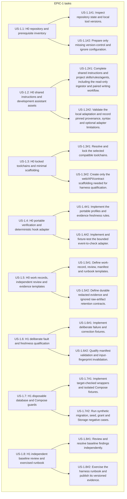

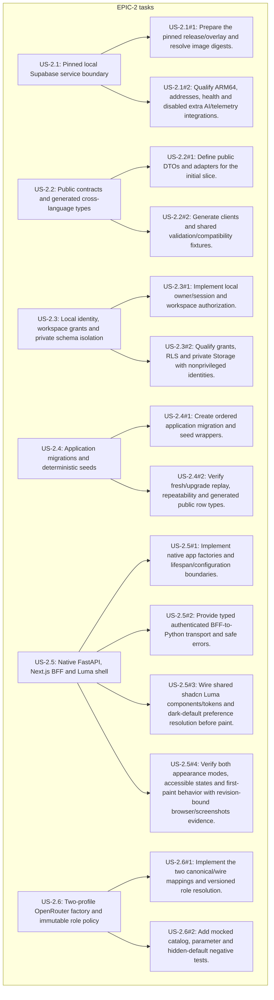

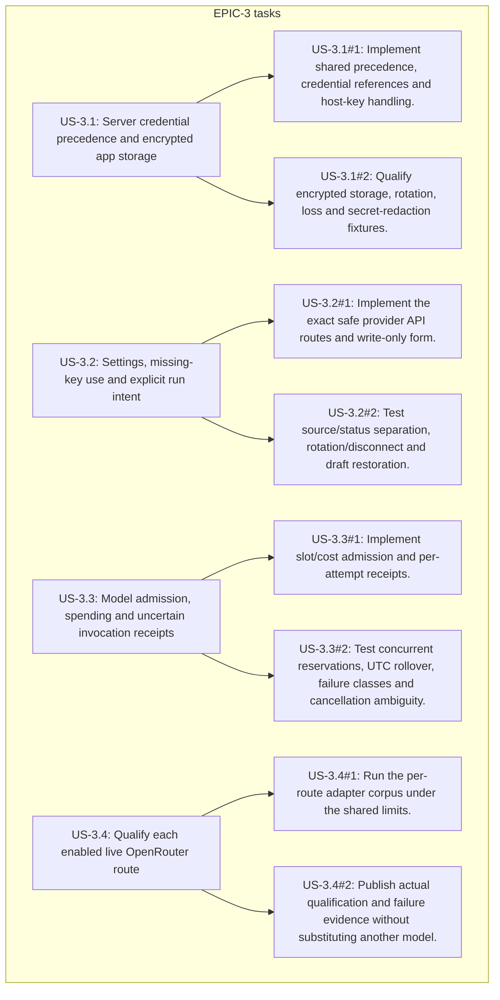

```mermaid
flowchart TD
  subgraph EPIC_4["EPIC-4 tasks"]
    US_4_1["US-4.1: Atomic run admission and canonical transition commands"]
    T_4_1_1["US-4.1#1: Implement typed admission and atomic transition/outbox commands."]
    US_4_1 --> T_4_1_1
    T_4_1_2["US-4.1#2: Test idempotency scope and valid/invalid/concurrent state changes."]
    US_4_1 --> T_4_1_2
    US_4_2["US-4.2: Fenced worker ownership and durable checkpoints"]
    T_4_2_1["US-4.2#1: Implement lease/heartbeat/fencing and scoped direct checkpointer access."]
    US_4_2 --> T_4_2_1
    T_4_2_2["US-4.2#2: Inject stale-owner and process-death cases at domain/checkpoint boundaries."]
    US_4_2 --> T_4_2_2
    US_4_3["US-4.3: Bounded goal planning and model/tool loop"]
    T_4_3_1["US-4.3#1: Compose the minimal explicitly configured Deep Agents stage and plan adapter."]
    US_4_3 --> T_4_3_1
    T_4_3_2["US-4.3#2: Exercise loop bounds and complete argument/result validation with fake models."]
    US_4_3 --> T_4_3_2
    US_4_4["US-4.4: Versioned tool registry and operation receipts"]
    T_4_4_1["US-4.4#1: Implement the narrow read/calculation/artifact tool contracts and central policy gateway."]
    US_4_4 --> T_4_4_1
    T_4_4_2["US-4.4#2: Test denied resources, hidden tools and receipt reuse."]
    US_4_4 --> T_4_4_2
    US_4_5["US-4.5: Private artifacts with staged publication and reconciliation"]
    T_4_5_1["US-4.5#1: Implement staged private uploads and authorized metadata/downloads."]
    US_4_5 --> T_4_5_1
    T_4_5_2["US-4.5#2: Test cross-workspace denial, interruption and hash reconciliation."]
    US_4_5 --> T_4_5_2
    US_4_6["US-4.6: Sanitized event replay and run workspace"]
    T_4_6_1["US-4.6#1: Implement durable event projection, cursor transport and typed client."]
    US_4_6 --> T_4_6_1
    T_4_6_2["US-4.6#2: Build the run/plan/artifact inspector with accessible status states."]
    US_4_6 --> T_4_6_2
    US_4_7["US-4.7: Pause, cancellation and interrupted-run recovery"]
    T_4_7_1["US-4.7#1: Implement cancellation propagation and preserved pause/wait context."]
    US_4_7 --> T_4_7_1
    T_4_7_2["US-4.7#2: Run late-result, sleep, retry and competing completion/cancellation fixtures."]
    US_4_7 --> T_4_7_2
    US_4_8["US-4.8: Verify the first durable goal-to-artifact slice"]
    T_4_8_1["US-4.8#1: Exercise the bounded mock/local database/browser slice."]
    US_4_8 --> T_4_8_1
    T_4_8_2["US-4.8#2: Record independent review, recovery assertions and exercised user-flow runbook."]
    US_4_8 --> T_4_8_2
  end
```

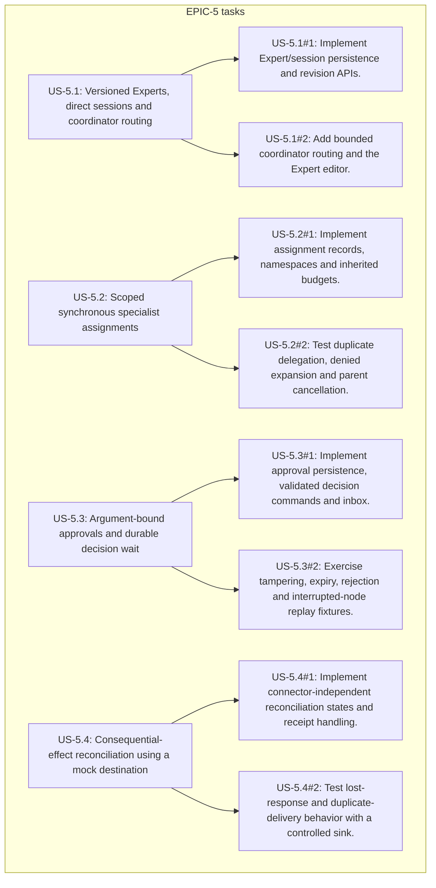

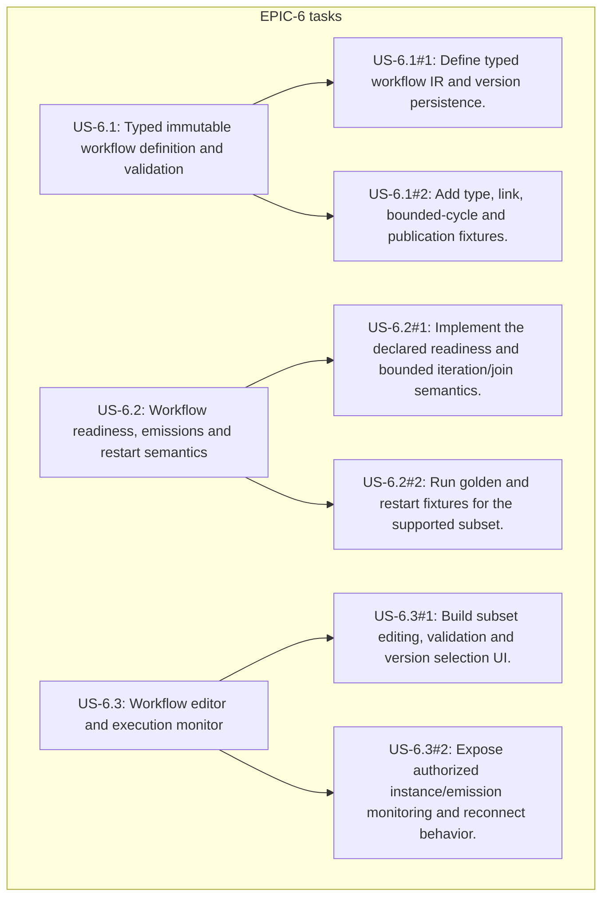

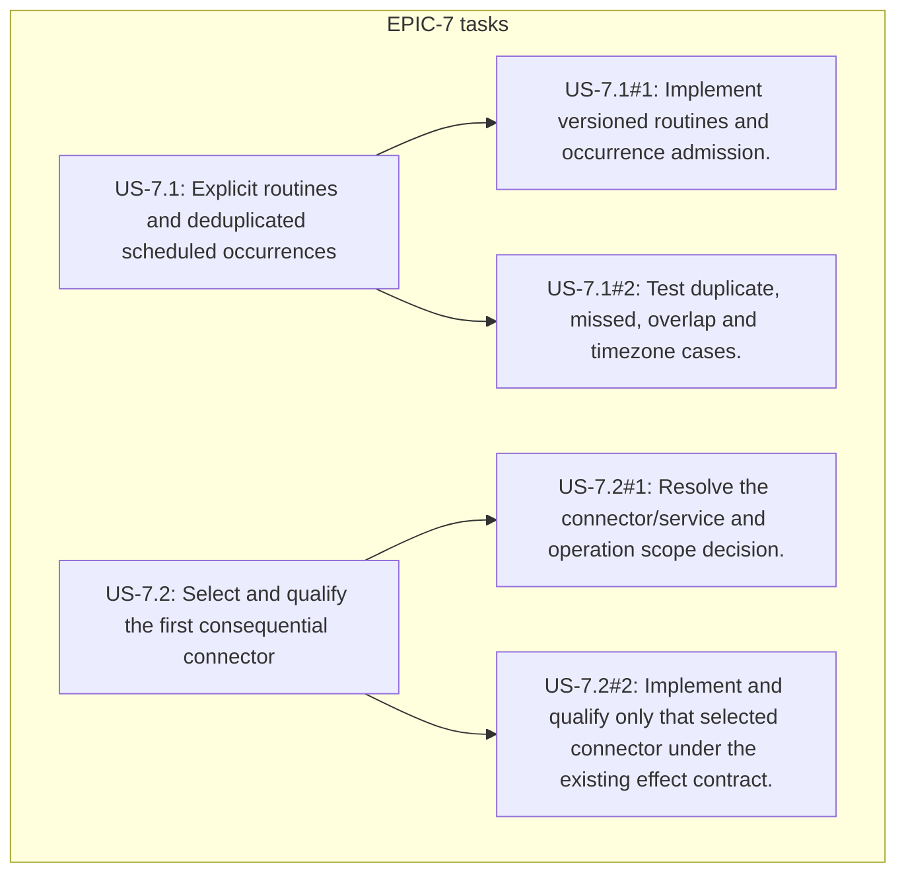

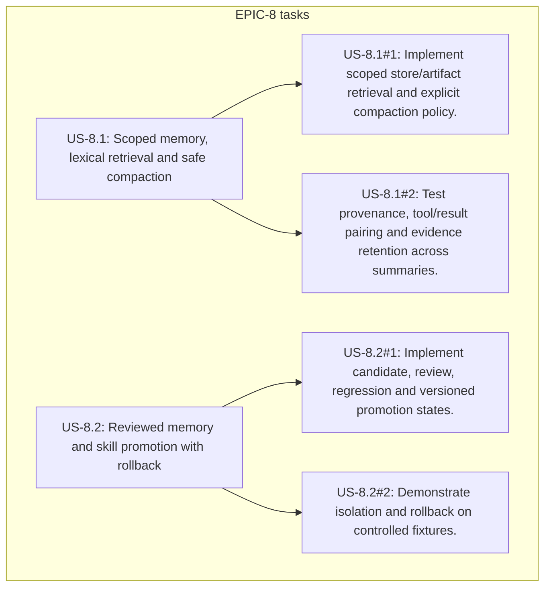

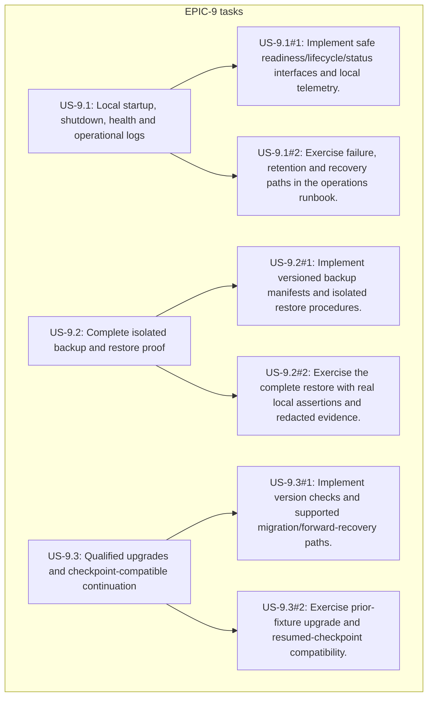

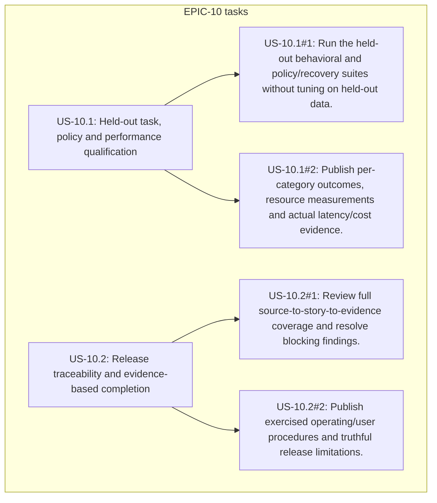

```mermaid
flowchart TD
  subgraph EPIC_11["EPIC-11 tasks"]
    US_11_1["US-11.1: Truthful qualification status"]
    T_11_1_1["US-11.1#1: Add the per-route qualification record and widen the qualification status contract, with regenerated clients."]
    US_11_1 --> T_11_1_1
    T_11_1_2["US-11.1#2: Record each route&#x27;s current result from the US-3.4 evidence, with its date, configuration and limits."]
    US_11_1 --> T_11_1_2
    T_11_1_3["US-11.1#3: Show the record in Settings, and correct the goal composer&#x27;s message and the tests that pin the old text."]
    US_11_1 --> T_11_1_3
    US_11_2["US-11.2: Reasoning continuation check"]
    T_11_2_1["US-11.2#1: Add the deterministic check on the application&#x27;s continuation path, using a fake transport."]
    US_11_2 --> T_11_2_1
    T_11_2_2["US-11.2#2: Run the capped trial on each enabled route, and record actual cost against the shared cap."]
    US_11_2 --> T_11_2_2
    T_11_2_3["US-11.2#3: Report any loss to the owner, without changing LC-23&#x27;s text."]
    US_11_2 --> T_11_2_3
    US_11_3["US-11.3: Guarded persistent install, exercised"]
    T_11_3_1["US-11.3#1: Build the guarded persistent migration apply, with its refusals tested on a disposable target."]
    US_11_3 --> T_11_3_1
    T_11_3_2["US-11.3#2: Choose and record the install&#x27;s project name, ports, env file and data location outside the repository."]
    US_11_3 --> T_11_3_2
    T_11_3_3["US-11.3#3: Stand up the stack and exercise the runbooks on it, correcting what they say about a persistent stack."]
    US_11_3 --> T_11_3_3
    T_11_3_4["US-11.3#4: Run a real goal under the shared cap, record actual cost, and leave the worker&#x27;s inference switch off afterward."]
    US_11_3 --> T_11_3_4
    US_11_4["US-11.4: Run controls on the run page"]
    T_11_4_1["US-11.4#1: Add pause, cancel and resume to the run page, using the existing routes and the run&#x27;s current version."]
    US_11_4 --> T_11_4_1
    T_11_4_2["US-11.4#2: Add owner-only model-call reconciliation, and show each refusal&#x27;s reason."]
    US_11_4 --> T_11_4_2
    T_11_4_3["US-11.4#3: Cover the controls with browser tests on a disposable stack with a scripted model."]
    US_11_4 --> T_11_4_3
    US_11_5["US-11.5: Run list and inspector"]
    T_11_5_1["US-11.5#1: Add a workspace-scoped run list route and screen."]
    US_11_5 --> T_11_5_1
    T_11_5_2["US-11.5#2: Add a sanitized inspector read model and screen for model calls, tool operation attempts and checkpoints."]
    US_11_5 --> T_11_5_2
    T_11_5_3["US-11.5#3: Cover isolation and the absence of private fields on a disposable stack."]
    US_11_5 --> T_11_5_3
    US_11_6["US-11.6: Model and role choice in Settings"]
    T_11_6_1["US-11.6#1: Add a read of the current policy and its version, as only the write route exists."]
    US_11_6 --> T_11_6_1
    T_11_6_2["US-11.6#2: Add the approved model list, workspace default and role policy to Settings."]
    US_11_6 --> T_11_6_2
    T_11_6_3["US-11.6#3: State the effect of role overrides on the screen, and assert that text in a browser test."]
    US_11_6 --> T_11_6_3
    US_11_7["US-11.7: Approval reason and target"]
    T_11_7_1["US-11.7#1: Persist the policy&#x27;s reason and the resource target with the approval request."]
    US_11_7 --> T_11_7_1
    T_11_7_2["US-11.7#2: Return both in the approval view, and show them in the inbox."]
    US_11_7 --> T_11_7_2
    T_11_7_3["US-11.7#3: Cover both scenarios in a browser test."]
    US_11_7 --> T_11_7_3
    US_11_8["US-11.8: Operations completeness"]
    T_11_8_1["US-11.8#1: Record each restore and its verification result where Operations can read it."]
    US_11_8 --> T_11_8_1
    T_11_8_2["US-11.8#2: Add delayed schedules, OpenRouter availability, restore history and qualification evidence to the status contract and screen."]
    US_11_8 --> T_11_8_2
    T_11_8_3["US-11.8#3: Cover both scenarios in a browser test on a disposable stack."]
    US_11_8 --> T_11_8_3
    US_11_9["US-11.9: Run creation disclosure, role map and run details"]
    T_11_9_1["US-11.9#1: Add the MP-07 disclosure to every run-creation screen."]
    US_11_9 --> T_11_9_1
    T_11_9_2["US-11.9#2: Add a per-run model choice, the complete role map and budgets to the run workspace."]
    US_11_9 --> T_11_9_2
    T_11_9_3["US-11.9#3: Add reported and estimated costs, errors and evidence links to the inspector, and cover all four scenarios in browser tests."]
    US_11_9 --> T_11_9_3
    US_11_10["US-11.10: Real Mac sleep proof"]
    T_11_10_1["US-11.10#1: Write the sleep procedure, with what to observe before and after."]
    US_11_10 --> T_11_10_1
    T_11_10_2["US-11.10#2: Have the owner run it on a disposable stack with a scripted model, and record the observations."]
    US_11_10 --> T_11_10_2
    T_11_10_3["US-11.10#3: Only if the result requires it, build wake handling and have the owner repeat the test."]
    US_11_10 --> T_11_10_3
    US_11_11["US-11.11: Design system migration and final visual evidence"]
    T_11_11_1["US-11.11#1: Add the shared form components and move every form to them."]
    US_11_11 --> T_11_11_1
    T_11_11_2["US-11.11#2: Capture both-theme screenshots, measured contrast and axe across all named surfaces."]
    US_11_11 --> T_11_11_2
    T_11_11_3["US-11.11#3: Check keyboard use, zoom and reduced motion, and confirm appearance changes issue no model or task request."]
    US_11_11 --> T_11_11_3
    US_11_12["US-11.12: Final independent review and Gate 0"]
    T_11_12_1["US-11.12#1: Bind the final revision&#x27;s fingerprint and run one independent review of it."]
    US_11_12 --> T_11_12_1
    T_11_12_2["US-11.12#2: Repeat Gate 0 and the harness runbook on that revision, and publish validated evidence."]
    US_11_12 --> T_11_12_2
    T_11_12_3["US-11.12#3: Record a disposition for the 41 minors and open majors, and settle WORKER-INFERENCE-001&#x27;s status."]
    US_11_12 --> T_11_12_3
    T_11_12_4["US-11.12#4: Mark Claude&#x27;s crash and timeout hook behavior not qualified, and hand the record to US-10.2&#x27;s assessment."]
    US_11_12 --> T_11_12_4
  end
```

```mermaid
flowchart TD
  subgraph EPIC_12["EPIC-12 tasks"]
    US_12_1["US-12.1: Stop offering DeepSeek for new runs"]
    T_12_1_1["US-12.1#1: Refuse DeepSeek on the server for new runs and for writes to the workspace default, role overrides and Expert bindings, with regenerated clients if a public contract changes."]
    US_12_1 --> T_12_1_1
    T_12_1_2["US-12.1#2: Remove it from every picker, and say on Settings why it isn&#x27;t offered."]
    US_12_1 --> T_12_1_2
    T_12_1_3["US-12.1#3: Update the tests that choose DeepSeek through the product path, and arrange the frozen-route cases on runs already admitted."]
    US_12_1 --> T_12_1_3
    T_12_1_4["US-12.1#4: Correct text that still says a person can choose it, including `README.md` and `.claude/rules/model-gateway.md`."]
    US_12_1 --> T_12_1_4
    US_12_2["US-12.2: Close what a test can settle"]
    T_12_2_1["US-12.2#1: Add the LC-03, LC-04, LC-07 and LC-13 tests on a disposable stack, and fix what they find."]
    US_12_2 --> T_12_2_1
    T_12_2_2["US-12.2#2: Add the no-key file cases for LC-20, MP-A12 and LM-A06."]
    US_12_2 --> T_12_2_2
    T_12_2_3["US-12.2#3: Add the dispatch inventory for LC-25 and the request shape check for LC-26."]
    US_12_2 --> T_12_2_3
    T_12_2_4["US-12.2#4: Walk every surface in both themes for LC-34, DS-04 and DS-05, retain the results, and capture again whatever changed."]
    US_12_2 --> T_12_2_4
    T_12_2_5["US-12.2#5: Fix R5-1 to R5-7."]
    US_12_2 --> T_12_2_5
    T_12_2_6["US-12.2#6: Put each new check in a profile or state the command that runs it, and list what stays a limit for US-10.2&#x27;s record."]
    US_12_2 --> T_12_2_6
    US_12_3["US-12.3: Final review and Gate 0 at the final code"]
    T_12_3_1["US-12.3#1: Bind the final revision&#x27;s fingerprint, and run the independent review of everything since US-11.12&#x27;s bound tree."]
    US_12_3 --> T_12_3_1
    T_12_3_2["US-12.3#2: Repeat Gate 0 and the harness runbook on that revision as US-11.12 did, including `qualify_worker_inference.py` by hand and the visual measurements on the final tree."]
    US_12_3 --> T_12_3_2
    T_12_3_3["US-12.3#3: Record a disposition for each finding, and publish evidence that `scripts/evidence.py` validates."]
    US_12_3 --> T_12_3_3
    T_12_3_4["US-12.3#4: Mark the hook behavior not qualified, and hand the fingerprint to US-12.4, US-12.5, US-12.6 and US-10.2."]
    US_12_3 --> T_12_3_4
    US_12_4["US-12.4: Measure the two-call workload"]
    T_12_4_1["US-12.4#1: Arrange two goals at once, which needs two claiming workers because one worker runs one step at a time, and rehearse that on a fake transport first."]
    US_12_4 --> T_12_4_1
    T_12_4_2["US-12.4#2: Run the workload once on Terra on a disposable stack, under the shared ledger, sampling the four resources."]
    US_12_4 --> T_12_4_2
    T_12_4_3["US-12.4#3: Record the result, spending and limits, and hand LM-A09&#x27;s row to US-10.2&#x27;s record."]
    US_12_4 --> T_12_4_3
    US_12_5["US-12.5: Third real Mac sleep"]
    T_12_5_1["US-12.5#1: Have the owner follow the runbook on a disposable stack with a scripted model."]
    US_12_5 --> T_12_5_1
    T_12_5_2["US-12.5#2: Record the report&#x27;s observations with the fingerprint, and hand the LC-31 and LM-A07 rows to US-10.2&#x27;s record."]
    US_12_5 --> T_12_5_2
    US_12_6["US-12.6: The real install at the final code"]
    T_12_6_1["US-12.6#1: Back up the install, restore it to an isolated copy, and apply its pending migrations there first."]
    US_12_6 --> T_12_6_1
    T_12_6_2["US-12.6#2: Apply them to the install, start it on its own loopback ports, and record the other projects before and after."]
    US_12_6 --> T_12_6_2
    T_12_6_3["US-12.6#3: Run one goal on Terra under the shared ledger, record the outcome and spending, and leave the worker&#x27;s inference switch off."]
    US_12_6 --> T_12_6_3
    T_12_6_4["US-12.6#4: Hand the LM-A01, LM-A02, LM-A04 and LM-A08 rows to US-10.2&#x27;s record."]
    US_12_6 --> T_12_6_4
    US_12_7["US-12.7: Record why a call&#x27;s outcome is unknown"]
    T_12_7_1["US-12.7#1: Write the event on each path in `loop_middleware.py` that ends a dispatched call as `uncertain_acceptance` or `partial_stream`, through the worker&#x27;s structured log."]
    US_12_7 --> T_12_7_1
    T_12_7_2["US-12.7#2: Cover each path and the secret control with tests on a fake transport."]
    US_12_7 --> T_12_7_2
    T_12_7_3["US-12.7#3: Run it through the product&#x27;s worker on a disposable stack, with no paid call."]
    US_12_7 --> T_12_7_3
    T_12_7_4["US-12.7#4: Add where to look to the operations runbook, and hand LM-A09&#x27;s row to US-10.2&#x27;s record."]
    US_12_7 --> T_12_7_4
    US_12_8["US-12.8: Review and Gate 0 after the last decisions"]
    T_12_8_1["US-12.8#1: Bind the revision&#x27;s fingerprint, and run the independent review of everything since `05916d5e…`, including the corrected release record."]
    US_12_8 --> T_12_8_1
    T_12_8_2["US-12.8#2: Repeat Gate 0 and the harness runbook on that revision as US-12.3 did, including `qualify_worker_inference.py` by hand."]
    US_12_8 --> T_12_8_2
    T_12_8_3["US-12.8#3: Record a disposition for each finding, and publish evidence that `scripts/evidence.py` validates."]
    US_12_8 --> T_12_8_3
    T_12_8_4["US-12.8#4: Mark US-12.3&#x27;s summary void, mark the hook behavior not qualified, and hand the fingerprint to US-10.2."]
    US_12_8 --> T_12_8_4
  end
```

```mermaid
flowchart TD
  subgraph EPIC_13["EPIC-13 tasks"]
    US_13_1["US-13.1: Requester, scope snapshot and policy version on an approval request"]
    T_13_1_1["US-13.1#1: Persist the three fields with the approval request, by migration, recording who started a run at admission, as Decision 0015 defines them."]
    US_13_1 --> T_13_1_1
    T_13_1_2["US-13.1#2: Return them in the approval view as the owner decides, and cover both scenarios on a disposable stack."]
    US_13_1 --> T_13_1_2
    US_13_2["US-13.2: Held-out replay before promotion"]
    T_13_2_1["US-13.2#1: Add the held-out replay to the promotion path, in place of the reviewer&#x27;s text checks, as Decision 0016 defines it."]
    US_13_2 --> T_13_2_1
    T_13_2_2["US-13.2#2: Cover both scenarios, with a scripted model unless a paid replay is separately authorized."]
    US_13_2 --> T_13_2_2
  end
```

```mermaid
flowchart TD
  subgraph EPIC_14["EPIC-14 tasks"]
    US_14_1["US-14.1: Tool catalog API derived from the registry"]
    T_14_1_1["US-14.1#1: Add the descriptive fields to tool definitions and derive the descriptors from the registry, including flattened fields, limits and grantable_to, with the planned browse_goal descriptor as disabled_by_policy and never registered."]
    US_14_1 --> T_14_1_1
    T_14_1_2["US-14.1#2: Compute availability and its typed reason per request from the worker-facing configuration, never stored."]
    US_14_1 --> T_14_1_2
    T_14_1_3["US-14.1#3: Add `GET /v1/tools`, `/v1/tools/{tool_id}` and `/v1/tools/{tool_id}/versions/{version}` with schema_version, catalog_digest and filters, behind the existing checks and the BFF, then regenerate OpenAPI and the TypeScript client."]
    US_14_1 --> T_14_1_3
    T_14_1_4["US-14.1#4: Test registry–catalog parity, agent-view filtering and secret absence."]
    US_14_1 --> T_14_1_4
    US_14_2["US-14.2: Tools page and grants by group"]
    T_14_2_1["US-14.2#1: Add the Tools sidebar entry and the `/tools` list and `/tools/{tool_id}` detail pages through the BFF and the generated client, with the raw JSON Schema in a disclosure."]
    US_14_2 --> T_14_2_1
    T_14_2_2["US-14.2#2: Add group selection, an expansion preview and refusal of unavailable tools to the Expert editor, and record both the pairs and the groups on save, by migration where the schema needs it."]
    US_14_2 --> T_14_2_2
    T_14_2_3["US-14.2#3: Cover the scenarios in browser specs with axe."]
    US_14_2 --> T_14_2_3
    US_14_3["US-14.3: Durable tool-use record and events"]
    T_14_3_1["US-14.3#1: Add the private tool-use table by migration, with no PostgREST, Realtime or browser access and under workspace retention, and write it from the gateway for every dispatch, fenced by lease generation."]
    US_14_3 --> T_14_3_1
    T_14_3_2["US-14.3#2: Add per-definition public fields, defaulting to none, applied after the tool&#x27;s own redaction."]
    US_14_3 --> T_14_3_2
    T_14_3_3["US-14.3#3: Add the two event types to the typed union, the generated client and the consumer in the same change that emits them, with the consumer ignoring unknown types."]
    US_14_3 --> T_14_3_3
    T_14_3_4["US-14.3#4: Count metered calls per root run tree and deny the 21st before any request."]
    US_14_3 --> T_14_3_4
    T_14_3_5["US-14.3#5: Add `GET /v1/runs/{run_id}/tool-uses`, cursor-paginated across the run tree, and cover the scenarios on a disposable stack."]
    US_14_3 --> T_14_3_5
    US_14_4["US-14.4: Tool use on run and flow screens"]
    T_14_4_1["US-14.4#1: Add Tools used to the run workspace from `tool.use.*` events and the listing."]
    US_14_4 --> T_14_4_1
    T_14_4_2["US-14.4#2: Add tool uses under node runs in the workflow monitor."]
    US_14_4 --> T_14_4_2
    T_14_4_3["US-14.4#3: Cover the scenarios in browser specs with axe."]
    US_14_4 --> T_14_4_3
    US_14_5["US-14.5: Tool-provider key readiness"]
    T_14_5_1["US-14.5#1: Read tool-provider keys from the worker&#x27;s environment for each attempt and pass them only to the adapter&#x27;s HTTP client, with no credential field in any tool input."]
    US_14_5 --> T_14_5_1
    T_14_5_2["US-14.5#2: Refuse a grant of an unavailable tool at run admission and at Expert save with a typed code."]
    US_14_5 --> T_14_5_2
    T_14_5_3["US-14.5#3: Add fake-key patterns to the secret scan."]
    US_14_5 --> T_14_5_3
    T_14_5_4["US-14.5#4: Document `TAVILY_API_KEY` and `JINA_API_KEY` in the operations runbook, and add Decision 0017 C8&#x27;s warning that a broader developer token under `GITHUB_TOKEN` would be picked up."]
    US_14_5 --> T_14_5_4
    US_14_6["US-14.6: Tavily search, extract, map and crawl"]
    T_14_6_1["US-14.6#1: Add `tavily_search`, `tavily_extract`, `tavily_map` and `tavily_crawl` as plain `httpx` adapters with an injectable transport, the PRD&#x27;s schema ceilings and recorded fixtures."]
    US_14_6 --> T_14_6_1
    T_14_6_2["US-14.6#2: Cover the scenarios with fake transports only."]
    US_14_6 --> T_14_6_2
    US_14_7["US-14.7: Jina Search The Web and Extract Website Content"]
    T_14_7_1["US-14.7#1: Add `search_web` and `extract_website_content` as plain `httpx` adapters with an injectable transport, schema ceilings and recorded fixtures."]
    US_14_7 --> T_14_7_1
    T_14_7_2["US-14.7#2: Cover the scenarios with fake transports only."]
    US_14_7 --> T_14_7_2
    US_14_8["US-14.8: URL guard for tools that fetch"]
    T_14_8_1["US-14.8#1: Add one shared guard with DNS checks on every answer, redirect revalidation, a limit of 3 redirects, and size and time caps."]
    US_14_8 --> T_14_8_1
    T_14_8_2["US-14.8#2: Cover the scenarios with a fake resolver and transport."]
    US_14_8 --> T_14_8_2
    US_14_9["US-14.9: Agent File Input, read_run_file v2, read_csv and store_remote_file"]
    T_14_9_1["US-14.9#1: Add the goal composer&#x27;s attachment of text files to run inputs, through the BFF and API."]
    US_14_9 --> T_14_9_1
    T_14_9_2["US-14.9#2: Register `read_run_file` version 2 with media type and line paging, keeping saved grants on the version they pinned, and add `read_csv`."]
    US_14_9 --> T_14_9_2
    T_14_9_3["US-14.9#3: Add `store_remote_file` as a reversible internal write through the URL guard."]
    US_14_9 --> T_14_9_3
    T_14_9_4["US-14.9#4: Cover the scenarios, with browser specs for the composer and fake transports for remote storage."]
    US_14_9 --> T_14_9_4
    US_14_10["US-14.10: Market history and inflation rates"]
    T_14_10_1["US-14.10#1: Add `market_history` and `inflation_rates` as read-only plain `httpx` adapters with an injectable transport and recorded fixtures, with no new package."]
    US_14_10 --> T_14_10_1
    T_14_10_2["US-14.10#2: Cover the scenarios with fake transports only."]
    US_14_10 --> T_14_10_2
    US_14_11["US-14.11: Code tools over run files"]
    T_14_11_1["US-14.11#1: Add `search_files`, `read_code_file`, `write_code_file` and `patch_code_file` over the run&#x27;s files only, in pure Python, with names that never match the SDK&#x27;s file tools."]
    US_14_11 --> T_14_11_1
    T_14_11_2["US-14.11#2: Cover the scenarios."]
    US_14_11 --> T_14_11_2
    US_14_12["US-14.12: Goal-driven browsing"]
    T_14_12_1["US-14.12#1: Register `browse_goal` as `arbitrary_execution` with its input and output schemas, limits and public fields, only while the executor reports qualified and the admitted browser model exists."]
    US_14_12 --> T_14_12_1
    T_14_12_2["US-14.12#2: Run each call through US-14.14&#x27;s browsing loop, whose read-only actions are opening a numbered link, going to a URL, scrolling and finishing with a summary, and enforce `allowed_domains`, `max_steps` and `max_seconds`, ending the call on a refused action or an invalid answer."]
    US_14_12 --> T_14_12_2
    T_14_12_3["US-14.12#3: Set `browse_goal`&#x27;s provider to `autobots` and remove the `browser_use` provider value from the catalog, its Pydantic contract, the generated OpenAPI document and TypeScript client, and the Tools screen&#x27;s provider labels, so the providers are exactly those TC-03 lists."]
    US_14_12 --> T_14_12_3
    T_14_12_4["US-14.12#4: Grant it only through an Expert, and require a person&#x27;s approval on every call, showing the task, start URL, allowed domains and limits."]
    US_14_12 --> T_14_12_4
    T_14_12_5["US-14.12#5: Cover the scenarios on a disposable stack with a scripted model."]
    US_14_12 --> T_14_12_5
    US_14_13["US-14.13: Isolated browser executor"]
    T_14_13_1["US-14.13#1: Start and remove one hardened container per call from the digest-pinned Playwright image, with CDP on loopback behind a per-session token and nothing of the worker&#x27;s environment."]
    US_14_13 --> T_14_13_1
    T_14_13_2["US-14.13#2: Build the egress proxy sidecar locally, applying the URL guard to every request and connecting to the address it checked."]
    US_14_13 --> T_14_13_2
    T_14_13_3["US-14.13#3: Tie the executor to the attempt&#x27;s lease, cancellation and time cap, with labelled containers and a sweeper."]
    US_14_13 --> T_14_13_3
    T_14_13_4["US-14.13#4: Qualify every refusal live on a disposable stack with a scripted model, and report qualified only after that check passes."]
    US_14_13 --> T_14_13_4
    US_14_14["US-14.14: Admitted model for the browsing loop"]
    T_14_14_1["US-14.14#1: Implement the browsing loop in the worker over the isolated executor&#x27;s CDP session with the locked `websockets` client, showing the model each page&#x27;s URL, title, a cut of its readable text and its numbered links. No package is added or removed, and `langchain-mcp-adapters` stays."]
    US_14_14 --> T_14_14_1
    T_14_14_2["US-14.14#2: Route every step through model admission on the run&#x27;s frozen `researcher` route, with a reservation, an invocation ticket and receipt, the run&#x27;s budget and `model_calls`, and the shared transport. The loop has no model client of its own."]
    US_14_14 --> T_14_14_2
    T_14_14_3["US-14.14#3: Define the four read-only actions as typed tools, required on every step. Refuse a route whose catalog entry lacks tool support with a typed code before anything is sent, and end the call on an answer that isn&#x27;t one valid action."]
    US_14_14 --> T_14_14_3
    T_14_14_4["US-14.14#4: Cover the scenarios offline with a scripted model."]
    US_14_14 --> T_14_14_4
    US_14_15["US-14.15: Sol profile and route qualification"]
    T_14_15_1["US-14.15#1: Add `openrouter_sol` to the domain&#x27;s approved profiles, not offered for new runs until its route is qualified, with Sol as the `researcher` role&#x27;s built-in default once offered, and regenerated clients if a public contract changes."]
    US_14_15 --> T_14_15_1
    T_14_15_2["US-14.15#2: Add a migration widening every profile check to include `openrouter_sol` and seeding its `model_profiles` row."]
    US_14_15 --> T_14_15_2
    T_14_15_3["US-14.15#3: Add Sol&#x27;s route entry and its authorized US$1.20 cap to the route qualification runner."]
    US_14_15 --> T_14_15_3
    T_14_15_4["US-14.15#4: List Sol in Settings as approved with its offering state, qualification and limits, and in every picker once it&#x27;s offered."]
    US_14_15 --> T_14_15_4
    T_14_15_5["US-14.15#5: Run Sol&#x27;s live route qualification once within the cap, and record it."]
    US_14_15 --> T_14_15_5
    T_14_15_6["US-14.15#6: Cover the refusal, resolution, frozen-run and removal scenarios offline and on a disposable stack with a fake transport."]
    US_14_15 --> T_14_15_6
    US_14_16["US-14.16: Live browse trial with Sol"]
    T_14_16_1["US-14.16#1: Add the trial runner, in no verification profile, reading the owner&#x27;s key file in its own process and refusing a repeat without the owner&#x27;s request."]
    US_14_16 --> T_14_16_1
    T_14_16_2["US-14.16#2: Run the trial once and record the redacted evidence: the summary&#x27;s label, visited URLs, model calls, receipts, spend and the hosts the proxy connected to."]
    US_14_16 --> T_14_16_2
    US_14_17["US-14.17: Tool-provider keys from .env, overridden in Settings"]
    T_14_17_1["US-14.17#1: Add a migration admitting the providers `tavily` and `jina` in `app_private.provider_credentials`. Verify it on disposable targets only, record it as shipped for schema readiness, and leave applying it to the persistent install to the owner."]
    US_14_17 --> T_14_17_1
    T_14_17_2["US-14.17#2: Resolve the Tavily and Jina keys in K1&#x27;s order from the run&#x27;s workspace inside each attempt, and pass the key only to the adapter&#x27;s HTTP client."]
    US_14_17 --> T_14_17_2
    T_14_17_3["US-14.17#3: Apply the same resolution to catalog availability, run admission and Expert, routine and workflow save, with the key&#x27;s source on available key-backed tools."]
    US_14_17 --> T_14_17_3
    T_14_17_4["US-14.17#4: Add owner-only, versioned save, replace and remove routes for the two keys, with a shape check only, plus a members&#x27; source-only read. Put them behind the existing session, CSRF and workspace checks, add the Pydantic contract, and regenerate OpenAPI and the TypeScript client."]
    US_14_17 --> T_14_17_4
    T_14_17_5["US-14.17#5: Add the Settings → Tool keys page through the BFF, with transient password inputs and source-only display for members."]
    US_14_17 --> T_14_17_5
    T_14_17_6["US-14.17#6: Update the Tools page&#x27;s repair text to name Settings → Tool keys and `.env`, and show the key&#x27;s source on available key-backed tools."]
    US_14_17 --> T_14_17_6
    T_14_17_7["US-14.17#7: Make `make start` parse the repository `.env` as data and pass only `TAVILY_API_KEY` and `JINA_API_KEY` to the API and worker, passing nothing for a blank value."]
    US_14_17 --> T_14_17_7
    T_14_17_8["US-14.17#8: Cover the scenarios with unit tests on fake transports, a disposable database check including the secret scan, the web suite with axe, and a Makefile parsing test."]
    US_14_17 --> T_14_17_8
    T_14_17_9["US-14.17#9: Update the operations runbook (including the owner&#x27;s `make migrate`, then `make stop &amp;&amp; make start`), README, `.env.example` and `CODEBASE.md`."]
    US_14_17 --> T_14_17_9
    US_14_18["US-14.18: Settings → Keys &amp; vars, with the GitHub token, repository and browsing switch per workspace"]
    T_14_18_1["US-14.18#1: Add migration 52, admitting the GitHub token as a sealed provider credential and storing each workspace&#x27;s GitHub repository and browsing switch as versioned non-secret values. Update the schema-readiness record, verify on disposable targets only, and leave applying it to the persistent install to the owner."]
    US_14_18 --> T_14_18_1
    T_14_18_2["US-14.18#2: Generalize the resolver to all five items in K1&#x27;s order per workspace, with each item&#x27;s source, and the repository and switch values exposed to members."]
    US_14_18 --> T_14_18_2
    T_14_18_3["US-14.18#3: Resolve the GitHub token and repository inside each attempt from the run&#x27;s workspace in every GitHub adapter, passing the token only to the adapter&#x27;s HTTP client."]
    US_14_18 --> T_14_18_3
    T_14_18_4["US-14.18#4: Record the resolved repository on each GitHub write&#x27;s approval request, and refuse with `approval_target_changed` before any request when the approved call resolves a different repository or its recorded target is empty."]
    US_14_18 --> T_14_18_4
    T_14_18_5["US-14.18#5: Resolve the browsing switch per workspace for catalog availability, run and routine admission, Expert save and the worker&#x27;s per-job binding of `browse_goal`, still requiring an executor that reports qualified."]
    US_14_18 --> T_14_18_5
    T_14_18_6["US-14.18#6: Replace `/v1/settings/tool-keys` with `/v1/settings/keys-and-vars` (owner-only versioned save, replace and remove, the shape, `owner/name` and `enabled`|`disabled` checks, and members&#x27; source and value read), behind the existing session, CSRF and workspace checks. Update the Pydantic contract, and regenerate OpenAPI and the TypeScript client."]
    US_14_18 --> T_14_18_6
    T_14_18_7["US-14.18#7: Rename the web page to `/settings/keys-and-vars` and its nav label to Keys &amp; vars, add the two values&#x27; inputs beside the transient secret inputs, remove the former page, and update the Tools page&#x27;s repair text."]
    US_14_18 --> T_14_18_7
    T_14_18_8["US-14.18#8: Extend `make start` and its `.env` parsing script to pass `GITHUB_REPOSITORY` and `GITHUB_TOKEN` as data, with the existing Tavily, Jina and switch rules."]
    US_14_18 --> T_14_18_8
    T_14_18_9["US-14.18#9: Cover the scenarios with unit tests on fake transports, a disposable database check including the secret scan and the approval binding, the web suite with axe, and the Makefile parsing test."]
    US_14_18 --> T_14_18_9
    T_14_18_10["US-14.18#10: Update the operations runbook (including the owner&#x27;s `make migrate`, then `make stop &amp;&amp; make start`), README, `.env.example` and `CODEBASE.md`."]
    US_14_18 --> T_14_18_10
    US_14_19["US-14.19: The cronjob tool manages the workspace&#x27;s routines"]
    T_14_19_1["US-14.19#1: Add migration 53 with `removed_at` on routines and a name unique only among live routines, and make removal disable the routine, hide it from the service&#x27;s lists, leave it out of evaluation and free its name, deleting nothing. Update the schema-readiness record. Verify on disposable targets only, and leave applying it to the persistent install to the owner."]
    US_14_19 --> T_14_19_1
    T_14_19_2["US-14.19#2: Register `cronjob` v1 with Pydantic input and output schemas for the seven actions, provider `autobots`, class `reversible_internal_write` with receipts, `free_local`, no network, Expert-only grant, approval `by_action` and C8&#x27;s public fields."]
    US_14_19 --> T_14_19_2
    T_14_19_3["US-14.19#3: Route `create`, `update`, `pause`, `resume`, `run` and `remove` through the routine service and its typed codes, keep every action in the run&#x27;s workspace, record the run&#x27;s starter as creator, and admit `run` through the scheduled path&#x27;s admission."]
    US_14_19 --> T_14_19_3
    T_14_19_4["US-14.19#4: Require argument-bound approval for every action except `list`, showing the action, the routine and its schedule."]
    US_14_19 --> T_14_19_4
    T_14_19_5["US-14.19#5: Add the group Automation and the approval value `by_action` to the catalog&#x27;s Pydantic contract and the Tools screen&#x27;s labels, then regenerate OpenAPI and the TypeScript client."]
    US_14_19 --> T_14_19_5
    T_14_19_6["US-14.19#6: Cover the scenarios with unit tests and a disposable database check with no model, including the scan for goal text and inputs."]
    US_14_19 --> T_14_19_6
    T_14_19_7["US-14.19#7: Update the operations runbook (including the owner&#x27;s `make migrate`) and `CODEBASE.md`."]
    US_14_19 --> T_14_19_7
    US_14_20["US-14.20: Tool guide, shown in a modal on the Tools page"]
    T_14_20_1["US-14.20#1: Add a guide with what, when and why texts to every registered tool and every planned descriptor, `cronjob` included, and expose it as `guide` in the catalog&#x27;s Pydantic contract. Regenerate OpenAPI and the TypeScript client."]
    US_14_20 --> T_14_20_1
    T_14_20_2["US-14.20#2: Add a test that fails, naming the tool, when a tool&#x27;s guide is missing or has an empty text."]
    US_14_20 --> T_14_20_2
    T_14_20_3["US-14.20#3: Replace the Tools page&#x27;s side panel with a native `dialog` modal labelled by the tool&#x27;s title. Keep `?tool=&lt;id&gt;`, Granted to, Copy schema and the link to `/tools/{tool_id}`. Close it on Escape, Close and an outside click, returning focus to the tool&#x27;s link."]
    US_14_20 --> T_14_20_3
    T_14_20_4["US-14.20#4: Update the browser suites for the Tools page and Granted to, with axe in both themes."]
    US_14_20 --> T_14_20_4
    T_14_20_5["US-14.20#5: Update `CODEBASE.md`."]
    US_14_20 --> T_14_20_5
    US_14_21["US-14.21: Search tools page in batches of 10, at most 3 pages a call"]
    T_14_21_1["US-14.21#1: Add a shared pager for the search tools with a page size of 10 and a cap of 3: canonical-URL de-duplication, contiguous ranks, the stop reasons `enough`, `no_more`, `page_limit` and `provider_error`, and a later page&#x27;s typed failure kept as `page_error`."]
    US_14_21 --> T_14_21_1
    T_14_21_2["US-14.21#2: Register `search_web` v2 (Jina, `num` 10 and `page` n per page, `max_results` 1 to 30, a 70-second timeout) and `tavily_search` v2 (one request, `max_results` 1 to 20) with Decision 0031 S8&#x27;s output and public fields. Keep version 1 of each registered and unchanged."]
    US_14_21 --> T_14_21_2
    T_14_21_3["US-14.21#3: Give new grants version 2 in `PROVIDER_TOOLS` and `TOOL_VERSIONS`, record both changes as compatible, and pin version 2&#x27;s schema digests. Update the guides for both tools."]
    US_14_21 --> T_14_21_3
    T_14_21_4["US-14.21#4: Cover the scenarios with fake-transport unit tests and a disposable database check through the gateway, with no live provider call."]
    US_14_21 --> T_14_21_4
    T_14_21_5["US-14.21#5: Update `CODEBASE.md`."]
    US_14_21 --> T_14_21_5
    US_14_22["US-14.22: Google search through SerpApi, and a Google bot Expert"]
    T_14_22_1["US-14.22#1: Add migration 63, which adds `serpapi` to the provider lists of `app_private.provider_credentials` and `app_private.tool_key_settings`. Ship it in the readiness record and regenerate the schema snapshot and row types on a disposable target. Leave applying it to the persistent install to the owner&#x27;s `make migrate`."]
    US_14_22 --> T_14_22_1
    T_14_22_2["US-14.22#2: Add the `serpapi` Keys &amp; vars secret to the Python items, the settings contract, the routes and the web labels. Regenerate OpenAPI and the TypeScript client. Have `make start` pass `SERPAPI_API_KEY`, and name it in `.env.example` and the operations runbook."]
    US_14_22 --> T_14_22_2
    T_14_22_3["US-14.22#3: Register `google_search` v1 with provider `serpapi`: pages through the shared pager using SerpApi&#x27;s next-page signal, Decision 0032&#x27;s errors, metering and public fields, a guide, version and schema-digest pins, and a web label."]
    US_14_22 --> T_14_22_3
    T_14_22_4["US-14.22#4: Add Google bot to the concept seed and its checks."]
    US_14_22 --> T_14_22_4
    T_14_22_5["US-14.22#5: Cover the scenarios with fake-transport unit tests, harness tests and disposable database and browser checks, with no SerpApi search and no model call."]
    US_14_22 --> T_14_22_5
    T_14_22_6["US-14.22#6: Update `CODEBASE.md`."]
    US_14_22 --> T_14_22_6
    US_14_23["US-14.23: A Google toolkit that finds with Google and reads pages directly"]
    T_14_23_1["US-14.23#1: Pin `trafilatura` 2.3.1, lock and prepare it, and name it in the toolchain runbook."]
    US_14_23 --> T_14_23_1
    T_14_23_2["US-14.23#2: Add the group `google` and the provider `direct`, move `google_search` into the group, and register `google_map`, `google_extract` and `google_crawl` v1 with Decision 0033&#x27;s behavior, limits, metering, public fields, guides and version pins."]
    US_14_23 --> T_14_23_2
    T_14_23_3["US-14.23#3: Give the seeded Google bot the toolkit."]
    US_14_23 --> T_14_23_3
    T_14_23_4["US-14.23#4: Cover the scenarios with fake-transport unit tests, the toolchain manifest test and disposable database checks, with no SerpApi search or live page read."]
    US_14_23 --> T_14_23_4
    T_14_23_5["US-14.23#5: Update `CODEBASE.md`."]
    US_14_23 --> T_14_23_5
    US_14_24["US-14.24: Tool switches on the Tools page"]
    T_14_24_1["US-14.24#1: Add migration 64 with `app_private.tool_switches`, ship it in the readiness record, and regenerate the schema snapshot and row types on a disposable target. Leave applying it to the persistent install to the owner&#x27;s `make migrate`."]
    US_14_24 --> T_14_24_1
    T_14_24_2["US-14.24#2: Read each workspace&#x27;s switches into its availability view, and mark a turned-off tool or group `disabled_by_policy` with its reason and repair. Refuse calls to it in the gateway with `tool_turned_off`."]
    US_14_24 --> T_14_24_2
    T_14_24_3["US-14.24#3: Add the switch state to the catalog contract, and the owner-only, versioned switch endpoints. Regenerate OpenAPI and the TypeScript client."]
    US_14_24 --> T_14_24_3
    T_14_24_4["US-14.24#4: Add accessible switches for tools and groups to the Tools page, owner-only, in both themes."]
    US_14_24 --> T_14_24_4
    T_14_24_5["US-14.24#5: Cover the scenarios with unit tests, disposable database checks and a browser suite."]
    US_14_24 --> T_14_24_5
    T_14_24_6["US-14.24#6: Update `CODEBASE.md` and the operations runbook."]
    US_14_24 --> T_14_24_6
  end
```

```mermaid
flowchart TD
  subgraph EPIC_15["EPIC-15 tasks"]
    US_15_1["US-15.1: Sidebar groups with Tools under Build"]
    T_15_1_1["US-15.1#1: Regroup the sidebar&#x27;s links in the web shell, keeping link names, roles and data hooks."]
    US_15_1 --> T_15_1_1
    T_15_1_2["US-15.1#2: Update `tools.spec.ts` to Tools under Build after Workflows, and any `appearance.spec.ts` assertion of the old placement."]
    US_15_1 --> T_15_1_2
    T_15_1_3["US-15.1#3: Cover the scenarios in browser specs with axe."]
    US_15_1 --> T_15_1_3
    US_15_2["US-15.2: Display name, workspace role and account"]
    T_15_2_1["US-15.2#1: Add a per-user profile by migration with a display name checked to 1–60 characters, and RLS that lets a user write their own name and members of a shared workspace read it, with negative tests for anonymous, other-user and other-workspace roles."]
    US_15_2 --> T_15_2_1
    T_15_2_2["US-15.2#2: Add the role and workspace name to `SessionSummary`, and a profile read and update, in Pydantic and FastAPI, then regenerate OpenAPI and the TypeScript client."]
    US_15_2 --> T_15_2_2
    T_15_2_3["US-15.2#3: Forward both through the BFF with the existing session and request checks."]
    US_15_2 --> T_15_2_3
    T_15_2_4["US-15.2#4: Add the shell&#x27;s account footer and menu, and Settings → Account."]
    US_15_2 --> T_15_2_4
    T_15_2_5["US-15.2#5: Cover the scenarios on a disposable stack and in browser specs with axe."]
    US_15_2 --> T_15_2_5
    US_15_3["US-15.3: Member-readable readiness, health line and service chips"]
    T_15_3_1["US-15.3#1: Add a member-readable readiness read in the application layer, holding only the API, worker, database and OpenRouter authentication states."]
    US_15_3 --> T_15_3_1
    T_15_3_2["US-15.3#2: Add its Pydantic contract and FastAPI route, regenerate OpenAPI and the TypeScript client, and forward it through the BFF."]
    US_15_3 --> T_15_3_2
    T_15_3_3["US-15.3#3: Add the shell&#x27;s health line and Home&#x27;s service chips."]
    US_15_3 --> T_15_3_3
    T_15_3_4["US-15.3#4: Cover the scenarios on a disposable stack and in browser specs with axe."]
    US_15_3 --> T_15_3_4
    US_15_4["US-15.4: Run list projection, filters and spend"]
    T_15_4_1["US-15.4#1: Extend the run list projection in the application layer with labels, stop_reason, plan progress, frozen profiles and ledger spend."]
    US_15_4 --> T_15_4_1
    T_15_4_2["US-15.4#2: Add status-group, text and profile filters, per-tab counts, a keyset cursor and a total in the Pydantic contract and FastAPI route, then regenerate OpenAPI and the TypeScript client."]
    US_15_4 --> T_15_4_2
    T_15_4_3["US-15.4#3: Forward the filters and the cursor through the BFF."]
    US_15_4 --> T_15_4_3
    T_15_4_4["US-15.4#4: Render the tabs, filters, Load more, labels, the &quot;≈&quot; spend and the meter on Runs."]
    US_15_4 --> T_15_4_4
    T_15_4_5["US-15.4#5: Cover the scenarios on a disposable stack and in browser specs with axe."]
    US_15_4 --> T_15_4_5
    US_15_5["US-15.5: Approvals inbox, count badge and decision shortcuts"]
    T_15_5_1["US-15.5#1: Add decided statuses, tab counts, `decided_at` and `decided_by`, the run goal, the served plan task found through the tool use&#x27;s operation ID, and the stored arguments&#x27; byte size to the approval read model."]
    US_15_5 --> T_15_5_1
    T_15_5_2["US-15.5#2: Add a pending-count endpoint and the extended views in Pydantic and FastAPI, then regenerate OpenAPI and the TypeScript client."]
    US_15_5 --> T_15_5_2
    T_15_5_3["US-15.5#3: Forward both through the BFF."]
    US_15_5 --> T_15_5_3
    T_15_5_4["US-15.5#4: Build the tabs, the list beside the detail, the Fields and JSON views with sanitized markdown, J and K, and ⌘↵ and ⌘⌫ with a second press and a live announcement."]
    US_15_5 --> T_15_5_4
    T_15_5_5["US-15.5#5: Add the sidebar badge."]
    US_15_5 --> T_15_5_5
    T_15_5_6["US-15.5#6: Cover the scenarios on a disposable stack and in browser specs with axe."]
    US_15_5 --> T_15_5_6
    US_15_6["US-15.6: Expert card facts and filters"]
    T_15_6_1["US-15.6#1: Add each Expert&#x27;s run count and last run time to the Expert read model in Pydantic and FastAPI, then regenerate OpenAPI and the TypeScript client."]
    US_15_6 --> T_15_6_1
    T_15_6_2["US-15.6#2: Render the card facts, Start run, the approval note, the filters with counts and the search on Experts."]
    US_15_6 --> T_15_6_2
    T_15_6_3["US-15.6#3: Cover the scenarios on a disposable stack and in browser specs with axe."]
    US_15_6 --> T_15_6_3
    US_15_7["US-15.7: Tools side panel, Granted to and Copy schema"]
    T_15_7_1["US-15.7#1: Derive Granted to from the latest Expert versions and the agent steps of published workflows in the application layer, and expose it in Pydantic and FastAPI, then regenerate OpenAPI and the TypeScript client."]
    US_15_7 --> T_15_7_1
    T_15_7_2["US-15.7#2: Render the group list with counts, the text filter, the side panel and Copy schema, keeping `/tools/{tool_id}`."]
    US_15_7 --> T_15_7_2
    T_15_7_3["US-15.7#3: Cover the scenarios on a disposable stack and in browser specs with axe."]
    US_15_7 --> T_15_7_3
    US_15_8["US-15.8: Model catalog facts, binding source and form actions"]
    T_15_8_1["US-15.8#1: Add catalog prices per 1M tokens, supported parameters, the fetch time and each role binding&#x27;s source to the model read models in Pydantic and FastAPI, then regenerate OpenAPI and the TypeScript client."]
    US_15_8 --> T_15_8_1
    T_15_8_2["US-15.8#2: Add a Reset all write that clears role overrides under the expected version."]
    US_15_8 --> T_15_8_2
    T_15_8_3["US-15.8#3: Render the facts, sources, Discard, Reset all and the summary on Models, and the binding source in the run&#x27;s role map."]
    US_15_8 --> T_15_8_3
    T_15_8_4["US-15.8#4: Cover the scenarios with a fake catalog on a disposable stack and in browser specs with axe."]
    US_15_8 --> T_15_8_4
    US_15_9["US-15.9: Composer chips, run preview and budget"]
    T_15_9_1["US-15.9#1: Add the allowed budget range and the remaining daily cap to run intent, and the profiles by role and the default tool grants to a preview, in the application layer, Pydantic and FastAPI, then regenerate OpenAPI and the TypeScript client."]
    US_15_9 --> T_15_9_1
    T_15_9_2["US-15.9#2: Validate and freeze a chosen budget at admission, refusing values outside US$0.25–5.00, off the US$0.25 step or above the remaining daily cap."]
    US_15_9 --> T_15_9_2
    T_15_9_3["US-15.9#3: Forward intent, preview and budget through the BFF."]
    US_15_9 --> T_15_9_3
    T_15_9_4["US-15.9#4: Add the Expert, budget and models chips, the preview chips and the file chips to Home&#x27;s composer."]
    US_15_9 --> T_15_9_4
    T_15_9_5["US-15.9#5: Cover the scenarios on a disposable stack with a fake transport and in browser specs with axe."]
    US_15_9 --> T_15_9_5
    US_15_10["US-15.10: Home greeting, Needs you and recent runs"]
    T_15_10_1["US-15.10#1: Render the greeting from the workspace&#x27;s timezone and the display name."]
    US_15_10 --> T_15_10_1
    T_15_10_2["US-15.10#2: Render Needs you from pending approvals and the run list&#x27;s Needs you group, and Recent runs from the run list."]
    US_15_10 --> T_15_10_2
    T_15_10_3["US-15.10#3: Cover the scenarios in browser specs with axe on a disposable stack."]
    US_15_10 --> T_15_10_3
    US_15_11["US-15.11: Workflow description and node labels"]
    T_15_11_1["US-15.11#1: Add a nullable workflow description by migration."]
    US_15_11 --> T_15_11_1
    T_15_11_2["US-15.11#2: Add an optional node `label` in a new Workflow IR version in the domain, keeping the previous version valid, with shared fixtures for both versions."]
    US_15_11 --> T_15_11_2
    T_15_11_3["US-15.11#3: Expose both in the Pydantic contracts and FastAPI routes, then regenerate OpenAPI and the TypeScript client."]
    US_15_11 --> T_15_11_3
    T_15_11_4["US-15.11#4: Edit the description and the labels in the workflow editor."]
    US_15_11 --> T_15_11_4
    T_15_11_5["US-15.11#5: Cover the scenarios on a disposable stack."]
    US_15_11 --> T_15_11_5
    US_15_12["US-15.12: Workflow drafts"]
    T_15_12_1["US-15.12#1: Add one draft per workflow by migration, with RLS that lets only the owner write it, and negative tests."]
    US_15_12 --> T_15_12_1
    T_15_12_2["US-15.12#2: Add saving a draft, publishing it with an expected version and discarding it in the application layer, and refuse a draft wherever a run or routine binds a version."]
    US_15_12 --> T_15_12_2
    T_15_12_3["US-15.12#3: Expose them in Pydantic and FastAPI, regenerate OpenAPI and the TypeScript client, and forward them through the BFF."]
    US_15_12 --> T_15_12_3
    T_15_12_4["US-15.12#4: Save, publish and discard the draft from the workflow editor."]
    US_15_12 --> T_15_12_4
    T_15_12_5["US-15.12#5: Cover the scenarios on a disposable stack and in browser specs."]
    US_15_12 --> T_15_12_5
    US_15_13["US-15.13: Workflow list, preview, executions and budget"]
    T_15_13_1["US-15.13#1: Add per-workflow executions with version, state, spend and duration, the Experts in step order, the step count, the last execution and the run count to the workflow read models in Pydantic and FastAPI, then regenerate OpenAPI and the TypeScript client."]
    US_15_13 --> T_15_13_1
    T_15_13_2["US-15.13#2: Accept and freeze an execution budget from US$0.25 to US$5.00 in steps of US$0.25, never above the remaining daily cap."]
    US_15_13 --> T_15_13_2
    T_15_13_3["US-15.13#3: Render the tabs, search, rows, preview panel with its version switch, and recent executions on Workflows."]
    US_15_13 --> T_15_13_3
    T_15_13_4["US-15.13#4: Cover the scenarios on a disposable stack and in browser specs with axe."]
    US_15_13 --> T_15_13_4
    US_15_14["US-15.14: GitHub read tools and issue labels on one repository"]
    T_15_14_1["US-15.14#1: Add the four read tools as plain `httpx` adapters with an injectable transport over the shared repository configuration, with schema ceilings, public fields and recorded fixtures."]
    US_15_14 --> T_15_14_1
    T_15_14_2["US-15.14#2: Register `create_github_issue` version 2 with optional `labels`, up to 10, keeping version 1 unchanged."]
    US_15_14 --> T_15_14_2
    T_15_14_3["US-15.14#3: Report `key_missing` for every GitHub tool until both variables are set, with a repair naming them, the token&#x27;s scopes and a restart, and update the operations runbook with the fine-grained scopes D6 lists."]
    US_15_14 --> T_15_14_3
    T_15_14_4["US-15.14#4: Cover the scenarios with fake transports only."]
    US_15_14 --> T_15_14_4
    US_15_15["US-15.15: Approval-gated pull-request connector"]
    T_15_15_1["US-15.15#1: Add `github_open_pull_request` as a consequential connector with approval on every call, limits of 20 files and 1 MiB in total, and no repository input."]
    US_15_15 --> T_15_15_1
    T_15_15_2["US-15.15#2: Compute each file&#x27;s diff against the base for the approval request, binding the approval to the exact request."]
    US_15_15 --> T_15_15_2
    T_15_15_3["US-15.15#3: Create `autobots/&lt;operation_id&gt;`, commit only the named paths, open the pull request with the operation-ID marker, and read back the branch and pull request before any retry."]
    US_15_15 --> T_15_15_3
    T_15_15_4["US-15.15#4: Cover the scenarios with fake transports only, including a lost response."]
    US_15_15 --> T_15_15_4
    US_15_16["US-15.16: Live GitHub qualification on the configured repository"]
    T_15_16_1["US-15.16#1: Extend the GitHub qualification runner, in no verification profile, to the read tools, labels and pull requests, refusing to start without the token and the recorded authorization."]
    US_15_16 --> T_15_16_1
    T_15_16_2["US-15.16#2: Run it once and record redacted evidence: the outputs&#x27; shapes, the markers, the retry readback and the absence of the token."]
    US_15_16 --> T_15_16_2
    US_15_17["US-15.17: Run side panel and plan task timing"]
    T_15_17_1["US-15.17#1: Add plan task start and finish times by migration, written only on the worker&#x27;s fenced path in database time."]
    US_15_17 --> T_15_17_1
    T_15_17_2["US-15.17#2: Add the current task, task times, per-task tools, tokens and the root tree&#x27;s metered-call count to the run read model in Pydantic and FastAPI, then regenerate OpenAPI and the TypeScript client."]
    US_15_17 --> T_15_17_2
    T_15_17_3["US-15.17#3: Build the side panel on Runs with Open run, Pause, Resume and Cancel through the existing commands and expected-version guard."]
    US_15_17 --> T_15_17_3
    T_15_17_4["US-15.17#4: Cover the scenarios, including the stale worker, on a disposable stack with a scripted model, and in browser specs with axe."]
    US_15_17 --> T_15_17_4
    US_15_18["US-15.18: Operations verdict and check detail"]
    T_15_18_1["US-15.18#1: Record each readiness probe&#x27;s database answer time and keep the last 20 for a p95, with no tracing."]
    US_15_18 --> T_15_18_1
    T_15_18_2["US-15.18#2: Add the worker count, applied migrations, storage and disk bytes, leased and queued jobs, checkpoint adapter, catalog fetch time and loopback check to the status read model in Pydantic and FastAPI, then regenerate OpenAPI and the TypeScript client."]
    US_15_18 --> T_15_18_2
    T_15_18_3["US-15.18#3: Render the verdict and the values on Operations."]
    US_15_18 --> T_15_18_3
    T_15_18_4["US-15.18#4: Cover the scenarios on a disposable stack and in browser specs with axe."]
    US_15_18 --> T_15_18_4
    US_15_19["US-15.19: Operations jobs chart"]
    T_15_19_1["US-15.19#1: Add an hourly job count by outcome over 24 hours in the application layer, Pydantic and FastAPI, then regenerate OpenAPI and the TypeScript client."]
    US_15_19 --> T_15_19_1
    T_15_19_2["US-15.19#2: Render the chart with chart tokens and its text table on Operations."]
    US_15_19 --> T_15_19_2
    T_15_19_3["US-15.19#3: Cover the scenarios on a disposable stack and in browser specs with axe."]
    US_15_19 --> T_15_19_3
    US_15_20["US-15.20: Appearance preferences with a System theme"]
    T_15_20_1["US-15.20#1: Offer System, Light and Dark in the theme provider: dark for a first visit and for a missing, invalid or unavailable value, and System following the OS only when chosen."]
    US_15_20 --> T_15_20_1
    T_15_20_2["US-15.20#2: Add the serif, density and reduce-motion preferences, stored in the browser and changing presentation only."]
    US_15_20 --> T_15_20_2
    T_15_20_3["US-15.20#3: Update `appearance.spec.ts` for System and the new preferences, under both OS schemes and with invalid and unavailable storage."]
    US_15_20 --> T_15_20_3
    T_15_20_4["US-15.20#4: Cover the scenarios in browser specs with axe in both themes."]
    US_15_20 --> T_15_20_4
    US_15_21["US-15.21: Settings sub-pages for notifications, data and keyboard"]
    T_15_21_1["US-15.21#1: Add a member-readable retention summary in the application layer, Pydantic and FastAPI, then regenerate OpenAPI and the TypeScript client and forward it through the BFF."]
    US_15_21 --> T_15_21_1
    T_15_21_2["US-15.21#2: Add the Settings sub-navigation and the Notifications, Data on this Mac and Keyboard pages."]
    US_15_21 --> T_15_21_2
    T_15_21_3["US-15.21#3: Raise browser notifications for runs entering waiting_approval or waiting_input while the app is open, only with the browser&#x27;s permission and the setting on."]
    US_15_21 --> T_15_21_3
    T_15_21_4["US-15.21#4: Cover the scenarios on a disposable stack and in browser specs with axe."]
    US_15_21 --> T_15_21_4
    US_15_22["US-15.22: Search palette"]
    T_15_22_1["US-15.22#1: Add one workspace-scoped search over run goals and the names of Experts, workflows and tools, with typed results, in the application layer, Pydantic and FastAPI, then regenerate OpenAPI and the TypeScript client and forward it through the BFF."]
    US_15_22 --> T_15_22_1
    T_15_22_2["US-15.22#2: Add the Search button with its key hint after the skip link, the ⌘K handler that ignores text fields, and the palette dialog with a listbox."]
    US_15_22 --> T_15_22_2
    T_15_22_3["US-15.22#3: Cover the scenarios on a disposable stack and in browser specs with axe."]
    US_15_22 --> T_15_22_3
    US_15_23["US-15.23: New run shortcut"]
    T_15_23_1["US-15.23#1: Add the New run button with its key hint after the skip link, and the shortcut handler that ignores text fields."]
    US_15_23 --> T_15_23_1
    T_15_23_2["US-15.23#2: Update `appearance.spec.ts`&#x27;s tab-order assertion so the skip link stays first."]
    US_15_23 --> T_15_23_2
    T_15_23_3["US-15.23#3: Cover the scenarios in browser specs with axe."]
    US_15_23 --> T_15_23_3
    US_15_24["US-15.24: Streaming result text"]
    T_15_24_1["US-15.24#1: Emit ephemeral, coalesced `result.text.delta` events for the final result&#x27;s text only, on the live stream and never into durable events."]
    US_15_24 --> T_15_24_1
    T_15_24_2["US-15.24#2: Add the event type to the typed union, the generated client and the consumer in the same change, with the consumer ignoring unknown types."]
    US_15_24 --> T_15_24_2
    T_15_24_3["US-15.24#3: Add the &quot;Stream text as it&#x27;s written&quot; preference to Appearance, and honor it in the run view."]
    US_15_24 --> T_15_24_3
    T_15_24_4["US-15.24#4: Cover the scenarios with a scripted model on a disposable stack, including a scan for reasoning, tool arguments and secrets."]
    US_15_24 --> T_15_24_4
    US_15_25["US-15.25: Concept Experts and workflows seed"]
    T_15_25_1["US-15.25#1: Add a repeatable seed, kept apart from migrations, that targets a named workspace with bounded upserts and no user-edit overwrites."]
    US_15_25 --> T_15_25_1
    T_15_25_2["US-15.25#2: Seed a workflow as a draft when a tool it needs is unavailable."]
    US_15_25 --> T_15_25_2
    T_15_25_3["US-15.25#3: Cover the scenarios on a disposable stack, including a double seed and a secret scan."]
    US_15_25 --> T_15_25_3
  end
```

```mermaid
flowchart TD
  subgraph EPIC_16["EPIC-16 tasks"]
    US_16_1["US-16.1: Sober control borders"]
    T_16_1_1["US-16.1#1: Replace the inset underline with a `--control-border` token for all four sides, at 3:1 in both themes."]
    US_16_1 --> T_16_1_1
    T_16_1_2["US-16.1#2: Give the composer&#x27;s goal field the shared rounded border, and drop the composer and sign-in cards&#x27; shadow."]
    US_16_1 --> T_16_1_2
    T_16_1_3["US-16.1#3: Measure boundaries and focus in both themes with the visual walk."]
    US_16_1 --> T_16_1_3
    US_16_2["US-16.2: Schema readiness against every shipped migration"]
    T_16_2_1["US-16.2#1: Record the shipped migration count and newest name, with a check that they match the directory."]
    US_16_2 --> T_16_2_1
    T_16_2_2["US-16.2#2: Compare the applied count in readiness, with schema_behind and schema_ahead."]
    US_16_2 --> T_16_2_2
    T_16_2_3["US-16.2#3: Extend the required relations and columns through migration 49."]
    US_16_2 --> T_16_2_3
    T_16_2_4["US-16.2#4: Show applied against shipped in Operations, and cover the scenarios on a disposable stack."]
    US_16_2 --> T_16_2_4
    US_16_3["US-16.3: Workspace choice for members of several workspaces"]
    T_16_3_1["US-16.3#1: Add a same-origin, CSRF-checked route that keeps the choice in an HttpOnly cookie."]
    US_16_3 --> T_16_3_1
    T_16_3_2["US-16.3#2: Send the choice from the BFF and the event stream as `X-Autobots-Workspace`."]
    US_16_3 --> T_16_3_2
    T_16_3_3["US-16.3#3: Add the sidebar chooser for members of several workspaces."]
    US_16_3 --> T_16_3_3
    T_16_3_4["US-16.3#4: Cover the scenarios in the browser on a disposable stack."]
    US_16_3 --> T_16_3_4
    US_16_4["US-16.4: A current install with Sol&#x27;s live qualification"]
    T_16_4_1["US-16.4#1: Back up the install, then apply the pending migrations through the guarded path."]
    US_16_4 --> T_16_4_1
    T_16_4_2["US-16.4#2: Run Sol&#x27;s corpus live within its ledger, and record the report."]
    US_16_4 --> T_16_4_2
    T_16_4_3["US-16.4#3: Record today&#x27;s qualification in a migration, apply it, and check Settings → Models."]
    US_16_4 --> T_16_4_3
    US_16_5["US-16.5: Real examples on the install"]
    T_16_5_1["US-16.5#1: Seed the concept Experts and workflows into the owner workspace."]
    US_16_5 --> T_16_5_1
    T_16_5_2["US-16.5#2: Add a guarded command that runs the example goals and workflow live under the shared ledger."]
    US_16_5 --> T_16_5_2
    T_16_5_3["US-16.5#3: Tell the model that a plan cites criteria by ID, which live Expert runs got wrong."]
    US_16_5 --> T_16_5_3
    T_16_5_4["US-16.5#4: Check Runs, Experts, Workflows and Approvals show them."]
    US_16_5 --> T_16_5_4
    US_16_6["US-16.6: Deep research runs like Deep-Research-Content-Writer"]
    T_16_6_1["US-16.6#1: Raise `MAX_OUTPUT_TOKENS`, `RootLimits`, `METERED_TOOL_CALLS` and the model call time to Decision 0034 L1 to L4, and update the tests that pin them."]
    US_16_6 --> T_16_6_1
    T_16_6_2["US-16.6#2: Add `read_artifact` v1 over `application/artifacts.read_artifact`: its contract, definition, registry entry, Expert grant, guide, version and pinned schema digest. Regenerate OpenAPI and the TypeScript client if a contract changes."]
    US_16_6 --> T_16_6_2
    T_16_6_3["US-16.6#3: Let an Expert seed carry instructions, and seed the Deep research writer and the Deep research content writer workflow."]
    US_16_6 --> T_16_6_3
    T_16_6_4["US-16.6#4: Grant a workflow execution its agent steps&#x27; Experts&#x27; tools (Decision 0034 F3)."]
    US_16_6 --> T_16_6_4
    T_16_6_5["US-16.6#5: Cover the scenarios with unit tests and disposable database checks, including a scripted run of the workflow."]
    US_16_6 --> T_16_6_5
    T_16_6_6["US-16.6#6: Update `CODEBASE.md` and the runbooks that state the limits."]
    US_16_6 --> T_16_6_6
    US_16_7["US-16.7: Live deep research on the install, documented"]
    T_16_7_1["US-16.7#1: Have the owner rebuild and restart the install with inference on, and run the concept seed."]
    US_16_7 --> T_16_7_1
    T_16_7_2["US-16.7#2: Start the Expert run and the workflow execution from the Studio, each with a US$5.00 budget, and record their outcomes, artifacts and costs."]
    US_16_7 --> T_16_7_2
    T_16_7_3["US-16.7#3: Write `README-Deep-Research-Content-Writer.md` from the runs, and link it from `README.md` and `README-DEV.md`."]
    US_16_7 --> T_16_7_3
    US_16_8["US-16.8: A 64K working context for deep research"]
    T_16_8_1["US-16.8#1: Raise `CONTEXT_TOKENS`, `RESERVED_PROMPT_TOKENS`, the compaction target, `LARGE_TOOL_CHARS` and `READ_PAGES_IN_VIEW` to Decision 0034 L6 to L8, and update the tests that pin them."]
    US_16_8 --> T_16_8_1
    T_16_8_2["US-16.8#2: Cover the scenarios with unit tests of compaction and the reservation."]
    US_16_8 --> T_16_8_2
    T_16_8_3["US-16.8#3: Update `CODEBASE.md` and the runbooks that state the context."]
    US_16_8 --> T_16_8_3
    US_16_9["US-16.9: The plan survives compaction"]
    T_16_9_1["US-16.9#1: Add the run&#x27;s plan, with each task done or open, to `state_block`."]
    US_16_9 --> T_16_9_1
    T_16_9_2["US-16.9#2: Cover the scenarios with unit tests and the memory check on a disposable database."]
    US_16_9 --> T_16_9_2
    T_16_9_3["US-16.9#3: Update `CODEBASE.md`."]
    US_16_9 --> T_16_9_3
  end
```

```mermaid
flowchart TD
  subgraph EPIC_17["EPIC-17 tasks"]
    US_17_1["US-17.1: The YOLO setting and the Expert&#x27;s browse domains"]
    T_17_1_1["US-17.1#1: Add the workspace&#x27;s YOLO setting in a migration with its traceability header. It is on for every workspace, including existing ones, and only the owner changes it through the API and the BFF. Checked by the db profile&#x27;s disposable fixtures and `tests/harness/test_migration_headers.py`."]
    US_17_1 --> T_17_1_1
    T_17_1_2["US-17.1#2: Freeze the setting in the run&#x27;s snapshot at admission. A run admitted before this change reads as off. A call counts as YOLO only while both the frozen and the current setting are on (Y4). Checked by pytest under `services/agent/tests` and the db profile&#x27;s disposable fixtures."]
    US_17_1 --> T_17_1_2
    T_17_1_3["US-17.1#3: Start a `browse_goal` call without approval while the call is YOLO, and keep approval on every call otherwise (Decision 0018 B6, Y15). Checked by pytest under `services/agent/tests` and the db profile&#x27;s disposable fixtures with a scripted model."]
    US_17_1 --> T_17_1_3
    T_17_1_4["US-17.1#4: Add a browse domain list to each Expert version that grants `browse_goal`, edited by the owner in the Expert editor, where a change makes a new version. Under YOLO, refuse before any container starts a call naming a domain outside the list, or from an Expert with no list, with a typed reason naming the list. Checked by pytest under `services/agent/tests`, the db profile&#x27;s disposable fixtures and the Experts browser suite under `apps/web/tests/browser`."]
    US_17_1 --> T_17_1_4
    T_17_1_5["US-17.1#5: Add Settings → Browsing with the checkbox and its line, the one-time notice on Home, and `typing` with the domains among `browse_goal`&#x27;s public fields in the tool row. Checked by the Settings, Home and run workspace browser suites under `apps/web/tests/browser`, with axe."]
    US_17_1 --> T_17_1_5
    T_17_1_6["US-17.1#6: Update the Pydantic contracts, then regenerate OpenAPI and the TypeScript client. Checked by `contract_drift` in the full profile."]
    US_17_1 --> T_17_1_6
    T_17_1_7["US-17.1#7: Keep these true to Y2, saying approval on every call applies only with YOLO off: `browse_goal`&#x27;s guide, the approval the Tools page shows for it, and the Expert cards&#x27; approval note (EX-03). The guide also says that an Expert browsing a wiki or forum tells it in its instructions never to edit or post (Y13). Checked by pytest under `services/agent/tests` and the Tools and Experts browser suites under `apps/web/tests/browser`."]
    US_17_1 --> T_17_1_7
    T_17_1_8["US-17.1#8: Amend PRD-Tool-Catalog AB-01, AB-02 and TC-02, and PRD-Studio SE-02 and Home, as Decision 0035&#x27;s &quot;Requirements revised&quot; lists. Checked by reading each against Decision 0035 Y1 to Y4."]
    US_17_1 --> T_17_1_8
    T_17_1_9["US-17.1#9: Update `README.md`, whose opening paragraph and &quot;Asks before it acts&quot; say browsing always waits for approval, plus `README-DEV.md`, the operations runbook&#x27;s &quot;Turning on browse_goal&quot; and `CODEBASE.md`. Checked by reading each against Decision 0035 Y1 to Y4."]
    US_17_1 --> T_17_1_9
    US_17_2["US-17.2: An admitted model endpoint for the browser box"]
    T_17_2_1["US-17.2#1: Serve an OpenAI-compatible chat completions endpoint from the worker for each browse, answering a streamed request as a stream. Only that browse&#x27;s executor network can reach it, and serving it opens neither the Docker host nor any other private address to the box (BX-02, BX-03). Checked by pytest under `services/agent/tests` and by `scripts/qualify_browser_executor.py` on a disposable stack with a scripted model."]
    US_17_2 --> T_17_2_1
    T_17_2_2["US-17.2#2: Send each request through model admission on the run&#x27;s frozen `researcher` route, as a browsing-loop step is sent (Decision 0020 L3). That means a reservation, an invocation ticket and receipt, the run&#x27;s budget and `model_calls`, the shared transport with MP-02&#x27;s request contract, and settled spend. Uncertain outcomes are left for reconciliation (BM-01). The endpoint has no model client of its own. Checked by pytest under `services/agent/tests` with a fake OpenRouter transport."]
    US_17_2 --> T_17_2_2
    T_17_2_3["US-17.2#3: Refuse a request with a typed reason before anything is sent when it is past the run&#x27;s budget, model calls or time, comes from a cancelled run, or carries content the route isn&#x27;t qualified for, such as an image (MP-02, SP-008, Y16). Checked by pytest under `services/agent/tests` with a fake OpenRouter transport."]
    US_17_2 --> T_17_2_3
    T_17_2_4["US-17.2#4: Keep the OpenRouter key on the worker&#x27;s side. The endpoint answers the box without a key, and nothing it logs or records holds one. Checked by pytest under `services/agent/tests` with a planted fake key."]
    US_17_2 --> T_17_2_4
    T_17_2_5["US-17.2#5: Amend PRD-Tool-Catalog BM-01 to BM-04 for the endpoint. Update the operations runbook&#x27;s browser executor section and `CODEBASE.md`. Checked by reading them against Decision 0035 Y7."]
    US_17_2 --> T_17_2_5
    US_17_3["US-17.3: browse_goal on browser-use in the isolated executor"]
    T_17_3_1["US-17.3#1: Add `services/browser-use/` with its own `pyproject.toml` and `uv.lock`, pinning browser-use 1.0.6 apart from the worker&#x27;s lock. Record its resolved dependency tree in the change, and ignore its local environment. Checked by a harness test under `tests/harness` that reads the lock&#x27;s pin."]
    US_17_3 --> T_17_3_1
    T_17_3_2["US-17.3#2: Build the browser-use image from the digest-pinned Playwright image (B1) with that environment, and add it to the images&#x27; source fingerprint. Start one container per call, with BX-01&#x27;s caps and hardening, nothing of the worker&#x27;s environment, and Chromium&#x27;s policy turning downloads off. Checked by `scripts/qualify_browser_executor.py` on a disposable stack with a scripted model."]
    US_17_3 --> T_17_3_2
    T_17_3_3["US-17.3#3: Run browser-use inside the container with a local headless Chromium, a fresh profile, the call&#x27;s `allowed_domains`, vision and its judge off (Y16), and the US-17.2 endpoint as its only model. It never uses Browser Use Cloud, its gateway or `sensitive_data`. Checked by pytest under `services/agent/tests` with a scripted model, and by `scripts/qualify_browse_goal.py` on a disposable stack."]
    US_17_3 --> T_17_3_3
    T_17_3_4["US-17.3#4: Choose the engine per call: browser-use while the call is YOLO and its image reports qualified, Autobots&#x27; loop otherwise, capped to the loop&#x27;s limits (Y15). Checked by pytest under `services/agent/tests` and the db profile&#x27;s disposable fixtures with a scripted model."]
    US_17_3 --> T_17_3_4
    T_17_3_5["US-17.3#5: Map browser-use&#x27;s outcome onto `browse_goal`&#x27;s stop reasons. End the call on a refused action the model chose, and count a page&#x27;s own refused request (Decision 0018). Apply Y9&#x27;s limits, with the box&#x27;s 600-second cap for browser-use sessions only. Checked by pytest under `services/agent/tests` with a scripted model."]
    US_17_3 --> T_17_3_5
    T_17_3_6["US-17.3#6: Make sure no request reaches Browser Use&#x27;s gateway, cloud browser, telemetry or sync hosts. Turn off the pinned version&#x27;s telemetry and update check. The egress proxy keeps its host rules and filters no methods (Y6). Checked by pytest under `services/agent/tests` and by the proxy log that `scripts/qualify_browser_executor.py` records."]
    US_17_3 --> T_17_3_6
    T_17_3_7["US-17.3#7: Extend the executor&#x27;s qualification with the browser-use image, BX-05&#x27;s refusals and the container&#x27;s inspection, and report browser-use qualified only after every one is observed. Checked by `scripts/qualify_browser_executor.py` on a disposable stack with a scripted model, reaching only the qualification host (Y18)."]
    US_17_3 --> T_17_3_7
    T_17_3_8["US-17.3#8: Amend PRD-Tool-Catalog BX-01 for the 600-second browser-use cap. Update `README-DEV.md`, the operations runbook&#x27;s browser executor section (building and qualifying the image) and `CODEBASE.md`. Checked by reading them against Decision 0035 Y5 to Y9."]
    US_17_3 --> T_17_3_8
    US_17_4["US-17.4: Pressing, typing and submitting under YOLO, with bot_check, typed results and step screenshots"]
    T_17_4_1["US-17.4#1: Let browser-use type, pick from menus, click, press Enter and submit by GET or POST within the call&#x27;s domains while the call is YOLO. Record each submit&#x27;s domain and path among the tool use&#x27;s public fields, never the typed value or the query. Checked by pytest under `services/agent/tests` with a scripted model, and by `scripts/qualify_browse_goal.py` on a disposable stack."]
    US_17_4 --> T_17_4_1
    T_17_4_2["US-17.4#2: Add `bot_check` to `stopped`, recognised in the box from the page itself (Y16), ending the call. No stealth setting, no changed user agent, no retry, and no Browser Use Cloud or solver. Checked by pytest under `services/agent/tests` with a scripted model."]
    US_17_4 --> T_17_4_2
    T_17_4_3["US-17.4#3: Add an optional output schema to `browse_goal`&#x27;s input: a JSON Schema object of at most 8 KB whose top-level `x-link-fields` names its link fields (Y19). Validate the result against it, keep the query only in those fields, and stop with `invalid_action` when the result doesn&#x27;t validate. Follow the catalog&#x27;s versioning and pinned schema digests (SP-013). Checked by pytest under `services/agent/tests`."]
    US_17_4 --> T_17_4_3
    T_17_4_4["US-17.4#4: Keep one screenshot per browser-use step in the run&#x27;s private storage, readable only by the workspace&#x27;s members through the authorized download path. Show the screenshots, with each submit&#x27;s domain and path, in the run&#x27;s tool row. Checked by the db profile&#x27;s disposable fixtures and the run workspace browser suite under `apps/web/tests/browser`, with axe."]
    US_17_4 --> T_17_4_4
    T_17_4_5["US-17.4#5: Show that the box holds no key, password, cookie or card, that Chromium refuses downloads, and that a file chooser sees only the box&#x27;s empty `tmpfs`. Checked by `scripts/qualify_browser_executor.py` on a disposable stack with a scripted model."]
    US_17_4 --> T_17_4_5
    T_17_4_6["US-17.4#6: Update the Pydantic contracts and `browse_goal`&#x27;s guide, and regenerate OpenAPI and the TypeScript client. Checked by `contract_drift` in the full profile and pytest under `services/agent/tests`."]
    US_17_4 --> T_17_4_6
    T_17_4_7["US-17.4#7: Amend PRD-Tool-Catalog&#x27;s &quot;Autonomous browsing&quot; for `bot_check` and the output schema, and BX-03 for submits under YOLO. Update `README.md`, `README-DEV.md` and `CODEBASE.md` to say browsing presses, types and submits under YOLO, and that a bot check stops it. Checked by reading them against Decision 0035 Y5, Y10 to Y12 and Y19."]
    US_17_4 --> T_17_4_7
    US_17_5["US-17.5: The Transcript reader Expert and workflow"]
    T_17_5_1["US-17.5#1: Seed the Transcript reader with a purpose and instructions. They open the watch address, press &quot;...more&quot; and &quot;Show transcript&quot;, read every line, and publish `transcript.md` with the video&#x27;s title, its source address and each line&#x27;s timestamp, noting that the lines are YouTube&#x27;s own captions. They stop when no transcript is offered or a bot check appears, and never sign in, comment or post (Y13). Grant it `browse_goal` and the artifact tools publication needs, with an empty browse domain list. Its purpose says it browses only once the owner adds youtube.com, ytimg.com, ggpht.com and gstatic.com, never googlevideo.com, and that adding them is where the owner accepts YouTube&#x27;s terms. Checked by the db profile&#x27;s disposable fixtures (`concept_seed_check`)."]
    US_17_5 --> T_17_5_1
    T_17_5_2["US-17.5#2: Seed the Transcript workflow, input `video` → Transcript reader → output. It is published when `browse_goal` is available and otherwise a draft (SD-01), and the seed changes nothing that already exists by name (Decision 0034 S1). Checked by the db profile&#x27;s disposable fixtures."]
    US_17_5 --> T_17_5_2
    T_17_5_3["US-17.5#3: Let a workflow&#x27;s `string` input declare a pattern, and refuse an execution whose value doesn&#x27;t match before it starts, naming the input (Y17). The Transcript workflow&#x27;s `video` input requires an https YouTube watch or youtu.be address, and inputs without a pattern are unchanged. Checked by pytest under `services/agent/tests` and the db profile&#x27;s disposable fixtures."]
    US_17_5 --> T_17_5_3
    T_17_5_4["US-17.5#4: Execute the workflow on a disposable stack with a scripted model and scripted browses (a transcript, no transcript, and a bot check), with no request to YouTube (Y18). Checked by the db profile&#x27;s disposable fixtures."]
    US_17_5 --> T_17_5_4
    T_17_5_5["US-17.5#5: Show the Transcript reader&#x27;s empty browse domain list on the Experts page. Checked by the Experts browser suite under `apps/web/tests/browser`."]
    US_17_5 --> T_17_5_5
    T_17_5_6["US-17.5#6: Amend PRD-Studio SD-01 and SD-02 for the Transcript reader and its workflow. Update `CODEBASE.md`. Checked by reading them against Decision 0035 Y14 and Y17."]
    US_17_5 --> T_17_5_6
  end
```

```mermaid
flowchart TD
  subgraph EPIC_18["EPIC-18 tasks"]
    US_18_1["US-18.1: Retire inflation_rates and the World Bank provider"]
    T_18_1_1["US-18.1#1: Remove `inflation_rates`: its adapter in `adapters/market_data.py`, its contracts in `contracts/market_tools.py`, its guide, its entries in `PROVIDER_TOOLS` and `TOOL_VERSIONS`, its pinned digest in `tests/fixtures/tool_schema_versions.json`, and its tests. Remove `world_bank` from `ToolProvider` and the provider Literal. `market_history` keeps its version, schema and digest (R1). Checked by pytest under `services/agent/tests`, including registry–catalog parity, the execution contract and the pinned schema digests."]
    US_18_1 --> T_18_1_1
    T_18_1_2["US-18.1#2: Regenerate OpenAPI and the TypeScript client without `world_bank`. Checked by `contract_drift` in the fast profile."]
    US_18_1 --> T_18_1_2
    T_18_1_3["US-18.1#3: List the retired tools beside the tool map, starting with `inflation_rates`, and check that no retired name is registered, granted or in `TOOL_VERSIONS` (R2). Checked by pytest under `services/agent/tests`."]
    US_18_1 --> T_18_1_3
    T_18_1_4["US-18.1#4: Leave retired tools out wherever a saved configuration becomes a grant: an Expert&#x27;s run in a session, a routine&#x27;s run and a workflow&#x27;s agent steps. Grant the configuration&#x27;s other tools as before, and rewrite no stored configuration (R2, R3). Checked by pytest under `services/agent/tests` and the db profile&#x27;s disposable fixtures."]
    US_18_1 --> T_18_1_4
    T_18_1_5["US-18.1#5: Save a revision that names a retired tool without that tool, and keep refusing any other name the catalog doesn&#x27;t hold with `expert_tool_not_available` (R4). Checked by pytest under `services/agent/tests` and the db profile&#x27;s disposable fixtures."]
    US_18_1 --> T_18_1_5
    T_18_1_6["US-18.1#6: Let the execution-contract check accept a recorded tool that is retired, so a paused run continues without it and a call to it is refused with `tool_not_registered`. A recorded tool removed without being retired still stops a run (R5). Checked by pytest under `services/agent/tests` and the db profile&#x27;s disposable fixtures with a scripted model."]
    US_18_1 --> T_18_1_6
    T_18_1_7["US-18.1#7: Keep the stored-shape fixture and `tests/db/sql/app/identity/experts.sql`, which name `inflation_rates`, as saved work that must still read, and show that an earlier run&#x27;s `inflation_rates` tool use still reads as recorded (R6). Move `web_tools_check.py`&#x27;s metered-call check to `market_history`, and remove `world_bank` from `browse_goal_check.py`&#x27;s provider set. Checked by pytest under `services/agent/tests` and the db profile&#x27;s disposable fixtures."]
    US_18_1 --> T_18_1_7
    T_18_1_8["US-18.1#8: Seed the Market watcher for prices and exchange rates with no `inflation_rates`, and seed &quot;Monthly FX note&quot; with an input for the currency pairs and the step &quot;Pull the rates&quot;, keeping what exists by name (R7, Decision 0034 S1). Checked by the db profile&#x27;s disposable fixtures (`concept_seed_check`) on a new workspace and on one seeded before."]
    US_18_1 --> T_18_1_8
    T_18_1_9["US-18.1#9: Remove `world_bank` from the web&#x27;s provider labels and their unit test. Checked by the web unit tests under `apps/web/tests/unit`."]
    US_18_1 --> T_18_1_9
    T_18_1_10["US-18.1#10: Through the change&#x27;s delta specs, remove the market-data spec&#x27;s inflation requirement and rename the workflow in the experts spec&#x27;s seed scenario. Checked by reading the archived specs against R1 and R7."]
    US_18_1 --> T_18_1_10
    T_18_1_11["US-18.1#11: Amend PRD-Tool-Catalog TC-03 and &quot;Market data&quot;, PRD-Studio SD-01 and SD-02, and Decision 0017 C1, Q5 and its Reversal, as Decision 0036&#x27;s &quot;Requirements revised&quot; lists. Update the seeded workflows in `README.md`, and update `CODEBASE.md`. Checked by reading each against Decision 0036 R1, R5 and R7."]
    US_18_1 --> T_18_1_11
  end
```

## Product Context

This is the execution backlog for the approved Option B: native Next.js plus native Python FastAPI/LangGraph/Deep Agents on this Mac, local self-hosted Supabase Docker, and OpenRouter-only inference. It reorganizes the preserved SP-001–SP-021 contract into bounded source-linked stories; it does not remove or silently replace that contract. H0/H1 precede feature code, product migrations and production worker logic, with only minimal non-feature scaffolding and disposable qualification fixtures permitted during Gate 0.

The [explicit adaptation decision](docs/engineering/decisions/0001-ohmyorch-adaptation.md#project-decision) authorizes the project-local OhMyOrch ingestion format; it does not authorize a product build or broaden the runtime/provider boundary.

Sources retain their authority: the [preserved engineering contract](docs/engineering/option-b-contract.md) owns its additional serialized-state and implementation decisions; the [Option B PRD](docs/PRD/PRD-LangChain-Deep-Agents.md), [harness PRD](docs/PRD/PRD-Development-Harness.md), [provider PRD](docs/PRD/PRD-Model-Providers.md), [deployment PRD](docs/PRD/PRD-Local-Mac-Deployment.md) and [design-system PRD](docs/PRD/PRD-Design-System.md) own their detailed contracts. [AutoGPT research](docs/PRD/PRD-AutoGPT.md) describes upstream behavior; it does not automatically authorize new clone features. [The comparison](docs/PRD/PRD-Comparison-Recommendation.md) records the architecture rationale. Conflicts must remain visible and be resolved in their owning requirements, not silently in code.

Story IDs are the execution identifiers. The H0/H1/B0–B7 labels retain the preserved milestone sequence; older numbered ranges are sequencing slots, not evidence that work is complete. Every story inherits DH-W01–DH-W06: proportional plan, implementation, independent review, verification and exercised runbook/evidence. No story is DONE merely because its specification or a development asset exists. Initial dependent stories remain BLOCKED until prerequisites are evidenced; READY means specified and actionable, not implemented.

**Preserved SP coverage**

| Preserved requirement | Backlog coverage |
|---|---|
| [SP-001](docs/engineering/option-b-contract.md#sp-001--h0-establish-the-development-contract) | US-1.1, US-1.2, US-1.3, US-1.4 |
| [SP-002](docs/engineering/option-b-contract.md#sp-002--h1-prove-and-enable-the-baseline) | US-1.6, US-1.7, US-1.8 |
| [SP-003](docs/engineering/option-b-contract.md#sp-003--one-traceable-work-record-per-meaningful-change) | US-1.5, US-1.8, US-10.2 |
| [SP-004](docs/engineering/option-b-contract.md#sp-004--local-architecture) | US-1.3, US-2.5 |
| [SP-005](docs/engineering/option-b-contract.md#sp-005--local-services-and-isolation) | US-2.1, US-2.3 |
| [SP-006](docs/engineering/option-b-contract.md#sp-006--approved-model-profiles) | US-2.6 |
| [SP-007](docs/engineering/option-b-contract.md#sp-007--credentials-and-configuration-ux) | US-3.1, US-3.2 |
| [SP-008](docs/engineering/option-b-contract.md#sp-008--budgets-and-model-qualification) | US-3.3, US-3.4, US-4.3, US-5.2, US-10.1 |
| [SP-009](docs/engineering/option-b-contract.md#sp-009--types-and-ownership) | US-2.2 |
| [SP-010](docs/engineering/option-b-contract.md#sp-010--canonical-run-states-and-transitions) | US-2.2, US-4.1, US-4.7 |
| [SP-011](docs/engineering/option-b-contract.md#sp-011--plans-graph-state-and-events) | US-4.3, US-4.6, US-4.8, US-5.1, US-8.1 |
| [SP-012](docs/engineering/option-b-contract.md#sp-012--durable-job-ownership-and-recovery) | US-4.2, US-4.7, US-5.4, US-9.3 |
| [SP-013](docs/engineering/option-b-contract.md#sp-013--tools-approvals-and-artifacts) | US-4.4, US-4.5, US-5.3, US-5.4, US-7.2 |
| [SP-014](docs/engineering/option-b-contract.md#sp-014--application-interfaces-and-ux) | US-2.5, US-3.2, US-4.1, US-4.6, US-5.1, US-6.3, US-9.1 |
| [SP-015](docs/engineering/option-b-contract.md#sp-015--migrations-and-seeds) | US-1.7, US-2.4, US-9.3 |
| [SP-016](docs/engineering/option-b-contract.md#sp-016--schedules-workflows-and-learning) | US-5.1, US-5.2, US-6.1, US-6.2, US-6.3, US-7.1, US-7.2, US-8.1, US-8.2 |
| [SP-017](docs/engineering/option-b-contract.md#sp-017--language-and-contract-quality) | US-1.2, US-1.3, US-1.4, US-1.6, US-2.2 |
| [SP-018](docs/engineering/option-b-contract.md#sp-018--local-operations-and-runbooks) | US-9.1, US-9.2, US-9.3 |
| [SP-019](docs/engineering/option-b-contract.md#sp-019--acceptance-scenarios) | US-1.6, US-3.2, US-3.4, US-4.7, US-4.8, US-5.4, US-6.2, US-9.2, US-10.1, US-10.2 |
| [SP-020](docs/engineering/option-b-contract.md#sp-020--milestone-sequence) | All stories through the H0/H1 and B0–B7 phase labels; milestone order remains governed by SP-020. |
| [SP-021](docs/engineering/option-b-contract.md#sp-021--completion-contract) | US-1.5, US-1.8, US-3.4, US-4.8, US-10.1, US-10.2 |

## Goals

- Deliver bounded goal execution with inspectable plans, validated tools, verifiable artifacts and truthful completion. Sources: SP-011–SP-014 and LC-03/04/06/12.
- Preserve work through browser disconnect, worker failure and local interruptions without blind repeated effects. Sources: SP-010/SP-012 and LC-08/09/11.
- Add versioned Experts, scoped delegation, reusable workflows and explicit routines after the durable core. Sources: SP-016/SP-020 and LC-02/07/14/15.
- Establish the portable development baseline first and retain independently reviewed, reproducible evidence for each change. Sources: SP-001–SP-003/SP-021 and DH-W01–06.

## Non-Goals

- No hosted application, hosted Supabase, remote workers/log collection or second durable orchestration authority.
- No local inference runtime, fallback provider, hidden embedding/reranking service, extra model profile or automatic paid inference triggered by saving a key.
- No public marketplace, billing product, complete AutoGPT integration parity, unrestricted code execution or unattended self-modification in this scope.
- No claim that an optional Claude adapter is active, model capabilities are qualified, or the product is implemented because documentation/assets exist.

Sources: [scope](docs/PRD/PRD-LangChain-Deep-Agents.md#23-explicit-scope-choices), SP-004–SP-008, and the normative provider/deployment boundaries.

## Actors

| Actor | Job |
|---|---|
| User / workspace owner | Set goals and scope, configure models, inspect artifacts and outcomes |
| Specialist owner / automation builder | Version Experts, workflows, memory and explicit routines |
| Reviewer | Decide exact proposed actions and inspect independent development evidence |
| Operator | Maintain the local stack, credentials, backups, recovery and qualification |
| Developer | Implement bounded stories under the portable standards and evidence contract |

Source: [Option B users](docs/PRD/PRD-LangChain-Deep-Agents.md#21-primary-users), SP-003 and DH-W01–06.

## Global Business Rules

1. All application/data/Auth/Storage/workers/logs remain on this Mac. Inference alone uses the approved OpenRouter route; scoped external tools retain separate permission rules. Private app_private and agent_runtime SQL remain excluded from PostgREST/Realtime. Sources: SP-004/SP-005, LM-01–07.
2. The registry contains only openrouter_deepseek_flash (canonical deepseek/deepseek-v4.1-flash-20261017; wire deepseek/deepseek-v4.1-flash-1017) and openrouter_terra (canonical openai/gpt-6.1-terra-20261026; wire openai/gpt-6.1-terra). All 14 roles initially use Terra, by Decision 0006. Source: SP-006 and MP-01/02.
3. Resolve run-role override, run-wide selection, workspace-role override, workspace default, then Terra. Freeze bindings/data scope/limits at admission; children inherit them. Catalog freshness is at most five minutes with exact canonical matching and no fallback. Source: SP-006.
4. Missing keys preserve local non-AI use and block every inference path. Environment precedence, app encryption and late-bound credential versions follow MP-03–06; Save and validate does not launch work. Source: SP-007.
5. Initial limits are two remote slots per workspace, 8K context, 512 output tokens, 24 model calls, 40 tool calls, one invalid-argument/schema repair, two plan revisions, two child levels, four children, two outstanding assignments and 15 minutes active execution. Approval wait has separate expiry. US$1/root and US$5/workspace UTC-day admission budgets include attempts/descendants. These are configurable application limits, not model capacities. Source: SP-008.
6. The canonical run enum is queued, running, waiting_input, waiting_approval, paused, verifying, cancelling, succeeded, failed, cancelled. SP-010 retains the complete transition table. Resume applies only to paused; terminal states need a linked new run. Cancellation is valid from every nonterminal state and cannot be undone by late results.
7. Model text proposes actions; deterministic policy controls state, schema validation, approvals, permissions and effect receipts. Neither a checkpoint nor an LLM claim proves completion or exactly-once effects. Sources: SP-011–SP-013.
8. Every story follows the proportional DH-W01–06 delivery cycle. Changes invalidate affected evidence; templates/skips and inactive optional adapters are not passing results. Test resets and runbook exercises target qualified disposable environments, never persistent workbench data. Sources: SP-001–SP-003/SP-015/SP-021.
9. Optional development assistant integration cannot add another inference provider, paid hook or remote reviewer requirement. The portable baseline must operate without Claude or model credentials; actual assistant event delivery is qualified only for an enabled adapter. Sources: SP-002 and DH-01/02/05.
10. Review and promote memory/skills with scope, provenance, regression evidence and rollback. A saved key or generated recollection never authorizes unattended work or wider permissions. Source: SP-016.
11. Use shadcn Luma with the exact user-supplied [semantic tokens](docs/design/luma.css). Dark is the fresh-visit default regardless of OS preference; explicit light/dark selection persists locally and applies before paint. All delivered UI uses this design contract, including keyless setup, states and workflow surfaces. Earlier warm-neutral/forest-green concepts are superseded. Sources: SP-014, LC-34 and [DS-01–DS-05](docs/PRD/PRD-Design-System.md).

## Non-Functional Requirements

- Require zero unauthorized effects and zero duplicate effects across the tested policy/recovery boundaries; classify unresolved outcomes honestly. Sources: SP-012/SP-019/SP-021, LC-05/09/10/11.
- Target p95 non-inference API latency below 300 ms, committed-event visibility below one second, cancellation acknowledgment within one second and eligible recovery within 60 seconds after lease expiry/worker availability. These require measured conditions or an explicit supported revision. Source: SP-021.
- Target at least 98 percent first-pass valid calls across 100 protocol cases and at least 85 percent task success on 40 held-out tasks repeated three times; report failing categories and keep task correctness separate from valid protocol output. Source: Option B §6.4 and SP-019/SP-021.
- Keep secrets out of browser persistence, prompts, checkpoints, raw graph streams, logs and evidence. Use scoped Auth/RLS/Storage and privileged-server separation; no hosted tracing. Sources: SP-005/SP-007/SP-009/SP-011.
- Use reproducible locks, generated contracts, deterministic tests and local redacted evidence. Demonstrate restart, complete isolated restore and checkpoint-compatible upgrades. Sources: SP-015/SP-017/SP-018/SP-021.
- Verify shared theme tokens, first-paint/hydration behavior, keyboard/focus operation, contrast and state/diff meaning in both supported modes; capture implemented-screen evidence. Generated mockups do not establish browser or accessibility acceptance. Sources: SP-014, LC-34 and [DS-01–DS-05](docs/PRD/PRD-Design-System.md).

# EPIC-1: Development foundation and Gate 0

Phase reference: H0/H1, preserved SP-020. All story completion also requires SP-003/SP-021 and DH-W01–06.

### US-1.1: H0 repository and prerequisite inventory

Status: DONE
Change: `openspec/changes/archive/2026-11-04-us-1-1-h0-repository-prerequisite-inventory/`

As a developer
I want an accurate repository and local-tool inventory
So that existing work and missing prerequisites are visible before changes.

Source:
- [SP-001](docs/engineering/option-b-contract.md#sp-001--h0-establish-the-development-contract)
- [H0.1](docs/PRD/PRD-Development-Harness.md#dh-02-first-implementation-tasks)
- [SP-020](docs/engineering/option-b-contract.md#sp-020--milestone-sequence) — phase reference H0-01.

Codebase Context:
- [Existing development assets and limits](CODEBASE.md#current-capabilities) — reconcile current tooling; presence is not evidence that H0/H1 passed.

Acceptance Criteria:

```gherkin
Scenario: Preserve existing work
  Given the documentation and project-local development assets already present
  When the repository and installed tool versions are inspected
  Then the inventory records actual paths, versions and missing prerequisites without secret values or overwritten unrelated settings

Scenario: Establish repository hygiene
  Given version control or required ignores are absent
  When the H0 foundation is prepared
  Then version control and ignores are established without committing credentials, local transcripts or disposable data
```

Dependencies:
- None.

Tasks:
- [x] Inspect repository state and local tool versions.
- [x] Prepare only missing version-control and ignore configuration.

Open Questions:
- None.

### US-1.2: H0 shared instructions and development assistant assets

Status: DONE
Change: `openspec/changes/archive/2026-11-05-us-1-2-h0-shared-instructions-development/`

As a developer
I want shared instructions and focused project-local assistant definitions
So that development guidance is reusable without becoming a product model runtime.

Source:
- [SP-001](docs/engineering/option-b-contract.md#sp-001--h0-establish-the-development-contract)
- [SP-017](docs/engineering/option-b-contract.md#sp-017--language-and-contract-quality)
- [DH-03 repository structure](docs/PRD/PRD-Development-Harness.md#dh-03-required-repository-structure)
- [DH-04 skills and agents](docs/PRD/PRD-Development-Harness.md#dh-04-skills-and-specialist-agents)
- [Decision 0001: explicit ingestion request](docs/engineering/decisions/0001-ohmyorch-adaptation.md#requested-behavior)
- [Decision 0001: local adaptation boundaries](docs/engineering/decisions/0001-ohmyorch-adaptation.md#project-decision)
- [SP-020](docs/engineering/option-b-contract.md#sp-020--milestone-sequence) — phase reference H0-02.

Codebase Context:
- [Existing development assets and limits](CODEBASE.md#current-capabilities) — reconcile current tooling; presence is not evidence that H0/H1 passed.

Acceptance Criteria:

```gherkin
Scenario: Keep development policy portable
  Given shared engineering standards and the approved local/OpenRouter boundary
  When AGENTS.md, CLAUDE.md and project rules, skills, agents and settings are authored
  Then common rules are not duplicated inconsistently and each rule links to a check or review responsibility

Scenario: Separate optional assistant activation
  Given an unavailable or incompatible Claude adapter
  When its configuration is validated
  Then it remains explicitly inactive and no new model provider, paid review call or activation claim is introduced

Scenario: Ingest without inventing product behavior
  Given approved PRDs, preserved SP requirements and descriptive CODEBASE context
  When the read-only adapted ingestor returns a proposed backlog and its paired caller persists it
  Then stories cite their sources, contain Given/When/Then acceptance, preserve stable identities and honest dependencies/statuses, and generate navigation without implementing product code or claiming delivery complete
```

Dependencies:
- US-1.1

Tasks:
- [x] Complete shared instructions and project skills/rules/agents, including the read-only ingestor and paired writing workflow.
- [x] Validate the local adaptation and record pinned provenance, syntax and optional adapter limitations.

Open Questions:
- None.

### US-1.3: H0 locked toolchains and minimal scaffolding

Status: DONE
Change: `openspec/changes/archive/2026-11-05-us-1-3-h0-locked-toolchains-minimal/`

As a developer
I want compatible prepared Node and Python environments
So that the verifier can run reproducibly without changing dependencies during checks.

Source:
- [SP-001](docs/engineering/option-b-contract.md#sp-001--h0-establish-the-development-contract)
- [SP-004](docs/engineering/option-b-contract.md#sp-004--local-architecture)
- [SP-017](docs/engineering/option-b-contract.md#sp-017--language-and-contract-quality)
- [DH-06 language standards](docs/PRD/PRD-Development-Harness.md#dh-06-coding-and-layer-standards)
- [Option B package constraints](docs/PRD/PRD-LangChain-Deep-Agents.md#31-verified-python-package-snapshot)
- [SP-020](docs/engineering/option-b-contract.md#sp-020--milestone-sequence) — phase reference H0-03.

Codebase Context:
- [Existing development assets and limits](CODEBASE.md#current-capabilities) — reconcile current tooling; presence is not evidence that H0/H1 passed.

Acceptance Criteria:

```gherkin
Scenario: Resolve the combined environment
  Given the researched package candidates and Python/OpenRouter compatibility constraints
  When pinned Node/pnpm and Python 3.12/uv manifests and locks are resolved
  Then a reproducible prepared environment and minimal non-feature packages exist with recorded versions

Scenario: Keep verification non-mutating
  Given a prepared locked environment
  When a verification command runs
  Then it does not silently install dependencies or rewrite the lock
```

Dependencies:
- US-1.1

Tasks:
- [x] Resolve and lock the selected compatible toolchains.
- [x] Create only the web/API/contract scaffolding needed for harness qualification.

Open Questions:
- None.

### US-1.4: H0 portable verification and deterministic hook adapter

Status: DONE
Change: `openspec/changes/archive/2026-11-05-us-1-4-h0-portable-verification-deterministic/`

As a developer
I want one local verification runner with a thin hook adapter
So that required checks work independently of a coding assistant.

Source:
- [SP-001](docs/engineering/option-b-contract.md#sp-001--h0-establish-the-development-contract)
- [SP-017](docs/engineering/option-b-contract.md#sp-017--language-and-contract-quality)
- [DH-05 hooks and portable enforcement](docs/PRD/PRD-Development-Harness.md#dh-05-hooks-and-portable-enforcement)
- [DH-09 profiles](docs/PRD/PRD-Development-Harness.md#dh-09-verification-profiles-and-completion-rules)
- [SP-020](docs/engineering/option-b-contract.md#sp-020--milestone-sequence) — phase reference H0-04.

Codebase Context:
- [Existing development assets and limits](CODEBASE.md#current-capabilities) — reconcile current tooling; presence is not evidence that H0/H1 passed.

Acceptance Criteria:

```gherkin
Scenario: Run independently of Claude
  Given the prepared repository and no model credential
  When the portable harness, fast or full verification profile runs
  Then required checks return distinct pass, failure or prerequisite errors without paid inference or implicit installation

Scenario: Handle unsafe hook input
  Given malformed input, shell metacharacters, symlinks, timeout or a missing executable fixture
  When the deterministic hook dispatcher processes the fixture
  Then it uses bounded validated input, documented event behavior and redacted diagnostics without treating filenames as shell code
```

Dependencies:
- US-1.2
- US-1.3

Tasks:
- [x] Implement the portable profiles and evidence freshness rules.
- [x] Implement and fixture-test the bounded event-to-check adapter.

Open Questions:
- None.

### US-1.5: H0 work records, independent review and evidence templates

Status: DONE
Change: `openspec/changes/archive/2026-11-05-us-1-5-h0-work-records-independent/`

As a developer
I want a proportional delivery and evidence contract
So that every later work item can be reviewed and reproduced.

Source:
- [SP-003](docs/engineering/option-b-contract.md#sp-003--one-traceable-work-record-per-meaningful-change)
- [SP-021](docs/engineering/option-b-contract.md#sp-021--completion-contract)
- [DH-W01–DH-W06](docs/PRD/PRD-Development-Harness.md#dh-091-work-item-evidence-contract)
- [DH-09.2 manifests](docs/PRD/PRD-Development-Harness.md#dh-092-fingerprints-manifests-and-retained-artifacts)
- [SP-020](docs/engineering/option-b-contract.md#sp-020--milestone-sequence) — phase reference H0-05.

Codebase Context:
- [Existing development assets and limits](CODEBASE.md#current-capabilities) — reconcile current tooling; presence is not evidence that H0/H1 passed.

Acceptance Criteria:

```gherkin
Scenario: Prepare honest templates
  Given the required plan, implementation, independent review, verification and runbook stages
  When work-record and evidence templates are created
  Then they contain traceable IDs, fingerprints, findings, expected/observed results and runbook links while examples remain visibly unexecuted

Scenario: Reject unsupported completion
  Given a template, stale fingerprint, skipped check or unresolved blocking review finding
  When completion evidence is validated
  Then the work item cannot be marked complete and the missing evidence remains visible
```

Dependencies:
- None.

Tasks:
- [x] Define work-record, review, manifest and runbook templates.
- [x] Define durable redacted evidence and ignored raw-artifact retention contracts.

Open Questions:
- None.

### US-1.6: H1 deliberate fault and freshness qualification

Status: DONE
Change: `openspec/changes/archive/2026-11-05-us-1-6-h1-deliberate-fault-freshness/`

As a developer
I want known-good and known-bad harness fixtures
So that a passing verifier demonstrates that actual faults are detected.

Source:
- [SP-002](docs/engineering/option-b-contract.md#sp-002--h1-prove-and-enable-the-baseline)
- [SP-017](docs/engineering/option-b-contract.md#sp-017--language-and-contract-quality)
- [SP-019](docs/engineering/option-b-contract.md#sp-019--acceptance-scenarios)
- [DH-A02–05, DH-A08/11/14/15](docs/PRD/PRD-Development-Harness.md#dh-10-acceptance-and-closure)
- [SP-020](docs/engineering/option-b-contract.md#sp-020--milestone-sequence) — phase reference H1-01.

Codebase Context:
- [Existing development assets and limits](CODEBASE.md#current-capabilities) — reconcile current tooling; presence is not evidence that H0/H1 passed.

Acceptance Criteria:

```gherkin
Scenario: Detect faults and invalidate old evidence
  Given good and faulty TypeScript, Python, contract, state and model-transport fixtures
  When the portable checks run and a relevant untracked input later changes
  Then faults fail, corrected inputs pass and the older report cannot certify the changed inputs

Scenario: Protect paid endpoints during tests
  Given a developer environment containing a real provider key
  When the baseline model tests execute
  Then fake transports are used and external inference is rejected
```

Dependencies:
- US-1.4
- US-1.5

Tasks:
- [x] Implement deliberate failure and correction fixtures.
- [x] Qualify manifest validation and input-fingerprint invalidation.

Open Questions:
- None.

### US-1.7: H1 disposable database and Compose guards

Status: DONE
Change: `openspec/changes/archive/2026-11-05-us-1-7-h1-disposable-database-compose/`

As a developer
I want qualified disposable infrastructure checks
So that migration and operation tests cannot reset persistent workbench data.

Source:
- [SP-002](docs/engineering/option-b-contract.md#sp-002--h1-prove-and-enable-the-baseline)
- [SP-015](docs/engineering/option-b-contract.md#sp-015--migrations-and-seeds)
- [DH-07 migrations and seeds](docs/PRD/PRD-Development-Harness.md#dh-07-supabase-migrations-seeds-and-database-quality)
- [DH-08 target isolation](docs/PRD/PRD-Development-Harness.md#dh-08-docker-and-local-operations-standards)
- [SP-020](docs/engineering/option-b-contract.md#sp-020--milestone-sequence) — phase reference H1-02.

Codebase Context:
- [Existing development assets and limits](CODEBASE.md#current-capabilities) — reconcile current tooling; presence is not evidence that H0/H1 passed.

Acceptance Criteria:

```gherkin
Scenario: Refuse the persistent target
  Given test wrappers receive the persistent database identity or volumes
  When a reset, cleanup or disposable migration test is requested
  Then the operation is refused before mutation

Scenario: Exercise disposable fixtures
  Given a marked isolated project with distinct ports and volumes
  When synthetic migrations, repeated seeds and authorization fixtures run
  Then replay and seed repeatability are verified and anonymous/cross-workspace access fails without touching persistent services
```

Dependencies:
- US-1.3
- US-1.5

Tasks:
- [x] Implement target-checked wrappers and isolated Compose fixtures.
- [x] Run synthetic migration, seed, grant and Storage negative cases.

Open Questions:
- None.

### US-1.8: H1 independent baseline review and exercised runbook

Status: DONE
Change: `openspec/changes/archive/2026-11-05-us-1-8-h1-independent-baseline-review/`

As an operator
I want a reviewed portable baseline with reproducible evidence
So that feature work starts only after Gate 0 is demonstrated.

Source:
- [SP-002](docs/engineering/option-b-contract.md#sp-002--h1-prove-and-enable-the-baseline)
- [SP-003](docs/engineering/option-b-contract.md#sp-003--one-traceable-work-record-per-meaningful-change)
- [SP-021](docs/engineering/option-b-contract.md#sp-021--completion-contract)
- [H1.3](docs/PRD/PRD-Development-Harness.md#dh-02-first-implementation-tasks)
- [DH-A01–16](docs/PRD/PRD-Development-Harness.md#dh-10-acceptance-and-closure)
- [SP-020](docs/engineering/option-b-contract.md#sp-020--milestone-sequence) — phase reference H1-03.

Codebase Context:
- [Existing development assets and limits](CODEBASE.md#current-capabilities) — reconcile current tooling; presence is not evidence that H0/H1 passed.

Acceptance Criteria:

```gherkin
Scenario: Close Gate 0 honestly
  Given positive/negative portable and disposable checks have current evidence
  When an independent reviewer inspects the baseline and its runbook is exercised
  Then required findings are resolved and the redacted report records real commands, outcomes, failures and recovery

Scenario: Report optional adapter status
  Given the portable baseline passes but Claude is incompatible
  When Gate 0 results are published
  Then the adapter remains explicitly inactive and script fixtures are not claimed as actual assistant event delivery
```

Dependencies:
- US-1.6
- US-1.7

Tasks:
- [x] Review and resolve baseline findings independently.
- [x] Exercise the harness runbook and publish its versioned evidence.

Open Questions:
- None.

# EPIC-2: Local application foundation

Phase reference: B0, preserved SP-020. All story completion also requires SP-003/SP-021 and DH-W01–06.

### US-2.1: Pinned local Supabase service boundary

Status: DONE
Change: `openspec/changes/archive/2026-11-05-us-2-1-pinned-local-supabase-service/`

As an operator
I want a project-scoped local Supabase stack
So that application infrastructure stays on this Mac.

Source:
- [SP-005](docs/engineering/option-b-contract.md#sp-005--local-services-and-isolation)
- [LM-03 Compose baseline](docs/PRD/PRD-Local-Mac-Deployment.md#lm-03-supabase-and-docker-baseline)
- [LM-04 addresses](docs/PRD/PRD-Local-Mac-Deployment.md#lm-04-local-addresses-and-connection-types)
- [SP-020](docs/engineering/option-b-contract.md#sp-020--milestone-sequence) — phase reference B0.

Acceptance Criteria:

```gherkin
Scenario: Publish only approved local services
  Given the pinned self-hosted Compose release and local overlay
  When the rendered configuration and actual listeners are qualified
  Then required ports bind only to loopback, direct database access reaches db:5432 and Studio remains behind authenticated gateway access

Scenario: Protect unrelated services
  Given a proposed host port conflicts with another process
  When startup preflight runs
  Then it reports the conflict instead of killing that process or retaining a wildcard publication
```

Dependencies:
- US-1.8

Tasks:
- [x] Prepare the pinned release/overlay and resolve image digests.
- [x] Qualify ARM64, addresses, health and disabled extra AI/telemetry integrations.

Open Questions:
- None.

### US-2.2: Public contracts and generated cross-language types

Status: DONE
Change: `openspec/changes/archive/2026-11-05-us-2-2-public-contracts-generated-cross/`

As a developer
I want one typed public API contract
So that Python, TypeScript and persisted state do not drift silently.

Source:
- [SP-009](docs/engineering/option-b-contract.md#sp-009--types-and-ownership)
- [SP-010](docs/engineering/option-b-contract.md#sp-010--canonical-run-states-and-transitions)
- [SP-017](docs/engineering/option-b-contract.md#sp-017--language-and-contract-quality)
- [Option B entities](docs/PRD/PRD-LangChain-Deep-Agents.md#111-product-entities)
- [DH-06 contracts and state](docs/PRD/PRD-Development-Harness.md#dh-06-coding-and-layer-standards)
- [SP-020](docs/engineering/option-b-contract.md#sp-020--milestone-sequence) — phase reference B0.

Acceptance Criteria:

```gherkin
Scenario: Generate without credentials or services
  Given Pydantic public contracts and explicit domain/persistence/state boundaries
  When OpenAPI/JSON Schema and the TypeScript client are generated
  Then generation requires no service connection or provider credential and drift is detected against versioned artifacts

Scenario: Validate at trust boundaries
  Given invalid identifiers, money, timestamps or enum values
  When a public request or response crosses a boundary
  Then runtime validation rejects invalid values rather than relying on a TypeScript cast
```

Dependencies:
- US-1.8

Tasks:
- [x] Define public DTOs and adapters for the initial slice.
- [x] Generate clients and shared validation/compatibility fixtures.

Open Questions:
- None.

### US-2.3: Local identity, workspace grants and private schema isolation

Status: DONE
Change: `openspec/changes/archive/2026-11-05-us-2-3-local-identity-workspace-grants/`

As a workspace owner
I want local authenticated and scoped access
So that another user cannot read my records or internal credentials.

Source:
- [SP-005](docs/engineering/option-b-contract.md#sp-005--local-services-and-isolation)
- [LM-05 Auth and schema ownership](docs/PRD/PRD-Local-Mac-Deployment.md#lm-05-database-auth-and-storage-ownership)
- [Option B authorization](docs/PRD/PRD-LangChain-Deep-Agents.md#53-auth-private-artifacts-and-persistence-boundaries)
- [SP-020](docs/engineering/option-b-contract.md#sp-020--milestone-sequence) — phase reference B0.

Acceptance Criteria:

```gherkin
Scenario: Use local password ownership
  Given local Auth with public signup disabled
  When the owner is bootstrapped through supported APIs and signs in
  Then the BFF and Python service verify identity and workspace membership without an external identity provider

Scenario: Reject cross-boundary access
  Given anonymous, forged or other-workspace identities
  When they request domain records, private schemas or private Storage objects
  Then access is denied and app_private/agent_runtime are absent from PostgREST and Realtime access
```

Dependencies:
- US-2.1
- US-2.4
- US-2.5

Tasks:
- [x] Implement local owner/session and workspace authorization.
- [x] Qualify grants, RLS and private Storage with nonprivileged identities.

Open Questions:
- None.

### US-2.4: Application migrations and deterministic seeds

Status: DONE
Change: `openspec/changes/archive/2026-11-05-us-2-4-application-migrations-deterministic-seeds/`

As an operator
I want one guarded schema and seed history
So that fresh setup and upgrades preserve user data.

Source:
- [SP-015](docs/engineering/option-b-contract.md#sp-015--migrations-and-seeds)
- [DH-07 database quality](docs/PRD/PRD-Development-Harness.md#dh-07-supabase-migrations-seeds-and-database-quality)
- [LM-05 database roles](docs/PRD/PRD-Local-Mac-Deployment.md#lm-05-database-auth-and-storage-ownership)
- [SP-020](docs/engineering/option-b-contract.md#sp-020--milestone-sequence) — phase reference B0.

Acceptance Criteria:

```gherkin
Scenario: Replay and upgrade application schema
  Given a marked disposable direct database and a supported prior fixture
  When ordered migrations and reference seeds run, then seeds run again
  Then schema constraints and relationships are correct, reference rows are stable and user edits are not overwritten

Scenario: Separate migration authority
  Given restricted runtime roles and a migration identity
  When schema setup or a framework table upgrade is requested
  Then only the explicit guarded migration path changes schema and no competing ORM history or worker-startup DDL is introduced
```

Dependencies:
- US-2.1
- US-1.7

Tasks:
- [x] Create ordered application migration and seed wrappers.
- [x] Verify fresh/upgrade replay, repeatability and generated public row types.

Open Questions:
- None.

### US-2.5: Native FastAPI, Next.js BFF and Luma shell

Status: DONE
Change: `openspec/changes/archive/2026-11-05-us-2-5-native-fastapi-next-js/`

As a developer
I want local API and presentation processes with clear ownership and the shared Luma interface
So that HTTP requests do not own durable work and users see a consistent dark-default workbench.

Source:
- [SP-004](docs/engineering/option-b-contract.md#sp-004--local-architecture)
- [SP-014](docs/engineering/option-b-contract.md#sp-014--application-interfaces-and-ux)
- [Option B process boundaries](docs/PRD/PRD-LangChain-Deep-Agents.md#51-process-boundaries-and-local-networking)
- [Option B API contract](docs/PRD/PRD-LangChain-Deep-Agents.md#112-api-contract)
- [DS-01–DS-05: Luma tokens, theme behavior, components, accessibility and visual evidence](docs/PRD/PRD-Design-System.md)
- [LC-34: shared Luma interface](docs/PRD/PRD-LangChain-Deep-Agents.md#13-functional-requirements-and-acceptance-criteria)
- [SP-020](docs/engineering/option-b-contract.md#sp-020--milestone-sequence) — phase reference B0.

Acceptance Criteria:

```gherkin
Scenario: Start bounded native services
  Given the prepared package layout and local configuration
  When the Next.js BFF and FastAPI app factory start
  Then lifespan-managed pools/clients remain server-side and long-running work is not owned by a browser or request

Scenario: Guard the same-origin boundary
  Given an authenticated local application route
  When a forged origin, workspace or internal request is submitted
  Then Host/Origin/CSRF and identity checks reject the request without exposing privileged credentials

Scenario: Render Luma dark on a fresh visit
  Given no valid saved appearance preference and either a light or dark operating-system preference
  When the user first opens the local app
  Then the first rendered interface uses the exact Luma dark tokens without a light flash or hydration mismatch

Scenario: Preserve an explicit appearance choice
  Given the user explicitly selects light or dark mode
  When the user navigates and reloads the app
  Then the saved choice applies before paint and no model request or durable run-state mutation occurs

Scenario: Share accessible semantic styling
  Given the shell and available screens in both supported modes
  When the user operates controls by keyboard and inspects statuses, overlays and forms
  Then shared Luma semantic tokens apply and focus, labels, contrast and non-color state meaning satisfy DS-03 and DS-04

Scenario: Retain visual acceptance evidence
  Given the implemented shell and theme behavior
  When the browser acceptance checks run against the identified revision
  Then first-visit, persisted-choice and representative screen evidence is retained under DS-05 without treating generated concepts as passing runtime tests
```

Dependencies:
- US-1.8
- US-2.2

Tasks:
- [x] Implement native app factories and lifespan/configuration boundaries.
- [x] Provide typed authenticated BFF-to-Python transport and safe errors.
- [x] Wire shared shadcn Luma components/tokens and dark-default preference resolution before paint.
- [x] Verify both appearance modes, accessible states and first-paint behavior with revision-bound browser/screenshots evidence.

Open Questions:
- None.

### US-2.6: Two-profile OpenRouter factory and immutable role policy

Status: DONE
Change: `openspec/changes/archive/2026-11-05-us-2-6-two-profile-openrouter-factory/`

As a workspace owner
I want explicit approved model bindings
So that all model-backed roles follow one auditable policy.

Source:
- [SP-006](docs/engineering/option-b-contract.md#sp-006--approved-model-profiles)
- [MP-01 profiles and precedence](docs/PRD/PRD-Model-Providers.md#mp-01-approved-models-and-selection)
- [MP-02 catalog and request contract](docs/PRD/PRD-Model-Providers.md#mp-02-catalog-and-request-contract)
- [SP-020](docs/engineering/option-b-contract.md#sp-020--milestone-sequence) — phase reference B0.

Acceptance Criteria:

```gherkin
Scenario: Resolve the approved role map
  Given a new workspace and optional run/workspace overrides
  When a role policy is resolved
  Then all 14 initial roles use Terra and the documented precedence selects only approved Terra or explicit DeepSeek bindings

Scenario: Reject drift and implicit routing
  Given stale catalog metadata, canonical drift or an unsupported request option
  When the factory prepares an attempt
  Then it blocks unsupported dispatch, uses the fixed OpenRouter route and fallback settings, and never introduces an implicit model or provider
```

Dependencies:
- US-1.8
- US-2.2

Tasks:
- [x] Implement the two canonical/wire mappings and versioned role resolution.
- [x] Add mocked catalog, parameter and hidden-default negative tests.

Open Questions:
- None.

# EPIC-3: Credentials, model admission and route qualification

Phase reference: B1, preserved SP-020. All story completion also requires SP-003/SP-021 and DH-W01–06.

### US-3.1: Server credential precedence and encrypted app storage

Status: DONE
Change: `openspec/changes/archive/2026-11-05-us-3-1-server-credential-precedence-encrypted/`

As a workspace owner
I want safe environment or app-stored credentials
So that runs can authenticate without persisting raw secrets.

Source:
- [SP-007](docs/engineering/option-b-contract.md#sp-007--credentials-and-configuration-ux)
- [MP-03 precedence](docs/PRD/PRD-Model-Providers.md#mp-03-configuration-precedence)
- [MP-06 encryption and replay](docs/PRD/PRD-Model-Providers.md#mp-06-secret-storage-and-durable-execution)
- [SP-020](docs/engineering/option-b-contract.md#sp-020--milestone-sequence) — phase reference B1.

Acceptance Criteria:

```gherkin
Scenario: Preserve source precedence
  Given shared config roots with process/dotenv/app-store candidates
  When the native processes resolve a credential
  Then whitespace and test-mode rules agree and an invalid nonempty higher-priority key blocks fallback

Scenario: Persist only protected secret material
  Given a valid app credential and the separate protected host master key
  When the credential is stored, rotated and later resolved for an attempt
  Then AES-GCM ciphertext and references are durable while plaintext/client instances stay out of checkpoints, logs and browser state

Scenario: Handle key loss
  Given encrypted credentials already exist but the host master key is unavailable
  When credential storage is accessed
  Then it reports unavailable storage without generating a replacement or using plaintext
```

Dependencies:
- US-2.4
- US-2.6

Tasks:
- [x] Implement shared precedence, credential references and host-key handling.
- [x] Qualify encrypted storage, rotation, loss and secret-redaction fixtures.

Open Questions:
- None.

### US-3.2: Settings, missing-key use and explicit run intent

Status: DONE
Change: `openspec/changes/archive/2026-11-05-us-3-2-settings-missing-key-use/`

As a workspace owner
I want write-only provider setup that preserves drafts
So that I can configure inference without accidentally starting a paid task.

Source:
- [SP-007](docs/engineering/option-b-contract.md#sp-007--credentials-and-configuration-ux)
- [SP-014](docs/engineering/option-b-contract.md#sp-014--application-interfaces-and-ux)
- [SP-019](docs/engineering/option-b-contract.md#sp-019--acceptance-scenarios)
- [MP-04 Settings states](docs/PRD/PRD-Model-Providers.md#mp-04-settings-flow-and-states)
- [MP-05 credential APIs](docs/PRD/PRD-Model-Providers.md#mp-05-application-apis-and-authorization)
- [SP-020](docs/engineering/option-b-contract.md#sp-020--milestone-sequence) — phase reference B1.

Acceptance Criteria:

```gherkin
Scenario: Keep non-AI work available
  Given no effective OpenRouter credential
  When the user signs in, reads files or attempts model-backed work
  Then local viewing/settings remain usable while every model call is credentials_required and the draft is preserved

Scenario: Validate without launching a run
  Given an app-managed draft key and preserved composer selection
  When Save and validate succeeds through key metadata
  Then the key is encrypted, catalog status remains separate, and control returns to the draft without paid inference

Scenario: Preserve valid configuration
  Given a bad replacement key or stale mutation version
  When an owner submits the credential change
  Then the prior valid key remains or conflict is returned without exposing stored secrets
```

Dependencies:
- US-2.3
- US-2.5
- US-3.1

Tasks:
- [x] Implement the exact safe provider API routes and write-only form.
- [x] Test source/status separation, rotation/disconnect and draft restoration.

Open Questions:
- None.

### US-3.3: Model admission, spending and uncertain invocation receipts

Status: DONE
Change: `openspec/changes/archive/2026-11-05-us-3-3-model-admission-spending-uncertain/`

As a workspace owner
I want bounded remote model attempts
So that parallel work and retries cannot silently overrun the displayed budget.

Source:
- [SP-008](docs/engineering/option-b-contract.md#sp-008--budgets-and-model-qualification)
- [MP-07 resources and spend](docs/PRD/PRD-Model-Providers.md#mp-07-disclosure-resources-and-spend)
- [MP-08 failures](docs/PRD/PRD-Model-Providers.md#mp-08-failure-and-recovery)
- [SP-020](docs/engineering/option-b-contract.md#sp-020--milestone-sequence) — phase reference B1.

Acceptance Criteria:

```gherkin
Scenario: Reserve shared budgets
  Given root/workspace spend and outstanding reservations
  When concurrent attempts or descendants request dispatch
  Then two shared remote slots and configured limits apply, cost is reserved atomically, warning occurs at 80 percent and new paid admission pauses at 100 percent

Scenario: Keep uncertain charges explicit
  Given partial SSE or uncertain provider acceptance
  When a request fails or is cancelled
  Then the attempt and reservation remain recorded and no blind redispatch or incomplete tool execution occurs

Scenario: Bound safe retries
  Given a safe retryable failure
  When retry policy runs
  Then at most two permitted retries respect Retry-After where supplied, the root deadline and the same model/budget
```

Dependencies:
- US-2.4
- US-2.6
- US-3.1

Tasks:
- [x] Implement slot/cost admission and per-attempt receipts.
- [x] Test concurrent reservations, UTC rollover, failure classes and cancellation ambiguity.

Open Questions:
- None.

### US-3.4: Qualify each enabled live OpenRouter route

Status: DONE
Change: `openspec/changes/archive/2026-11-05-us-3-4-qualify-each-enabled-live/`

As an operator
I want actual protocol evidence for an enabled model
So that advertised capabilities are not mistaken for working application behavior.

Source:
- [SP-008](docs/engineering/option-b-contract.md#sp-008--budgets-and-model-qualification)
- [SP-019](docs/engineering/option-b-contract.md#sp-019--acceptance-scenarios)
- [SP-021](docs/engineering/option-b-contract.md#sp-021--completion-contract)
- [MP-A06/07/09/10](docs/PRD/PRD-Model-Providers.md#mp-09-acceptance-evidence)
- [Option B capability gate matrix](docs/PRD/PRD-LangChain-Deep-Agents.md#64-capability-gate-matrix)
- [SP-020](docs/engineering/option-b-contract.md#sp-020--milestone-sequence) — phase reference B1 qualification.
- [Decision 0005](docs/engineering/decisions/0005-deepseek-strict-nested-unsupported.md#decision) — DeepSeek's strict nested output stays disabled.

Acceptance Criteria:

```gherkin
Scenario: Qualify real adapter behavior
  Given an explicitly authorized bounded paid qualification and its selected model/configuration
  When tool, strict-schema, fragmented-stream, continuation, refusal and truncation fixtures run
  Then actual route results and reported usage are recorded separately from mocks, and unsupported capabilities remain disabled

Scenario: Test forced selection honestly
  Given two competing tools and a conflicting prompt preference
  When named tool choice is exercised
  Then the result demonstrates selector enforcement or records unsupported behavior rather than treating an automatic matching call as proof
```

Dependencies:
- US-3.2
- US-3.3
- US-4.8

Tasks:
- [x] Run the per-route adapter corpus under the shared limits.
- [x] Publish actual qualification and failure evidence without substituting another model.

Open Questions:
- None.

# EPIC-4: Durable goal-to-artifact execution

Phase reference: B1, preserved SP-020. All story completion also requires SP-003/SP-021 and DH-W01–06.

### US-4.1: Atomic run admission and canonical transition commands

Status: DONE
Change: `openspec/changes/archive/2026-11-05-us-4-1-atomic-run-admission-canonical/`

As a user
I want a durable run with explicit legal transitions
So that retries and conflicting commands cannot corrupt lifecycle state.

Source:
- [SP-010](docs/engineering/option-b-contract.md#sp-010--canonical-run-states-and-transitions)
- [SP-014](docs/engineering/option-b-contract.md#sp-014--application-interfaces-and-ux)
- [Option B outer lifecycle](docs/PRD/PRD-LangChain-Deep-Agents.md#71-outer-goal-lifecycle-application-owned)
- [Run APIs](docs/PRD/PRD-LangChain-Deep-Agents.md#112-api-contract)
- [SP-020](docs/engineering/option-b-contract.md#sp-020--milestone-sequence) — phase reference B1.

Acceptance Criteria:

```gherkin
Scenario: Admit exactly one logical request
  Given an authorized goal with an idempotency key and normalized request hash
  When matching concurrent admissions occur
  Then one Run/job/outbox result is committed and returned with 202 while conflicting content for the key is rejected

Scenario: Enforce lifecycle guards
  Given a run and an expected version
  When an actor requests input, approval, pause, resume or completion
  Then the SP-010 transition table and actor guards apply and terminal states cannot be reopened
```

Dependencies:
- US-2.2
- US-2.3
- US-2.5
- US-2.6
- US-3.3

Tasks:
- [x] Implement typed admission and atomic transition/outbox commands.
- [x] Test idempotency scope and valid/invalid/concurrent state changes.

Open Questions:
- None.

### US-4.2: Fenced worker ownership and durable checkpoints

Status: DONE
Change: `openspec/changes/archive/2026-11-05-us-4-2-fenced-worker-ownership-durable/`

As an operator
I want one current execution owner per run
So that a restarted or stale worker cannot write conflicting progress.

Source:
- [SP-012](docs/engineering/option-b-contract.md#sp-012--durable-job-ownership-and-recovery)
- [Option B queue/checkpoint ownership](docs/PRD/PRD-LangChain-Deep-Agents.md#52-queue-checkpointer-and-store-ownership)
- [Checkpoint durability](docs/PRD/PRD-LangChain-Deep-Agents.md#101-checkpoints-and-exactly-once-limitations)
- [SP-020](docs/engineering/option-b-contract.md#sp-020--milestone-sequence) — phase reference B1.

Acceptance Criteria:

```gherkin
Scenario: Fence both product and checkpoint writes
  Given a worker lease expires and a new generation claims the job
  When the stale worker tries to update domain records or checkpoint state
  Then both writes are rejected by the qualified ownership mechanism

Scenario: Recover persisted execution
  Given the current worker dies after a persisted boundary
  When a replacement claims the eligible job
  Then it uses database-time ownership and the saved checkpoint without redoing known effects or claiming exactly-once remote execution
```

Dependencies:
- US-4.1
- US-2.4

Tasks:
- [x] Implement lease/heartbeat/fencing and scoped direct checkpointer access.
- [x] Inject stale-owner and process-death cases at domain/checkpoint boundaries.

Open Questions:
- None.

### US-4.3: Bounded goal planning and model/tool loop

Status: DONE
Change: `openspec/changes/archive/2026-11-05-us-4-3-bounded-goal-planning-model/`

As a user
I want a small agent loop driven by explicit success criteria
So that work progresses with inspectable plans and finite limits.

Source:
- [SP-008](docs/engineering/option-b-contract.md#sp-008--budgets-and-model-qualification)
- [SP-011](docs/engineering/option-b-contract.md#sp-011--plans-graph-state-and-events)
- [Option B specialist loop](docs/PRD/PRD-LangChain-Deep-Agents.md#72-inner-specialist-loop-deep-agents)
- [Goal and plan contracts](docs/PRD/PRD-LangChain-Deep-Agents.md#81-goal-and-plan-contracts)
- [SP-020](docs/engineering/option-b-contract.md#sp-020--milestone-sequence) — phase reference B1.

Acceptance Criteria:

```gherkin
Scenario: Preserve goal and evidence through planning
  Given an admitted original goal, scope and criteria
  When the loop proposes and revises a validated plan
  Then versioned tasks retain criteria, completed evidence and revision reasons without expanding scope

Scenario: Stop within root limits
  Given the configured root call/tool/repair/child/time envelope
  When the loop reaches a limit or receives invalid structured output
  Then new work stops or performs only the allowed repair and returns honest partial/failure information instead of unbounded retries
```

Dependencies:
- US-4.2
- US-4.4
- US-2.6
- US-3.3

Tasks:
- [x] Compose the minimal explicitly configured Deep Agents stage and plan adapter.
- [x] Exercise loop bounds and complete argument/result validation with fake models.

Open Questions:
- None.

### US-4.4: Versioned tool registry and operation receipts

Status: DONE
Change: `openspec/changes/archive/2026-11-05-us-4-4-versioned-tool-registry-operation/`

As an operator
I want one enforced tool boundary
So that a model cannot bypass scope through SDK or MCP tools.

Source:
- [SP-013](docs/engineering/option-b-contract.md#sp-013--tools-approvals-and-artifacts)
- [Tool contract](docs/PRD/PRD-LangChain-Deep-Agents.md#91-tool-contract)
- [Execution boundaries](docs/PRD/PRD-LangChain-Deep-Agents.md#93-filesystem-and-execution-boundaries)
- [SP-020](docs/engineering/option-b-contract.md#sp-020--milestone-sequence) — phase reference B1.

Acceptance Criteria:

```gherkin
Scenario: Validate before execution
  Given a registered versioned tool and completed arguments
  When the loop requests the tool
  Then schema, scope, run status, timeout and operation policy are checked before effects and streamed prefixes never execute

Scenario: Reject inherited capabilities
  Given a tool request outside granted resources or an unqualified shell capability
  When the request reaches the executor
  Then it is denied regardless of SDK discovery or middleware defaults

Scenario: Keep effect identity durable
  Given a repeated logical tool operation
  When the executor handles replay
  Then it reuses the operation identity and receipt rather than blindly repeating a known effect
```

Dependencies:
- US-4.2
- US-2.2

Tasks:
- [x] Implement the narrow read/calculation/artifact tool contracts and central policy gateway.
- [x] Test denied resources, hidden tools and receipt reuse.

Open Questions:
- None.

### US-4.5: Private artifacts with staged publication and reconciliation

Status: DONE
Change: `openspec/changes/archive/2026-11-05-us-4-5-private-artifacts-staged-publication/`

As a user
I want durable scoped output files
So that a successful result refers to bytes that actually exist.

Source:
- [SP-013](docs/engineering/option-b-contract.md#sp-013--tools-approvals-and-artifacts)
- [Artifact storage boundaries](docs/PRD/PRD-LangChain-Deep-Agents.md#53-auth-private-artifacts-and-persistence-boundaries)
- [LM-05 private Storage](docs/PRD/PRD-Local-Mac-Deployment.md#lm-05-database-auth-and-storage-ownership)
- [SP-020](docs/engineering/option-b-contract.md#sp-020--milestone-sequence) — phase reference B1.

Acceptance Criteria:

```gherkin
Scenario: Publish a verified object
  Given an authorized artifact write with stable operation identity
  When bytes upload and hash verification succeed
  Then committed metadata/events reference the private local object and immutable hash

Scenario: Reconcile interrupted publication
  Given an orphan upload or missing object after interruption
  When recovery inspects staged artifacts
  Then it reconciles or reports incomplete delivery rather than assuming the object and database committed atomically
```

Dependencies:
- US-2.3
- US-2.4
- US-4.4

Tasks:
- [x] Implement staged private uploads and authorized metadata/downloads.
- [x] Test cross-workspace denial, interruption and hash reconciliation.

Open Questions:
- None.

### US-4.6: Sanitized event replay and run workspace

Status: DONE
Change: `openspec/changes/archive/2026-11-05-us-4-6-sanitized-event-replay-run/`

As a user
I want an inspectable timeline that survives reconnects
So that I can distinguish activity, waiting, errors and evidence.

Source:
- [SP-011](docs/engineering/option-b-contract.md#sp-011--plans-graph-state-and-events)
- [SP-014](docs/engineering/option-b-contract.md#sp-014--application-interfaces-and-ux)
- [Public event envelope](docs/PRD/PRD-LangChain-Deep-Agents.md#113-public-event-envelope)
- [Run workspace and inspector](docs/PRD/PRD-LangChain-Deep-Agents.md#121-required-screens)
- [SP-020](docs/engineering/option-b-contract.md#sp-020--milestone-sequence) — phase reference B1.

Acceptance Criteria:

```gherkin
Scenario: Reconnect from committed events
  Given a run event cursor and a disconnected browser
  When the user reconnects
  Then ordered authorized replay and live events reconstruct status without duplicates, with a snapshot when retained events cannot fill a gap

Scenario: Keep private execution state private
  Given framework state includes secrets or protected reasoning metadata
  When activity is projected to the UI
  Then only the sanitized envelope and concise decision/evidence summaries appear, with explicit paused/error/reconnecting states
```

Dependencies:
- US-4.1
- US-2.5
- US-4.3

Tasks:
- [x] Implement durable event projection, cursor transport and typed client.
- [x] Build the run/plan/artifact inspector with accessible status states.

Open Questions:
- None.

### US-4.7: Pause, cancellation and interrupted-run recovery

Status: DONE
Change: `openspec/changes/archive/2026-11-05-us-4-7-pause-cancellation-interrupted-run/`

As a user
I want monotonic control of running or waiting work
So that late responses cannot undo a cancellation or bypass a wait.

Source:
- [SP-010](docs/engineering/option-b-contract.md#sp-010--canonical-run-states-and-transitions)
- [SP-012](docs/engineering/option-b-contract.md#sp-012--durable-job-ownership-and-recovery)
- [SP-019](docs/engineering/option-b-contract.md#sp-019--acceptance-scenarios)
- [Pause/cancel/resume](docs/PRD/PRD-LangChain-Deep-Agents.md#103-pause-cancel-and-resume)
- [Model uncertainty handling](docs/PRD/PRD-Model-Providers.md#mp-08-failure-and-recovery)
- [SP-020](docs/engineering/option-b-contract.md#sp-020--milestone-sequence) — phase reference B1.

Acceptance Criteria:

```gherkin
Scenario: Cancel any nonterminal run
  Given a queued, running, waiting, paused, verifying or cancelling run
  When an authorized cancellation arrives
  Then new dispatch is fenced and the run moves directly to cancelled only without unsettled work, otherwise through cancelling with truthful reconciliation

Scenario: Resume only paused work
  Given a paused run with immutable bindings and outstanding input/approval obligations
  When authorized resume passes readiness checks
  Then the same policy continues without bypassing obligations while terminal states require a linked new run

Scenario: Recover after sleep or loss
  Given a worker or Mac interruption during a model/tool attempt
  When execution becomes available again
  Then saved receipts and unknown outcomes are reconciled before another paid or consequential dispatch
```

Dependencies:
- US-4.2
- US-4.3

Tasks:
- [x] Implement cancellation propagation and preserved pause/wait context.
- [x] Run late-result, sleep, retry and competing completion/cancellation fixtures.

Open Questions:
- None.

### US-4.8: Verify the first durable goal-to-artifact slice

Status: DONE
Change: `openspec/changes/archive/2026-11-05-us-4-8-verify-first-durable-goal/`

As a user
I want evidence-backed completion of the initial personal-agent task
So that a plausible answer alone cannot mark work successful.

Source:
- [SP-011](docs/engineering/option-b-contract.md#sp-011--plans-graph-state-and-events)
- [SP-019](docs/engineering/option-b-contract.md#sp-019--acceptance-scenarios)
- [SP-021](docs/engineering/option-b-contract.md#sp-021--completion-contract)
- [LC-03/04/06/08/11/12/13](docs/PRD/PRD-LangChain-Deep-Agents.md#13-functional-requirements-and-acceptance-criteria)
- [Controlled benchmark patterns](docs/PRD/PRD-LangChain-Deep-Agents.md#142-three-benchmark-tasks)
- [SP-020](docs/engineering/option-b-contract.md#sp-020--milestone-sequence) — phase reference B1.

Acceptance Criteria:

```gherkin
Scenario: Complete the mocked vertical slice
  Given controlled documents, calculator/read tools, a fake model and a defined artifact criterion
  When the goal is admitted, planned, executed, restarted and inspected
  Then the artifact and deterministic criteria are verified with recoverable state and replayable evidence

Scenario: Report unmet criteria honestly
  Given a missing required artifact or failed check
  When completion verification runs
  Then the result is partial or failed rather than succeeded
```

Dependencies:
- US-4.3
- US-4.5
- US-4.6
- US-4.7

Tasks:
- [x] Exercise the bounded mock/local database/browser slice.
- [x] Record independent review, recovery assertions and exercised user-flow runbook.

Open Questions:
- None.

# EPIC-5: Experts, specialists and consequential effects

Phase reference: B2/B3, preserved SP-020. All story completion also requires SP-003/SP-021 and DH-W01–06.

### US-5.1: Versioned Experts, direct sessions and coordinator routing

Status: DONE
Change: `openspec/changes/archive/2026-11-05-us-5-1-versioned-experts-direct-sessions/`

As a specialist owner
I want persistent Expert configurations and direct or routed sessions
So that new work uses intended capabilities while existing runs retain their revision.

Source:
- [SP-011](docs/engineering/option-b-contract.md#sp-011--plans-graph-state-and-events)
- [SP-014](docs/engineering/option-b-contract.md#sp-014--application-interfaces-and-ux)
- [SP-016](docs/engineering/option-b-contract.md#sp-016--schedules-workflows-and-learning)
- [Expert identity](docs/PRD/PRD-LangChain-Deep-Agents.md#82-expert-identity-versus-subagent-execution)
- [Expert/session APIs](docs/PRD/PRD-LangChain-Deep-Agents.md#112-api-contract)
- [SP-020](docs/engineering/option-b-contract.md#sp-020--milestone-sequence) — phase reference B2.

Acceptance Criteria:

```gherkin
Scenario: Preserve configuration versions
  Given an Expert with instructions, tools, skills and model-role binding
  When a revision is saved and new or existing sessions dispatch work
  Then new work uses the chosen revision and in-flight work preserves its frozen revision and permissions

Scenario: Route within granted scope
  Given a coordinator or direct Expert session
  When an assignment is selected
  Then the configured Expert and allowed tools are visible and no implicit model or broader connector grant is added
```

Dependencies:
- US-4.8

Tasks:
- [x] Implement Expert/session persistence and revision APIs.
- [x] Add bounded coordinator routing and the Expert editor.

Open Questions:
- None.

### US-5.2: Scoped synchronous specialist assignments

Status: DONE
Change: `openspec/changes/archive/2026-11-05-us-5-2-scoped-synchronous-specialist-assignments/`

As a coordinator user
I want bounded specialists with isolated task context
So that delegation adds useful work without multiplying permissions or budgets.

Source:
- [SP-008](docs/engineering/option-b-contract.md#sp-008--budgets-and-model-qualification)
- [SP-016](docs/engineering/option-b-contract.md#sp-016--schedules-workflows-and-learning)
- [Scope/budget narrowing](docs/PRD/PRD-LangChain-Deep-Agents.md#83-scope-and-budget-narrowing)
- [Local synchronous specialists](docs/PRD/PRD-LangChain-Deep-Agents.md#82-expert-identity-versus-subagent-execution)
- [SP-020](docs/engineering/option-b-contract.md#sp-020--milestone-sequence) — phase reference B3.

Acceptance Criteria:

```gherkin
Scenario: Narrow child execution
  Given a parent with fixed policy, deadline and remaining allowance
  When a specialist assignment is created
  Then child scope intersects parent scope, inherited roles remain fixed and depth/headcount/outstanding/spend limits apply

Scenario: Reattach after replay
  Given a parent repeats an assignment operation after restart
  When delegation resumes
  Then the existing assignment/result is reused rather than creating a duplicate child and model slots are not held while awaiting child work
```

Dependencies:
- US-5.1
- US-3.3
- US-4.7

Tasks:
- [x] Implement assignment records, namespaces and inherited budgets.
- [x] Test duplicate delegation, denied expansion and parent cancellation.

Open Questions:
- None.

### US-5.3: Argument-bound approvals and durable decision wait

Status: DONE
Change: `openspec/changes/archive/2026-11-05-us-5-3-argument-bound-approvals-durable/`

As a reviewer
I want the exact proposed action before approval
So that my decision cannot authorize a modified or replayed effect.

Source:
- [SP-013](docs/engineering/option-b-contract.md#sp-013--tools-approvals-and-artifacts)
- [Approval and replay](docs/PRD/PRD-LangChain-Deep-Agents.md#92-approval-contract-and-replay)
- [Approval inbox](docs/PRD/PRD-LangChain-Deep-Agents.md#121-required-screens)
- [SP-020](docs/engineering/option-b-contract.md#sp-020--milestone-sequence) — phase reference B3.

Acceptance Criteria:

```gherkin
Scenario: Bind the review decision
  Given a persisted tool/version, normalized arguments hash, scope and expiry
  When the reviewer approves or rejects
  Then only the matching authorized current proposal is released and changed/expired/replayed decisions cannot authorize other work

Scenario: Restart during approval wait
  Given a worker has persisted the proposal and interrupted
  When the worker restarts and receives a decision
  Then proposal persistence remains idempotent, no pre-approval effect occurs and rejection permits only replanning or failure handling
```

Dependencies:
- US-4.4
- US-4.7
- US-4.6

Tasks:
- [x] Implement approval persistence, validated decision commands and inbox.
- [x] Exercise tampering, expiry, rejection and interrupted-node replay fixtures.

Open Questions:
- None.

### US-5.4: Consequential-effect reconciliation using a mock destination

Status: DONE
Change: `openspec/changes/archive/2026-11-05-us-5-4-consequential-effect-reconciliation-using/`

As an operator
I want explicit external-effect outcomes and receipts
So that lost acknowledgments do not cause duplicate irreversible work.

Source:
- [SP-012](docs/engineering/option-b-contract.md#sp-012--durable-job-ownership-and-recovery)
- [SP-013](docs/engineering/option-b-contract.md#sp-013--tools-approvals-and-artifacts)
- [SP-019](docs/engineering/option-b-contract.md#sp-019--acceptance-scenarios)
- [Exactly-once limitations](docs/PRD/PRD-LangChain-Deep-Agents.md#101-checkpoints-and-exactly-once-limitations)
- [External write failure policy](docs/PRD/PRD-LangChain-Deep-Agents.md#102-failure-policy)
- [SP-020](docs/engineering/option-b-contract.md#sp-020--milestone-sequence) — phase reference B3.

Acceptance Criteria:

```gherkin
Scenario: Reconcile a lost response
  Given an approved effect reached a mock destination but acknowledgment was lost
  When the worker recovers
  Then it records unknown outcome and uses the destination idempotency/readback contract or operator evidence before retry

Scenario: Keep uncertain results truthful
  Given the destination cannot establish whether the effect occurred
  When recovery is evaluated
  Then the uncertainty remains visible and no exactly-once guarantee or blind duplicate write is claimed
```

Dependencies:
- US-5.3
- US-4.4

Tasks:
- [x] Implement connector-independent reconciliation states and receipt handling.
- [x] Test lost-response and duplicate-delivery behavior with a controlled sink.

Open Questions:
- None.

# EPIC-6: Typed reusable workflows

Phase reference: B4, preserved SP-020. All story completion also requires SP-003/SP-021 and DH-W01–06.

### US-6.1: Typed immutable workflow definition and validation

Status: DONE
Change: `openspec/changes/archive/2026-11-05-us-6-1-typed-immutable-workflow-definition/`

As an automation builder
I want a versioned workflow vocabulary
So that a reviewed graph has a stable executable contract.

Source:
- [SP-016](docs/engineering/option-b-contract.md#sp-016--schedules-workflows-and-learning)
- [Workflow IR and node subset](docs/PRD/PRD-LangChain-Deep-Agents.md#73-workflowdataflow-loop-application-owned)
- [SP-020](docs/engineering/option-b-contract.md#sp-020--milestone-sequence) — phase reference B4.

Acceptance Criteria:

```gherkin
Scenario: Validate before publication
  Given a proposal using the documented input/output/transform/condition/foreach/join/read/artifact/approval/agent subset
  When publication is requested
  Then types, links, iteration bounds and versions validate or typed errors are returned before an immutable version is published

Scenario: Preserve exact execution bindings
  Given a published workflow or model-generated proposal
  When a run is created
  Then it references the exact validated graph/block versions and unsupported arbitrary cycles are rejected
```

Dependencies:
- US-4.8
- US-5.3

Tasks:
- [x] Define typed workflow IR and version persistence.
- [x] Add type, link, bounded-cycle and publication fixtures.

Open Questions:
- None.

### US-6.2: Workflow readiness, emissions and restart semantics

Status: DONE
Change: `openspec/changes/archive/2026-11-05-us-6-2-workflow-readiness-emissions-restart/`

As an automation builder
I want predictable node execution
So that iteration and joins do not overwrite or lose outputs.

Source:
- [SP-016](docs/engineering/option-b-contract.md#sp-016--schedules-workflows-and-learning)
- [SP-019](docs/engineering/option-b-contract.md#sp-019--acceptance-scenarios)
- [Readiness and emissions](docs/PRD/PRD-LangChain-Deep-Agents.md#73-workflowdataflow-loop-application-owned)
- [LC-14](docs/PRD/PRD-LangChain-Deep-Agents.md#13-functional-requirements-and-acceptance-criteria)
- [SP-020](docs/engineering/option-b-contract.md#sp-020--milestone-sequence) — phase reference B4.

Acceptance Criteria:

```gherkin
Scenario: Separate node instances and emissions
  Given a bounded foreach, conditional branch and join workflow
  When inputs and repeated emissions arrive
  Then readiness uses typed inputs and distinct instance/port identities while skipped, waiting and failed branches remain distinguishable

Scenario: Restart inside iteration
  Given a workflow has committed some iteration emissions
  When the worker restarts
  Then it resumes the saved instances without silently replacing prior outputs or duplicating known effects
```

Dependencies:
- US-6.1
- US-4.2
- US-4.4

Tasks:
- [x] Implement the declared readiness and bounded iteration/join semantics.
- [x] Run golden and restart fixtures for the supported subset.

Open Questions:
- None.

### US-6.3: Workflow editor and execution monitor

Status: DONE
Change: `openspec/changes/archive/2026-11-05-us-6-3-workflow-editor-execution-monitor/`

As an automation builder
I want an editor and monitor for the supported subset
So that I can review validation and inspect the actual published run.

Source:
- [SP-014](docs/engineering/option-b-contract.md#sp-014--application-interfaces-and-ux)
- [SP-016](docs/engineering/option-b-contract.md#sp-016--schedules-workflows-and-learning)
- [Workflow editor/monitor](docs/PRD/PRD-LangChain-Deep-Agents.md#121-required-screens)
- [SP-020](docs/engineering/option-b-contract.md#sp-020--milestone-sequence) — phase reference B4.

Acceptance Criteria:

```gherkin
Scenario: Inspect a validated graph run
  Given a draft graph and its published immutable version
  When the user validates, publishes and opens an execution
  Then typed errors or the exact version binding are visible with node-instance status and output emissions

Scenario: Keep UI state a projection
  Given the browser reconnects during workflow execution
  When the monitor refreshes
  Then it reads authorized durable state rather than creating a second scheduler
```

Dependencies:
- US-6.1
- US-6.2
- US-4.6

Tasks:
- [x] Build subset editing, validation and version selection UI.
- [x] Expose authorized instance/emission monitoring and reconnect behavior.

Open Questions:
- None.

# EPIC-7: Routines and selected connectors

Phase reference: B5, preserved SP-020. All story completion also requires SP-003/SP-021 and DH-W01–06.

### US-7.1: Explicit routines and deduplicated scheduled occurrences

Status: DONE
Change: `openspec/changes/archive/2026-11-05-us-7-1-explicit-routines-deduplicated-scheduled/`

As a specialist owner
I want scoped local recurring work
So that schedule recovery cannot duplicate or silently broaden tasks.

Source:
- [SP-016](docs/engineering/option-b-contract.md#sp-016--schedules-workflows-and-learning)
- [Routines and scheduled work](docs/PRD/PRD-LangChain-Deep-Agents.md#104-routines-and-scheduled-work)
- [SP-020](docs/engineering/option-b-contract.md#sp-020--milestone-sequence) — phase reference B5.

Acceptance Criteria:

```gherkin
Scenario: Deduplicate and recover occurrences
  Given a routine with frozen configuration, timezone, scope and budgets
  When duplicate triggers arrive or the Mac wakes after missed work
  Then unique occurrence keys prevent duplicates and the default no-overlap/one-catch-up policy is applied visibly

Scenario: Keep scheduling explicit
  Given a saved provider key or an edited routine
  When future scheduling is evaluated
  Then the key alone starts no job and edits do not mutate admitted runs or widen their inference/tool permissions
```

Dependencies:
- US-5.1
- US-4.7
- US-6.2

Tasks:
- [x] Implement versioned routines and occurrence admission.
- [x] Test duplicate, missed, overlap and timezone cases.

Open Questions:
- None.

### US-7.2: Select and qualify the first consequential connector

Status: DONE
Change: `openspec/changes/archive/2026-11-06-us-7-2-select-qualify-first-consequential/`

As a workspace owner
I want a specifically selected connector with scoped operations
So that external automation is verified against the actual destination contract.

Source:
- [SP-013](docs/engineering/option-b-contract.md#sp-013--tools-approvals-and-artifacts)
- [SP-016](docs/engineering/option-b-contract.md#sp-016--schedules-workflows-and-learning)
- [SP-020](docs/engineering/option-b-contract.md#sp-020--milestone-sequence)
- [Later connector scope](docs/PRD/PRD-LangChain-Deep-Agents.md#23-explicit-scope-choices)
- [Tool classes and policies](docs/PRD/PRD-LangChain-Deep-Agents.md#91-tool-contract)
- [Decision 0007](docs/engineering/decisions/0007-first-connector-github-issues.md#decision) — GitHub, creating an issue in one configured repository.

Acceptance Criteria:

```gherkin
Scenario: Enforce the selected connector contract
  Given an explicitly selected service and allowed operation with versioned scopes and approval policy
  When the connector performs an authorized call
  Then schema, credentials, permissions, idempotency and uncertain-outcome behavior follow the registered tool contract

Scenario: Reject out-of-scope work
  Given the selected connector receives an operation outside its grant
  When execution is requested
  Then the policy gateway rejects it before an external effect
```

Dependencies:
- US-5.4

Tasks:
- [x] Resolve the connector/service and operation scope decision.
- [x] Implement and qualify only that selected connector under the existing effect contract.

Open Questions:
- None.

# EPIC-8: Scoped memory and reviewed learning

Phase reference: B6, preserved SP-020. All story completion also requires SP-003/SP-021 and DH-W01–06.

### US-8.1: Scoped memory, lexical retrieval and safe compaction

Status: DONE
Change: `openspec/changes/archive/2026-11-05-us-8-1-scoped-memory-lexical-retrieval/`

As a user
I want scoped retained evidence with bounded context
So that long work preserves criteria and citations without hidden inference services.

Source:
- [SP-011](docs/engineering/option-b-contract.md#sp-011--plans-graph-state-and-events)
- [SP-016](docs/engineering/option-b-contract.md#sp-016--schedules-workflows-and-learning)
- [Memory and context design](docs/PRD/PRD-LangChain-Deep-Agents.md#84-memory-and-context-design)
- [SP-020](docs/engineering/option-b-contract.md#sp-020--milestone-sequence) — phase reference B6.

Acceptance Criteria:

```gherkin
Scenario: Preserve critical state through compaction
  Given long source/tool outputs and pending tool/approval context
  When the run offloads and summarizes using its snapshotted role
  Then goal, criteria, permissions and unresolved waits remain outside lossy summaries and citations point to retrievable original evidence

Scenario: Keep memory scoped and local
  Given another workspace requests stored memory or lexical evidence
  When retrieval executes
  Then authorization prevents leakage and no extra embedding/reranking endpoint is introduced
```

Dependencies:
- US-4.5
- US-5.1
- US-3.3

Tasks:
- [x] Implement scoped store/artifact retrieval and explicit compaction policy.
- [x] Test provenance, tool/result pairing and evidence retention across summaries.

Open Questions:
- None.

### US-8.2: Reviewed memory and skill promotion with rollback

Status: DONE
Change: `openspec/changes/archive/2026-11-05-us-8-2-reviewed-memory-skill-promotion/`

As a specialist owner
I want versioned improvement proposals
So that learned material cannot silently become policy.

Source:
- [SP-016](docs/engineering/option-b-contract.md#sp-016--schedules-workflows-and-learning)
- [Skills and learning](docs/PRD/PRD-LangChain-Deep-Agents.md#85-skills-and-learning)
- [SP-020](docs/engineering/option-b-contract.md#sp-020--milestone-sequence) — phase reference B6.

Acceptance Criteria:

```gherkin
Scenario: Promote only reviewed evidence
  Given a proposed skill or memory change with supporting run evidence
  When regression checks and review complete
  Then a new scoped version may be promoted with provenance and rollback rather than replacing instructions silently

Scenario: Keep untrusted material subordinate
  Given retrieved or generated content asks to expand tools or model access
  When the improvement pipeline evaluates it
  Then operating permissions and approved model defaults remain unchanged
```

Dependencies:
- US-8.1
- US-5.1

Tasks:
- [x] Implement candidate, review, regression and versioned promotion states.
- [x] Demonstrate isolation and rollback on controlled fixtures.

Open Questions:
- None.

# EPIC-9: Local operations and recovery

Phase reference: B7, preserved SP-020. All story completion also requires SP-003/SP-021 and DH-W01–06.

### US-9.1: Local startup, shutdown, health and operational logs

Status: DONE
Change: `openspec/changes/archive/2026-11-05-us-9-1-local-startup-shutdown-health/`

As an operator
I want documented local lifecycle and readiness
So that interruptions are visible and ordinary operations preserve data.

Source:
- [SP-018](docs/engineering/option-b-contract.md#sp-018--local-operations-and-runbooks)
- [SP-014 receipt retention](docs/engineering/option-b-contract.md#sp-014--application-interfaces-and-ux)
- [LM-07 local operations](docs/PRD/PRD-Local-Mac-Deployment.md#lm-07-persistence-and-operations)
- [Local logs and metrics](docs/PRD/PRD-LangChain-Deep-Agents.md#122-logs-and-metrics)
- [SP-020](docs/engineering/option-b-contract.md#sp-020--milestone-sequence) — phase reference B7.

Acceptance Criteria:

```gherkin
Scenario: Start and stop without data loss
  Given the configured persistent local stack
  When the supported lifecycle procedure starts or drains/stops services
  Then readiness is verified before admission and ordinary shutdown preserves volumes, records and bounded in-flight state

Scenario: Expose safe operational evidence
  Given database/storage/disk or queue readiness degrades
  When local Operations and logs report status
  Then the condition is visible with redacted identifiers and no remote trace collector or exposed secret configuration

Scenario: Apply declared retention without erasing recovery evidence
  Given configured local retention and the supported retry, replay and run-retention windows
  When scoped retention or deletion runs
  Then the configured scope is enforced without prematurely removing required operation receipts or exposing another workspace's records
```

Dependencies:
- US-4.8
- US-2.1

Tasks:
- [x] Implement safe readiness/lifecycle/status interfaces and local telemetry.
- [x] Exercise failure, retention and recovery paths in the operations runbook.

Open Questions:
- None.

### US-9.2: Complete isolated backup and restore proof

Status: DONE
Change: `openspec/changes/archive/2026-11-05-us-9-2-complete-isolated-backup-restore/`

As an operator
I want a restorable local application backup
So that history, artifact bytes and encrypted credentials recover together.

Source:
- [SP-018](docs/engineering/option-b-contract.md#sp-018--local-operations-and-runbooks)
- [SP-019](docs/engineering/option-b-contract.md#sp-019--acceptance-scenarios)
- [LM-07 backup scope](docs/PRD/PRD-Local-Mac-Deployment.md#lm-07-persistence-and-operations)
- [Local backup and restore](docs/PRD/PRD-LangChain-Deep-Agents.md#105-local-shutdown-backup-restore-and-upgrades)
- [SP-020](docs/engineering/option-b-contract.md#sp-020--milestone-sequence) — phase reference B7.

Acceptance Criteria:

```gherkin
Scenario: Restore all required components
  Given a backup of database/roles, Storage bytes and configuration plus separately protected keys
  When it is restored to an isolated instance
  Then Auth, workspace isolation, artifact hashes, credential decryptability and checkpoint history are verified

Scenario: Avoid accidental resumed charges
  Given restored pending runs and model receipts
  When restore verification completes
  Then no paid work is automatically replayed and ordinary restore checks remain bounded to the declared target
```

Dependencies:
- US-9.1
- US-3.1
- US-4.5
- US-4.7

Tasks:
- [x] Implement versioned backup manifests and isolated restore procedures.
- [x] Exercise the complete restore with real local assertions and redacted evidence.

Open Questions:
- None.

### US-9.3: Qualified upgrades and checkpoint-compatible continuation

Status: DONE
Change: `openspec/changes/archive/2026-11-05-us-9-3-qualified-upgrades-checkpoint-compatible/`

As an operator
I want reviewed application and Supabase upgrades
So that saved work does not resume under incompatible state or tool semantics.

Source:
- [SP-012](docs/engineering/option-b-contract.md#sp-012--durable-job-ownership-and-recovery)
- [SP-015](docs/engineering/option-b-contract.md#sp-015--migrations-and-seeds)
- [SP-018](docs/engineering/option-b-contract.md#sp-018--local-operations-and-runbooks)
- [Upgrade operations](docs/PRD/PRD-LangChain-Deep-Agents.md#105-local-shutdown-backup-restore-and-upgrades)
- [Resume compatibility](docs/PRD/PRD-LangChain-Deep-Agents.md#103-pause-cancel-and-resume)
- [SP-020](docs/engineering/option-b-contract.md#sp-020--milestone-sequence) — phase reference B7.

Acceptance Criteria:

```gherkin
Scenario: Preserve execution semantics during upgrade
  Given pinned prior application/schema/image fixtures and saved checkpoints
  When a reviewed upgrade/forward-recovery procedure runs
  Then compatible state is migrated or blocked honestly and original model/tool/configuration bindings are not silently replaced

Scenario: Qualify adapter migrations
  Given a changed framework checkpoint/store release
  When migration and isolated replay tests run
  Then actual schema/search-path/grants behavior is verified before production continuation
```

Dependencies:
- US-9.2
- US-2.4
- US-4.2

Tasks:
- [x] Implement version checks and supported migration/forward-recovery paths.
- [x] Exercise prior-fixture upgrade and resumed-checkpoint compatibility.

Open Questions:
- None.

# EPIC-10: Product qualification and completion

Phase reference: B7, preserved SP-020. All story completion also requires SP-003/SP-021 and DH-W01–06.

### US-10.1: Held-out task, policy and performance qualification

Status: DONE
Change: `openspec/changes/archive/2026-11-06-us-10-1-held-out-task-policy/`

As a product owner
I want measured end-to-end outcomes
So that framework mechanisms are not mistaken for product quality.

Source:
- [SP-008](docs/engineering/option-b-contract.md#sp-008--budgets-and-model-qualification)
- [SP-019](docs/engineering/option-b-contract.md#sp-019--acceptance-scenarios)
- [SP-021](docs/engineering/option-b-contract.md#sp-021--completion-contract)
- [Shared model/task thresholds](docs/PRD/PRD-LangChain-Deep-Agents.md#64-capability-gate-matrix)
- [Nonfunctional targets](docs/PRD/PRD-LangChain-Deep-Agents.md#131-nonfunctional-targets)
- [Evaluation](docs/PRD/PRD-LangChain-Deep-Agents.md#14-evaluation-and-release-qualification)
- [SP-020](docs/engineering/option-b-contract.md#sp-020--milestone-sequence) — phase reference B7 qualification.

Acceptance Criteria:

```gherkin
Scenario: Measure the scoped release corpus
  Given 100 protocol cases and 40 held-out tasks with three trials under the shared limits
  When the actual qualified configuration is evaluated
  Then results target at least 98 percent first-pass valid calls and 85 percent task success while permission/replay failures remain zero and category failures are reported

Scenario: Measure local responsiveness separately
  Given the declared local benchmark workload and configured remote concurrency
  When API/event/cancellation/recovery behavior is measured
  Then evidence reports p95 API below 300 ms, committed events below one second, cancellation acknowledgment within one second and eligible recovery within 60 seconds, or records an explicit supported revision rather than claiming unmeasured success
```

Dependencies:
- US-3.4
- US-5.2
- US-5.4
- US-6.2
- US-7.1
- US-8.2
- US-9.3

Tasks:
- [x] Run the held-out behavioral and policy/recovery suites without tuning on held-out data.
- [x] Publish per-category outcomes, resource measurements and actual latency/cost evidence.

Open Questions:
- None.

### US-10.2: Release traceability and evidence-based completion

Status: DONE
Change: `openspec/changes/archive/2026-11-06-us-10-2-release-traceability-evidence-based/`

As a product owner
I want a complete requirement-to-evidence record
So that implemented, verified and live-qualified claims remain distinct.

Source:
- [SP-003](docs/engineering/option-b-contract.md#sp-003--one-traceable-work-record-per-meaningful-change)
- [SP-019](docs/engineering/option-b-contract.md#sp-019--acceptance-scenarios)
- [SP-020](docs/engineering/option-b-contract.md#sp-020--milestone-sequence)
- [SP-021](docs/engineering/option-b-contract.md#sp-021--completion-contract)
- [DH-W01–06 completion](docs/PRD/PRD-Development-Harness.md#dh-091-work-item-evidence-contract)
- [LC-01–LC-34](docs/PRD/PRD-LangChain-Deep-Agents.md#13-functional-requirements-and-acceptance-criteria)
- [DS-01–DS-05](docs/PRD/PRD-Design-System.md)
- [MP-A01–12](docs/PRD/PRD-Model-Providers.md#mp-09-acceptance-evidence)
- [LM-A01–09](docs/PRD/PRD-Local-Mac-Deployment.md#lm-08-implementation-acceptance-and-closure)

Acceptance Criteria:

```gherkin
Scenario: Close only supported claims
  Given final implementation, independent review, required suites and exercised runbooks
  When release readiness is assessed
  Then every applicable LC/MP/LM/DH requirement maps to current redacted evidence and unresolved mandatory work prevents completion

Scenario: Preserve evidence limits
  Given static, mock, disposable and live results coexist
  When the release record is published
  Then it identifies exact revisions and limitations without promoting templates, skips or mocked provider behavior into live qualification
```

Dependencies:
- US-10.1
- US-7.2
- US-11.12
- US-12.3
- US-12.4
- US-12.5
- US-12.6
- US-12.7
- US-12.8

Tasks:
- [x] Review full source-to-story-to-evidence coverage and resolve blocking findings.
- [x] Publish exercised operating/user procedures and truthful release limitations.

Open Questions:
- None.

# EPIC-11: Installable release readiness

Phase reference: B7, preserved SP-020. Scope and spending come from Decision 0009. Routine stories follow Decision 0003, with one independent review of the final code in US-11.12.

### US-11.1: Truthful qualification status

Status: DONE
Change: `openspec/changes/archive/2026-11-06-us-11-1-truthful-qualification-status/`

As an operator
I want each route's qualification stored and shown with its date, configuration and limits
So that Settings and the goal composer say only what was observed.

Source:
- [US-10.2 finding B6](docs/engineering/evidence/US-10.2/summary.md#blocking-findings)
- [Decision 0009, B6](docs/engineering/decisions/0009-release-scope-from-blocking-findings.md#decision)
- [LC-17](docs/PRD/PRD-LangChain-Deep-Agents.md#13-functional-requirements-and-acceptance-criteria)
- [Settings screen](docs/PRD/PRD-LangChain-Deep-Agents.md#121-required-screens)
- [MP-04 Settings states](docs/PRD/PRD-Model-Providers.md#mp-04-settings-flow-and-states)
- [MP-05 qualification metadata](docs/PRD/PRD-Model-Providers.md#mp-05-application-apis-and-authorization)
- [US-3.4 route results](docs/engineering/evidence/US-3.4/summary.md#outcome)
- [Decision 0005](docs/engineering/decisions/0005-deepseek-strict-nested-unsupported.md#decision) — DeepSeek's strict nested output stays disabled.
- [SP-020](docs/engineering/option-b-contract.md#sp-020--milestone-sequence) — phase reference B7.

Acceptance Criteria:

```gherkin
Scenario: Show each route's stored qualification
  Given a durable qualification record for each approved route, with its date, configuration and limits
  When the API restarts and an owner opens Settings
  Then each route shows its own status, date, configuration and limits, apart from authentication and catalog status

Scenario: Refuse to infer qualification
  Given a route with no qualification record and a valid OpenRouter key
  When Settings loads
  Then that route reads as not qualified, and neither the key nor an available catalog changes that

Scenario: Correct the goal message
  Given a goal has been admitted
  When the composer reports the result
  Then it says the goal is queued and links the run, and no longer says that no worker runs it or that no model has been called
```

Dependencies:
- US-3.2
- US-3.4

Tasks:
- [x] Add the per-route qualification record and widen the qualification status contract, with regenerated clients.
- [x] Record each route's current result from the US-3.4 evidence, with its date, configuration and limits.
- [x] Show the record in Settings, and correct the goal composer's message and the tests that pin the old text.

Open Questions:
- None.

### US-11.2: Reasoning continuation check

Status: DONE
Change: `openspec/changes/archive/2026-11-06-us-11-2-reasoning-continuation-check/`

As an operator
I want a check and a capped live trial of reasoning metadata across a tool continuation
So that LC-23 reports what happens instead of assuming it.

Source:
- [US-10.2 finding B10](docs/engineering/evidence/US-10.2/summary.md#blocking-findings)
- [Decision 0009, B10 and spending](docs/engineering/decisions/0009-release-scope-from-blocking-findings.md#decision)
- [LC-23](docs/PRD/PRD-LangChain-Deep-Agents.md#13-functional-requirements-and-acceptance-criteria)
- [MP-02 reasoning metadata](docs/PRD/PRD-Model-Providers.md#mp-02-catalog-and-request-contract)
- [MP-A06](docs/PRD/PRD-Model-Providers.md#mp-09-acceptance-evidence)
- [Protected reasoning in logs](docs/PRD/PRD-LangChain-Deep-Agents.md#122-logs-and-metrics)
- [SP-008](docs/engineering/option-b-contract.md#sp-008--budgets-and-model-qualification)
- [SP-020](docs/engineering/option-b-contract.md#sp-020--milestone-sequence) — phase reference B7.

Acceptance Criteria:

```gherkin
Scenario: Check the continuation request
  Given a fake transport replies with reasoning metadata alongside a tool call
  When the application builds the continuation request
  Then the check reports survived only when that metadata is sent back with its original content and ordering, and reports dropped when it is dropped or altered

Scenario: Trial each enabled route live
  Given a route that returns reasoning metadata with a tool call, under Decision 0009's shared US$1 cap
  When the capped trial continues that tool call through the real route
  Then the result records the route, date, configuration, reported cost and whether the metadata survived, with no metadata in ordinary logs or activity events

Scenario: Report loss honestly
  Given a trial where the metadata did not survive, or the route returned none to preserve
  When the result is recorded
  Then it is reported as lost or as not exercised, never as survived, LC-23 stays partial and the owner is told

Scenario: Stop at the shared cap
  Given the spend so far plus the trial's worst-case cost would pass US$1
  When the trial is about to start
  Then no request is sent and the work left undone is reported as not run
```

Dependencies:
- US-2.6
- US-3.4

Tasks:
- [x] Add the deterministic check on the application's continuation path, using a fake transport.
- [x] Run the capped trial on each enabled route, and record actual cost against the shared cap.
- [x] Report any loss to the owner, without changing LC-23's text.

Open Questions:
- None.

### US-11.3: Guarded persistent install, exercised

Status: DONE
Change: `openspec/changes/archive/2026-11-06-us-11-3-guarded-persistent-install-exercised/`

As an owner
I want a guarded migration path and a real persistent install on this Mac
So that results come from an installation a person keeps, not only from throwaway stacks.

Source:
- [US-10.2 finding B1](docs/engineering/evidence/US-10.2/summary.md#blocking-findings)
- [Runbooks not yet exercised](docs/engineering/evidence/US-10.2/summary.md#procedures)
- [Decision 0009, B1 and spending](docs/engineering/decisions/0009-release-scope-from-blocking-findings.md#decision)
- [Decision 0009, data stays](docs/engineering/decisions/0009-release-scope-from-blocking-findings.md#reversal)
- [LM-04 addresses](docs/PRD/PRD-Local-Mac-Deployment.md#lm-04-local-addresses-and-connection-types)
- [LM-07 persistence](docs/PRD/PRD-Local-Mac-Deployment.md#lm-07-persistence-and-operations)
- [LM-A01, LM-A02 and LM-A04](docs/PRD/PRD-Local-Mac-Deployment.md#lm-08-implementation-acceptance-and-closure)
- [LC-27](docs/PRD/PRD-LangChain-Deep-Agents.md#13-functional-requirements-and-acceptance-criteria)
- [MP-A12](docs/PRD/PRD-Model-Providers.md#mp-09-acceptance-evidence)
- [Local shutdown, backup and upgrades](docs/PRD/PRD-LangChain-Deep-Agents.md#105-local-shutdown-backup-restore-and-upgrades)
- [DH-07 target guards](docs/PRD/PRD-Development-Harness.md#dh-07-supabase-migrations-seeds-and-database-quality)
- [SP-015](docs/engineering/option-b-contract.md#sp-015--migrations-and-seeds)
- [SP-018](docs/engineering/option-b-contract.md#sp-018--local-operations-and-runbooks)
- [Operations runbook start](docs/engineering/runbooks/operations.md#start)
- [SP-020](docs/engineering/option-b-contract.md#sp-020--milestone-sequence) — phase reference B7.

Acceptance Criteria:

```gherkin
Scenario: Refuse the wrong target
  Given a target that is not the identified persistent install, or a request to reset that install
  When the guarded apply runs
  Then it refuses before any change, and nothing is migrated, reset or removed

Scenario: Stand up beside other projects
  Given other projects' Docker stacks are present on this Mac
  When the install starts on its own loopback ports and its migrations apply through the guarded path
  Then readiness is verified, its live listeners are only its recorded loopback bindings, and other projects' containers, ports and volumes are unchanged

Scenario: Exercise the runbooks on the install
  Given the running install, with an owner, a finished run and a published artifact
  When the local Supabase, local app, operations, backup and upgrade runbooks are followed on it, including stop and start
  Then each observed step is recorded, the owner, run, artifact bytes and volumes survive stop and start, a backup restores into an isolated instance, and any step not exercised is listed as not exercised

Scenario: Run a real goal under the shared cap
  Given inference is on, and the shared US$1 cap's remainder covers the goal's worst-case cost
  When the owner's goal runs on OpenRouter through the install's API and worker
  Then its actual outcome, reported cost and the running total are recorded whether it succeeded or failed, and no goal starts whose worst-case cost would take the total past US$1
```

Dependencies:
- US-2.1
- US-2.4
- US-9.1
- US-9.2
- US-9.3
- US-11.2

Tasks:
- [x] Build the guarded persistent migration apply, with its refusals tested on a disposable target.
- [x] Choose and record the install's project name, ports, env file and data location outside the repository.
- [x] Stand up the stack and exercise the runbooks on it, correcting what they say about a persistent stack.
- [x] Run a real goal under the shared cap, record actual cost, and leave the worker's inference switch off afterward.

Open Questions:
- None.

### US-11.4: Run controls on the run page

Status: DONE
Change: `openspec/changes/archive/2026-11-06-us-11-4-run-controls-run-page/`

As a user
I want pause, cancel, resume and model-call reconciliation on the run page
So that a person can control a run without calling the API.

Source:
- [US-10.2 finding B9](docs/engineering/evidence/US-10.2/summary.md#blocking-findings)
- [Decision 0009, B9](docs/engineering/decisions/0009-release-scope-from-blocking-findings.md#decision)
- [PRD 10.3 pause, cancel and resume](docs/PRD/PRD-LangChain-Deep-Agents.md#103-pause-cancel-and-resume)
- [LC-08 and LC-11](docs/PRD/PRD-LangChain-Deep-Agents.md#13-functional-requirements-and-acceptance-criteria)
- [MP-08 uncertain calls](docs/PRD/PRD-Model-Providers.md#mp-08-failure-and-recovery)
- [SP-010](docs/engineering/option-b-contract.md#sp-010--canonical-run-states-and-transitions)
- [SP-014](docs/engineering/option-b-contract.md#sp-014--application-interfaces-and-ux)
- [SP-020](docs/engineering/option-b-contract.md#sp-020--milestone-sequence) — phase reference B7.

Acceptance Criteria:

```gherkin
Scenario: Control a run from its page
  Given a running run on a disposable stack with a scripted model
  When a person pauses it, resumes it and then cancels it from the run page
  Then the page shows each resulting state in text, and it matches the state the API reports

Scenario: Offer no control a terminal run can't take
  Given a succeeded, failed or cancelled run
  When the run page loads
  Then it offers no pause, resume or cancel, and nothing on the page can reopen the run

Scenario: Refuse resume until a call is reconciled
  Given a paused run with an uncertain model call
  When a person presses resume
  Then the page shows the refusal and its reason, the run stays paused, and no model call starts

Scenario: Reconcile an uncertain call
  Given a paused run with an uncertain model call
  When the owner enters the charge seen in the provider's own records
  Then that charge is recorded against the call, and resume is accepted once no uncertain call remains
```

Dependencies:
- US-3.3
- US-4.6
- US-4.7

Tasks:
- [x] Add pause, cancel and resume to the run page, using the existing routes and the run's current version.
- [x] Add owner-only model-call reconciliation, and show each refusal's reason.
- [x] Cover the controls with browser tests on a disposable stack with a scripted model.

Open Questions:
- None.

### US-11.5: Run list and inspector

Status: DONE
Change: `openspec/changes/archive/2026-11-06-us-11-5-run-list-inspector/`

As a user
I want a list of my workspace's runs and an inspector for each
So that I can find a run and see what it used, attempted and saved.

Source:
- [US-10.2 finding B3](docs/engineering/evidence/US-10.2/summary.md#blocking-findings)
- [Decision 0009, B3](docs/engineering/decisions/0009-release-scope-from-blocking-findings.md#decision)
- [PRD 12.1 run inspector](docs/PRD/PRD-LangChain-Deep-Agents.md#121-required-screens)
- [PRD 12.2 frozen identity and upstream provider](docs/PRD/PRD-LangChain-Deep-Agents.md#122-logs-and-metrics)
- [LC-19 and LC-20](docs/PRD/PRD-LangChain-Deep-Agents.md#13-functional-requirements-and-acceptance-criteria)
- [MP-02 upstream provider](docs/PRD/PRD-Model-Providers.md#mp-02-catalog-and-request-contract)
- [SP-014](docs/engineering/option-b-contract.md#sp-014--application-interfaces-and-ux)
- [SP-020](docs/engineering/option-b-contract.md#sp-020--milestone-sequence) — phase reference B7.

Acceptance Criteria:

```gherkin
Scenario: List this workspace's runs
  Given this workspace and another each have runs, and no OpenRouter key is configured
  When a person opens the run list
  Then it shows only this workspace's runs with their states and links, and no run starts

Scenario: Inspect a run
  Given a finished run with model calls, tool operations and checkpoints
  When a person opens its inspector
  Then it shows each call's role, token counts and provider, canonical and wire identity, the upstream provider or unknown, each tool operation attempt and the run's checkpoints, with no raw checkpoint state, reasoning metadata or key

Scenario: Refuse another workspace's run
  Given a run in another workspace
  When a person requests its inspector
  Then the request is refused and none of that run's data appears
```

Dependencies:
- US-3.3
- US-4.2
- US-4.4
- US-4.6

Tasks:
- [x] Add a workspace-scoped run list route and screen.
- [x] Add a sanitized inspector read model and screen for model calls, tool operation attempts and checkpoints.
- [x] Cover isolation and the absence of private fields on a disposable stack.

Open Questions:
- None.

### US-11.6: Model and role choice in Settings

Status: DONE
Change: `openspec/changes/archive/2026-11-06-us-11-6-model-role-choice-settings/`

As a workspace owner
I want to see the approved models and set the workspace default and role policy
So that I can choose a model and know what that choice does in this release.

Source:
- [US-10.2 finding B3](docs/engineering/evidence/US-10.2/summary.md#blocking-findings)
- [Decision 0009, revised role requirements](docs/engineering/decisions/0009-release-scope-from-blocking-findings.md#requirements-revised)
- [Decision 0009, role overrides](docs/engineering/decisions/0009-release-scope-from-blocking-findings.md#what-this-gives-up)
- [PRD 12.1 Settings](docs/PRD/PRD-LangChain-Deep-Agents.md#121-required-screens)
- [LC-01 and LC-25](docs/PRD/PRD-LangChain-Deep-Agents.md#13-functional-requirements-and-acceptance-criteria)
- [MP-05 policy route](docs/PRD/PRD-Model-Providers.md#mp-05-application-apis-and-authorization)
- [MP-A08](docs/PRD/PRD-Model-Providers.md#mp-09-acceptance-evidence)
- [SP-020](docs/engineering/option-b-contract.md#sp-020--milestone-sequence) — phase reference B7.

Acceptance Criteria:

```gherkin
Scenario: Choose the workspace default
  Given an owner on Settings, which lists each approved model's canonical and wire identity
  When the owner saves a different workspace default
  Then a new run freezes that choice, and a run already admitted keeps its bindings

Scenario: Say what a role override does
  Given an effective policy whose executor and another role differ, including when only the executor was overridden
  When the screen shows that policy
  Then it says only the executor's binding dispatches in this release, other differing roles don't take effect, and a summarizer that differs pauses the run with route_not_bound

Scenario: Refuse a stale save
  Given the policy changed after the screen loaded
  When the owner saves
  Then the save is refused with a reload message, and the stored policy is unchanged
```

Dependencies:
- US-2.6
- US-3.2

Tasks:
- [x] Add a read of the current policy and its version, as only the write route exists.
- [x] Add the approved model list, workspace default and role policy to Settings.
- [x] State the effect of role overrides on the screen, and assert that text in a browser test.

Open Questions:
- None.

### US-11.7: Approval reason and target

Status: DONE
Change: `openspec/changes/archive/2026-11-06-us-11-7-approval-reason-target/`

As a reviewer
I want each approval to show the policy's reason and its target
So that I know what the action touches and why it is asking me.

Source:
- [US-10.2 finding B3](docs/engineering/evidence/US-10.2/summary.md#blocking-findings)
- [Decision 0009, B3 and the approval reason](docs/engineering/decisions/0009-release-scope-from-blocking-findings.md#decision)
- [PRD 12.1 approval inbox](docs/PRD/PRD-LangChain-Deep-Agents.md#121-required-screens)
- [PRD 9.2 approval request](docs/PRD/PRD-LangChain-Deep-Agents.md#92-approval-contract-and-replay)
- [LC-10](docs/PRD/PRD-LangChain-Deep-Agents.md#13-functional-requirements-and-acceptance-criteria)
- [SP-013](docs/engineering/option-b-contract.md#sp-013--tools-approvals-and-artifacts)
- [SP-020](docs/engineering/option-b-contract.md#sp-020--milestone-sequence) — phase reference B7.

Acceptance Criteria:

```gherkin
Scenario: Show the policy's reason and the target
  Given a pending approval whose request records the policy's reason and a resource target
  When the reviewer opens the inbox
  Then both appear as text with the exact proposed action and expiry, and the reason comes from the server's policy, not from model output

Scenario: Don't invent what wasn't recorded
  Given a pending approval saved before these fields existed
  When the reviewer opens the inbox
  Then it says which is not recorded, and any decision stays bound to the argument hash the reviewer saw
```

Dependencies:
- US-5.3

Tasks:
- [x] Persist the policy's reason and the resource target with the approval request.
- [x] Return both in the approval view, and show them in the inbox.
- [x] Cover both scenarios in a browser test.

Open Questions:
- None.

### US-11.8: Operations completeness

Status: DONE
Change: `openspec/changes/archive/2026-11-06-us-11-8-operations-completeness/`

As an operator
I want delayed schedules, OpenRouter availability, restore history and qualification evidence in Operations
So that the local install's state can be read in one place.

Source:
- [US-10.2 finding B3](docs/engineering/evidence/US-10.2/summary.md#blocking-findings)
- [Decision 0009, B3](docs/engineering/decisions/0009-release-scope-from-blocking-findings.md#decision)
- [PRD 12.1 Operations](docs/PRD/PRD-LangChain-Deep-Agents.md#121-required-screens)
- [PRD 10.4 missed occurrences](docs/PRD/PRD-LangChain-Deep-Agents.md#104-routines-and-scheduled-work)
- [PRD 10.5 restore](docs/PRD/PRD-LangChain-Deep-Agents.md#105-local-shutdown-backup-restore-and-upgrades)
- [LC-15 and LC-17](docs/PRD/PRD-LangChain-Deep-Agents.md#13-functional-requirements-and-acceptance-criteria)
- [LM-07 network loss](docs/PRD/PRD-Local-Mac-Deployment.md#lm-07-persistence-and-operations)
- [SP-018](docs/engineering/option-b-contract.md#sp-018--local-operations-and-runbooks)
- [SP-020](docs/engineering/option-b-contract.md#sp-020--milestone-sequence) — phase reference B7.

Acceptance Criteria:

```gherkin
Scenario: Show the four missing facts
  Given a delayed routine occurrence, a known OpenRouter status, a verified restore and a stored qualification record
  When an operator opens Operations
  Then it shows the delayed schedule, OpenRouter availability, the restore's date and result, and each route's qualification date and limits, with no address, path, identifier or secret

Scenario: Say what is unknown or unavailable
  Given no restore has been recorded and OpenRouter can't be reached
  When Operations loads
  Then it says none is recorded and OpenRouter is unavailable, the page stays usable, and no model call is made
```

Dependencies:
- US-7.1
- US-9.1
- US-9.2
- US-11.1

Tasks:
- [x] Record each restore and its verification result where Operations can read it.
- [x] Add delayed schedules, OpenRouter availability, restore history and qualification evidence to the status contract and screen.
- [x] Cover both scenarios in a browser test on a disposable stack.

Open Questions:
- None.

### US-11.9: Run creation disclosure, role map and run details

Status: DONE
Change: `openspec/changes/archive/2026-11-06-us-11-9-run-creation-disclosure-role/`

As a user
I want to see what a run will use, send and spend before I start it, and its full details afterward
So that starting a cloud run is an informed choice and its cost and errors can be read.

Source:
- [US-10.2 finding B3](docs/engineering/evidence/US-10.2/summary.md#blocking-findings)
- [Decision 0009, run screens](docs/engineering/decisions/0009-release-scope-from-blocking-findings.md#decision)
- [PRD 12.1 run workspace and inspector](docs/PRD/PRD-LangChain-Deep-Agents.md#121-required-screens)
- [MP-07 budgets and disclosure](docs/PRD/PRD-Model-Providers.md#mp-07-disclosure-resources-and-spend)
- [LC-01 and LC-20](docs/PRD/PRD-LangChain-Deep-Agents.md#13-functional-requirements-and-acceptance-criteria)
- [SP-008](docs/engineering/option-b-contract.md#sp-008--budgets-and-model-qualification)
- [SP-014](docs/engineering/option-b-contract.md#sp-014--application-interfaces-and-ux)
- [SP-020](docs/engineering/option-b-contract.md#sp-020--milestone-sequence) — phase reference B7.

Acceptance Criteria:

```gherkin
Scenario: Disclose before starting
  Given a person composing a goal on any screen that creates a run
  When the form is shown
  Then it states the selected model and roles, the budget and the categories of data sent to OpenRouter, and nothing is sent until the person presses Run

Scenario: Choose a model for one run
  Given the two approved models
  When a person picks the other one for a single run
  Then that run freezes the choice, the workspace default is unchanged, and the run workspace shows the complete effective role map and says only the executor's binding dispatches in this release

Scenario: Read budgets, costs and errors
  Given a finished run with reported charges and a failed call
  When a person opens the run workspace and its inspector
  Then the workspace shows token and spend budgets, and the inspector shows reported and estimated costs labeled apart, errors and evidence links, with no private reasoning or key

Scenario: Refuse an unapproved model
  Given a run request naming a model that isn't approved
  When it is submitted
  Then it is refused, no run starts and the draft is kept
```

Dependencies:
- US-3.3
- US-11.5
- US-11.6

Tasks:
- [x] Add the MP-07 disclosure to every run-creation screen.
- [x] Add a per-run model choice, the complete role map and budgets to the run workspace.
- [x] Add reported and estimated costs, errors and evidence links to the inspector, and cover all four scenarios in browser tests.

Open Questions:
- None.

### US-11.10: Real Mac sleep proof

Status: DONE
Change: `openspec/changes/archive/2026-11-06-us-11-10-real-mac-sleep-proof/`

As an owner
I want this Mac put to sleep during a run, following a written procedure
So that recovery after sleep is observed rather than stood in for by SIGSTOP.

Source:
- [US-10.2 finding B2](docs/engineering/evidence/US-10.2/summary.md#blocking-findings)
- [Decision 0009, B2](docs/engineering/decisions/0009-release-scope-from-blocking-findings.md#decision)
- [LC-31](docs/PRD/PRD-LangChain-Deep-Agents.md#13-functional-requirements-and-acceptance-criteria)
- [PRD 10.5 Mac sleep](docs/PRD/PRD-LangChain-Deep-Agents.md#105-local-shutdown-backup-restore-and-upgrades)
- [LM-07 interruptions](docs/PRD/PRD-Local-Mac-Deployment.md#lm-07-persistence-and-operations)
- [LM-A07](docs/PRD/PRD-Local-Mac-Deployment.md#lm-08-implementation-acceptance-and-closure)
- [SP-012](docs/engineering/option-b-contract.md#sp-012--durable-job-ownership-and-recovery)
- [SP-020](docs/engineering/option-b-contract.md#sp-020--milestone-sequence) — phase reference B7.

Acceptance Criteria:

```gherkin
Scenario: Observe one real sleep
  Given a disposable stack with a scripted model, a run in progress and the written procedure
  When the owner sleeps this Mac once and wakes it
  Then the record states what was observed for run status, receipts and reservations, whether any call was redispatched or effect duplicated, and that a real sleep was used, not SIGSTOP

Scenario: Build wake handling only if the test shows it's needed
  Given the observed sleep's result
  When it is assessed against LC-31 and LM-A07
  Then a blind redispatch, duplicate effect, false status or stranded run is recorded as a failure and wake handling is built in this story, and otherwise none is built and the limit is recorded

Scenario: Prove a fix under real sleep
  Given wake handling had to be built
  When the owner sleeps this Mac a second time under the same procedure
  Then the failure is shown to be gone under real sleep, and SIGSTOP alone doesn't complete this story
```

Dependencies:
- US-4.7
- US-9.1

Tasks:
- [x] Write the sleep procedure, with what to observe before and after.
- [x] Have the owner run it on a disposable stack with a scripted model, and record the observations.
- [x] Only if the result requires it, build wake handling and have the owner repeat the test.

Open Questions:
- None.

### US-11.11: Design system migration and final visual evidence

Status: DONE
Change: `openspec/changes/archive/2026-11-06-us-11-11-design-system-migration-final/`

As a user
I want forms on shared components and the final screens measured in both themes
So that design claims rest on the screens as they ship.

Source:
- [US-10.2 finding B7](docs/engineering/evidence/US-10.2/summary.md#blocking-findings)
- [Decision 0009, B7](docs/engineering/decisions/0009-release-scope-from-blocking-findings.md#decision)
- [Decision 0010](docs/engineering/decisions/0010-contrast-pass-line.md#decision) — WCAG 2.1 AA is the contrast pass line.
- [DS-03 named surfaces](docs/PRD/PRD-Design-System.md#ds-03--apply-semantic-tokens-across-the-whole-ui)
- [DS-04 usability](docs/PRD/PRD-Design-System.md#ds-04--preserve-usability-and-state-meaning)
- [DS-05 evidence](docs/PRD/PRD-Design-System.md#ds-05--verification-and-design-evidence)
- [LC-34](docs/PRD/PRD-LangChain-Deep-Agents.md#13-functional-requirements-and-acceptance-criteria)
- [PRD 12.1.1 theme behavior](docs/PRD/PRD-LangChain-Deep-Agents.md#1211-luma-design-and-theme-behavior)
- [SP-014](docs/engineering/option-b-contract.md#sp-014--application-interfaces-and-ux)
- [SP-020](docs/engineering/option-b-contract.md#sp-020--milestone-sequence) — phase reference B7.

Acceptance Criteria:

```gherkin
Scenario: Move forms to shared components
  Given the web app's forms
  When each is checked after the migration
  Then its controls come from the shared components and use the input, border and ring tokens with visible keyboard focus

Scenario: Capture every named surface once
  Given the screens are final
  When every DS-03 surface in use, including sign-in and key setup, is captured in dark and light
  Then each has a retained screenshot, contrast measured in its actual states and an axe result, under docs/engineering/evidence/US-11.11/ with the revision they came from

Scenario: Report what fails or is missing
  Given a surface fails contrast or axe, or a named surface doesn't exist
  When the evidence is reviewed
  Then the failure or absence is recorded, the pairing, focus, label or structure is corrected first, and any token change is a recorded proposal rather than a silent substitution
```

Dependencies:
- US-2.5
- US-11.1
- US-11.4
- US-11.5
- US-11.6
- US-11.7
- US-11.8
- US-11.9

Tasks:
- [x] Add the shared form components and move every form to them.
- [x] Capture both-theme screenshots, measured contrast and axe across all named surfaces.
- [x] Check keyboard use, zoom and reduced motion, and confirm appearance changes issue no model or task request.

Open Questions:
- None.

### US-11.12: Final independent review and Gate 0

Status: DONE
Change: `openspec/changes/archive/2026-11-06-us-11-12-final-independent-review-gate/`

As an owner
I want one independent review of the final code that repeats Gate 0 and settles open findings
So that review and harness claims rest on the revision being released.

Source:
- [US-10.2 findings B4 and B5](docs/engineering/evidence/US-10.2/summary.md#blocking-findings)
- [Gate 0 approval void](docs/engineering/evidence/US-10.2/summary.md#dh-development-harness)
- [Decision 0009, B4 and B5](docs/engineering/decisions/0009-release-scope-from-blocking-findings.md#decision)
- [Decision 0009, revised LC-33 and DH-W03](docs/engineering/decisions/0009-release-scope-from-blocking-findings.md#requirements-revised)
- [Decision 0003](docs/engineering/decisions/0003-openspec-only-delivery.md#decision)
- [Decision 0011](docs/engineering/decisions/0011-review-dispositions.md#decision) — M8, M32, M33 and WORKER-INFERENCE-001, as built.
- [LC-32 and LC-33](docs/PRD/PRD-LangChain-Deep-Agents.md#13-functional-requirements-and-acceptance-criteria)
- [DH-W03](docs/PRD/PRD-Development-Harness.md#dh-091-work-item-evidence-contract)
- [DH-A03 and DH-A13](docs/PRD/PRD-Development-Harness.md#dh-10-acceptance-and-closure)
- [The 41 minors](docs/engineering/evidence/REVIEW-US-5.1-to-US-9.3/review-r1.md#minors)
- [The majors](docs/engineering/evidence/REVIEW-US-5.1-to-US-9.3/review-r1.md#majors)
- [Owner decisions on majors](docs/engineering/evidence/REVIEW-US-5.1-to-US-9.3/fixes-majors.md#decisions-for-the-owner)
- [WORKER-INFERENCE-001 review](docs/engineering/work-items/WORKER-INFERENCE-001.md#review)
- [SP-002](docs/engineering/option-b-contract.md#sp-002--h1-prove-and-enable-the-baseline)
- [SP-021](docs/engineering/option-b-contract.md#sp-021--completion-contract)
- [SP-020](docs/engineering/option-b-contract.md#sp-020--milestone-sequence) — phase reference B7.

Acceptance Criteria:

```gherkin
Scenario: Review the final code and repeat Gate 0
  Given the final code of every EPIC-11 story, bound to a fingerprint, and a reviewer who did not author it
  When the reviewer inspects it, and Gate 0's checks and the harness runbook are repeated on that revision
  Then findings, dispositions and commands are recorded under docs/engineering/evidence/US-11.12/, scripts/evidence.py validates them, and the record leaves H1 and product acceptance to be assessed afterward

Scenario: Settle what earlier reviews left open
  Given the 41 minors, majors M8, M30, M32 and M33, and WORKER-INFERENCE-001
  When the review's dispositions are recorded
  Then each has a stated outcome, M30 cites Decision 0009, and WORKER-INFERENCE-001 has a status backed by its evidence

Scenario: Refuse a stale or unresolved result
  Given a blocking finding is open, or a source changed after the reviewed fingerprint
  When the story is assessed
  Then it does not complete until the finding is resolved, the affected scope is reviewed again and the fingerprint is bound anew

Scenario: Mark the hook behavior not qualified
  Given Claude's crash and timeout hook behavior has not been qualified
  When the Gate 0 report is published
  Then it marks that behavior not qualified, and script fixtures are not reported as actual event delivery
```

Dependencies:
- US-11.1
- US-11.2
- US-11.3
- US-11.4
- US-11.5
- US-11.6
- US-11.7
- US-11.8
- US-11.9
- US-11.10
- US-11.11

Tasks:
- [x] Bind the final revision's fingerprint and run one independent review of it.
- [x] Repeat Gate 0 and the harness runbook on that revision, and publish validated evidence.
- [x] Record a disposition for the 41 minors and open majors, and settle WORKER-INFERENCE-001's status.
- [x] Mark Claude's crash and timeout hook behavior not qualified, and hand the record to US-10.2's assessment.

Open Questions:
- None.


# EPIC-12: Release closure

Phase reference: B7, preserved SP-020. Scope and spending come from Decision 0013. Routine stories follow Decision 0003, with the independent review of the final code in US-12.3.

### US-12.1: Stop offering DeepSeek for new runs

Status: DONE
Change: `openspec/changes/archive/2026-11-06-us-12-1-stop-offering-deepseek-new/`

As a workspace owner
I want DeepSeek kept out of everything that starts new work until it's qualified
So that nobody can choose a route with no task qualification.

Source:
- [Decision 0013, DeepSeek](docs/engineering/decisions/0013-release-closure.md#decision)
- [Decision 0013, revised MP-01 and PRD 6](docs/engineering/decisions/0013-release-closure.md#requirements-revised)
- [Review finding RR-7](docs/engineering/evidence/US-10.2/review-r2.md#blocking)
- [MP-01](docs/PRD/PRD-Model-Providers.md#mp-01-approved-models-and-selection)
- [MP-05 model and policy routes](docs/PRD/PRD-Model-Providers.md#mp-05-application-apis-and-authorization)
- [Separate gates per binding](docs/PRD/PRD-LangChain-Deep-Agents.md#64-capability-gate-matrix)
- [A binding that fails qualification stays unavailable](docs/PRD/PRD-LangChain-Deep-Agents.md#15-implementation-sequence-and-exit-gates)
- [LC-17](docs/PRD/PRD-LangChain-Deep-Agents.md#13-functional-requirements-and-acceptance-criteria)
- [Decision 0006, saved choices and frozen runs](docs/engineering/decisions/0006-terra-is-the-default.md#consequences)
- [SP-006](docs/engineering/option-b-contract.md#sp-006--approved-model-profiles)
- [SP-020](docs/engineering/option-b-contract.md#sp-020--milestone-sequence) — phase reference B7.

Acceptance Criteria:

```gherkin
Scenario: Leave it out of every choice
  Given each screen that creates a run or sets a model for future runs, including the goal composer, a session, Continue in a new run, the workspace default, role overrides and the Expert editor
  When its model choices are shown
  Then DeepSeek isn't among them

Scenario: Refuse it through the API
  Given a request naming DeepSeek for a new run, the workspace default, a role override or an Expert's role binding
  When it is submitted
  Then it is refused with a reason saying DeepSeek isn't offered for new runs until it's qualified, no run starts and nothing stored changes

Scenario: Refuse a saved choice without substituting
  Given a workspace default, role override or Expert version saved earlier that names DeepSeek
  When a new run, workflow run or routine occurrence would resolve to it
  Then it is refused with the same reason, no run starts, no other model is substituted and the saved choice isn't rewritten

Scenario: Leave admitted runs as they are
  Given a run already admitted on DeepSeek
  When it resumes, or a child is admitted under its frozen policy
  Then it keeps its frozen route, and the registry still holds the profile

Scenario: Keep its record visible
  Given DeepSeek's stored qualification record
  When an owner opens Settings and Operations
  Then the record shows with its date, configuration and limits, and Settings lists the model as approved and says it isn't offered for new runs

Scenario: Keep the qualification runner working
  Given the route qualification runner and a fake transport
  When it is run for DeepSeek
  Then it sends on DeepSeek's route, nothing that stops new runs refuses it, and this story makes no paid call
```

Dependencies:
- US-2.6
- US-5.1
- US-6.2
- US-7.1
- US-11.1
- US-11.6
- US-11.9

Tasks:
- [x] Refuse DeepSeek on the server for new runs and for writes to the workspace default, role overrides and Expert bindings, with regenerated clients if a public contract changes.
- [x] Remove it from every picker, and say on Settings why it isn't offered.
- [x] Update the tests that choose DeepSeek through the product path, and arrange the frozen-route cases on runs already admitted.
- [x] Correct text that still says a person can choose it, including `README.md` and `.claude/rules/model-gateway.md`.

Open Questions:
- None.

### US-12.2: Close what a test can settle

Status: DONE
Change: `openspec/changes/archive/2026-11-06-us-12-2-close-what-test-can/`

As a product owner
I want the partial rows' testable parts observed, and round 5's small findings fixed
So that only what a test can't settle stays a limit at the final review.

Source:
- [Decision 0013, partial rows](docs/engineering/decisions/0013-release-closure.md#decision)
- [US-10.2 LC rows](docs/engineering/evidence/US-10.2/summary.md#lc-product-requirements)
- [US-10.2 MP rows](docs/engineering/evidence/US-10.2/summary.md#mp-model-providers)
- [US-10.2 LM rows](docs/engineering/evidence/US-10.2/summary.md#lm-local-mac-deployment)
- [US-10.2 DS rows](docs/engineering/evidence/US-10.2/summary.md#ds-design-system)
- [Review findings RR-4, RR-5 and RR-10](docs/engineering/evidence/US-10.2/review-r2.md#blocking)
- [R5-1 to R5-7](docs/engineering/evidence/US-11.12/review-r5.md#nonblocking)
- [Their earlier dispositions](docs/engineering/evidence/US-11.12/summary.md#found-by-the-later-rounds)
- [LC-03, LC-04, LC-07, LC-13, LC-20, LC-25, LC-26 and LC-34](docs/PRD/PRD-LangChain-Deep-Agents.md#13-functional-requirements-and-acceptance-criteria)
- [Dispatch inventory and Terra's generation options](docs/PRD/PRD-LangChain-Deep-Agents.md#63-openrouter-only-model-factory)
- [PRD 12.1.1 theme behavior](docs/PRD/PRD-LangChain-Deep-Agents.md#1211-luma-design-and-theme-behavior)
- [MP-A12](docs/PRD/PRD-Model-Providers.md#mp-09-acceptance-evidence)
- [LM-06 with no key](docs/PRD/PRD-Local-Mac-Deployment.md#lm-06-configuration-and-credentials)
- [LM-A06](docs/PRD/PRD-Local-Mac-Deployment.md#lm-08-implementation-acceptance-and-closure)
- [DS-03 named surfaces](docs/PRD/PRD-Design-System.md#ds-03--apply-semantic-tokens-across-the-whole-ui)
- [DS-04 usability](docs/PRD/PRD-Design-System.md#ds-04--preserve-usability-and-state-meaning)
- [DS-05 evidence](docs/PRD/PRD-Design-System.md#ds-05--verification-and-design-evidence)
- [SP-014](docs/engineering/option-b-contract.md#sp-014--application-interfaces-and-ux)
- [SP-020](docs/engineering/option-b-contract.md#sp-020--milestone-sequence) — phase reference B7.

Acceptance Criteria:

```gherkin
Scenario: Inspect the goal after a compaction
  Given a run on a disposable stack that compacts through the real SDK on a fake transport
  When a person opens the run in a browser before and after the compaction
  Then the original request and its normalized criteria read the same both times

Scenario: Return partial results across descendants
  Given a run tree with a finished child and a limit exhausted across the tree
  When the limit stops dispatch
  Then no new model or tool call starts in any descendant, and the finished child's results can be read from the run

Scenario: See delegation on the Assignments card
  Given a run with a child, on a disposable stack with a scripted model
  When a person opens the run page in a browser
  Then the Assignments card shows the child's Expert and its state or outcome, its link opens the child run, and the child's result links to its parent

Scenario: Rebuild across a disconnect
  Given a run with a plan, a pending approval and a published artifact, on a disposable stack with a scripted model
  When the browser's connection drops and returns while events are committed
  Then the plan, approval, artifact and status are rebuilt on screen with no gap or duplicate

Scenario: Use local files with no key
  Given a published artifact and a workspace with no OpenRouter key
  When a person opens the artifact list and downloads the artifact
  Then both work, and any attempt at inference reports credentials_required with no model call

Scenario: Inventory each dispatch
  Given instrumentation at the model factory's boundary, and a fake-transport run that dispatches through its executor, a matching summarizer during compaction and a child
  When the run finishes
  Then the inventory lists every dispatch by role and route and matches the frozen role map, and a dispatch outside the factory or from an SDK implicit model fails the test

Scenario: Check the shape of Terra's requests
  Given requests for Terra captured on a fake transport
  When each body is checked
  Then it carries no unadvertised sampler or parallel-tool flag and no reasoning-off, `reasoning` has a checked shape, and a request that breaks either fails the check

Scenario: Walk each surface in both themes
  Given every DS-03 surface in use, in dark and light
  When keyboard order, disabled controls, zoom and reduced motion are checked on each
  Then each result is retained under docs/engineering/evidence/US-12.2/ with the revision it came from, a surface that doesn't exist is listed as absent, and a failure is recorded and corrected first in its pairing, focus, label or structure

Scenario: Fix round 5's small findings
  Given findings R5-1 to R5-7
  When the fixes are checked
  Then R5-1's browser test is named for what it asserts
  And R5-2's runbook row says the refusal counts bytes, and that its remedy isn't available for a child or workflow run
  And R5-3's report can't read an unread count as 0, and its not_checked catches a blank value
  And R5-4's lone surrogate is shown unreachable, or is refused with a stated reason before any reservation
  And R5-5's text is gone once the outcome is known
  And R5-6's hidden picker after a lost reply, and the key cleared by a refusal, each have a test
  And R5-7's guard names `grep . master.key` and piped forms among its limits

Scenario: State what a test can't settle
  Given a part of a row that needs a live route, a real interruption or a person, such as a real compaction, live request bodies, real host downtime for LC-15, a cut TCP connection that wasn't arranged, or a screen reader
  When the row is reported
  Then that part is named as a limit and never as passing, fake-transport and disposable results keep their own class, and this story makes no paid call or persistent change
```

Dependencies:
- US-2.6
- US-3.2
- US-4.3
- US-4.6
- US-5.2
- US-8.1
- US-11.5
- US-11.11
- US-11.12

Tasks:
- [x] Add the LC-03, LC-04, LC-07 and LC-13 tests on a disposable stack, and fix what they find.
- [x] Add the no-key file cases for LC-20, MP-A12 and LM-A06.
- [x] Add the dispatch inventory for LC-25 and the request shape check for LC-26.
- [x] Walk every surface in both themes for LC-34, DS-04 and DS-05, retain the results, and capture again whatever changed.
- [x] Fix R5-1 to R5-7.
- [x] Put each new check in a profile or state the command that runs it, and list what stays a limit for US-10.2's record.

Open Questions:
- None.

### US-12.3: Final review and Gate 0 at the final code

Status: DONE
Change: `openspec/changes/archive/2026-11-06-us-12-3-final-review-gate-0/`

As an owner
I want an independent review of what changed since US-11.12, and Gate 0 repeated at the final code
So that review and harness claims rest on the revision being released.

Source:
- [Decision 0013, H1.3's records](docs/engineering/decisions/0013-release-closure.md#decision)
- [Decision 0013, revised H1.3](docs/engineering/decisions/0013-release-closure.md#requirements-revised)
- [US-11.12's bound fingerprint](docs/engineering/evidence/US-10.2/summary.md#revisions)
- [US-11.12's Gate 0](docs/engineering/evidence/US-11.12/summary.md#gate-0-by-dh-a-gate)
- [US-11.12's results](docs/engineering/evidence/US-11.12/summary.md#results-on-these-inputs)
- [H1.3](docs/PRD/PRD-Development-Harness.md#dh-02-first-implementation-tasks)
- [DH-W03](docs/PRD/PRD-Development-Harness.md#dh-091-work-item-evidence-contract)
- [Fingerprints](docs/PRD/PRD-Development-Harness.md#dh-092-fingerprints-manifests-and-retained-artifacts)
- [DH-A01 to DH-A16](docs/PRD/PRD-Development-Harness.md#dh-10-acceptance-and-closure)
- [Decision 0012](docs/engineering/decisions/0012-unqualified-hooks-in-h1.md#decision)
- [LC-32 and LC-33](docs/PRD/PRD-LangChain-Deep-Agents.md#13-functional-requirements-and-acceptance-criteria)
- [SP-002](docs/engineering/option-b-contract.md#sp-002--h1-prove-and-enable-the-baseline)
- [SP-021](docs/engineering/option-b-contract.md#sp-021--completion-contract)
- [SP-020](docs/engineering/option-b-contract.md#sp-020--milestone-sequence) — phase reference B7.

Acceptance Criteria:

```gherkin
Scenario: Review what changed and repeat Gate 0
  Given the final code of US-12.1 and US-12.2 bound to a fingerprint, and a reviewer who did not author it
  When the reviewer inspects everything changed since US-11.12's bound fingerprint, and Gate 0's checks and the harness runbook are repeated on that revision
  Then findings, dispositions and commands are recorded under docs/engineering/evidence/US-12.3/, scripts/evidence.py validates them, and the record leaves H1 and product acceptance to US-10.2's assessment

Scenario: Carry the H1.3 baseline
  Given H0 and H1 stories delivered under Decision 0003 with no DH-W record
  When the record is published
  Then it says it carries their baseline, as revised H1.3 allows, and doesn't claim H1 is met

Scenario: Void a stale binding
  Given a blocking finding is open, or a source the fingerprint covers changed after it was bound, which `scripts/evidence.py` decides and which leaves out `SPECS.md`, `CODEBASE.md` and evidence as records
  When this story, or evidence resting on its fingerprint, is assessed
  Then the binding is void until the finding is resolved, the affected scope is reviewed again and the fingerprint is bound anew

Scenario: Mark the hook behavior not qualified
  Given Claude's crash, timeout and Stop recursion hook behavior has not been qualified
  When the Gate 0 report is published
  Then it marks that behavior not qualified, and script fixtures are not reported as actual event delivery
```

Dependencies:
- US-12.1
- US-12.2

Tasks:
- [x] Bind the final revision's fingerprint, and run the independent review of everything since US-11.12's bound tree.
- [x] Repeat Gate 0 and the harness runbook on that revision as US-11.12 did, including `qualify_worker_inference.py` by hand and the visual measurements on the final tree.
- [x] Record a disposition for each finding, and publish evidence that `scripts/evidence.py` validates.
- [x] Mark the hook behavior not qualified, and hand the fingerprint to US-12.4, US-12.5, US-12.6 and US-10.2.

Open Questions:
- None.

### US-12.4: Measure the two-call workload

Status: DONE
Change: `openspec/changes/archive/2026-11-06-us-12-4-measure-two-call-workload/`

As an operator
I want local resources measured while two Terra goals run at once
So that PRD 13.1's stability target rests on an observation or a reported failure.

Source:
- [Decision 0013, the workload and its spending](docs/engineering/decisions/0013-release-closure.md#decision)
- [Decision 0009, the ledger](docs/engineering/decisions/0009-release-scope-from-blocking-findings.md#decision)
- [Review finding RR-8](docs/engineering/evidence/US-10.2/review-r2.md#blocking)
- [PRD 13.1](docs/PRD/PRD-LangChain-Deep-Agents.md#131-nonfunctional-targets)
- [Two calls per workspace](docs/PRD/PRD-LangChain-Deep-Agents.md#65-provider-admission-and-budgets)
- [MP-07 limits and spend](docs/PRD/PRD-Model-Providers.md#mp-07-disclosure-resources-and-spend)
- [LM-07 measured resources](docs/PRD/PRD-Local-Mac-Deployment.md#lm-07-persistence-and-operations)
- [LM-A09](docs/PRD/PRD-Local-Mac-Deployment.md#lm-08-implementation-acceptance-and-closure)
- [What hasn't run through this worker](docs/engineering/evidence/US-11.12/summary.md#failures-errors-skips-and-limitations)
- [SP-008](docs/engineering/option-b-contract.md#sp-008--budgets-and-model-qualification)
- [SP-021](docs/engineering/option-b-contract.md#sp-021--completion-contract)
- [SP-020](docs/engineering/option-b-contract.md#sp-020--milestone-sequence) — phase reference B7.

Acceptance Criteria:

```gherkin
Scenario: Measure two goals at once
  Given a disposable stack on US-12.3's bound code, and the shared cap's remainder covers both goals' worst cases
  When two goals run at once on Terra in one workspace, through the real API and workers
  Then CPU, memory, disk and connections are recorded through the workload for the UI, API, workers and Docker, with each goal's outcome and the fingerprint it ran on

Scenario: Don't count goals that never overlapped
  Given the two goals' model calls never ran at the same time
  When the result is assessed
  Then the two-call workload is reported as not measured, never as stable

Scenario: Report a failed result as failed
  Given a service crashed, restarted or went unhealthy during the workload, or a run was stranded or reported a false status
  When the result is recorded
  Then it is reported as a failed stability result, LM-A09 stays partial and the owner is told

Scenario: Stop at the shared cap
  Given the shared ledger plus a goal's worst-case cost would pass US$1
  When the goal is about to start
  Then no request is sent, and the work left undone is reported as not run

Scenario: Record what was spent
  Given the goals have settled
  When the result is recorded
  Then each reported charge and the ledger's total stand beside actual key usage before and after, with no key in the record
```

Dependencies:
- US-12.3

Tasks:
- [x] Arrange two goals at once, which needs two claiming workers because one worker runs one step at a time, and rehearse that on a fake transport first.
- [x] Run the workload once on Terra on a disposable stack, under the shared ledger, sampling the four resources.
- [x] Record the result, spending and limits, and hand LM-A09's row to US-10.2's record.

Open Questions:
- None.

### US-12.5: Third real Mac sleep

Status: DONE
Change: `openspec/changes/archive/2026-11-06-us-12-5-third-real-mac-sleep/`

As an owner
I want this Mac put to sleep once more on the final code, following the runbook
So that recovery after sleep is observed with the lease keeper as it ships.

Source:
- [Decision 0013, a third real sleep](docs/engineering/decisions/0013-release-closure.md#decision)
- [The changed lease keeper](docs/engineering/evidence/US-11.12/summary.md#failures-errors-skips-and-limitations)
- [Runbook procedure](docs/engineering/runbooks/mac-sleep.md#procedure)
- [What to observe](docs/engineering/runbooks/mac-sleep.md#what-to-observe)
- [How it's assessed](docs/engineering/runbooks/mac-sleep.md#how-its-assessed)
- [LC-31](docs/PRD/PRD-LangChain-Deep-Agents.md#13-functional-requirements-and-acceptance-criteria)
- [PRD 10.5 Mac sleep](docs/PRD/PRD-LangChain-Deep-Agents.md#105-local-shutdown-backup-restore-and-upgrades)
- [LM-07 interruptions](docs/PRD/PRD-Local-Mac-Deployment.md#lm-07-persistence-and-operations)
- [LM-A07](docs/PRD/PRD-Local-Mac-Deployment.md#lm-08-implementation-acceptance-and-closure)
- [SP-012](docs/engineering/option-b-contract.md#sp-012--durable-job-ownership-and-recovery)
- [SP-020](docs/engineering/option-b-contract.md#sp-020--milestone-sequence) — phase reference B7.

Acceptance Criteria:

```gherkin
Scenario: Observe a real sleep on the final code
  Given a disposable stack with a scripted model on US-12.3's bound code, a run in progress and the written runbook
  When the owner sleeps this Mac for at least two minutes and wakes it
  Then the record states what was observed for run status, receipts and reservations, whether any call was redispatched or effect duplicated, macOS's own Sleep and Wake, and the fingerprint it ran on, and SIGSTOP isn't used

Scenario: Report a failure as a failure
  Given the report lists blind_redispatch, duplicate_effect, false_status or stranded_run
  When it is assessed against LC-31 and LM-A07
  Then it is recorded as a failure, this story doesn't complete, and any fix voids US-12.3's binding and needs another real sleep

Scenario: Don't count a run that never slept
  Given the report says no_sleep_during_the_run
  When it is assessed
  Then nothing is claimed from it, and the owner starts again

Scenario: Keep what this doesn't prove
  Given the model is scripted
  When the record is published
  Then a real provider's connection dropped across a sleep, and network loss, stay stated limits
```

Dependencies:
- US-12.3

Tasks:
- [x] Have the owner follow the runbook on a disposable stack with a scripted model.
- [x] Record the report's observations with the fingerprint, and hand the LC-31 and LM-A07 rows to US-10.2's record.

Open Questions:
- None.

### US-12.6: The real install at the final code

Status: DONE
Change: `openspec/changes/archive/2026-11-06-us-12-6-real-install-final-code/`

As an owner
I want the real install backed up, migrated and running one real goal on the final code
So that the code released has run on the install a person keeps.

Source:
- [Decision 0013, the real install and its spending](docs/engineering/decisions/0013-release-closure.md#decision)
- [Decision 0009, the ledger](docs/engineering/decisions/0009-release-scope-from-blocking-findings.md#decision)
- [The persistent install](docs/engineering/runbooks/local-supabase.md#the-persistent-install)
- [Take a backup](docs/engineering/runbooks/backup-restore.md#take-a-backup)
- [Restore into an isolated instance](docs/engineering/runbooks/backup-restore.md#restore-into-an-isolated-instance)
- [Upgrade procedure](docs/engineering/runbooks/upgrade.md#upgrade-procedure)
- [Operations runbook start](docs/engineering/runbooks/operations.md#start)
- [Turning on inference](docs/engineering/runbooks/operations.md#turning-on-inference)
- [LM-04 addresses](docs/PRD/PRD-Local-Mac-Deployment.md#lm-04-local-addresses-and-connection-types)
- [LM-07 persistence](docs/PRD/PRD-Local-Mac-Deployment.md#lm-07-persistence-and-operations)
- [LM-A01, LM-A02, LM-A04 and LM-A08](docs/PRD/PRD-Local-Mac-Deployment.md#lm-08-implementation-acceptance-and-closure)
- [PRD 10.5 backup and upgrades](docs/PRD/PRD-LangChain-Deep-Agents.md#105-local-shutdown-backup-restore-and-upgrades)
- [DH-07 target guards](docs/PRD/PRD-Development-Harness.md#dh-07-supabase-migrations-seeds-and-database-quality)
- [SP-015](docs/engineering/option-b-contract.md#sp-015--migrations-and-seeds)
- [SP-018](docs/engineering/option-b-contract.md#sp-018--local-operations-and-runbooks)
- [SP-020](docs/engineering/option-b-contract.md#sp-020--milestone-sequence) — phase reference B7.

Acceptance Criteria:

```gherkin
Scenario: Try the migrations on a restored copy first
  Given the real install on US-12.3's bound code, with its pending migrations
  When it is backed up, the backup is restored to an isolated held copy and the pending migrations are applied there through the guarded path
  Then each step is recorded, and a failure there leaves the install's database unchanged and stops the story with a report

Scenario: Apply and start beside other projects
  Given the restored copy took the migrations
  When the same migrations are applied to the install through the guarded path and it starts on its own loopback ports
  Then readiness is verified, its schema is current, its live listeners are only its recorded loopback bindings, its owner, runs and artifacts remain, and other projects' containers, ports and volumes are unchanged

Scenario: Run one real goal under the shared cap
  Given inference is on for this goal, and the shared cap's remainder covers its worst-case cost
  When one goal runs on Terra through the install's API and worker
  Then its frozen route, actual outcome, reported cost, the ledger's total and actual key usage are recorded whether it succeeded or failed, and the worker's inference switch is off afterward

Scenario: Stop at the shared cap
  Given the shared ledger plus the goal's worst-case cost would pass US$1
  When the goal is about to start
  Then no request is sent and the goal is reported as not run

Scenario: Stay inside what was authorized
  Given a step beyond this backup, these migrations, this start and one goal would be needed
  When it comes up
  Then the story stops and reports it, and nothing is reset, removed or spent beyond the decision
```

Dependencies:
- US-12.3

Tasks:
- [x] Back up the install, restore it to an isolated copy, and apply its pending migrations there first.
- [x] Apply them to the install, start it on its own loopback ports, and record the other projects before and after.
- [x] Run one goal on Terra under the shared ledger, record the outcome and spending, and leave the worker's inference switch off.
- [x] Hand the LM-A01, LM-A02, LM-A04 and LM-A08 rows to US-10.2's record.

Open Questions:
- None.

### US-12.7: Record why a call's outcome is unknown

Status: DONE
Change: `openspec/changes/archive/2026-11-06-us-12-7-record-why-call-outcome-unknown/`

As an operator
I want each model call that ends with an unknown outcome to say why in the worker's log
So that the next pause like US-12.4's can be explained, where that one couldn't.

Source:
- [Decision 0014, record the cause now](docs/engineering/decisions/0014-release-limits-accepted.md#decision)
- [Decision 0014, what this gives up](docs/engineering/decisions/0014-release-limits-accepted.md#what-this-gives-up)
- [US-12.4's failed round](docs/engineering/evidence/US-12.4/summary.md#the-failed-round)
- [US-10.2's item 1](docs/engineering/evidence/US-10.2/summary.md#what-needs-the-owner)
- [Review finding RF-8](docs/engineering/evidence/US-10.2/review-r3.md#nonblocking)
- [MP-08 partial SSE or uncertain acceptance](docs/PRD/PRD-Model-Providers.md#mp-08-failure-and-recovery)
- [MP-A11 log inspection](docs/PRD/PRD-Model-Providers.md#mp-09-acceptance-evidence)
- [PRD 12.2 structured logs and redaction](docs/PRD/PRD-LangChain-Deep-Agents.md#122-logs-and-metrics)
- [LC-18](docs/PRD/PRD-LangChain-Deep-Agents.md#13-functional-requirements-and-acceptance-criteria)
- [LM-07 local logs with redaction](docs/PRD/PRD-Local-Mac-Deployment.md#lm-07-persistence-and-operations)
- [LM-A09](docs/PRD/PRD-Local-Mac-Deployment.md#lm-08-implementation-acceptance-and-closure)
- [The uncertain pause in the runbook](docs/engineering/runbooks/operations.md#turning-on-inference)
- [The runbook on logs](docs/engineering/runbooks/operations.md#reading-health)
- [SP-018](docs/engineering/option-b-contract.md#sp-018--local-operations-and-runbooks)
- [SP-020](docs/engineering/option-b-contract.md#sp-020--milestone-sequence) — phase reference B7.

Acceptance Criteria:

```gherkin
Scenario: Name the exception behind an uncertain call
  Given a dispatched model call on a fake transport raises an exception classed as `uncertain_acceptance`, once with an HTTP status and once without one
  When the call ends
  Then `services/agent/src/autobots/adapters/loop_middleware.py` writes one structured worker log event naming the invocation, the run, the exception's type, its cause's type where it has a cause, and the HTTP status where there is one

Scenario: Say which path had no exception
  Given a dispatched call is still out when `_bounded` reaches the call time limit, and in a second case when the run's status becomes an interrupting one
  When `_bounded` ends the call
  Then one such event names the invocation and the run and says which of those two it was

Scenario: Cover a partial stream that is arranged
  Given nothing in the code raises `partial_stream` today, so a handler is arranged to raise it with accumulated output
  When the call ends as `partial_stream`
  Then one such event names the invocation, the run and the exception's type, its accumulated output isn't in the event, and the case is reported as arranged

Scenario: Keep a secret out of the log
  Given an exception whose message and whose cause's message hold a sentinel in a shape the log's redaction doesn't recognize, and a check that the raised exception really carries it
  When the call ends as `uncertain_acceptance` on a fake transport
  Then the sentinel, the exception's message, the request and reply text and the key are absent from the log

Scenario: Observe it through the product's worker
  Given a disposable stack, the product's own `worker.main` with no wrapper, a fake HTTP transport, an arranged reply whose text reaches the exception's message, and no paid call
  When a goal's call ends as `uncertain_acceptance`
  Then the worker's log holds one event for that invocation and run, with identifiers as the log's format cuts them, that text and the arranged key are nowhere in the log, the run pauses with its reservation held as before, and any path not run through the worker is reported as not run there

Scenario: Change nothing else
  Given this story's change
  When it is compared with the code before it
  Then there is no migration or column, and no change to a screen, a state, a charge or what a pause does, and the pause stays a stated limit that this explains and doesn't fix

Scenario: Say where to look
  Given an operator reconciling a run paused as `uncertain_acceptance`
  When they read the operations runbook
  Then it says which log holds the event and what the event names, and still sends them to OpenRouter's records for the charge
```

Dependencies:
- None.

Tasks:
- [x] Write the event on each path in `loop_middleware.py` that ends a dispatched call as `uncertain_acceptance` or `partial_stream`, through the worker's structured log.
- [x] Cover each path and the secret control with tests on a fake transport.
- [x] Run it through the product's worker on a disposable stack, with no paid call.
- [x] Add where to look to the operations runbook, and hand LM-A09's row to US-10.2's record.

Open Questions:
- None.

### US-12.8: Review and Gate 0 after the last decisions

Status: DONE
Change: `openspec/changes/archive/2026-11-06-us-12-8-review-gate-0-last-decisions/`

As an owner
I want an independent review of what changed since US-12.3's binding, and Gate 0 repeated on that revision
So that review and harness claims rest on the revision being released, now that Decision 0014 has voided that binding.

Source:
- [Decision 0014](docs/engineering/decisions/0014-release-limits-accepted.md#decision)
- [Decision 0014, LM-07 and LM-A04 revised](docs/engineering/decisions/0014-release-limits-accepted.md#requirements-revised)
- [US-12.3's bound fingerprint](docs/engineering/evidence/US-10.2/summary.md#revisions)
- [What answering the owner's items voids](docs/engineering/evidence/US-10.2/summary.md#what-needs-the-owner)
- [Review finding RF-4](docs/engineering/evidence/US-10.2/review-r3.md#blocking)
- [The correction not read again](docs/engineering/evidence/US-10.2/review-r3.md#independent-read-of-the-release-record-third-version)
- [US-12.3's Void a stale binding scenario](SPECS.md#us-123-final-review-and-gate-0-at-the-final-code)
- [US-12.3's Gate 0](docs/engineering/evidence/US-12.3/summary.md#gate-0-by-dh-a-gate)
- [US-12.3's results](docs/engineering/evidence/US-12.3/summary.md#results-on-these-inputs)
- [US-12.3's mark on the hooks](docs/engineering/evidence/US-12.3/summary.md#mark-on-the-hooks)
- [US-11.12's void notice](docs/engineering/evidence/US-11.12/summary.md#us-1112-evidence-summary-final-review-and-gate-0)
- [Decision 0013, H1.3's records](docs/engineering/decisions/0013-release-closure.md#decision)
- [Decision 0013, revised H1.3](docs/engineering/decisions/0013-release-closure.md#requirements-revised)
- [H1.3](docs/PRD/PRD-Development-Harness.md#dh-02-first-implementation-tasks)
- [DH-W03](docs/PRD/PRD-Development-Harness.md#dh-091-work-item-evidence-contract)
- [Fingerprints](docs/PRD/PRD-Development-Harness.md#dh-092-fingerprints-manifests-and-retained-artifacts)
- [DH-A01 to DH-A16](docs/PRD/PRD-Development-Harness.md#dh-10-acceptance-and-closure)
- [Decision 0012](docs/engineering/decisions/0012-unqualified-hooks-in-h1.md#decision)
- [LC-32 and LC-33](docs/PRD/PRD-LangChain-Deep-Agents.md#13-functional-requirements-and-acceptance-criteria)
- [SP-002](docs/engineering/option-b-contract.md#sp-002--h1-prove-and-enable-the-baseline)
- [SP-021](docs/engineering/option-b-contract.md#sp-021--completion-contract)
- [SP-020](docs/engineering/option-b-contract.md#sp-020--milestone-sequence) — phase reference B7.

Acceptance Criteria:

```gherkin
Scenario: Review what changed and repeat Gate 0
  Given Decision 0014, the LM-07 and LM-A04 revision and US-12.7's code bound to a new fingerprint, and a reviewer who did not author them
  When the reviewer inspects everything changed since US-12.3's bound fingerprint `05916d5e…` in commit `70c5162`, and Gate 0's checks and the harness runbook are repeated on that revision as US-12.3 did, including `qualify_worker_inference.py` by hand
  Then findings, dispositions and commands are recorded under docs/engineering/evidence/US-12.8/, scripts/evidence.py validates them and binds the new fingerprint, and the record leaves H1 and product acceptance to US-10.2's assessment

Scenario: Read the correction left unread
  Given review-r3 says the release record's correction wasn't read again, and that the review a new binding needs would read it
  When this review runs
  Then the reader reads that corrected record, and what it finds is recorded with the other findings

Scenario: Say plainly what ran earlier
  Given the live and real-sleep evidence of US-12.4, US-12.5 and US-12.6 ran before this binding
  When the record is published
  Then it says plainly that they ran at the earlier fingerprint, `05916d5e…` unless a record names an older one, lists the inputs that differ from it, which are expected to be only those changes, names any other evidence not repeated here, and says no paid call or persistent change was made, as Decision 0014 authorizes none

Scenario: Carry the H1.3 baseline
  Given H0 and H1 stories delivered under Decision 0003 with no DH-W record, and US-12.3's record that carried their baseline is void
  When the record is published
  Then it says it carries their baseline, as revised H1.3 allows, and doesn't claim H1 is met

Scenario: Void a stale binding
  Given a blocking finding is open, or a source the fingerprint covers changed after it was bound, which `scripts/evidence.py` decides and which leaves out `SPECS.md`, `CODEBASE.md` and evidence as records
  When this story, or evidence resting on its fingerprint, is assessed
  Then the binding is void until the finding is resolved, the affected scope is reviewed again and the fingerprint is bound anew

Scenario: Mark the hook behavior not qualified
  Given Claude's crash, timeout and Stop recursion hook behavior has not been qualified
  When the Gate 0 report is published
  Then it marks that behavior not qualified, and script fixtures are not reported as actual event delivery

Scenario: Keep earlier records as history
  Given US-12.3's and US-11.12's records describe their own fingerprints
  When this binding replaces US-12.3's
  Then both stay as history, and US-12.3's summary is marked void by this change the way US-11.12's was
```

Dependencies:
- US-12.7

Tasks:
- [x] Bind the revision's fingerprint, and run the independent review of everything since `05916d5e…`, including the corrected release record.
- [x] Repeat Gate 0 and the harness runbook on that revision as US-12.3 did, including `qualify_worker_inference.py` by hand.
- [x] Record a disposition for each finding, and publish evidence that `scripts/evidence.py` validates.
- [x] Mark US-12.3's summary void, mark the hook behavior not qualified, and hand the fingerprint to US-10.2.

Open Questions:
- None.

# EPIC-13: After release

Post-release, by Decision 0013, and not a dependency of US-10.2. Each story waits for the owner to schedule it.

### US-13.1: Requester, scope snapshot and policy version on an approval request

Status: DONE
Change: `openspec/changes/archive/2026-11-07-us-13-1-requester-scope-snapshot-policy/`

As a reviewer
I want an approval request to record who asked, under what scope and under which policy version
So that PRD 9.2's approval contract is complete.

Source:
- [Decision 0013, review items marked later](docs/engineering/decisions/0013-release-closure.md#decision)
- [Decision 0015, the four answers and scheduling](docs/engineering/decisions/0015-approval-request-fields.md#decision)
- [LC-10's row](docs/engineering/evidence/US-10.2/summary.md#lc-product-requirements)
- [N-22, N-24 and N-25](docs/engineering/evidence/US-11.12/review-r1-open-findings.md#table-1-minors)
- [PRD 9.2 approval request](docs/PRD/PRD-LangChain-Deep-Agents.md#92-approval-contract-and-replay)
- [LC-10](docs/PRD/PRD-LangChain-Deep-Agents.md#13-functional-requirements-and-acceptance-criteria)
- [SP-013](docs/engineering/option-b-contract.md#sp-013--tools-approvals-and-artifacts)
- [SP-020](docs/engineering/option-b-contract.md#sp-020--milestone-sequence) — after B7, post-release.

Acceptance Criteria:

```gherkin
Scenario: Record the three fields with the proposal
  Given a tool call that needs approval
  When its approval request is stored before the wait
  Then it holds the requester, scope snapshot and policy version as immutable fields, alongside its arguments hash

Scenario: Don't invent what wasn't recorded
  Given an approval request saved before these fields existed
  When a reviewer opens it
  Then the missing fields read as not recorded, and any decision stays bound to the argument hash the reviewer saw
```

Dependencies:
- US-5.3
- US-11.7

Tasks:
- [x] Persist the three fields with the approval request, by migration, recording who started a run at admission, as Decision 0015 defines them.
- [x] Return them in the approval view as the owner decides, and cover both scenarios on a disposable stack.

Open Questions:
- None.

### US-13.2: Held-out replay before promotion

Status: DONE
Change: `openspec/changes/archive/2026-11-07-us-13-2-held-out-replay-before/`

As a specialist owner
I want a real held-out replay before a memory or skill is promoted
So that a text match can't pass a promotion a replay would catch.

Source:
- [Decision 0013, review items marked later](docs/engineering/decisions/0013-release-closure.md#decision)
- [Decision 0016, the three answers and scheduling](docs/engineering/decisions/0016-held-out-replay.md#decision)
- [Decision 0011, M33](docs/engineering/decisions/0011-review-dispositions.md#decision)
- [What Decision 0011 gives up](docs/engineering/decisions/0011-review-dispositions.md#what-this-gives-up)
- [N-new-2's disposition](docs/engineering/evidence/US-11.12/summary.md#found-by-this-review)
- [N-new-2](docs/engineering/evidence/US-11.12/review-r1-open-findings.md#new-findings)
- [Promotion's limit in this release](docs/engineering/evidence/US-10.2/summary.md#limits-on-the-release-as-it-stands)
- [Skills and learning](docs/PRD/PRD-LangChain-Deep-Agents.md#85-skills-and-learning)
- [SP-016](docs/engineering/option-b-contract.md#sp-016--schedules-workflows-and-learning)
- [SP-020](docs/engineering/option-b-contract.md#sp-020--milestone-sequence) — after B7, post-release.

Acceptance Criteria:

```gherkin
Scenario: Gate promotion on a real replay
  Given a memory or skill proposal, and held-out regression tasks it wasn't drawn from
  When the replay runs before promotion
  Then promotion needs its passing result, and a reviewer's text checks can no longer pass a proposal alone

Scenario: Refuse without a passing replay
  Given the replay failed or didn't run
  When an owner tries to promote the proposal
  Then it is refused with the reason, the active version is unchanged and rollback still works
```

Dependencies:
- US-8.2

Tasks:
- [x] Add the held-out replay to the promotion path, in place of the reviewer's text checks, as Decision 0016 defines it.
- [x] Cover both scenarios, with a scripted model unless a paid replay is separately authorized.

Open Questions:
- None.

# EPIC-14: Tool catalog and tool-use record

Scheduled now by [Decision 0017](docs/engineering/decisions/0017-tool-catalog.md#decision), independent of EPIC-13, and sourced from [PRD-Tool-Catalog.md](docs/PRD/PRD-Tool-Catalog.md#catalog-contract). The order is catalog, record and readiness first, then the URL guard, then one provider at a time. Every provider-tool scenario runs against a fake transport, even when a real key is present. No story in this epic shows that a provider works live, and neither H1 nor product acceptance follows from it ([what Decision 0017 doesn't establish](docs/engineering/decisions/0017-tool-catalog.md#what-this-doesnt-establish)). Live qualification of a provider is a separate task with a cap the owner sets.

### US-14.1: Tool catalog API derived from the registry

Status: DONE
Change: `openspec/changes/archive/2026-11-07-us-14-1-tool-catalog-api-derived/`

As a developer or agent author
I want one versioned catalog of every registered tool with its schemas, group, provider, classes and availability
So that tools can be discovered and granted without reading the code.

Source:
- [Catalog contract, TC-01 to TC-05](docs/PRD/PRD-Tool-Catalog.md#catalog-contract)
- [Autonomous browsing, catalogued as disabled](docs/PRD/PRD-Tool-Catalog.md#autonomous-browsing)
- [Decision 0017, Q10: registry–catalog parity stays exact](docs/engineering/decisions/0017-tool-catalog.md#open-questions)
- [Tool contract](docs/PRD/PRD-LangChain-Deep-Agents.md#91-tool-contract)
- [SP-013](docs/engineering/option-b-contract.md#sp-013--tools-approvals-and-artifacts)

Codebase Context:
- [Current tools and receipts](CODEBASE.md#current-capabilities): describes the registry before the analyzed revision. It is not product intent.

Acceptance Criteria:

```gherkin
Scenario: The catalog matches the registry
  Given the tools registered in this build
  When a workspace member requests the tool catalog through the BFF
  Then every registered tool ID and version appears exactly once with its descriptor, schemas, group, provider, classes and availability, browse_goal appears only as disabled_by_policy, and no other unregistered tool appears

Scenario: Discovery doesn't grant
  Given a run whose scope doesn't grant a catalogued tool
  When the model is shown its tools
  Then the ungranted tool is absent from the agent view, and a call naming it is denied before any effect

Scenario: No secret in the catalog
  Given a fake value is set for a tool's key requirement
  When the catalog and that tool's version are read
  Then the response names only the variable and an availability state, never the value, a prefix, its length or a hash
```

Dependencies:
- US-4.4
- US-2.2

Tasks:
- [x] Add the descriptive fields to tool definitions and derive the descriptors from the registry, including flattened fields, limits and grantable_to, with the planned browse_goal descriptor as disabled_by_policy and never registered.
- [x] Compute availability and its typed reason per request from the worker-facing configuration, never stored.
- [x] Add `GET /v1/tools`, `/v1/tools/{tool_id}` and `/v1/tools/{tool_id}/versions/{version}` with schema_version, catalog_digest and filters, behind the existing checks and the BFF, then regenerate OpenAPI and the TypeScript client.
- [x] Test registry–catalog parity, agent-view filtering and secret absence.

Open Questions:
- None.

### US-14.2: Tools page and grants by group

Status: DONE
Change: `openspec/changes/archive/2026-11-07-us-14-2-tools-page-grants-group/`

As a workspace owner
I want a Tools page before Settings that shows each tool's inputs, outputs, types and availability, and an Expert editor that grants tools singly or by group
So that I can see what an agent may use and choose it precisely.

Source:
- [Tools screen, TS-01 to TS-04](docs/PRD/PRD-Tool-Catalog.md#tools-screen)
- [Grants by group, TC-06](docs/PRD/PRD-Tool-Catalog.md#catalog-contract)
- [Decision 0017, C9 and C10](docs/engineering/decisions/0017-tool-catalog.md#conflicts-with-existing-rules)
- [Required screens](docs/PRD/PRD-LangChain-Deep-Agents.md#121-required-screens)
- [SP-014](docs/engineering/option-b-contract.md#sp-014--application-interfaces-and-ux)

Acceptance Criteria:

```gherkin
Scenario: Browse tools by group
  Given the catalog holds tools in several groups
  When the owner opens Tools from the sidebar entry placed directly before Settings
  Then tools appear by group with their classes and availability, the filters are kept in the URL, and a tool's detail lists every registered version and its input and output fields with type, required flag, constraints and whether they are public

Scenario: Show unavailable tools honestly
  Given a tool whose key is missing or which is disabled_by_policy
  When it is listed or opened
  Then it reads as unavailable in text, not by color alone, with its typed reason and repair

Scenario: A group grant stays explicit
  Given an owner grants a group to an Expert version in the editor
  When the expansion is previewed and the version is saved
  Then the version records the expanded tool versions and the groups they came from, a tool added to the group later doesn't change it, and a grant naming an unavailable tool is refused with a typed code
```

Dependencies:
- US-14.1
- US-5.1

Tasks:
- [x] Add the Tools sidebar entry and the `/tools` list and `/tools/{tool_id}` detail pages through the BFF and the generated client, with the raw JSON Schema in a disclosure.
- [x] Add group selection, an expansion preview and refusal of unavailable tools to the Expert editor, and record both the pairs and the groups on save, by migration where the schema needs it.
- [x] Cover the scenarios in browser specs with axe.

Open Questions:
- None.

### US-14.3: Durable tool-use record and events

Status: DONE
Change: `openspec/changes/archive/2026-11-07-us-14-3-durable-tool-use-record/`

As a run's owner
I want every tool dispatch recorded with when, why, what it used and produced, and its outcome
So that I can see which tools a run used and for which plan task.

Source:
- [Tool-use record, TU-01 to TU-07](docs/PRD/PRD-Tool-Catalog.md#tool-use-record)
- [Decision 0017, Q3, Q4 and Q13](docs/engineering/decisions/0017-tool-catalog.md#open-questions)
- [Public event envelope](docs/PRD/PRD-LangChain-Deep-Agents.md#113-public-event-envelope)
- [Tool contract](docs/PRD/PRD-LangChain-Deep-Agents.md#91-tool-contract)
- [SP-011](docs/engineering/option-b-contract.md#sp-011--plans-graph-state-and-events)
- [SP-012](docs/engineering/option-b-contract.md#sp-012--durable-job-ownership-and-recovery)
- [SP-013](docs/engineering/option-b-contract.md#sp-013--tools-approvals-and-artifacts)

Codebase Context:
- [Current tools and receipts](CODEBASE.md#current-capabilities): receipts stay the effect ledger.

Acceptance Criteria:

```gherkin
Scenario: Record every dispatch
  Given a run that calls a pure, a read-only and an effectful tool, and has one call denied
  When the calls finish and the run's tool uses are listed
  Then each dispatch has exactly one private tool-use row with tool, version, group, plan task, database times, outcome and typed code, the effectful one carries its receipt's operation ID, and the listing returns them in order with the task's title

Scenario: Public projection and events
  Given a tool whose definition marks some fields public, and a fake key configured
  When its use is streamed as tool.use.started and tool.use.completed and then listed
  Then the events carry identifiers, outcome, code and duration only at schema_version 1, the listing shows only public fields, URLs without query or fragment, and digests and sizes for content, and the fake key appears in no row, event, receipt, checkpoint or log line

Scenario: Fenced and budgeted
  Given a worker that has lost its lease, and separately a root run tree that has already made 20 metered tool calls against a fake transport
  When each attempts another tool call
  Then the first can't record a tool use, and the second is denied with tool_budget_exceeded before any request
```

Dependencies:
- US-14.1
- US-4.2
- US-4.6

Tasks:
- [x] Add the private tool-use table by migration, with no PostgREST, Realtime or browser access and under workspace retention, and write it from the gateway for every dispatch, fenced by lease generation.
- [x] Add per-definition public fields, defaulting to none, applied after the tool's own redaction.
- [x] Add the two event types to the typed union, the generated client and the consumer in the same change that emits them, with the consumer ignoring unknown types.
- [x] Count metered calls per root run tree and deny the 21st before any request.
- [x] Add `GET /v1/runs/{run_id}/tool-uses`, cursor-paginated across the run tree, and cover the scenarios on a disposable stack.

Open Questions:
- None.

### US-14.4: Tool use on run and flow screens

Status: DONE
Change: `openspec/changes/archive/2026-11-07-us-14-4-tool-use-run-flow/`

As a run's owner
I want the run workspace and the workflow monitor to show the tools used, when, for which task and with what result
So that a run's outcome can be traced to the tools behind it.

Source:
- [Tool-use views, TV-01 to TV-03](docs/PRD/PRD-Tool-Catalog.md#tool-use-views)
- [Decision 0017, C10](docs/engineering/decisions/0017-tool-catalog.md#conflicts-with-existing-rules)
- [Required screens](docs/PRD/PRD-LangChain-Deep-Agents.md#121-required-screens)
- [SP-014](docs/engineering/option-b-contract.md#sp-014--application-interfaces-and-ux)

Acceptance Criteria:

```gherkin
Scenario: Live and reloaded tool use
  Given a running run that calls tools
  When the owner watches its workspace, then reloads it
  Then Tools used shows each use once, in order, with time and duration, tool and group, the plan task's title, public inputs, outputs or digests, and outcome

Scenario: Flow view
  Given a workflow execution whose nodes call tools
  When the workflow monitor is opened
  Then each tool use appears under the run of the node that made it

Scenario: Accessible list
  Given the Tools used list is open
  When a new use arrives
  Then it is announced politely, the list keeps heading and table semantics, and axe reports no violations
```

Dependencies:
- US-14.3

Tasks:
- [x] Add Tools used to the run workspace from `tool.use.*` events and the listing.
- [x] Add tool uses under node runs in the workflow monitor.
- [x] Cover the scenarios in browser specs with axe.

Open Questions:
- None.

### US-14.5: Tool-provider key readiness

Status: DONE
Change: `openspec/changes/archive/2026-11-07-us-14-5-tool-provider-key-readiness/`

As a workspace owner
I want each tool provider's key read in the worker for each attempt and shown only as available or not
So that tools work when configured and no key leaks when they aren't.

Source:
- [Provider keys, PK-01 to PK-03](docs/PRD/PRD-Tool-Catalog.md#provider-keys)
- [Decision 0017, C1, C5 and C8](docs/engineering/decisions/0017-tool-catalog.md#conflicts-with-existing-rules)
- [Decision 0017, Q1](docs/engineering/decisions/0017-tool-catalog.md#open-questions)
- [Decision 0007, credential](docs/engineering/decisions/0007-first-connector-github-issues.md#decision)
- [SP-007](docs/engineering/option-b-contract.md#sp-007--credentials-and-configuration-ux)

Acceptance Criteria:

```gherkin
Scenario: A missing key disables only its provider's tools
  Given one tool provider's key is not set in the worker's environment
  When a run or Expert version that grants none of its tools is admitted or saved, and another that grants one is requested
  Then the first is unaffected, the second is refused with a typed code before any dispatch, and only that provider's tools read key_missing

Scenario: A key stays out of durable state
  Given a fake key set for a tool provider
  When its tools run against a fake transport
  Then the key reaches only the adapter's HTTP client, and a scan finds it in no scope, checkpoint, graph state, prompt, schema, event, tool-use row, receipt, log line or evidence

Scenario: No automatic live key check
  Given a real key may be present in the environment
  When availability is computed and the tests run
  Then no request leaves for the provider, and availability reports only whether the key is set
```

Dependencies:
- US-14.1
- US-3.1

Tasks:
- [x] Read tool-provider keys from the worker's environment for each attempt and pass them only to the adapter's HTTP client, with no credential field in any tool input.
- [x] Refuse a grant of an unavailable tool at run admission and at Expert save with a typed code.
- [x] Add fake-key patterns to the secret scan.
- [x] Document `TAVILY_API_KEY` and `JINA_API_KEY` in the operations runbook, and add Decision 0017 C8's warning that a broader developer token under `GITHUB_TOKEN` would be picked up.

Open Questions:
- None.

### US-14.6: Tavily search, extract, map and crawl

Status: DONE
Change: `openspec/changes/archive/2026-11-07-us-14-6-tavily-search-extract-map/`

As a goal's owner
I want Tavily's four operations as bounded read-only tools
So that a run can search, extract and crawl the web through one recorded and guarded path.

Source:
- [Web tools](docs/PRD/PRD-Tool-Catalog.md#web-tools)
- [URL guard](docs/PRD/PRD-Tool-Catalog.md#url-guard)
- [Provider keys](docs/PRD/PRD-Tool-Catalog.md#provider-keys)
- [Decision 0017, C1, C2, C5 and C12](docs/engineering/decisions/0017-tool-catalog.md#conflicts-with-existing-rules)
- [SP-013](docs/engineering/option-b-contract.md#sp-013--tools-approvals-and-artifacts)

Acceptance Criteria:

```gherkin
Scenario: Bounded calls against a fake transport
  Given a granted Tavily tool, a fake key and a fake transport
  When the model calls it with an argument beyond a schema ceiling, and then with allowed arguments
  Then the first is refused before any request, and the second returns validated output labelled third-party, truncated at max_output_bytes with a notice, and recorded as a tool use

Scenario: No provider-side inference
  Given any Tavily tool call against a fake transport
  When its request is built
  Then include_answer, auto_parameters and natural-language instructions are absent or off, and no tool schema offers them

Scenario: URLs pass the guard
  Given tavily_extract, tavily_map or tavily_crawl named with a URL the guard refuses
  When it is called against a fake transport
  Then it fails with the guard's typed code and the transport receives no request
```

Dependencies:
- US-14.3
- US-14.5
- US-14.8

Tasks:
- [x] Add `tavily_search`, `tavily_extract`, `tavily_map` and `tavily_crawl` as plain `httpx` adapters with an injectable transport, the PRD's schema ceilings and recorded fixtures.
- [x] Cover the scenarios with fake transports only.

Open Questions:
- None.

### US-14.7: Jina Search The Web and Extract Website Content

Status: DONE
Change: `openspec/changes/archive/2026-11-07-us-14-7-jina-search-web-extract/`

As a goal's owner
I want Search The Web and Extract Website Content backed by Jina
So that a run can search and read pages through one recorded and guarded path.

Source:
- [Web tools](docs/PRD/PRD-Tool-Catalog.md#web-tools)
- [URL guard](docs/PRD/PRD-Tool-Catalog.md#url-guard)
- [Provider keys](docs/PRD/PRD-Tool-Catalog.md#provider-keys)
- [Decision 0017, C2 and C5](docs/engineering/decisions/0017-tool-catalog.md#conflicts-with-existing-rules)
- [Decision 0017, Q2](docs/engineering/decisions/0017-tool-catalog.md#open-questions)

Acceptance Criteria:

```gherkin
Scenario: Search against a fake transport
  Given a granted search_web tool, a fake key and a fake s.jina.ai transport
  When the model searches with max_results within 10
  Then it returns validated results with title, URL and snippet, labelled third-party and recorded as a tool use, and a request beyond the ceiling is refused before any request

Scenario: Extract in reader mode without provider inference
  Given a granted extract_website_content tool and a fake r.jina.ai transport
  When it is called with a URL the guard admits
  Then the request uses reader mode with no model-based reader option, and the output is the URL, markdown labelled third-party and truncated at max_output_bytes with a notice, and links

Scenario: URLs pass the guard
  Given extract_website_content named with a URL the guard refuses
  When it is called against a fake transport
  Then it fails with the guard's typed code and the transport receives no request
```

Dependencies:
- US-14.3
- US-14.5
- US-14.8

Tasks:
- [x] Add `search_web` and `extract_website_content` as plain `httpx` adapters with an injectable transport, schema ceilings and recorded fixtures.
- [x] Cover the scenarios with fake transports only.

Open Questions:
- None.

### US-14.8: URL guard for tools that fetch

Status: DONE
Change: `openspec/changes/archive/2026-11-07-us-14-8-url-guard-tools-that/`

As a workspace owner
I want every URL a tool fetches, or sends to a provider, to pass one guard
So that no tool can reach loopback services, private networks or cloud metadata.

Source:
- [URL guard, UG-01](docs/PRD/PRD-Tool-Catalog.md#url-guard)
- [Decision 0017, C6](docs/engineering/decisions/0017-tool-catalog.md#conflicts-with-existing-rules)
- [SP-005](docs/engineering/option-b-contract.md#sp-005--local-services-and-isolation)

Acceptance Criteria:

```gherkin
Scenario: Refuse unsafe URLs before any request
  Given a URL that isn't https, carries userinfo, exceeds the length bound, or has any DNS answer that is loopback, private, link-local, carrier-grade NAT, multicast, reserved, unspecified or cloud metadata
  When a tool submits it to the guard with a fake resolver and transport
  Then it is refused with a typed code and no request is sent

Scenario: Revalidate every redirect
  Given a fake transport that redirects
  When the guarded fetch follows it
  Then each target is revalidated, an unsafe target is refused, and a fourth redirect is refused with a typed code

Scenario: Cap size and time
  Given a fake response larger than the size cap or slower than the time cap
  When it is fetched through the guard
  Then the fetch stops with a typed code
```

Dependencies:
- US-14.1

Tasks:
- [x] Add one shared guard with DNS checks on every answer, redirect revalidation, a limit of 3 redirects, and size and time caps.
- [x] Cover the scenarios with a fake resolver and transport.

Open Questions:
- None.

### US-14.9: Agent File Input, read_run_file v2, read_csv and store_remote_file

Status: DONE
Change: `openspec/changes/archive/2026-11-07-us-14-9-agent-file-input-read/`

As a goal's owner
I want to attach text files to a goal, and give agents paged reading, CSV reading and guarded remote storage over run files
So that a run can work from my files and from fetched text without arbitrary access.

Source:
- [File tools and FI-01](docs/PRD/PRD-Tool-Catalog.md#file-tools)
- [URL guard](docs/PRD/PRD-Tool-Catalog.md#url-guard)
- [Tool-use record, TU-04](docs/PRD/PRD-Tool-Catalog.md#tool-use-record)
- [Decision 0017, Q10 and Q11](docs/engineering/decisions/0017-tool-catalog.md#open-questions)
- [Tool contract](docs/PRD/PRD-LangChain-Deep-Agents.md#91-tool-contract)
- [SP-013](docs/engineering/option-b-contract.md#sp-013--tools-approvals-and-artifacts)

Acceptance Criteria:

```gherkin
Scenario: Attach files to a goal
  Given the goal composer
  When the owner attaches up to 5 plain text, markdown, JSON or CSV files of at most 1 MiB each, and then tries a sixth file, a larger file or another type
  Then the accepted files become run inputs under inputs/ with their media type, the others are refused with a reason, and no catalog tool is added

Scenario: Read run files in pages
  Given a run with a text file and a CSV under inputs/
  When read_run_file version 2 is called with an offset and limit, and read_csv with max_rows within 500
  Then they return the requested lines with media type, version, sha256, total lines and a truncation flag, and columns with inferred types, rows and a truncation flag, and the tool-use record keeps only digests and sizes of the content

Scenario: Store a remote file through the guard
  Given store_remote_file and a fake transport
  When it is asked to store a guarded text URL under outputs/, then a refused URL, a non-text type, a body over 1 MiB or a path outside outputs/
  Then the first returns path, version, sha256, size and media type, and each of the others is refused with a typed code and writes nothing
```

Dependencies:
- US-14.3
- US-14.8

Tasks:
- [x] Add the goal composer's attachment of text files to run inputs, through the BFF and API.
- [x] Register `read_run_file` version 2 with media type and line paging, keeping saved grants on the version they pinned, and add `read_csv`.
- [x] Add `store_remote_file` as a reversible internal write through the URL guard.
- [x] Cover the scenarios, with browser specs for the composer and fake transports for remote storage.

Open Questions:
- None.

### US-14.10: Market history and inflation rates

Status: DONE
Change: `openspec/changes/archive/2026-11-07-us-14-10-market-history-inflation-rates/`

As a goal's owner
I want price history from Yahoo Finance's chart endpoint and annual inflation from the World Bank
So that a run can compare markets and inflation with named, timestamped sources.

Source:
- [Market data](docs/PRD/PRD-Tool-Catalog.md#market-data)
- [Tool-use record, TU-06](docs/PRD/PRD-Tool-Catalog.md#tool-use-record)
- [Decision 0017, C11 and C12](docs/engineering/decisions/0017-tool-catalog.md#conflicts-with-existing-rules)
- [Decision 0017, Q4 to Q7](docs/engineering/decisions/0017-tool-catalog.md#open-questions)

Acceptance Criteria:

```gherkin
Scenario: Price history from a fake chart endpoint
  Given a granted market_history tool and a fake transport
  When it is called with up to 5 symbols matching the pattern, an allowed period and interval
  Then each symbol returns dated rows with close-to-close pct_change whose first row is null, its currency, a source named as unofficial and retrieved_at, and invalid symbols or values outside the allowed sets are refused before any request

Scenario: Typed failures and no crosses
  Given a fake transport that reports an unknown symbol, an outage or a rate limit
  When market_history is called
  Then it fails as symbol_not_found, provider_unavailable or rate_limited, and computes no cross rate

Scenario: Annual inflation from a fake World Bank transport
  Given a granted inflation_rates tool and a fake transport
  When it is called for CRI, USA or EMU over a year range
  Then it returns annual inflation_pct rows with indicator FP.CPI.TOTL.ZG and the source, refuses any other country before a request, and counts as a metered call under the run tree's limit of 20
```

Dependencies:
- US-14.3
- US-14.8

Tasks:
- [x] Add `market_history` and `inflation_rates` as read-only plain `httpx` adapters with an injectable transport and recorded fixtures, with no new package.
- [x] Cover the scenarios with fake transports only.

Open Questions:
- None.

### US-14.11: Code tools over run files

Status: DONE
Change: `openspec/changes/archive/2026-11-07-us-14-11-code-tools-over-run/`

As a goal's owner
I want to search, read, write and patch the run's own files with pure Python tools
So that a run can work on code-like text without a shell, a binary or access outside its files.

Source:
- [Code tools](docs/PRD/PRD-Tool-Catalog.md#code-tools)
- [Decision 0017, C7](docs/engineering/decisions/0017-tool-catalog.md#conflicts-with-existing-rules)
- [Decision 0017, Q8](docs/engineering/decisions/0017-tool-catalog.md#open-questions)
- [Tool contract](docs/PRD/PRD-LangChain-Deep-Agents.md#91-tool-contract)

Acceptance Criteria:

```gherkin
Scenario: Search run files
  Given a run with files
  When search_files is called with a regex, a path prefix, a glob, an output mode and limits within the ceilings
  Then it returns matches, files or a count from the run's files only, caps each match line at 500 characters, flags truncation, and an uncompilable pattern fails as invalid_pattern

Scenario: Patch exactly or not at all
  Given a file under outputs/
  When patch_code_file is called with an absent old_string, or an ambiguous one without replace_all, and then with an exact one
  Then the first two fail with a typed code and write nothing, and the last returns the new version, sha256 and number of replacements

Scenario: Writes stay under outputs/
  Given write_code_file or patch_code_file
  When the path is outside outputs/
  Then the call is refused with a typed code and nothing is written
```

Dependencies:
- US-14.3

Tasks:
- [x] Add `search_files`, `read_code_file`, `write_code_file` and `patch_code_file` over the run's files only, in pure Python, with names that never match the SDK's file tools.
- [x] Cover the scenarios.

Open Questions:
- None.

### US-14.12: Goal-driven browsing

Status: DONE
Change: `openspec/changes/archive/2026-11-07-us-14-12-goal-driven-browsing/`

As a goal's owner
I want a read-only browsing tool that pursues a goal in an isolated browser
So that a run can read sites through a browser within allowed domains, with a person approving each call.

Source:
- [Autonomous browsing](docs/PRD/PRD-Tool-Catalog.md#autonomous-browsing)
- [Catalog contract, TC-03](docs/PRD/PRD-Tool-Catalog.md#catalog-contract)
- [Decision 0020, L2, L5 and L6](docs/engineering/decisions/0020-own-browsing-loop.md#decision)
- [Decision 0018, B5 and B6](docs/engineering/decisions/0018-browser-executor.md#decision)
- [Decision 0018, the qualification host](docs/engineering/decisions/0018-browser-executor.md#the-qualification-host)
- [Decision 0018, a refused action ends the call](docs/engineering/decisions/0018-browser-executor.md#a-refused-action-ends-the-call)
- [Decision 0017, C3 and C4](docs/engineering/decisions/0017-tool-catalog.md#conflicts-with-existing-rules)
- [Decision 0017, Q9](docs/engineering/decisions/0017-tool-catalog.md#open-questions)
- [Tool-use record](docs/PRD/PRD-Tool-Catalog.md#tool-use-record)
- [Tool contract](docs/PRD/PRD-LangChain-Deep-Agents.md#91-tool-contract)
- [Approval contract and replay](docs/PRD/PRD-LangChain-Deep-Agents.md#92-approval-contract-and-replay)
- [SP-005](docs/engineering/option-b-contract.md#sp-005--local-services-and-isolation)
- [SP-013](docs/engineering/option-b-contract.md#sp-013--tools-approvals-and-artifacts)

Acceptance Criteria:

```gherkin
Scenario: A read-only browse is summarised and recorded
  Given a qualified executor and the admitted browser model on a disposable stack, a scripted model, an Expert granting browse_goal and an approved call
  When it browses from the qualification host https://example.com/ with allowed_domains example.com until the model reports done
  Then it returns a summary labelled third-party and cut to the shared text budget, visited URLs without query or fragment, steps, model_calls and stopped set to done, and one metered tool use records only start_url, allowed_domains, max_steps, stopped, steps and the count of visited URLs, with each step counted as the run's model spend

Scenario: Outside its domains, a submission, an invalid answer and its limits
  Given an approved browse_goal call on the same disposable stack with a scripted model
  When the model navigates outside allowed_domains, attempts typing or a form submission, answers with something other than one valid action, or runs past max_steps or max_seconds
  Then a refused navigation or submission ends the call at once with stopped set to refused_action, nothing is submitted and no further step is taken, a submission that gets past the action set is refused by the egress proxy and ends the call the same way, an answer that isn't one valid action ends the call with stopped set to invalid_action, the output keeps the summary so far and the URLs visited, and reaching max_steps or max_seconds stops the call with stopped set to max_steps or max_seconds

Scenario: Granted only through an Expert, approved on every call
  Given a run that grants browse_goal other than through an Expert, and a run whose Expert grants it
  When each proposes a browse_goal call
  Then the first is refused with a typed code, and the second waits for a person's approval showing the task, start_url, allowed_domains and limits, with no container started and no model call made until it is approved

Scenario: Stays disabled while unqualified
  Given the executor reports not qualified, or the admitted browser model is absent
  When the catalog is read or a grant names browse_goal
  Then browse_goal reads disabled_by_policy with its repair and provider autobots, it isn't registered, the grant is refused with a typed code, and the catalog's providers are only those TC-03 lists
```

Dependencies:
- US-14.3
- US-14.8
- US-14.13
- US-14.14

Tasks:
- [x] Register `browse_goal` as `arbitrary_execution` with its input and output schemas, limits and public fields, only while the executor reports qualified and the admitted browser model exists.
- [x] Run each call through US-14.14's browsing loop, whose read-only actions are opening a numbered link, going to a URL, scrolling and finishing with a summary, and enforce `allowed_domains`, `max_steps` and `max_seconds`, ending the call on a refused action or an invalid answer.
- [x] Set `browse_goal`'s provider to `autobots` and remove the `browser_use` provider value from the catalog, its Pydantic contract, the generated OpenAPI document and TypeScript client, and the Tools screen's provider labels, so the providers are exactly those TC-03 lists.
- [x] Grant it only through an Expert, and require a person's approval on every call, showing the task, start URL, allowed domains and limits.
- [x] Cover the scenarios on a disposable stack with a scripted model.

Open Questions:
- None.

### US-14.13: Isolated browser executor

Status: DONE
Change: `openspec/changes/archive/2026-11-07-us-14-13-isolated-browser-executor/`

As a workspace owner
I want a browser that runs in a disposable container with no way to reach this Mac, its services, its files or its credentials
So that a browsing tool can read the web without arbitrary access.

Source:
- [Isolated browser executor](docs/PRD/PRD-Tool-Catalog.md#isolated-browser-executor)
- [Decision 0018, B1 to B3 and B8](docs/engineering/decisions/0018-browser-executor.md#decision)
- [Decision 0018, the qualification host](docs/engineering/decisions/0018-browser-executor.md#the-qualification-host)
- [Tool contract](docs/PRD/PRD-LangChain-Deep-Agents.md#91-tool-contract)
- [Filesystem and execution boundaries](docs/PRD/PRD-LangChain-Deep-Agents.md#93-filesystem-and-execution-boundaries)
- [SP-005](docs/engineering/option-b-contract.md#sp-005--local-services-and-isolation)

Acceptance Criteria:

```gherkin
Scenario: The browser can't reach this Mac or a private network
  Given an executor on a disposable stack whose browser a scripted model drives
  When the browser requests, directly or through a redirect, subresource or WebSocket upgrade, the API's or Supabase's loopback ports, the Docker host, a private address, the metadata address, a public name resolving to loopback, a file:// URL, a download, a non-GET request with a body, or more bytes or requests than the per-call cap
  Then each is refused by the egress proxy or the browser, the proxy's log names hosts without paths or queries, and a GET to the qualification host https://example.com/, which the URL guard admits, loads through the proxy connected to the address it checked

Scenario: Nothing of the host enters the container
  Given an executor started by a worker that holds model and provider keys and a database URL
  When the browser container and its CDP endpoint are inspected
  Then it runs the digest-pinned Playwright image as a non-root user with all capabilities dropped, no-new-privileges, a read-only root, a 256 MiB tmpfs and caps of 1 CPU, 1 GiB memory and 256 processes, with no bind mount, volume, Docker socket, key or database URL, only the internal network behind the egress proxy, and CDP published on 127.0.0.1 on a random port that refuses a connection without the session token

Scenario: Bounded and owned by one attempt
  Given a browsing call in progress whose containers are labelled with its run and generation
  When it exceeds its memory or process cap, reaches 300 seconds, the run is cancelled, or the worker loses its lease
  Then the CDP session closes and its containers are removed, and a sweeper removes the labelled containers a crashed worker left

Scenario: Qualified only after the live check
  Given the executor's live qualification check on a disposable stack with a scripted model
  When any refusal it lists is not observed, and then when every one is observed
  Then the executor reports not qualified in the first case, and qualified only in the second
```

Dependencies:
- US-14.3
- US-14.8

Tasks:
- [x] Start and remove one hardened container per call from the digest-pinned Playwright image, with CDP on loopback behind a per-session token and nothing of the worker's environment.
- [x] Build the egress proxy sidecar locally, applying the URL guard to every request and connecting to the address it checked.
- [x] Tie the executor to the attempt's lease, cancellation and time cap, with labelled containers and a sweeper.
- [x] Qualify every refusal live on a disposable stack with a scripted model, and report qualified only after that check passes.

Open Questions:
- None.

### US-14.14: Admitted model for the browsing loop

Status: DONE
Change: `openspec/changes/archive/2026-11-07-us-14-14-admitted-model-browser-use/`

As a workspace owner
I want a read-only browsing loop whose every step is an admitted call of its run
So that browsing spends only within the run's budget, on an approved profile, with receipts, and needs no package outside the lock.

Source:
- [Admitted browser model](docs/PRD/PRD-Tool-Catalog.md#admitted-browser-model)
- [Decision 0020, L1 to L4 and L6](docs/engineering/decisions/0020-own-browsing-loop.md#decision)
- [Decision 0018, B4](docs/engineering/decisions/0018-browser-executor.md#decision)
- [SP-006](docs/engineering/option-b-contract.md#sp-006--approved-model-profiles)
- [SP-008](docs/engineering/option-b-contract.md#sp-008--budgets-and-model-qualification)

Acceptance Criteria:

```gherkin
Scenario: Each step is an admitted call
  Given the browsing loop in the worker with a scripted model and scripted pages, offline
  When the loop takes three steps, opening a numbered link, scrolling and finishing with a summary
  Then each step shows the model the page's URL, title, a cut of its readable text and its numbered links, each step's call has a reservation, an invocation ticket and receipt, and the run's frozen researcher route on an approved OpenRouter profile over the shared transport, its spend is settled into the run's model calls and spend, and the loop ends with the model's summary

Scenario: An uncertain outcome follows the existing rules
  Given a scripted step call through admission whose outcome is uncertain
  When the loop records it
  Then its receipt and reservation stay pending reconciliation and it is not redispatched

Scenario: No other model path
  Given the browsing loop in the worker
  When a model call is made outside admission, or a step is attempted with the run's budget exhausted
  Then the loop has no model client of its own, the outside call fails as unadmitted, the exhausted budget refuses the call before it is sent, and neither reaches the transport

Scenario: Actions are required tool calls, refused on a route lacking tool support
  Given a route whose catalog entry supports tools and a route whose catalog entry doesn't
  When the loop requests a step on each
  Then the first offers exactly the actions open a numbered link, go to a URL, scroll and finish with a summary, as tools with typed arguments and a tool call required, and the second is refused with a typed code before anything is sent

Scenario: An answer that isn't one valid action ends the call
  Given a scripted model that answers a step with no tool call, more than one tool call, an action outside the fixed set, or arguments that don't fit the action's type
  When the loop reads the answer
  Then the call ends with stopped set to invalid_action, keeping the notes so far, and no further step is requested
```

Dependencies:
- US-3.3
- US-14.13

Tasks:
- [x] Implement the browsing loop in the worker over the isolated executor's CDP session with the locked `websockets` client, showing the model each page's URL, title, a cut of its readable text and its numbered links. No package is added or removed, and `langchain-mcp-adapters` stays.
- [x] Route every step through model admission on the run's frozen `researcher` route, with a reservation, an invocation ticket and receipt, the run's budget and `model_calls`, and the shared transport. The loop has no model client of its own.
- [x] Define the four read-only actions as typed tools, required on every step. Refuse a route whose catalog entry lacks tool support with a typed code before anything is sent, and end the call on an answer that isn't one valid action.
- [x] Cover the scenarios offline with a scripted model.

Open Questions:
- None.

### US-14.15: Sol profile and route qualification

Status: DONE
Change: `openspec/changes/archive/2026-11-07-us-14-15-sol-profile-route-qualification/`

As a workspace owner
I want Sol approved for the researcher role, and offered only once its route is qualified
So that browsing can use Sol without anyone choosing a route that hasn't been tested.

Source:
- [Decision 0019, S1 to S4](docs/engineering/decisions/0019-sol-profile-and-browser-use.md#decision)
- [Decision 0019, revised SP-006 and MP-01](docs/engineering/decisions/0019-sol-profile-and-browser-use.md#requirements-revised)
- [Decision 0019, reversal](docs/engineering/decisions/0019-sol-profile-and-browser-use.md#reversal)
- [Decision 0004, a run bound to a removed profile stops](docs/engineering/decisions/0004-terra-replaces-astra.md#consequences)
- [MP-01](docs/PRD/PRD-Model-Providers.md#mp-01-approved-models-and-selection)
- [SP-006](docs/engineering/option-b-contract.md#sp-006--approved-model-profiles)
- [SP-008](docs/engineering/option-b-contract.md#sp-008--budgets-and-model-qualification)

Acceptance Criteria:

```gherkin
Scenario: Approved, and refused for new runs until qualified
  Given Sol in the registry with no stored qualification of its route
  When a new run, the workspace default, a role override or an Expert's role binding names it
  Then it is refused with model_not_offered and a reason saying Sol isn't offered for new runs until its route is qualified, no run starts, no other model is substituted and nothing stored changes, no picker lists it, and Settings lists it as approved and says it isn't offered

Scenario: Qualify the route live within its cap
  Given an authorized live qualification of Sol's route with US-3.4's runner and suite and a cap of US$1.20
  When the suite runs
  Then each call is counted at its worst case before it is sent, no call is sent that wouldn't fit in what's left of the cap, no call is retried and no other model is tried, the route's actual results and reported usage are stored as Sol's qualification apart from mocks with unsupported capabilities left disabled, and Settings shows that qualification with its date, configuration and limits

Scenario: Offered once qualified, with researcher on Sol by default
  Given Sol's route qualified and a workspace with no saved model policy
  When a run is admitted with no model choice, a run naming Sol is admitted, and runs are admitted with a run role override, a run-wide profile, a workspace role override or a workspace default, each naming Terra for researcher
  Then the first freezes researcher on Sol and every other role on Terra, the second is admitted, Sol is listed in the pickers, and each of the others freezes researcher on Terra

Scenario: Frozen runs keep Sol, and removing it stops them
  Given a run admitted with researcher frozen on Sol
  When it resumes or a child is admitted under its frozen policy, and then when Sol is removed from the approved set by migration on a disposable stack and the run resumes
  Then it keeps its frozen route in the first case, and in the second it stops with no call sent, no other model is put in its place and its saved policy isn't rewritten
```

Dependencies:
- US-3.4
- US-11.6
- US-12.1

Tasks:
- [x] Add `openrouter_sol` to the domain's approved profiles, not offered for new runs until its route is qualified, with Sol as the `researcher` role's built-in default once offered, and regenerated clients if a public contract changes.
- [x] Add a migration widening every profile check to include `openrouter_sol` and seeding its `model_profiles` row.
- [x] Add Sol's route entry and its authorized US$1.20 cap to the route qualification runner.
- [x] List Sol in Settings as approved with its offering state, qualification and limits, and in every picker once it's offered.
- [x] Run Sol's live route qualification once within the cap, and record it.
- [x] Cover the refusal, resolution, frozen-run and removal scenarios offline and on a disposable stack with a fake transport.

Open Questions:
- None.

### US-14.16: Live browse trial with Sol

Status: DONE
Change: `openspec/changes/archive/2026-11-07-us-14-16-live-browse-trial-sol/`

As a workspace owner
I want one capped live browse with a real model
So that browsing on Sol is seen working once from start to finish, and not only with a scripted model.

Source:
- [Decision 0019, S6](docs/engineering/decisions/0019-sol-profile-and-browser-use.md#decision)
- [Decision 0019, what this doesn't establish](docs/engineering/decisions/0019-sol-profile-and-browser-use.md#what-this-doesnt-establish)
- [Decision 0020, L3 to L5](docs/engineering/decisions/0020-own-browsing-loop.md#decision)
- [Decision 0018, B8](docs/engineering/decisions/0018-browser-executor.md#decision)
- [Decision 0018, the qualification host](docs/engineering/decisions/0018-browser-executor.md#the-qualification-host)
- [Autonomous browsing](docs/PRD/PRD-Tool-Catalog.md#autonomous-browsing)
- [Admitted browser model](docs/PRD/PRD-Tool-Catalog.md#admitted-browser-model)
- [SP-008](docs/engineering/option-b-contract.md#sp-008--budgets-and-model-qualification)

Acceptance Criteria:

```gherkin
Scenario: One live read-only browse within US$1
  Given the owner's authorized trial on the persistent or a disposable stack, the owner's key read from the key file by the trial's own process, a run whose researcher route is frozen on Sol with a US$1 budget, and one approved read-only browse_goal call
  When it browses from https://example.com/ with allowed_domains example.com and iana.org
  Then it returns a summary labelled third-party and the visited URLs, every model call is admitted with a reservation, invocation ticket and receipt on Sol through the shared gateway, the run's spend with its reservations stays within US$1, and the egress proxy connects to no host outside example.com and iana.org

Scenario: Not repeated without the owner
  Given the trial's recorded result
  When the trial is started again without a new request from the owner
  Then it refuses before any container starts or model call is made
```

Dependencies:
- US-14.12
- US-14.15

Tasks:
- [x] Add the trial runner, in no verification profile, reading the owner's key file in its own process and refusing a repeat without the owner's request.
- [x] Run the trial once and record the redacted evidence: the summary's label, visited URLs, model calls, receipts, spend and the hosts the proxy connected to.

Open Questions:
- None.

### US-14.17: Tool-provider keys from .env, overridden in Settings

Status: DONE
Change: `openspec/changes/archive/2026-11-08-us-14-17-tool-provider-keys-env/`

As a workspace owner
I want the Tavily and Jina keys read from my `.env`, and a place in Settings to save a key that takes precedence over it
So that the Tavily and Jina tools are available on the install without editing its environment, and a saved key takes effect on the next call without a restart.

Source:
- [Decision 0024, K1 to K6](docs/engineering/decisions/0024-tool-keys-from-env-and-settings.md#decision)
- [Decision 0024, what was found](docs/engineering/decisions/0024-tool-keys-from-env-and-settings.md#what-was-found)
- [Decision 0024, owner steps after delivery](docs/engineering/decisions/0024-tool-keys-from-env-and-settings.md#owner-steps-after-delivery)
- [Decision 0024, what this doesn't establish](docs/engineering/decisions/0024-tool-keys-from-env-and-settings.md#what-this-doesnt-establish)
- [Provider keys, PK-01 and PK-03 to PK-06](docs/PRD/PRD-Tool-Catalog.md#provider-keys)
- [Tools screen, TS-03](docs/PRD/PRD-Tool-Catalog.md#tools-screen)
- [Catalog contract, TC-04](docs/PRD/PRD-Tool-Catalog.md#catalog-contract)
- [Tool-use record, TU-04](docs/PRD/PRD-Tool-Catalog.md#tool-use-record)
- [MP-03 file order](docs/PRD/PRD-Model-Providers.md#mp-03-configuration-precedence)
- [MP-05 owner-only versioned credential routes, as the pattern](docs/PRD/PRD-Model-Providers.md#mp-05-application-apis-and-authorization)
- [MP-06 sealed storage](docs/PRD/PRD-Model-Providers.md#mp-06-secret-storage-and-durable-execution)
- [SP-005](docs/engineering/option-b-contract.md#sp-005--local-services-and-isolation)
- [SP-007](docs/engineering/option-b-contract.md#sp-007--credentials-and-configuration-ux)
- [SP-015](docs/engineering/option-b-contract.md#sp-015--migrations-and-seeds)
- [Operations runbook, tool-provider keys](docs/engineering/runbooks/operations.md#tool-provider-keys)

Codebase Context:
- [Integration points](CODEBASE.md#integration-points): `adapters/provider_http.py` reads a provider key from the process environment for each attempt. Not product intent.
- [Data and Persistence](CODEBASE.md#data-and-persistence): keys are sealed under the master key file in `application/credentials/`. The `app_private.provider_credentials` check admits only `openrouter` (migration 4).

Acceptance Criteria:

```gherkin
Scenario: Settings, then the environment, then .env
  Given fake Tavily and Jina keys set in combinations of a workspace's saved key, the process environment and the .env files under the configuration root, some of them blank or whitespace-only
  When each provider's key is resolved for that workspace
  Then the saved key wins over the process environment, the process environment wins over the .env files, the .env files are read in MP-03's file order, and a blank or whitespace-only value is skipped in favor of the next source

Scenario: Resolved per attempt from the run's workspace
  Given two workspaces, one with a fake Tavily key saved in Settings and one without, a different fake key in the process environment, and a fake transport for each adapter
  When a granted Tavily tool is called in a run of each workspace, the saved key is then replaced, and the first workspace's run calls the tool again without a restart
  Then each request carries its own workspace's key, with the environment key for the workspace that has no saved key, and the second call in the first workspace carries the replacement, with each key reaching only the adapter's HTTP client

Scenario: Owner saves, replaces and removes, and members see only the source
  Given a workspace with an owner and a member who isn't an owner, and a fake transport that records any provider request
  When the owner saves, replaces and removes a Tavily or Jina key with the expected version, the owner submits a stale version or a malformed value, the member tries to save or remove a key, and each of them reads Settings → Tool keys
  Then the owner's changes succeed and advance the version, the stale version is refused as a conflict and the malformed value is refused by the shape check, each leaving the saved key unchanged, the member is refused, both of them see each key's source as settings, environment or none and never its value, prefix, length or hash, and no request reaches Tavily or Jina

Scenario: Removing falls back to the environment
  Given a workspace with a saved Jina key and a different fake key in the configuration root's .env
  When the owner removes the saved key
  Then the next resolution for that workspace uses the environment's key, the source reads environment, and every .env file is byte-for-byte unchanged

Scenario: Availability follows the same order
  Given a workspace with a key saved for one provider, an environment key only for the other, and a third arrangement with neither
  When the Tools page is read, a run granting each provider's tools is admitted, and an Expert, routine and workflow granting them are saved, all for that workspace
  Then availability, admission and save agree with the resolution order, a tool with no key reads key_missing with a repair naming Settings → Tool keys and the provider's variable in .env, and an available key-backed tool shows its key's source as Settings or environment

Scenario: make start passes only the two keys, as data
  Given a repository .env holding fake TAVILY_API_KEY and JINA_API_KEY values, another variable, and a value containing shell syntax, and separately one where both keys are blank
  When make start's environment for the API and the worker is built against a disposable target
  Then only the two keys are passed, the value with shell syntax is passed literally and nothing in it runs, the other variable isn't passed, and a blank key passes nothing

Scenario: The sealed key stays out of durable state
  Given a disposable database, a fake key saved in Settings for each provider, and runs whose granted Tavily and Jina tools call fake transports
  When the runs finish and a scan reads their scopes, checkpoints, graph state, events, tool-use rows, receipts, logs and evidence
  Then the fake keys appear in none of them, the provider_credentials rows hold only sealed material, and no API or BFF response contains a key
```

Dependencies:
- US-3.1
- US-3.2
- US-11.3
- US-14.2
- US-14.5
- US-14.6
- US-14.7
- US-16.2
- US-16.3

Tasks:
- [x] Add a migration admitting the providers `tavily` and `jina` in `app_private.provider_credentials`. Verify it on disposable targets only, record it as shipped for schema readiness, and leave applying it to the persistent install to the owner.
- [x] Resolve the Tavily and Jina keys in K1's order from the run's workspace inside each attempt, and pass the key only to the adapter's HTTP client.
- [x] Apply the same resolution to catalog availability, run admission and Expert, routine and workflow save, with the key's source on available key-backed tools.
- [x] Add owner-only, versioned save, replace and remove routes for the two keys, with a shape check only, plus a members' source-only read. Put them behind the existing session, CSRF and workspace checks, add the Pydantic contract, and regenerate OpenAPI and the TypeScript client.
- [x] Add the Settings → Tool keys page through the BFF, with transient password inputs and source-only display for members.
- [x] Update the Tools page's repair text to name Settings → Tool keys and `.env`, and show the key's source on available key-backed tools.
- [x] Make `make start` parse the repository `.env` as data and pass only `TAVILY_API_KEY` and `JINA_API_KEY` to the API and worker, passing nothing for a blank value.
- [x] Cover the scenarios with unit tests on fake transports, a disposable database check including the secret scan, the web suite with axe, and a Makefile parsing test.
- [x] Update the operations runbook (including the owner's `make migrate`, then `make stop && make start`), README, `.env.example` and `CODEBASE.md`.

Open Questions:
- None.

### US-14.18: Settings → Keys & vars, with the GitHub token, repository and browsing switch per workspace

Status: DONE
Change: `openspec/changes/archive/2026-11-08-us-14-18-settings-keys-vars-github/`

As a workspace owner
I want Settings → Tool keys renamed to Keys & vars, holding the GitHub token as a third secret and the GitHub repository and browsing switch as values, all resolved per workspace in the same order
So that GitHub tools and browsing can be configured in the app without editing the install's environment, and a changed setting can never redirect a GitHub write that was already approved.

Source:
- [Decision 0025, V1 to V9](docs/engineering/decisions/0025-keys-and-vars.md#decision)
- [Decision 0025, owner steps after delivery](docs/engineering/decisions/0025-keys-and-vars.md#owner-steps-after-delivery)
- [Decision 0025, what this doesn't establish](docs/engineering/decisions/0025-keys-and-vars.md#what-this-doesnt-establish)
- [Decision 0024, K1, K2 and K7, the rules extended](docs/engineering/decisions/0024-tool-keys-from-env-and-settings.md#decision)
- [Decision 0007, amended](docs/engineering/decisions/0007-first-connector-github-issues.md#amended)
- [Provider keys, PK-01 and PK-04 to PK-08](docs/PRD/PRD-Tool-Catalog.md#provider-keys)
- [Tools screen, TS-03](docs/PRD/PRD-Tool-Catalog.md#tools-screen)
- [Autonomous browsing, AB-02](docs/PRD/PRD-Tool-Catalog.md#autonomous-browsing)
- [Catalog contract, TC-04](docs/PRD/PRD-Tool-Catalog.md#catalog-contract)
- [Tool-use record, TU-04](docs/PRD/PRD-Tool-Catalog.md#tool-use-record)
- [GitHub tools, GH-07](docs/PRD/PRD-Studio.md#github-tools)
- [Approval contract and replay](docs/PRD/PRD-LangChain-Deep-Agents.md#92-approval-contract-and-replay)
- [MP-03 file order](docs/PRD/PRD-Model-Providers.md#mp-03-configuration-precedence)
- [MP-06 sealed storage](docs/PRD/PRD-Model-Providers.md#mp-06-secret-storage-and-durable-execution)
- [SP-007](docs/engineering/option-b-contract.md#sp-007--credentials-and-configuration-ux)
- [SP-013](docs/engineering/option-b-contract.md#sp-013--tools-approvals-and-artifacts)
- [SP-015](docs/engineering/option-b-contract.md#sp-015--migrations-and-seeds)
- [Operations runbook, tool-provider keys](docs/engineering/runbooks/operations.md#tool-provider-keys)

Codebase Context:
- [Integration points](CODEBASE.md#integration-points): `application/tool_keys.py` resolves the Tavily and Jina keys from the run's workspace in K1's order. The GitHub adapters use the process environment's `GITHUB_REPOSITORY` and `GITHUB_TOKEN`. Not product intent.
- [Data and Persistence](CODEBASE.md#data-and-persistence): the Tavily and Jina keys are sealed in the master-key store and saved at Settings → Tool keys (`application/tool_key_settings.py`). Approval requests record a `resource_target`.

Acceptance Criteria:

```gherkin
Scenario: Settings → Keys & vars replaces Tool keys
  Given a workspace with an owner and a member who isn't an owner, signed in on a disposable stack
  When each opens Settings and follows its Keys & vars entry, then requests the former /settings/tool-keys page and /v1/settings/tool-keys routes, and the Tools page is read with no Tavily or Jina key resolved
  Then the entry is labelled Keys & vars and opens /settings/keys-and-vars, which lists the Tavily key, the Jina key and the GitHub token as secrets and the GitHub repository and the browsing switch as values, the former page and routes answer 404, and a Tavily or Jina tool's key_missing repair names Settings → Keys & vars

Scenario: Settings, then the environment, then .env, for all five
  Given fake values for the Tavily key, the Jina key, the GitHub token, the GitHub repository and the browsing switch set in combinations of a workspace's saved value, the process environment and the .env files under the configuration root, some of them blank or whitespace-only
  When each item is resolved for that workspace, and the owner and a member read Settings → Keys & vars
  Then the saved value wins over the process environment, the process environment wins over the .env files, the .env files are read in MP-03's file order, a blank or whitespace-only value is skipped in favor of the next source, both of them see each item's source as settings, environment or none, both see the resolved GitHub repository and browsing switch values, and neither sees a secret's value, prefix, length or hash

Scenario: Owner-only versioned save and removal, checked without a provider request
  Given a workspace with an owner and a member who isn't an owner, and fake transports that record any GitHub, Tavily or Jina request
  When the owner saves, replaces and removes the GitHub token, the GitHub repository and the browsing switch with the expected version, the owner submits a stale version, a token that fails the shape check, a repository that isn't owner/name and a switch other than enabled or disabled, and the member tries to save or remove any of the five items
  Then the owner's changes succeed and advance the version, removing falls back to the environment and leaves every .env file byte-for-byte unchanged, the stale version is refused as a conflict, each malformed value is refused by its check, each refusal leaves the saved value unchanged, the member is refused, and no request reaches GitHub, Tavily or Jina

Scenario: GitHub tools resolve the token and repository per attempt from the run's workspace
  Given two workspaces, one with a fake GitHub token and repository saved in Settings and one without, a different fake token and repository in the process environment, and a fake GitHub transport
  When a granted GitHub read tool is called in a run of each workspace, the first workspace's saved token and repository are then removed, and its run calls the read tool again without a restart
  Then each request carries its own workspace's token and targets its own workspace's repository, with the environment's for the workspace that has no saved values, the call after removal uses the environment's token and repository, and the token reaches only the adapter's HTTP client

Scenario: A saved disabled switch turns browsing off for its workspace
  Given an executor that reports qualified, AUTOBOTS_BROWSER_EXECUTOR set to enabled in the environment, a workspace whose saved browsing switch is disabled, and another workspace with no saved switch
  When each workspace's catalog is read, an Expert version granting browse_goal is saved, a run granting it is admitted, and the worker binds tools for a job of each workspace
  Then browse_goal reads disabled_by_policy in the first workspace, its Expert save is refused expert_tool_unavailable and its admission tool_unavailable, the worker doesn't bind browse_goal for its job, and the other workspace sees browse_goal available and its job binds it

Scenario: A saved enabled switch turns browsing on for its workspace
  Given AUTOBOTS_BROWSER_EXECUTOR not set in the environment or the .env files, a workspace whose saved browsing switch is enabled, and another workspace with no saved switch
  When an executor that reports qualified is in place and each workspace's catalog is read, an Expert version granting browse_goal is saved in the first workspace and the worker binds tools for its job, and then the executor reports not qualified
  Then browse_goal is available in the first workspace, the save succeeds, the worker binds browse_goal for that job, the other workspace sees disabled_by_policy, and once the executor reports not qualified the first workspace also sees disabled_by_policy

Scenario: An approved GitHub write keeps its repository
  Given a workspace whose resolved GitHub repository is owner/a, a run granted create_github_issue and github_open_pull_request, and a fake GitHub transport that records every request
  When each proposes a call and its approval is requested and granted, the owner then saves owner/b as the workspace's repository before the approved calls run, separately an approved call whose workspace repository is unchanged runs, and an approved call whose recorded target is empty runs
  Then each approval request records owner/a, each changed call and the call with an empty recorded target are refused approval_target_changed before any request, the transport receives no request for them and nothing is written, and the unchanged call runs against owner/a

Scenario: make start passes only the listed variables, as data
  Given a repository .env holding fake TAVILY_API_KEY, JINA_API_KEY, GITHUB_REPOSITORY and GITHUB_TOKEN values, AUTOBOTS_BROWSER_EXECUTOR set to enabled, another variable, and a value containing shell syntax, and separately one where those four are blank and the switch holds a value other than enabled
  When make start's environment for the API and the worker is built against a disposable target
  Then only those four variables and the switch are passed, the value with shell syntax is passed literally and nothing in it runs, the other variable isn't passed, a blank value passes nothing, and a switch other than exactly enabled passes nothing

Scenario: The sealed secrets stay out of durable state
  Given a disposable database, a fake Tavily key, Jina key and GitHub token saved in Settings for a workspace, and runs whose granted Tavily, Jina and GitHub tools, including an approved GitHub write, call fake transports
  When the runs finish and a scan reads their scopes, checkpoints, events, tool-use rows, receipts, approval requests and logs
  Then the fake secrets appear in none of them, the provider_credentials rows hold only sealed material, and no API or BFF response contains a secret, including the Keys & vars responses
```

Dependencies:
- US-14.17
- US-7.2
- US-15.14
- US-15.15
- US-14.12

Tasks:
- [x] Add migration 52, admitting the GitHub token as a sealed provider credential and storing each workspace's GitHub repository and browsing switch as versioned non-secret values. Update the schema-readiness record, verify on disposable targets only, and leave applying it to the persistent install to the owner.
- [x] Generalize the resolver to all five items in K1's order per workspace, with each item's source, and the repository and switch values exposed to members.
- [x] Resolve the GitHub token and repository inside each attempt from the run's workspace in every GitHub adapter, passing the token only to the adapter's HTTP client.
- [x] Record the resolved repository on each GitHub write's approval request, and refuse with `approval_target_changed` before any request when the approved call resolves a different repository or its recorded target is empty.
- [x] Resolve the browsing switch per workspace for catalog availability, run and routine admission, Expert save and the worker's per-job binding of `browse_goal`, still requiring an executor that reports qualified.
- [x] Replace `/v1/settings/tool-keys` with `/v1/settings/keys-and-vars` (owner-only versioned save, replace and remove, the shape, `owner/name` and `enabled`|`disabled` checks, and members' source and value read), behind the existing session, CSRF and workspace checks. Update the Pydantic contract, and regenerate OpenAPI and the TypeScript client.
- [x] Rename the web page to `/settings/keys-and-vars` and its nav label to Keys & vars, add the two values' inputs beside the transient secret inputs, remove the former page, and update the Tools page's repair text.
- [x] Extend `make start` and its `.env` parsing script to pass `GITHUB_REPOSITORY` and `GITHUB_TOKEN` as data, with the existing Tavily, Jina and switch rules.
- [x] Cover the scenarios with unit tests on fake transports, a disposable database check including the secret scan and the approval binding, the web suite with axe, and the Makefile parsing test.
- [x] Update the operations runbook (including the owner's `make migrate`, then `make stop && make start`), README, `.env.example` and `CODEBASE.md`.

Open Questions:
- None.

### US-14.19: The cronjob tool manages the workspace's routines

Status: DONE
Change: `openspec/changes/archive/2026-11-08-us-14-19-cronjob-tool-manages-workspace/`

As a workspace owner whose Expert runs goals
I want an Expert to list, create, update, pause, resume, run and remove the workspace's routines through one tool, with a person approving every action that can start or change work
So that an agent can manage scheduled work through the same rules as the Routines API, without a second scheduler and without starting paid work on its own.

Source:
- [Decision 0026, C1 to C10](docs/engineering/decisions/0026-cronjob-tool-and-tool-guide.md#cronjob)
- [Decision 0026, what this doesn't establish](docs/engineering/decisions/0026-cronjob-tool-and-tool-guide.md#what-this-doesnt-establish)
- [Automation, CJ-01 to CJ-04](docs/PRD/PRD-Tool-Catalog.md#automation)
- [Catalog contract, TC-01 to TC-03 and TC-06](docs/PRD/PRD-Tool-Catalog.md#catalog-contract)
- [Tool-use record, TU-01, TU-03 and TU-04](docs/PRD/PRD-Tool-Catalog.md#tool-use-record)
- [Autonomous browsing, AB-02, the Expert-only pattern](docs/PRD/PRD-Tool-Catalog.md#autonomous-browsing)
- [Routines and scheduled work](docs/PRD/PRD-LangChain-Deep-Agents.md#104-routines-and-scheduled-work)
- [Tool contract](docs/PRD/PRD-LangChain-Deep-Agents.md#91-tool-contract)
- [Approval contract and replay](docs/PRD/PRD-LangChain-Deep-Agents.md#92-approval-contract-and-replay)
- [SP-013](docs/engineering/option-b-contract.md#sp-013--tools-approvals-and-artifacts)
- [SP-015](docs/engineering/option-b-contract.md#sp-015--migrations-and-seeds)
- [SP-016](docs/engineering/option-b-contract.md#sp-016--schedules-workflows-and-learning)

Codebase Context:
- [Current capabilities](CODEBASE.md#current-capabilities): routines are explicit, with immutable versions, and the maintenance step admits them with a unique key (`application/routines.py`). They have API routes and no screen. `browse_goal` is Expert-only. Not product intent.
- [Data and Persistence](CODEBASE.md#data-and-persistence): schema readiness compares `SHIPPED_MIGRATIONS` and `REQUIRED_COLUMNS` with the applied migrations.

Acceptance Criteria:

```gherkin
Scenario: The catalog lists cronjob under Automation
  Given a disposable stack and a workspace member
  When the member reads the catalog and filters it by the Automation group
  Then cronjob v1 appears exactly once, in the group Automation described as "Scheduled tasks that start goals and workflows", with provider autobots, operation class reversible_internal_write, cost class free_local, no network, approval by_action and grantable only to an Expert

Scenario: list runs without approval and stays in the run's workspace
  Given a disposable database, a workspace with two routines, another workspace with one routine, and a run in the first workspace whose Expert grants cronjob, dispatched through the gateway with no model
  When the run calls cronjob with the action list
  Then it returns the first workspace's routines, no approval request is created, and the other workspace's routine isn't listed

Scenario: Every other action waits for a person's approval
  Given the same run and an existing routine in its workspace
  When it calls cronjob with each of create, update, pause, resume, run and remove, one call is rejected, and an approval granted for one call is presented for a call with different arguments
  Then each call creates an approval request bound to its arguments that shows the action, the routine and its schedule, no routine changes and no occurrence is admitted before approval, the rejected call changes nothing, and the approval doesn't authorize the call with different arguments

Scenario: create and update follow the routine service's validation
  Given approved cronjob calls in a run of the first workspace, a target Expert in that workspace, and one in the other workspace
  When create names the other workspace's target, grants tools beyond its target's, or sets an invalid trigger or timezone, update sends a stale expected_version, and then a valid create and a valid update are approved
  Then each invalid call is refused with the routine service's typed code and saves nothing, the valid create saves a routine whose creator is the run's starter, and the valid update saves a new routine version

Scenario: pause and resume set enabled
  Given an enabled routine
  When an approved pause is applied, an approved run of the paused routine is attempted, and then an approved resume is applied
  Then pause sets enabled to false, run is refused routine_paused and admits nothing, and resume sets enabled to true

Scenario: run admits one occurrence now, by the scheduled path's rules
  Given a disposable database, a routine with no active run, a routine whose earlier run is still active, and a routine whose workspace has no usable key
  When an approved cronjob run is applied to each
  Then the first admits exactly one occurrence through the same admission as a scheduled one and returns its run_id, the second is skipped for overlap and says so, the third is blocked and says why, and no model call is made

Scenario: remove marks a routine removed and keeps its history
  Given a routine with versions and occurrences on a disposable database migrated through migration 53
  When an approved remove is applied, the routines are then listed through cronjob and through the routine service, routines are evaluated, another action names the removed routine, and an approved create reuses its name
  Then the routine has removed_at set and enabled false, it appears in neither list, no occurrence is admitted for it, the other action is refused routine_not_found, its versions and occurrences remain, and the new routine with the same name is saved

Scenario: Granted only through an Expert
  Given a run with no Expert behind it that names cronjob, and a run whose Expert grants cronjob
  When each proposes a cronjob call
  Then the first is refused expert_grant_required before any approval request or routine change, and the Expert's call proceeds to its action's rule

Scenario: Only public fields reach the tool-use record
  Given approved cronjob create and update calls whose goal text and inputs hold distinctive fake strings, and a list call
  When their tool-use rows, tool.use events and the tool-use listing are read
  Then each tool use shows only action, routine_id and name as inputs and the outcome's routine_id, status and run_id as outputs, and the fake goal text and inputs appear in none of them
```

Dependencies:
- US-7.1
- US-5.1
- US-5.3
- US-14.1
- US-14.3
- US-14.12
- US-16.2

Tasks:
- [x] Add migration 53 with `removed_at` on routines and a name unique only among live routines, and make removal disable the routine, hide it from the service's lists, leave it out of evaluation and free its name, deleting nothing. Update the schema-readiness record. Verify on disposable targets only, and leave applying it to the persistent install to the owner.
- [x] Register `cronjob` v1 with Pydantic input and output schemas for the seven actions, provider `autobots`, class `reversible_internal_write` with receipts, `free_local`, no network, Expert-only grant, approval `by_action` and C8's public fields.
- [x] Route `create`, `update`, `pause`, `resume`, `run` and `remove` through the routine service and its typed codes, keep every action in the run's workspace, record the run's starter as creator, and admit `run` through the scheduled path's admission.
- [x] Require argument-bound approval for every action except `list`, showing the action, the routine and its schedule.
- [x] Add the group Automation and the approval value `by_action` to the catalog's Pydantic contract and the Tools screen's labels, then regenerate OpenAPI and the TypeScript client.
- [x] Cover the scenarios with unit tests and a disposable database check with no model, including the scan for goal text and inputs.
- [x] Update the operations runbook (including the owner's `make migrate`) and `CODEBASE.md`.

Open Questions:
- None.

### US-14.20: Tool guide, shown in a modal on the Tools page

Status: DONE
Change: `openspec/changes/archive/2026-11-08-us-14-20-tool-guide-shown-modal/`

As a workspace member
I want every tool to say what it does, when to use it and why it's useful, and choosing a tool on the Tools page to open a modal with that guide and its inputs and outputs
So that I can understand a tool without leaving the list.

Source:
- [Decision 0026, G1 to G3](docs/engineering/decisions/0026-cronjob-tool-and-tool-guide.md#tool-guide)
- [Tool guide, TG-01 and TG-02](docs/PRD/PRD-Tool-Catalog.md#tool-guide)
- [Catalog contract, TC-01, TC-02 and TC-05](docs/PRD/PRD-Tool-Catalog.md#catalog-contract)
- [Tools screen, TS-02 and TS-03](docs/PRD/PRD-Tool-Catalog.md#tools-screen)
- [Tools, TL-01 to TL-03](docs/PRD/PRD-Studio.md#tools)
- [DS-04 usability and state meaning](docs/PRD/PRD-Design-System.md#ds-04--preserve-usability-and-state-meaning)
- [DS-05 verification in both themes](docs/PRD/PRD-Design-System.md#ds-05--verification-and-design-evidence)
- [SP-014](docs/engineering/option-b-contract.md#sp-014--application-interfaces-and-ux)

Codebase Context:
- [Current capabilities](CODEBASE.md#current-capabilities): the catalog is derived from the registry (`application/tool_catalog.py`). The Tools page has group counts, a filter, and a side panel at `?tool=<id>` with Granted to and Copy schema (`components/tool-catalog.tsx`). Not product intent.

Acceptance Criteria:

```gherkin
Scenario: Every tool carries a guide
  Given the registry's tools and the planned descriptors the catalog lists as disabled_by_policy
  When GET /v1/tools and each GET /v1/tools/{tool_id}/versions/{version} are read
  Then every descriptor carries a guide with non-empty what, when and why texts, and the Pydantic contract, the generated OpenAPI document and the TypeScript client include guide

Scenario: A tool without a guide fails a test
  Given a test registry holding a tool definition whose guide is missing or has an empty text
  When the catalog's guide test runs
  Then it fails and names that tool

Scenario: Choosing a tool opens its modal
  Given a member on the Tools page of a disposable stack, with an available tool and a key_missing tool in the catalog
  When the member chooses each tool from the list, and separately opens /tools?tool=<id> directly
  Then a modal dialog opens with ?tool=<id> in the URL, showing the tool's title and availability, the repair for the unavailable tool, then What, When and Why, then Inputs and Outputs giving each field's name, type, required and whether it is shown in records, and no side panel is rendered

Scenario: Granted to, Copy schema and the full page from the modal
  Given the modal open for a tool that an Expert's latest version grants
  When the member reads Granted to, presses Copy schema and follows the link to the full detail page
  Then Granted to lists that Expert, the clipboard holds exactly the shown version's input JSON Schema, and /tools/{tool_id} opens the full detail as a page

Scenario: Closing returns focus to the tool's link
  Given the modal opened from a tool's link in the list
  When it is closed with Escape, then reopened and closed with the Close button, then reopened and closed with a click outside the dialog
  Then the dialog closes each time and focus returns to the link of the tool that opened it

Scenario: Accessible in both themes
  Given the modal open in the light theme and in the dark theme
  When axe scans the page and a keyboard user tabs through the dialog
  Then axe reports no violations in either theme, and the dialog is a native dialog element labelled by the tool's title
```

Dependencies:
- US-14.1
- US-14.2
- US-15.7
- US-11.11
- US-14.19

Tasks:
- [x] Add a guide with what, when and why texts to every registered tool and every planned descriptor, `cronjob` included, and expose it as `guide` in the catalog's Pydantic contract. Regenerate OpenAPI and the TypeScript client.
- [x] Add a test that fails, naming the tool, when a tool's guide is missing or has an empty text.
- [x] Replace the Tools page's side panel with a native `dialog` modal labelled by the tool's title. Keep `?tool=<id>`, Granted to, Copy schema and the link to `/tools/{tool_id}`. Close it on Escape, Close and an outside click, returning focus to the tool's link.
- [x] Update the browser suites for the Tools page and Granted to, with axe in both themes.
- [x] Update `CODEBASE.md`.

Open Questions:
- None.

### US-14.21: Search tools page in batches of 10, at most 3 pages a call

Status: DONE
Change: `openspec/changes/archive/2026-11-18-us-14-21-search-tools-page-batches/`

As an Expert author whose runs research the web
I want `search_web` and `tavily_search` to fetch results in batches of 10, up to 3 pages a call, without duplicates and stopping when the provider has no more
So that one search can return up to 30 distinct results, each search's spend stays bounded and visible, and a failure on a later page doesn't lose the results already paid for.

Source:
- [Decision 0031, S1 to S9](docs/engineering/decisions/0031-search-tools-page-in-batches-of-ten.md#decision)
- [Decision 0031, what the reference does](docs/engineering/decisions/0031-search-tools-page-in-batches-of-ten.md#what-the-reference-does)
- [Decision 0031, providers](docs/engineering/decisions/0031-search-tools-page-in-batches-of-ten.md#providers)
- [Decision 0031, what this doesn't establish](docs/engineering/decisions/0031-search-tools-page-in-batches-of-ten.md#what-this-doesnt-establish)
- [Search paging, WS-01 to WS-06](docs/PRD/PRD-Tool-Catalog.md#search-paging)
- [Web tools](docs/PRD/PRD-Tool-Catalog.md#web-tools)
- [Tool-use record, TU-01, TU-04 and TU-06](docs/PRD/PRD-Tool-Catalog.md#tool-use-record)
- [Catalog contract, TC-01 and TC-02](docs/PRD/PRD-Tool-Catalog.md#catalog-contract)
- [Tool guide, TG-01](docs/PRD/PRD-Tool-Catalog.md#tool-guide)
- [Decision 0017, C5 and Q4](docs/engineering/decisions/0017-tool-catalog.md#decision)
- [Decision 0029, F13](docs/engineering/decisions/0029-refactor-decisions-delegated-r41-r68.md#decision-0029-choices-made-while-delivering-refactor-items-r-41-to-r-68)
- [Tool contract](docs/PRD/PRD-LangChain-Deep-Agents.md#91-tool-contract)
- [SP-013](docs/engineering/option-b-contract.md#sp-013--tools-approvals-and-artifacts)

Codebase Context:
- [Integration points](CODEBASE.md#integration-points): `adapters/tavily.py` and `adapters/jina.py` make one request per call, `max_results` at most 10, through `adapters/provider_http.py` with the key read per attempt. Not product intent.
- [Tests and Quality Gates](CODEBASE.md#tests-and-quality-gates): provider tools are tested on fake transports, which is mock-level evidence.

Acceptance Criteria:

```gherkin
Scenario: Version 2 of each search tool sits beside version 1
  Given the registry the catalog and the worker are built from
  When the catalog lists the group web_search and the schema-version pin test runs
  Then search_web and tavily_search each list versions 1 and 2, version 1's input and output schemas keep their pinned digests, new grants take version 2, and a run that pinned version 1 keeps calling it and is not stopped as incompatible_version

Scenario: search_web asks for pages of 10
  Given search_web version 2 over a fake Jina transport that serves three full pages of distinct results
  When it is called with max_results 30, and separately with max_results 15
  Then the first call sends three requests with num 10 and page 1, 2 and 3 and returns 30 results ranked 1 to 30 in page order with pages 3 and stopped enough, and the second sends two requests and returns 15 results with pages 2

Scenario: Never more than 3 pages
  Given the same fake transport, and one whose every page repeats the same 10 results
  When search_web version 2 is called with max_results 31, and then with max_results 30 over the repeating transport
  Then the first is refused invalid_arguments before any request, and the second sends no more than 3 requests, returns 10 results and stops no_more

Scenario: Duplicates are removed across pages
  Given a fake Jina transport whose second page repeats first-page URLs with a utm_source parameter, a fragment, an upper-case host and a trailing slash
  When search_web version 2 is called with max_results 20
  Then each repeat is dropped, the first occurrence keeps the URL the provider gave, ranks run from 1 without gaps, and duplicates_removed counts the repeats

Scenario: A short page stops the paging
  Given a fake Jina transport whose first page is full and whose second page holds 4 results
  When search_web version 2 is called with max_results 30
  Then it sends two requests, returns 14 results, and reports pages 2 and stopped no_more

Scenario: Tavily asks once for up to 20
  Given tavily_search version 2 over a fake Tavily transport
  When it is called with max_results 20, then with max_results 21
  Then the first sends one request with max_results 20 and Tavily's inference options off and reports pages 1, and the second is refused invalid_arguments before any request

Scenario: A provider error on a later page keeps the earlier pages
  Given a fake Jina transport whose first page is full and whose second page answers 429 with a body naming a fake key, and another whose first page answers 503
  When search_web version 2 is called with max_results 30 over each
  Then the first call succeeds with the first page's 10 results, pages 2, stopped provider_error and page_error rate_limited, sends no third request and no retry, and its output holds neither the body nor the key; the second call fails provider_unavailable

Scenario: What the model sees
  Given a search_web version 2 call whose results together exceed the shared text budget
  When its output is returned to the model
  Then it carries source third_party and the notice, results with rank, title, url and snippet, result_count, pages, stopped, duplicates_removed, page_error and truncated true, within the tool's output cap

Scenario: One metered call per search, with its pages recorded
  Given a disposable database, a run whose scope grants search_web version 2, and a fake Jina transport that serves three full pages
  When the run's gateway executes one search_web call with max_results 30
  Then exactly one tool use is recorded for it and counted once against the metered limit, its public output holds result_count 30, pages 3, stopped enough, duplicates_removed 0, page_error null and truncated, and neither a result's text nor the key appears in the record
```

Dependencies:
- US-14.1
- US-14.3
- US-14.6
- US-14.7
- US-14.17

Tasks:
- [x] Add a shared pager for the search tools with a page size of 10 and a cap of 3: canonical-URL de-duplication, contiguous ranks, the stop reasons `enough`, `no_more`, `page_limit` and `provider_error`, and a later page's typed failure kept as `page_error`.
- [x] Register `search_web` v2 (Jina, `num` 10 and `page` n per page, `max_results` 1 to 30, a 70-second timeout) and `tavily_search` v2 (one request, `max_results` 1 to 20) with Decision 0031 S8's output and public fields. Keep version 1 of each registered and unchanged.
- [x] Give new grants version 2 in `PROVIDER_TOOLS` and `TOOL_VERSIONS`, record both changes as compatible, and pin version 2's schema digests. Update the guides for both tools.
- [x] Cover the scenarios with fake-transport unit tests and a disposable database check through the gateway, with no live provider call.
- [x] Update `CODEBASE.md`.

Open Questions:
- None.

### US-14.22: Google search through SerpApi, and a Google bot Expert

Status: DONE
Change: `openspec/changes/archive/2026-11-18-us-14-22-google-search-through-serpapi/`

As an Expert author whose runs research the web
I want a `google_search` tool that searches Google through SerpApi with the key the reference really uses, set in Settings → Keys & vars or `.env`, and a seeded Google bot Expert that uses it
So that a run can search Google in pages of 10, up to 30 results, with its key handled like every other tool key and nothing parsed from Google's own pages.

Source:
- [Decision 0032, G1 to G8](docs/engineering/decisions/0032-google-search-through-serpapi.md#decision)
- [Decision 0032, SerpApi's Google search](docs/engineering/decisions/0032-google-search-through-serpapi.md#serpapis-google-search-read-2026-11-18)
- [Decision 0032, what this doesn't establish](docs/engineering/decisions/0032-google-search-through-serpapi.md#what-this-doesnt-establish)
- [Google search, GS-01 to GS-04](docs/PRD/PRD-Tool-Catalog.md#google-search)
- [Search paging, WS-01 to WS-06](docs/PRD/PRD-Tool-Catalog.md#search-paging)
- [Provider keys, PK-01 and PK-04 to PK-07](docs/PRD/PRD-Tool-Catalog.md#provider-keys)
- [Catalog contract, TC-02 and TC-03](docs/PRD/PRD-Tool-Catalog.md#catalog-contract)
- [Tools screen, TS-03](docs/PRD/PRD-Tool-Catalog.md#tools-screen)
- [Tool-use record, TU-01, TU-04 and TU-06](docs/PRD/PRD-Tool-Catalog.md#tool-use-record)
- [Tool guide, TG-01](docs/PRD/PRD-Tool-Catalog.md#tool-guide)
- [Decision 0031, S1 to S9](docs/engineering/decisions/0031-search-tools-page-in-batches-of-ten.md#decision)
- [Decision 0017, C1, C2 and C5](docs/engineering/decisions/0017-tool-catalog.md#decision)
- [Decision 0024, K1 to K7](docs/engineering/decisions/0024-tool-keys-from-env-and-settings.md#decision)
- [Decision 0025, V1 to V9](docs/engineering/decisions/0025-keys-and-vars.md#decision)
- [Seed, SD-01 and SD-02](docs/PRD/PRD-Studio.md#seed)
- [SP-013](docs/engineering/option-b-contract.md#sp-013--tools-approvals-and-artifacts)
- [SP-015](docs/engineering/option-b-contract.md#sp-015--migrations-and-seeds)

Codebase Context:
- [Integration points](CODEBASE.md#integration-points): the Tavily and Jina keys resolve per attempt by Keys & vars' order (`application/tool_keys.py`), and `make start` passes them through `scripts/tool_keys_env.py`. `adapters/search_paging.py` pages `search_web` v2. Not product intent.
- [Data and Persistence](CODEBASE.md#data-and-persistence): migration 52 lists the providers `app_private.provider_credentials` and `app_private.tool_key_settings` allow, and readiness compares `SHIPPED_MIGRATIONS` with the applied migrations.

Acceptance Criteria:

```gherkin
Scenario: google_search is a web search tool from SerpApi
  Given the registry the catalog and the worker are built from, and a workspace with no SerpApi key in any source
  When the catalog lists the group web_search and the schema-version pin test runs
  Then google_search v1 appears once with provider serpapi, operation class read_only, cost class metered_provider and key requirement SERPAPI_API_KEY, its schemas are pinned, new grants take version 1, and it is key_missing with a repair that names Settings → Keys & vars and SERPAPI_API_KEY

Scenario: google_search asks SerpApi for pages of 10
  Given google_search over a fake SerpApi transport that serves three pages of 10 organic results, each reply naming a next page
  When it is called with max_results 30
  Then it sends three GET requests to serpapi.com/search.json with engine google, the query, start 0, 10 and 20, hl en and gl us, returns 30 results ranked 1 to 30 with title, url and snippet, and reports pages 3 and stopped enough

Scenario: SerpApi's next-page signal decides when there are no more
  Given a fake SerpApi transport whose first page holds 8 organic results and names a next page, and whose second holds 10 and names none, and another whose second page is a Fully empty reply
  When google_search is called with max_results 30 over each
  Then the first sends two requests, returns 18 results and stops no_more, and the second returns the first page's results, stops no_more and reports no page_error

Scenario: SerpApi's failures are typed, and the key stays out of every output
  Given fake SerpApi replies of 401 on the first page, 429 on the second page, and 200 with another error on the first page, and a workspace with no SerpApi key
  When google_search is called over each, with a distinctive fake key where one is set
  Then the first fails serpapi_key_refused, the second keeps the first page's results with stopped provider_error and page_error rate_limited, the third fails serpapi_search_failed, the last fails serpapi_key_missing before any request, and no output holds the key or provider text

Scenario: The SerpApi key in Settings → Keys & vars
  Given a disposable stack with an owner and a member in one workspace, another workspace, and SERPAPI_API_KEY unset in the API's environment
  When the owner saves a fake SerpApi key, the member reads Keys & vars, the catalog is read in both workspaces, and the owner removes the key
  Then serpapi is listed as a secret after jina, the saved key is sealed and never returned, google_search is available from settings in the first workspace and key_missing in the other, and after removal its source falls back to none

Scenario: make start passes SERPAPI_API_KEY
  Given a .env file with SERPAPI_API_KEY set and an unrelated variable
  When scripts/tool_keys_env.py reads it
  Then SERPAPI_API_KEY is exported, quoted, and the unrelated variable is not

Scenario: Migration 63 allows the serpapi provider
  Given a disposable database migrated through migration 62
  When migration 63 is applied
  Then app_private.provider_credentials and app_private.tool_key_settings accept serpapi and still refuse an unknown provider, readiness ships 63 migrations, and the schema snapshot matches

Scenario: One metered call per Google search, with its pages recorded
  Given a disposable database, a run whose scope grants google_search, and a fake SerpApi transport that serves three pages
  When the run's gateway executes one google_search call with max_results 30
  Then exactly one tool use is recorded and counted once against the metered limit, its public output holds result_count 30, pages 3, stopped enough, duplicates_removed 0, page_error null and truncated, and neither a result's text nor the key appears in the record

Scenario: The concept seed adds Google bot
  Given a disposable stack, a fresh workspace and no SerpApi, Jina or GitHub variable
  When the concept seed runs twice
  Then six Experts exist once each, Google bot among them, granted save_artifact and publish_artifact, saved without google_search and extract_website_content, and its purpose says so
```

Dependencies:
- US-14.21
- US-14.18
- US-15.25

Tasks:
- [x] Add migration 63, which adds `serpapi` to the provider lists of `app_private.provider_credentials` and `app_private.tool_key_settings`. Ship it in the readiness record and regenerate the schema snapshot and row types on a disposable target. Leave applying it to the persistent install to the owner's `make migrate`.
- [x] Add the `serpapi` Keys & vars secret to the Python items, the settings contract, the routes and the web labels. Regenerate OpenAPI and the TypeScript client. Have `make start` pass `SERPAPI_API_KEY`, and name it in `.env.example` and the operations runbook.
- [x] Register `google_search` v1 with provider `serpapi`: pages through the shared pager using SerpApi's next-page signal, Decision 0032's errors, metering and public fields, a guide, version and schema-digest pins, and a web label.
- [x] Add Google bot to the concept seed and its checks.
- [x] Cover the scenarios with fake-transport unit tests, harness tests and disposable database and browser checks, with no SerpApi search and no model call.
- [x] Update `CODEBASE.md`.

Open Questions:
- None.

### US-14.23: A Google toolkit that finds with Google and reads pages directly

Status: DONE
Change: `openspec/changes/archive/2026-11-18-us-14-23-google-toolkit-that-finds/`

As an Expert author whose runs research the web
I want a Google group of tools, search, map, extract and crawl, that finds with Google through SerpApi and reads pages directly from their sites, politely and through the URL guard
So that a run can find and read sources with one toolkit, with no third-party reader, and turn it off as a whole or tool by tool.

Source:
- [Decision 0033, K1 to K9](docs/engineering/decisions/0033-google-toolkit-and-tool-switches.md#the-google-toolkit-us-1423)
- [Decision 0033, what Google can and can't do here](docs/engineering/decisions/0033-google-toolkit-and-tool-switches.md#what-google-can-and-cant-do-here)
- [Decision 0033, what this doesn't establish](docs/engineering/decisions/0033-google-toolkit-and-tool-switches.md#what-this-doesnt-establish)
- [Google toolkit, GT-01 and GT-02](docs/PRD/PRD-Tool-Catalog.md#google-toolkit)
- [Google search, GS-01 to GS-04](docs/PRD/PRD-Tool-Catalog.md#google-search)
- [Search paging, WS-01 to WS-06](docs/PRD/PRD-Tool-Catalog.md#search-paging)
- [URL guard, UG-01](docs/PRD/PRD-Tool-Catalog.md#url-guard)
- [Catalog contract, TC-02 and TC-03](docs/PRD/PRD-Tool-Catalog.md#catalog-contract)
- [Tool-use record, TU-01, TU-04 and TU-06](docs/PRD/PRD-Tool-Catalog.md#tool-use-record)
- [Tool guide, TG-01](docs/PRD/PRD-Tool-Catalog.md#tool-guide)
- [Seed, SD-01 and SD-02](docs/PRD/PRD-Studio.md#seed)
- [Decision 0017, C5, C6 and C12](docs/engineering/decisions/0017-tool-catalog.md#decision)
- [SP-013](docs/engineering/option-b-contract.md#sp-013--tools-approvals-and-artifacts)

Codebase Context:
- [Integration points](CODEBASE.md#integration-points): `adapters/url_guard.py` guards every fetched URL and redirect. `adapters/serpapi.py` pages Google search through `adapters/search_paging.py`. No HTML extractor is locked. Not product intent.

Acceptance Criteria:

```gherkin
Scenario: The Google group holds four tools
  Given the registry the catalog and the worker are built from
  When the catalog lists the group google and the schema-version pin test runs
  Then google_search v1, google_map v1, google_extract v1 and google_crawl v1 appear once each in the group google with providers serpapi, serpapi, direct and serpapi, google_search keeps its pinned digest, the new tools' schemas are pinned, new grants take version 1, and search_web and tavily_search stay in web_search

Scenario: google_map lists the pages Google has indexed for a site
  Given google_map over a fake SerpApi transport whose two pages of results include a link on another host and one on a subdomain
  When it is called with url https://Example.com/docs/?x=1#top and max_results 20
  Then every request searches site:example.com/docs, the off-host link is dropped, the subdomain's link is kept, and the output holds base_url, the urls in Google's order, pages 2 and the stop reason

Scenario: google_extract reads pages as markdown, politely
  Given a fake resolver and transport serving robots.txt and two HTML pages on one host and one HTML page on another, and a recorded sleep
  When google_extract is called with those three URLs
  Then each host's robots.txt is fetched once, every request carries the user agent Autobots/1.0 (local research agent), the two requests to the same host are at least one second apart, each result holds its url, title, markdown and word count, the output is labelled third-party, and the text is cut to the shared budget

Scenario: robots.txt is obeyed and fails closed
  Given hosts whose robots.txt disallows a path for Autobots, answers 404, answers 500, and a page that redirects to a host whose robots.txt disallows it
  When google_extract reads a URL on each
  Then the disallowed path fails robots_disallowed with no page request, the 404 host's page is read, the 500 host's page fails robots_disallowed with no page request, and the redirected page fails robots_disallowed and none of its text is returned

Scenario: Page failures are typed and never retried
  Given pages that answer 404, a PDF, an HTML page with no readable text, and a URL whose host resolves to a private address
  When google_extract reads each
  Then they fail page_http_404, unsupported_media_type, no_readable_text and url_host_refused, the private address is never requested, and each page is requested at most once

Scenario: google_crawl maps a site with Google, then reads its pages
  Given a fake SerpApi transport that returns three links on the site and one off it, and a fake site serving those pages
  When google_crawl is called with that site and limit 5
  Then it makes one SerpApi search and reads the three pages on the site, returns their markdown, lists any failures, and reports pages 1

Scenario: Extraction opens no connection of its own
  Given an HTML page that references images, scripts and other sites, served by a fake transport
  When google_extract reads it
  Then the transport receives only that page's robots.txt and the page itself

Scenario: One metered call each, with public fields only
  Given a disposable database, a run whose scope grants google_extract and google_crawl, and fake transports
  When the gateway executes one call of each
  Then each is one tool use counted once against the metered limit, its public output holds counts and no page text, and no key appears in the record

Scenario: Google bot gets the toolkit
  Given a disposable stack, a fresh workspace and no SerpApi, Jina or GitHub variable
  When the concept seed runs
  Then Google bot is granted google_extract, save_artifact and publish_artifact, is saved without google_search, google_map and google_crawl, and says so in its purpose

Scenario: The new dependency is pinned and recorded
  Given the Python manifest, its lock and the toolchain runbook
  When the toolchain manifest test runs
  Then trafilatura is an exact pin at 2.3.1, locked with its transitive packages, and named in the runbook's table
```

Dependencies:
- US-14.22
- US-14.8

Tasks:
- [x] Pin `trafilatura` 2.3.1, lock and prepare it, and name it in the toolchain runbook.
- [x] Add the group `google` and the provider `direct`, move `google_search` into the group, and register `google_map`, `google_extract` and `google_crawl` v1 with Decision 0033's behavior, limits, metering, public fields, guides and version pins.
- [x] Give the seeded Google bot the toolkit.
- [x] Cover the scenarios with fake-transport unit tests, the toolchain manifest test and disposable database checks, with no SerpApi search or live page read.
- [x] Update `CODEBASE.md`.

Open Questions:
- None.

### US-14.24: Tool switches on the Tools page

Status: DONE
Change: `openspec/changes/archive/2026-11-18-us-14-24-tool-switches-tools-page/`

As a workspace owner
I want to turn any tool, or a whole group such as Google, on or off for my workspace from the Tools page
So that I can stop a provider's tools at once, or one tool at a time, without removing keys or editing every Expert.

Source:
- [Decision 0033, W1 to W5](docs/engineering/decisions/0033-google-toolkit-and-tool-switches.md#tool-switches-us-1424)
- [Tool switches, TW-01 to TW-03](docs/PRD/PRD-Tool-Catalog.md#tool-switches)
- [Catalog contract, TC-02, TC-04 and TC-05](docs/PRD/PRD-Tool-Catalog.md#catalog-contract)
- [Tools screen, TS-01 to TS-03](docs/PRD/PRD-Tool-Catalog.md#tools-screen)
- [Provider keys, PK-02](docs/PRD/PRD-Tool-Catalog.md#provider-keys)
- [DS-04 usability and state meaning](docs/PRD/PRD-Design-System.md#ds-04--preserve-usability-and-state-meaning)
- [DS-05 verification in both themes](docs/PRD/PRD-Design-System.md#ds-05--verification-and-design-evidence)
- [SP-013](docs/engineering/option-b-contract.md#sp-013--tools-approvals-and-artifacts)
- [SP-014](docs/engineering/option-b-contract.md#sp-014--application-interfaces-and-ux)
- [SP-015](docs/engineering/option-b-contract.md#sp-015--migrations-and-seeds)

Codebase Context:
- [Current capabilities](CODEBASE.md#current-capabilities): the catalog's availability comes from each workspace's Keys & vars view (`application/tool_catalog.py`, `application/tool_keys.py`). The Tools page lists tools by group with a modal (`components/tool-catalog.tsx`). Not product intent.

Acceptance Criteria:

```gherkin
Scenario: Every switchable tool and group shows its switch
  Given a disposable stack and a workspace member
  When the member reads GET /v1/tools
  Then every Expert-grantable tool and every group that holds one carries a switch that is on at version 0, and the plan, delegation and workflow approval tools, and the groups that hold only them, carry none

Scenario: Turning a tool off makes it unavailable in that workspace only
  Given an owner of one workspace and a second workspace
  When the owner turns google_crawl off and the catalog is read in both workspaces
  Then google_crawl is disabled_by_policy with reason turned_off in the first workspace, its repair says to turn it on in Tools, and it is unchanged in the second

Scenario: Turning a group off turns off its tools
  Given the google group with all four tools on
  When the owner turns the group off, turns google_search on individually, and then turns the group back on
  Then while the group is off all four read disabled_by_policy with reason group_turned_off, google_search stays off despite its own switch, and turning the group on makes all four available again

Scenario: Admission and Expert saves refuse a tool that is off
  Given google_search turned off in a workspace
  When a run that grants it is admitted and an Expert that grants it is saved
  Then the run is refused tool_unavailable and the Expert expert_tool_unavailable, and nothing is created

Scenario: A run in progress can't call a tool that is turned off
  Given a disposable database, a running run whose scope grants google_search, and a fake SerpApi transport
  When google_search is turned off, the run calls it, google_search is turned back on, and the run calls it again
  Then the first call is refused tool_turned_off before any request, and the second succeeds

Scenario: Only the owner changes a switch, at its version
  Given an owner and a member of a workspace
  When the member turns a tool off, the owner sends a stale version, and then the owner sends the current version
  Then the member is refused and nothing changes, the stale change is refused stale_version, and the owner's change is saved with the next version

Scenario: Migration 64 adds the private switch table
  Given a disposable database migrated through migration 63
  When migration 64 is applied
  Then app_private.tool_switches exists with no anon or authenticated access, the runtime role can read, insert and update it, readiness ships 64 migrations, and the schema snapshot matches

Scenario: The Tools page switches
  Given an owner and a member signed in on the Tools page of a disposable stack
  When the owner turns the Google group off and back on with the keyboard, and the member opens the page
  Then each switchable tool and group shows an on or off switch with its state in words, the four Google tools read off while the group is off, the member sees each state but no switch they can change, and axe reports no violations in either theme
```

Dependencies:
- US-14.23
- US-14.18
- US-14.2

Tasks:
- [x] Add migration 64 with `app_private.tool_switches`, ship it in the readiness record, and regenerate the schema snapshot and row types on a disposable target. Leave applying it to the persistent install to the owner's `make migrate`.
- [x] Read each workspace's switches into its availability view, and mark a turned-off tool or group `disabled_by_policy` with its reason and repair. Refuse calls to it in the gateway with `tool_turned_off`.
- [x] Add the switch state to the catalog contract, and the owner-only, versioned switch endpoints. Regenerate OpenAPI and the TypeScript client.
- [x] Add accessible switches for tools and groups to the Tools page, owner-only, in both themes.
- [x] Cover the scenarios with unit tests, disposable database checks and a browser suite.
- [x] Update `CODEBASE.md` and the operations runbook.

Open Questions:
- None.

# EPIC-15: Studio product surfaces

Scheduled by [Decision 0022](docs/engineering/decisions/0022-studio-product-surfaces.md#decision) and sourced from [PRD-Studio.md](docs/PRD/PRD-Studio.md#shell). Story order follows the Studio plan's phasing: data the app already has, then read models, workflow depth, GitHub tools, run timing and Operations detail, and last search, preferences, streaming and the concept seed. The model-assisted features stay out of this epic (D13). Each element is built only where real data backs it, and no screen shows sample data. Every GitHub scenario runs against a fake transport, and live use is a separate story that needs the owner's token and a capped authorization (D12). No story in this epic establishes H1 or product acceptance ([what Decision 0022 doesn't establish](docs/engineering/decisions/0022-studio-product-surfaces.md#what-this-doesnt-establish)).

### US-15.1: Sidebar groups with Tools under Build

Status: DONE
Change: `openspec/changes/archive/2026-11-07-us-15-1-sidebar-groups-tools-under/`

As a workspace member
I want the sidebar grouped into the daily work, Build and System, with Tools under Build
So that the navigation matches the Studio concepts the owner chose.

Source:
- [Shell, SH-01](docs/PRD/PRD-Studio.md#shell)
- [Decision 0022, D2](docs/engineering/decisions/0022-studio-product-surfaces.md#decision)
- [Decision 0017, amended C9](docs/engineering/decisions/0017-tool-catalog.md#amended)
- [Decision 0021, amended R5](docs/engineering/decisions/0021-studio-interface-redesign.md#amended)
- [DS-04](docs/PRD/PRD-Design-System.md#ds-04--preserve-usability-and-state-meaning)

Codebase Context:
- [Design and Tools screen](CODEBASE.md#current-capabilities): the Studio presentation groups the sidebar into the daily work, Build and System, and US-14.2 put Tools before Settings. Both are described as after the analyzed revision. This is not product intent.

Acceptance Criteria:

```gherkin
Scenario: Three named groups
  Given a signed-in workspace member on any screen
  When the sidebar renders
  Then its links read, in order, Home, Runs and Approvals in the work group, Experts, Workflows and Tools under Build, and Operations, Models and Settings under System, each group is named in text, and the current page is marked by more than color

Scenario: The skip link stays first
  Given a fresh load of any screen
  When the person presses Tab once
  Then the skip link has focus, and activating it moves focus to the main content

Scenario: The browser specs follow the decision
  Given tools.spec.ts and appearance.spec.ts
  When they run against the regrouped sidebar
  Then tools.spec.ts asserts Tools directly after Workflows under Build, no spec asserts Tools directly before Settings, and axe reports no violations
```

Dependencies:
- US-14.2
- US-11.11

Tasks:
- [x] Regroup the sidebar's links in the web shell, keeping link names, roles and data hooks.
- [x] Update `tools.spec.ts` to Tools under Build after Workflows, and any `appearance.spec.ts` assertion of the old placement.
- [x] Cover the scenarios in browser specs with axe.

Open Questions:
- None.

### US-15.2: Display name, workspace role and account

Status: DONE
Change: `openspec/changes/archive/2026-11-07-us-15-2-display-name-workspace-role/`

As a workspace member
I want an editable display name, and my role and each workspace's name in my session
So that the shell, Home and Settings can name me without showing me to anyone outside my workspaces.

Source:
- [Identity, ID-01 and ID-02](docs/PRD/PRD-Studio.md#identity)
- [Shell, SH-05](docs/PRD/PRD-Studio.md#shell)
- [Settings, SE-04](docs/PRD/PRD-Studio.md#settings)
- [Decision 0022, D10](docs/engineering/decisions/0022-studio-product-surfaces.md#decision)
- [SP-005](docs/engineering/option-b-contract.md#sp-005--local-services-and-isolation)
- [SP-009](docs/engineering/option-b-contract.md#sp-009--types-and-ownership)
- [SP-015](docs/engineering/option-b-contract.md#sp-015--migrations-and-seeds)

Codebase Context:
- [Membership](CODEBASE.md#authentication-and-authorization): membership comes from `public.workspace_members`, and client-supplied user or workspace IDs aren't trusted.

Acceptance Criteria:

```gherkin
Scenario: Edit my own display name
  Given a signed-in member on Settings → Account
  When they save a display name of 1 to 60 characters, and then try an empty name and one of 61 characters
  Then the first is saved and shown in the shell footer, and the others are refused with a typed code and leave the saved name unchanged

Scenario: RLS bounds who reads and writes a name
  Given on a disposable stack two users who share a workspace and a third user who belongs only to another workspace
  When each, as the authenticated role, reads and tries to update the others' profile rows
  Then each user can update only their own name, a member of the shared workspace can read the other's name, and the third user can neither read nor change either

Scenario: Fall back to the email's local part
  Given a user signed in as ada@example.com who has never saved a display name
  When the shell footer and the session summary load
  Then the name shown is "ada"

Scenario: Session summary and account footer
  Given a user who is owner of one workspace and member of another
  When the session summary is read through the BFF and the footer's menu is opened
  Then the summary returns each workspace's name and the user's role in it, the footer shows the display name, the role in the current workspace and "this Mac", and its menu offers Settings → Account and Sign out

Scenario: Account page
  Given Settings → Account
  When it loads
  Then it shows the display name as editable, the email as read-only, the role and Sign out
```

Dependencies:
- US-2.2
- US-2.3
- US-2.4
- US-2.5

Tasks:
- [x] Add a per-user profile by migration with a display name checked to 1–60 characters, and RLS that lets a user write their own name and members of a shared workspace read it, with negative tests for anonymous, other-user and other-workspace roles.
- [x] Add the role and workspace name to `SessionSummary`, and a profile read and update, in Pydantic and FastAPI, then regenerate OpenAPI and the TypeScript client.
- [x] Forward both through the BFF with the existing session and request checks.
- [x] Add the shell's account footer and menu, and Settings → Account.
- [x] Cover the scenarios on a disposable stack and in browser specs with axe.

Open Questions:
- None.

### US-15.3: Member-readable readiness, health line and service chips

Status: DONE
Change: `openspec/changes/archive/2026-11-07-us-15-3-member-readable-readiness-health/`

As a workspace member
I want to see whether the local services are ready without owner-only detail
So that I know whether a run can start before I write a goal.

Source:
- [Shell, SH-04](docs/PRD/PRD-Studio.md#shell)
- [Home, HM-05](docs/PRD/PRD-Studio.md#home)
- [PRD 12.1 Home and Operations](docs/PRD/PRD-LangChain-Deep-Agents.md#121-required-screens)
- [MP-04](docs/PRD/PRD-Model-Providers.md#mp-04-settings-flow-and-states)
- [SP-014](docs/engineering/option-b-contract.md#sp-014--application-interfaces-and-ux)
- [SP-018](docs/engineering/option-b-contract.md#sp-018--local-operations-and-runbooks)

Codebase Context:
- [Operations](CODEBASE.md#current-capabilities): the status page reports database, schema, Storage, disk, queue, delayed routines, catalog availability, restore history and route qualification.

Acceptance Criteria:

```gherkin
Scenario: All ready
  Given a disposable stack whose API, worker and database are ready and whose OpenRouter authentication is valid
  When a member who isn't the owner opens any screen and then Home
  Then the shell's line reads "All local services ready", and Home shows the API, worker and database as ready and OpenRouter as authenticated, each in words

Scenario: Name the service that isn't ready
  Given a disposable stack whose worker has no current heartbeat and whose other services are ready
  When the member opens any screen and then Home
  Then the shell's line names the worker as not ready, Home's worker chip says so in text, and the screens stay usable

Scenario: Nothing private in the member read
  Given the member readiness read
  When its response is inspected
  Then it holds readiness states only, with no counts, no paths and no secret, and reading it makes no model call
```

Dependencies:
- US-9.1
- US-11.8
- US-3.2

Tasks:
- [x] Add a member-readable readiness read in the application layer, holding only the API, worker, database and OpenRouter authentication states.
- [x] Add its Pydantic contract and FastAPI route, regenerate OpenAPI and the TypeScript client, and forward it through the BFF.
- [x] Add the shell's health line and Home's service chips.
- [x] Cover the scenarios on a disposable stack and in browser specs with axe.

Open Questions:
- None.

### US-15.4: Run list projection, filters and spend

Status: DONE
Change: `openspec/changes/archive/2026-11-07-us-15-4-run-list-projection-filters/`

As a workspace member
I want each run in the list to show what it is, how far it got, its models and its spend, with filters and paging
So that I can find a run and read its state without opening it.

Source:
- [Runs, RN-01 to RN-03](docs/PRD/PRD-Studio.md#runs)
- [Decision 0022, D9](docs/engineering/decisions/0022-studio-product-surfaces.md#decision)
- [MP-07](docs/PRD/PRD-Model-Providers.md#mp-07-disclosure-resources-and-spend)
- [SP-010](docs/engineering/option-b-contract.md#sp-010--canonical-run-states-and-transitions)
- [SP-014](docs/engineering/option-b-contract.md#sp-014--application-interfaces-and-ux)

Acceptance Criteria:

```gherkin
Scenario: One row per run with its facts
  Given runs in this workspace started as a goal, in an Expert session and by a workflow, with plans, frozen profiles and ledger entries, and runs in another workspace
  When a member reads the run list through the BFF
  Then each row for this workspace returns the goal summary, the Expert, session or workflow label, the status and stop_reason, tasks complete of total, the frozen profiles, charged spend, outstanding reservations, an unreported flag, and the created and updated times, and no run from the other workspace appears

Scenario: Status tabs with server counts
  Given runs in every canonical state, including a paused run
  When the member switches between All, Active, Needs you and Finished
  Then Active holds queued, running, verifying, paused and cancelling runs, Needs you holds waiting_approval and waiting_input runs, Finished holds succeeded, failed and cancelled runs, and each tab's count comes from the server

Scenario: Text and profile filters with keyset paging
  Given more matching runs than fit on one page
  When the member filters by text that matches a goal or an Expert name, then by a profile, and presses Load more while a new run is admitted
  Then only matching runs appear, the next page continues from the cursor with no row repeated or skipped, and the total reflects the filter

Scenario: Estimated spend is marked
  Given one run with an outstanding reservation, one with an unreported charge and one that is fully reported
  When the list renders
  Then the first two show "≈" before their amounts, the third shows its reported amount without it, and each row's meter shows spent and reserved against the frozen limit in text as well as color
```

Dependencies:
- US-11.5
- US-4.6
- US-3.3
- US-5.1
- US-6.3

Tasks:
- [x] Extend the run list projection in the application layer with labels, stop_reason, plan progress, frozen profiles and ledger spend.
- [x] Add status-group, text and profile filters, per-tab counts, a keyset cursor and a total in the Pydantic contract and FastAPI route, then regenerate OpenAPI and the TypeScript client.
- [x] Forward the filters and the cursor through the BFF.
- [x] Render the tabs, filters, Load more, labels, the "≈" spend and the meter on Runs.
- [x] Cover the scenarios on a disposable stack and in browser specs with axe.

Open Questions:
- None.

### US-15.5: Approvals inbox, count badge and decision shortcuts

Status: DONE
Change: `openspec/changes/archive/2026-11-07-us-15-5-approvals-inbox-count-badge/`

As a reviewer
I want waiting and decided requests beside their full context, a count in the sidebar, and keyboard shortcuts that need confirming
So that I can decide exact requests quickly without approving anything I didn't see.

Source:
- [Approvals, AP-01 to AP-04](docs/PRD/PRD-Studio.md#approvals)
- [Shell, SH-03](docs/PRD/PRD-Studio.md#shell)
- [Decision 0022, D3](docs/engineering/decisions/0022-studio-product-surfaces.md#decision)
- [PRD 9.2](docs/PRD/PRD-LangChain-Deep-Agents.md#92-approval-contract-and-replay)
- [Tool-use record](docs/PRD/PRD-Tool-Catalog.md#tool-use-record)
- [SP-013](docs/engineering/option-b-contract.md#sp-013--tools-approvals-and-artifacts)

Acceptance Criteria:

```gherkin
Scenario: Waiting and Decided with counts
  Given pending, approved, rejected, expired and withdrawn requests in this workspace
  When a reviewer opens Approvals and presses J and K with focus outside any text field
  Then Waiting lists the pending requests and Decided lists the rest, each tab shows its count, the list sits beside the selected request's detail, and J and K move the selection between requests

Scenario: Facts of a request
  Given a decided request whose operation ID matches a tool use made for a plan task
  When the request is selected
  Then the detail shows who requested it, the run's goal, that plan task's title, the expiry as both relative and absolute time, and who decided it, when, and the outcome

Scenario: The exact request, whole
  Given a pending request whose arguments contain markdown, and another too long to show whole
  When each is shown in the Fields view and the JSON view
  Then the first shows the full stored arguments with their hash and byte size, the Fields view lists the parsed keys and shows markdown both as text and rendered and sanitized, neither view hides, reorders or truncates content, and the second request can't be approved

Scenario: Shortcuts need a second press
  Given a focused pending request and focus outside any text field
  When the reviewer presses ⌘↵ once and waits more than 2 s, then presses ⌘⌫ twice within 2 s
  Then the single ⌘↵ is announced as needing a second press and decides nothing, the ⌘⌫ pair rejects the request bound to the hash shown, and with focus in a text field neither shortcut acts

Scenario: Sidebar badge from a count
  Given two pending approvals and more approvals in total than fit on one page
  When any screen renders the sidebar
  Then the Approvals link shows 2 with the accessible text "2 waiting", read from a count endpoint rather than from a listed page
```

Dependencies:
- US-5.3
- US-11.7
- US-13.1
- US-14.3

Tasks:
- [x] Add decided statuses, tab counts, `decided_at` and `decided_by`, the run goal, the served plan task found through the tool use's operation ID, and the stored arguments' byte size to the approval read model.
- [x] Add a pending-count endpoint and the extended views in Pydantic and FastAPI, then regenerate OpenAPI and the TypeScript client.
- [x] Forward both through the BFF.
- [x] Build the tabs, the list beside the detail, the Fields and JSON views with sanitized markdown, J and K, and ⌘↵ and ⌘⌫ with a second press and a live announcement.
- [x] Add the sidebar badge.
- [x] Cover the scenarios on a disposable stack and in browser specs with axe.

Open Questions:
- None.

### US-15.6: Expert card facts and filters

Status: DONE
Change: `openspec/changes/archive/2026-11-07-us-15-6-expert-card-facts-filters/`

As a workspace member
I want each Expert's role, model, tools, usage and approval needs on its card, with filters
So that I can pick the right Expert and see which ones can change things outside this Mac.

Source:
- [Decision 0022, D14–D17](docs/engineering/decisions/0022-studio-product-surfaces.md#decision)
- [Experts, EX-01 to EX-03](docs/PRD/PRD-Studio.md#experts)
- [Expert identity](docs/PRD/PRD-LangChain-Deep-Agents.md#82-expert-identity-versus-subagent-execution)
- [Catalog contract](docs/PRD/PRD-Tool-Catalog.md#catalog-contract)
- [MP-07](docs/PRD/PRD-Model-Providers.md#mp-07-disclosure-resources-and-spend)
- [SP-014](docs/engineering/option-b-contract.md#sp-014--application-interfaces-and-ux)

Acceptance Criteria:

```gherkin
Scenario: Card facts
  Given an Expert whose latest version binds the executor to a profile and grants six tools, and which has three runs
  When a member opens Experts
  Then its card shows the executor role and profile, the first four tools followed by "+2", a run count of 3 with the time of the last run, and Start run

Scenario: Start run discloses first
  Given an Expert's card
  When the member activates Start run
  Then run creation for that Expert shows the MP-07 disclosure, and nothing is sent until Run is pressed

Scenario: Can change things outside
  Given Experts that grant a consequential tool and Experts that grant none
  When the member picks Can change things outside, then types part of a name in the search
  Then each filter shows its count, Can change things outside lists exactly the Experts with a consequential tool, and the search narrows the list by name

Scenario: Approval note
  Given an Expert granting a tool that needs approval on every call, such as create_github_issue
  When its card renders
  Then the card says so in words, such as "Approval on every issue"

Scenario: Read only is the complement
  Given an Expert whose only writing tool is save_artifact and another granting create_github_issue
  When the person picks Read only, then Can change things outside
  Then the first Expert is listed under Read only, the second under Can change things outside, and the two counts add up to All
```

Dependencies:
- US-5.1
- US-14.2
- US-11.5

Tasks:
- [x] Add each Expert's run count and last run time to the Expert read model in Pydantic and FastAPI, then regenerate OpenAPI and the TypeScript client.
- [x] Render the card facts, Start run, the approval note, the filters with counts and the search on Experts.
- [x] Cover the scenarios on a disposable stack and in browser specs with axe.

Open Questions:
- None.

### US-15.7: Tools side panel, Granted to and Copy schema

Status: DONE
Change: `openspec/changes/archive/2026-11-08-us-15-7-tools-side-panel-granted/`

As a workspace member
I want the tool list grouped with counts, each tool's detail beside it with who it's granted to, and its input schema one press away
So that I can see where a tool is used without leaving the list.

Source:
- [Tools, TL-01 to TL-03](docs/PRD/PRD-Studio.md#tools)
- [Tools screen](docs/PRD/PRD-Tool-Catalog.md#tools-screen)
- [Catalog contract](docs/PRD/PRD-Tool-Catalog.md#catalog-contract)
- [Workflow IR](docs/PRD/PRD-LangChain-Deep-Agents.md#73-workflowdataflow-loop-application-owned)
- [SP-014](docs/engineering/option-b-contract.md#sp-014--application-interfaces-and-ux)

Acceptance Criteria:

```gherkin
Scenario: Group list and side panel
  Given a catalog with tools in several groups
  When a member opens Tools, filters by text and by provider and availability, and selects a row
  Then each group shows its count, the filters stay in the URL, the row's detail opens in a side panel, and /tools/{tool_id} still opens the same detail as a page

Scenario: Granted to
  Given an Expert whose latest version grants the tool, another Expert whose only grant of it is in an older version, and a published workflow whose agent step uses the first Expert
  When the tool's detail opens
  Then it lists the first Expert and the published workflow, and not the Expert whose grant is only in an older version

Scenario: Copy schema
  Given a tool's detail showing one of its versions
  When the member presses Copy schema
  Then the clipboard holds exactly that version's input JSON Schema
```

Dependencies:
- US-14.2
- US-5.1
- US-6.1

Tasks:
- [x] Derive Granted to from the latest Expert versions and the agent steps of published workflows in the application layer, and expose it in Pydantic and FastAPI, then regenerate OpenAPI and the TypeScript client.
- [x] Render the group list with counts, the text filter, the side panel and Copy schema, keeping `/tools/{tool_id}`.
- [x] Cover the scenarios on a disposable stack and in browser specs with axe.

Open Questions:
- None.

### US-15.8: Model catalog facts, binding source and form actions

Status: DONE
Change: `openspec/changes/archive/2026-11-08-us-15-8-model-catalog-facts-binding/`

As a workspace owner
I want each approved profile's catalog prices and capabilities, where each role's binding comes from, and Discard and Reset all
So that I choose models knowing what they cost and why a role uses one.

Source:
- [Models, MD-01 to MD-03](docs/PRD/PRD-Studio.md#models)
- [MP-01](docs/PRD/PRD-Model-Providers.md#mp-01-approved-models-and-selection)
- [MP-02](docs/PRD/PRD-Model-Providers.md#mp-02-catalog-and-request-contract)
- [MP-04](docs/PRD/PRD-Model-Providers.md#mp-04-settings-flow-and-states)
- [SP-006](docs/engineering/option-b-contract.md#sp-006--approved-model-profiles)

Acceptance Criteria:

```gherkin
Scenario: Catalog facts apart from qualification
  Given a fresh catalog fetch with prices and supported parameters for each approved profile
  When the owner opens Models
  Then each profile shows its input and output price per 1M tokens, its supported parameters as capabilities labelled "from the catalog" and kept separate from its qualification, and the catalog's fetch time

Scenario: Where each binding comes from
  Given a workspace with no saved default and one workspace role override, and a run admitted with a run role override
  When Models and that run's role map are shown
  Then each role says whether its binding comes from a run override, a workspace override, the workspace default or the built-in default, and researcher reads Sol from the built-in default where nothing else names it

Scenario: Discard and Reset all
  Given unsaved edits on the form and two saved role overrides
  When the owner presses Discard, then Reset all, and then Reset all again from a screen loaded before that reset
  Then Discard returns the form to its saved state, the first Reset all clears both overrides with the expected version, the stale one is refused with a reload message, and the summary's count of roles that follow the workspace default matches the saved policy
```

Dependencies:
- US-11.6
- US-14.15
- US-3.4

Tasks:
- [x] Add catalog prices per 1M tokens, supported parameters, the fetch time and each role binding's source to the model read models in Pydantic and FastAPI, then regenerate OpenAPI and the TypeScript client.
- [x] Add a Reset all write that clears role overrides under the expected version.
- [x] Render the facts, sources, Discard, Reset all and the summary on Models, and the binding source in the run's role map.
- [x] Cover the scenarios with a fake catalog on a disposable stack and in browser specs with axe.

Open Questions:
- None.

### US-15.9: Composer chips, run preview and budget

Status: DONE
Change: `openspec/changes/archive/2026-11-08-us-15-9-composer-chips-run-preview/`

As a goal's owner
I want to choose an Expert, a budget and models from chips, and see which profiles and tools the run would use before I press Run
So that I start a bounded run knowing what it will use and spend.

Source:
- [Home, HM-02 and HM-03](docs/PRD/PRD-Studio.md#home)
- [Decision 0022, D11](docs/engineering/decisions/0022-studio-product-surfaces.md#decision)
- [MP-07](docs/PRD/PRD-Model-Providers.md#mp-07-disclosure-resources-and-spend)
- [Direct sessions](docs/PRD/PRD-LangChain-Deep-Agents.md#82-expert-identity-versus-subagent-execution)
- [File tools](docs/PRD/PRD-Tool-Catalog.md#file-tools)
- [SP-008](docs/engineering/option-b-contract.md#sp-008--budgets-and-model-qualification)

Acceptance Criteria:

```gherkin
Scenario: Budget choices within the daily cap
  Given a workspace with US$2.10 left in its daily cap
  When the owner opens the budget chip and starts a run with US$1.50
  Then the chip offers US$0.25 to US$2.00 in steps of US$0.25 with US$1.00 selected first, the disclosure shows the chosen budget, and the admitted run freezes a US$1.50 limit

Scenario: A budget outside the range is refused
  Given run requests with budgets of US$5.25, US$0.10, US$1.10 and one above the remaining daily cap
  When each is submitted through the BFF
  Then each is refused with a typed code, no run starts, and the draft is kept

Scenario: An Expert chip starts a direct session first
  Given the composer once with one Expert chosen and once with no Expert
  When the owner presses Run each time
  Then the first starts a direct session with that Expert before admission and the run belongs to it, and the second is admitted as a goal run

Scenario: Preview what the run would use
  Given a goal, a budget and a model choice in the composer
  When the preview loads
  Then chips show each profile with the roles that resolve to it, such as "Terra · 13 roles" and "Sol · researcher", and the tools the run would be granted, all from the preview endpoint, and nothing is sent to OpenRouter until Run

Scenario: Attached files as chips
  Given two attached text files
  When the composer shows them
  Then each chip shows the file's name, type and size
```

Dependencies:
- US-11.9
- US-14.9
- US-14.15
- US-5.1
- US-3.3

Tasks:
- [x] Add the allowed budget range and the remaining daily cap to run intent, and the profiles by role and the default tool grants to a preview, in the application layer, Pydantic and FastAPI, then regenerate OpenAPI and the TypeScript client.
- [x] Validate and freeze a chosen budget at admission, refusing values outside US$0.25–5.00, off the US$0.25 step or above the remaining daily cap.
- [x] Forward intent, preview and budget through the BFF.
- [x] Add the Expert, budget and models chips, the preview chips and the file chips to Home's composer.
- [x] Cover the scenarios on a disposable stack with a fake transport and in browser specs with axe.

Open Questions:
- None.

### US-15.10: Home greeting, Needs you and recent runs

Status: DONE
Change: `openspec/changes/archive/2026-11-08-us-15-10-home-greeting-needs-you/`

As a workspace member
I want Home to greet me, show what's waiting for me and list my recent runs
So that I can pick up what needs me before starting something new.

Source:
- [Decision 0022, D14–D17](docs/engineering/decisions/0022-studio-product-surfaces.md#decision)
- [Home, HM-01 and HM-04](docs/PRD/PRD-Studio.md#home)
- [Decision 0022, D9 and D10](docs/engineering/decisions/0022-studio-product-surfaces.md#decision)
- [SP-014](docs/engineering/option-b-contract.md#sp-014--application-interfaces-and-ux)

Acceptance Criteria:

```gherkin
Scenario: Greeting by the workspace's timezone
  Given a workspace whose timezone is America/Costa_Rica and a member whose display name is Ada
  When Home loads at 09:00, 14:00 and 20:00 local time
  Then it reads "Good morning", "Good afternoon" and "Good evening" in turn, each followed by "Ada", and then the heading "What should we work on?"

Scenario: Needs you
  Given a pending approval, a run in waiting_input and a paused run
  When Home loads
  Then Needs you lists the approval with a link to its Review and the waiting run with a link to Reply on the run, and doesn't list the paused run

Scenario: Recent runs
  Given seven runs in the workspace
  When Home loads
  Then Recent runs lists the five newest, each with its state, its progress or spend, and a relative time

Scenario: Greeting boundaries
  Given the workspace timezone and local times 04:59, 05:00, 11:59, 12:00, 17:59 and 18:00
  When Home renders at each time
  Then it reads evening, morning, morning, afternoon, afternoon and evening
```

Dependencies:
- US-15.2
- US-15.4
- US-15.5

Tasks:
- [x] Render the greeting from the workspace's timezone and the display name.
- [x] Render Needs you from pending approvals and the run list's Needs you group, and Recent runs from the run list.
- [x] Cover the scenarios in browser specs with axe on a disposable stack.

Open Questions:
- None.

### US-15.11: Workflow description and node labels

Status: DONE
Change: `openspec/changes/archive/2026-11-08-us-15-11-workflow-description-node-labels/`

As an automation builder
I want an optional description on a workflow and an optional label on each graph node
So that lists and previews can say what a workflow and each of its steps do.

Source:
- [Workflows, WF-06](docs/PRD/PRD-Studio.md#workflows)
- [Workflow IR](docs/PRD/PRD-LangChain-Deep-Agents.md#73-workflowdataflow-loop-application-owned)
- [SP-009](docs/engineering/option-b-contract.md#sp-009--types-and-ownership)
- [SP-015](docs/engineering/option-b-contract.md#sp-015--migrations-and-seeds)
- [SP-016](docs/engineering/option-b-contract.md#sp-016--schedules-workflows-and-learning)

Acceptance Criteria:

```gherkin
Scenario: Optional description
  Given one workflow saved with a description and another saved without one
  When both are read through the BFF
  Then the first returns its description, the second returns none, and both stay valid

Scenario: Labels bump the IR version
  Given a graph whose nodes carry optional labels, and a graph at the previous IR version with no labels
  When each is validated and published
  Then the first is stored at the new IR version with its labels, and the second still validates, publishes and runs unchanged

Scenario: Versions published before the change are untouched
  Given a version published before the migration
  When a run binds it after the migration
  Then the run references the same version and hash as before
```

Dependencies:
- US-6.1
- US-6.3

Tasks:
- [x] Add a nullable workflow description by migration.
- [x] Add an optional node `label` in a new Workflow IR version in the domain, keeping the previous version valid, with shared fixtures for both versions.
- [x] Expose both in the Pydantic contracts and FastAPI routes, then regenerate OpenAPI and the TypeScript client.
- [x] Edit the description and the labels in the workflow editor.
- [x] Cover the scenarios on a disposable stack.

Open Questions:
- None.

### US-15.12: Workflow drafts

Status: DONE
Change: `openspec/changes/archive/2026-11-08-us-15-12-workflow-drafts/`

As an automation builder
I want one saved draft beside a workflow's published versions
So that I can prepare the next version without changing what runs use.

Source:
- [Workflows, WF-02](docs/PRD/PRD-Studio.md#workflows)
- [Decision 0022, D8](docs/engineering/decisions/0022-studio-product-surfaces.md#decision)
- [Workflow IR](docs/PRD/PRD-LangChain-Deep-Agents.md#73-workflowdataflow-loop-application-owned)
- [SP-014](docs/engineering/option-b-contract.md#sp-014--application-interfaces-and-ux)
- [SP-016](docs/engineering/option-b-contract.md#sp-016--schedules-workflows-and-learning)

Acceptance Criteria:

```gherkin
Scenario: One saved draft
  Given a published workflow in a workspace
  When the owner saves a draft graph twice and a member who isn't the owner tries to save one
  Then the workflow holds one draft with the owner's second graph, and the member's save is refused with a typed code

Scenario: Publish from the draft
  Given a draft beside published version 3
  When the owner publishes it with expected version 3, and another publish names expected version 2
  Then the first validates the draft and creates immutable version 4, and the second is refused as stale and creates nothing

Scenario: Discard leaves published versions alone
  Given a draft beside published versions
  When the owner discards the draft
  Then the draft is gone, and every published version and its hash is unchanged

Scenario: Runs bind only published versions
  Given a workflow with a draft
  When a run or a routine names the draft, and an execution names a published version
  Then the first two are refused with a typed code, and the execution binds the published version's hash
```

Dependencies:
- US-6.1
- US-6.3
- US-7.1

Tasks:
- [x] Add one draft per workflow by migration, with RLS that lets only the owner write it, and negative tests.
- [x] Add saving a draft, publishing it with an expected version and discarding it in the application layer, and refuse a draft wherever a run or routine binds a version.
- [x] Expose them in Pydantic and FastAPI, regenerate OpenAPI and the TypeScript client, and forward them through the BFF.
- [x] Save, publish and discard the draft from the workflow editor.
- [x] Cover the scenarios on a disposable stack and in browser specs.

Open Questions:
- None.

### US-15.13: Workflow list, preview, executions and budget

Status: DONE
Change: `openspec/changes/archive/2026-11-08-us-15-13-workflow-list-preview-executions/`

As an automation builder
I want each workflow's Experts, versions, steps, last execution and run count in the list, a preview of a version's steps, its recent executions, and a budget for each execution
So that I can pick and run a workflow knowing what it does and what it costs.

Source:
- [Workflows, WF-01 and WF-03 to WF-05](docs/PRD/PRD-Studio.md#workflows)
- [Decision 0022, D11](docs/engineering/decisions/0022-studio-product-surfaces.md#decision)
- [MP-07](docs/PRD/PRD-Model-Providers.md#mp-07-disclosure-resources-and-spend)
- [Workflow editor and monitor](docs/PRD/PRD-LangChain-Deep-Agents.md#121-required-screens)
- [SP-016](docs/engineering/option-b-contract.md#sp-016--schedules-workflows-and-learning)

Acceptance Criteria:

```gherkin
Scenario: List with tabs and search
  Given one workflow with a published version and a draft, and another with published versions only
  When a member opens Workflows, switches between All, Published and Drafts, and searches by name
  Then each row shows the name, the description, its Experts in step order such as "Research analyst → Brief writer", the published version and any draft, the number of steps, the last execution's state and time, and a run count, Drafts lists only the first workflow, and the search narrows the list by name

Scenario: Preview a version
  Given a selected workflow with a published version and a draft
  When the member uses the version switch
  Then the panel shows the chosen version's steps in order, each agent step with its label, Expert, model and granted tools, and the approval gate marked in words

Scenario: Recent executions
  Given executions of several versions, some with reported spend and some with estimated spend
  When the panel lists recent executions
  Then each shows its version, state, spend labelled estimated or reported, and duration

Scenario: A budget per execution
  Given a workspace with more than US$5.00 left in its daily cap
  When one execution is started with US$2.50 and another with US$5.25
  Then the first's run freezes a US$2.50 limit, and the second is refused with a typed code and starts nothing
```

Dependencies:
- US-15.11
- US-15.12
- US-14.4

Tasks:
- [x] Add per-workflow executions with version, state, spend and duration, the Experts in step order, the step count, the last execution and the run count to the workflow read models in Pydantic and FastAPI, then regenerate OpenAPI and the TypeScript client.
- [x] Accept and freeze an execution budget from US$0.25 to US$5.00 in steps of US$0.25, never above the remaining daily cap.
- [x] Render the tabs, search, rows, preview panel with its version switch, and recent executions on Workflows.
- [x] Cover the scenarios on a disposable stack and in browser specs with axe.

Open Questions:
- None.

### US-15.14: GitHub read tools and issue labels on one repository

Status: DONE
Change: `openspec/changes/archive/2026-11-08-us-15-14-github-read-tools-issue/`

As a goal's owner
I want four read-only GitHub tools, and labels on new issues, all on one configured repository
So that Experts can triage issues, read CI failures, list pull requests and read files without ever choosing a repository.

Source:
- [GitHub tools, GH-01 to GH-05 and GH-07](docs/PRD/PRD-Studio.md#github-tools)
- [Decision 0022, D6 and D12](docs/engineering/decisions/0022-studio-product-surfaces.md#decision)
- [Decision 0007, amended](docs/engineering/decisions/0007-first-connector-github-issues.md#amended)
- [Decision 0017, C5](docs/engineering/decisions/0017-tool-catalog.md#conflicts-with-existing-rules)
- [Catalog contract](docs/PRD/PRD-Tool-Catalog.md#catalog-contract)
- [Tool-use record](docs/PRD/PRD-Tool-Catalog.md#tool-use-record)
- [Provider keys](docs/PRD/PRD-Tool-Catalog.md#provider-keys)
- [URL guard](docs/PRD/PRD-Tool-Catalog.md#url-guard)
- [SP-013](docs/engineering/option-b-contract.md#sp-013--tools-approvals-and-artifacts)

Codebase Context:
- [GitHub integration](CODEBASE.md#integration-points): `create_github_issue` creates an issue on one configured repository, is granted per Expert, and reads back its marker.

Acceptance Criteria:

```gherkin
Scenario: Read tools against a fake transport
  Given GITHUB_REPOSITORY and a fake GITHUB_TOKEN set, a fake GitHub transport, and an Expert granting the four read tools
  When the model calls github_list_pull_requests, github_list_workflow_runs, github_search_issues and github_read_file with allowed inputs
  Then each returns validated output with the fields its requirement lists, every request targets only the configured repository, the search is restricted to it, and each call is recorded as a read-only tool use

Scenario: Bounded inputs, and no repository argument
  Given the same tools on a fake transport
  When a call names a repository, a state outside its allowed set or a limit above 100, and when github_read_file meets a file over 1 MiB
  Then the first three are refused before any request, the oversized file fails with a typed code, and no tool schema offers a repository input

Scenario: File content stays private
  Given a github_read_file call that returns text
  When its tool use is listed and the run's screens render it
  Then the content appears only as a digest and size, with its SHA and size, and never as text

Scenario: Labels on new issues, version 1 kept
  Given create_github_issue version 2, an Expert version that pinned version 1, and a fake transport
  When version 2 is approved and called with 10 labels, version 2 is proposed with 11 labels, and version 1 is approved and called with a title and body
  Then the first creates the issue with those labels, the second is refused before any approval request or request to GitHub, and version 1 behaves as before

Scenario: Key missing until both are set
  Given only one of GITHUB_REPOSITORY and GITHUB_TOKEN set
  When the catalog is read
  Then every GitHub tool reads key_missing, and the repair names both variables, the token's scopes and a restart, and never a value
```

Dependencies:
- US-7.2
- US-14.3
- US-14.5
- US-14.8

Tasks:
- [x] Add the four read tools as plain `httpx` adapters with an injectable transport over the shared repository configuration, with schema ceilings, public fields and recorded fixtures.
- [x] Register `create_github_issue` version 2 with optional `labels`, up to 10, keeping version 1 unchanged.
- [x] Report `key_missing` for every GitHub tool until both variables are set, with a repair naming them, the token's scopes and a restart, and update the operations runbook with the fine-grained scopes D6 lists.
- [x] Cover the scenarios with fake transports only.

Open Questions:
- None.

### US-15.15: Approval-gated pull-request connector

Status: DONE
Change: `openspec/changes/archive/2026-11-08-us-15-15-approval-gated-pull-request/`

As a goal's owner
I want an Expert to propose a pull request that a person approves with its full diff
So that code changes reach the repository only as reviewed pull requests that are safe to retry.

Source:
- [Decision 0022, D14–D17](docs/engineering/decisions/0022-studio-product-surfaces.md#decision)
- [GitHub tools, GH-06](docs/PRD/PRD-Studio.md#github-tools)
- [Decision 0022, D6 and D7](docs/engineering/decisions/0022-studio-product-surfaces.md#decision)
- [Decision 0007, marker readback](docs/engineering/decisions/0007-first-connector-github-issues.md#why)
- [Decision 0017, C5](docs/engineering/decisions/0017-tool-catalog.md#conflicts-with-existing-rules)
- [PRD 9.2](docs/PRD/PRD-LangChain-Deep-Agents.md#92-approval-contract-and-replay)
- [SP-012](docs/engineering/option-b-contract.md#sp-012--durable-job-ownership-and-recovery)
- [SP-013](docs/engineering/option-b-contract.md#sp-013--tools-approvals-and-artifacts)

Acceptance Criteria:

```gherkin
Scenario: The approval shows each file's diff
  Given an Expert granting github_open_pull_request and a fake transport that holds the base branch
  When the model proposes a pull request with a title, body, base branch and file changes
  Then the run waits for approval, the request shows the title, the base branch and each file's diff against the base, and no request that writes has been sent

Scenario: Bounded changes
  Given proposals with 21 files, with more than 1 MiB in total, and with a repository argument
  When each is validated
  Then each is refused with a typed code before any approval request or request to GitHub

Scenario: Branch, commits and marker
  Given an approved proposal whose operation ID is op_1, on a fake transport
  When the connector runs
  Then it creates the branch autobots/op_1, commits only the named paths, opens the pull request with op_1 as a marker in its body, and offers no merge

Scenario: A retry returns the existing pull request
  Given an approved call whose pull request was opened but whose response was lost, on a fake transport
  When the worker retries
  Then it first reads back the branch and any open pull request from it, returns the existing pull request, and opens no second one

Scenario: A moved base is refused
  Given an approved pull request and a fake transport whose base branch head has moved since approval
  When the connector runs
  Then it stops with base_moved, opens nothing, and a new approval shows the diff against the new head
```

Dependencies:
- US-15.14
- US-15.5
- US-5.4

Tasks:
- [x] Add `github_open_pull_request` as a consequential connector with approval on every call, limits of 20 files and 1 MiB in total, and no repository input.
- [x] Compute each file's diff against the base for the approval request, binding the approval to the exact request.
- [x] Create `autobots/<operation_id>`, commit only the named paths, open the pull request with the operation-ID marker, and read back the branch and pull request before any retry.
- [x] Cover the scenarios with fake transports only, including a lost response.

Open Questions:
- None.

### US-15.16: Live GitHub qualification on the configured repository

Status: DONE
Change: `openspec/changes/archive/2026-11-08-us-15-16-live-github-qualification-configured/`

As a workspace owner
I want each GitHub tool run once against josoroma/bot-test with my token, within a cap I authorize
So that the read tools, labels and pull-request connector are seen working live, and not only on fakes.

Source:
- [Decision 0022, D6, D7 and D12](docs/engineering/decisions/0022-studio-product-surfaces.md#decision)
- [Decision 0022, live authorization](docs/engineering/decisions/0022-studio-product-surfaces.md#live-authorization)
- [Decision 0022, what this doesn't establish](docs/engineering/decisions/0022-studio-product-surfaces.md#what-this-doesnt-establish)
- [Decision 0007, what this doesn't establish](docs/engineering/decisions/0007-first-connector-github-issues.md#what-this-doesnt-establish)
- [Decision 0017, C5](docs/engineering/decisions/0017-tool-catalog.md#conflicts-with-existing-rules)
- [GitHub tools](docs/PRD/PRD-Studio.md#github-tools)

Acceptance Criteria:

```gherkin
Scenario: One live pass per tool on the owner's repository
  Given the owner's fine-grained token for josoroma/bot-test in the worker environment and the owner's capped authorization
  When the qualification runner calls each read tool, creates one labelled issue, and opens one pull request after approval
  Then each returns validated output from GitHub, the issue and the pull request carry their operation markers, a retry of the pull request returns the existing one, and the redacted record holds no token

Scenario: Not run without the owner
  Given no recorded authorization or no token in the environment
  When the runner starts
  Then it refuses before any request to GitHub
```

Dependencies:
- US-15.14
- US-15.15

Tasks:
- [x] Extend the GitHub qualification runner, in no verification profile, to the read tools, labels and pull requests, refusing to start without the token and the recorded authorization.
- [x] Run it once and record redacted evidence: the outputs' shapes, the markers, the retry readback and the absence of the token.

Open Questions:
- None.

### US-15.17: Run side panel and plan task timing

Status: DONE
Change: `openspec/changes/archive/2026-11-08-us-15-17-run-side-panel-plan/`

As a run's owner
I want a side panel on the run list with the plan's progress, each task's tools and wall time, spend and controls
So that I can follow and steer a run without leaving the list.

Source:
- [Runs, RN-04 and RN-05](docs/PRD/PRD-Studio.md#runs)
- [Decision 0017, Q4 metered calls](docs/engineering/decisions/0017-tool-catalog.md#open-questions)
- [Pause, cancel and resume](docs/PRD/PRD-LangChain-Deep-Agents.md#103-pause-cancel-and-resume)
- [SP-010](docs/engineering/option-b-contract.md#sp-010--canonical-run-states-and-transitions)
- [SP-012](docs/engineering/option-b-contract.md#sp-012--durable-job-ownership-and-recovery)

Acceptance Criteria:

```gherkin
Scenario: Task times on the fenced path
  Given a running run whose current worker starts and finishes plan tasks, and a stale worker that has lost its lease
  When each records a task's start or finish
  Then the current worker's times are stored in database time, the stale worker's write is refused, and the current task is the earliest open task that has started

Scenario: The panel
  Given a running run with one done task, one current task and one to-do task, tool uses, and three metered tool calls in its root tree
  When a member selects its row on Runs
  Then a panel shows the state badge, title, Expert and start time, the plan with done, current and to-do markers in words, each task's tools and wall time, the spend, the tokens and "3 of 20 metered tool calls"

Scenario: Controls with the expected version
  Given the panel of a running run whose version changed after the panel loaded
  When the person presses Pause, then reloads and presses Pause again
  Then the first is refused as stale with a reload message, the second pauses the run through its canonical transition, and a terminal run's panel offers no Pause, Resume or Cancel
```

Dependencies:
- US-15.4
- US-4.2
- US-4.3
- US-11.4
- US-14.3

Tasks:
- [x] Add plan task start and finish times by migration, written only on the worker's fenced path in database time.
- [x] Add the current task, task times, per-task tools, tokens and the root tree's metered-call count to the run read model in Pydantic and FastAPI, then regenerate OpenAPI and the TypeScript client.
- [x] Build the side panel on Runs with Open run, Pause, Resume and Cancel through the existing commands and expected-version guard.
- [x] Cover the scenarios, including the stale worker, on a disposable stack with a scripted model, and in browser specs with axe.

Open Questions:
- None.

### US-15.18: Operations verdict and check detail

Status: DONE
Change: `openspec/changes/archive/2026-11-08-us-15-18-operations-verdict-check-detail/`

As an operator
I want a one-line verdict and each check's measured value on Operations
So that I can see how the local install is doing without reading logs.

Source:
- [Operations, OP-01, OP-02 and OP-04](docs/PRD/PRD-Studio.md#operations)
- [Decision 0022, D5](docs/engineering/decisions/0022-studio-product-surfaces.md#decision)
- [Decision 0013, amended](docs/engineering/decisions/0013-release-closure.md#amended)
- [PRD 12.1 Operations](docs/PRD/PRD-LangChain-Deep-Agents.md#121-required-screens)
- [SP-018](docs/engineering/option-b-contract.md#sp-018--local-operations-and-runbooks)

Codebase Context:
- [Operations](CODEBASE.md#current-capabilities): the status page already reports database, schema, Storage, disk, queue, delayed routines, catalog availability, restore history and route qualification.

Acceptance Criteria:

```gherkin
Scenario: Verdict
  Given a disposable stack with all checks but one passing, two workers and no installation hold
  When an operator opens Operations
  Then it shows the readiness sentence, "N of M checks pass" with N and M matching the checks shown, a worker count of 2 and the hold state

Scenario: Values beside checks
  Given at least 20 recorded readiness probes, applied migrations, stored objects, leased and queued jobs, a catalog fetch and a loopback-bound service
  When the checks render
  Then they show the database answer time as the p95 of the last 20 probes, the applied migrations, storage bytes, disk free and total as numbers, leased and queued jobs, the checkpoint adapter, the catalog's fetch time, and the loopback-only bind check

Scenario: Numbers only, and nothing more
  Given the Operations status response
  When it is inspected
  Then it holds no path and no secret, and no measured value beyond those D5 lists, and producing it sends nothing off the Mac

Scenario: Existing sections stay
  Given delayed schedules, a backup, a restore, model routes and retention settings
  When Operations loads
  Then the delayed schedules, backups, restores, tracing, model routes and retention sections still show
```

Dependencies:
- US-9.1
- US-9.2
- US-11.8

Tasks:
- [x] Record each readiness probe's database answer time and keep the last 20 for a p95, with no tracing.
- [x] Add the worker count, applied migrations, storage and disk bytes, leased and queued jobs, checkpoint adapter, catalog fetch time and loopback check to the status read model in Pydantic and FastAPI, then regenerate OpenAPI and the TypeScript client.
- [x] Render the verdict and the values on Operations.
- [x] Cover the scenarios on a disposable stack and in browser specs with axe.

Open Questions:
- None.

### US-15.19: Operations jobs chart

Status: DONE
Change: `openspec/changes/archive/2026-11-08-us-15-19-operations-jobs-chart/`

As an operator
I want jobs per hour over the last 24 hours, with a text table
So that I can see how much work ran and how it ended.

Source:
- [Decision 0022, D14–D17](docs/engineering/decisions/0022-studio-product-surfaces.md#decision)
- [Operations, OP-03](docs/PRD/PRD-Studio.md#operations)
- [Decision 0022, D5](docs/engineering/decisions/0022-studio-product-surfaces.md#decision)
- [Decision 0013, amended](docs/engineering/decisions/0013-release-closure.md#amended)
- [DS-04](docs/PRD/PRD-Design-System.md#ds-04--preserve-usability-and-state-meaning)

Acceptance Criteria:

```gherkin
Scenario: Jobs per hour with a text alternative
  Given jobs on a disposable stack that succeeded, waited for a person and failed during the last 24 hours
  When Operations loads
  Then a chart shows jobs per hour for 24 hours split into those three outcomes, marked with labels or patterns as well as color, and a text table gives the same counts

Scenario: Counts only
  Given the jobs chart's read
  When its response is inspected
  Then it holds hourly counts by outcome only, with no identifier and no goal text

Scenario: Buckets and series
  Given jobs in the last 24 hours that succeeded, entered waiting_approval or waiting_input, failed, were cancelled, and are paused or running
  When the chart is read in the workspace timezone
  Then each hour counts succeeded, waited for a person, failed with cancelled included, and in progress, and the text table gives the same numbers
```

Dependencies:
- US-15.18

Tasks:
- [x] Add an hourly job count by outcome over 24 hours in the application layer, Pydantic and FastAPI, then regenerate OpenAPI and the TypeScript client.
- [x] Render the chart with chart tokens and its text table on Operations.
- [x] Cover the scenarios on a disposable stack and in browser specs with axe.

Open Questions:
- None.

### US-15.20: Appearance preferences with a System theme

Status: DONE
Change: `openspec/changes/archive/2026-11-08-us-15-20-appearance-preferences-system-theme/`

As a person using the app
I want System, Light or Dark, serif documents, a density and reduced motion, kept in this browser
So that the app reads the way I like without changing any run.

Source:
- [Settings, SE-03](docs/PRD/PRD-Studio.md#settings)
- [DS-02 as amended](docs/PRD/PRD-Design-System.md#ds-02--dark-is-the-default)
- [Decision 0022, D2](docs/engineering/decisions/0022-studio-product-surfaces.md#decision)
- [DS-04](docs/PRD/PRD-Design-System.md#ds-04--preserve-usability-and-state-meaning)
- [DS-05](docs/PRD/PRD-Design-System.md#ds-05--verification-and-design-evidence)

Acceptance Criteria:

```gherkin
Scenario: System follows the OS only once chosen
  Given a fresh browser whose OS prefers light
  When the app loads, the person picks System, the OS switches to dark, and the page reloads
  Then the first load renders dark, choosing System renders light, the switch renders dark, and the reload restores System before paint

Scenario: Invalid or unavailable storage falls back to dark
  Given an invalid stored theme value, or browser storage that can't be written
  When the app loads
  Then it renders dark without crashing

Scenario: Presentation preferences
  Given Settings → Appearance in a fresh browser, with serif documents on
  When the person turns serif documents off, picks Compact density, forces reduced motion on and reloads
  Then documents use the non-serif stack, spacing is compact, motion stops even though the OS allows it, each choice survives the reload, and with nothing forced, motion follows the OS

Scenario: Presentation only
  Given a running run and a pending approval
  When the person changes every appearance preference
  Then no model or task request is issued, and no run, approval or workflow state changes
```

Dependencies:
- US-11.11
- US-3.2

Tasks:
- [x] Offer System, Light and Dark in the theme provider: dark for a first visit and for a missing, invalid or unavailable value, and System following the OS only when chosen.
- [x] Add the serif, density and reduce-motion preferences, stored in the browser and changing presentation only.
- [x] Update `appearance.spec.ts` for System and the new preferences, under both OS schemes and with invalid and unavailable storage.
- [x] Cover the scenarios in browser specs with axe in both themes.

Open Questions:
- None.

### US-15.21: Settings sub-pages for notifications, data and keyboard

Status: DONE
Change: `openspec/changes/archive/2026-11-08-us-15-21-settings-sub-pages-notifications/`

As a workspace member
I want Settings divided into Appearance, Notifications, Account, Data on this Mac and Keyboard
So that each preference and fact has one place.

Source:
- [Settings, SE-02 and SE-05 to SE-07](docs/PRD/PRD-Studio.md#settings)
- [Decision 0022, D3](docs/engineering/decisions/0022-studio-product-surfaces.md#decision)
- [PRD 12.1 Settings](docs/PRD/PRD-LangChain-Deep-Agents.md#121-required-screens)
- [SP-014](docs/engineering/option-b-contract.md#sp-014--application-interfaces-and-ux)

Acceptance Criteria:

```gherkin
Scenario: Sub-navigation
  Given a member signed in
  When they open Settings
  Then the sub-navigation lists Appearance, Notifications, Account, Data on this Mac and Keyboard, and links to Models and Operations

Scenario: Notify while the app is open
  Given "Tell me when a run waits for me" turned on and the browser's permission granted
  When one run enters waiting_approval and another enters waiting_input while the app is open
  Then the browser shows a notification for each, nothing is sent off the Mac, and with the permission denied or the setting off none is shown

Scenario: Data on this Mac
  Given a member who isn't the owner, and the owner
  When each opens Data on this Mac
  Then both read the retention summary with no way to change it, and only the owner sees the link to Operations

Scenario: Keyboard
  Given Settings → Keyboard
  When it opens
  Then it lists each shortcut the app offers, with its keys and what it does
```

Dependencies:
- US-15.2
- US-15.4
- US-15.5
- US-15.20

Tasks:
- [x] Add a member-readable retention summary in the application layer, Pydantic and FastAPI, then regenerate OpenAPI and the TypeScript client and forward it through the BFF.
- [x] Add the Settings sub-navigation and the Notifications, Data on this Mac and Keyboard pages.
- [x] Raise browser notifications for runs entering waiting_approval or waiting_input while the app is open, only with the browser's permission and the setting on.
- [x] Cover the scenarios on a disposable stack and in browser specs with axe.

Open Questions:
- None.

### US-15.22: Search palette

Status: DONE
Change: `openspec/changes/archive/2026-11-08-us-15-22-search-palette/`

As a workspace member
I want ⌘K to open one search over runs, Experts, workflows and tools
So that I can jump to anything in this workspace from the keyboard.

Source:
- [Search, SR-01](docs/PRD/PRD-Studio.md#search)
- [Shell, SH-02](docs/PRD/PRD-Studio.md#shell)
- [Decision 0022, D3](docs/engineering/decisions/0022-studio-product-surfaces.md#decision)
- [DS-04](docs/PRD/PRD-Design-System.md#ds-04--preserve-usability-and-state-meaning)
- [SP-014](docs/engineering/option-b-contract.md#sp-014--application-interfaces-and-ux)

Acceptance Criteria:

```gherkin
Scenario: Typed results within the workspace
  Given runs, Experts, workflows and tools in this workspace, and runs and Experts in another workspace
  When a member searches for a term that matches a run's goal and the names of an Expert, a workflow and a tool
  Then one endpoint returns typed results of each kind from this workspace only, and nothing from the other workspace

Scenario: ⌘K and the shell button
  Given focus outside any text field, on a screen where the skip link is the first tab stop
  When the member presses ⌘K, and separately activates the Search button placed after the skip link with its visible key hint
  Then each opens the palette as a dialog with a listbox, and with focus in a text field ⌘K does nothing

Scenario: Keyboard and focus
  Given the open palette with results
  When the member moves with the arrow keys, opens a result with Enter, then reopens the palette and closes it with Escape
  Then the active option is announced, Enter navigates to that result, and Escape returns focus to where it was before the palette opened
```

Dependencies:
- US-15.4
- US-15.6
- US-15.13

Tasks:
- [x] Add one workspace-scoped search over run goals and the names of Experts, workflows and tools, with typed results, in the application layer, Pydantic and FastAPI, then regenerate OpenAPI and the TypeScript client and forward it through the BFF.
- [x] Add the Search button with its key hint after the skip link, the ⌘K handler that ignores text fields, and the palette dialog with a listbox.
- [x] Cover the scenarios on a disposable stack and in browser specs with axe.

Open Questions:
- None.

### US-15.23: New run shortcut

Status: DONE
Change: `openspec/changes/archive/2026-11-08-us-15-23-new-run-shortcut/`

As a goal's owner
I want a New run button with the ⇧⌘O hint in the shell
So that I can start a goal from any screen.

Source:
- [Decision 0022, D14–D17](docs/engineering/decisions/0022-studio-product-surfaces.md#decision)
- [Shell, SH-02](docs/PRD/PRD-Studio.md#shell)
- [Decision 0022, D3](docs/engineering/decisions/0022-studio-product-surfaces.md#decision)
- [DS-04](docs/PRD/PRD-Design-System.md#ds-04--preserve-usability-and-state-meaning)

Acceptance Criteria:

```gherkin
Scenario: New run from the shell
  Given any screen, with the skip link as the first tab stop
  When the person activates the New run button that follows it and shows its key hint
  Then Home's composer opens with focus in the goal, and nothing is sent

Scenario: Not in a text field
  Given focus in a text field
  When the person presses the New run shortcut
  Then the app takes no action and the field keeps its content and focus

Scenario: The shortcut is shift-command-O
  Given focus outside a text field
  When the person presses ⇧⌘O
  Then Home's composer opens with focus in the goal, and the button's hint reads ⇧⌘O
```

Dependencies:
- US-15.1

Tasks:
- [x] Add the New run button with its key hint after the skip link, and the shortcut handler that ignores text fields.
- [x] Update `appearance.spec.ts`'s tab-order assertion so the skip link stays first.
- [x] Cover the scenarios in browser specs with axe.

Open Questions:
- None.

### US-15.24: Streaming result text

Status: DONE
Change: `openspec/changes/archive/2026-11-08-us-15-24-streaming-result-text/`

As a run's owner
I want to see the final result while it's being written, and a preference to turn that off
So that long results appear sooner without changing what's stored.

Source:
- [Streaming, ST-01](docs/PRD/PRD-Studio.md#streaming)
- [Settings, SE-03](docs/PRD/PRD-Studio.md#settings)
- [Decision 0022, D4](docs/engineering/decisions/0022-studio-product-surfaces.md#decision)
- [Public event envelope](docs/PRD/PRD-LangChain-Deep-Agents.md#113-public-event-envelope)
- [Decision 0017, Q13 event compatibility](docs/engineering/decisions/0017-tool-catalog.md#open-questions)
- [SP-011](docs/engineering/option-b-contract.md#sp-011--plans-graph-state-and-events)

Acceptance Criteria:

```gherkin
Scenario: Result deltas, ephemeral and coalesced
  Given a run writing its final result with a scripted model on a disposable stack
  When its owner watches the run
  Then result.text.delta events carry result text only, coalesced, at schema_version 1, none is stored as a durable event, and the text shown when the result completes equals the stored artifact

Scenario: Reconnect rebuilds from the artifact
  Given a stream cut while the result is being written
  When the browser reconnects and the result completes
  Then the view is rebuilt from durable events and the stored artifact, and the final text equals the artifact

Scenario: Nothing private is streamed
  Given a scripted model that also produces reasoning, tool arguments and framework values while writing
  When the deltas are inspected
  Then none carries reasoning, a tool argument or a raw framework value

Scenario: The preference turns live text off
  Given "Stream text as it's written" turned off in Settings → Appearance
  When a result is written
  Then the browser shows no live text, and shows the result once its artifact is stored
```

Dependencies:
- US-15.20
- US-4.3
- US-4.6

Tasks:
- [x] Emit ephemeral, coalesced `result.text.delta` events for the final result's text only, on the live stream and never into durable events.
- [x] Add the event type to the typed union, the generated client and the consumer in the same change, with the consumer ignoring unknown types.
- [x] Add the "Stream text as it's written" preference to Appearance, and honor it in the run view.
- [x] Cover the scenarios with a scripted model on a disposable stack, including a scan for reasoning, tool arguments and secrets.

Open Questions:
- None.

### US-15.25: Concept Experts and workflows seed

Status: DONE
Change: `openspec/changes/archive/2026-11-08-us-15-25-concept-experts-workflows-seed/`

As a workspace owner
I want an optional seed of the five concept Experts and six workflows in a workspace I choose
So that I can start from working examples instead of an empty app.

Source:
- [Decision 0022, D14–D17](docs/engineering/decisions/0022-studio-product-surfaces.md#decision)
- [Seed, SD-02](docs/PRD/PRD-Studio.md#seed)
- [Seed, SD-01](docs/PRD/PRD-Studio.md#seed)
- [SP-015](docs/engineering/option-b-contract.md#sp-015--migrations-and-seeds)
- [Provider keys](docs/PRD/PRD-Tool-Catalog.md#provider-keys)
- [Decision 0022, D8](docs/engineering/decisions/0022-studio-product-surfaces.md#decision)

Acceptance Criteria:

```gherkin
Scenario: Repeatable and separate from migrations
  Given a disposable stack after migrations, and a chosen workspace
  When the seed runs twice
  Then the workspace holds once each the Experts Market watcher, Research analyst, Brief writer, Issue triager and Code maintainer, and the workflows Weekly competitor brief, Monthly FX and inflation note, Nightly test triage, Interview synthesis, Release notes from merged PRs and Vendor due diligence, and running migrations alone creates none of them

Scenario: No secrets and no pending work
  Given the seed's files and the database after it runs
  When they are scanned
  Then they hold no key, token or password, and no job, run or routine occurrence is pending

Scenario: Unavailable tools seed a draft
  Given the GitHub variables not set
  When the seed runs
  Then each workflow that needs an unavailable tool exists only as a draft, and the others are published

Scenario: Seed follows SD-02
  Given a workspace without the GitHub variables set
  When the seed runs
  Then the five Experts and six workflows of SD-02 exist, Issue triager and Code maintainer are saved without their unavailable GitHub tools and say so in their purpose, Nightly test triage, Release notes from merged PRs and Interview synthesis are drafts, and the other three are published
```

Dependencies:
- US-15.11
- US-15.12
- US-15.14
- US-2.4

Tasks:
- [x] Add a repeatable seed, kept apart from migrations, that targets a named workspace with bounded upserts and no user-edit overwrites.
- [x] Seed a workflow as a draft when a tool it needs is unavailable.
- [x] Cover the scenarios on a disposable stack, including a double seed and a secret scan.

Open Questions:
- None.

# EPIC-16: A current install with real examples

Scheduled by [Decision 0023](docs/engineering/decisions/0023-install-current-and-real-examples.md#decision), from the owner's four requests of 2026-11-08 and the two risks the refreshed `CODEBASE.md` recorded. Three stories change the product: control borders, schema readiness and workspace choice. Two act on the persistent install, which needs its own backup first and only the guarded apply. Spend is capped per story, and no story establishes H1 or product acceptance ([what Decision 0023 doesn't establish](docs/engineering/decisions/0023-install-current-and-real-examples.md#what-this-doesnt-establish)). [Decision 0034](docs/engineering/decisions/0034-deep-research-like-content-writer.md) adds US-16.6 to US-16.9, deep research runs like Deep-Research-Content-Writer: raised run limits, an Expert and a workflow, a 64K working context after the first live run looped, a plan pinned through compaction after the second lost it, then two live runs on the install that a README documents.

### US-16.1: Sober control borders

Status: DONE
Change: `openspec/changes/archive/2026-11-08-us-16-1-sober-control-borders/`

As a workspace member
I want text fields and menus drawn with one even, quiet border like the other components
So that forms read calmly, without a heavy line at the bottom.

Source:
- [Decision 0023, E1](docs/engineering/decisions/0023-install-current-and-real-examples.md#decision)
- [DS-03](docs/PRD/PRD-Design-System.md#ds-03--apply-semantic-tokens-across-the-whole-ui)
- [Decision 0021](docs/engineering/decisions/0021-studio-interface-redesign.md#decision)

Acceptance Criteria:

```gherkin
Scenario: One even border and no underline
  Given any Input, Textarea or Select in either theme
  When it is shown without keyboard focus
  Then it has no inset bottom line, and its border is the same width and color on all four sides

Scenario: The composer's goal field matches
  Given Home's composer
  When it is shown
  Then the goal field has the same rounded, even border as the other controls, and the composer card, like the sign-in card, has no drop shadow, as other cards don't

Scenario: Still accessible
  Given every screen the visual walk covers, in dark and light
  When control boundaries and focus are measured
  Then each control's border reaches 3:1 against what is around it, and keyboard focus stays visible
```

Dependencies:
- None

Tasks:
- [x] Replace the inset underline with a `--control-border` token for all four sides, at 3:1 in both themes.
- [x] Give the composer's goal field the shared rounded border, and drop the composer and sign-in cards' shadow.
- [x] Measure boundaries and focus in both themes with the visual walk.

Open Questions:
- None.

### US-16.2: Schema readiness against every shipped migration

Status: DONE
Change: `openspec/changes/archive/2026-11-08-us-16-2-schema-readiness-against-every/`

As an operator
I want readiness to compare the database's applied migrations with the ones this release ships
So that a database behind the code is reported as behind, whatever the newest migration added.

Source:
- [Decision 0023, E2](docs/engineering/decisions/0023-install-current-and-real-examples.md#decision)
- [Decision 0022, D5](docs/engineering/decisions/0022-studio-product-surfaces.md#decision)
- [SP-015](docs/engineering/option-b-contract.md#sp-015--migrations-and-seeds)

Acceptance Criteria:

```gherkin
Scenario: Fewer applied migrations is behind
  Given a disposable database that has applied fewer migrations than the release ships
  When readiness is read
  Then the schema check is unavailable with schema_behind, admission stops, and Operations shows the applied count against the shipped count

Scenario: All applied is ready
  Given a disposable database with every shipped migration applied
  When readiness is read
  Then the schema check is ok, and Operations shows the two counts equal

Scenario: More applied is ahead, not blocking
  Given a database that has applied more migrations than the release ships
  When readiness is read
  Then the schema check is degraded with schema_ahead, and admission isn't stopped by it

Scenario: The shipped count can't drift
  Given the release's recorded migration count and newest name
  When the harness checks run
  Then they fail unless both match supabase/migrations

Scenario: Newer objects are required without a history
  Given a database with no readable migration history
  When readiness is read
  Then the relations and columns that migrations 38 to 49 add are among those it requires
```

Dependencies:
- None

Tasks:
- [x] Record the shipped migration count and newest name, with a check that they match the directory.
- [x] Compare the applied count in readiness, with schema_behind and schema_ahead.
- [x] Extend the required relations and columns through migration 49.
- [x] Show applied against shipped in Operations, and cover the scenarios on a disposable stack.

Open Questions:
- None.

### US-16.3: Workspace choice for members of several workspaces

Status: DONE
Change: `openspec/changes/archive/2026-11-08-us-16-3-workspace-choice-members-several/`

As a member of more than one workspace
I want to choose which workspace I'm working in, and change it
So that member screens work instead of asking me to choose a workspace with no way to.

Source:
- [Decision 0023, E3](docs/engineering/decisions/0023-install-current-and-real-examples.md#decision)
- [Shell, SH-01](docs/PRD/PRD-Studio.md#shell)
- [SP-014](docs/engineering/option-b-contract.md#sp-014--application-interfaces-and-ux)

Acceptance Criteria:

```gherkin
Scenario: Choose, then work
  Given a member of two workspaces, signed in with no workspace chosen
  When they choose one in the sidebar
  Then member screens show that workspace's data, and the choice survives a reload

Scenario: Change the workspace
  Given that member working in one workspace
  When they choose the other
  Then member screens show the other workspace's data

Scenario: The browser's choice is still checked
  Given a session whose chosen workspace is one the user isn't a member of
  When a member screen is requested
  Then the API refuses it, and no data of that workspace is returned

Scenario: Only a same-origin, CSRF-checked request sets the choice
  Given a request to set the workspace without a valid origin or CSRF token
  When it is sent
  Then it is refused and the choice is unchanged

Scenario: One workspace needs no choice
  Given a member of exactly one workspace
  When they sign in
  Then no workspace chooser asks for a choice, and member screens work as before
```

Dependencies:
- None

Tasks:
- [x] Add a same-origin, CSRF-checked route that keeps the choice in an HttpOnly cookie.
- [x] Send the choice from the BFF and the event stream as `X-Autobots-Workspace`.
- [x] Add the sidebar chooser for members of several workspaces.
- [x] Cover the scenarios in the browser on a disposable stack.

Open Questions:
- None.

### US-16.4: A current install with Sol's live qualification

Status: DONE
Change: `openspec/changes/archive/2026-11-08-us-16-4-current-install-sol-s/`

As an owner
I want my persistent install brought up to the code's migrations, and Sol's route qualified live today
So that Settings → Models shows Sol qualified from a real pass on this install.

Source:
- [Decision 0023, E4 and E5](docs/engineering/decisions/0023-install-current-and-real-examples.md#decision)
- [Decision 0019, S4](docs/engineering/decisions/0019-sol-profile-and-browser-use.md#decision)
- [Local Supabase runbook, the persistent install](docs/engineering/runbooks/local-supabase.md#the-persistent-install)

Acceptance Criteria:

```gherkin
Scenario: Backed up, then current
  Given the persistent install behind the shipped migrations
  When it is backed up and the guarded apply runs
  Then a completed, encrypted backup exists from before the apply, and readiness reports the schema ready with every shipped migration applied

Scenario: A live pass inside the authorized cap
  Given Sol's qualification ledger and its US$1.20 cap
  When the full corpus runs live on Sol
  Then every call was reserved at its worst case before it was sent, the committed total stays within the cap, and the report records each fixture's outcome

Scenario: Today's result on Settings → Models
  Given a passing live pass
  When the owner opens Settings → Models
  Then Sol shows qualified with limits, dated from today's pass, with its findings
```

Dependencies:
- US-16.2

Tasks:
- [x] Back up the install, then apply the pending migrations through the guarded path.
- [x] Run Sol's corpus live within its ledger, and record the report.
- [x] Record today's qualification in a migration, apply it, and check Settings → Models.

Open Questions:
- None.

### US-16.5: Real examples on the install

Status: DONE
Change: `openspec/changes/archive/2026-11-08-us-16-5-real-examples-install/`

As an owner
I want real Experts, workflows, runs and an approval in my app
So that every screen shows what the system actually does, like the Studio concepts.

Source:
- [Decision 0023, E6](docs/engineering/decisions/0023-install-current-and-real-examples.md#decision)
- [Seed, SD-02](docs/PRD/PRD-Studio.md#seed)
- [Decision 0022, D1](docs/engineering/decisions/0022-studio-product-surfaces.md#decision)

Acceptance Criteria:

```gherkin
Scenario: Experts and workflows
  Given the install's owner workspace
  When the concept seed runs
  Then the Experts and workflows of SD-02 are there, and what the owner already had is unchanged

Scenario: Real runs under a cap
  Given US$0.45 reserved from the shared ledger
  When two goal runs limited to US$0.10 each and one workflow execution limited to US$0.25 run live
  Then the runs end with their real outcome and artifacts, the spend stays within the reservation, and no key appears in stored rows or logs

Scenario: A pending approval
  Given the workflow execution reaching its approval gate
  When the owner opens Approvals
  Then the request is waiting, with its requester, run and exact fields
```

Dependencies:
- US-16.4

Tasks:
- [x] Seed the concept Experts and workflows into the owner workspace.
- [x] Add a guarded command that runs the example goals and workflow live under the shared ledger.
- [x] Tell the model that a plan cites criteria by ID, which live Expert runs got wrong.
- [x] Check Runs, Experts, Workflows and Approvals show them.

Open Questions:
- None.

### US-16.6: Deep research runs like Deep-Research-Content-Writer

Status: DONE
Change: `openspec/changes/archive/2026-11-18-us-16-6-deep-research-runs-like/`

As a workspace owner
I want an Expert and a workflow that research a topic and write a long, cited document, as Deep-Research-Content-Writer does
So that a goal such as "langchain for deep agents" ends in a source-backed document I can review.

Source:
- [Decision 0034, L1 to L5](docs/engineering/decisions/0034-deep-research-like-content-writer.md#limits-for-every-run-us-166)
- [Decision 0034, A1 to A4](docs/engineering/decisions/0034-deep-research-like-content-writer.md#reading-a-published-artifact-us-166)
- [Decision 0034, E1 to E5](docs/engineering/decisions/0034-deep-research-like-content-writer.md#the-deep-research-writer-expert-us-166)
- [Decision 0034, F1 to F3](docs/engineering/decisions/0034-deep-research-like-content-writer.md#the-deep-research-content-writer-workflow-us-166)
- [Decision 0034, S1](docs/engineering/decisions/0034-deep-research-like-content-writer.md#seed-us-166)
- [MP-07 initial limits](docs/PRD/PRD-Model-Providers.md#mp-07-disclosure-resources-and-spend)
- [Shared initial candidate policy](docs/PRD/PRD-LangChain-Deep-Agents.md#65-provider-admission-and-budgets)
- [Tool-use record, TU-06](docs/PRD/PRD-Tool-Catalog.md#tool-use-record)
- [File tools, FI-02](docs/PRD/PRD-Tool-Catalog.md#file-tools)
- [Seed, SD-01 and SD-02](docs/PRD/PRD-Studio.md#seed)
- [SP-008](docs/engineering/option-b-contract.md#sp-008--budgets-and-model-qualification)
- [SP-013](docs/engineering/option-b-contract.md#sp-013--tools-approvals-and-artifacts)

Codebase Context:
- [Architecture](CODEBASE.md#architecture): `domain/models.py` sets `MAX_OUTPUT_TOKENS`, `application/run_usage.py` the `RootLimits`, `application/tool_uses.py` `METERED_TOOL_CALLS`, and `application/loop_admission.py` the call time. `operations/concept_seed.py` seeds each Expert from a purpose and tools. A workflow's agent step returns an `AssignmentResult` of references, and a run reads only its own files. Not product intent.

Acceptance Criteria:

```gherkin
Scenario: Every run gets the raised limits
  Given the worker's defaults and a fake OpenRouter transport
  When a run's model call is sent and its run tree's counters are consumed
  Then the request asks for at most 4,096 output tokens and reserves its worst case at that size, a call may take 300 seconds, and the run tree allows 64 model calls, 96 tool dispatches, 8 child runs, 40 metered tool calls and 45 active minutes, refusing the next of each with its existing code

Scenario: read_artifact reads a published text artifact of the run's workspace
  Given a disposable database with a published markdown artifact in one workspace, a staged one, a published image, a published artifact whose stored bytes are gone, and a second workspace
  When a run in the first workspace reads each, and a run in the second workspace reads the published markdown
  Then the first read returns its name, media type, hash, size and content, the staged one and the second workspace's read return artifact_not_found, the image returns artifact_not_text, the lost one artifact_missing, and no refusal carries content

Scenario: read_artifact is an Expert-only, read-only tool
  Given the tool catalog
  When read_artifact's descriptor and the plain goal's tools are read
  Then read_artifact is version 1 in the Files group with a pinned schema digest, read-only, with no network, key, approval or metering, grantable to Experts, and not among a plain goal's tools

Scenario: The seed adds the Deep research writer and its workflow
  Given a disposable database with a workspace that already has the earlier concept Experts and workflows, and SerpApi available
  When the concept seed runs twice
  Then the first run adds the Deep research writer with its purpose, instructions and eight tools and publishes the Deep research content writer workflow, everything that existed is unchanged, and the second run adds nothing

Scenario: Without SerpApi the workflow is a draft
  Given a disposable database with no SerpApi key
  When the concept seed runs
  Then the Deep research writer is saved without google_search and its purpose says so, and the workflow is a draft

Scenario: A workflow's agent step gets its Expert's tools
  Given a published workflow whose agent step names an Expert granted read_artifact and google_extract
  When an execution is created, without and then with a requested tool list naming only read_artifact
  Then the first execution's grant holds the workflow tools, read_artifact and google_extract, and the second holds read_artifact but not google_extract

Scenario: The workflow's review step reads the first step's artifacts
  Given a disposable stack and a scripted model
  When the Deep research content writer runs on "langchain for deep agents", its first step publishes sources, synthesis, a document and a report, and the owner approves its gate
  Then the second step reads each of them with read_artifact and publishes its review, and the execution succeeds with the approved value as its output
```

Dependencies:
- US-16.5
- US-14.23

Tasks:
- [x] Raise `MAX_OUTPUT_TOKENS`, `RootLimits`, `METERED_TOOL_CALLS` and the model call time to Decision 0034 L1 to L4, and update the tests that pin them.
- [x] Add `read_artifact` v1 over `application/artifacts.read_artifact`: its contract, definition, registry entry, Expert grant, guide, version and pinned schema digest. Regenerate OpenAPI and the TypeScript client if a contract changes.
- [x] Let an Expert seed carry instructions, and seed the Deep research writer and the Deep research content writer workflow.
- [x] Grant a workflow execution its agent steps' Experts' tools (Decision 0034 F3).
- [x] Cover the scenarios with unit tests and disposable database checks, including a scripted run of the workflow.
- [x] Update `CODEBASE.md` and the runbooks that state the limits.

Open Questions:
- None.

### US-16.7: Live deep research on the install, documented

Status: DONE
Change: `openspec/changes/archive/2026-11-19-us-16-7-live-deep-research-install/`

As an owner
I want the Deep research writer and its workflow to research "langchain for deep agents" for real on my install
So that I can see what they produce, and read how it works in a README.

Source:
- [Decision 0034, R1 and R2](docs/engineering/decisions/0034-deep-research-like-content-writer.md#live-runs-us-167)
- [Decision 0034, E1 and F1](docs/engineering/decisions/0034-deep-research-like-content-writer.md#the-deep-research-writer-expert-us-166)
- [MP-07 initial limits](docs/PRD/PRD-Model-Providers.md#mp-07-disclosure-resources-and-spend)
- [Seed, SD-01](docs/PRD/PRD-Studio.md#seed)

Codebase Context:
- [Architecture](CODEBASE.md#architecture): the persistent install runs this checkout through the `Makefile`, and its worker spends only when started with `INFERENCE=enabled`. Not product intent.

Acceptance Criteria:

```gherkin
Scenario: The install runs the new code and seed
  Given the owner's persistent install, rebuilt and restarted by the owner with this code and inference on, and seeded again
  When the Studio's Experts and Workflows pages are read
  Then the Deep research writer and the Deep research content writer are there, and what was there before is unchanged

Scenario: A live Expert run
  Given the owner's OpenRouter and SerpApi keys
  When the coordinator starts the Deep research writer on "langchain for deep agents" from the Studio with a US$5.00 budget
  Then the run ends with its real outcome and published artifacts, its cost stays within US$5.00, and no key appears in its artifacts

Scenario: A live workflow execution
  Given the same keys
  When the coordinator starts the Deep research content writer on "langchain for deep agents" with a US$5.00 budget, and the owner decides its gate
  Then the execution ends with its real outcome, both steps' artifacts are published, and its cost stays within US$5.00

Scenario: The README documents the runs
  Given the two runs' records
  When README-Deep-Research-Content-Writer.md is written and linked from README.md and README-DEV.md
  Then it explains the reference, how Autobots runs it as an Expert and as a workflow, and what each run did, with counts and costs as observed, and every link resolves
```

Dependencies:
- US-16.6
- US-16.8
- US-16.9

Tasks:
- [x] Have the owner rebuild and restart the install with inference on, and run the concept seed.
- [x] Start the Expert run and the workflow execution from the Studio, each with a US$5.00 budget, and record their outcomes, artifacts and costs.
- [x] Write `README-Deep-Research-Content-Writer.md` from the runs, and link it from `README.md` and `README-DEV.md`.

Open Questions:
- None.

### US-16.8: A 64K working context for deep research

Status: DONE
Change: `openspec/changes/archive/2026-11-18-us-16-8-64k-working-context-deep/`

As a workspace owner
I want a run to keep its search results and the pages it reads in view
So that a deep research run reads its sources instead of re-reading them until it runs out of calls.

Source:
- [Decision 0034, L6 to L8](docs/engineering/decisions/0034-deep-research-like-content-writer.md#a-64k-working-context-us-168)
- [MP-07 initial limits](docs/PRD/PRD-Model-Providers.md#mp-07-disclosure-resources-and-spend)
- [SP-008](docs/engineering/option-b-contract.md#sp-008--budgets-and-model-qualification)

Codebase Context:
- [Architecture](CODEBASE.md#architecture): `application/compaction.py` offloads tool output over `LARGE_TOOL_CHARS` and keeps `READ_PAGES_IN_VIEW` read-back pages, `CompactionPolicy.context_chars` is the target, and `domain/models.py` sets `CONTEXT_TOKENS` and `RESERVED_PROMPT_TOKENS`. Not product intent.

Acceptance Criteria:

```gherkin
Scenario: Every run works in a 64K-token context
  Given the worker's defaults
  When a run's view is compacted and a model call is reserved
  Then the view is compacted toward 192,000 characters, tool output of up to 48,000 characters stays in view, the latest 16 read-back pages stay in view, and the call reserves 64,000 prompt tokens with its 4,096-token reply

Scenario: Search results stay in view
  Given a run whose google_search returned 28 results of about 14,000 characters, as the first live run's did
  When its next model call is prepared
  Then the results are in the model's view whole, not offloaded

Scenario: An offloaded output can be read back whole
  Given a tool output of 60,000 characters, offloaded
  When the model reads it back in 15 pages of 4,000 characters
  Then all 15 pages are in its view on the next call
```

Dependencies:
- US-16.6

Tasks:
- [x] Raise `CONTEXT_TOKENS`, `RESERVED_PROMPT_TOKENS`, the compaction target, `LARGE_TOOL_CHARS` and `READ_PAGES_IN_VIEW` to Decision 0034 L6 to L8, and update the tests that pin them.
- [x] Cover the scenarios with unit tests of compaction and the reservation.
- [x] Update `CODEBASE.md` and the runbooks that state the context.

Open Questions:
- None.

### US-16.9: The plan survives compaction

Status: DONE
Change: `openspec/changes/archive/2026-11-19-us-16-9-plan-survives-compaction/`

As a workspace owner
I want a long run to keep its plan after its conversation is compacted
So that it finishes the plan it started instead of trying to start over and being refused.

Source:
- [Decision 0034, C1](docs/engineering/decisions/0034-deep-research-like-content-writer.md#the-plan-survives-compaction-us-169)
- [8.4 Memory and context design](docs/PRD/PRD-LangChain-Deep-Agents.md#84-memory-and-context-design)
- [SP-011](docs/engineering/option-b-contract.md#sp-011--plans-graph-state-and-events)

Codebase Context:
- [Architecture](CODEBASE.md#architecture): `application/compaction.state_block` is read fresh ahead of the summary on every compacted call, and `application/plans.py` holds `latest_plan` and `completed_tasks`. Not product intent.

Acceptance Criteria:

```gherkin
Scenario: A compacted call sees the run's plan
  Given a run with plan version 1 of search, collect and write, whose search task is complete
  When its state block is built for a compacted call
  Then it lists plan version 1 with search done and collect and write open, each with its title and criteria, and says to continue the plan with complete_task and to revise it only with a reason that keeps completed tasks

Scenario: A run without a plan says so
  Given a run that hasn't proposed a plan
  When its state block is built
  Then it says there is no plan yet, and lists the goal, criteria, tools and paths as before
```

Dependencies:
- US-16.8

Tasks:
- [x] Add the run's plan, with each task done or open, to `state_block`.
- [x] Cover the scenarios with unit tests and the memory check on a disposable database.
- [x] Update `CODEBASE.md`.

Open Questions:
- None.

# EPIC-17: Browsing that types and submits under YOLO, and a Transcript reader

Scheduled by [Decision 0035](docs/engineering/decisions/0035-browser-use-typing-and-transcripts.md#decision), from the owner's answers of 2026-11-19 (T1, T2 and T10) and the choices they delegated. It amends Decision 0018 B5 and B6 while YOLO is on, and Decision 0020 L1. A workspace setting, "Let browsing type and submit (YOLO)", is on by default. While it is on, a `browse_goal` call starts without approval, but only on the domains its Expert lists. With it off, every call waits for a person and runs on Autobots' read-only loop, as today. With it on, the call runs browser-use 1.0.6 in the isolated executor, from its own image and uv-locked environment. Every model call browser-use makes is admitted on the run's frozen `researcher` route through an endpoint the worker serves on the box's network only. A bot check ends the call with `bot_check`, a call may name an output schema, and each step keeps one screenshot with the run. A seeded Transcript reader turns a YouTube watch address into `transcript.md`. Its browse domain list starts empty, so it can't browse until the owner adds YouTube's hosts. The plan's flight-price items (T8, T9) aren't scheduled. Each story's checks use scripted models, and one live run is a separate step the owner starts and caps. No story establishes H1 or product acceptance ([what Decision 0035 doesn't establish](docs/engineering/decisions/0035-browser-use-typing-and-transcripts.md#what-this-doesnt-establish)).

### US-17.1: The YOLO setting and the Expert's browse domains

Status: DONE
Change: `openspec/changes/archive/2026-11-19-us-17-1-yolo-setting-expert-s/`

As a workspace owner
I want one checkbox that lets browsing start without asking and type, click and submit, within the domains I list for each Expert
So that goals that need a search form run without stopping to ask, while the domains and the box's limits stay in force.

Source:
- [Decision 0035, Y1 to Y4, Y13 and Y15](docs/engineering/decisions/0035-browser-use-typing-and-transcripts.md#decision)
- [Decision 0035, requirements revised](docs/engineering/decisions/0035-browser-use-typing-and-transcripts.md#requirements-revised)
- [Decision 0035, what this gives up](docs/engineering/decisions/0035-browser-use-typing-and-transcripts.md#what-this-gives-up)
- [Decision 0035, reversal](docs/engineering/decisions/0035-browser-use-typing-and-transcripts.md#reversal)
- [Decision 0018, B5 and B6, which hold only while YOLO is off](docs/engineering/decisions/0018-browser-executor.md#decision)
- [Decision 0025, V4, the browsing switch that YOLO stays apart from](docs/engineering/decisions/0025-keys-and-vars.md#decision)
- [Autonomous browsing, AB-02](docs/PRD/PRD-Tool-Catalog.md#autonomous-browsing)
- [Tools screen, TS-02 and TS-04](docs/PRD/PRD-Tool-Catalog.md#tools-screen)
- [Tool-use record, TU-04](docs/PRD/PRD-Tool-Catalog.md#tool-use-record)
- [Tool guide, TG-01](docs/PRD/PRD-Tool-Catalog.md#tool-guide)
- [Settings, SE-02](docs/PRD/PRD-Studio.md#settings)
- [Home](docs/PRD/PRD-Studio.md#home)
- [Experts, EX-03](docs/PRD/PRD-Studio.md#experts)
- [Approval contract and replay](docs/PRD/PRD-LangChain-Deep-Agents.md#92-approval-contract-and-replay)
- [SP-013](docs/engineering/option-b-contract.md#sp-013--tools-approvals-and-artifacts)
- [SP-014](docs/engineering/option-b-contract.md#sp-014--application-interfaces-and-ux)
- [SP-015](docs/engineering/option-b-contract.md#sp-015--migrations-and-seeds)
- [Browser typing plan, the setting, the analysis behind Y1 to Y4](docs/plan/browser-typing-and-flights.md#3-the-setting)
- [Browser typing plan, risks, on the README's approval promise](docs/plan/browser-typing-and-flights.md#12-risks)
- [Browser typing plan, draft US-17.8, ingested here](docs/plan/browser-typing-and-flights.md#us-178-typing-and-submitting-in-browsing-a-settings-checkbox)

Codebase Context:
- [Current capabilities](CODEBASE.md#current-capabilities): `browse_goal` (`application/browsing_tool.py`) is registered only while the browsing switch is `enabled` and the executor's qualification is current. It waits for approval on every call and runs the read-only loop in `browsing_loop.py`. Settings has no Browsing page (checked in `apps/web/app/settings/` at HEAD). Not product intent.
- [Architecture](CODEBASE.md#architecture): the run's frozen snapshot is `PolicySnapshot` (`contracts/persisted.py`), and stored Expert configurations are read through `persistence/records.py`. Not product intent.

Acceptance Criteria:

```gherkin
Scenario: On by default
  Given a new workspace
  When the owner opens Settings → Browsing
  Then "Let browsing type and submit (YOLO)" is checked, with one line saying what it allows

Scenario: Existing workspaces get it on, with a notice once
  Given a workspace that existed before the setting shipped
  When its owner opens Home after the change, and again later
  Then the setting is on, and Home shows a notice saying so the first time only

Scenario: No approval while it is on
  Given the checkbox is on when a run is admitted, and an Expert whose browse domains include every domain its call names
  When the Expert's browse_goal call is made
  Then it starts without waiting for approval, and the tool row shows typing on and its domains

Scenario: The domains come from the Expert
  Given the checkbox is on, and an Expert whose grant allows browsing google.com and gstatic.com
  When its browse_goal call names any other domain
  Then the call is refused before any container starts

Scenario: An Expert with no domains can't browse
  Given the checkbox is on, and an Expert that grants browse_goal with no domains listed
  When its browse_goal call is made
  Then the call is refused before any container starts, with a reason that names the missing list

Scenario: The owner lists an Expert's browse domains
  Given an Expert that grants browse_goal
  When the owner adds en.wikivoyage.org to its browse domains in the Expert editor and saves
  Then a new Expert version holds the list, and the earlier version is unchanged

Scenario: Turning it off is immediate
  Given a run admitted with the checkbox on
  When the owner unchecks it and the run makes another browse_goal call
  Then that call waits for approval and runs read-only on Autobots' own loop

Scenario: Turning it on applies to new runs
  Given a run admitted with the checkbox off
  When the owner checks it, the run makes another browse_goal call, and a new run is admitted and makes one
  Then the first run's call waits for approval, and the new run's call starts without approval

Scenario: Only the owner changes it
  Given a signed-in workspace member who isn't the owner
  When they try to change the checkbox
  Then the request is refused and the setting is unchanged
```

Dependencies:
- US-14.12
- US-14.18

Tasks:
- [x] Add the workspace's YOLO setting in a migration with its traceability header. It is on for every workspace, including existing ones, and only the owner changes it through the API and the BFF. Checked by the db profile's disposable fixtures and `tests/harness/test_migration_headers.py`.
- [x] Freeze the setting in the run's snapshot at admission. A run admitted before this change reads as off. A call counts as YOLO only while both the frozen and the current setting are on (Y4). Checked by pytest under `services/agent/tests` and the db profile's disposable fixtures.
- [x] Start a `browse_goal` call without approval while the call is YOLO, and keep approval on every call otherwise (Decision 0018 B6, Y15). Checked by pytest under `services/agent/tests` and the db profile's disposable fixtures with a scripted model.
- [x] Add a browse domain list to each Expert version that grants `browse_goal`, edited by the owner in the Expert editor, where a change makes a new version. Under YOLO, refuse before any container starts a call naming a domain outside the list, or from an Expert with no list, with a typed reason naming the list. Checked by pytest under `services/agent/tests`, the db profile's disposable fixtures and the Experts browser suite under `apps/web/tests/browser`.
- [x] Add Settings → Browsing with the checkbox and its line, the one-time notice on Home, and `typing` with the domains among `browse_goal`'s public fields in the tool row. Checked by the Settings, Home and run workspace browser suites under `apps/web/tests/browser`, with axe.
- [x] Update the Pydantic contracts, then regenerate OpenAPI and the TypeScript client. Checked by `contract_drift` in the full profile.
- [x] Keep these true to Y2, saying approval on every call applies only with YOLO off: `browse_goal`'s guide, the approval the Tools page shows for it, and the Expert cards' approval note (EX-03). The guide also says that an Expert browsing a wiki or forum tells it in its instructions never to edit or post (Y13). Checked by pytest under `services/agent/tests` and the Tools and Experts browser suites under `apps/web/tests/browser`.
- [x] Amend PRD-Tool-Catalog AB-01, AB-02 and TC-02, and PRD-Studio SE-02 and Home, as Decision 0035's "Requirements revised" lists. Checked by reading each against Decision 0035 Y1 to Y4.
- [x] Update `README.md`, whose opening paragraph and "Asks before it acts" say browsing always waits for approval, plus `README-DEV.md`, the operations runbook's "Turning on browse_goal" and `CODEBASE.md`. Checked by reading each against Decision 0035 Y1 to Y4.

Open Questions:
- None.

### US-17.2: An admitted model endpoint for the browser box

Status: DONE
Change: `openspec/changes/archive/2026-11-19-us-17-2-admitted-model-endpoint-browser/`

As a workspace owner
I want every model call browser-use makes to be an admitted call of the run
So that browsing spends, counts and stops under the same budgets and receipts as everything else.

Source:
- [Decision 0035, Y7 and Y16](docs/engineering/decisions/0035-browser-use-typing-and-transcripts.md#decision)
- [Decision 0035, requirements revised for "Admitted browser model"](docs/engineering/decisions/0035-browser-use-typing-and-transcripts.md#requirements-revised)
- [Decision 0020, L3](docs/engineering/decisions/0020-own-browsing-loop.md#decision)
- [Decision 0018, B4](docs/engineering/decisions/0018-browser-executor.md#decision)
- [Admitted browser model, BM-01 and BM-02](docs/PRD/PRD-Tool-Catalog.md#admitted-browser-model)
- [Isolated browser executor, BX-02 and BX-03](docs/PRD/PRD-Tool-Catalog.md#isolated-browser-executor)
- [MP-02 request contract](docs/PRD/PRD-Model-Providers.md#mp-02-catalog-and-request-contract)
- [MP-06 secrets stay out of execution](docs/PRD/PRD-Model-Providers.md#mp-06-secret-storage-and-durable-execution)
- [MP-07 spend](docs/PRD/PRD-Model-Providers.md#mp-07-disclosure-resources-and-spend)
- [SP-006](docs/engineering/option-b-contract.md#sp-006--approved-model-profiles)
- [SP-008](docs/engineering/option-b-contract.md#sp-008--budgets-and-model-qualification)
- [Local small models plan, the shape of browser-use in the box](docs/plan/local-small-models.md#94-the-shape-browser-use-in-the-box-its-model-calls-admitted)
- [Local small models plan, draft US-17.6, ingested here without its local-route dependency](docs/plan/local-small-models.md#us-176-an-admitted-model-endpoint-for-the-browser-box)

Codebase Context:
- [Architecture](CODEBASE.md#architecture): `ModelAdmission` (`application/model_admission.py`) is the only writer of the invocation ledger, and every admitted call streams through the shared transport. Not product intent.
- [Integration points](CODEBASE.md#integration-points): the browser container's way out is `egress_proxy.py`, which allows only `CONNECT` to named hosts. Not product intent.

Acceptance Criteria:

```gherkin
Scenario: A request from the box is one admitted call
  Given the endpoint serving a browse's isolated executor network for a run whose researcher route is frozen, and a fake OpenRouter transport
  When a client on that network sends a chat completion to the endpoint
  Then it is admitted as one call of the run, with a reservation, an invocation ticket and a receipt, counted in model_calls, answered by that route only whatever model the request names, and the client is given no key

Scenario: A request past the run's limits is refused
  Given the run's budget, model calls or time is exhausted, or the run is cancelled
  When a client on the browse's executor network sends another request to the endpoint
  Then the endpoint refuses it with a typed reason, and nothing reaches the transport

Scenario: Only the box can reach the endpoint
  Given the endpoint is serving a browse
  When a request reaches it from anywhere but that browse's executor network
  Then it is refused
```

Dependencies:
- US-14.13
- US-14.14

Tasks:
- [x] Serve an OpenAI-compatible chat completions endpoint from the worker for each browse, answering a streamed request as a stream. Only that browse's executor network can reach it, and serving it opens neither the Docker host nor any other private address to the box (BX-02, BX-03). Checked by pytest under `services/agent/tests` and by `scripts/qualify_browser_executor.py` on a disposable stack with a scripted model.
- [x] Send each request through model admission on the run's frozen `researcher` route, as a browsing-loop step is sent (Decision 0020 L3). That means a reservation, an invocation ticket and receipt, the run's budget and `model_calls`, the shared transport with MP-02's request contract, and settled spend. Uncertain outcomes are left for reconciliation (BM-01). The endpoint has no model client of its own. Checked by pytest under `services/agent/tests` with a fake OpenRouter transport.
- [x] Refuse a request with a typed reason before anything is sent when it is past the run's budget, model calls or time, comes from a cancelled run, or carries content the route isn't qualified for, such as an image (MP-02, SP-008, Y16). Checked by pytest under `services/agent/tests` with a fake OpenRouter transport.
- [x] Keep the OpenRouter key on the worker's side. The endpoint answers the box without a key, and nothing it logs or records holds one. Checked by pytest under `services/agent/tests` with a planted fake key.
- [x] Amend PRD-Tool-Catalog BM-01 to BM-04 for the endpoint. Update the operations runbook's browser executor section and `CODEBASE.md`. Checked by reading them against Decision 0035 Y7.

Open Questions:
- None.

### US-17.3: browse_goal on browser-use in the isolated executor

Status: DONE
Change: `openspec/changes/archive/2026-11-19-us-17-3-browse-goal-browser-use/`

As a workspace owner
I want browse_goal to run browser-use inside the isolated executor while YOLO is on
So that pages Autobots' text loop can't reach are usable, within the allowed domains, with nothing of this Mac in reach.

Source:
- [Decision 0035, Y5, Y6, Y8, Y9, Y15, Y16 and Y18](docs/engineering/decisions/0035-browser-use-typing-and-transcripts.md#decision)
- [Decision 0035, requirements revised for "Isolated browser executor"](docs/engineering/decisions/0035-browser-use-typing-and-transcripts.md#requirements-revised)
- [Decision 0035, reversal](docs/engineering/decisions/0035-browser-use-typing-and-transcripts.md#reversal)
- [Decision 0018, B1 to B3](docs/engineering/decisions/0018-browser-executor.md#decision)
- [Decision 0018, the qualification host](docs/engineering/decisions/0018-browser-executor.md#the-qualification-host)
- [Decision 0018, a refused action ends the call](docs/engineering/decisions/0018-browser-executor.md#a-refused-action-ends-the-call)
- [Decision 0020, L1 as amended, with L2 to L6 standing for the loop](docs/engineering/decisions/0020-own-browsing-loop.md#decision)
- [Isolated browser executor, BX-01 to BX-05](docs/PRD/PRD-Tool-Catalog.md#isolated-browser-executor)
- [Autonomous browsing, AB-02 and AB-03](docs/PRD/PRD-Tool-Catalog.md#autonomous-browsing)
- [Tool contract](docs/PRD/PRD-LangChain-Deep-Agents.md#91-tool-contract)
- [Filesystem and execution boundaries](docs/PRD/PRD-LangChain-Deep-Agents.md#93-filesystem-and-execution-boundaries)
- [SP-005](docs/engineering/option-b-contract.md#sp-005--local-services-and-isolation)
- [SP-013](docs/engineering/option-b-contract.md#sp-013--tools-approvals-and-artifacts)
- [Local small models plan, draft US-17.7, ingested here](docs/plan/local-small-models.md#us-177-browse_goal-on-browser-use-in-the-isolated-executor)

Codebase Context:
- [Integration points](CODEBASE.md#integration-points): `adapters/browser_executor.py` runs one hardened Chromium container per call behind `egress_proxy.py`, which allows only `CONNECT` to named hosts, and `browser_page.py` reads pages over CDP from the worker. Not product intent.
- [Runtime and Tooling](CODEBASE.md#runtime-and-tooling): `infra/browser/browser.Dockerfile` uses the Playwright image by digest, and the Python service is locked by its `uv.lock`. `contracts/browsing.py` caps `max_steps` at 20 and `max_seconds` at 300 in the schema (checked at HEAD). Not product intent.

Acceptance Criteria:

```gherkin
Scenario: YOLO chooses the engine
  Given an Expert granted browse_goal with its browse domains, and a run admitted with YOLO on
  When the run makes a browse_goal call, and makes another after the owner turns YOLO off
  Then the first runs on browser-use in the isolated executor without approval, and the second waits for approval and runs on Autobots' read-only loop

Scenario: The contract is unchanged
  Given an Expert granted browse_goal, YOLO on and a scripted model
  When it browses on browser-use from the qualification host https://example.com/ until the model reports done
  Then the call takes the same inputs and starts without approval, every model call browser-use makes is one admitted call of the run through the endpoint, and it returns a summary labelled third-party, visited URLs without query or fragment, steps, model_calls and one of the same stop reasons

Scenario: The domains and the box hold
  Given browser-use is driving the box's Chromium on an allowed domain
  When a page or the model goes to a host outside the allowed domains, or starts a download
  Then the egress proxy or Chromium's policy refuses it, a request the page makes on its own is counted and the browse continues, and a navigation or download the model chose ends the call with refused_action

Scenario: Nothing reaches Browser Use's cloud
  Given a browse on browser-use on the run's frozen researcher route, driven by a scripted model through the endpoint
  When it runs to the end
  Then the proxy log shows no request to Browser Use's gateway, cloud browser, telemetry or sync hosts

Scenario: Longer limits for browser-use only
  Given a run admitted with YOLO on
  When one browse_goal call on browser-use names no limits, another names 40 steps and 600 seconds, and after YOLO is turned off a call runs on Autobots' loop
  Then the first runs with at most 25 steps and 300 seconds, the second with at most 40 steps and 600 seconds and a box cap of 600 seconds for its session only, and the loop's call runs at most 20 steps and 300 seconds

Scenario: A refused model request ends the browse
  Given a browse on browser-use whose run's budget, model calls or time runs out, or whose run is cancelled
  When browser-use sends its next request to the endpoint
  Then the endpoint refuses it with a typed reason, browser-use stops, and browse_goal reports its stop reason

Scenario: Qualified again for browser-use
  Given the executor's qualification check on a disposable stack with a scripted model, for the browser-use image built from the digest-pinned Playwright image with browser-use 1.0.6 from its own lock
  When any refusal it lists is not observed or the container holds a key, cookie, host folder or credential, and then when every refusal is observed and the container holds none
  Then the executor reports browser-use not qualified in the first case, with no call run on browser-use, and qualified only in the second
```

Dependencies:
- US-17.1
- US-17.2

Tasks:
- [x] Add `services/browser-use/` with its own `pyproject.toml` and `uv.lock`, pinning browser-use 1.0.6 apart from the worker's lock. Record its resolved dependency tree in the change, and ignore its local environment. Checked by a harness test under `tests/harness` that reads the lock's pin.
- [x] Build the browser-use image from the digest-pinned Playwright image (B1) with that environment, and add it to the images' source fingerprint. Start one container per call, with BX-01's caps and hardening, nothing of the worker's environment, and Chromium's policy turning downloads off. Checked by `scripts/qualify_browser_executor.py` on a disposable stack with a scripted model.
- [x] Run browser-use inside the container with a local headless Chromium, a fresh profile, the call's `allowed_domains`, vision and its judge off (Y16), and the US-17.2 endpoint as its only model. It never uses Browser Use Cloud, its gateway or `sensitive_data`. Checked by pytest under `services/agent/tests` with a scripted model, and by `scripts/qualify_browse_goal.py` on a disposable stack.
- [x] Choose the engine per call: browser-use while the call is YOLO and its image reports qualified, Autobots' loop otherwise, capped to the loop's limits (Y15). Checked by pytest under `services/agent/tests` and the db profile's disposable fixtures with a scripted model.
- [x] Map browser-use's outcome onto `browse_goal`'s stop reasons. End the call on a refused action the model chose, and count a page's own refused request (Decision 0018). Apply Y9's limits, with the box's 600-second cap for browser-use sessions only. Checked by pytest under `services/agent/tests` with a scripted model.
- [x] Make sure no request reaches Browser Use's gateway, cloud browser, telemetry or sync hosts. Turn off the pinned version's telemetry and update check. The egress proxy keeps its host rules and filters no methods (Y6). Checked by pytest under `services/agent/tests` and by the proxy log that `scripts/qualify_browser_executor.py` records.
- [x] Extend the executor's qualification with the browser-use image, BX-05's refusals and the container's inspection, and report browser-use qualified only after every one is observed. Checked by `scripts/qualify_browser_executor.py` on a disposable stack with a scripted model, reaching only the qualification host (Y18).
- [x] Amend PRD-Tool-Catalog BX-01 for the 600-second browser-use cap. Update `README-DEV.md`, the operations runbook's browser executor section (building and qualifying the image) and `CODEBASE.md`. Checked by reading them against Decision 0035 Y5 to Y9.

Open Questions:
- None.

### US-17.4: Pressing, typing and submitting under YOLO, with bot_check, typed results and step screenshots

Status: DONE
Change: `openspec/changes/archive/2026-11-19-us-17-4-pressing-typing-submitting-under/`

As a workspace owner
I want browser-use to press, type and submit on the allowed domains when YOLO is on, and to show me afterwards what it did
So that a browse can use a search form, stops at the edge of the domains its Expert allows, and leaves a record a person can check.

Source:
- [Decision 0035, Y5, Y10, Y11, Y12, Y16 and Y19](docs/engineering/decisions/0035-browser-use-typing-and-transcripts.md#decision)
- [Decision 0035, requirements revised for "Autonomous browsing"](docs/engineering/decisions/0035-browser-use-typing-and-transcripts.md#requirements-revised)
- [Decision 0035, what this gives up](docs/engineering/decisions/0035-browser-use-typing-and-transcripts.md#what-this-gives-up)
- [Decision 0018, a refused action ends the call](docs/engineering/decisions/0018-browser-executor.md#a-refused-action-ends-the-call)
- [Autonomous browsing, AB-03](docs/PRD/PRD-Tool-Catalog.md#autonomous-browsing)
- [Isolated browser executor, BX-01](docs/PRD/PRD-Tool-Catalog.md#isolated-browser-executor)
- [Tool-use record, TU-04](docs/PRD/PRD-Tool-Catalog.md#tool-use-record)
- [Tool-use views, TV-01](docs/PRD/PRD-Tool-Catalog.md#tool-use-views)
- [SP-013](docs/engineering/option-b-contract.md#sp-013--tools-approvals-and-artifacts)
- [Browser typing plan, what YOLO opens and what stays](docs/plan/browser-typing-and-flights.md#2-what-yolo-opens-and-what-stays)
- [Browser typing plan, draft US-17.9, ingested here](docs/plan/browser-typing-and-flights.md#us-179-browse_goal-types-and-submits-on-browser-use)

Codebase Context:
- [Current capabilities](CODEBASE.md#current-capabilities): every gateway dispatch writes a `tool_uses` row, served by `GET /v1/runs/{id}/tool-uses`. `browse_goal`'s `stopped` values are `done`, `max_steps`, `max_seconds`, `refused_action`, `invalid_action` and `cancelled` (`contracts/browsing.py`, checked at HEAD). Not product intent.

Acceptance Criteria:

```gherkin
Scenario: Types and submits within the allowed domains
  Given YOLO on, and a browse_goal call on browser-use within its Expert's domains
  When its task needs a form typed into and submitted
  Then it types, clicks and submits on those domains, and the run records each submit's domain and path, without the typed values or the query

Scenario: Leaving the domains ends the call
  Given the same call
  When a click or a submit leads to a host outside the allowed domains
  Then the egress proxy refuses it and the call stops with refused_action

Scenario: Nothing to sign in or pay with
  Given any browse on browser-use
  When it runs
  Then the box holds no key, password, cookie or card, Chromium refuses downloads, and a file chooser offers no host file

Scenario: A bot check stops the call
  Given a site answers with a bot check or a CAPTCHA
  When browser-use meets it
  Then nothing tries to solve it, hide from it or retry around it, and the call stops with bot_check

Scenario: What it saw is kept
  Given a browse on browser-use under YOLO
  When it finishes, however it stops
  Then each of its steps has one screenshot kept in the run's private storage, and the run's tool row shows them with each submit's domain and path

Scenario: A typed result
  Given the call names an output schema
  When browser-use finishes
  Then the output carries a result valid against that schema whose declared link fields keep their query while visited URLs stay bare, or the call stops with invalid_action
```

Dependencies:
- US-17.3

Tasks:
- [x] Let browser-use type, pick from menus, click, press Enter and submit by GET or POST within the call's domains while the call is YOLO. Record each submit's domain and path among the tool use's public fields, never the typed value or the query. Checked by pytest under `services/agent/tests` with a scripted model, and by `scripts/qualify_browse_goal.py` on a disposable stack.
- [x] Add `bot_check` to `stopped`, recognised in the box from the page itself (Y16), ending the call. No stealth setting, no changed user agent, no retry, and no Browser Use Cloud or solver. Checked by pytest under `services/agent/tests` with a scripted model.
- [x] Add an optional output schema to `browse_goal`'s input: a JSON Schema object of at most 8 KB whose top-level `x-link-fields` names its link fields (Y19). Validate the result against it, keep the query only in those fields, and stop with `invalid_action` when the result doesn't validate. Follow the catalog's versioning and pinned schema digests (SP-013). Checked by pytest under `services/agent/tests`.
- [x] Keep one screenshot per browser-use step in the run's private storage, readable only by the workspace's members through the authorized download path. Show the screenshots, with each submit's domain and path, in the run's tool row. Checked by the db profile's disposable fixtures and the run workspace browser suite under `apps/web/tests/browser`, with axe.
- [x] Show that the box holds no key, password, cookie or card, that Chromium refuses downloads, and that a file chooser sees only the box's empty `tmpfs`. Checked by `scripts/qualify_browser_executor.py` on a disposable stack with a scripted model.
- [x] Update the Pydantic contracts and `browse_goal`'s guide, and regenerate OpenAPI and the TypeScript client. Checked by `contract_drift` in the full profile and pytest under `services/agent/tests`.
- [x] Amend PRD-Tool-Catalog's "Autonomous browsing" for `bot_check` and the output schema, and BX-03 for submits under YOLO. Update `README.md`, `README-DEV.md` and `CODEBASE.md` to say browsing presses, types and submits under YOLO, and that a bot check stops it. Checked by reading them against Decision 0035 Y5, Y10 to Y12 and Y19.

Open Questions:
- None.

### US-17.5: The Transcript reader Expert and workflow

Status: DONE
Change: `openspec/changes/archive/2026-11-19-us-17-5-transcript-reader-expert-workflow/`

As a workspace owner
I want an Expert and a workflow that turn a YouTube video into its transcript as Markdown
So that I get a video's words as a clean, timestamped file I can read, search and reuse.

Source:
- [Decision 0035, Y3, Y10, Y13, Y14, Y17 and Y18](docs/engineering/decisions/0035-browser-use-typing-and-transcripts.md#decision)
- [Decision 0035, what this gives up, on YouTube's terms and another creator's work](docs/engineering/decisions/0035-browser-use-typing-and-transcripts.md#what-this-gives-up)
- [Decision 0034, S1, a seed that carries instructions and keeps what exists](docs/engineering/decisions/0034-deep-research-like-content-writer.md#seed-us-166)
- [Seed, SD-01 and SD-02](docs/PRD/PRD-Studio.md#seed)
- [Workflows](docs/PRD/PRD-Studio.md#workflows)
- [SP-015](docs/engineering/option-b-contract.md#sp-015--migrations-and-seeds)
- [SP-016](docs/engineering/option-b-contract.md#sp-016--schedules-workflows-and-learning)
- [Browser typing plan, a video's transcript](docs/plan/browser-typing-and-flights.md#72-a-second-example-a-videos-transcript)
- [Browser typing plan, draft US-17.13, ingested here](docs/plan/browser-typing-and-flights.md#us-1713-the-transcript-reader-expert-and-workflow)

Codebase Context:
- [Current capabilities](CODEBASE.md#current-capabilities): the concept seed keeps anything already named, strips unavailable tools and says so in the Expert's purpose, saves workflows that need them as drafts, and since Decision 0034 seeds Experts with instructions. Workflow inputs are typed `string`, `number`, `boolean`, `json` or `list`, with no address check (`domain/workflows.py`, checked at HEAD). Not product intent.

Acceptance Criteria:

```gherkin
Scenario: A watch address in, transcript.md out
  Given YOLO on, the Transcript reader with youtube.com, ytimg.com, ggpht.com and gstatic.com as its domains, the Transcript workflow, a disposable stack, a scripted model, and a scripted browse that returns a video's title and its transcript lines with their timestamps
  When the workflow is executed with that video's https watch address
  Then transcript.md is published with the video's title, its source address and every transcript line with its timestamp, and its line count equals the transcript's

Scenario: The video host isn't allowed
  Given the same execution
  When its browse_goal call is made
  Then the call starts without approval, and its allowed domains are within the Transcript reader's, none of them googlevideo.com

Scenario: Seeded with no domains
  Given a workspace where browse_goal is available
  When the concept seed runs, the owner opens the Transcript reader, and a run of it makes its browse_goal call
  Then its browse domain list is empty, and the call is refused before any container starts, naming the missing list

Scenario: Seeded once, and as a draft without browsing
  Given a workspace where browse_goal isn't available, and another where it is
  When the concept seed runs twice in each
  Then in the first the Transcript reader is saved without browse_goal and says so in its purpose, and the Transcript workflow is a draft, in the second the workflow is published, and the second seed run adds or changes nothing in either

Scenario: Only a YouTube watch address is accepted
  Given the Transcript workflow
  When its video input is not an https YouTube watch or youtu.be address
  Then the execution is refused before it starts, naming the input

Scenario: No transcript offered
  Given a video whose description has no transcript section
  When the Transcript reader browses it
  Then the run ends saying no transcript is offered, and publishes no file

Scenario: A bot check stops it
  Given YouTube answers with a bot check
  When the Transcript reader meets it
  Then the browse stops with bot_check, nothing tries to pass it, and no file is published
```

Dependencies:
- US-17.4

Tasks:
- [x] Seed the Transcript reader with a purpose and instructions. They open the watch address, press "...more" and "Show transcript", read every line, and publish `transcript.md` with the video's title, its source address and each line's timestamp, noting that the lines are YouTube's own captions. They stop when no transcript is offered or a bot check appears, and never sign in, comment or post (Y13). Grant it `browse_goal` and the artifact tools publication needs, with an empty browse domain list. Its purpose says it browses only once the owner adds youtube.com, ytimg.com, ggpht.com and gstatic.com, never googlevideo.com, and that adding them is where the owner accepts YouTube's terms. Checked by the db profile's disposable fixtures (`concept_seed_check`).
- [x] Seed the Transcript workflow, input `video` → Transcript reader → output. It is published when `browse_goal` is available and otherwise a draft (SD-01), and the seed changes nothing that already exists by name (Decision 0034 S1). Checked by the db profile's disposable fixtures.
- [x] Let a workflow's `string` input declare a pattern, and refuse an execution whose value doesn't match before it starts, naming the input (Y17). The Transcript workflow's `video` input requires an https YouTube watch or youtu.be address, and inputs without a pattern are unchanged. Checked by pytest under `services/agent/tests` and the db profile's disposable fixtures.
- [x] Execute the workflow on a disposable stack with a scripted model and scripted browses (a transcript, no transcript, and a bot check), with no request to YouTube (Y18). Checked by the db profile's disposable fixtures.
- [x] Show the Transcript reader's empty browse domain list on the Experts page. Checked by the Experts browser suite under `apps/web/tests/browser`.
- [x] Amend PRD-Studio SD-01 and SD-02 for the Transcript reader and its workflow. Update `CODEBASE.md`. Checked by reading them against Decision 0035 Y14 and Y17.

Open Questions:
- None.

# EPIC-18: inflation_rates and the World Bank provider removed

Scheduled by [Decision 0036](docs/engineering/decisions/0036-inflation-rates-removed.md#decision), from the owner's request of 2026-11-20 to remove the inflation tool and its World Bank code, and the choices they delegated. It amends Decision 0017 C1, Q5 and its Reversal, PRD-LangChain-Deep-Agents 10.3 for a retired tool, PRD-Tool-Catalog TC-03 and "Market data", and PRD-Studio SD-01 and SD-02's Market watcher and monthly workflow. `inflation_rates`, its adapter, contracts and guide, and the `world_bank` provider leave Autobots. `market_history` stays as it is, and nothing replaces the inflation source. Autobots lists the tools it has retired and never reuses their names. A saved Expert version or routine that names a retired tool keeps its stored bytes. Wherever saved work becomes a grant, its other tools are granted. A revision drops the name instead of being refused. A run in flight continues, and a call to the tool is refused with `tool_not_registered`. Earlier runs' records stay as they were. The seed's Market watcher loses the tool, and its monthly workflow becomes "Monthly FX note". US-14.10, which delivered the tool, stays as it was. The story's checks use fake transports and scripted models, with no request to the World Bank. Nothing here establishes H1 or product acceptance ([what Decision 0036 doesn't establish](docs/engineering/decisions/0036-inflation-rates-removed.md#what-this-doesnt-establish)).

### US-18.1: Retire inflation_rates and the World Bank provider

Status: DONE
Change: `openspec/changes/archive/2026-11-20-us-18-1-retire-inflation-rates-world/`

As a workspace owner
I want inflation_rates and its World Bank code gone from Autobots, with what I saved before still running
So that the catalog offers only the market tool I keep, and no saved Expert, routine, workflow or run breaks or is rewritten.

Source:
- [Decision 0036, R1 to R7](docs/engineering/decisions/0036-inflation-rates-removed.md#decision)
- [Decision 0036, requirements revised](docs/engineering/decisions/0036-inflation-rates-removed.md#requirements-revised)
- [Decision 0036, what this gives up](docs/engineering/decisions/0036-inflation-rates-removed.md#what-this-gives-up)
- [Decision 0036, reversal, a retired name stays retired](docs/engineering/decisions/0036-inflation-rates-removed.md#reversal)
- [Decision 0017, C1, which no longer names the World Bank](docs/engineering/decisions/0017-tool-catalog.md#conflicts-with-existing-rules)
- [Decision 0017, Q5, which no longer holds](docs/engineering/decisions/0017-tool-catalog.md#open-questions)
- [Decision 0017, reversal, which R5 qualifies for a retired tool](docs/engineering/decisions/0017-tool-catalog.md#reversal)
- [Decision 0034, S1, a seed that keeps what exists](docs/engineering/decisions/0034-deep-research-like-content-writer.md#seed-us-166)
- [Catalog contract, TC-01, TC-03 and TC-06](docs/PRD/PRD-Tool-Catalog.md#catalog-contract)
- [Market data](docs/PRD/PRD-Tool-Catalog.md#market-data)
- [Tool-use record, TU-01 and TU-05](docs/PRD/PRD-Tool-Catalog.md#tool-use-record)
- [Seed, SD-01 and SD-02](docs/PRD/PRD-Studio.md#seed)
- [Tool contract](docs/PRD/PRD-LangChain-Deep-Agents.md#91-tool-contract)
- [Resume compatibility, which R5 qualifies for a retired tool](docs/PRD/PRD-LangChain-Deep-Agents.md#103-pause-cancel-and-resume)
- [SP-009](docs/engineering/option-b-contract.md#sp-009--types-and-ownership)
- [SP-012](docs/engineering/option-b-contract.md#sp-012--durable-job-ownership-and-recovery)
- [SP-013](docs/engineering/option-b-contract.md#sp-013--tools-approvals-and-artifacts)
- [SP-015](docs/engineering/option-b-contract.md#sp-015--migrations-and-seeds)
- [SP-016](docs/engineering/option-b-contract.md#sp-016--schedules-workflows-and-learning)

Codebase Context:
- [Integration points](CODEBASE.md#integration-points): `adapters/market_data.py` serves `market_history` (Yahoo's chart endpoint) and `inflation_rates` (World Bank `FP.CPI.TOTL.ZG` for `CRI`, `USA` and `EMU`). Their contracts are in `contracts/market_tools.py`, and the guide is in `domain/tool_guides.py`. `world_bank` is in `domain/tool_catalog.ToolProvider` and in the provider Literal in `contracts/tool_catalog.py`, so it appears in `contracts/generated/openapi.json` and `packages/api-client/src/generated.ts`, and `apps/web/lib/tools/text.ts` labels it (checked at HEAD). Not product intent.
- [Architecture](CODEBASE.md#architecture): `domain/tools.PROVIDER_TOOLS` names `inflation_rates` and is part of `EXPERT_TOOLS`, not of a plain goal's `LOOP_TOOL_GRANTS`. `domain/execution.TOOL_VERSIONS` lists it, and every run records that whole map as its `execution_contract` at admission. `incompatibility()` reports "<tool> v<n> no longer exists" for a recorded tool the map lacks, and `recovery.execution_block` uses it to refuse a resume with `incompatible_version` and to stop a claimed run before any model call (checked at HEAD). Not product intent.
- [Current capabilities](CODEBASE.md#current-capabilities): an Expert's binding (`application/experts.py`) and a routine's run (`application/routines.py`) index `EXPERT_TOOLS[tool]` for every tool a saved configuration names, and admission's availability check lets through a name the catalog doesn't hold, so a saved version naming a removed tool would raise there. A workflow's agent steps (`application/workflow_executions.py`) already skip names outside `EXPERT_TOOLS`. Saving a revision refuses such a name with `expert_tool_not_available`, and the web Expert editor starts its draft from the latest version's tools. The gateway refuses a granted but unregistered tool with `tool_not_registered`, which `domain/stops.py` routes to the model, and `adapters/tool_middleware.py` leaves the tool out of the model's tool list (checked at HEAD). Not product intent.
- [Current capabilities](CODEBASE.md#current-capabilities): `ToolUseView` keeps `group` and `provider` as plain strings, so a retired one still reads (`contracts/runs.py`). The concept seed gives the Market watcher `inflation_rates` and seeds "Monthly FX and inflation note" with the step "Pull rates and inflation", keeping anything already named (`operations/concept_seed.py`). The stored-shape fixture `services/agent/tests/fixtures/stored/expert_config/groups_expanded_past_twenty_tools.json` and `tests/db/sql/app/identity/experts.sql` hold configurations naming `inflation_rates`, and `tests/db/checks/web_tools_check.py` exercises the metered limit through it (checked at HEAD). Not product intent.
- [Market-data spec, the inflation requirement](openspec/changes/archive/2026-11-20-us-18-1-retire-inflation-rates-world/specs/market-data/spec.md#requirement-inflation-is-annual-sourced-and-metered): the spec US-14.10 left required `inflation_rates` until this story's change removed it. Not product intent.
- [Experts spec, the concept seed](openspec/specs/experts/spec.md#requirement-an-optional-concept-seed): its scenario names "Monthly FX and inflation note". Not product intent.

Acceptance Criteria:

```gherkin
Scenario: The catalog no longer offers it
  Given the tool catalog after the change
  When a member lists the tools through the API, and the contracts are generated
  Then neither inflation_rates nor the world_bank provider appears in the listing, OpenAPI or the TypeScript client, and market_history is listed as before, with its version, provider and pinned schema digest

Scenario: A retired name stays retired
  Given inflation_rates is on the list of retired tools
  When a tool map or registry that holds that name is checked
  Then the check names it as retired, and the registry and tool maps Autobots ships hold no retired name

Scenario: A revision drops it
  Given an Expert whose latest version names inflation_rates and market_history
  When the owner saves a revision from that version, and then a revision naming a tool that is neither in the catalog nor retired
  Then the first is saved as a new version with market_history and without inflation_rates, the earlier version still lists inflation_rates, and the second is refused with expert_tool_not_available

Scenario: Saved Experts and routines still run
  Given an Expert version and a routine saved before the change, each naming inflation_rates and market_history
  When a session runs the Expert and the routine's occurrence is admitted
  Then each run is admitted and granted market_history without inflation_rates, and the stored version and routine are unchanged

Scenario: A workflow's agent step still runs
  Given a published workflow whose agent step names an Expert whose version lists inflation_rates and market_history, and a scripted model
  When the workflow is executed
  Then the step's run is granted market_history without inflation_rates, and the execution goes on past the step

Scenario: A run in flight carries on
  Given a paused run admitted before the change, whose recorded execution contract and grant list inflation_rates v1, and a scripted model
  When it is resumed and claimed, and its model calls inflation_rates
  Then it continues, its model's tool list leaves inflation_rates out, the call is refused with tool_not_registered, and the run carries on after the model reads the refusal

Scenario: A tool removed without being retired still stops a run
  Given a saved run whose recorded execution contract lists a tool that is neither registered nor retired
  When it is resumed, or a worker claims it
  Then the resume is refused with incompatible_version and the worker stops the run before any model call, each naming the tool as no longer existing, as before

Scenario: History stays as it was
  Given a run whose inflation_rates call was recorded before the change
  When a member lists its tool uses through the API
  Then the inflation_rates row reads with its version, group, provider and outcome as recorded, and its stored row is unchanged

Scenario: The seed on a new workspace
  Given a new workspace
  When the concept seed runs twice
  Then the Market watcher tracks prices and exchange rates without inflation_rates, "Monthly FX note" is published with an input for the currency pairs and the step "Pull the rates", no "Monthly FX and inflation note" exists, and the second run adds nothing

Scenario: The seed on a workspace seeded before
  Given a workspace where the concept seed ran before the change
  When the seed runs again
  Then the Market watcher and "Monthly FX and inflation note" are unchanged, and "Monthly FX note" is added beside them
```

Dependencies:
- None

Tasks:
- [x] Remove `inflation_rates`: its adapter in `adapters/market_data.py`, its contracts in `contracts/market_tools.py`, its guide, its entries in `PROVIDER_TOOLS` and `TOOL_VERSIONS`, its pinned digest in `tests/fixtures/tool_schema_versions.json`, and its tests. Remove `world_bank` from `ToolProvider` and the provider Literal. `market_history` keeps its version, schema and digest (R1). Checked by pytest under `services/agent/tests`, including registry–catalog parity, the execution contract and the pinned schema digests.
- [x] Regenerate OpenAPI and the TypeScript client without `world_bank`. Checked by `contract_drift` in the fast profile.
- [x] List the retired tools beside the tool map, starting with `inflation_rates`, and check that no retired name is registered, granted or in `TOOL_VERSIONS` (R2). Checked by pytest under `services/agent/tests`.
- [x] Leave retired tools out wherever a saved configuration becomes a grant: an Expert's run in a session, a routine's run and a workflow's agent steps. Grant the configuration's other tools as before, and rewrite no stored configuration (R2, R3). Checked by pytest under `services/agent/tests` and the db profile's disposable fixtures.
- [x] Save a revision that names a retired tool without that tool, and keep refusing any other name the catalog doesn't hold with `expert_tool_not_available` (R4). Checked by pytest under `services/agent/tests` and the db profile's disposable fixtures.
- [x] Let the execution-contract check accept a recorded tool that is retired, so a paused run continues without it and a call to it is refused with `tool_not_registered`. A recorded tool removed without being retired still stops a run (R5). Checked by pytest under `services/agent/tests` and the db profile's disposable fixtures with a scripted model.
- [x] Keep the stored-shape fixture and `tests/db/sql/app/identity/experts.sql`, which name `inflation_rates`, as saved work that must still read, and show that an earlier run's `inflation_rates` tool use still reads as recorded (R6). Move `web_tools_check.py`'s metered-call check to `market_history`, and remove `world_bank` from `browse_goal_check.py`'s provider set. Checked by pytest under `services/agent/tests` and the db profile's disposable fixtures.
- [x] Seed the Market watcher for prices and exchange rates with no `inflation_rates`, and seed "Monthly FX note" with an input for the currency pairs and the step "Pull the rates", keeping what exists by name (R7, Decision 0034 S1). Checked by the db profile's disposable fixtures (`concept_seed_check`) on a new workspace and on one seeded before.
- [x] Remove `world_bank` from the web's provider labels and their unit test. Checked by the web unit tests under `apps/web/tests/unit`.
- [x] Through the change's delta specs, remove the market-data spec's inflation requirement and rename the workflow in the experts spec's seed scenario. Checked by reading the archived specs against R1 and R7.
- [x] Amend PRD-Tool-Catalog TC-03 and "Market data", PRD-Studio SD-01 and SD-02, and Decision 0017 C1, Q5 and its Reversal, as Decision 0036's "Requirements revised" lists. Update the seeded workflows in `README.md`, and update `CODEBASE.md`. Checked by reading each against Decision 0036 R1, R5 and R7.

Open Questions:
- None.
