# SPECS — Option B source-traceable execution backlog

CODEBASE Context: consumed [CODEBASE.md](CODEBASE.md) (2026-11-04; development-harness work only, product unimplemented). Current-state evidence does not create product requirements or passing test claims.

## Table of Contents

- [EPIC-1: Development foundation and Gate 0](#epic-1-development-foundation-and-gate-0)
  - [US-1.1: H0 repository and prerequisite inventory](#us-11-h0-repository-and-prerequisite-inventory)
  - [US-1.2: H0 shared instructions and development assistant assets](#us-12-h0-shared-instructions-and-development-assistant-assets)
  - [US-1.3: H0 locked toolchains and minimal scaffolding](#us-13-h0-locked-toolchains-and-minimal-scaffolding)
  - [US-1.4: H0 portable verification and deterministic hook adapter](#us-14-h0-portable-verification-and-deterministic-hook-adapter)
  - [US-1.5: H0 work records, independent review and evidence templates](#us-15-h0-work-records-independent-review-and-evidence-templates)
  - [US-1.6: H1 deliberate fault and freshness qualification](#us-16-h1-deliberate-fault-and-freshness-qualification)
  - [US-1.7: H1 disposable database and Compose guards](#us-17-h1-disposable-database-and-compose-guards)
  - [US-1.8: H1 independent baseline review and exercised runbook](#us-18-h1-independent-baseline-review-and-exercised-runbook)
- [EPIC-2: Local application foundation](#epic-2-local-application-foundation)
  - [US-2.1: Pinned local Supabase service boundary](#us-21-pinned-local-supabase-service-boundary)
  - [US-2.2: Public contracts and generated cross-language types](#us-22-public-contracts-and-generated-cross-language-types)
  - [US-2.3: Local identity, workspace grants and private schema isolation](#us-23-local-identity-workspace-grants-and-private-schema-isolation)
  - [US-2.4: Application migrations and deterministic seeds](#us-24-application-migrations-and-deterministic-seeds)
  - [US-2.5: Native FastAPI, Next.js BFF and Luma shell](#us-25-native-fastapi-nextjs-bff-and-luma-shell)
  - [US-2.6: Two-profile OpenRouter factory and immutable role policy](#us-26-two-profile-openrouter-factory-and-immutable-role-policy)
- [EPIC-3: Credentials, model admission and route qualification](#epic-3-credentials-model-admission-and-route-qualification)
  - [US-3.1: Server credential precedence and encrypted app storage](#us-31-server-credential-precedence-and-encrypted-app-storage)
  - [US-3.2: Settings, missing-key use and explicit run intent](#us-32-settings-missing-key-use-and-explicit-run-intent)
  - [US-3.3: Model admission, spending and uncertain invocation receipts](#us-33-model-admission-spending-and-uncertain-invocation-receipts)
  - [US-3.4: Qualify each enabled live OpenRouter route](#us-34-qualify-each-enabled-live-openrouter-route)
- [EPIC-4: Durable goal-to-artifact execution](#epic-4-durable-goal-to-artifact-execution)
  - [US-4.1: Atomic run admission and canonical transition commands](#us-41-atomic-run-admission-and-canonical-transition-commands)
  - [US-4.2: Fenced worker ownership and durable checkpoints](#us-42-fenced-worker-ownership-and-durable-checkpoints)
  - [US-4.3: Bounded goal planning and model/tool loop](#us-43-bounded-goal-planning-and-modeltool-loop)
  - [US-4.4: Versioned tool registry and operation receipts](#us-44-versioned-tool-registry-and-operation-receipts)
  - [US-4.5: Private artifacts with staged publication and reconciliation](#us-45-private-artifacts-with-staged-publication-and-reconciliation)
  - [US-4.6: Sanitized event replay and run workspace](#us-46-sanitized-event-replay-and-run-workspace)
  - [US-4.7: Pause, cancellation and interrupted-run recovery](#us-47-pause-cancellation-and-interrupted-run-recovery)
  - [US-4.8: Verify the first durable goal-to-artifact slice](#us-48-verify-the-first-durable-goal-to-artifact-slice)
- [EPIC-5: Experts, specialists and consequential effects](#epic-5-experts-specialists-and-consequential-effects)
  - [US-5.1: Versioned Experts, direct sessions and coordinator routing](#us-51-versioned-experts-direct-sessions-and-coordinator-routing)
  - [US-5.2: Scoped synchronous specialist assignments](#us-52-scoped-synchronous-specialist-assignments)
  - [US-5.3: Argument-bound approvals and durable decision wait](#us-53-argument-bound-approvals-and-durable-decision-wait)
  - [US-5.4: Consequential-effect reconciliation using a mock destination](#us-54-consequential-effect-reconciliation-using-a-mock-destination)
- [EPIC-6: Typed reusable workflows](#epic-6-typed-reusable-workflows)
  - [US-6.1: Typed immutable workflow definition and validation](#us-61-typed-immutable-workflow-definition-and-validation)
  - [US-6.2: Workflow readiness, emissions and restart semantics](#us-62-workflow-readiness-emissions-and-restart-semantics)
  - [US-6.3: Workflow editor and execution monitor](#us-63-workflow-editor-and-execution-monitor)
- [EPIC-7: Routines and selected connectors](#epic-7-routines-and-selected-connectors)
  - [US-7.1: Explicit routines and deduplicated scheduled occurrences](#us-71-explicit-routines-and-deduplicated-scheduled-occurrences)
  - [US-7.2: Select and qualify the first consequential connector](#us-72-select-and-qualify-the-first-consequential-connector)
- [EPIC-8: Scoped memory and reviewed learning](#epic-8-scoped-memory-and-reviewed-learning)
  - [US-8.1: Scoped memory, lexical retrieval and safe compaction](#us-81-scoped-memory-lexical-retrieval-and-safe-compaction)
  - [US-8.2: Reviewed memory and skill promotion with rollback](#us-82-reviewed-memory-and-skill-promotion-with-rollback)
- [EPIC-9: Local operations and recovery](#epic-9-local-operations-and-recovery)
  - [US-9.1: Local startup, shutdown, health and operational logs](#us-91-local-startup-shutdown-health-and-operational-logs)
  - [US-9.2: Complete isolated backup and restore proof](#us-92-complete-isolated-backup-and-restore-proof)
  - [US-9.3: Qualified upgrades and checkpoint-compatible continuation](#us-93-qualified-upgrades-and-checkpoint-compatible-continuation)
- [EPIC-10: Product qualification and completion](#epic-10-product-qualification-and-completion)
  - [US-10.1: Held-out task, policy and performance qualification](#us-101-held-out-task-policy-and-performance-qualification)
  - [US-10.2: Release traceability and evidence-based completion](#us-102-release-traceability-and-evidence-based-completion)

## Work Item Status

| ID | Title | Status | Parent |
|---|---|---|---|
| EPIC-1 | Development foundation and Gate 0 | — | — |
| US-1.1 | H0 repository and prerequisite inventory | DONE | EPIC-1 |
| US-1.1#1 | Inspect repository state and local tool versions. | DONE | US-1.1 |
| US-1.1#2 | Prepare only missing version-control and ignore configuration. | DONE | US-1.1 |
| US-1.2 | H0 shared instructions and development assistant assets | DONE | EPIC-1 |
| US-1.2#1 | Complete shared instructions and project skills/rules/agents, including the read-only ingestor and paired writing workflow. | DONE | US-1.2 |
| US-1.2#2 | Validate the local adaptation and record pinned provenance, syntax and optional adapter limitations. | DONE | US-1.2 |
| US-1.3 | H0 locked toolchains and minimal scaffolding | DONE | EPIC-1 |
| US-1.3#1 | Resolve and lock the selected compatible toolchains. | DONE | US-1.3 |
| US-1.3#2 | Create only the web/API/contract scaffolding needed for harness qualification. | DONE | US-1.3 |
| US-1.4 | H0 portable verification and deterministic hook adapter | DONE | EPIC-1 |
| US-1.4#1 | Implement the portable profiles and evidence freshness rules. | DONE | US-1.4 |
| US-1.4#2 | Implement and fixture-test the bounded event-to-check adapter. | DONE | US-1.4 |
| US-1.5 | H0 work records, independent review and evidence templates | DONE | EPIC-1 |
| US-1.5#1 | Define work-record, review, manifest and runbook templates. | DONE | US-1.5 |
| US-1.5#2 | Define durable redacted evidence and ignored raw-artifact retention contracts. | DONE | US-1.5 |
| US-1.6 | H1 deliberate fault and freshness qualification | DONE | EPIC-1 |
| US-1.6#1 | Implement deliberate failure and correction fixtures. | DONE | US-1.6 |
| US-1.6#2 | Qualify manifest validation and input-fingerprint invalidation. | DONE | US-1.6 |
| US-1.7 | H1 disposable database and Compose guards | DONE | EPIC-1 |
| US-1.7#1 | Implement target-checked wrappers and isolated Compose fixtures. | DONE | US-1.7 |
| US-1.7#2 | Run synthetic migration, seed, grant and Storage negative cases. | DONE | US-1.7 |
| US-1.8 | H1 independent baseline review and exercised runbook | DONE | EPIC-1 |
| US-1.8#1 | Review and resolve baseline findings independently. | DONE | US-1.8 |
| US-1.8#2 | Exercise the harness runbook and publish its versioned evidence. | DONE | US-1.8 |
| EPIC-2 | Local application foundation | — | — |
| US-2.1 | Pinned local Supabase service boundary | DONE | EPIC-2 |
| US-2.1#1 | Prepare the pinned release/overlay and resolve image digests. | DONE | US-2.1 |
| US-2.1#2 | Qualify ARM64, addresses, health and disabled extra AI/telemetry integrations. | DONE | US-2.1 |
| US-2.2 | Public contracts and generated cross-language types | DONE | EPIC-2 |
| US-2.2#1 | Define public DTOs and adapters for the initial slice. | DONE | US-2.2 |
| US-2.2#2 | Generate clients and shared validation/compatibility fixtures. | DONE | US-2.2 |
| US-2.3 | Local identity, workspace grants and private schema isolation | DONE | EPIC-2 |
| US-2.3#1 | Implement local owner/session and workspace authorization. | DONE | US-2.3 |
| US-2.3#2 | Qualify grants, RLS and private Storage with nonprivileged identities. | DONE | US-2.3 |
| US-2.4 | Application migrations and deterministic seeds | DONE | EPIC-2 |
| US-2.4#1 | Create ordered application migration and seed wrappers. | DONE | US-2.4 |
| US-2.4#2 | Verify fresh/upgrade replay, repeatability and generated public row types. | DONE | US-2.4 |
| US-2.5 | Native FastAPI, Next.js BFF and Luma shell | DONE | EPIC-2 |
| US-2.5#1 | Implement native app factories and lifespan/configuration boundaries. | DONE | US-2.5 |
| US-2.5#2 | Provide typed authenticated BFF-to-Python transport and safe errors. | DONE | US-2.5 |
| US-2.5#3 | Wire shared shadcn Luma components/tokens and dark-default preference resolution before paint. | DONE | US-2.5 |
| US-2.5#4 | Verify both appearance modes, accessible states and first-paint behavior with revision-bound browser/screenshots evidence. | DONE | US-2.5 |
| US-2.6 | Two-profile OpenRouter factory and immutable role policy | DONE | EPIC-2 |
| US-2.6#1 | Implement the two canonical/wire mappings and versioned role resolution. | DONE | US-2.6 |
| US-2.6#2 | Add mocked catalog, parameter and hidden-default negative tests. | DONE | US-2.6 |
| EPIC-3 | Credentials, model admission and route qualification | — | — |
| US-3.1 | Server credential precedence and encrypted app storage | DONE | EPIC-3 |
| US-3.1#1 | Implement shared precedence, credential references and host-key handling. | DONE | US-3.1 |
| US-3.1#2 | Qualify encrypted storage, rotation, loss and secret-redaction fixtures. | DONE | US-3.1 |
| US-3.2 | Settings, missing-key use and explicit run intent | DONE | EPIC-3 |
| US-3.2#1 | Implement the exact safe provider API routes and write-only form. | DONE | US-3.2 |
| US-3.2#2 | Test source/status separation, rotation/disconnect and draft restoration. | DONE | US-3.2 |
| US-3.3 | Model admission, spending and uncertain invocation receipts | DONE | EPIC-3 |
| US-3.3#1 | Implement slot/cost admission and per-attempt receipts. | DONE | US-3.3 |
| US-3.3#2 | Test concurrent reservations, UTC rollover, failure classes and cancellation ambiguity. | DONE | US-3.3 |
| US-3.4 | Qualify each enabled live OpenRouter route | DONE | EPIC-3 |
| US-3.4#1 | Run the per-route adapter corpus under the shared limits. | DONE | US-3.4 |
| US-3.4#2 | Publish actual qualification and failure evidence without substituting another model. | DONE | US-3.4 |
| EPIC-4 | Durable goal-to-artifact execution | — | — |
| US-4.1 | Atomic run admission and canonical transition commands | DONE | EPIC-4 |
| US-4.1#1 | Implement typed admission and atomic transition/outbox commands. | DONE | US-4.1 |
| US-4.1#2 | Test idempotency scope and valid/invalid/concurrent state changes. | DONE | US-4.1 |
| US-4.2 | Fenced worker ownership and durable checkpoints | DONE | EPIC-4 |
| US-4.2#1 | Implement lease/heartbeat/fencing and scoped direct checkpointer access. | DONE | US-4.2 |
| US-4.2#2 | Inject stale-owner and process-death cases at domain/checkpoint boundaries. | DONE | US-4.2 |
| US-4.3 | Bounded goal planning and model/tool loop | DONE | EPIC-4 |
| US-4.3#1 | Compose the minimal explicitly configured Deep Agents stage and plan adapter. | DONE | US-4.3 |
| US-4.3#2 | Exercise loop bounds and complete argument/result validation with fake models. | DONE | US-4.3 |
| US-4.4 | Versioned tool registry and operation receipts | DONE | EPIC-4 |
| US-4.4#1 | Implement the narrow read/calculation/artifact tool contracts and central policy gateway. | DONE | US-4.4 |
| US-4.4#2 | Test denied resources, hidden tools and receipt reuse. | DONE | US-4.4 |
| US-4.5 | Private artifacts with staged publication and reconciliation | DONE | EPIC-4 |
| US-4.5#1 | Implement staged private uploads and authorized metadata/downloads. | DONE | US-4.5 |
| US-4.5#2 | Test cross-workspace denial, interruption and hash reconciliation. | DONE | US-4.5 |
| US-4.6 | Sanitized event replay and run workspace | DONE | EPIC-4 |
| US-4.6#1 | Implement durable event projection, cursor transport and typed client. | DONE | US-4.6 |
| US-4.6#2 | Build the run/plan/artifact inspector with accessible status states. | DONE | US-4.6 |
| US-4.7 | Pause, cancellation and interrupted-run recovery | DONE | EPIC-4 |
| US-4.7#1 | Implement cancellation propagation and preserved pause/wait context. | DONE | US-4.7 |
| US-4.7#2 | Run late-result, sleep, retry and competing completion/cancellation fixtures. | DONE | US-4.7 |
| US-4.8 | Verify the first durable goal-to-artifact slice | DONE | EPIC-4 |
| US-4.8#1 | Exercise the bounded mock/local database/browser slice. | DONE | US-4.8 |
| US-4.8#2 | Record independent review, recovery assertions and exercised user-flow runbook. | DONE | US-4.8 |
| EPIC-5 | Experts, specialists and consequential effects | — | — |
| US-5.1 | Versioned Experts, direct sessions and coordinator routing | DONE | EPIC-5 |
| US-5.1#1 | Implement Expert/session persistence and revision APIs. | DONE | US-5.1 |
| US-5.1#2 | Add bounded coordinator routing and the Expert editor. | DONE | US-5.1 |
| US-5.2 | Scoped synchronous specialist assignments | DONE | EPIC-5 |
| US-5.2#1 | Implement assignment records, namespaces and inherited budgets. | DONE | US-5.2 |
| US-5.2#2 | Test duplicate delegation, denied expansion and parent cancellation. | DONE | US-5.2 |
| US-5.3 | Argument-bound approvals and durable decision wait | DONE | EPIC-5 |
| US-5.3#1 | Implement approval persistence, validated decision commands and inbox. | DONE | US-5.3 |
| US-5.3#2 | Exercise tampering, expiry, rejection and interrupted-node replay fixtures. | DONE | US-5.3 |
| US-5.4 | Consequential-effect reconciliation using a mock destination | DONE | EPIC-5 |
| US-5.4#1 | Implement connector-independent reconciliation states and receipt handling. | DONE | US-5.4 |
| US-5.4#2 | Test lost-response and duplicate-delivery behavior with a controlled sink. | DONE | US-5.4 |
| EPIC-6 | Typed reusable workflows | — | — |
| US-6.1 | Typed immutable workflow definition and validation | DONE | EPIC-6 |
| US-6.1#1 | Define typed workflow IR and version persistence. | DONE | US-6.1 |
| US-6.1#2 | Add type, link, bounded-cycle and publication fixtures. | DONE | US-6.1 |
| US-6.2 | Workflow readiness, emissions and restart semantics | DONE | EPIC-6 |
| US-6.2#1 | Implement the declared readiness and bounded iteration/join semantics. | DONE | US-6.2 |
| US-6.2#2 | Run golden and restart fixtures for the supported subset. | DONE | US-6.2 |
| US-6.3 | Workflow editor and execution monitor | DONE | EPIC-6 |
| US-6.3#1 | Build subset editing, validation and version selection UI. | DONE | US-6.3 |
| US-6.3#2 | Expose authorized instance/emission monitoring and reconnect behavior. | DONE | US-6.3 |
| EPIC-7 | Routines and selected connectors | — | — |
| US-7.1 | Explicit routines and deduplicated scheduled occurrences | DONE | EPIC-7 |
| US-7.1#1 | Implement versioned routines and occurrence admission. | DONE | US-7.1 |
| US-7.1#2 | Test duplicate, missed, overlap and timezone cases. | DONE | US-7.1 |
| US-7.2 | Select and qualify the first consequential connector | DONE | EPIC-7 |
| US-7.2#1 | Resolve the connector/service and operation scope decision. | DONE | US-7.2 |
| US-7.2#2 | Implement and qualify only that selected connector under the existing effect contract. | DONE | US-7.2 |
| EPIC-8 | Scoped memory and reviewed learning | — | — |
| US-8.1 | Scoped memory, lexical retrieval and safe compaction | DONE | EPIC-8 |
| US-8.1#1 | Implement scoped store/artifact retrieval and explicit compaction policy. | DONE | US-8.1 |
| US-8.1#2 | Test provenance, tool/result pairing and evidence retention across summaries. | DONE | US-8.1 |
| US-8.2 | Reviewed memory and skill promotion with rollback | DONE | EPIC-8 |
| US-8.2#1 | Implement candidate, review, regression and versioned promotion states. | DONE | US-8.2 |
| US-8.2#2 | Demonstrate isolation and rollback on controlled fixtures. | DONE | US-8.2 |
| EPIC-9 | Local operations and recovery | — | — |
| US-9.1 | Local startup, shutdown, health and operational logs | DONE | EPIC-9 |
| US-9.1#1 | Implement safe readiness/lifecycle/status interfaces and local telemetry. | DONE | US-9.1 |
| US-9.1#2 | Exercise failure, retention and recovery paths in the operations runbook. | DONE | US-9.1 |
| US-9.2 | Complete isolated backup and restore proof | DONE | EPIC-9 |
| US-9.2#1 | Implement versioned backup manifests and isolated restore procedures. | DONE | US-9.2 |
| US-9.2#2 | Exercise the complete restore with real local assertions and redacted evidence. | DONE | US-9.2 |
| US-9.3 | Qualified upgrades and checkpoint-compatible continuation | DONE | EPIC-9 |
| US-9.3#1 | Implement version checks and supported migration/forward-recovery paths. | DONE | US-9.3 |
| US-9.3#2 | Exercise prior-fixture upgrade and resumed-checkpoint compatibility. | DONE | US-9.3 |
| EPIC-10 | Product qualification and completion | — | — |
| US-10.1 | Held-out task, policy and performance qualification | DONE | EPIC-10 |
| US-10.1#1 | Run the held-out behavioral and policy/recovery suites without tuning on held-out data. | DONE | US-10.1 |
| US-10.1#2 | Publish per-category outcomes, resource measurements and actual latency/cost evidence. | DONE | US-10.1 |
| US-10.2 | Release traceability and evidence-based completion | READY | EPIC-10 |
| US-10.2#1 | Review full source-to-story-to-evidence coverage and resolve blocking findings. | TODO | US-10.2 |
| US-10.2#2 | Publish exercised operating/user procedures and truthful release limitations. | TODO | US-10.2 |

## Dependency Diagram

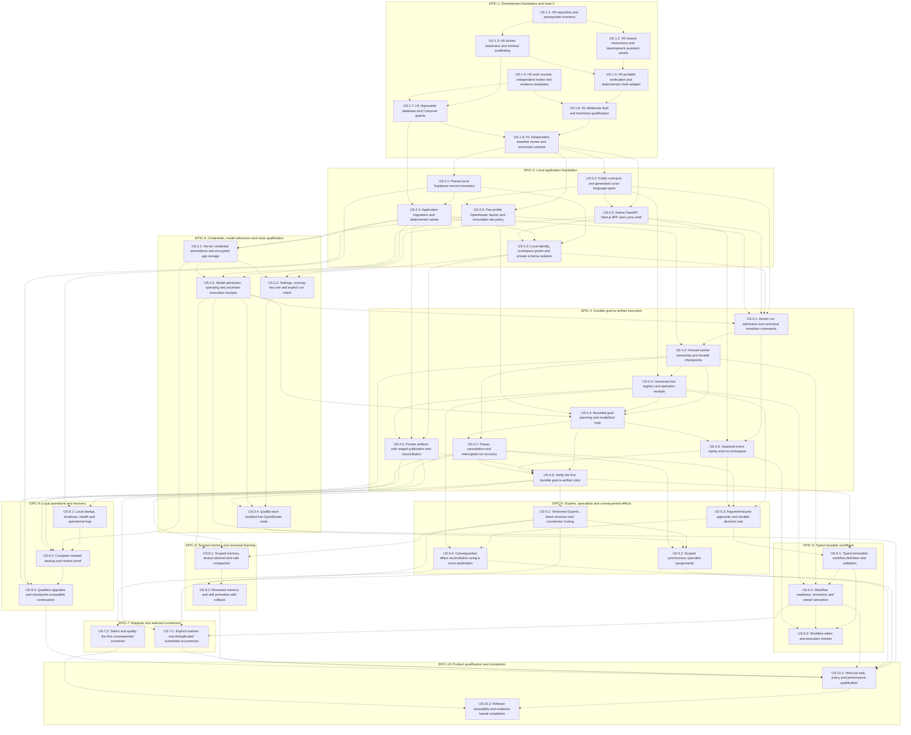

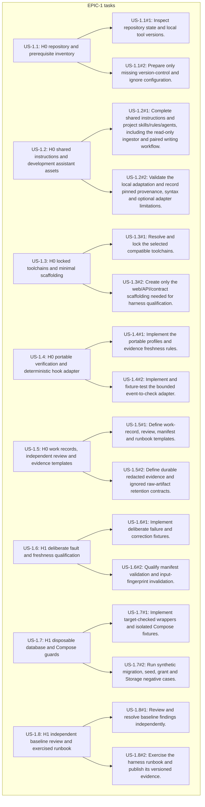

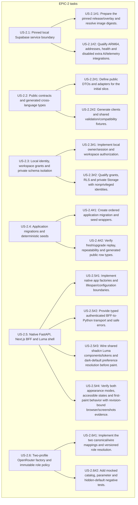

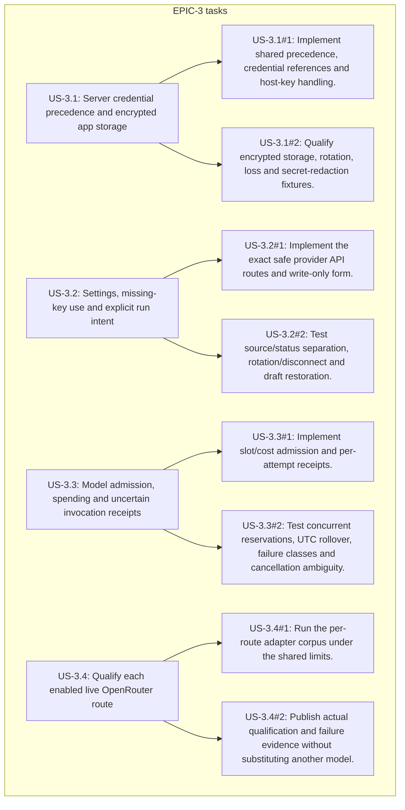

```mermaid
flowchart TD
  subgraph EPIC_4["EPIC-4 tasks"]
    US_4_1["US-4.1: Atomic run admission and canonical transition commands"]
    T_4_1_1["US-4.1#1: Implement typed admission and atomic transition/outbox commands."]
    US_4_1 --> T_4_1_1
    T_4_1_2["US-4.1#2: Test idempotency scope and valid/invalid/concurrent state changes."]
    US_4_1 --> T_4_1_2
    US_4_2["US-4.2: Fenced worker ownership and durable checkpoints"]
    T_4_2_1["US-4.2#1: Implement lease/heartbeat/fencing and scoped direct checkpointer access."]
    US_4_2 --> T_4_2_1
    T_4_2_2["US-4.2#2: Inject stale-owner and process-death cases at domain/checkpoint boundaries."]
    US_4_2 --> T_4_2_2
    US_4_3["US-4.3: Bounded goal planning and model/tool loop"]
    T_4_3_1["US-4.3#1: Compose the minimal explicitly configured Deep Agents stage and plan adapter."]
    US_4_3 --> T_4_3_1
    T_4_3_2["US-4.3#2: Exercise loop bounds and complete argument/result validation with fake models."]
    US_4_3 --> T_4_3_2
    US_4_4["US-4.4: Versioned tool registry and operation receipts"]
    T_4_4_1["US-4.4#1: Implement the narrow read/calculation/artifact tool contracts and central policy gateway."]
    US_4_4 --> T_4_4_1
    T_4_4_2["US-4.4#2: Test denied resources, hidden tools and receipt reuse."]
    US_4_4 --> T_4_4_2
    US_4_5["US-4.5: Private artifacts with staged publication and reconciliation"]
    T_4_5_1["US-4.5#1: Implement staged private uploads and authorized metadata/downloads."]
    US_4_5 --> T_4_5_1
    T_4_5_2["US-4.5#2: Test cross-workspace denial, interruption and hash reconciliation."]
    US_4_5 --> T_4_5_2
    US_4_6["US-4.6: Sanitized event replay and run workspace"]
    T_4_6_1["US-4.6#1: Implement durable event projection, cursor transport and typed client."]
    US_4_6 --> T_4_6_1
    T_4_6_2["US-4.6#2: Build the run/plan/artifact inspector with accessible status states."]
    US_4_6 --> T_4_6_2
    US_4_7["US-4.7: Pause, cancellation and interrupted-run recovery"]
    T_4_7_1["US-4.7#1: Implement cancellation propagation and preserved pause/wait context."]
    US_4_7 --> T_4_7_1
    T_4_7_2["US-4.7#2: Run late-result, sleep, retry and competing completion/cancellation fixtures."]
    US_4_7 --> T_4_7_2
    US_4_8["US-4.8: Verify the first durable goal-to-artifact slice"]
    T_4_8_1["US-4.8#1: Exercise the bounded mock/local database/browser slice."]
    US_4_8 --> T_4_8_1
    T_4_8_2["US-4.8#2: Record independent review, recovery assertions and exercised user-flow runbook."]
    US_4_8 --> T_4_8_2
  end
```

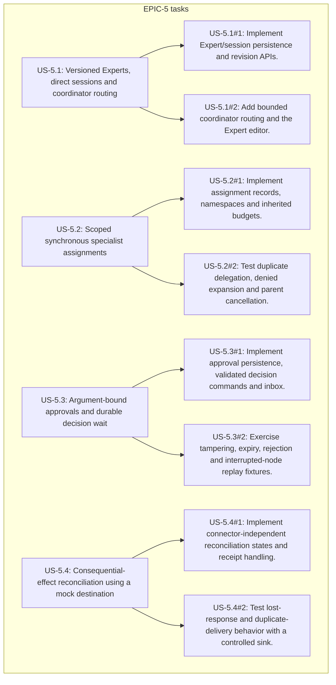

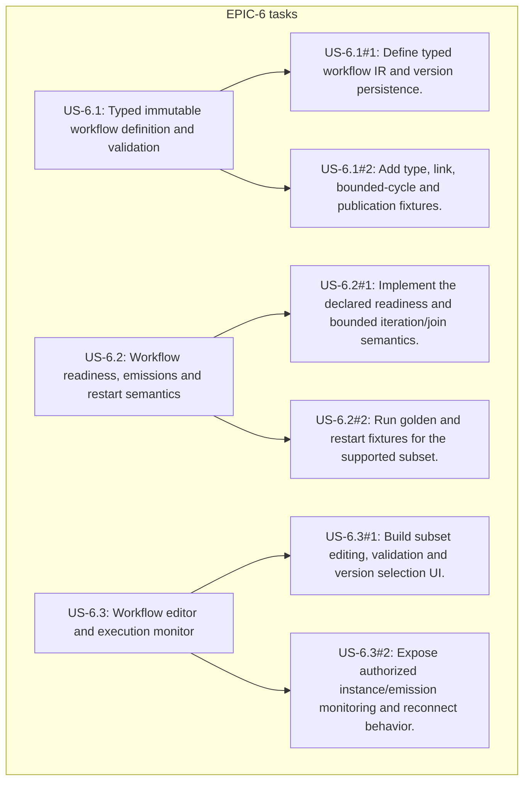

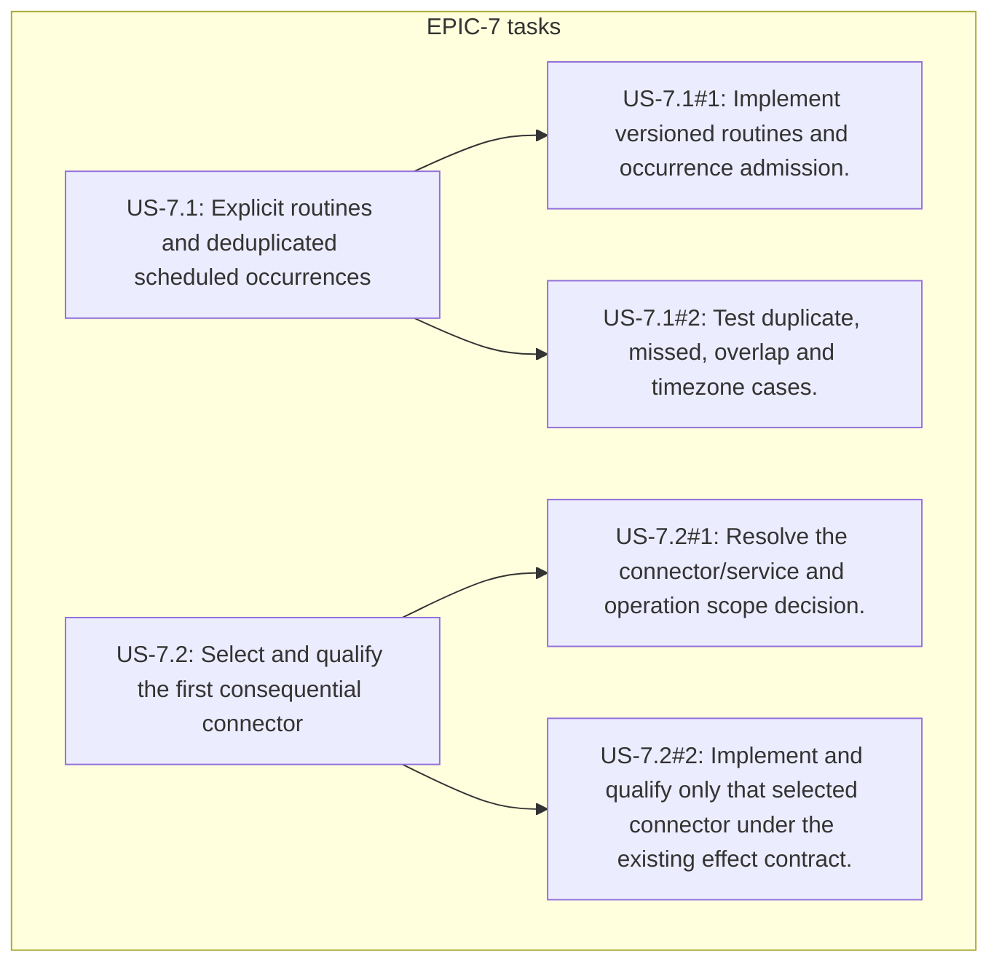

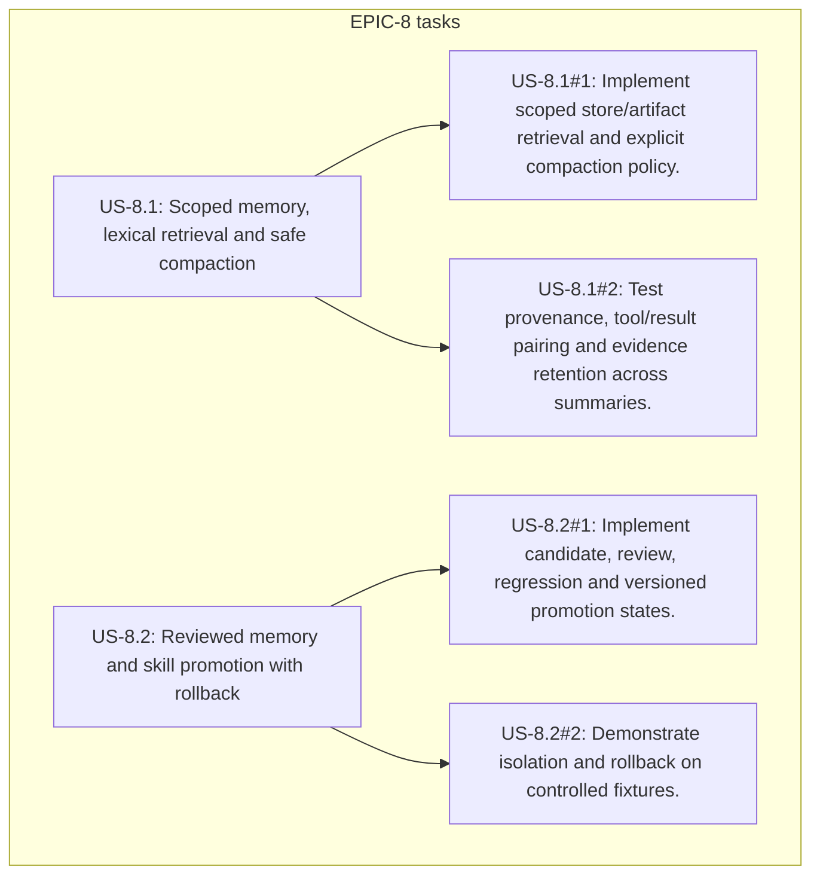

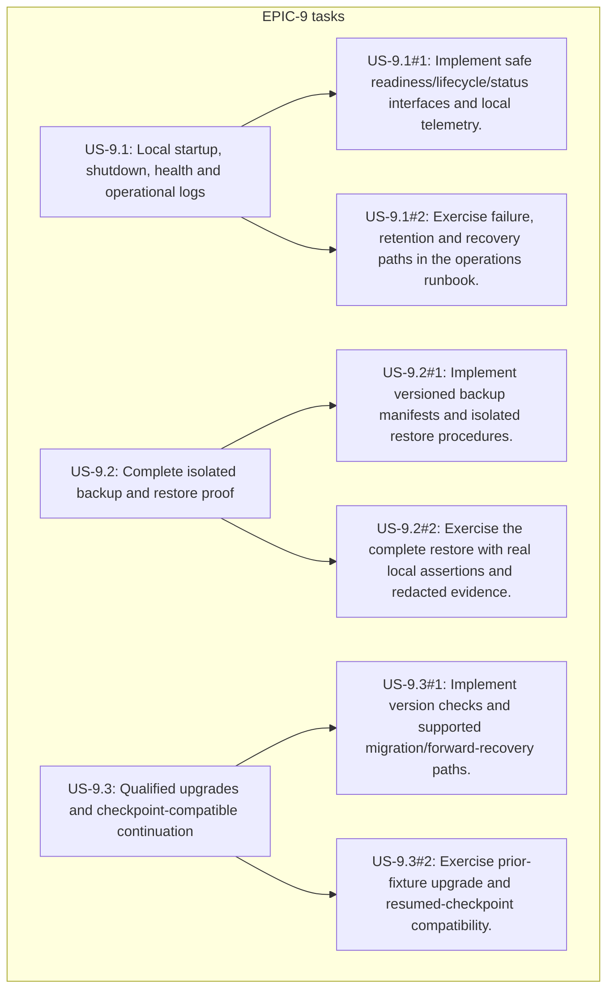

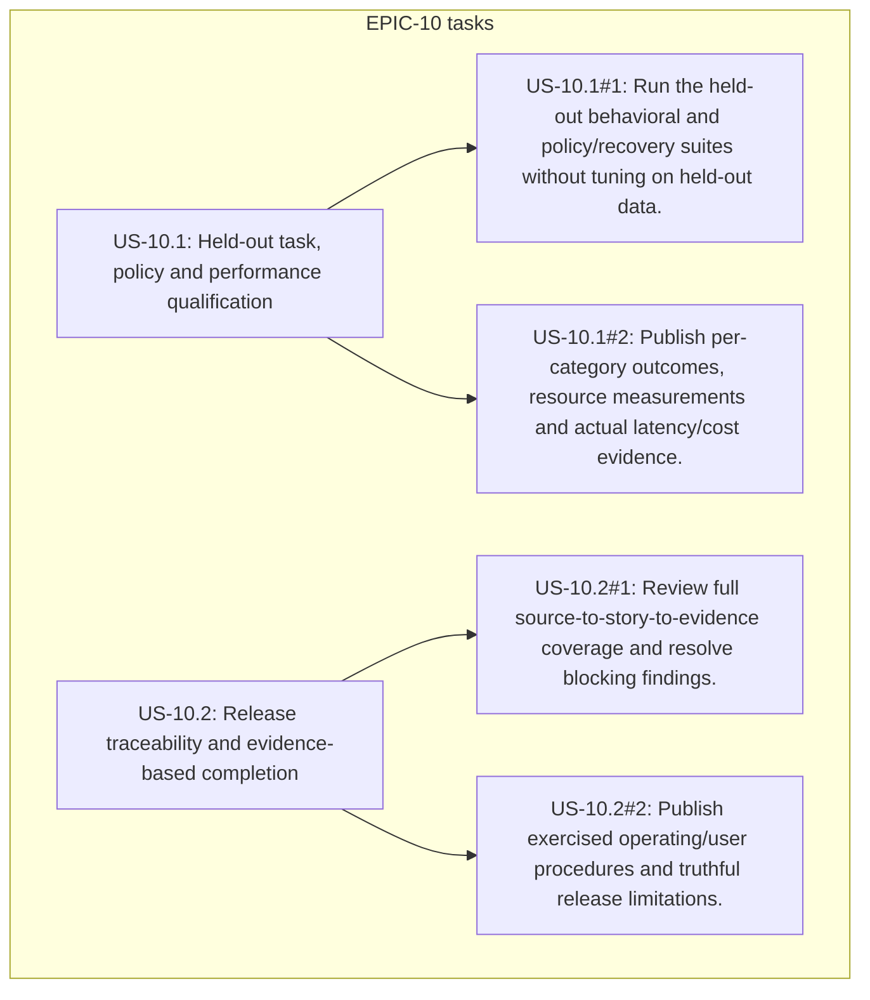

## Product Context

This is the execution backlog for the approved Option B: native Next.js plus native Python FastAPI/LangGraph/Deep Agents on this Mac, local self-hosted Supabase Docker, and OpenRouter-only inference. It reorganizes the preserved SP-001–SP-021 contract into bounded source-linked stories; it does not remove or silently replace that contract. H0/H1 precede feature code, product migrations and production worker logic, with only minimal non-feature scaffolding and disposable qualification fixtures permitted during Gate 0.

The [explicit adaptation decision](docs/engineering/decisions/0001-ohmyorch-adaptation.md#project-decision) authorizes the project-local OhMyOrch ingestion format; it does not authorize a product build or broaden the runtime/provider boundary.

Sources retain their authority: the [preserved engineering contract](docs/engineering/option-b-contract.md) owns its additional serialized-state and implementation decisions; the [Option B PRD](PRD-LangChain-Deep-Agents.md), [harness PRD](PRD-Development-Harness.md), [provider PRD](PRD-Model-Providers.md), [deployment PRD](PRD-Local-Mac-Deployment.md) and [design-system PRD](PRD-Design-System.md) own their detailed contracts. [AutoGPT research](PRD-AutoGPT.md) describes upstream behavior; it does not automatically authorize new clone features. [The comparison](PRD-Comparison-Recommendation.md) records the architecture rationale. Conflicts must remain visible and be resolved in their owning requirements, not silently in code.

Story IDs are the execution identifiers. The H0/H1/B0–B7 labels retain the preserved milestone sequence; older numbered ranges are sequencing slots, not evidence that work is complete. Every story inherits DH-W01–DH-W06: proportional plan, implementation, independent review, verification and exercised runbook/evidence. No story is DONE merely because its specification or a development asset exists. Initial dependent stories remain BLOCKED until prerequisites are evidenced; READY means specified and actionable, not implemented.

**Preserved SP coverage**

| Preserved requirement | Backlog coverage |
|---|---|
| [SP-001](docs/engineering/option-b-contract.md#sp-001--h0-establish-the-development-contract) | US-1.1, US-1.2, US-1.3, US-1.4 |
| [SP-002](docs/engineering/option-b-contract.md#sp-002--h1-prove-and-enable-the-baseline) | US-1.6, US-1.7, US-1.8 |
| [SP-003](docs/engineering/option-b-contract.md#sp-003--one-traceable-work-record-per-meaningful-change) | US-1.5, US-1.8, US-10.2 |
| [SP-004](docs/engineering/option-b-contract.md#sp-004--local-architecture) | US-1.3, US-2.5 |
| [SP-005](docs/engineering/option-b-contract.md#sp-005--local-services-and-isolation) | US-2.1, US-2.3 |
| [SP-006](docs/engineering/option-b-contract.md#sp-006--exactly-two-model-profiles) | US-2.6 |
| [SP-007](docs/engineering/option-b-contract.md#sp-007--credentials-and-configuration-ux) | US-3.1, US-3.2 |
| [SP-008](docs/engineering/option-b-contract.md#sp-008--budgets-and-model-qualification) | US-3.3, US-3.4, US-4.3, US-5.2, US-10.1 |
| [SP-009](docs/engineering/option-b-contract.md#sp-009--types-and-ownership) | US-2.2 |
| [SP-010](docs/engineering/option-b-contract.md#sp-010--canonical-run-states-and-transitions) | US-2.2, US-4.1, US-4.7 |
| [SP-011](docs/engineering/option-b-contract.md#sp-011--plans-graph-state-and-events) | US-4.3, US-4.6, US-4.8, US-5.1, US-8.1 |
| [SP-012](docs/engineering/option-b-contract.md#sp-012--durable-job-ownership-and-recovery) | US-4.2, US-4.7, US-5.4, US-9.3 |
| [SP-013](docs/engineering/option-b-contract.md#sp-013--tools-approvals-and-artifacts) | US-4.4, US-4.5, US-5.3, US-5.4, US-7.2 |
| [SP-014](docs/engineering/option-b-contract.md#sp-014--application-interfaces-and-ux) | US-2.5, US-3.2, US-4.1, US-4.6, US-5.1, US-6.3, US-9.1 |
| [SP-015](docs/engineering/option-b-contract.md#sp-015--migrations-and-seeds) | US-1.7, US-2.4, US-9.3 |
| [SP-016](docs/engineering/option-b-contract.md#sp-016--schedules-workflows-and-learning) | US-5.1, US-5.2, US-6.1, US-6.2, US-6.3, US-7.1, US-7.2, US-8.1, US-8.2 |
| [SP-017](docs/engineering/option-b-contract.md#sp-017--language-and-contract-quality) | US-1.2, US-1.3, US-1.4, US-1.6, US-2.2 |
| [SP-018](docs/engineering/option-b-contract.md#sp-018--local-operations-and-runbooks) | US-9.1, US-9.2, US-9.3 |
| [SP-019](docs/engineering/option-b-contract.md#sp-019--acceptance-scenarios) | US-1.6, US-3.2, US-3.4, US-4.7, US-4.8, US-5.4, US-6.2, US-9.2, US-10.1, US-10.2 |
| [SP-020](docs/engineering/option-b-contract.md#sp-020--milestone-sequence) | All stories through the H0/H1 and B0–B7 phase labels; milestone order remains governed by SP-020. |
| [SP-021](docs/engineering/option-b-contract.md#sp-021--completion-contract) | US-1.5, US-1.8, US-3.4, US-4.8, US-10.1, US-10.2 |

## Goals

- Deliver bounded goal execution with inspectable plans, validated tools, verifiable artifacts and truthful completion. Sources: SP-011–SP-014 and LC-03/04/06/12.
- Preserve work through browser disconnect, worker failure and local interruptions without blind repeated effects. Sources: SP-010/SP-012 and LC-08/09/11.
- Add versioned Experts, scoped delegation, reusable workflows and explicit routines after the durable core. Sources: SP-016/SP-020 and LC-02/07/14/15.
- Establish the portable development baseline first and retain independently reviewed, reproducible evidence for each change. Sources: SP-001–SP-003/SP-021 and DH-W01–06.

## Non-Goals

- No hosted application, hosted Supabase, remote workers/log collection or second durable orchestration authority.
- No local inference runtime, fallback provider, hidden embedding/reranking service, extra model profile or automatic paid inference triggered by saving a key.
- No public marketplace, billing product, complete AutoGPT integration parity, unrestricted code execution or unattended self-modification in this scope.
- No claim that an optional Claude adapter is active, model capabilities are qualified, or the product is implemented because documentation/assets exist.

Sources: [scope](PRD-LangChain-Deep-Agents.md#23-explicit-scope-choices), SP-004–SP-008, and the normative provider/deployment boundaries.

## Actors

| Actor | Job |
|---|---|
| User / workspace owner | Set goals and scope, configure models, inspect artifacts and outcomes |
| Specialist owner / automation builder | Version Experts, workflows, memory and explicit routines |
| Reviewer | Decide exact proposed actions and inspect independent development evidence |
| Operator | Maintain the local stack, credentials, backups, recovery and qualification |
| Developer | Implement bounded stories under the portable standards and evidence contract |

Source: [Option B users](PRD-LangChain-Deep-Agents.md#21-primary-users), SP-003 and DH-W01–06.

## Global Business Rules

1. All application/data/Auth/Storage/workers/logs remain on this Mac. Inference alone uses the approved OpenRouter route; scoped external tools retain separate permission rules. Private app_private and agent_runtime SQL remain excluded from PostgREST/Realtime. Sources: SP-004/SP-005, LM-01–07.
2. The registry contains only openrouter_deepseek_flash (canonical deepseek/deepseek-v4.1-flash-20261017; wire deepseek/deepseek-v4.1-flash-1017) and openrouter_terra (canonical openai/gpt-6.1-terra-20261026; wire openai/gpt-6.1-terra). All 14 roles initially use Terra, by Decision 0006. Source: SP-006 and MP-01/02.
3. Resolve run-role override, run-wide selection, workspace-role override, workspace default, then Terra. Freeze bindings/data scope/limits at admission; children inherit them. Catalog freshness is at most five minutes with exact canonical matching and no fallback. Source: SP-006.
4. Missing keys preserve local non-AI use and block every inference path. Environment precedence, app encryption and late-bound credential versions follow MP-03–06; Save and validate does not launch work. Source: SP-007.
5. Initial limits are two remote slots per workspace, 8K context, 512 output tokens, 24 model calls, 40 tool calls, one invalid-argument/schema repair, two plan revisions, two child levels, four children, two outstanding assignments and 15 minutes active execution. Approval wait has separate expiry. US$1/root and US$5/workspace UTC-day admission budgets include attempts/descendants. These are configurable application limits, not model capacities. Source: SP-008.
6. The canonical run enum is queued, running, waiting_input, waiting_approval, paused, verifying, cancelling, succeeded, failed, cancelled. SP-010 retains the complete transition table. Resume applies only to paused; terminal states need a linked new run. Cancellation is valid from every nonterminal state and cannot be undone by late results.
7. Model text proposes actions; deterministic policy controls state, schema validation, approvals, permissions and effect receipts. Neither a checkpoint nor an LLM claim proves completion or exactly-once effects. Sources: SP-011–SP-013.
8. Every story follows the proportional DH-W01–06 delivery cycle. Changes invalidate affected evidence; templates/skips and inactive optional adapters are not passing results. Test resets and runbook exercises target qualified disposable environments, never persistent workbench data. Sources: SP-001–SP-003/SP-015/SP-021.
9. Optional development assistant integration cannot add another inference provider, paid hook or remote reviewer requirement. The portable baseline must operate without Claude or model credentials; actual assistant event delivery is qualified only for an enabled adapter. Sources: SP-002 and DH-01/02/05.
10. Review and promote memory/skills with scope, provenance, regression evidence and rollback. A saved key or generated recollection never authorizes unattended work or wider permissions. Source: SP-016.
11. Use shadcn Luma with the exact user-supplied [semantic tokens](docs/design/luma.css). Dark is the fresh-visit default regardless of OS preference; explicit light/dark selection persists locally and applies before paint. All delivered UI uses this design contract, including keyless setup, states and workflow surfaces. Earlier warm-neutral/forest-green concepts are superseded. Sources: SP-014, LC-34 and [DS-01–DS-05](PRD-Design-System.md).

## Non-Functional Requirements

- Require zero unauthorized effects and zero duplicate effects across the tested policy/recovery boundaries; classify unresolved outcomes honestly. Sources: SP-012/SP-019/SP-021, LC-05/09/10/11.
- Target p95 non-inference API latency below 300 ms, committed-event visibility below one second, cancellation acknowledgment within one second and eligible recovery within 60 seconds after lease expiry/worker availability. These require measured conditions or an explicit supported revision. Source: SP-021.
- Target at least 98 percent first-pass valid calls across 100 protocol cases and at least 85 percent task success on 40 held-out tasks repeated three times; report failing categories and keep task correctness separate from valid protocol output. Source: Option B §6.4 and SP-019/SP-021.
- Keep secrets out of browser persistence, prompts, checkpoints, raw graph streams, logs and evidence. Use scoped Auth/RLS/Storage and privileged-server separation; no hosted tracing. Sources: SP-005/SP-007/SP-009/SP-011.
- Use reproducible locks, generated contracts, deterministic tests and local redacted evidence. Demonstrate restart, complete isolated restore and checkpoint-compatible upgrades. Sources: SP-015/SP-017/SP-018/SP-021.
- Verify shared theme tokens, first-paint/hydration behavior, keyboard/focus operation, contrast and state/diff meaning in both supported modes; capture implemented-screen evidence. Generated mockups do not establish browser or accessibility acceptance. Sources: SP-014, LC-34 and [DS-01–DS-05](PRD-Design-System.md).

# EPIC-1: Development foundation and Gate 0

Phase reference: H0/H1, preserved SP-020. All story completion also requires SP-003/SP-021 and DH-W01–06.

### US-1.1: H0 repository and prerequisite inventory

Status: DONE
Change: `openspec/changes/archive/2026-11-04-us-1-1-h0-repository-prerequisite-inventory/`

As a developer
I want an accurate repository and local-tool inventory
So that existing work and missing prerequisites are visible before changes.

Source:
- [SP-001](docs/engineering/option-b-contract.md#sp-001--h0-establish-the-development-contract)
- [H0.1](PRD-Development-Harness.md#dh-02-first-implementation-tasks)
- [SP-020](docs/engineering/option-b-contract.md#sp-020--milestone-sequence) — phase reference H0-01.

Codebase Context:
- [Existing development assets and limits](CODEBASE.md#current-capabilities) — reconcile current tooling; presence is not evidence that H0/H1 passed.

Acceptance Criteria:

```gherkin
Scenario: Preserve existing work
  Given the documentation and project-local development assets already present
  When the repository and installed tool versions are inspected
  Then the inventory records actual paths, versions and missing prerequisites without secret values or overwritten unrelated settings

Scenario: Establish repository hygiene
  Given version control or required ignores are absent
  When the H0 foundation is prepared
  Then version control and ignores are established without committing credentials, local transcripts or disposable data
```

Dependencies:
- None.

Tasks:
- [x] Inspect repository state and local tool versions.
- [x] Prepare only missing version-control and ignore configuration.

Open Questions:
- None.

### US-1.2: H0 shared instructions and development assistant assets

Status: DONE
Change: `openspec/changes/archive/2026-11-05-us-1-2-h0-shared-instructions-development/`

As a developer
I want shared instructions and focused project-local assistant definitions
So that development guidance is reusable without becoming a product model runtime.

Source:
- [SP-001](docs/engineering/option-b-contract.md#sp-001--h0-establish-the-development-contract)
- [SP-017](docs/engineering/option-b-contract.md#sp-017--language-and-contract-quality)
- [DH-03 repository structure](PRD-Development-Harness.md#dh-03-required-repository-structure)
- [DH-04 skills and agents](PRD-Development-Harness.md#dh-04-skills-and-specialist-agents)
- [Decision 0001: explicit ingestion request](docs/engineering/decisions/0001-ohmyorch-adaptation.md#requested-behavior)
- [Decision 0001: local adaptation boundaries](docs/engineering/decisions/0001-ohmyorch-adaptation.md#project-decision)
- [SP-020](docs/engineering/option-b-contract.md#sp-020--milestone-sequence) — phase reference H0-02.

Codebase Context:
- [Existing development assets and limits](CODEBASE.md#current-capabilities) — reconcile current tooling; presence is not evidence that H0/H1 passed.

Acceptance Criteria:

```gherkin
Scenario: Keep development policy portable
  Given shared engineering standards and the approved local/OpenRouter boundary
  When AGENTS.md, CLAUDE.md and project rules, skills, agents and settings are authored
  Then common rules are not duplicated inconsistently and each rule links to a check or review responsibility

Scenario: Separate optional assistant activation
  Given an unavailable or incompatible Claude adapter
  When its configuration is validated
  Then it remains explicitly inactive and no new model provider, paid review call or activation claim is introduced

Scenario: Ingest without inventing product behavior
  Given approved PRDs, preserved SP requirements and descriptive CODEBASE context
  When the read-only adapted ingestor returns a proposed backlog and its paired caller persists it
  Then stories cite their sources, contain Given/When/Then acceptance, preserve stable identities and honest dependencies/statuses, and generate navigation without implementing product code or claiming delivery complete
```

Dependencies:
- US-1.1

Tasks:
- [x] Complete shared instructions and project skills/rules/agents, including the read-only ingestor and paired writing workflow.
- [x] Validate the local adaptation and record pinned provenance, syntax and optional adapter limitations.

Open Questions:
- None.

### US-1.3: H0 locked toolchains and minimal scaffolding

Status: DONE
Change: `openspec/changes/archive/2026-11-05-us-1-3-h0-locked-toolchains-minimal/`

As a developer
I want compatible prepared Node and Python environments
So that the verifier can run reproducibly without changing dependencies during checks.

Source:
- [SP-001](docs/engineering/option-b-contract.md#sp-001--h0-establish-the-development-contract)
- [SP-004](docs/engineering/option-b-contract.md#sp-004--local-architecture)
- [SP-017](docs/engineering/option-b-contract.md#sp-017--language-and-contract-quality)
- [DH-06 language standards](PRD-Development-Harness.md#dh-06-coding-and-layer-standards)
- [Option B package constraints](PRD-LangChain-Deep-Agents.md#31-verified-python-package-snapshot)
- [SP-020](docs/engineering/option-b-contract.md#sp-020--milestone-sequence) — phase reference H0-03.

Codebase Context:
- [Existing development assets and limits](CODEBASE.md#current-capabilities) — reconcile current tooling; presence is not evidence that H0/H1 passed.

Acceptance Criteria:

```gherkin
Scenario: Resolve the combined environment
  Given the researched package candidates and Python/OpenRouter compatibility constraints
  When pinned Node/pnpm and Python 3.12/uv manifests and locks are resolved
  Then a reproducible prepared environment and minimal non-feature packages exist with recorded versions

Scenario: Keep verification non-mutating
  Given a prepared locked environment
  When a verification command runs
  Then it does not silently install dependencies or rewrite the lock
```

Dependencies:
- US-1.1

Tasks:
- [x] Resolve and lock the selected compatible toolchains.
- [x] Create only the web/API/contract scaffolding needed for harness qualification.

Open Questions:
- None.

### US-1.4: H0 portable verification and deterministic hook adapter

Status: DONE
Change: `openspec/changes/archive/2026-11-05-us-1-4-h0-portable-verification-deterministic/`

As a developer
I want one local verification runner with a thin hook adapter
So that required checks work independently of a coding assistant.

Source:
- [SP-001](docs/engineering/option-b-contract.md#sp-001--h0-establish-the-development-contract)
- [SP-017](docs/engineering/option-b-contract.md#sp-017--language-and-contract-quality)
- [DH-05 hooks and portable enforcement](PRD-Development-Harness.md#dh-05-hooks-and-portable-enforcement)
- [DH-09 profiles](PRD-Development-Harness.md#dh-09-verification-profiles-and-completion-rules)
- [SP-020](docs/engineering/option-b-contract.md#sp-020--milestone-sequence) — phase reference H0-04.

Codebase Context:
- [Existing development assets and limits](CODEBASE.md#current-capabilities) — reconcile current tooling; presence is not evidence that H0/H1 passed.

Acceptance Criteria:

```gherkin
Scenario: Run independently of Claude
  Given the prepared repository and no model credential
  When the portable harness, fast or full verification profile runs
  Then required checks return distinct pass, failure or prerequisite errors without paid inference or implicit installation

Scenario: Handle unsafe hook input
  Given malformed input, shell metacharacters, symlinks, timeout or a missing executable fixture
  When the deterministic hook dispatcher processes the fixture
  Then it uses bounded validated input, documented event behavior and redacted diagnostics without treating filenames as shell code
```

Dependencies:
- US-1.2
- US-1.3

Tasks:
- [x] Implement the portable profiles and evidence freshness rules.
- [x] Implement and fixture-test the bounded event-to-check adapter.

Open Questions:
- None.

### US-1.5: H0 work records, independent review and evidence templates

Status: DONE
Change: `openspec/changes/archive/2026-11-05-us-1-5-h0-work-records-independent/`

As a developer
I want a proportional delivery and evidence contract
So that every later work item can be reviewed and reproduced.

Source:
- [SP-003](docs/engineering/option-b-contract.md#sp-003--one-traceable-work-record-per-meaningful-change)
- [SP-021](docs/engineering/option-b-contract.md#sp-021--completion-contract)
- [DH-W01–DH-W06](PRD-Development-Harness.md#dh-091-work-item-evidence-contract)
- [DH-09.2 manifests](PRD-Development-Harness.md#dh-092-fingerprints-manifests-and-retained-artifacts)
- [SP-020](docs/engineering/option-b-contract.md#sp-020--milestone-sequence) — phase reference H0-05.

Codebase Context:
- [Existing development assets and limits](CODEBASE.md#current-capabilities) — reconcile current tooling; presence is not evidence that H0/H1 passed.

Acceptance Criteria:

```gherkin
Scenario: Prepare honest templates
  Given the required plan, implementation, independent review, verification and runbook stages
  When work-record and evidence templates are created
  Then they contain traceable IDs, fingerprints, findings, expected/observed results and runbook links while examples remain visibly unexecuted

Scenario: Reject unsupported completion
  Given a template, stale fingerprint, skipped check or unresolved blocking review finding
  When completion evidence is validated
  Then the work item cannot be marked complete and the missing evidence remains visible
```

Dependencies:
- None.

Tasks:
- [x] Define work-record, review, manifest and runbook templates.
- [x] Define durable redacted evidence and ignored raw-artifact retention contracts.

Open Questions:
- None.

### US-1.6: H1 deliberate fault and freshness qualification

Status: DONE
Change: `openspec/changes/archive/2026-11-05-us-1-6-h1-deliberate-fault-freshness/`

As a developer
I want known-good and known-bad harness fixtures
So that a passing verifier demonstrates that actual faults are detected.

Source:
- [SP-002](docs/engineering/option-b-contract.md#sp-002--h1-prove-and-enable-the-baseline)
- [SP-017](docs/engineering/option-b-contract.md#sp-017--language-and-contract-quality)
- [SP-019](docs/engineering/option-b-contract.md#sp-019--acceptance-scenarios)
- [DH-A02–05, DH-A08/11/14/15](PRD-Development-Harness.md#dh-10-acceptance-and-closure)
- [SP-020](docs/engineering/option-b-contract.md#sp-020--milestone-sequence) — phase reference H1-01.

Codebase Context:
- [Existing development assets and limits](CODEBASE.md#current-capabilities) — reconcile current tooling; presence is not evidence that H0/H1 passed.

Acceptance Criteria:

```gherkin
Scenario: Detect faults and invalidate old evidence
  Given good and faulty TypeScript, Python, contract, state and model-transport fixtures
  When the portable checks run and a relevant untracked input later changes
  Then faults fail, corrected inputs pass and the older report cannot certify the changed inputs

Scenario: Protect paid endpoints during tests
  Given a developer environment containing a real provider key
  When the baseline model tests execute
  Then fake transports are used and external inference is rejected
```

Dependencies:
- US-1.4
- US-1.5

Tasks:
- [x] Implement deliberate failure and correction fixtures.
- [x] Qualify manifest validation and input-fingerprint invalidation.

Open Questions:
- None.

### US-1.7: H1 disposable database and Compose guards

Status: DONE
Change: `openspec/changes/archive/2026-11-05-us-1-7-h1-disposable-database-compose/`

As a developer
I want qualified disposable infrastructure checks
So that migration and operation tests cannot reset persistent workbench data.

Source:
- [SP-002](docs/engineering/option-b-contract.md#sp-002--h1-prove-and-enable-the-baseline)
- [SP-015](docs/engineering/option-b-contract.md#sp-015--migrations-and-seeds)
- [DH-07 migrations and seeds](PRD-Development-Harness.md#dh-07-supabase-migrations-seeds-and-database-quality)
- [DH-08 target isolation](PRD-Development-Harness.md#dh-08-docker-and-local-operations-standards)
- [SP-020](docs/engineering/option-b-contract.md#sp-020--milestone-sequence) — phase reference H1-02.

Codebase Context:
- [Existing development assets and limits](CODEBASE.md#current-capabilities) — reconcile current tooling; presence is not evidence that H0/H1 passed.

Acceptance Criteria:

```gherkin
Scenario: Refuse the persistent target
  Given test wrappers receive the persistent database identity or volumes
  When a reset, cleanup or disposable migration test is requested
  Then the operation is refused before mutation

Scenario: Exercise disposable fixtures
  Given a marked isolated project with distinct ports and volumes
  When synthetic migrations, repeated seeds and authorization fixtures run
  Then replay and seed repeatability are verified and anonymous/cross-workspace access fails without touching persistent services
```

Dependencies:
- US-1.3
- US-1.5

Tasks:
- [x] Implement target-checked wrappers and isolated Compose fixtures.
- [x] Run synthetic migration, seed, grant and Storage negative cases.

Open Questions:
- None.

### US-1.8: H1 independent baseline review and exercised runbook

Status: DONE
Change: `openspec/changes/archive/2026-11-05-us-1-8-h1-independent-baseline-review/`

As an operator
I want a reviewed portable baseline with reproducible evidence
So that feature work starts only after Gate 0 is demonstrated.

Source:
- [SP-002](docs/engineering/option-b-contract.md#sp-002--h1-prove-and-enable-the-baseline)
- [SP-003](docs/engineering/option-b-contract.md#sp-003--one-traceable-work-record-per-meaningful-change)
- [SP-021](docs/engineering/option-b-contract.md#sp-021--completion-contract)
- [H1.3](PRD-Development-Harness.md#dh-02-first-implementation-tasks)
- [DH-A01–16](PRD-Development-Harness.md#dh-10-acceptance-and-closure)
- [SP-020](docs/engineering/option-b-contract.md#sp-020--milestone-sequence) — phase reference H1-03.

Codebase Context:
- [Existing development assets and limits](CODEBASE.md#current-capabilities) — reconcile current tooling; presence is not evidence that H0/H1 passed.

Acceptance Criteria:

```gherkin
Scenario: Close Gate 0 honestly
  Given positive/negative portable and disposable checks have current evidence
  When an independent reviewer inspects the baseline and its runbook is exercised
  Then required findings are resolved and the redacted report records real commands, outcomes, failures and recovery

Scenario: Report optional adapter status
  Given the portable baseline passes but Claude is incompatible
  When Gate 0 results are published
  Then the adapter remains explicitly inactive and script fixtures are not claimed as actual assistant event delivery
```

Dependencies:
- US-1.6
- US-1.7

Tasks:
- [x] Review and resolve baseline findings independently.
- [x] Exercise the harness runbook and publish its versioned evidence.

Open Questions:
- None.

# EPIC-2: Local application foundation

Phase reference: B0, preserved SP-020. All story completion also requires SP-003/SP-021 and DH-W01–06.

### US-2.1: Pinned local Supabase service boundary

Status: DONE
Change: `openspec/changes/archive/2026-11-05-us-2-1-pinned-local-supabase-service/`

As an operator
I want a project-scoped local Supabase stack
So that application infrastructure stays on this Mac.

Source:
- [SP-005](docs/engineering/option-b-contract.md#sp-005--local-services-and-isolation)
- [LM-03 Compose baseline](PRD-Local-Mac-Deployment.md#lm-03-supabase-and-docker-baseline)
- [LM-04 addresses](PRD-Local-Mac-Deployment.md#lm-04-local-addresses-and-connection-types)
- [SP-020](docs/engineering/option-b-contract.md#sp-020--milestone-sequence) — phase reference B0.

Acceptance Criteria:

```gherkin
Scenario: Publish only approved local services
  Given the pinned self-hosted Compose release and local overlay
  When the rendered configuration and actual listeners are qualified
  Then required ports bind only to loopback, direct database access reaches db:5432 and Studio remains behind authenticated gateway access

Scenario: Protect unrelated services
  Given a proposed host port conflicts with another process
  When startup preflight runs
  Then it reports the conflict instead of killing that process or retaining a wildcard publication
```

Dependencies:
- US-1.8

Tasks:
- [x] Prepare the pinned release/overlay and resolve image digests.
- [x] Qualify ARM64, addresses, health and disabled extra AI/telemetry integrations.

Open Questions:
- None.

### US-2.2: Public contracts and generated cross-language types

Status: DONE
Change: `openspec/changes/archive/2026-11-05-us-2-2-public-contracts-generated-cross/`

As a developer
I want one typed public API contract
So that Python, TypeScript and persisted state do not drift silently.

Source:
- [SP-009](docs/engineering/option-b-contract.md#sp-009--types-and-ownership)
- [SP-010](docs/engineering/option-b-contract.md#sp-010--canonical-run-states-and-transitions)
- [SP-017](docs/engineering/option-b-contract.md#sp-017--language-and-contract-quality)
- [Option B entities](PRD-LangChain-Deep-Agents.md#111-product-entities)
- [DH-06 contracts and state](PRD-Development-Harness.md#dh-06-coding-and-layer-standards)
- [SP-020](docs/engineering/option-b-contract.md#sp-020--milestone-sequence) — phase reference B0.

Acceptance Criteria:

```gherkin
Scenario: Generate without credentials or services
  Given Pydantic public contracts and explicit domain/persistence/state boundaries
  When OpenAPI/JSON Schema and the TypeScript client are generated
  Then generation requires no service connection or provider credential and drift is detected against versioned artifacts

Scenario: Validate at trust boundaries
  Given invalid identifiers, money, timestamps or enum values
  When a public request or response crosses a boundary
  Then runtime validation rejects invalid values rather than relying on a TypeScript cast
```

Dependencies:
- US-1.8

Tasks:
- [x] Define public DTOs and adapters for the initial slice.
- [x] Generate clients and shared validation/compatibility fixtures.

Open Questions:
- None.

### US-2.3: Local identity, workspace grants and private schema isolation

Status: DONE
Change: `openspec/changes/archive/2026-11-05-us-2-3-local-identity-workspace-grants/`

As a workspace owner
I want local authenticated and scoped access
So that another user cannot read my records or internal credentials.

Source:
- [SP-005](docs/engineering/option-b-contract.md#sp-005--local-services-and-isolation)
- [LM-05 Auth and schema ownership](PRD-Local-Mac-Deployment.md#lm-05-database-auth-and-storage-ownership)
- [Option B authorization](PRD-LangChain-Deep-Agents.md#53-auth-private-artifacts-and-persistence-boundaries)
- [SP-020](docs/engineering/option-b-contract.md#sp-020--milestone-sequence) — phase reference B0.

Acceptance Criteria:

```gherkin
Scenario: Use local password ownership
  Given local Auth with public signup disabled
  When the owner is bootstrapped through supported APIs and signs in
  Then the BFF and Python service verify identity and workspace membership without an external identity provider

Scenario: Reject cross-boundary access
  Given anonymous, forged or other-workspace identities
  When they request domain records, private schemas or private Storage objects
  Then access is denied and app_private/agent_runtime are absent from PostgREST and Realtime access
```

Dependencies:
- US-2.1
- US-2.4
- US-2.5

Tasks:
- [x] Implement local owner/session and workspace authorization.
- [x] Qualify grants, RLS and private Storage with nonprivileged identities.

Open Questions:
- None.

### US-2.4: Application migrations and deterministic seeds

Status: DONE
Change: `openspec/changes/archive/2026-11-05-us-2-4-application-migrations-deterministic-seeds/`

As an operator
I want one guarded schema and seed history
So that fresh setup and upgrades preserve user data.

Source:
- [SP-015](docs/engineering/option-b-contract.md#sp-015--migrations-and-seeds)
- [DH-07 database quality](PRD-Development-Harness.md#dh-07-supabase-migrations-seeds-and-database-quality)
- [LM-05 database roles](PRD-Local-Mac-Deployment.md#lm-05-database-auth-and-storage-ownership)
- [SP-020](docs/engineering/option-b-contract.md#sp-020--milestone-sequence) — phase reference B0.

Acceptance Criteria:

```gherkin
Scenario: Replay and upgrade application schema
  Given a marked disposable direct database and a supported prior fixture
  When ordered migrations and reference seeds run, then seeds run again
  Then schema constraints and relationships are correct, reference rows are stable and user edits are not overwritten

Scenario: Separate migration authority
  Given restricted runtime roles and a migration identity
  When schema setup or a framework table upgrade is requested
  Then only the explicit guarded migration path changes schema and no competing ORM history or worker-startup DDL is introduced
```

Dependencies:
- US-2.1
- US-1.7

Tasks:
- [x] Create ordered application migration and seed wrappers.
- [x] Verify fresh/upgrade replay, repeatability and generated public row types.

Open Questions:
- None.

### US-2.5: Native FastAPI, Next.js BFF and Luma shell

Status: DONE
Change: `openspec/changes/archive/2026-11-05-us-2-5-native-fastapi-next-js/`

As a developer
I want local API and presentation processes with clear ownership and the shared Luma interface
So that HTTP requests do not own durable work and users see a consistent dark-default workbench.

Source:
- [SP-004](docs/engineering/option-b-contract.md#sp-004--local-architecture)
- [SP-014](docs/engineering/option-b-contract.md#sp-014--application-interfaces-and-ux)
- [Option B process boundaries](PRD-LangChain-Deep-Agents.md#51-process-boundaries-and-local-networking)
- [Option B API contract](PRD-LangChain-Deep-Agents.md#112-api-contract)
- [DS-01–DS-05: Luma tokens, theme behavior, components, accessibility and visual evidence](PRD-Design-System.md)
- [LC-34: shared Luma interface](PRD-LangChain-Deep-Agents.md#13-functional-requirements-and-acceptance-criteria)
- [SP-020](docs/engineering/option-b-contract.md#sp-020--milestone-sequence) — phase reference B0.

Acceptance Criteria:

```gherkin
Scenario: Start bounded native services
  Given the prepared package layout and local configuration
  When the Next.js BFF and FastAPI app factory start
  Then lifespan-managed pools/clients remain server-side and long-running work is not owned by a browser or request

Scenario: Guard the same-origin boundary
  Given an authenticated local application route
  When a forged origin, workspace or internal request is submitted
  Then Host/Origin/CSRF and identity checks reject the request without exposing privileged credentials

Scenario: Render Luma dark on a fresh visit
  Given no valid saved appearance preference and either a light or dark operating-system preference
  When the user first opens the local app
  Then the first rendered interface uses the exact Luma dark tokens without a light flash or hydration mismatch

Scenario: Preserve an explicit appearance choice
  Given the user explicitly selects light or dark mode
  When the user navigates and reloads the app
  Then the saved choice applies before paint and no model request or durable run-state mutation occurs

Scenario: Share accessible semantic styling
  Given the shell and available screens in both supported modes
  When the user operates controls by keyboard and inspects statuses, overlays and forms
  Then shared Luma semantic tokens apply and focus, labels, contrast and non-color state meaning satisfy DS-03 and DS-04

Scenario: Retain visual acceptance evidence
  Given the implemented shell and theme behavior
  When the browser acceptance checks run against the identified revision
  Then first-visit, persisted-choice and representative screen evidence is retained under DS-05 without treating generated concepts as passing runtime tests
```

Dependencies:
- US-1.8
- US-2.2

Tasks:
- [x] Implement native app factories and lifespan/configuration boundaries.
- [x] Provide typed authenticated BFF-to-Python transport and safe errors.
- [x] Wire shared shadcn Luma components/tokens and dark-default preference resolution before paint.
- [x] Verify both appearance modes, accessible states and first-paint behavior with revision-bound browser/screenshots evidence.

Open Questions:
- None.

### US-2.6: Two-profile OpenRouter factory and immutable role policy

Status: DONE
Change: `openspec/changes/archive/2026-11-05-us-2-6-two-profile-openrouter-factory/`

As a workspace owner
I want explicit approved model bindings
So that all model-backed roles follow one auditable policy.

Source:
- [SP-006](docs/engineering/option-b-contract.md#sp-006--exactly-two-model-profiles)
- [MP-01 profiles and precedence](PRD-Model-Providers.md#mp-01-approved-models-and-selection)
- [MP-02 catalog and request contract](PRD-Model-Providers.md#mp-02-catalog-and-request-contract)
- [SP-020](docs/engineering/option-b-contract.md#sp-020--milestone-sequence) — phase reference B0.

Acceptance Criteria:

```gherkin
Scenario: Resolve the approved role map
  Given a new workspace and optional run/workspace overrides
  When a role policy is resolved
  Then all 14 initial roles use Terra and the documented precedence selects only approved Terra or explicit DeepSeek bindings

Scenario: Reject drift and implicit routing
  Given stale catalog metadata, canonical drift or an unsupported request option
  When the factory prepares an attempt
  Then it blocks unsupported dispatch, uses the fixed OpenRouter route and fallback settings, and never introduces an implicit model or provider
```

Dependencies:
- US-1.8
- US-2.2

Tasks:
- [x] Implement the two canonical/wire mappings and versioned role resolution.
- [x] Add mocked catalog, parameter and hidden-default negative tests.

Open Questions:
- None.

# EPIC-3: Credentials, model admission and route qualification

Phase reference: B1, preserved SP-020. All story completion also requires SP-003/SP-021 and DH-W01–06.

### US-3.1: Server credential precedence and encrypted app storage

Status: DONE
Change: `openspec/changes/archive/2026-11-05-us-3-1-server-credential-precedence-encrypted/`

As a workspace owner
I want safe environment or app-stored credentials
So that runs can authenticate without persisting raw secrets.

Source:
- [SP-007](docs/engineering/option-b-contract.md#sp-007--credentials-and-configuration-ux)
- [MP-03 precedence](PRD-Model-Providers.md#mp-03-configuration-precedence)
- [MP-06 encryption and replay](PRD-Model-Providers.md#mp-06-secret-storage-and-durable-execution)
- [SP-020](docs/engineering/option-b-contract.md#sp-020--milestone-sequence) — phase reference B1.

Acceptance Criteria:

```gherkin
Scenario: Preserve source precedence
  Given shared config roots with process/dotenv/app-store candidates
  When the native processes resolve a credential
  Then whitespace and test-mode rules agree and an invalid nonempty higher-priority key blocks fallback

Scenario: Persist only protected secret material
  Given a valid app credential and the separate protected host master key
  When the credential is stored, rotated and later resolved for an attempt
  Then AES-GCM ciphertext and references are durable while plaintext/client instances stay out of checkpoints, logs and browser state

Scenario: Handle key loss
  Given encrypted credentials already exist but the host master key is unavailable
  When credential storage is accessed
  Then it reports unavailable storage without generating a replacement or using plaintext
```

Dependencies:
- US-2.4
- US-2.6

Tasks:
- [x] Implement shared precedence, credential references and host-key handling.
- [x] Qualify encrypted storage, rotation, loss and secret-redaction fixtures.

Open Questions:
- None.

### US-3.2: Settings, missing-key use and explicit run intent

Status: DONE
Change: `openspec/changes/archive/2026-11-05-us-3-2-settings-missing-key-use/`

As a workspace owner
I want write-only provider setup that preserves drafts
So that I can configure inference without accidentally starting a paid task.

Source:
- [SP-007](docs/engineering/option-b-contract.md#sp-007--credentials-and-configuration-ux)
- [SP-014](docs/engineering/option-b-contract.md#sp-014--application-interfaces-and-ux)
- [SP-019](docs/engineering/option-b-contract.md#sp-019--acceptance-scenarios)
- [MP-04 Settings states](PRD-Model-Providers.md#mp-04-settings-flow-and-states)
- [MP-05 credential APIs](PRD-Model-Providers.md#mp-05-application-apis-and-authorization)
- [SP-020](docs/engineering/option-b-contract.md#sp-020--milestone-sequence) — phase reference B1.

Acceptance Criteria:

```gherkin
Scenario: Keep non-AI work available
  Given no effective OpenRouter credential
  When the user signs in, reads files or attempts model-backed work
  Then local viewing/settings remain usable while every model call is credentials_required and the draft is preserved

Scenario: Validate without launching a run
  Given an app-managed draft key and preserved composer selection
  When Save and validate succeeds through key metadata
  Then the key is encrypted, catalog status remains separate, and control returns to the draft without paid inference

Scenario: Preserve valid configuration
  Given a bad replacement key or stale mutation version
  When an owner submits the credential change
  Then the prior valid key remains or conflict is returned without exposing stored secrets
```

Dependencies:
- US-2.3
- US-2.5
- US-3.1

Tasks:
- [x] Implement the exact safe provider API routes and write-only form.
- [x] Test source/status separation, rotation/disconnect and draft restoration.

Open Questions:
- None.

### US-3.3: Model admission, spending and uncertain invocation receipts

Status: DONE
Change: `openspec/changes/archive/2026-11-05-us-3-3-model-admission-spending-uncertain/`

As a workspace owner
I want bounded remote model attempts
So that parallel work and retries cannot silently overrun the displayed budget.

Source:
- [SP-008](docs/engineering/option-b-contract.md#sp-008--budgets-and-model-qualification)
- [MP-07 resources and spend](PRD-Model-Providers.md#mp-07-disclosure-resources-and-spend)
- [MP-08 failures](PRD-Model-Providers.md#mp-08-failure-and-recovery)
- [SP-020](docs/engineering/option-b-contract.md#sp-020--milestone-sequence) — phase reference B1.

Acceptance Criteria:

```gherkin
Scenario: Reserve shared budgets
  Given root/workspace spend and outstanding reservations
  When concurrent attempts or descendants request dispatch
  Then two shared remote slots and configured limits apply, cost is reserved atomically, warning occurs at 80 percent and new paid admission pauses at 100 percent

Scenario: Keep uncertain charges explicit
  Given partial SSE or uncertain provider acceptance
  When a request fails or is cancelled
  Then the attempt and reservation remain recorded and no blind redispatch or incomplete tool execution occurs

Scenario: Bound safe retries
  Given a safe retryable failure
  When retry policy runs
  Then at most two permitted retries respect Retry-After where supplied, the root deadline and the same model/budget
```

Dependencies:
- US-2.4
- US-2.6
- US-3.1

Tasks:
- [x] Implement slot/cost admission and per-attempt receipts.
- [x] Test concurrent reservations, UTC rollover, failure classes and cancellation ambiguity.

Open Questions:
- None.

### US-3.4: Qualify each enabled live OpenRouter route

Status: DONE
Change: `openspec/changes/archive/2026-11-05-us-3-4-qualify-each-enabled-live/`

As an operator
I want actual protocol evidence for an enabled model
So that advertised capabilities are not mistaken for working application behavior.

Source:
- [SP-008](docs/engineering/option-b-contract.md#sp-008--budgets-and-model-qualification)
- [SP-019](docs/engineering/option-b-contract.md#sp-019--acceptance-scenarios)
- [SP-021](docs/engineering/option-b-contract.md#sp-021--completion-contract)
- [MP-A06/07/09/10](PRD-Model-Providers.md#mp-09-acceptance-evidence)
- [Option B capability gate matrix](PRD-LangChain-Deep-Agents.md#64-capability-gate-matrix)
- [SP-020](docs/engineering/option-b-contract.md#sp-020--milestone-sequence) — phase reference B1 qualification.
- [Decision 0005](docs/engineering/decisions/0005-deepseek-strict-nested-unsupported.md#decision) — DeepSeek's strict nested output stays disabled.

Acceptance Criteria:

```gherkin
Scenario: Qualify real adapter behavior
  Given an explicitly authorized bounded paid qualification and its selected model/configuration
  When tool, strict-schema, fragmented-stream, continuation, refusal and truncation fixtures run
  Then actual route results and reported usage are recorded separately from mocks, and unsupported capabilities remain disabled

Scenario: Test forced selection honestly
  Given two competing tools and a conflicting prompt preference
  When named tool choice is exercised
  Then the result demonstrates selector enforcement or records unsupported behavior rather than treating an automatic matching call as proof
```

Dependencies:
- US-3.2
- US-3.3
- US-4.8

Tasks:
- [x] Run the per-route adapter corpus under the shared limits.
- [x] Publish actual qualification and failure evidence without substituting another model.

Open Questions:
- None.

# EPIC-4: Durable goal-to-artifact execution

Phase reference: B1, preserved SP-020. All story completion also requires SP-003/SP-021 and DH-W01–06.

### US-4.1: Atomic run admission and canonical transition commands

Status: DONE
Change: `openspec/changes/archive/2026-11-05-us-4-1-atomic-run-admission-canonical/`

As a user
I want a durable run with explicit legal transitions
So that retries and conflicting commands cannot corrupt lifecycle state.

Source:
- [SP-010](docs/engineering/option-b-contract.md#sp-010--canonical-run-states-and-transitions)
- [SP-014](docs/engineering/option-b-contract.md#sp-014--application-interfaces-and-ux)
- [Option B outer lifecycle](PRD-LangChain-Deep-Agents.md#71-outer-goal-lifecycle-application-owned)
- [Run APIs](PRD-LangChain-Deep-Agents.md#112-api-contract)
- [SP-020](docs/engineering/option-b-contract.md#sp-020--milestone-sequence) — phase reference B1.

Acceptance Criteria:

```gherkin
Scenario: Admit exactly one logical request
  Given an authorized goal with an idempotency key and normalized request hash
  When matching concurrent admissions occur
  Then one Run/job/outbox result is committed and returned with 202 while conflicting content for the key is rejected

Scenario: Enforce lifecycle guards
  Given a run and an expected version
  When an actor requests input, approval, pause, resume or completion
  Then the SP-010 transition table and actor guards apply and terminal states cannot be reopened
```

Dependencies:
- US-2.2
- US-2.3
- US-2.5
- US-2.6
- US-3.3

Tasks:
- [x] Implement typed admission and atomic transition/outbox commands.
- [x] Test idempotency scope and valid/invalid/concurrent state changes.

Open Questions:
- None.

### US-4.2: Fenced worker ownership and durable checkpoints

Status: DONE
Change: `openspec/changes/archive/2026-11-05-us-4-2-fenced-worker-ownership-durable/`

As an operator
I want one current execution owner per run
So that a restarted or stale worker cannot write conflicting progress.

Source:
- [SP-012](docs/engineering/option-b-contract.md#sp-012--durable-job-ownership-and-recovery)
- [Option B queue/checkpoint ownership](PRD-LangChain-Deep-Agents.md#52-queue-checkpointer-and-store-ownership)
- [Checkpoint durability](PRD-LangChain-Deep-Agents.md#101-checkpoints-and-exactly-once-limitations)
- [SP-020](docs/engineering/option-b-contract.md#sp-020--milestone-sequence) — phase reference B1.

Acceptance Criteria:

```gherkin
Scenario: Fence both product and checkpoint writes
  Given a worker lease expires and a new generation claims the job
  When the stale worker tries to update domain records or checkpoint state
  Then both writes are rejected by the qualified ownership mechanism

Scenario: Recover persisted execution
  Given the current worker dies after a persisted boundary
  When a replacement claims the eligible job
  Then it uses database-time ownership and the saved checkpoint without redoing known effects or claiming exactly-once remote execution
```

Dependencies:
- US-4.1
- US-2.4

Tasks:
- [x] Implement lease/heartbeat/fencing and scoped direct checkpointer access.
- [x] Inject stale-owner and process-death cases at domain/checkpoint boundaries.

Open Questions:
- None.

### US-4.3: Bounded goal planning and model/tool loop

Status: DONE
Change: `openspec/changes/archive/2026-11-05-us-4-3-bounded-goal-planning-model/`

As a user
I want a small agent loop driven by explicit success criteria
So that work progresses with inspectable plans and finite limits.

Source:
- [SP-008](docs/engineering/option-b-contract.md#sp-008--budgets-and-model-qualification)
- [SP-011](docs/engineering/option-b-contract.md#sp-011--plans-graph-state-and-events)
- [Option B specialist loop](PRD-LangChain-Deep-Agents.md#72-inner-specialist-loop-deep-agents)
- [Goal and plan contracts](PRD-LangChain-Deep-Agents.md#81-goal-and-plan-contracts)
- [SP-020](docs/engineering/option-b-contract.md#sp-020--milestone-sequence) — phase reference B1.

Acceptance Criteria:

```gherkin
Scenario: Preserve goal and evidence through planning
  Given an admitted original goal, scope and criteria
  When the loop proposes and revises a validated plan
  Then versioned tasks retain criteria, completed evidence and revision reasons without expanding scope

Scenario: Stop within root limits
  Given the configured root call/tool/repair/child/time envelope
  When the loop reaches a limit or receives invalid structured output
  Then new work stops or performs only the allowed repair and returns honest partial/failure information instead of unbounded retries
```

Dependencies:
- US-4.2
- US-4.4
- US-2.6
- US-3.3

Tasks:
- [x] Compose the minimal explicitly configured Deep Agents stage and plan adapter.
- [x] Exercise loop bounds and complete argument/result validation with fake models.

Open Questions:
- None.

### US-4.4: Versioned tool registry and operation receipts

Status: DONE
Change: `openspec/changes/archive/2026-11-05-us-4-4-versioned-tool-registry-operation/`

As an operator
I want one enforced tool boundary
So that a model cannot bypass scope through SDK or MCP tools.

Source:
- [SP-013](docs/engineering/option-b-contract.md#sp-013--tools-approvals-and-artifacts)
- [Tool contract](PRD-LangChain-Deep-Agents.md#91-tool-contract)
- [Execution boundaries](PRD-LangChain-Deep-Agents.md#93-filesystem-and-execution-boundaries)
- [SP-020](docs/engineering/option-b-contract.md#sp-020--milestone-sequence) — phase reference B1.

Acceptance Criteria:

```gherkin
Scenario: Validate before execution
  Given a registered versioned tool and completed arguments
  When the loop requests the tool
  Then schema, scope, run status, timeout and operation policy are checked before effects and streamed prefixes never execute

Scenario: Reject inherited capabilities
  Given a tool request outside granted resources or an unqualified shell capability
  When the request reaches the executor
  Then it is denied regardless of SDK discovery or middleware defaults

Scenario: Keep effect identity durable
  Given a repeated logical tool operation
  When the executor handles replay
  Then it reuses the operation identity and receipt rather than blindly repeating a known effect
```

Dependencies:
- US-4.2
- US-2.2

Tasks:
- [x] Implement the narrow read/calculation/artifact tool contracts and central policy gateway.
- [x] Test denied resources, hidden tools and receipt reuse.

Open Questions:
- None.

### US-4.5: Private artifacts with staged publication and reconciliation

Status: DONE
Change: `openspec/changes/archive/2026-11-05-us-4-5-private-artifacts-staged-publication/`

As a user
I want durable scoped output files
So that a successful result refers to bytes that actually exist.

Source:
- [SP-013](docs/engineering/option-b-contract.md#sp-013--tools-approvals-and-artifacts)
- [Artifact storage boundaries](PRD-LangChain-Deep-Agents.md#53-auth-private-artifacts-and-persistence-boundaries)
- [LM-05 private Storage](PRD-Local-Mac-Deployment.md#lm-05-database-auth-and-storage-ownership)
- [SP-020](docs/engineering/option-b-contract.md#sp-020--milestone-sequence) — phase reference B1.

Acceptance Criteria:

```gherkin
Scenario: Publish a verified object
  Given an authorized artifact write with stable operation identity
  When bytes upload and hash verification succeed
  Then committed metadata/events reference the private local object and immutable hash

Scenario: Reconcile interrupted publication
  Given an orphan upload or missing object after interruption
  When recovery inspects staged artifacts
  Then it reconciles or reports incomplete delivery rather than assuming the object and database committed atomically
```

Dependencies:
- US-2.3
- US-2.4
- US-4.4

Tasks:
- [x] Implement staged private uploads and authorized metadata/downloads.
- [x] Test cross-workspace denial, interruption and hash reconciliation.

Open Questions:
- None.

### US-4.6: Sanitized event replay and run workspace

Status: DONE
Change: `openspec/changes/archive/2026-11-05-us-4-6-sanitized-event-replay-run/`

As a user
I want an inspectable timeline that survives reconnects
So that I can distinguish activity, waiting, errors and evidence.

Source:
- [SP-011](docs/engineering/option-b-contract.md#sp-011--plans-graph-state-and-events)
- [SP-014](docs/engineering/option-b-contract.md#sp-014--application-interfaces-and-ux)
- [Public event envelope](PRD-LangChain-Deep-Agents.md#113-public-event-envelope)
- [Run workspace and inspector](PRD-LangChain-Deep-Agents.md#121-required-screens)
- [SP-020](docs/engineering/option-b-contract.md#sp-020--milestone-sequence) — phase reference B1.

Acceptance Criteria:

```gherkin
Scenario: Reconnect from committed events
  Given a run event cursor and a disconnected browser
  When the user reconnects
  Then ordered authorized replay and live events reconstruct status without duplicates, with a snapshot when retained events cannot fill a gap

Scenario: Keep private execution state private
  Given framework state includes secrets or protected reasoning metadata
  When activity is projected to the UI
  Then only the sanitized envelope and concise decision/evidence summaries appear, with explicit paused/error/reconnecting states
```

Dependencies:
- US-4.1
- US-2.5
- US-4.3

Tasks:
- [x] Implement durable event projection, cursor transport and typed client.
- [x] Build the run/plan/artifact inspector with accessible status states.

Open Questions:
- None.

### US-4.7: Pause, cancellation and interrupted-run recovery

Status: DONE
Change: `openspec/changes/archive/2026-11-05-us-4-7-pause-cancellation-interrupted-run/`

As a user
I want monotonic control of running or waiting work
So that late responses cannot undo a cancellation or bypass a wait.

Source:
- [SP-010](docs/engineering/option-b-contract.md#sp-010--canonical-run-states-and-transitions)
- [SP-012](docs/engineering/option-b-contract.md#sp-012--durable-job-ownership-and-recovery)
- [SP-019](docs/engineering/option-b-contract.md#sp-019--acceptance-scenarios)
- [Pause/cancel/resume](PRD-LangChain-Deep-Agents.md#103-pause-cancel-and-resume)
- [Model uncertainty handling](PRD-Model-Providers.md#mp-08-failure-and-recovery)
- [SP-020](docs/engineering/option-b-contract.md#sp-020--milestone-sequence) — phase reference B1.

Acceptance Criteria:

```gherkin
Scenario: Cancel any nonterminal run
  Given a queued, running, waiting, paused, verifying or cancelling run
  When an authorized cancellation arrives
  Then new dispatch is fenced and the run moves directly to cancelled only without unsettled work, otherwise through cancelling with truthful reconciliation

Scenario: Resume only paused work
  Given a paused run with immutable bindings and outstanding input/approval obligations
  When authorized resume passes readiness checks
  Then the same policy continues without bypassing obligations while terminal states require a linked new run

Scenario: Recover after sleep or loss
  Given a worker or Mac interruption during a model/tool attempt
  When execution becomes available again
  Then saved receipts and unknown outcomes are reconciled before another paid or consequential dispatch
```

Dependencies:
- US-4.2
- US-4.3

Tasks:
- [x] Implement cancellation propagation and preserved pause/wait context.
- [x] Run late-result, sleep, retry and competing completion/cancellation fixtures.

Open Questions:
- None.

### US-4.8: Verify the first durable goal-to-artifact slice

Status: DONE
Change: `openspec/changes/archive/2026-11-05-us-4-8-verify-first-durable-goal/`

As a user
I want evidence-backed completion of the initial personal-agent task
So that a plausible answer alone cannot mark work successful.

Source:
- [SP-011](docs/engineering/option-b-contract.md#sp-011--plans-graph-state-and-events)
- [SP-019](docs/engineering/option-b-contract.md#sp-019--acceptance-scenarios)
- [SP-021](docs/engineering/option-b-contract.md#sp-021--completion-contract)
- [LC-03/04/06/08/11/12/13](PRD-LangChain-Deep-Agents.md#13-functional-requirements-and-acceptance-criteria)
- [Controlled benchmark patterns](PRD-LangChain-Deep-Agents.md#142-three-benchmark-tasks)
- [SP-020](docs/engineering/option-b-contract.md#sp-020--milestone-sequence) — phase reference B1.

Acceptance Criteria:

```gherkin
Scenario: Complete the mocked vertical slice
  Given controlled documents, calculator/read tools, a fake model and a defined artifact criterion
  When the goal is admitted, planned, executed, restarted and inspected
  Then the artifact and deterministic criteria are verified with recoverable state and replayable evidence

Scenario: Report unmet criteria honestly
  Given a missing required artifact or failed check
  When completion verification runs
  Then the result is partial or failed rather than succeeded
```

Dependencies:
- US-4.3
- US-4.5
- US-4.6
- US-4.7

Tasks:
- [x] Exercise the bounded mock/local database/browser slice.
- [x] Record independent review, recovery assertions and exercised user-flow runbook.

Open Questions:
- None.

# EPIC-5: Experts, specialists and consequential effects

Phase reference: B2/B3, preserved SP-020. All story completion also requires SP-003/SP-021 and DH-W01–06.

### US-5.1: Versioned Experts, direct sessions and coordinator routing

Status: DONE
Change: `openspec/changes/archive/2026-11-05-us-5-1-versioned-experts-direct-sessions/`

As a specialist owner
I want persistent Expert configurations and direct or routed sessions
So that new work uses intended capabilities while existing runs retain their revision.

Source:
- [SP-011](docs/engineering/option-b-contract.md#sp-011--plans-graph-state-and-events)
- [SP-014](docs/engineering/option-b-contract.md#sp-014--application-interfaces-and-ux)
- [SP-016](docs/engineering/option-b-contract.md#sp-016--schedules-workflows-and-learning)
- [Expert identity](PRD-LangChain-Deep-Agents.md#82-expert-identity-versus-subagent-execution)
- [Expert/session APIs](PRD-LangChain-Deep-Agents.md#112-api-contract)
- [SP-020](docs/engineering/option-b-contract.md#sp-020--milestone-sequence) — phase reference B2.

Acceptance Criteria:

```gherkin
Scenario: Preserve configuration versions
  Given an Expert with instructions, tools, skills and model-role binding
  When a revision is saved and new or existing sessions dispatch work
  Then new work uses the chosen revision and in-flight work preserves its frozen revision and permissions

Scenario: Route within granted scope
  Given a coordinator or direct Expert session
  When an assignment is selected
  Then the configured Expert and allowed tools are visible and no implicit model or broader connector grant is added
```

Dependencies:
- US-4.8

Tasks:
- [x] Implement Expert/session persistence and revision APIs.
- [x] Add bounded coordinator routing and the Expert editor.

Open Questions:
- None.

### US-5.2: Scoped synchronous specialist assignments

Status: DONE
Change: `openspec/changes/archive/2026-11-05-us-5-2-scoped-synchronous-specialist-assignments/`

As a coordinator user
I want bounded specialists with isolated task context
So that delegation adds useful work without multiplying permissions or budgets.

Source:
- [SP-008](docs/engineering/option-b-contract.md#sp-008--budgets-and-model-qualification)
- [SP-016](docs/engineering/option-b-contract.md#sp-016--schedules-workflows-and-learning)
- [Scope/budget narrowing](PRD-LangChain-Deep-Agents.md#83-scope-and-budget-narrowing)
- [Local synchronous specialists](PRD-LangChain-Deep-Agents.md#82-expert-identity-versus-subagent-execution)
- [SP-020](docs/engineering/option-b-contract.md#sp-020--milestone-sequence) — phase reference B3.

Acceptance Criteria:

```gherkin
Scenario: Narrow child execution
  Given a parent with fixed policy, deadline and remaining allowance
  When a specialist assignment is created
  Then child scope intersects parent scope, inherited roles remain fixed and depth/headcount/outstanding/spend limits apply

Scenario: Reattach after replay
  Given a parent repeats an assignment operation after restart
  When delegation resumes
  Then the existing assignment/result is reused rather than creating a duplicate child and model slots are not held while awaiting child work
```

Dependencies:
- US-5.1
- US-3.3
- US-4.7

Tasks:
- [x] Implement assignment records, namespaces and inherited budgets.
- [x] Test duplicate delegation, denied expansion and parent cancellation.

Open Questions:
- None.

### US-5.3: Argument-bound approvals and durable decision wait

Status: DONE
Change: `openspec/changes/archive/2026-11-05-us-5-3-argument-bound-approvals-durable/`

As a reviewer
I want the exact proposed action before approval
So that my decision cannot authorize a modified or replayed effect.

Source:
- [SP-013](docs/engineering/option-b-contract.md#sp-013--tools-approvals-and-artifacts)
- [Approval and replay](PRD-LangChain-Deep-Agents.md#92-approval-contract-and-replay)
- [Approval inbox](PRD-LangChain-Deep-Agents.md#121-required-screens)
- [SP-020](docs/engineering/option-b-contract.md#sp-020--milestone-sequence) — phase reference B3.

Acceptance Criteria:

```gherkin
Scenario: Bind the review decision
  Given a persisted tool/version, normalized arguments hash, scope and expiry
  When the reviewer approves or rejects
  Then only the matching authorized current proposal is released and changed/expired/replayed decisions cannot authorize other work

Scenario: Restart during approval wait
  Given a worker has persisted the proposal and interrupted
  When the worker restarts and receives a decision
  Then proposal persistence remains idempotent, no pre-approval effect occurs and rejection permits only replanning or failure handling
```

Dependencies:
- US-4.4
- US-4.7
- US-4.6

Tasks:
- [x] Implement approval persistence, validated decision commands and inbox.
- [x] Exercise tampering, expiry, rejection and interrupted-node replay fixtures.

Open Questions:
- None.

### US-5.4: Consequential-effect reconciliation using a mock destination

Status: DONE
Change: `openspec/changes/archive/2026-11-05-us-5-4-consequential-effect-reconciliation-using/`

As an operator
I want explicit external-effect outcomes and receipts
So that lost acknowledgments do not cause duplicate irreversible work.

Source:
- [SP-012](docs/engineering/option-b-contract.md#sp-012--durable-job-ownership-and-recovery)
- [SP-013](docs/engineering/option-b-contract.md#sp-013--tools-approvals-and-artifacts)
- [SP-019](docs/engineering/option-b-contract.md#sp-019--acceptance-scenarios)
- [Exactly-once limitations](PRD-LangChain-Deep-Agents.md#101-checkpoints-and-exactly-once-limitations)
- [External write failure policy](PRD-LangChain-Deep-Agents.md#102-failure-policy)
- [SP-020](docs/engineering/option-b-contract.md#sp-020--milestone-sequence) — phase reference B3.

Acceptance Criteria:

```gherkin
Scenario: Reconcile a lost response
  Given an approved effect reached a mock destination but acknowledgment was lost
  When the worker recovers
  Then it records unknown outcome and uses the destination idempotency/readback contract or operator evidence before retry

Scenario: Keep uncertain results truthful
  Given the destination cannot establish whether the effect occurred
  When recovery is evaluated
  Then the uncertainty remains visible and no exactly-once guarantee or blind duplicate write is claimed
```

Dependencies:
- US-5.3
- US-4.4

Tasks:
- [x] Implement connector-independent reconciliation states and receipt handling.
- [x] Test lost-response and duplicate-delivery behavior with a controlled sink.

Open Questions:
- None.

# EPIC-6: Typed reusable workflows

Phase reference: B4, preserved SP-020. All story completion also requires SP-003/SP-021 and DH-W01–06.

### US-6.1: Typed immutable workflow definition and validation

Status: DONE
Change: `openspec/changes/archive/2026-11-05-us-6-1-typed-immutable-workflow-definition/`

As an automation builder
I want a versioned workflow vocabulary
So that a reviewed graph has a stable executable contract.

Source:
- [SP-016](docs/engineering/option-b-contract.md#sp-016--schedules-workflows-and-learning)
- [Workflow IR and node subset](PRD-LangChain-Deep-Agents.md#73-workflowdataflow-loop-application-owned)
- [SP-020](docs/engineering/option-b-contract.md#sp-020--milestone-sequence) — phase reference B4.

Acceptance Criteria:

```gherkin
Scenario: Validate before publication
  Given a proposal using the documented input/output/transform/condition/foreach/join/read/artifact/approval/agent subset
  When publication is requested
  Then types, links, iteration bounds and versions validate or typed errors are returned before an immutable version is published

Scenario: Preserve exact execution bindings
  Given a published workflow or model-generated proposal
  When a run is created
  Then it references the exact validated graph/block versions and unsupported arbitrary cycles are rejected
```

Dependencies:
- US-4.8
- US-5.3

Tasks:
- [x] Define typed workflow IR and version persistence.
- [x] Add type, link, bounded-cycle and publication fixtures.

Open Questions:
- None.

### US-6.2: Workflow readiness, emissions and restart semantics

Status: DONE
Change: `openspec/changes/archive/2026-11-05-us-6-2-workflow-readiness-emissions-restart/`

As an automation builder
I want predictable node execution
So that iteration and joins do not overwrite or lose outputs.

Source:
- [SP-016](docs/engineering/option-b-contract.md#sp-016--schedules-workflows-and-learning)
- [SP-019](docs/engineering/option-b-contract.md#sp-019--acceptance-scenarios)
- [Readiness and emissions](PRD-LangChain-Deep-Agents.md#73-workflowdataflow-loop-application-owned)
- [LC-14](PRD-LangChain-Deep-Agents.md#13-functional-requirements-and-acceptance-criteria)
- [SP-020](docs/engineering/option-b-contract.md#sp-020--milestone-sequence) — phase reference B4.

Acceptance Criteria:

```gherkin
Scenario: Separate node instances and emissions
  Given a bounded foreach, conditional branch and join workflow
  When inputs and repeated emissions arrive
  Then readiness uses typed inputs and distinct instance/port identities while skipped, waiting and failed branches remain distinguishable

Scenario: Restart inside iteration
  Given a workflow has committed some iteration emissions
  When the worker restarts
  Then it resumes the saved instances without silently replacing prior outputs or duplicating known effects
```

Dependencies:
- US-6.1
- US-4.2
- US-4.4

Tasks:
- [x] Implement the declared readiness and bounded iteration/join semantics.
- [x] Run golden and restart fixtures for the supported subset.

Open Questions:
- None.

### US-6.3: Workflow editor and execution monitor

Status: DONE
Change: `openspec/changes/archive/2026-11-05-us-6-3-workflow-editor-execution-monitor/`

As an automation builder
I want an editor and monitor for the supported subset
So that I can review validation and inspect the actual published run.

Source:
- [SP-014](docs/engineering/option-b-contract.md#sp-014--application-interfaces-and-ux)
- [SP-016](docs/engineering/option-b-contract.md#sp-016--schedules-workflows-and-learning)
- [Workflow editor/monitor](PRD-LangChain-Deep-Agents.md#121-required-screens)
- [SP-020](docs/engineering/option-b-contract.md#sp-020--milestone-sequence) — phase reference B4.

Acceptance Criteria:

```gherkin
Scenario: Inspect a validated graph run
  Given a draft graph and its published immutable version
  When the user validates, publishes and opens an execution
  Then typed errors or the exact version binding are visible with node-instance status and output emissions

Scenario: Keep UI state a projection
  Given the browser reconnects during workflow execution
  When the monitor refreshes
  Then it reads authorized durable state rather than creating a second scheduler
```

Dependencies:
- US-6.1
- US-6.2
- US-4.6

Tasks:
- [x] Build subset editing, validation and version selection UI.
- [x] Expose authorized instance/emission monitoring and reconnect behavior.

Open Questions:
- None.

# EPIC-7: Routines and selected connectors

Phase reference: B5, preserved SP-020. All story completion also requires SP-003/SP-021 and DH-W01–06.

### US-7.1: Explicit routines and deduplicated scheduled occurrences

Status: DONE
Change: `openspec/changes/archive/2026-11-05-us-7-1-explicit-routines-deduplicated-scheduled/`

As a specialist owner
I want scoped local recurring work
So that schedule recovery cannot duplicate or silently broaden tasks.

Source:
- [SP-016](docs/engineering/option-b-contract.md#sp-016--schedules-workflows-and-learning)
- [Routines and scheduled work](PRD-LangChain-Deep-Agents.md#104-routines-and-scheduled-work)
- [SP-020](docs/engineering/option-b-contract.md#sp-020--milestone-sequence) — phase reference B5.

Acceptance Criteria:

```gherkin
Scenario: Deduplicate and recover occurrences
  Given a routine with frozen configuration, timezone, scope and budgets
  When duplicate triggers arrive or the Mac wakes after missed work
  Then unique occurrence keys prevent duplicates and the default no-overlap/one-catch-up policy is applied visibly

Scenario: Keep scheduling explicit
  Given a saved provider key or an edited routine
  When future scheduling is evaluated
  Then the key alone starts no job and edits do not mutate admitted runs or widen their inference/tool permissions
```

Dependencies:
- US-5.1
- US-4.7
- US-6.2

Tasks:
- [x] Implement versioned routines and occurrence admission.
- [x] Test duplicate, missed, overlap and timezone cases.

Open Questions:
- None.

### US-7.2: Select and qualify the first consequential connector

Status: DONE
Change: `openspec/changes/archive/2026-11-06-us-7-2-select-qualify-first-consequential/`

As a workspace owner
I want a specifically selected connector with scoped operations
So that external automation is verified against the actual destination contract.

Source:
- [SP-013](docs/engineering/option-b-contract.md#sp-013--tools-approvals-and-artifacts)
- [SP-016](docs/engineering/option-b-contract.md#sp-016--schedules-workflows-and-learning)
- [SP-020](docs/engineering/option-b-contract.md#sp-020--milestone-sequence)
- [Later connector scope](PRD-LangChain-Deep-Agents.md#23-explicit-scope-choices)
- [Tool classes and policies](PRD-LangChain-Deep-Agents.md#91-tool-contract)
- [Decision 0007](docs/engineering/decisions/0007-first-connector-github-issues.md#decision) — GitHub, creating an issue in one configured repository.

Acceptance Criteria:

```gherkin
Scenario: Enforce the selected connector contract
  Given an explicitly selected service and allowed operation with versioned scopes and approval policy
  When the connector performs an authorized call
  Then schema, credentials, permissions, idempotency and uncertain-outcome behavior follow the registered tool contract

Scenario: Reject out-of-scope work
  Given the selected connector receives an operation outside its grant
  When execution is requested
  Then the policy gateway rejects it before an external effect
```

Dependencies:
- US-5.4

Tasks:
- [x] Resolve the connector/service and operation scope decision.
- [x] Implement and qualify only that selected connector under the existing effect contract.

Open Questions:
- None.

# EPIC-8: Scoped memory and reviewed learning

Phase reference: B6, preserved SP-020. All story completion also requires SP-003/SP-021 and DH-W01–06.

### US-8.1: Scoped memory, lexical retrieval and safe compaction

Status: DONE
Change: `openspec/changes/archive/2026-11-05-us-8-1-scoped-memory-lexical-retrieval/`

As a user
I want scoped retained evidence with bounded context
So that long work preserves criteria and citations without hidden inference services.

Source:
- [SP-011](docs/engineering/option-b-contract.md#sp-011--plans-graph-state-and-events)
- [SP-016](docs/engineering/option-b-contract.md#sp-016--schedules-workflows-and-learning)
- [Memory and context design](PRD-LangChain-Deep-Agents.md#84-memory-and-context-design)
- [SP-020](docs/engineering/option-b-contract.md#sp-020--milestone-sequence) — phase reference B6.

Acceptance Criteria:

```gherkin
Scenario: Preserve critical state through compaction
  Given long source/tool outputs and pending tool/approval context
  When the run offloads and summarizes using its snapshotted role
  Then goal, criteria, permissions and unresolved waits remain outside lossy summaries and citations point to retrievable original evidence

Scenario: Keep memory scoped and local
  Given another workspace requests stored memory or lexical evidence
  When retrieval executes
  Then authorization prevents leakage and no extra embedding/reranking endpoint is introduced
```

Dependencies:
- US-4.5
- US-5.1
- US-3.3

Tasks:
- [x] Implement scoped store/artifact retrieval and explicit compaction policy.
- [x] Test provenance, tool/result pairing and evidence retention across summaries.

Open Questions:
- None.

### US-8.2: Reviewed memory and skill promotion with rollback

Status: DONE
Change: `openspec/changes/archive/2026-11-05-us-8-2-reviewed-memory-skill-promotion/`

As a specialist owner
I want versioned improvement proposals
So that learned material cannot silently become policy.

Source:
- [SP-016](docs/engineering/option-b-contract.md#sp-016--schedules-workflows-and-learning)
- [Skills and learning](PRD-LangChain-Deep-Agents.md#85-skills-and-learning)
- [SP-020](docs/engineering/option-b-contract.md#sp-020--milestone-sequence) — phase reference B6.

Acceptance Criteria:

```gherkin
Scenario: Promote only reviewed evidence
  Given a proposed skill or memory change with supporting run evidence
  When regression checks and review complete
  Then a new scoped version may be promoted with provenance and rollback rather than replacing instructions silently

Scenario: Keep untrusted material subordinate
  Given retrieved or generated content asks to expand tools or model access
  When the improvement pipeline evaluates it
  Then operating permissions and approved model defaults remain unchanged
```

Dependencies:
- US-8.1
- US-5.1

Tasks:
- [x] Implement candidate, review, regression and versioned promotion states.
- [x] Demonstrate isolation and rollback on controlled fixtures.

Open Questions:
- None.

# EPIC-9: Local operations and recovery

Phase reference: B7, preserved SP-020. All story completion also requires SP-003/SP-021 and DH-W01–06.

### US-9.1: Local startup, shutdown, health and operational logs

Status: DONE
Change: `openspec/changes/archive/2026-11-05-us-9-1-local-startup-shutdown-health/`

As an operator
I want documented local lifecycle and readiness
So that interruptions are visible and ordinary operations preserve data.

Source:
- [SP-018](docs/engineering/option-b-contract.md#sp-018--local-operations-and-runbooks)
- [SP-014 receipt retention](docs/engineering/option-b-contract.md#sp-014--application-interfaces-and-ux)
- [LM-07 local operations](PRD-Local-Mac-Deployment.md#lm-07-persistence-and-operations)
- [Local logs and metrics](PRD-LangChain-Deep-Agents.md#122-logs-and-metrics)
- [SP-020](docs/engineering/option-b-contract.md#sp-020--milestone-sequence) — phase reference B7.

Acceptance Criteria:

```gherkin
Scenario: Start and stop without data loss
  Given the configured persistent local stack
  When the supported lifecycle procedure starts or drains/stops services
  Then readiness is verified before admission and ordinary shutdown preserves volumes, records and bounded in-flight state

Scenario: Expose safe operational evidence
  Given database/storage/disk or queue readiness degrades
  When local Operations and logs report status
  Then the condition is visible with redacted identifiers and no remote trace collector or exposed secret configuration

Scenario: Apply declared retention without erasing recovery evidence
  Given configured local retention and the supported retry, replay and run-retention windows
  When scoped retention or deletion runs
  Then the configured scope is enforced without prematurely removing required operation receipts or exposing another workspace's records
```

Dependencies:
- US-4.8
- US-2.1

Tasks:
- [x] Implement safe readiness/lifecycle/status interfaces and local telemetry.
- [x] Exercise failure, retention and recovery paths in the operations runbook.

Open Questions:
- None.

### US-9.2: Complete isolated backup and restore proof

Status: DONE
Change: `openspec/changes/archive/2026-11-05-us-9-2-complete-isolated-backup-restore/`

As an operator
I want a restorable local application backup
So that history, artifact bytes and encrypted credentials recover together.

Source:
- [SP-018](docs/engineering/option-b-contract.md#sp-018--local-operations-and-runbooks)
- [SP-019](docs/engineering/option-b-contract.md#sp-019--acceptance-scenarios)
- [LM-07 backup scope](PRD-Local-Mac-Deployment.md#lm-07-persistence-and-operations)
- [Local backup and restore](PRD-LangChain-Deep-Agents.md#105-local-shutdown-backup-restore-and-upgrades)
- [SP-020](docs/engineering/option-b-contract.md#sp-020--milestone-sequence) — phase reference B7.

Acceptance Criteria:

```gherkin
Scenario: Restore all required components
  Given a backup of database/roles, Storage bytes and configuration plus separately protected keys
  When it is restored to an isolated instance
  Then Auth, workspace isolation, artifact hashes, credential decryptability and checkpoint history are verified

Scenario: Avoid accidental resumed charges
  Given restored pending runs and model receipts
  When restore verification completes
  Then no paid work is automatically replayed and ordinary restore checks remain bounded to the declared target
```

Dependencies:
- US-9.1
- US-3.1
- US-4.5
- US-4.7

Tasks:
- [x] Implement versioned backup manifests and isolated restore procedures.
- [x] Exercise the complete restore with real local assertions and redacted evidence.

Open Questions:
- None.

### US-9.3: Qualified upgrades and checkpoint-compatible continuation

Status: DONE
Change: `openspec/changes/archive/2026-11-05-us-9-3-qualified-upgrades-checkpoint-compatible/`

As an operator
I want reviewed application and Supabase upgrades
So that saved work does not resume under incompatible state or tool semantics.

Source:
- [SP-012](docs/engineering/option-b-contract.md#sp-012--durable-job-ownership-and-recovery)
- [SP-015](docs/engineering/option-b-contract.md#sp-015--migrations-and-seeds)
- [SP-018](docs/engineering/option-b-contract.md#sp-018--local-operations-and-runbooks)
- [Upgrade operations](PRD-LangChain-Deep-Agents.md#105-local-shutdown-backup-restore-and-upgrades)
- [Resume compatibility](PRD-LangChain-Deep-Agents.md#103-pause-cancel-and-resume)
- [SP-020](docs/engineering/option-b-contract.md#sp-020--milestone-sequence) — phase reference B7.

Acceptance Criteria:

```gherkin
Scenario: Preserve execution semantics during upgrade
  Given pinned prior application/schema/image fixtures and saved checkpoints
  When a reviewed upgrade/forward-recovery procedure runs
  Then compatible state is migrated or blocked honestly and original model/tool/configuration bindings are not silently replaced

Scenario: Qualify adapter migrations
  Given a changed framework checkpoint/store release
  When migration and isolated replay tests run
  Then actual schema/search-path/grants behavior is verified before production continuation
```

Dependencies:
- US-9.2
- US-2.4
- US-4.2

Tasks:
- [x] Implement version checks and supported migration/forward-recovery paths.
- [x] Exercise prior-fixture upgrade and resumed-checkpoint compatibility.

Open Questions:
- None.

# EPIC-10: Product qualification and completion

Phase reference: B7, preserved SP-020. All story completion also requires SP-003/SP-021 and DH-W01–06.

### US-10.1: Held-out task, policy and performance qualification

Status: DONE
Change: `openspec/changes/archive/2026-11-06-us-10-1-held-out-task-policy/`

As a product owner
I want measured end-to-end outcomes
So that framework mechanisms are not mistaken for product quality.

Source:
- [SP-008](docs/engineering/option-b-contract.md#sp-008--budgets-and-model-qualification)
- [SP-019](docs/engineering/option-b-contract.md#sp-019--acceptance-scenarios)
- [SP-021](docs/engineering/option-b-contract.md#sp-021--completion-contract)
- [Shared model/task thresholds](PRD-LangChain-Deep-Agents.md#64-capability-gate-matrix)
- [Nonfunctional targets](PRD-LangChain-Deep-Agents.md#131-nonfunctional-targets)
- [Evaluation](PRD-LangChain-Deep-Agents.md#14-evaluation-and-release-qualification)
- [SP-020](docs/engineering/option-b-contract.md#sp-020--milestone-sequence) — phase reference B7 qualification.

Acceptance Criteria:

```gherkin
Scenario: Measure the scoped release corpus
  Given 100 protocol cases and 40 held-out tasks with three trials under the shared limits
  When the actual qualified configuration is evaluated
  Then results target at least 98 percent first-pass valid calls and 85 percent task success while permission/replay failures remain zero and category failures are reported

Scenario: Measure local responsiveness separately
  Given the declared local benchmark workload and configured remote concurrency
  When API/event/cancellation/recovery behavior is measured
  Then evidence reports p95 API below 300 ms, committed events below one second, cancellation acknowledgment within one second and eligible recovery within 60 seconds, or records an explicit supported revision rather than claiming unmeasured success
```

Dependencies:
- US-3.4
- US-5.2
- US-5.4
- US-6.2
- US-7.1
- US-8.2
- US-9.3

Tasks:
- [x] Run the held-out behavioral and policy/recovery suites without tuning on held-out data.
- [x] Publish per-category outcomes, resource measurements and actual latency/cost evidence.

Open Questions:
- None.

### US-10.2: Release traceability and evidence-based completion

Status: READY

As a product owner
I want a complete requirement-to-evidence record
So that implemented, verified and live-qualified claims remain distinct.

Source:
- [SP-003](docs/engineering/option-b-contract.md#sp-003--one-traceable-work-record-per-meaningful-change)
- [SP-019](docs/engineering/option-b-contract.md#sp-019--acceptance-scenarios)
- [SP-020](docs/engineering/option-b-contract.md#sp-020--milestone-sequence)
- [SP-021](docs/engineering/option-b-contract.md#sp-021--completion-contract)
- [DH-W01–06 completion](PRD-Development-Harness.md#dh-091-work-item-evidence-contract)
- [LC-01–LC-34](PRD-LangChain-Deep-Agents.md#13-functional-requirements-and-acceptance-criteria)
- [DS-01–DS-05](PRD-Design-System.md)
- [MP-A01–12](PRD-Model-Providers.md#mp-09-acceptance-evidence)
- [LM-A01–09](PRD-Local-Mac-Deployment.md#lm-08-implementation-acceptance-and-closure)

Acceptance Criteria:

```gherkin
Scenario: Close only supported claims
  Given final implementation, independent review, required suites and exercised runbooks
  When release readiness is assessed
  Then every applicable LC/MP/LM/DH requirement maps to current redacted evidence and unresolved mandatory work prevents completion

Scenario: Preserve evidence limits
  Given static, mock, disposable and live results coexist
  When the release record is published
  Then it identifies exact revisions and limitations without promoting templates, skips or mocked provider behavior into live qualification
```

Dependencies:
- US-10.1
- US-7.2

Tasks:
- [ ] Review full source-to-story-to-evidence coverage and resolve blocking findings.
- [ ] Publish exercised operating/user procedures and truthful release limitations.

Open Questions:
- None.

