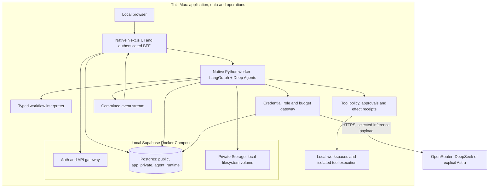

# Architecture comparison and recommendation for our AutoGPT-inspired product

**Decision date:** 2026-11-04. **Status:** Finalized requirements and architecture recommendation; application implementation, local deployment and paid inference qualification remain pending.

**Recommendation:** Build the interface in **Next.js** and autonomous execution in **Python LangGraph + Deep Agents**. Run the application, workers and supporting services on this Mac. Use **local Supabase Docker** for Postgres, Auth and private file Storage. **OpenRouter is the only inference provider:** all 14 roles initially use the approved DeepSeek profile; Astra is an explicit alternative. Start with two remote inference slots and a narrow, permission-controlled toolset.

This is an engineering judgment about implementation fit, not a measured intelligence advantage. The TypeScript alternative remains credible: select it if the same task and recovery tests demonstrate equal outcomes with materially less maintenance. Both options obey the [provider contract](PRD-Model-Providers.md) and [local Mac deployment contract](PRD-Local-Mac-Deployment.md).

Both interfaces use the same **shadcn Luma theme with dark mode as the default**, governed by [PRD-Design-System.md](PRD-Design-System.md) and the exact [theme tokens](../design/luma.css). A saved explicit light/dark choice is applied before paint; OS preference does not override the fresh-visit dark default. The prior warm-neutral/forest-green visual direction is superseded. Theme behavior is a shared product requirement, not an advantage of either execution framework.

**Implementation entry point:** [SPECS.md](../../SPECS.md) organizes Option B execution while preserving the normative companion PRDs. Its first task is the [development harness](PRD-Development-Harness.md): H0 foundation followed by H1 activated baseline, before feature code, product migrations or production worker logic. Minimal non-feature scaffolding and disposable qualification fixtures are permitted. The development coding assistant does not become a product inference provider.

## 1. Evidence, scope and product evolution

Read the specification set together:

| Document | Authority |
|---|---|
| [SPECS.md](../../SPECS.md) | Option B execution entry point, work order and completion evidence; the companion PRDs retain their stated authority |
| [PRD-AutoGPT.md](PRD-AutoGPT.md) | Source reconstruction and AG-01–AG-14 product requirements |
| [PRD-NextJS.md](PRD-NextJS.md) | Option A: TypeScript implementation |
| [PRD-LangChain-Deep-Agents.md](PRD-LangChain-Deep-Agents.md) | Option B: Python execution implementation |
| [PRD-Model-Providers.md](PRD-Model-Providers.md) | Approved models, credentials, disclosure, budgets and inference failures |
| [PRD-Local-Mac-Deployment.md](PRD-Local-Mac-Deployment.md) | Mac processes, Supabase deployment, authorization, storage and operations |
| [PRD-Development-Harness.md](PRD-Development-Harness.md) | Prerequisite repository standards, coding-assistant integration and portable verification |
| [PRD-Design-System.md](PRD-Design-System.md) | Exact Luma tokens, dark-default behavior, accessible component/state styling and visual evidence |

AutoGPT research is pinned to [`13ac38c5b6583bd01b0a6142b0060fc03e102b6e`](https://github.com/Significant-Gravitas/AutoGPT/tree/13ac38c5b6583bd01b0a6142b0060fc03e102b6e). It distinguishes Classic's command loop from current Platform workflows and expert orchestration. It does not establish every historical design decision or undisclosed hosted configuration.

The final deployment decision supersedes earlier local-model and optional-cloud designs. [Bonsai research](../../research/LOCAL-MODEL-EVIDENCE.md) and the [Qwen experiment](../../research/QWEN38-GGUF-TEST-RESULTS.md) remain historical evidence, outside active implementation scope. Existing services and downloaded models belonging to other projects remain untouched.

The initial product is a personal workbench on this Mac. Autonomous outcomes and inspectable artifacts take precedence over marketplace, billing and connector breadth. All application execution, authentication, records, files and logs stay local; selected inference context necessarily leaves the Mac through OpenRouter. Optional network tools require their own task permissions. There is no hosted application, remote database, external telemetry backend, local inference fallback or offline-inference promise.

## 2. What the product must reproduce

A useful clone needs adaptive goal execution and reusable automation, with distinct promises:

| Mode | User promise | Execution contract |
|---|---|---|
| Autonomous task | Work toward an outcome, present evidence, request necessary approval and stop within limits | Bounded model/tool loop, explicit plans, observations and verification |
| Saved workflow | Execute this reviewed procedure with these inputs | Versioned typed nodes, readiness rules, branches, bounded loops and declared model stages |

A checklist is not an executable workflow, and an answer is not proof of completion. Both architectures must maintain the source PRD's identity/goal requirements (AG-01–02), loops/delegation (AG-03–04), workflow semantics (AG-05–06), approvals/triggers (AG-07–08), artifacts/memory/learning (AG-09–10), observability/recovery (AG-11–12) and integration/evaluation contracts (AG-13–14).

“Thinking” in the interface means concise decision summaries, plan revisions, chosen actions and evidence. Generated rationale is not verified access to internal cognition. Reviewer roles add checks but can share the author's blind spots; deterministic validation and human assessment remain necessary.

## 3. Alternatives

### Option A — Native TypeScript application and durable runtime

Use Next.js, AI SDK 7, `@ai-sdk/workflow`'s `WorkflowAgent`, Workflow 5 and a local Postgres World. Native Node processes run on the Mac; local Supabase supplies the shared services. OpenRouter clients are reconstructed inside model-call steps using a credential reference, never serialized into workflow arguments.

`WorkflowAgent` supports durable model/tool execution; it must not be confused with an in-memory `ToolLoopAgent` left running after an HTTP request. The maintained Postgres World is a reference implementation requiring deployment adaptation and protected routes. Its long-lived worker, schema migrations and replay behavior must be qualified locally. [WorkflowAgent](https://ai-sdk.dev/docs/agents/workflow-agent), [Postgres World](https://workflow-sdk.dev/worlds/postgres).

Application code still owns goal states, specialists, memory policy, typed workflow semantics, evaluations, permission checks and effect receipts. Vercel libraries do not imply Vercel hosting.

### Option B — Next.js interface and Python LangGraph / Deep Agents

Use Next.js for UI and the authenticated browser boundary; a native Python service owns execution. LangGraph supplies persisted state/control flow. Deep Agents supplies selected context, filesystem and specialist middleware inside bounded stages. Local Supabase supplies the same persistence, identity and file services as Option A.

The inspected Deep Agents harness requires deliberate middleware selection: planning uses explicitly added `TodoListMiddleware`. Checkpoints, cross-thread stores and product records have different responsibilities; none substitutes for the others. [Deep Agents overview](https://docs.langchain.com/oss/python/deepagents/overview), [LangGraph persistence](https://docs.langchain.com/oss/python/langgraph/persistence).

Python adds API contracts and another application process, but its explicit state graph and composed harness align closely with the requested planning, delegation, review and recovery behavior.

### Option C — Fork current AutoGPT

A fork supplies more existing product surface but imports its services, assumptions and license obligations. Platform's PolyForm Shield contains a competing-product restriction; Classic's license does not make all Platform code MIT. This product therefore uses researched behavior as input to an original implementation, including original prompts, schemas and branding. Any code reuse requires review of the applicable terms. [Pinned Platform license](https://github.com/Significant-Gravitas/AutoGPT/blob/13ac38c5b6583bd01b0a6142b0060fc03e102b6e/autogpt_platform/LICENSE.md).

Option C is outside the implementation baseline. This is a reuse decision, not legal clearance for the future product.

## 4. Capability and ownership comparison

Framework mechanisms do not automatically establish end-to-end correctness.

| Concern | Option A: TypeScript / Workflow | Option B: Python / LangGraph | Shared requirement |
|---|---|---|---|
| Interface | Next.js and AI SDK UI integration | Same Next.js UI; typed Python boundary | Shared shadcn Luma, dark default, authenticated goals, timeline, files and approvals |
| Iteration | AI SDK agent loop | LangChain loop composed by Deep Agents | Shared role policy and root budgets |
| Durability | WorkflowAgent and Postgres World | Persistent checkpointer and worker | Real crash/restart tests |
| Goal state | Application state machine | Explicit outer LangGraph | Truthful terminal and waiting states |
| Planning | Custom plan tools/contracts | Todo middleware plus product contracts | Criteria, revisions and verification |
| Specialists | Subagent-as-tool patterns | Specialist harness and context isolation | Scoped capabilities and inherited limits |
| Context/memory | Custom tools and compaction | Composed backends and summarization | Provenance, scope, deletion and poison defenses |
| Human review | Durable messages/hooks | Persisted interrupts and resume | Actor, argument hash, expiry and authorization |
| Workflow builder | Custom validator/interpreter | Same custom product layer | Typed ports, readiness and versioned execution |
| External effects | Application ledger | Same ledger | Idempotency and uncertain-effect reconciliation |
| Inference | Official OpenRouter AI SDK adapter | Dedicated OpenRouter LangChain adapter | Only two approved profiles; no fallback |
| Persistence | Local Supabase; `workflow_runtime` | Local Supabase; `agent_runtime` | Private direct-SQL runtime access |
| Security | Tool gateway and isolated execution | Same; backend permissions alone insufficient | Deny secret access and validate completed arguments |
| Operations | One application language | Two application languages | Native Mac processes, Docker Supabase, local logs |
| Upgrade risk | Durable provider/replay contracts | More interacting packages; beta harness maturity | Resolver-tested lock and regression fixtures |

AI SDK documents isolated subagents and custom memory tools. B's advantage is existing composition and state-flow fit, not exclusive access to delegation or memory. [AI SDK subagents](https://ai-sdk.dev/docs/agents/subagents), [memory](https://ai-sdk.dev/docs/agents/memory).

Deep Agents backend choices also matter: state-backed files, cross-thread stores, host files and sandbox execution are different capabilities. `LocalShellBackend` does not isolate execution. Both options need the same product-controlled tool boundary. [Deep Agents backends](https://docs.langchain.com/oss/python/deepagents/backends).

## 5. Dependency evidence and compatibility

These registry observations are dated research evidence, not an installed or tested lockfile. Preserve exact artifacts, solve the complete dependency graph and test the selected stack. [General snapshot](../../research/dependency-snapshot.json).

| Area | Observed version / source | Selection implication |
|---|---|---|
| UI | Next.js 16.4.5; React 19.3.1 | Shared candidate |
| AI SDK | `ai` 7.0.162; `@ai-sdk/react` 4.0.166 | A runtime; optional B UI adapter |
| TypeScript durability | `@ai-sdk/workflow` 2.0.94; `workflow` 5.3.0; `@workflow/world-postgres` 5.1.0 | Local A runtime after recovery qualification |
| TypeScript OpenRouter | `@openrouter/ai-sdk-provider` 3.1.0 | AI SDK 7 peer; [snapshot](../../research/openrouter-nextjs-sdk.json) |
| Python harness | `deepagents` 0.7.32; `langchain` 1.4.8; `langgraph` 1.2.19 | B candidate |
| Python persistence | `langgraph-checkpoint-postgres` 3.2.0 | Direct local database integration |
| Python OpenRouter | `langchain-openrouter` 0.2.9; compatible `openrouter` candidate 0.11.46 | Combined core constraints admit 1.7.5; SDK requires Pydantic `<2.13`; [snapshot](../../research/openrouter-langchain-sdk.json) |
| Supabase browser/server clients | `@supabase/supabase-js` 2.119.0; `@supabase/ssr` 0.12.7 | JS requires Node >=22; SSR peer accepts `^2.114.0`; [snapshot](../../research/supabase-nextjs-sdk.json) |
| Local Supabase distribution | `self-hosted/v0.8.3`, commit `bc27d2661edd09a5d0b8d76ce33da6d4071a756e` | Coordinated Compose baseline; resolve image digests and verify ARM64; [snapshot](../../research/supabase-local-deployment-snapshot.json) |

Do not mix `@workflow/ai`'s inspected AI SDK 6 peer with the selected AI SDK 7 integration. Do not assume an npm `latest` tag means stable: inspected `eve` was `1.0.0-rc.3`, outside mandatory scope. A JavaScript Deep Agents package also exists; Python is a deliberate implementation choice, not a claim that the harness is Python-only.

The published TypeScript OpenRouter adapter still requires product-owned reconstruction inside durable steps. Repository documentation does not prove released serialization compatibility. The Python adapter's inspected SDK range excludes OpenRouter SDK 1.x. Auth, tool streaming, credential rotation and restart must pass together before adopting either resolved package set.

## 6. Why Option B wins initially

The difficult work is preserving a goal through observations, isolating specialists, recovering from failure and proving completion. LangGraph offers an explicit control-flow foundation; Deep Agents reduces initial assembly of context and delegation mechanisms. That combination is the closer fit for an autonomous workbench.

Next.js remains valuable for task composition, artifact previews, workflow editing and approvals. A typed execution API prevents rendering, browser connection lifetime or an HTTP request from owning a task.

The costs are meaningful: Python/TypeScript contracts, two native process types and more dependencies. A large default harness can also waste the initial context allowance. Start with only the selected tools/middleware and measure useful evidence retention.

Prefer A if the team is strongly TypeScript-oriented, fixed workflows dominate, or an identical vertical slice passes the same quality/recovery gates with lower ownership cost. Compare measured overhead rather than package counts. Framework choice cannot repair unreliable model verification; reduce scope or add deterministic structure when a selected profile fails. Another model requires explicit selection, never fallback.

## 7. Local deployment and responsibility boundaries



For A, substitute a native Workflow worker and `workflow_runtime`. Use **one durable orchestration authority per run**; do not wrap LangGraph in a competing WorkflowAgent lifecycle. LangGraph events also require an explicit transport adapter before using AI SDK UI components.

Next.js owns the browser boundary. The domain service owns goals, run transitions, schedules and authorization. The harness owns bounded loop mechanics; the interpreter owns saved-workflow semantics. Gateways enforce model admission and tool policy. Postgres owns committed state and event cursors. Private Storage owns committed artifact bytes.

The deployment contract specifies loopback-only listeners, local password Auth, disabled public signup and private buckets. Public domain records use RLS. `app_private` holds encrypted credentials, cost reservations and effect receipts; framework tables use the selected private runtime schema. These schemas use restricted direct SQL roles and are excluded from PostgREST and Realtime. Privileged clients are never browser clients or assumed to enforce RLS.

Use the gateway for authenticated Studio access; verify the direct database publication rather than confusing it with a pooler. Validate final Compose bindings, schema migration/search-path behavior and persistent volumes. Object upload and database commit need staging/reconciliation because they are not one atomic transaction. No hosted application or telemetry service is part of either option.

## 8. Model, credential and planning contract

```yaml
provider: openrouter
profiles:
  openrouter_deepseek_flash:
    canonical: deepseek/deepseek-v4.1-flash-20261017
    wire_id: deepseek/deepseek-v4.1-flash-1017
  openrouter_astra:
    canonical: openai/gpt-6-astra-20260903
    wire_id: openai/gpt-6-astra
roles:
  coordinator: openrouter_deepseek_flash
  router: openrouter_deepseek_flash
  planner: openrouter_deepseek_flash
  executor: openrouter_deepseek_flash
  researcher: openrouter_deepseek_flash
  coder: openrouter_deepseek_flash
  reviewer: openrouter_deepseek_flash
  evaluator: openrouter_deepseek_flash
  summarizer: openrouter_deepseek_flash
  memory_curator: openrouter_deepseek_flash
  skill_learner: openrouter_deepseek_flash
  tool_repair: openrouter_deepseek_flash
  workflow_generator: openrouter_deepseek_flash
  general_purpose: openrouter_deepseek_flash
```

Resolve a role by run-specific override, run-wide profile, workspace role override, workspace default, then DeepSeek. Display the effective map and external payload categories before Run. Snapshot canonical/wire identity, role-policy version, catalog revision, limits and credential reference. Children, summaries and evaluators inherit the snapshot. Model changes create a linked new run; existing bindings remain immutable.

Catalog metadata must be no older than five minutes, and the non-batch wire ID must still map to the approved canonical identity. Drift or absence pauses as `model_unavailable`. Public aliases do not guarantee immutable snapshot availability. Requests use OpenRouter Chat Completions with `require_parameters: true` and `allow_fallbacks: false`; no fallback array or hidden inference service. Record the reported upstream provider per attempt. Omit unadvertised Astra sampling parameters. [Catalog evidence](../../research/openrouter-model-catalog.json), [provider contract](PRD-Model-Providers.md).

Server `OPENROUTER_API_KEY` resolves through shared process/dotenv precedence before an encrypted app credential. Invalid nonempty environment configuration blocks fallback. Missing credentials permit local UI, settings and files but pause **every** model-backed operation as `credentials_required`.

Settings → Models → OpenRouter supports write-only Save & validate when the environment key is absent. Validation checks key metadata and catalog, not paid inference; successful saving returns to the preserved draft and never starts a run. Encrypt app credentials in local `app_private` using the protected host master key outside all workspaces. Resolve keys at attempts; never serialize them or provider clients into durable state. Authentication status and inference qualification remain separate.

MVP retrieval uses local lexical/full-text search. There is no extra embedding/reranking model. Preserve required opaque protocol metadata securely; show evidence and concise decision summaries instead of private reasoning.

## 9. Qualification gates

### Gate 0 — Repository development harness

Complete H0 foundation and H1 activated baseline from the [normative harness PRD](PRD-Development-Harness.md). Establish project `.claude` skills, subagents, rules and deterministic hooks, `CLAUDE.md`, shared `AGENTS.md`, and a portable repository verification runner independent of Claude. Enforce standards for Next.js/TypeScript, Python, Docker, Supabase migrations/deterministic seeds, shared contracts/types, state transitions, workers and the model gateway. Hooks call deterministic repository checks; assistant instructions alone cannot certify a change.

Prove the mandatory portable baseline with passing and deliberately failing fixtures in a disposable local project, using explicit test database identity and isolated ports/volumes. Never reset the persistent application database for verification. Missing required checks block Gate 0. An incompatible or unavailable optional Claude adapter may remain explicitly inactive without blocking a passing portable baseline; script fixtures cannot claim actual assistant delivery. Qualify event delivery for any enabled adapter. Only minimal non-feature scaffolding and disposable fixtures needed for H0–H1 precede product work; exact activation follows the normative document. This is a developer-time integration, separate from application agent roles and model defaults. The project-local ingestion and hook-script subset now exists; complete H0/H1 and actual assistant event delivery remain pending as recorded in [CODEBASE.md](../../CODEBASE.md).

### Gate A — Local deployment and provider contracts

Pass LM-A01–09 and MP-A01–12: local listeners/storage, Auth/RLS/private-schema isolation, restart and backup restoration; credentials, drift, parameter handling, budgets and secret-safe replay. Public catalog presence and key authentication do not establish model quality.

Qualify each enabled profile through its actual SDK: automatic/required/named tools, streamed arguments, nested strict JSON, tool-result continuation, refusal, truncation and cancellation. Named selection needs two conflicting tools so automatic selection cannot masquerade as enforcement. Include arithmetic and negative fixtures; valid JSON alone is insufficient. Paid qualification remains pending.

### Gate B — Identical vertical slices

Both contenders must accept a goal, validate a short plan, read fixtures, calculate, write an artifact, recover an injected tool failure, wait for approval, restart, resume the immutable approved action once, verify results and return truthful status with replayable events.

Use the same model profile, fixtures, tools and limits: **two remote inference slots**, **8K total context**, **512 output tokens per call**, **24 model calls**, **40 tool calls**, **one repair per invalid structured response**, **two child levels**, **four children total**, and **15 minutes active execution per root task**. Approval wait has a separate expiry. These are configurable initial application/evaluation limits, not physical model capacities. Record supported sampler settings and do not assume determinism.

### Gate C — Behavior and recovery

Use 40 held-out tasks across research, artifact creation, workflows, recovery and approvals, with three trials per architecture plus a policy/recovery suite. Do not tune prompts on held-out tasks.

| Metric | Proposed target | Evidence |
|---|---|---|
| Function selection/arguments | >=98% first pass across 100 protocol cases | Parsed calls and validators |
| Scoped task success | >=85%, with category results | Deterministic or independent human rubric |
| Honest non-success | Every unmet criterion partial/failed | Negative fixtures and final states |
| Approval enforcement | Zero unauthorized effects | Ledger and mock sink |
| Restart safety | Zero duplicate effects at tested boundaries | Crash injection and receipts |
| Context retention | Required evidence survives compaction | Citation/artifact assertions |
| Inference/privacy | Only approved OpenRouter routes; no secret disclosure | Role, network and payload inspection |
| Spend control | No admission bypass through concurrency/replay | Reservation and ambiguous-failure tests |
| Local operations | Recoverable sleep/restart; measured resource envelope | Worker/Docker restarts, memory and queue traces |

Targets are not achieved results. Report uncertainty and failing categories; aggregate success cannot excuse an approval bypass. If outcomes are indistinguishable, prefer the architecture the team can maintain.

## 10. Delivery sequence

Use [SPECS.md](../../SPECS.md) to execute Option B. Each H0/H1 and product work item requires a proportional **plan → implement → independent review → verify → runbook + evidence** record. Record scope and success criteria, review findings and their disposition, final-state check results, operational guidance and remaining limitations. Exercise applicable runbook procedures in the qualified disposable environment and attach actual evidence. Small changes use short records rather than skipping stages; unchanged operational behavior is recorded explicitly. Review fixes return through the affected checks. The harness contract defines exact evidence and completion requirements; independent review does not depend on a Claude adapter being available.

| Stage | Deliverable | Exit condition |
|---|---|---|
| H0: Development foundation | Shared repository instructions, `.claude` skills/subagents/rules/hooks, portable runner and versioned engineering standards | Normative H0 checks and isolated verification procedure are ready |
| H1: Activated baseline | Verify the mandatory portable runner and hook fixtures in a disposable local project; qualify any enabled assistant adapter | Gate 0 passes, deliberate violations fail, optional inactive adapters are recorded honestly and persistent data remains untouched; product implementation may begin |
| 0: Foundation and qualification | Local Supabase, Auth/Storage, private schemas, credentials, provider corpus, dependency lock and vertical slices | Gates A–B; secret-safe replay and local restore |
| 1: Useful personal agent | Goals, plans, read tools, artifacts, durable admission/checkpoints/events, cancel/resume | Verifiable task completion and restart preservation |
| 2: Consequential tools | Approval inbox, connector receipts and reconciliation | Fault tests pass before enabling effects |
| 3: Controlled specialists | Scoped skills/memory and bounded delegation | Benefit demonstrated at fixed budgets |
| 4: Reusable automation | Typed workflow editor/interpreter, schedules, trigger deduplication | Reviewed versioned workflows run consistently |
| 5: Local product refinement | Additional justified connectors and richer evaluations | Same local boundary and release gates maintained |

Delay marketplace breadth, billing, unrestricted execution, automatic skill publication and background learning until justified. No stage silently adds hosted infrastructure. Milestones avoid invented calendar estimates without team and connector scope.

## 11. Cost, observability and interruptions

All inference is metered OpenRouter work. Default caps are **US$1 per run tree** and **US$5 per workspace UTC day**, configurable by authorized users. Reserve conservative input/output/reasoning cost under a database lock before dispatch; count retries and descendants. Warn at 80%, pause at 100%, and block new paid calls when pricing is unavailable. Retain unresolved reservations after ambiguous acceptance. These admission controls do not guarantee the final provider bill.

Task cost includes inference, authorized tool/API charges, local storage/compute and human review. Measure queue wait, model/tool latency, checkpoint overhead and approval wait separately. Two remote slots bound concurrency; they are not GPU permits. No complete-stack capacity result exists yet.

Keep logs and metrics local and redacted. Durable events contain run/attempt IDs, sequence, role/canonical/wire identity, reported upstream provider, usage/cost status, approval references and artifact links. Raw streamed prefixes are transient and never executable tool arguments.

Mac sleep, Docker restart and network loss are expected. Recover checkpoints and reconcile effects; browser disconnect does not cancel work. Without OpenRouter, local non-AI use remains available and inference waits. Stopping the Mac stops the application; no hosted uptime promise applies.

## 12. Closed decisions and implementation handoff

| Decision | Status | Remaining evidence |
|---|---|---|
| B: Next.js + Python LangGraph/Deep Agents preferred | Closed recommendation | Comparable vertical slices and maintenance assessment |
| H0–H1 development harness before product implementation | Closed prerequisite | Portable checks and deterministic hooks pass their disposable-project acceptance suite |
| Plan, implement, independent review, verify, runbook/evidence per work item | Closed delivery requirement | Proportional records and final-state evidence follow SPECS.md and the harness contract |
| All application services/data on this Mac; Supabase Docker | Closed | Loopback, ARM64, migrations, resource and restore tests |
| Only OpenRouter; 14 DeepSeek defaults; explicit Astra | Closed | Role inheritance, catalog and paid capability tests |
| Environment-first / encrypted app credentials | Closed | Setup, authorization, rotation and secret-safe replay |
| Two remote slots; context/output/loop/spend limits | Closed initial configuration | Concurrency and task-quality qualification |
| One orchestration authority, domain-owned approvals/receipts | Closed | Crash, cancellation and uncertain-effect tests |
| Separate autonomous and saved-workflow contracts | Closed | Typed execution and completion evidence |
| Application delivery | Pending | Implement the selected architecture and pass release gates |

The specification is ready for implementation. Finalized requirements do not mean services are installed, an application exists, or paid models have passed qualification. Additional autonomy must follow measured outcomes and recoverable execution.
