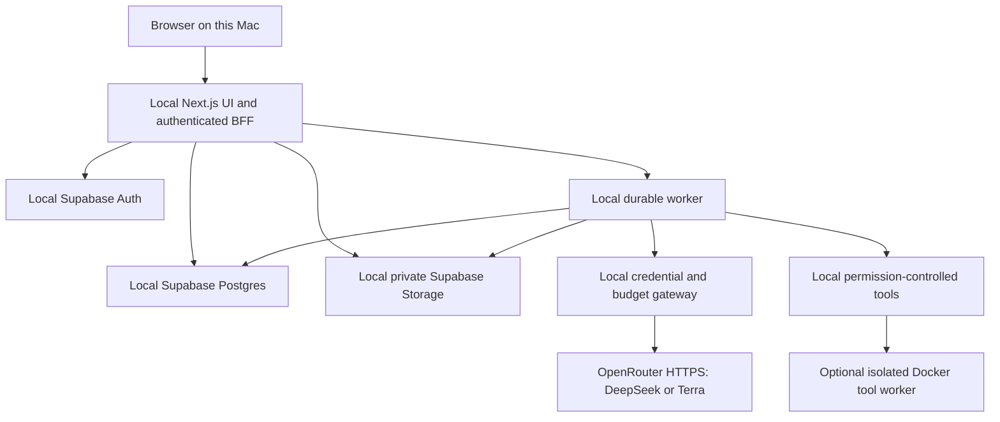

# PRD — local Mac application, local Supabase and OpenRouter-only inference

**Decision date:** 2026-11-04. **Status:** Finalized deployment requirements; services have not been installed or launched by this documentation update.

This is the normative deployment contract for the [Next.js implementation](PRD-NextJS.md), [LangChain implementation](PRD-LangChain-Deep-Agents.md), [model-provider contract](PRD-Model-Providers.md) and [recommendation](PRD-Comparison-Recommendation.md). It supersedes every earlier active requirement for Bonsai, local model serving or hosted application infrastructure.

## LM-01. Deployment boundary

All application execution, durable orchestration, authentication, database records, files, credentials and operational logs run on **this Apple Silicon Mac**. **OpenRouter is the only remote inference provider**. Its remote models receive the selected task context, so this is a locally hosted application with remote inference, not an offline application or a claim that model providers retain no data. By [Decision 0041](../engineering/decisions/0041-local-model-source.md), a local profile's calls are answered instead by the owner's `llama-server` on 127.0.0.1, and its prompts don't leave the Mac. Its tool calls still do.

The initial model for all 14 roles is the approved Terra snapshot; DeepSeek stays approved and isn't offered for new runs until qualified, by [Decision 0013](../engineering/decisions/0013-release-closure.md). The exact canonical identities, wire IDs, credential flow and budgets are defined in the provider PRD. No MTPLX, MLX, Ollama, local embedding service, direct OpenAI/DeepSeek API, hosted AI Gateway or hidden evaluator is an application dependency or fallback. A local profile's `llama-server` and its pinned weights in `~/Models` are the owner's, started and downloaded by the owner ([Decision 0041](../engineering/decisions/0041-local-model-source.md) A4, A5). The application never starts or downloads them, and never falls back to or from them.

Vercel's libraries may run locally; Vercel hosting is not part of this deployment. Supabase is self-hosted here, not a supabase.com project. Hosted LangSmith, remote workers, remote artifact buckets, managed databases and external log collectors are outside the active design. Optional network tools remain separately governed by the task's explicit tool permissions; they do not introduce another inference provider or hosted application backend.

Serve the [shadcn Luma design assets](PRD-Design-System.md) from the local Next.js application. Dark is the fresh-visit default, independent of OS preference; explicit light/dark appearance persists locally. Theme resolution and ordinary local browsing require no model key, inference call or hosted theme service. This presentation policy does not alter the native-process or Docker topology.

Earlier model experiments remain historical evidence. This revision does not stop another project's services, remove downloaded weights, or change credentials on the Mac.

## LM-02. Process topology

Use native macOS Node processes for Next.js and, in the recommended architecture, a native Python execution service. Run **one project-scoped local Supabase stack in Docker**. Docker also provides isolated tool execution when that capability is enabled; the model never receives control of the Docker daemon.

For Option B, LangGraph/Deep Agents owns the worker. For Option A, the local Workflow worker owns it. Never operate both durable engines as competing owners of the same run. Supabase supplies persistence and supporting services; neither Realtime nor an HTTP request owns the agent lifecycle.

## LM-03. Supabase and Docker baseline

For Option B, first complete the [development harness Gate 0](PRD-Development-Harness.md): H0 defines the standards and tooling; H1 verifies guarded migration/seed scripts and disposable deployment fixtures. Persistent stack setup and product migrations follow that baseline. Ordinary coding hooks never reset databases, apply persistent migrations or remove volumes.

Use the official self-hosted Docker Compose distribution as the persistent personal-workbench baseline. The inspected release is **self-hosted/v0.8.3**, commit **bc27d2661edd09a5d0b8d76ce33da6d4071a756e**. Its Compose file includes Postgres 17, Auth, Storage, API gateway and Studio services. Preserve the coordinated release configuration and pin resolved image digests during implementation rather than independently upgrading individual images. [Pinned Compose source](https://github.com/supabase/supabase/blob/bc27d2661edd09a5d0b8d76ce33da6d4071a756e/docker/docker-compose.yml), [inspection snapshot](../../research/supabase-local-deployment-snapshot.json)

Docker Desktop on macOS is the baseline container engine. Before implementation startup, check the installed engine/Compose version, available disk and ports, ARM64 image availability, bind-mount behavior and the rendered configuration. The documentation update did not establish that Docker or these images are installed. Use the official manual macOS setup path; the upstream automated Linux installer is not a Mac bootstrap command. [Self-hosting guide](https://supabase.com/docs/guides/self-hosting/docker)

The Supabase CLI may manage a separate disposable development/test project, with separate ports and volumes. It is not a second concurrent owner of the persistent application database. Do not require Supabase Cloud login, project linking or remote database pushes. [Local CLI workflow](https://supabase.com/docs/guides/local-development/cli/getting-started)

Keep database, Auth, Storage and gateway dependencies required by the selected release. Do not enable hosted analytics or remote tracing. Realtime is optional for noncritical local UI refresh; durable run events use the application's committed event log and cursor. Edge Functions are not the long-running agent worker. Removing unused services must include a validated dependency/configuration change.

The pinned Compose source forwards an optional **OPENAI_API_KEY** into Studio. Explicitly set that Studio value empty and disable its AI assistant regardless of unrelated host environment values. Do not inject the OpenRouter key into Studio. All application inference must pass through the approved worker's role, credential and budget gateway. Disable native Next.js telemetry with **NEXT_TELEMETRY_DISABLED=1** and explicitly disable inherited remote tracing configuration in the worker.

## LM-04. Local addresses and connection types

These are **proposed product ports**, not assertions about existing running processes. Detect conflicts and stop startup with a useful error rather than killing an unrelated process.

| Consumer-facing service | Proposed address | Boundary |
|---|---|---|
| Next.js UI and BFF | http://127.0.0.1:3000 | Local browser; authenticated application routes |
| Python execution API, Option B | http://127.0.0.1:8001 | BFF/worker access; authenticated internal requests |
| Supabase gateway: Auth, REST, Storage | http://127.0.0.1:54321 | Loopback host publication to gateway container |
| Direct Supabase Postgres | 127.0.0.1:54322 | Explicit loopback publication to the **db** service's internal 5432 |
| Supabase Studio | Gateway's authenticated operator route at http://127.0.0.1:54321 | Generated operator credentials; no separate raw Studio publication |

The pinned upstream Compose publishes pooler ports by default. Do not mistake a Supavisor port for the direct database connection. Keep the internal database port at 5432, explicitly publish the db service to host 54322, and remove unused host pooler publications. The durable runtime uses the direct connection, with tested transaction, advisory-lock and prepared-statement behavior. Browser clients never receive a database connection string.

Studio remains behind the gateway's operator authentication. Do not expose its internal port directly or copy the CLI's 54323 development port into this self-hosted design. The upstream gateway's default host binding also must be replaced. Inspect the final rendered Compose configuration and actual listeners: an override that merely appends a loopback mapping while retaining a wildcard binding fails acceptance.

Native processes use published loopback ports. Containers communicate through Compose service DNS and internal ports; their localhost is their own container. These address spaces must not be mixed. [Docker Compose networking](https://docs.docker.com/compose/how-tos/networking/)

Strict loopback HTTP is the MVP local transport. Enforce configured Host/Origin checks and CSRF protections on sensitive application mutations. OpenRouter always uses HTTPS. There is no LAN/public application access, tunnel or public ingress in this scope; adding one requires a new transport/deployment decision and HTTPS.

## LM-05. Database, Auth and Storage ownership

Use one Supabase Postgres cluster with explicit schema boundaries:

| Schema / service | Responsibility | Access rule |
|---|---|---|
| Public application tables | Workspaces, goals, plans, runs, artifact metadata and user-visible records | RLS and workspace ownership; narrow grants |
| app_private | Provider ciphertext, cost reservations, effect receipts and private operational data | Direct server SQL only; exclude from PostgREST exposure and Realtime publications |
| agent_runtime | Option B checkpoint/store tables | Restricted runtime role and direct connection |
| workflow_runtime | Option A durable Workflow tables | Restricted runtime role and direct connection |
| Supabase Auth / Storage internals | Vendor-owned identity and object metadata | Use their APIs and release migrations; do not bypass them with application writes |

Use the runtime schema for the selected architecture. Validate each adapter's actual migration and schema/search-path behavior; do not invent a constructor option or assume custom schemas work without a restart test. Separate migration privileges from runtime privileges. Do not run application workers as the database superuser or treat a secret/service client as RLS-enforced.

Supabase Auth provides local password sign-in. Disable public signup and bootstrap the owner through an explicit local operator procedure. The MVP requires no external SMTP, OAuth or hosted identity provider. Sessions are validated server-side; local hosting does not make a browser-provided user/workspace ID trustworthy. Use the current Supabase SSR integration for Next.js, and enforce the same identity/scope at the Python boundary. [SSR clients](https://supabase.com/docs/guides/auth/server-side/creating-a-client?queryGroups=framework&framework=nextjs), [RLS](https://supabase.com/docs/guides/database/postgres/row-level-security)

Store committed artifacts in a **private local Supabase Storage bucket**. Its filesystem backend and persistent data directory remain on this Mac. Use scoped paths, content hashes, size/type validation and authorized downloads or short-lived signed URLs. Native scratch/workspace files are also local and separate from secret directories. Storage authorization must cover listing, upload, download and deletion. [File-backed Storage configuration](https://supabase.com/docs/guides/self-hosting/storage/config)

A database commit and an object upload are not one atomic operation. Persist artifact staging/status and operation IDs, verify the stored object's hash, then publish committed metadata/event references. Reconcile interrupted uploads and orphan objects without declaring missing artifacts successful.

## LM-06. Configuration and credentials

All processes use the shared configuration root and environment precedence in the provider PRD. Distinguish these values:

- **OPENROUTER_API_KEY:** server-only inference credential; environment first, encrypted in-app setup when absent.
- **SUPABASE_URL:** local gateway URL for server clients.
- **NEXT_PUBLIC_SUPABASE_URL / NEXT_PUBLIC_SUPABASE_PUBLISHABLE_KEY:** local URL and intentionally public client key, permitted only with correct Auth/RLS policies.
- **SUPABASE_SECRET_KEY:** privileged server-only key matching the self-hosted release; a legacy service-role deployment must use its matching configuration, never expose either credential to the browser.
- **DATABASE_URL:** server-only direct Postgres connection with the appropriate restricted role; separate runtime/migration credentials where needed.
- **AUTOBOTS_PROVIDER_MASTER_KEY_FILE:** shared private host file for decrypting app-stored OpenRouter credentials; outside the repository and every tool workspace.

Generate Supabase installation secrets rather than retaining example passwords/keys. Keep project config/templates under version control and real environment files, secret files and persistent data out of it. Provider ciphertext lives in app_private; the master key remains separately protected on the host. The provider PRD defines write-only setup, key validation, rotation and loss handling.

Missing OpenRouter credentials allow sign-in, settings, draft editing and reading existing local artifacts. They block **every model-backed operation**, including planning, summaries, evaluations, workflow generation and scheduled agent work. Saving a key validates authentication and returns to the draft; it does not start a paid task.

## LM-07. Persistence and operations

Keep the reviewed Compose deployment/configuration separate from its persistent Postgres and Storage data. On macOS, permissions and Docker file sharing must be checked for those specific paths. Do not place database files under an agent-editable workspace. Named volumes or bind-mounted data must survive ordinary process/container restarts; document their actual location and ownership.

Start infrastructure and wait for health; apply reviewed migrations with the migration role; verify local Auth/Storage/database contracts; then start workers and UI. Admission must stop when required persistence is unhealthy. Shutdown stops new work, records in-flight state, drains or checkpoints bounded work, then stops processes without deleting data. Docker volume removal, database reset and prune operations are not routine startup or shutdown actions.

Back up database contents/roles, Storage bytes, deployment/migration versions and the credential master key through a documented local process. Keep key backup separate from database ciphertext. A database-only backup does not contain artifact bytes. Demonstrate restoration into an isolated test instance and verify artifact hashes, Auth, run history and credential decryptability before declaring backup success.

Mac sleep, restarting this project's containers and network loss are expected interruptions (by [Decision 0014](../engineering/decisions/0014-release-limits-accepted.md), a restart of Docker itself or of the Mac is a stated limit, as it also stops other projects). Recover jobs/checkpoints and reconcile unknown effects; do not duplicate a tool action or treat a dropped paid response as free. Without network/OpenRouter availability, the UI and stored data remain available but inference waits. Browser disconnect does not cancel the durable job. Stopping the Mac stops the application; this design makes no hosted uptime promise.

Collect logs and metrics locally with secret redaction. Begin with bounded containers/processes and measured resource limits; remote inference removes a local model-loading requirement, not the need to measure database, worker and sandbox memory. A local profile's server needs its own memory beside them: [the measurements](../../research/LOCAL-MODELS-INKLING-BONSAI.md) for [Decision 0041](../engineering/decisions/0041-local-model-source.md) A15 found Bonsai 2.5's server at a 9.4 GB peak footprint beside its 7.7 GB of weights, with swap growing, so only one local model is served at a time. No host capacity result for the complete new stack exists yet.

## LM-08. Implementation acceptance and closure

| Gate | Evidence required |
|---|---|
| LM-A01: Local topology | UI, workers, Auth, Postgres, Storage and logs resolve to this Mac; no hosted project/application service is required |
| LM-A02: Published ports | Rendered Compose plus live listeners contain only approved loopback bindings; Studio authentication retained; direct DB verified |
| LM-A03: Inference boundary | Every role/request targets only the approved OpenRouter models or, by [Decision 0041](../engineering/decisions/0041-local-model-source.md), a local profile's owner-started `llama-server` on 127.0.0.1; the application starts no local model, and there is no SDK fallback or Studio assistant inference, even when unrelated provider/tracing variables exist in the host environment |
| LM-A04: Persistence | Restart UI/worker and this project's containers and recover state/artifacts; ordinary stop/start preserves data |
| LM-A05: Authorization | Auth, workspace RLS, private buckets, private schemas and privileged-client separation pass negative tests |
| LM-A06: Credentials | Environment and in-app setup pass; absent key blocks every inference path but preserves local non-AI use |
| LM-A07: Recovery | Sleep/network loss and interrupted effects preserve truthful status, receipts and cost reservations |
| LM-A08: Backup | Restore database plus Storage and separate key backup into an isolated instance; verify actual readable artifacts and records |
| LM-A09: Runtime compatibility | ARM64 images, direct database adapters, schema migrations and complete-stack resource envelope measured |

The local deployment, storage boundaries and inference-provider choice are closed requirements. Docker setup, compatible package installation, application implementation and these acceptance tests remain execution work. No actual Supabase stack, database migration, key mutation or paid inference was performed to create this document.
