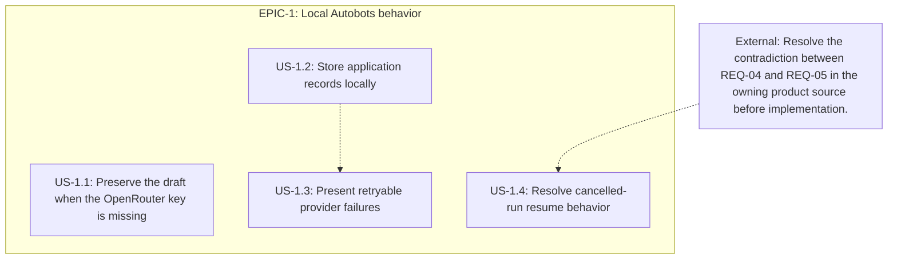
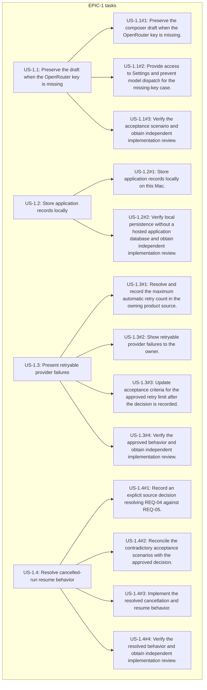

# Autobots Fixture Specifications

CODEBASE Context: [CODEBASE.md — Current implementation](CODEBASE.md#current-implementation) records no product application and a prototype retry helper. No revision or freshness date is recorded; its seven retries are descriptive behavior, not a product requirement.

## Table of Contents

- [EPIC-1: Local Autobots behavior](#epic-1-local-autobots-behavior)
  - [US-1.1: Preserve the draft when the OpenRouter key is missing](#us-11-preserve-the-draft-when-the-openrouter-key-is-missing)
  - [US-1.2: Store application records locally](#us-12-store-application-records-locally)
  - [US-1.3: Present retryable provider failures](#us-13-present-retryable-provider-failures)
  - [US-1.4: Resolve cancelled-run resume behavior](#us-14-resolve-cancelled-run-resume-behavior)

## Work Item Status

| ID | Title | Status | Parent |
|---|---|---|---|
| EPIC-1 | Local Autobots behavior | — | — |
| US-1.1 | Preserve the draft when the OpenRouter key is missing | READY | EPIC-1 |
| US-1.1#1 | Preserve the composer draft when the OpenRouter key is missing. | TODO | US-1.1 |
| US-1.1#2 | Provide access to Settings and prevent model dispatch for the missing-key case. | TODO | US-1.1 |
| US-1.1#3 | Verify the acceptance scenario and obtain independent implementation review. | TODO | US-1.1 |
| US-1.2 | Store application records locally | IN PROGRESS | EPIC-1 |
| US-1.2#1 | Store application records locally on this Mac. | TODO | US-1.2 |
| US-1.2#2 | Verify local persistence without a hosted application database and obtain independent implementation review. | TODO | US-1.2 |
| US-1.3 | Present retryable provider failures | NEEDS CLARIFICATION | EPIC-1 |
| US-1.3#1 | Resolve and record the maximum automatic retry count in the owning product source. | TODO | US-1.3 |
| US-1.3#2 | Show retryable provider failures to the owner. | TODO | US-1.3 |
| US-1.3#3 | Update acceptance criteria for the approved retry limit after the decision is recorded. | TODO | US-1.3 |
| US-1.3#4 | Verify the approved behavior and obtain independent implementation review. | TODO | US-1.3 |
| US-1.4 | Resolve cancelled-run resume behavior | BLOCKED | EPIC-1 |
| US-1.4#1 | Record an explicit source decision resolving REQ-04 against REQ-05. | TODO | US-1.4 |
| US-1.4#2 | Reconcile the contradictory acceptance scenarios with the approved decision. | TODO | US-1.4 |
| US-1.4#3 | Implement the resolved cancellation and resume behavior. | TODO | US-1.4 |
| US-1.4#4 | Verify the resolved behavior and obtain independent implementation review. | TODO | US-1.4 |

## Dependency Diagram





## Product Context

The fixture defines a local Autobots settings screen using OpenRouter. Application records remain on this Mac. This backlog derives product intent from [PRD.md](PRD.md#scope) and follows the source-traceability and implementation-evidence rules in [CONTRACT.md](CONTRACT.md#workflow).

The existing backlog assigned no epic or story identifiers. The supplied sources define SP-901 and SP-902 and no H0/H1/B phase definitions. The dependency of US-1.3 on US-1.2 is part of this existing backlog.

REQ-03 leaves the maximum automatic retry count undecided. REQ-04 and REQ-05 contradict each other about resuming cancelled runs. Both conflicting requirements remain visible below; neither is selected as authoritative.

**Preserved SP coverage**

| Preserved requirement | Backlog coverage |
|---|---|
| [SP-901](CONTRACT.md#sp-901-missing-key-draft-preservation) | US-1.1 |
| [SP-902](CONTRACT.md#sp-902-retry-visibility) | US-1.3 |

# EPIC-1: Local Autobots behavior

### US-1.1: Preserve the draft when the OpenRouter key is missing

Status: READY

As a local Autobots owner
I want to open Settings without losing my draft when the OpenRouter key is missing
So that I can address the missing key while retaining my work.

Source:
- [PRD.md — REQ-01 Missing key](PRD.md#req-01-missing-key)
- [CONTRACT.md — SP-901 Missing-key draft preservation](CONTRACT.md#sp-901-missing-key-draft-preservation)

Acceptance Criteria:
```gherkin
Scenario: A missing OpenRouter key preserves the draft and provides access to Settings
  Given the OpenRouter key is missing
  And the composer contains a draft
  When the owner attempts to submit the draft
  Then the current composer draft is preserved
  And the owner can open Settings
  And no model request is dispatched
```

Dependencies:
- None

Tasks:
- [ ] Preserve the composer draft when the OpenRouter key is missing.
- [ ] Provide access to Settings and prevent model dispatch for the missing-key case.
- [ ] Verify the acceptance scenario and obtain independent implementation review.

Open Questions:
- None

### US-1.2: Store application records locally

Status: IN PROGRESS
Change: `openspec/changes/fixture-us-1-2/`

As a local Autobots owner
I want application records stored on this Mac
So that the application uses local storage within the approved scope.

Source:
- [PRD.md — REQ-02 Local storage](PRD.md#req-02-local-storage)

Acceptance Criteria:
```gherkin
Scenario: Application records are stored on this Mac
  Given Autobots has an application record to store
  When the application stores the record
  Then the record is stored locally on this Mac
  And no hosted application database is used
```

Dependencies:
- None

Tasks:
- [ ] Store application records locally on this Mac.
- [ ] Verify local persistence without a hosted application database and obtain independent implementation review.

Open Questions:
- None

### US-1.3: Present retryable provider failures

Status: NEEDS CLARIFICATION

As a local Autobots owner
I want retryable provider failures shown to me
So that I can see when a provider request has failed.

Source:
- [PRD.md — REQ-03 Retry policy](PRD.md#req-03-retry-policy)
- [CONTRACT.md — SP-902 Retry visibility](CONTRACT.md#sp-902-retry-visibility)

Codebase Context:
- [CODEBASE.md — Current implementation](CODEBASE.md#current-implementation) describes a prototype helper that retries seven times; this does not establish an approved retry limit.

Acceptance Criteria:
```gherkin
Scenario: The owner can see a retryable provider failure
  Given a provider request is in progress
  When the provider reports a retryable failure
  Then the failure is shown to the owner
```

Dependencies:
- US-1.2

Tasks:
- [ ] Resolve and record the maximum automatic retry count in the owning product source.
- [ ] Show retryable provider failures to the owner.
- [ ] Update acceptance criteria for the approved retry limit after the decision is recorded.
- [ ] Verify the approved behavior and obtain independent implementation review.

Open Questions:
- What is the maximum automatic retry count?

### US-1.4: Resolve cancelled-run resume behavior

Status: BLOCKED

As a local Autobots user
I want defined behavior when attempting to resume a cancelled run
So that cancellation and resume behavior follow one consistent approved requirement.

Source:
- [PRD.md — REQ-04 Cancellation](PRD.md#req-04-cancellation)
- [PRD.md — REQ-05 Resume](PRD.md#req-05-resume)

Acceptance Criteria:
```gherkin
Scenario: REQ-04 requires cancelled runs to remain terminal
  Given a run has been cancelled
  When the user attempts to resume the run
  Then the run remains terminal
  And the run cannot be resumed

Scenario: REQ-05 requires cancelled runs to resume in place
  Given a run has been cancelled
  When the user attempts to resume the run
  Then the run resumes in place
```

Dependencies:
- External: Resolve the contradiction between REQ-04 and REQ-05 in the owning product source before implementation.

Tasks:
- [ ] Record an explicit source decision resolving REQ-04 against REQ-05.
- [ ] Reconcile the contradictory acceptance scenarios with the approved decision.
- [ ] Implement the resolved cancellation and resume behavior.
- [ ] Verify the resolved behavior and obtain independent implementation review.

Open Questions:
- Must cancelled runs remain terminal and non-resumable, or may they resume in place?
