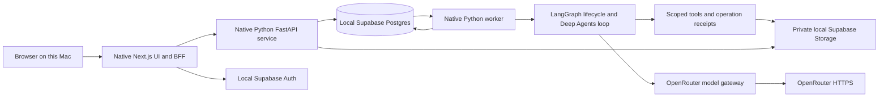

# Option B engineering contract — preserved SP requirements

**Specification date:** 2026-11-04. **Delivery status:** Specified; application and development harness implementation pending.

This preserves the SP-001–SP-021 technical contract previously held in root SPECS.md. The executable backlog now lives in [SPECS.md](../../SPECS.md). The selected architecture is **Option B**: a native Next.js interface and Python API/workers on this Mac, local Supabase in Docker, and OpenRouter as the only inference provider. The first implementation work is the engineering harness. Every subsequent work item follows **plan → implement → independent review → verify → runbook and evidence**.

## 1. Authority, scope and completion

| Source | Authority retained by this specification |
|---|---|
| [Option B PRD](../../PRD-LangChain-Deep-Agents.md) | Product behavior, agent loops, domain entities, tools, durability and LC acceptance requirements |
| [Development harness PRD](../../PRD-Development-Harness.md) | H0/H1 prerequisite, coding standards, `.claude` integration, portable checks and work evidence |
| [Model provider PRD](../../PRD-Model-Providers.md) | Exact model identities, credentials, routing, budgets and MP acceptance requirements |
| [Local deployment PRD](../../PRD-Local-Mac-Deployment.md) | Supabase/Docker topology, ports, private storage, operations and LM acceptance requirements |
| [Design-system PRD](../../PRD-Design-System.md) | Exact shadcn Luma tokens, dark-default behavior, accessible component/state styling and DS verification requirements |
| [AutoGPT research PRD](../../PRD-AutoGPT.md) | Source-grounded capability reference; upstream behavior is not automatically a clone requirement |
| [Comparison](../../PRD-Comparison-Recommendation.md) | Rationale for Option B; Option A is outside this implementation scope |

This file converts those requirements into an ordered build contract and closes the serialized state/terminal-transition details below. It does not replace the detailed security, provider or deployment contracts. Change a shared decision in its owning PRD and this specification together; record rationale and affected acceptance evidence. Do not silently resolve conflicting requirements in code.

**Implemented** means code/configuration exists. **Verified** means required checks ran against the identified revision and passed. **Qualified for live use** additionally requires the relevant actual deployment/provider tests. A PRD, generated template, model catalog entry, mocked response or reviewer assertion alone establishes none of these statuses.

## 2. First tasks: engineering harness before feature work

### SP-001 — H0: establish the development contract

Complete H0 before product features, product SQL migrations or worker behavior. Minimal tooling/scaffolding and synthetic fixtures needed to prove the harness are allowed.

1. Inspect existing files and tool versions; preserve prior work. Establish repository ignores and version control if absent. Do not overwrite unrelated local assistant settings.
2. Create shared `AGENTS.md`, a concise `CLAUDE.md` entry point, `.claude/rules`, `.claude/skills/<name>/SKILL.md`, `.claude/agents/<name>.md`, reviewed project settings and deterministic command-hook scripts.
3. Establish the Python 3.12/uv and compatible Node/pnpm toolchains, lockfiles, minimal web/API packages and generated-contract locations. Use the researched dependency constraints, then actually resolve and qualify them.
4. Implement the portable `scripts/verify.py` runner, check profiles, hook adapter, failure fixtures and safe database target verification.
5. Add work-item, review, evidence and runbook templates under `docs/engineering/`; document commands and expected behavior before claiming they work.

The `.claude` integration supplies repeatable workflows and focused development agents for Next.js, Python/workers, database/RLS, contracts, infrastructure and review. It does not become the application's agent runtime. Skills must cover planning, implementation, review, verification and runbook/evidence maintenance as well as domain standards.

### SP-002 — H1: prove and enable the baseline

Run the harness on positive and deliberately failing fixtures. Demonstrate lint/type/contract failures, safe hook error handling, stale-evidence invalidation, isolated database targeting, repeatable seeds and basic worker/state fixtures. Use disposable projects, ports and volumes; never reset the persistent Supabase database to pass a coding check.

The portable runner is mandatory and must work without Claude, model credentials or paid inference. Validate any assistant adapter claimed as qualified against its actual version, and report any other in use as configured and not qualified, by [Decision 0012](decisions/0012-unqualified-hooks-in-h1.md). Distinguish configuration/script tests from real event delivery. An incompatible Claude adapter remains explicitly inactive while the portable harness remains usable; do not add an Anthropic route or assume the application's OpenRouter model IDs work in that CLI.

Initial hooks use local commands only: readiness at session start; narrowly scoped checks before tools; bounded diagnostics after edits; current-evidence checks at completion. No prompt/agent hooks, automatic dependency installation, paid inference, persistent migration, seed mutation or Docker startup from ordinary edit hooks. Detailed supported event behavior and failure semantics live in the harness PRD.

Gate 0 passes only with the applicable DH acceptance evidence. Neither assistant instructions nor a bypassable Git hook alone enforce the standard. Tests that have not run remain pending.

## 3. Mandatory delivery cycle and records

### SP-003 — one traceable work record per meaningful change

Use a stable work-item ID, such as `H0-01` or `B1-02`, and the DH-W01–DH-W06 evidence contract. Keep small changes concise; do not create multiple ceremonial documents when one work record can link the relevant material.

| Stage | Required record | Exit condition |
|---|---|---|
| Plan | Requirement IDs; acceptance criteria; affected layers/files/contracts/states; migration/seed impact; verification and recovery plan | Scope and observable success are clear before implementation |
| Implement | Actual files and behavior changed; decisions/deviations; schema/configuration versions; tests added or reused | The bounded change is concrete and reviewable |
| Independent review | Reviewer identity/context, reviewed revision, findings and severity, resolution or justified remaining limitation | Blocking findings resolved; author self-review is not mislabeled independent |
| Verify | Commands, environment/tool versions, input fingerprint, expected/observed results, exit codes, test counts and artifacts | Required checks pass for the reviewed final inputs; failures/skips stay visible |
| Runbook and evidence | Reproducible operational/user procedure, exercised environment, expected outcomes, troubleshooting/recovery and linked evidence | Another operator can reproduce the claim within its stated scope |

Implementation and tests may iterate; the record reflects the final change. A review request is not permission to execute unrelated external actions. An assistant reviewer may inspect a separate context, but its opinion does not replace executed checks. Changes after review invalidate affected review/check evidence and require appropriate revalidation.

Use these deliverable locations, as defined by the harness contract:

- `docs/engineering/work-items/<work-item-id>.md`: concise plan, implementation and review record.
- `docs/engineering/runbooks/<runbook-id>.md`: maintained procedure and verification/recovery instructions.
- `docs/engineering/evidence/<work-item-id>/`: reviewed, redacted evidence summary/manifest suitable for version control.
- `.checks/<work-item-id>/<evidence-id>/`: ignored local raw results, with explicit retention and availability; never the sole durable proof.

Evidence labels must distinguish **static**, **mocked**, **disposable integration**, **local runtime** and **live OpenRouter**. Include source/configuration/lock fingerprints and specific assertions. Redact secrets and private task data before saving evidence; preserve useful failure context without raw request dumps. Templates and illustrative commands are labeled as such. A runbook's last-exercised revision/date/result is mandatory for a verified claim; unexercised procedures remain marked unverified.

Runbooks must cover setup/start/stop, migrations and seeds, credential setup/rotation/loss, worker pause/cancel/recovery, backup/restore, upgrade/forward recovery and provider qualification as those features are delivered. A UI-only change can update the relevant user-flow runbook rather than inventing an infrastructure procedure.

## 4. Selected runtime and code ownership

### SP-004 — local architecture

Next.js owns presentation, same-origin session handling and the BFF. Select FastAPI as the Python HTTP implementation, with a pure app factory and lifespan-managed resources. Python owns domain logic, API contracts, run admission, worker behavior and the single LangGraph lifecycle. Deep Agents implements bounded specialist loops inside it. Do not introduce a competing Workflow durable engine or launch work solely inside a browser/HTTP request.

Use the repository layout in the harness PRD: `apps/web`, `services/agent/src/autobots`, generated clients/contracts, `supabase/migrations`, separate seeds and `infra/supabase`. Enforce dependencies from presentation/adapters into application/domain contracts, not domain code importing UI or framework clients. No duplicate Python and TypeScript business-state implementation.

Use the package snapshots in the Option B PRD as researched candidates, not an installed lockfile. Resolve the combined dependency graph. In particular, the selected `langchain-openrouter` adapter's OpenRouter SDK range is below 1.0; do not install an independently latest incompatible SDK. Next.js UI streaming requires an explicit adapter for sanitized application events, not raw LangGraph output.

### SP-005 — local services and isolation

Use the pinned self-hosted Supabase Compose baseline from the deployment PRD. Proposed collision-checked loopback endpoints are web `3000`, Python API `8001`, Supabase gateway `54321`, and direct database `54322` mapped to `db:5432`. Studio stays behind gateway authentication. Native processes use host loopback; containers use service DNS/internal ports. No managed Supabase project, hosted application, remote worker, remote tracing or local inference server is required.

Separate public domain tables under RLS from `app_private` credentials/ledgers and `agent_runtime` checkpoints/store. Private schemas use restricted direct SQL, excluded from PostgREST/Realtime and browser roles. Migration and runtime privileges differ. Storage buckets are private and file-backed locally; artifact metadata alone is not the artifact.

Use local password Auth with public signup disabled and explicit owner bootstrap through supported APIs. Verify identity and workspace ownership at both BFF and Python boundaries. Loopback hosting does not authorize a forged user ID. Bind ports deliberately, check Host/Origin/CSRF on mutations, protect secrets outside tool workspaces and disable Studio AI and inherited remote telemetry integrations.

## 5. Model and credential contracts

### SP-006 — approved model profiles

| Profile | Requested canonical identity | OpenRouter request ID |
|---|---|---|
| `openrouter_deepseek_flash` — approved, and not offered for new runs until qualified, with a saved choice naming it refused and no substitute, by [Decision 0013](decisions/0013-release-closure.md) | `deepseek/deepseek-v4.1-flash-20261017` | `deepseek/deepseek-v4.1-flash-1017` |
| `openrouter_terra` — default, by [Decision 0006](decisions/0006-terra-is-the-default.md) | `openai/gpt-6.1-terra-20261026` | `openai/gpt-6.1-terra` |
| `openrouter_sol` — approved, and not offered for new runs until its route is qualified; then the `researcher` role's built-in default, by [Decision 0019](decisions/0019-sol-profile-and-browser-use.md) | `openai/gpt-6.1-sol-20260929` | `openai/gpt-6.1-sol` |

All 14 roles initially bind to Terra, except `researcher`, which binds to Sol once Sol is offered (Decision 0019): `coordinator`, `router`, `planner`, `executor`, `researcher`, `coder`, `reviewer`, `evaluator`, `summarizer`, `memory_curator`, `skill_learner`, `tool_repair`, `workflow_generator`, `general_purpose`. Maintain role constants for future explicit configuration; children and middleware cannot create hidden model defaults.

Resolve run role override → explicit run-wide profile → workspace role override → workspace default → the role's built-in default (Sol for `researcher` once offered, otherwise Terra). Freeze the complete map, canonical/wire IDs, revision references, limits, data scope and credential reference at admission. Changing models for unfinished work creates a linked new run using selected evidence references; it does not reinterpret an old checkpoint. Credential rotation remains late-bound per attempt.

Before each paid attempt, revalidate the exact canonical/wire association with catalog metadata at most five minutes old. Use only OpenRouter Chat Completions with `require_parameters=true` and `allow_fallbacks=false`. Reject unknown profiles, arbitrary base URLs, implicit SDK models, fallback arrays, batch/Pro/router substitutions and additional embedding services. Preserve required opaque reasoning metadata privately; omit unsupported Terra sampler/parallel-tool settings. Catalog support is not runtime qualification.

### SP-007 — credentials and configuration UX

Load server-only `OPENROUTER_API_KEY` using the provider PRD's shared process/dotenv precedence before an encrypted app credential. All native processes use the same absolute configuration root. Whitespace-only values count as absent; a nonempty invalid higher-priority key blocks fallback. Environment-managed keys are read-only in the UI and require coordinated restart to change.

When absent, Settings → Models → OpenRouter offers a transient password field and **Save & validate**. Authenticate through key metadata, check the catalog separately and encrypt a valid app credential locally. Invalid drafts preserve the previous credential; a catalog outage does not erase an authentication-valid save. Return to the preserved composer draft without starting a run.

Store app keys using the provider PRD's AES-256-GCM contract in `app_private`, with the separately protected host master key. Never store raw secrets in browser storage, graph state, prompts, logs or evidence. A missing master key with existing encrypted rows is an error, not permission to generate a replacement.

Missing credentials preserve sign-in, settings, drafts and existing artifacts, but block every inference role. Model connection states are `missing`, `validating`, `configured`, `invalid`, `unavailable`; catalog and qualification status are independent. Setup errors before admission preserve the draft and return typed errors. Credential failure after admission pauses the run with a reason.

### SP-008 — budgets and model qualification

Initial application limits are two shared OpenRouter slots per workspace, 8K total context and 512 output tokens per call, configurable within qualified model constraints. Root defaults include 24 model calls, 40 tool dispatches, one schema/tool-argument repair, two plan revisions, two child levels, four children total, two outstanding assignments and 15 minutes active execution; approval wait has a separate expiry. Retries and descendants consume the same tree budgets. Record any policy revision before admission. These are application limits, not model capacities or measured adequacy for every task.

Default spend caps are US$1 per root run and US$5 per workspace UTC day. Reserve conservative cost under database concurrency control before dispatch; descendants/retries share root/workspace accounting. Warn at 80%, pause at 100% of spend plus reservations. Mandatory reasoning consumes the qualified output allowance; truncated output is incomplete. Release inference slots before waiting for child work.

Qualify each enabled model through its actual SDK for auto/required/named tools, strict/nested JSON, fragmented streaming, continuation, refusal, truncation, cancellation and task correctness. Named-tool tests use competing tools. Server validation remains mandatory for every structured result. Keep paid qualification separate from default tests and record reported charges separately from estimates. Ambiguous accepted requests retain receipts/reservations pending reconciliation; do not blindly redispatch.

## 6. Domain contracts, types and state

### SP-009 — types and ownership

Pydantic models own public HTTP schemas; generated OpenAPI/JSON Schema produces the TypeScript client. SQL migrations own database schema and public Supabase row types. Typed LangGraph state defines internal execution channels/reducers. UI view models derive from public DTOs. These representations may differ; adapters make conversion explicit rather than treating a database row as an API response.

Core entities are Workspace, ExpertDefinition/ExpertVersion, Session, GoalSpec, Run, PlanVersion/Task, Assignment, ToolOperation, ApprovalRequest, Artifact/Evidence, WorkflowVersion/NodeExecution, Routine/Occurrence and RunEvent. Provider entities include credentials, safe connection status, catalog snapshots, model policy/run snapshots, invocations and spend reservations. LocalDeploymentStatus contains safe readiness information only. Fields and provenance follow Option B §11.1.

Validate identifiers, workspace scope, timestamps, monetary values, enums and schema versions at boundaries. Use UTC-aware times and exact monetary units. Contract generation must run without connecting to services or loading provider credentials. Include schema/version compatibility fixtures and generated-artifact drift checks; do not hand-copy state/role enums across languages.

### SP-010 — canonical run states and transitions

Serialized API/database run states are the lowercase values below; their display labels correspond to the Option B PRD diagram. Keep reasons and pending conditions separate from status. `credentials_required` is an error/reason, not an additional run state.

| State | Meaning | Permitted normal exits |
|---|---|---|
| `queued` | Admitted, waiting for a valid worker claim | `running`; `paused` if admission prerequisites lapse |
| `running` | Current fenced worker drives the bounded loop | `waiting_input`, `waiting_approval`, `paused`, `verifying`, `failed` |
| `waiting_input` | Specific required user input is outstanding | `queued` after authorized validated input; `paused` |
| `waiting_approval` | Exact proposed operation awaits a decision | `queued` after valid decision; `paused` on expiry/repair need |
| `paused` | Execution suspended with a reason, saved admission state and latest checkpoint if one exists | `queued` after authorized resume and readiness checks |
| `verifying` | Candidate result being checked against criteria | `succeeded`; `running` for bounded repair; `failed`; `paused` |
| `cancelling` | New admission fenced; active/unknown work being settled | `cancelled` once active outcomes are settled or explicitly classified unknown |
| `succeeded` | Required criteria and artifacts verified | Terminal |
| `failed` | Unrecoverable failure or exhausted allowed repairs | Terminal |
| `cancelled` | Cancellation completed with truthful outstanding-outcome records | Terminal |

Cancellation is also valid from **every nonterminal state**. Move directly to `cancelled` only when no active or unsettled attempt/effect remains; otherwise enter `cancelling`. Repeated cancellation is idempotent. Check cancellation/fencing before each new dispatch and after results. Late results can update reconciliation evidence but cannot mark the run successful or reopen it.

`resume` applies only to `paused`. Waiting states use their input/approval commands; terminal states require a linked new run. Resume distinguishes an admitted run that has not executed from continuation of an existing checkpoint. A paused run's outstanding input/approval requirements remain in its persisted state, so re-enqueueing cannot bypass them. A rejected approval releases the decision wait for replanning/failure handling, never execution of the rejected action. Approval expiry does not imply consent.

Transition commands require expected version, actor authorization, guard evaluation and an atomic domain update/outbox event where possible. Competing completion/cancellation writes are serialized by version/fencing. Document the separate state machines for steps, tool attempts, approvals and credential connections; do not conflate them with Run status. Tests cover every permitted transition and representative invalid/concurrent cases.

#### Tool-attempt receipts and approval requests

These states are separate from run status: a run's `waiting_approval` is the run's wait, and a request's `pending` is the request's own state (Decision 0029 F8). Stored values are the lowercase names below. `services/agent/src/autobots/domain/effects.py` holds both tables. `application/receipts.py` is the only writer of a receipt's status and `application/approvals.py` the only writer of a request's. Each status write admits only the states its command moves from, so a move outside a table matches no row. `none` means no row yet.

| Receipt command | From | To |
|---|---|---|
| `start` | none | `started` |
| `reopen` | `started`, `failed`, `unknown` | `started` |
| `record` | `started` | `succeeded`, `failed`, `unknown` |
| `record` | `failed`, `unknown` | `succeeded` |
| `mark_unknown` | `started` | `unknown` |
| `rule` | `unknown` | `succeeded`, `failed` |

| Approval command | From | To |
|---|---|---|
| `request` | none | `pending` |
| `decide` | `pending` | `approved`, `rejected` |
| `expire` | `pending` | `expired` |
| `withdraw` | `pending` | `withdrawn` |
| `return_to_review` | `approved` | `pending` |

Notes:

- A `succeeded` receipt never moves. A `record` of a success lands over any earlier outcome, as repeating an effect that happened is the worse mistake. Any other `record` speaks only for the attempt still `started` at its generation or an earlier one. `rejected`, `expired` and `withdrawn` requests never move, and an expiry never overwrites a decision or a withdrawal.
- An approval that releases a call leaving no receipt, such as `browse_goal`'s, records `consumed_at` in the releasing transaction. That is not a state. The same call again takes `return_to_review` and waits for a person (Decisions 0018 B6 and 0020 L5). A call the metered budget refuses after its release has still consumed its approval, which fails safe.

### SP-011 — plans, graph state and events

Store original goal, normalized criteria, constraints and budget. Version plans and revisions with task dependencies, expected output, ownership and revision reason. Completed evidence survives replanning. The model proposes; deterministic application logic commits status and validates completion.

Use explicit typed graph channels and tested reducers for concurrency, replacement and replay. Keep runtime clients outside state. Avoid duplicate static/conditional routing. Private graph channels do not imply private stream output: publish an explicit sanitized RunEvent envelope with run ID, monotonic sequence, type, causal IDs, schema version and timestamp.

The event stream supports cursor replay then live SSE. Reconnect detects gaps, deduplicates by sequence and obtains an authoritative snapshot when retention prevents replay. It never exposes secrets, private reasoning or raw framework values. Product records, checkpoints and public events have distinct ownership; reconciliation repairs interrupted projection without inventing a single transaction across them all.

## 7. Execution, tools, persistence and interfaces

### SP-012 — durable job ownership and recovery

Atomically create the admitted Run, job and initial outbox event. Workers claim eligible jobs with row locks, lease/heartbeat, attempts, `available_at` and a monotonic fencing generation, using database time. Only the current generation writes execution state or admits effects. The checkpointer/store uses qualified direct Postgres connections and private `agent_runtime`; privileged setup is an explicit migration operation, not worker startup.

Checkpoint writes need enforced ownership too: qualify a guarded write transaction or equivalently strong serialized thread ownership with the selected adapter. A check only before/after an HTTP request is insufficient. Inject a stale worker that resumes after reassignment and attempts both a product write and a checkpoint write; both must fail. Do not declare worker recovery qualified until this mechanism is demonstrated.

Use synchronous checkpoint durability for steps requiring persistence before continuing and measure its overhead. Persist model/tool operation identity and receipts across replay. At-least-once scheduling does not imply exactly-once remote effects. Distinguish confirmed failure, success and unknown outcomes; reconcile unknowns using destination idempotency/readback or operator evidence before retry.

Pause/cancel/shutdown stop new admission and preserve bounded in-flight status. Test competing workers, process death, lease expiry, duplicated delivery, checkpoint/projection gaps, lost responses, Mac sleep and restart. Browser disconnection does not cancel the job. On wake, recheck services and saved model policy; never assume provider work stopped while the Mac slept.

### SP-013 — tools, approvals and artifacts

Every tool has versioned input/output schemas, effect classification, scope, timeout, idempotency behavior and permission/approval requirements. Validate completed arguments before execution; streamed prefixes never authorize effects. Narrow child scope and budgets from the parent. Read/tool retries have explicit ownership; invalid arguments get at most the allowed repair.

Approval records bind actor, workspace, operation/tool version, normalized argument hash, scope, expiry and exact proposal. Modified, expired or replayed approval cannot authorize different work. Persist approval intent before waiting; replay cannot perform an unapproved pre-interrupt effect. External connectors and consequential actions remain subject to their authorized task scope.

Stage artifacts with stable operation IDs; upload private bytes, verify hash and publish committed metadata/events. Reconcile orphan uploads and missing objects. Database commit plus object upload is not atomic. Store large tool outputs by reference, enforce workspace access and sanitize displayed content. A result with a missing required artifact cannot succeed.

### SP-014 — application interfaces and UX

The browser calls the same-origin Next.js BFF; Python endpoints use `/v1`. Preserve the exact provider API routes in the provider PRD: safe provider status, credential PUT/DELETE, effective validation POST, model listing and policy PUT. They are server-only credential operations with version/authorization checks; no raw stored key is returned.

Implement typed run admission (`202` with run ID), snapshots, cursor events, input, pause, resume, cancel, approval decision and authorized artifact download. Preserve Option B's Expert/version, workflow validation/publication, routine and local-status contracts as their milestones arrive. Apply idempotency to mutations, workspace checks to every resource and stable safe error codes. Internal API access is authenticated; loopback is not a substitute.

Scope idempotency keys by workspace, actor, operation and target. Store a normalized request hash and committed result reference; concurrent duplicates serialize. Reusing a key with different content returns conflict, while a matching completed request returns its original result. Retain receipts through the supported retry/replay and run-retention window; expiring a key must not remove the underlying effect receipt. Provider-policy/credential mutations require owner/admin authority; ordinary run commands require the applicable workspace/run permission rather than implicitly granting every member administrative rights.

Required screens are local sign-in/setup, goal composer and model selection, run/plan activity, approvals, artifacts, Expert configuration, workflow editor/monitor, routines, memory provenance, Settings and local Operations as scoped by milestone. Provide explicit loading/empty/error/paused/reconnecting states and keyboard-accessible controls. Show evidence and decision summaries, not private chain-of-thought. Do not show a cloud/server error as endless “thinking.”

Use shadcn Luma with the exact [user-supplied tokens](../design/luma.css), governed by [DS-01–DS-05](../../PRD-Design-System.md). Dark is the first-visit default regardless of OS preference; apply a saved explicit light/dark choice before paint and fall back to dark for missing/invalid preferences. Components, sidebar, overlays, charts and workflow surfaces use semantic tokens. State and diff meaning must remain legible through text/icons and accessible contrast in both modes. Theme changes do not alter run/model state or call inference. The prior warm-neutral/forest-green concepts are superseded; regenerated images remain design references rather than implementation evidence.

### SP-015 — migrations and seeds

One ordered SQL history under `supabase/migrations` owns application schema. Never rewrite applied migrations; use follow-up changes, controlled backfills and reviewed forward recovery. Framework checkpoint/store upgrades have coordinated version records and qualified schema/search-path behavior. Privileged migration identity differs from runtime identity.

The persistent Compose stack uses explicit local migration targets, not a cloud project or implicit CLI development database. Wrap migration plan/apply with identity, direct-port and expected-baseline checks. A dry-run preview is not proof the SQL executes correctly. Verification resets only marked disposable instances and refuses the persistent target.

Separate repeatable reference/bootstrap seeds, synthetic disposable fixtures and secure owner setup. Use fixed fixture IDs/clocks and bounded upserts without overwriting user edits. Keep DDL in migrations; no real passwords/keys, scheduled inference jobs or hidden API calls in seeds. Compose needs explicit seed execution after migration; CLI start/reset automation cannot be assumed. Test fresh replay, prior-version upgrade, repeated apply and double seeding, with actual role-based RLS/Storage negative tests.

### SP-016 — schedules, workflows and learning

After the durable core, implement the documented workflow subset with typed ports, immutable graph versions, condition/foreach/join semantics and distinct node-instance/emission IDs. Distinguish skipped, waiting and failed branches. Validate before publication and test restart inside iteration and join handling.

Routines bind configuration, scope, timezone and budgets explicitly. Use unique occurrence keys; default no overlap and one catch-up after host recovery. Routine edits do not mutate admitted runs. Background summaries/memory/skills use the same provider and spend policy; a saved key never starts unattended work.

Memory and skills require workspace scope, provenance, versioned promotion, regression evaluation and rollback. Begin with local lexical/full-text retrieval; no unapproved embedding or reranking endpoint. Learning cannot quietly expand permissions or replace model defaults.

## 8. Engineering checks and operational proof

### SP-017 — language and contract quality

Apply the harness's strict TypeScript, explicit client/server boundaries, Next.js ESLint/format/type/build checks, and meaningful browser/component tests. Run lint separately from build. Use Ruff, mypy strict for owned Python modules, pytest and controlled async/resource lifecycles. Keep exceptions narrow and documented. Generate and compare contracts/types; validate runtime data rather than trusting casts.

Verification profiles are `harness`, `fast`, `full`, `db` and `operations`, with change-impact selection. Fast checks use prepared environments and no implicit installs, services or inference. Integration profiles use explicit disposable targets. Do not make a suite pass by removing negative fixtures or changing thresholds without explaining the underlying decision.

### SP-018 — local operations and runbooks

Implement supported start/readiness, graceful stop, health/status, backup/restore and upgrade procedures. Bind only approved loopback ports; validate merged Compose without dumping expanded secrets. Preserve volumes across ordinary restart. Keep tool containers nonprivileged and bounded, without broad home mounts or Docker sockets. Measure the full stack on this Mac; remote inference does not remove local DB/worker/container resource constraints.

Backup evidence must include database/roles, Storage bytes, configuration/version manifest and separately protected credential key/signing requirements. Restore to isolated ports/volumes and verify owner Auth, workspace isolation, artifacts/hashes, credential decryptability and checkpoint history without automatically replaying paid work. Same-device backups do not establish protection against losing the Mac.

Each runbook states prerequisites and target identity, exact qualified commands, expected healthy results, failure symptoms, diagnostic steps, recovery/forward fix and cleanup ownership. Record its last successful exercise and link evidence. New operational behavior is incomplete until its runbook has been exercised at the appropriate test scope.

### SP-019 — acceptance scenarios

| Scenario | Observable required result | Source gates |
|---|---|---|
| Deliberate code/contract fault | Required checker fails; corrected revision passes; evidence invalidates after edits | DH suite, LC-32 |
| Missing OpenRouter key | Local sign-in/files/settings work; every inference path is blocked; draft survives setup; save does not run it | MP-A01–04/12, LC-20–22 |
| Luma appearance and theme preference | Fresh browser renders dark under either OS preference; explicit light/dark survives reload before paint; shared semantic tokens and accessible state meaning hold across delivered screens | DS-01–05, LC-34, SP-014 |
| Canonical/model drift | Call rejected before paid dispatch; no substitute profile/provider | MP-A05/08, LC-19/25/26 |
| Simple admitted goal | Versioned plan, validated tool, private artifact, deterministic verification and truthful terminal result | LC-03/04/06/12 |
| Approval tampering/replay | Altered/expired/reused decision cannot authorize another effect | LC-05/09/10 |
| Worker death/duplicate claim | Current fenced owner recovers; known effects are not blindly repeated; unknown effects remain explicit | LC-08/09/11/29 |
| Cancel while waiting/verifying/running | No new dispatch after fence; late results cannot succeed/reopen the run | LC-11, SP-010 |
| SSE reconnect | Ordered sanitized reconstruction without lost status or leaked private state | LC-13/18 |
| Concurrent spend/children/retries | Root/workspace reservations prevent unbudgeted admission; estimates and charges differ visibly | MP-A09, LC-07/24 |
| Fresh/upgrade schema and repeated seed | Correct data/constraints, stable bootstrap, no user-data overwrite; wrong reset target rejected | DH suite, LM-A04/05/09 |
| Forged/other-workspace access | Domain/Storage denial; private schemas absent from browser APIs | LC-28/30, LM-A05 |
| Restart and restore | DB/files/Auth/checkpoints persist and read correctly; no automatic paid replay | LC-27/31, LM-A01–09 |
| Workflow/routine/memory behavior | Correct instance identity, deduplication, scoped provenance and reversible promotion | LC-14–16 |
| Live model route enabled | Actual adapter protocol/task evidence exists for that model/configuration; unsupported capabilities remain disabled | MP-A06/07, LC-17/23/26 |

These rows select key scenarios; they do not replace the full LC, MP, LM and DH acceptance suites. Each work item maps to relevant IDs, fixtures, commands, review and evidence. Add negative/recovery cases where the implementation introduces a new boundary.

## 9. Ordered implementation backlog

### SP-020 — milestone sequence

Every row produces its work record, review, required verification and exercised runbook/evidence. Checkboxes remain open until that work is done; this specification does not pre-complete them.

| Order / work-item range | Deliverable | Exit gate |
|---|---|---|
| [ ] H0-01…05 | Repository standards, `.claude` assets, locks/scaffolding, portable checker, evidence/runbook templates | H0 artifacts valid; commands and contracts defined; no feature implementation yet |
| [ ] H1-01…03 | Positive/negative harness fixtures, disposable DB/Compose guards, baseline evidence and enabled-adapter checks | Gate 0 passes; optional inactive adapter clearly identified |
| [ ] B0-01…04 | Local Supabase/Auth/private schemas/Storage, API/BFF, migration/seed wrappers, mock model gateway and typed contracts | Local boundary/RLS/contract tests; keyless UI; reproducible setup runbook |
| [ ] B1-01…05 | Queued goal → leased worker → plan/read tool → private artifact → verification; Settings, event replay, baseline invocation/effect receipts, cancellation and recovery | Mocked slice and local DB/browser recovery pass; fencing, reservations, cancellation and unknown-outcome handling precede any qualified live dispatch |
| [ ] B2-01…03 | Versioned Experts, coordinator routing and plan revisions | Scope/revision tests and inspectable evidence |
| [ ] B3-01…04 | Extend the existing receipts/cancellation foundation to bounded delegation, approvals and consequential tool effects | Conflicting claims, tampering, lost-response and nested cancellation fixtures pass |
| [ ] B4-01…03 | Workflow subset and editor/monitor | Typed graph, branches/foreach/joins and restart fixtures pass |
| [ ] B5-01…03 | Explicit routines and selected connectors | Trigger deduplication, overlap/missed policy, scoped credentials and side-effect recovery |
| [ ] B6-01…03 | Scoped memory/skill promotion | Provenance, task-quality regression, isolation and rollback proof |
| [ ] B7-01…04 | Operations hardening, retention, restore, sleep/restart and upgrade | Full local acceptance, resource measurements, exercised restore/upgrade runbooks |

Resolve a work-item range into bounded individual plans before implementation; range numbers are sequencing slots, not a claim that one task covers an entire subsystem. Build the smallest useful durable slice before a complete workflow canvas. Feature checks added later extend the H1 baseline; synthetic bootstrap fixtures are not evidence that feature code works.

## 10. Definition of done and present evidence

### SP-021 — completion contract

A work item is done only when its planned requirements are implemented, reviewed at the final relevant revision, verified with appropriate positive/negative/recovery cases, and documented by an exercised runbook plus durable redacted evidence. Required failures, unavailable dependencies, unperformed paid qualification and unsupported features remain explicit. Report partial progress as partial; never convert skipped checks to passing.

Release requires the full applicable LC-01–LC-34, MP-A01–12, LM-A01–09, DS-01–DS-05 and DH suites, generated contract consistency and the operations/recovery scenarios above. Meet or explicitly revise the PRD's measured responsiveness targets with evidence: p95 non-inference API under 300 ms, committed events visible under one second, cancellation acknowledged within one second, and eligible recovery within 60 seconds after lease expiry/worker availability. Benchmark conditions and resource measurements must accompany results; these are targets, not current observations.

**Evidence boundary when this contract was preserved:** these SP requirements were specified before the harness adaptation. Current implementation and test status now live in [CODEBASE.md](../../CODEBASE.md) and the [adaptation evidence](evidence/HARNESS-ADAPT-001/summary.md). Preserving these requirements does not claim that the application, complete H0/H1 baseline, Supabase or live inference is implemented or qualified.
